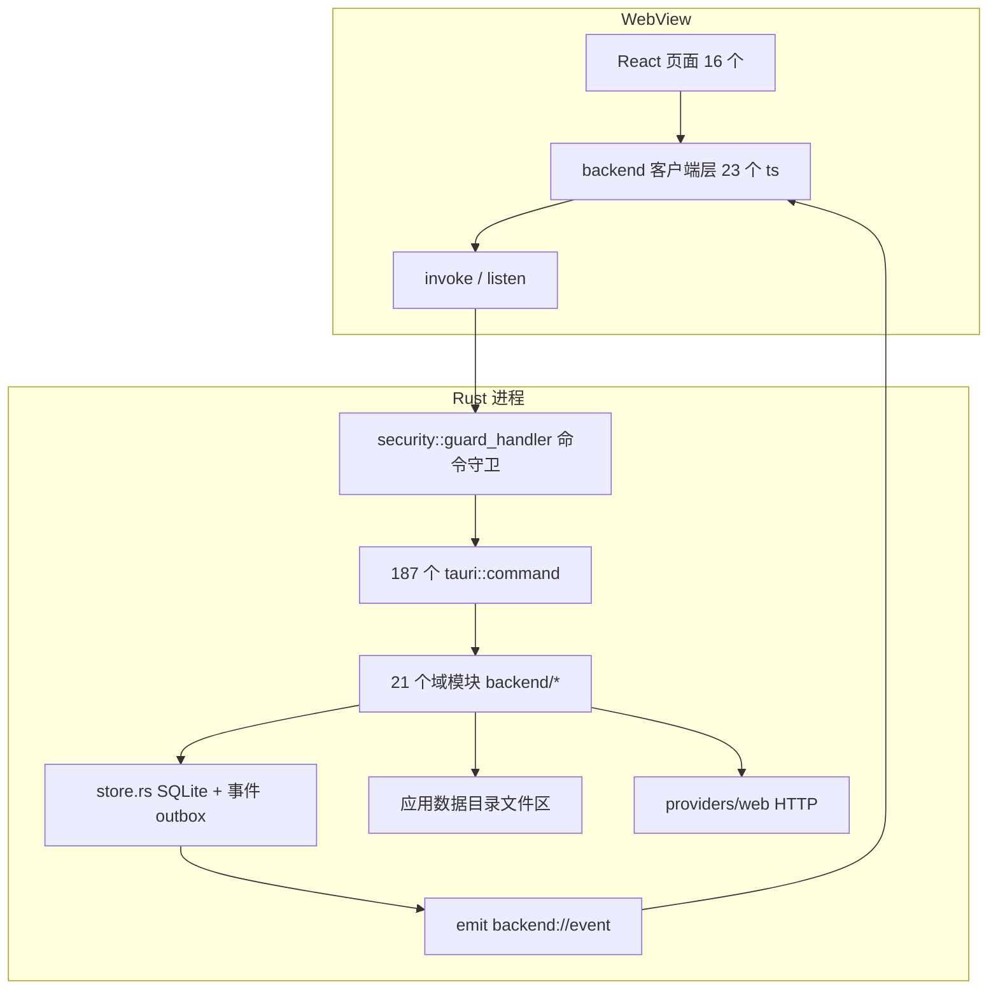
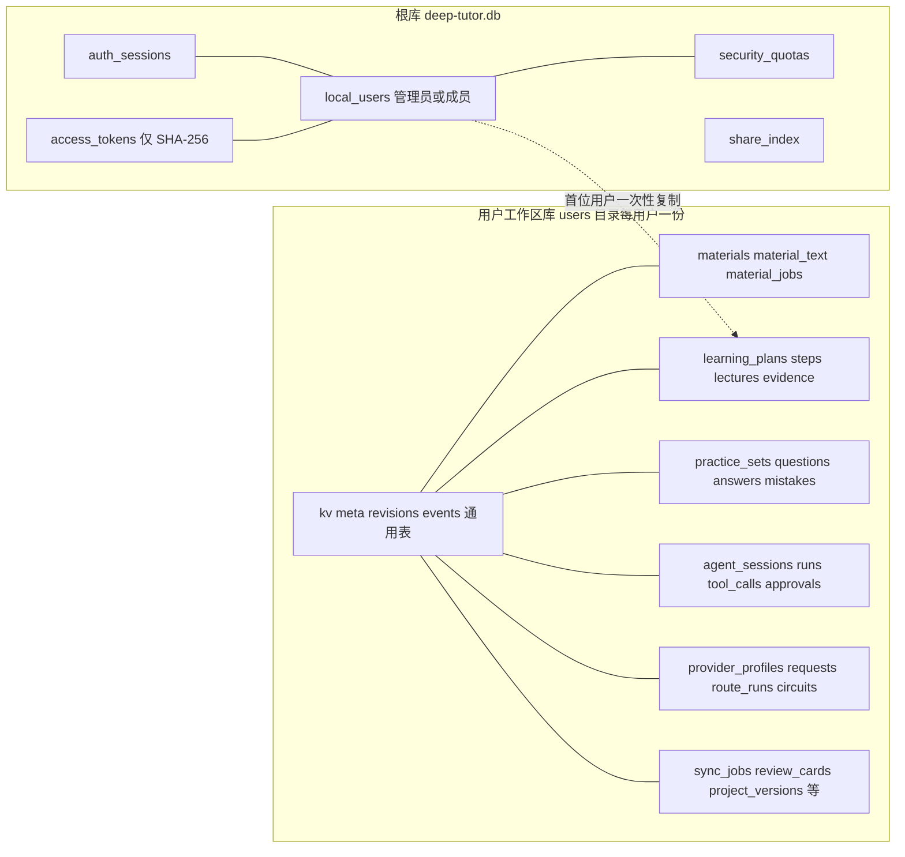
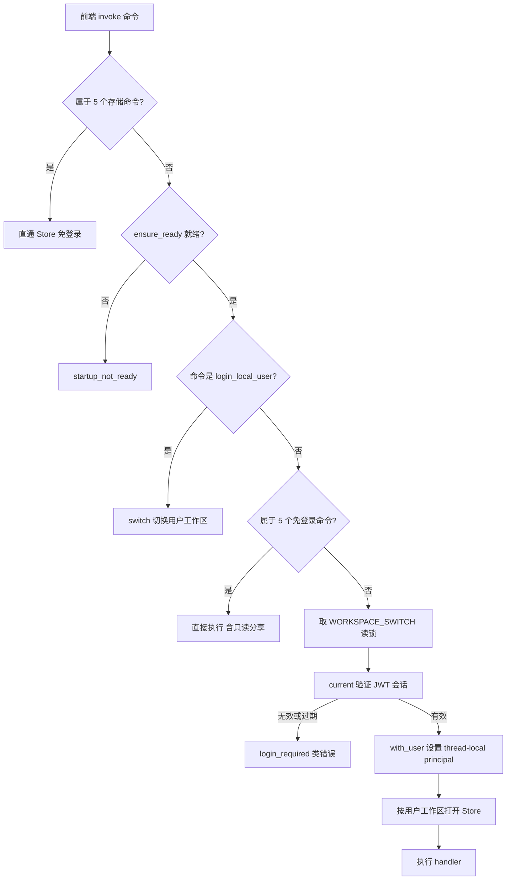
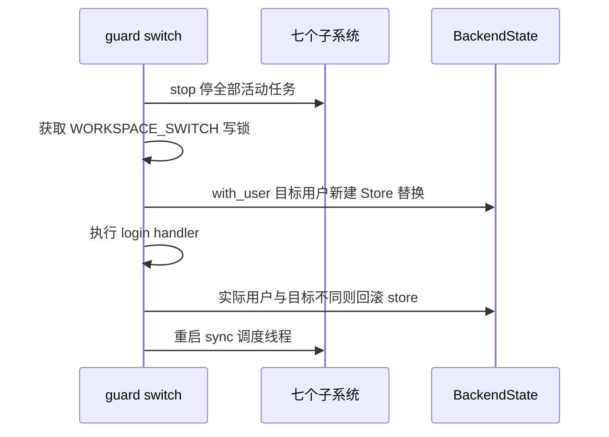
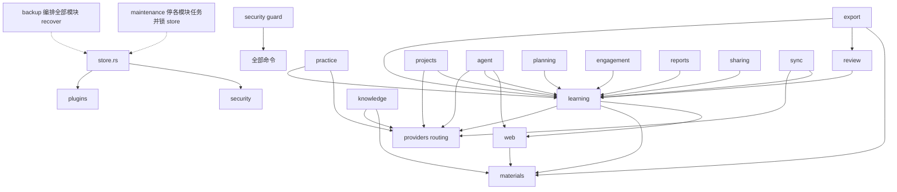

# 01 · 架构分析

> 基准：main 分支 commit `df63ee0f`。全部引用形如 `文件:行号`，相对 `desktop/` 目录。

## 1. 总览

单一 Tauri 2 进程：Rust 侧承担窗口宿主、全部业务后端、SQLite 持久化与网络访问；WebView 侧 React 18 只做渲染与命令调用，不直接访问文件系统或网络（网页抓取 `fetch_webpage` 命令仅由后端 `import_webpage` 复用，前端不直接调用）。

分层判定依据：
- 表现层：`src/pages/*.tsx`、`src/components/*.tsx`，无业务规则，仅调用客户端函数（`src/pages/Practice.tsx:13`）。
- 业务逻辑层：`src-tauri/src/backend/*` 21 个域模块（另有 backend 根的 commands/store/error/random），每个模块 `commands.rs`（IPC 边界）+ `mod.rs`（实现）+ `tests.rs`。
- 数据访问层：`store.rs`（kv/meta/revisions/events 通用表）与各模块 `migrate()` 建立的领域表，全部经 rusqlite 直连。
- 横切层：`error.rs`（类型化错误）、`security/guard.rs`（鉴权与用户工作区切换）、`plugins/mod.rs:609`（事件订阅分发）、`random.rs`（安全随机数）。

架构模式：
- 分层 + 域模块化（module-per-domain，目录即限界）。
- 事件溯源辅助的 CRUD：领域状态写领域表，同时向 `events` 表追加事件（`store.rs:408-421`），前端靠事件驱动刷新。
- 每域状态机 + 断点续接：所有长任务（方案/讲义/练习/评分/Agent/同步/项目反馈）有 `running/cancelling/…/interrupted` 状态列与 `recover()` 恢复函数（`startup.rs:372-381` 统一拉起）。

## 2. 进程与运行时形态

- 入口 `src-tauri/src/main.rs:13`：`tauri::Builder` + `tauri_plugin_dialog` + `setup` 回调注册 187 个命令（`main.rs` generate_handler 注册块），命令清单经 `security::guard_handler` 包裹（`security/guard.rs:132`）。
- `--verify-native` 分支（`main.rs:14`）：清空窗口配置（`main.rs:272-274`），要求 `DEEPTUTOR_VERIFY_DATA_DIR` 绝对路径（`main.rs:19-24`），同步初始化后 `bootstrap()` 断言 `tasks/preferences` 存在并 `exit(0)`（`main.rs:62-80`）。
- 正常分支：`startup::initialize_background`（`main.rs:50`）在 `backend-startup` 线程初始化（`startup.rs:309-331`），主窗口立即显示，前端轮询 `bootstrap()`（容忍 `startup_not_ready` 重试，`useBackendState.ts`）等待就绪；`get_storage_overview` 仅由设置页目录面板调用。

## 3. 模块清单与规模

| 模块 | 文件/行数 | 职责 | 关键状态结构 |
|---|---|---|---|
| backend（根） | 5 / 2168 | 通用存储、命令外壳、错误 | `BackendState`（`mod.rs:87`：store Mutex + 10 个域 State） |
| startup | 1 / 765 | 目录解析/校验、初始化、恢复命令 | `StartupState`（`startup.rs:27`） |
| store | 1 / 1366 | kv/meta/revisions/events、校验、配额、事件分页 | `Store`（`store.rs:61`） |
| security | 6 / 2633 | 用户/会话/PAT/配额/守卫/工作区隔离 | `SecurityState`（`mod.rs:228`） |
| providers | 15 / 9327 | 供应商档案、三协议流式、路由/熔断、用量 | `ProviderState`（`mod.rs:193`） |
| web | 4 / 1063 | DuckDuckGo 检索、安全抓取 | 无（纯函数） |
| materials | 5 / 2875 | 导入/去重/解析队列/媒体/ZIP | `MaterialState`（`mod.rs:32`） |
| notes | 4 / 1113 | 笔记归档导入、知识库体检 | 无 |
| learning | 9 / 5005 | 八步方案流水线、讲义、知识进度 | `LearningState`（`mod.rs:30`） |
| planning | 3 / 959 | 周视图、强度、目标、排期 | 复用 LearningState |
| knowledge | 3 / 1349 | Wiki 引用问答 | `KnowledgeState`（`mod.rs:29`） |
| practice | 9 / 4500 | 出题/判分/错题/变式/模拟考 | `PracticeState`（`mod.rs:25`） |
| review | 2 / 915 | SM-2 式间隔复习 | 复用 SQLite 事务 |
| projects | 3 / 1027 | 项目成果版本与量规反馈 | 复用 |
| agent | 4 / 3492 | 会话/工具循环/审批/记忆/产物 | `AgentState`（`mod.rs:47`） |
| engagement | 3 / 1192 | 全局搜索、通知、档案、首页 | 复用 |
| reports | 3 / 1746 | 专注会话、学习报告、日历 | 复用 |
| community | 3 / 1592 | 本机讨论/小组/预约/提醒 | 复用 |
| plugins | 3 / 1046 | 声明式事件插件 | `PluginState`（`mod.rs:21`） |
| backup | 5 / 3028 | .dtbackup 导出/预演/追加导入 | RAII `Workspace`（`archive.rs:141`） |
| sharing | 3 / 1004 | 只读分享令牌与离线包 | `SharingState`（`mod.rs:22`） |
| sync | 7 / 2328 | WebDAV/S3 配置同步、24h 调度、版本保留 | 全局 `ACTIVE/NEXT_JOB`（`mod.rs:28-29`） |
| maintenance | 3 / 1008 | 完整性检查、孤儿清理、VACUUM | `OPERATION` 互斥（`commands.rs:9`） |
| export | 7 / 2110 | 8 格式导出（含自研 PDF/Anki） | 无 |
| 前端 | 62 / 7168 | 渲染与命令客户端 | `useBackendState`（`src/backend/useBackendState.ts:16`） |

## 4. 横切层

### 4.1 错误模型（`error.rs`）

`BackendError { code: String, message: String }`（`error.rs:4`）实现 `Serialize`，直接作为 Tauri command 的 reject 载荷。From 转换：rusqlite Busy/Locked → `database_busy`，其余 IO/SQLite → `storage_failed`，serde_json → `invalid_record`，zip → `export_failed`（`error.rs:29-67`）。守卫将 `{invalid_session, session_expired, session_revoked, account_disabled, login_required}` 识别为可重登录集合（`security/mod.rs:41`）。

### 4.2 存储层（`store.rs`）

四张通用表（`store.rs:187-210`，events 附表达式索引 `events_kind_request ON events(kind, json_extract(payload, '$.requestId'))`）：
- `kv(namespace,id,data,updated_at)` — tasks/notes/resources/projects/preferences/drafts 六个命名空间（`store.rs:15`）。
- `meta(key,value)` — `seeded`、`schema_fingerprint`。
- `revisions(namespace,value)` — 乐观锁版本号。
- `events(id AUTOINCREMENT,kind,payload,created_at)` — 单调递增事件 outbox。

核心函数：
| 函数 | 位置 | 行为 |
|---|---|---|
| `Store::open(root, owner)` | store.rs:124 | 工作区路径解析、WAL/外键/busy_timeout=10s/synchronous=NORMAL（:172-179）、user_version>1 拒绝降级（:185-191）、建通用表、schema 指纹比对决定是否跑全部 `migrate`（:211-258） |
| `schema_fingerprint(conn)` | store.rs:100 | sqlite_master 全量 SHA-256 |
| `replace_collection(namespace, expected_revision, value)` | store.rs:544 | 校验→配额（`ensure_quota_in_tx` :359，写事务内复查）→事务内 DELETE+INSERT→revision 乐观锁（:334-345）→events 写 `state.changed`（:612） |
| `event(conn, kind, payload)` | store.rs:492 | INSERT events 后同事务调 `plugins::dispatch`（:502） |
| `events_since(last_id)` | store.rs:778 | `id > ?1 ORDER BY id LIMIT 201`，截 200 + has_more（:786,805） |
| `ensure_quota_in_tx(resource, additional)` | store.rs:359 | 事务内查 `security_quotas`，notes/materials/sessions/threads/agent_memory 五类计数（:384-400） |
| `validate_collection` / `validate_draft` / `validate_preferences` | store.rs:882/618/1030 | 字段白名单、长度上限（记录 1MB、集合 10000 条）、枚举与范围校验 |
| `bootstrap()` | store.rs:315 | 首次种子默认偏好（`defaults()` :291）后返回 `app_state()` |

`app_state()`（:462）输出聚合快照：四集合 + preferences + versions（六命名空间 revision）+ `workspaceId` + `lastEventId`，是前端单一真相源。

双库结构：

user-1 旧库一次性复制：`open` 中 `owner==Some(1) && root!=path && root.exists() && !path.exists()` 时对根库 `wal_checkpoint(FULL)` 后 `fs::copy`（:141-147），此后根库只存账户表。

### 4.3 命令守卫与用户隔离（`security/`）

- `guard_handler`（`guard.rs:132`）分层放行：5 个存储命令直通（:139）→ `ensure_ready`（:150）→ `login_local_user` 走 `switch()`（:153）→ 5 个免登录命令（:156-163）→ 其余命令在 `WORKSPACE_SWITCH` 读锁下 `with_user(user, handler)`（:172-183）。

命令守卫判定顺序：

- `switch()`（`guard.rs:49`）：停 7 个子系统（:20-28）→ 写锁内替换 `BackendState.store` 为目标用户库（:98-117）→ 执行 → 必要时回滚 → 重启 sync 调度（:82）。

用户切换时序：

- 工作区路径：`user_workspace_path(root,user_id) = root.parent()/users/{user_id}/<db名>`（`security/mod.rs:112`）；thread-local `PRINCIPAL`（:34）由 `with_user` 设置，`ScopedBuilder::spawn`（:83-104）把 principal 继承到后台线程；`Store::new` 读它决定 owner，无 principal 时返回 `store_unavailable`（生产 fail-closed，测试环境回退根库语义，`store.rs:74-88`）。tauri 把 async 命令体 spawn 到 tokio worker（`respond_async`），thread-local 到不了那里——4 个 providers 异步命令改经 `session_principal`（`security/mod.rs:76`）从会话派生当前用户（与 guard `current()` 同源）再显式传播进 `spawn_blocking`。
- 会话：JWT HS256 手写实现（签名 `security/mod.rs:506`，签发 `jwt()` :545，验证 `verify` :591 常量时间比对 :605），secret 与 session token 存系统密钥库（`session-{id}`，:578）；7 天有效期（`SESSION_SECONDS` :31）。单活动会话：`issue()`（:643）签发前撤销全部仍活跃会话并清理其凭据槽，`logout`（:969）撤销该用户全部会话——切换用户后登出不会回退到上一位用户的会话。
- PAT：`random::token("dtp_")` 47 字符（`random.rs:68`，BCryptGenRandom），库中仅存 SHA-256（`mod.rs:1170`），明文只在创建响应出现一次；`authenticate_access_token` 验证通过后经 `issue()` 建立会话（前端 SecurityPanel 的 PAT 登录入口调用）。
- 表（根库，`migrate` `mod.rs:392`）：`local_users`(role CHECK 管理员/成员)、`auth_sessions`、`access_tokens(token_hash UNIQUE)`、`security_quotas(PK(user_id,resource))`、`share_index`。

### 4.4 事件系统

写路径：域函数在事务内 `Store::event`（落 events 表 + 插件投递）→ 事务 commit → 命令层 `emit(app,&event)` 推 `backend://event`（`backend/commands.rs:22`）。终态先落盘再发送由此保证。前端 `onBackendEvent`（`client.ts:410`）统一接收，`useBackendState.sync()` 以 `events_since(lastId)` 翻页追赶。

插件投递：`plugins::dispatch(conn,event_id,kind)` 查 `plugin_subscriptions` 命中即 INSERT `plugin_deliveries`（`plugins/mod.rs:689-703`），模式为 `*` 或 15 个命名空间前缀 `.*`（:294-310，含 maintenance）。

## 5. 各域数据结构（SQLite 表 + 核心类型）

### 5.1 providers（`providers/mod.rs:271-322`、`routing.rs:121-176`、`usage.rs:123`）
- 表：`provider_profiles`（models_json、health、latency_ms）、`provider_meta`（active_provider）、`provider_requests`（request_id PK、status/output/usage_json/tool_calls_json、attempts）、`provider_route_runs` + `provider_route_attempts`（PK(request_id,attempt)，upstream_request_id UNIQUE）、`provider_circuits`（state/failures/opened_at）、`usage_rates`（UNIQUE(provider_id,model)）。
- 类型：`ProviderProfile`（mod.rs:28）、`ChatMessage`（:62）、`TokenUsage/ChatResult/ChatError`（openai.rs:20/28/40）、`StreamPolicy{max_attempts=2,request_timeout=45s,chunk_timeout=120s}`（openai.rs:647-653）、`RoutingSettings{mode,routes,aggregate_*,failover,circuit}`（routing.rs:56）、`CircuitSettings{failures=3,cooldown=60s,timeout=45s,retries=2}`（:36-43）、`UsageSettings{session_usd=1.0,daily_usd=10.0,regeneration_limit=2}`（usage.rs:17-23）。
- 凭据：trait `CredentialBackend{get,set,delete}`（mod.rs:84），生产 `SystemCredentials`（keyring，:90），测试 `MemoryCredentials`（:151）。API Key 永不入库——`has_key` 是唯一暴露（mod.rs:28）。

### 5.2 learning（`learning/mod.rs:129-267`）/ planning / knowledge
- 表：`learning_plans`（status、artifacts_json 分步产物、result_json、version）、`learning_plan_steps`（PK(plan_id,step_index)、attempt、request_id）、`learning_plan_materials`（FK RESTRICT）、`learning_plan_adoptions`、`learning_plan_schedule_tasks`、`learning_plan_versions`、`learning_node_evidence`（evidence_key 唯一索引）、`learning_reading_progress`、`learning_node_tasks`、`learning_lectures`、`learning_lecture_units`（PK(plan,stage,version,unit_index)）、`learning_lecture_versions`、`learning_annotations`；knowledge：`knowledge_sessions`、`knowledge_session_materials`。
- 类型：`PlanInput/Source/Citation/KnowledgeNode/KnowledgeEdge/Graph/Stage/Schedule/ValidationReport/PlanResult/PlanStep/Plan`（`types.rs:19-211`，`STEP_NAMES[8]` :6-15）、`Lecture/LectureUnit/LectureContent`（`lecture.rs:48-79`）、`KnowledgeCitation{quote,char_start,char_end,line}`（knowledge/mod.rs:89-97）。

### 5.3 practice / review / projects
- 表：`practice_sets`（FK plan CASCADE、mode/status、exam 三列）、`practice_questions`（UNIQUE(set_id,position)、rubric_json）、`practice_answers`（question_id UNIQUE、grader_request_id、索引 practice_answers_set ON set_id）、`practice_mistakes`（variant_of/mastered 链）、`practice_bookmarks`；`review_cards`（due_at/interval_days/ease=2.5/repetitions/lapses、suspended、索引 review_due_cards ON (deleted,suspended,due_at)）、`review_history`（索引 review_history_card）；挂起卡片评分返回 `card_suspended`（`set_review_card_suspended` 命令）；`project_versions`（UNIQUE(project_id,version_number)、feedback_json、cancel_requested）。
- 类型：`PracticeSetDetail/AnswerResult/Mistake`（practice/mod.rs:128-161）、`ReviewCard/GradeResult`（review/mod.rs:53/101）、`ProjectFeedback{concept,implementation,verification:u8,summary,suggestions}`（projects/mod.rs:60）。

### 5.4 materials / notes / export
- 表：`materials`（sha256 UNIQUE、status、progress、parse_mode）、`material_text`（PK=material_id CASCADE）、`material_jobs`（UNIQUE(material_id,kind,attempt)、cancel_requested）。
- 文件区：`{数据目录}/materials/originals/{sha256}.{kind}`（materials/mod.rs:61-66,335）；导出原子替换 `.download-{n}/.previous-{n}`（:1192-1206）。
- 解析限制常量（parse.rs:11-15）：文件 50MB、文本 5MB、XML 32MB、ZIP 总量 64MB、PDF 2000 页；ZIP 资料包另有 archive.rs:8-9 的 64 条/200MB。
- export：`ExportScope{Plan,Lecture,Knowledge,Review,Schedule}` 与 `ExportFormat` 8 值（mod.rs:24-58）；PDF 为手工 TrueType 解析 + CIDFontType2 自写（pdf.rs:126-340，msyh/simhei ≤64MB :214）；Anki 生成真实 collection.anki2（export/anki.rs:55 render 起，:220 入包）。

### 5.5 agent / community / engagement / reports
- agent 表（mod.rs:189-256）：`agent_sessions`(budget_tokens 默认 16000)、`agent_runs`(status/steps/current_request_id)、`agent_messages`、`agent_tool_calls`(id PK 幂等)、`agent_artifacts`(sha256/expires_at)、`agent_approvals`、`agent_memory`；agent_messages/runs/artifacts/approvals 四表各带 session_id 索引（mod.rs:269-272，每个 agent.* 事件不再全表扫描）。
- community 表（mod.rs:173-225）：posts/replies/reactions(单用户 PK(post_id,kind))/groups/group_members/rooms/reservations/reminders。
- engagement：`notifications`（mod.rs:135-143）。
- reports：`focus_sessions`（paused_at 靠 PRAGMA 检测补列 :197-199）、`study_checkins`；`learning_node_evidence` 带 created_at 索引（reports/mod.rs:193，周报免全表排序）。

### 5.6 backup / sharing / sync
- backup：`.dtbackup` = zip{manifest.json + state.db(VACUUM INTO 快照) + files/*}；`TABLES` 67 张白名单（archive.rs:25-93），排除 `auth_sessions/access_tokens/share_index`（:95）；上限包 2GB/库 512MB/单文件 50MB/清单 1MB（:19-22）。
- sharing：`shared_plans(token_hash UNIQUE,payload_json,expires_at,revoked_at)` + 根库 `share_index(token_hash,user_id)`；离线包 `SharePackage{format,version,token,plan,expires_at,checksum}`（mod.rs:90）。
- sync：`sync_config`(id=1 单行，凭据在 keyring)、`sync_jobs`(id TEXT PK,status,remote_path)；远端布局 `{base}/versions/{timestamp}-{id}-{sha256}.json` + 当前对象（versions.rs:179-193），保留最近 10 个（:206-218）。

### 5.7 plugins
表（mod.rs:192-203）：`plugins`(enabled 默认 0、generation)、`plugin_subscriptions`、`plugin_deliveries`(PK(plugin_id,event_id))、`plugin_reloads`。清单 `PluginManifest` `deny_unknown_fields`（:60），目录 `plugins/{id}/manifest.json`，原子写（:347）。

## 6. 模块依赖图

方向规律：`providers`/`materials`/`web` 是被依赖的底座；`learning` 是学习域枢纽（被 practice/review/planning/engagement/reports/sharing/export/agent 依赖）；`backup`/`maintenance` 处于最上层，编排全部模块的 stop/recover。无循环依赖：planning→learning 单向；plugins 只被 store 依赖。

## 7. 前端架构

- 骨架：`main.tsx:33-37` → `App.tsx`；无 router，`page` 状态 + hash 同步（`App.tsx:54`），`renderPage()` switch 分发（:285-304）；6 个重页面 React.lazy（:35-40）；三组导航 + 顶栏（⌘K 搜索/快速记录/主题/通知）+ 移动底栏。
- 前置守卫顺序：`shared` 分享页独立 → `startupError` → DataDirectoryPanel → `loginRequired` → SecurityPanel → 未 ready Loader（:253-265）。
- 客户端层 23 个文件：`client.ts` 聚合 invoke 并维护 `isCancelRace` 竞态错误码表（client.ts:424）；领域客户端 practice/review/knowledge/community/… 一一对应命令组；事件统一走 `onBackendEvent`（client.ts:410）。
- 状态：`useBackendState`（:16）持有快照 + lastEventId/workspaceId ref；`applySnapshot` 拒绝回退事件并在 workspaceId 变化时重置游标（:33-43）；bootstrap/sync 的瞬态 `database_busy` 自动重试至多 5 次不弹错（:96）；`security.session_started` 触发 generation+1 全量重载（:162）；`replaceCollection`（:217）提交更新函数语义并按命名空间排队串行提交（inflight 队列 :27），消除一帧窗口的丢写竞态。
- 流式：`useAgent.ts:129-171` 按 requestId 匹配 `provider.chat_delta`（payload.reasoning 区分文本/思考），`provider.route_attempt` 切换 upstreamRequestId；快照合并带 deltaEpoch 世代号，旧周期快照不得覆盖已拼接增量。
- 样式：单文件 styles.css 1871 行；Primitive oklch 调色板（:3-20）→ Semantic 变量（:22-41）→ `[data-theme="dark"]` 覆盖（:45-63）；断点 640/700/1024/1080/1100/1180/1240/1280/1320（:281-:1023 各处）；Esc 经 UI.tsx `MODAL_STACK`（:87）栈顶仲裁一次只关一层，滚动锁引用计数；`html.reduce-motion` 规则覆盖 smooth scroll，系统偏好经 matchMedia 跟随（App.tsx:243）。

## 8. 命令注册总览（`main.rs:79-268`）

| 分组 | 数量 | 代表命令 |
|---|---|---|
| 启动/存储 | 14 | startup 5 + 通用命令 9：bootstrap、events_since、replace_collection、reset_application |
| 安全 | 10 | login_local_user、create_access_token、set_security_quota |
| 供应商/路由/用量 | 20 | route_provider_chat（含工具调用）、stream_provider_chat、export_usage_csv |
| 材料/笔记 | 14 | import_material_archive、read_material_media_chunk、import_notes |
| 学习/讲义/知识/排期 | 29 | learning 16 + knowledge 8 + planning 5：start_learning_plan、generate_lecture、ask_knowledge |
| 练习/复习/项目 | 27 | practice 13 + review 9 + projects 5：submit_practice_answer、grade_review_card、submit_project_version |
| Agent | 10 | send_agent_message、approve_agent_request |
| 备份/分享/同步/运维 | 20 | backup 3 + sharing 7 + sync 7 + maintenance 3：import_full_backup、read_shared_plan、restore_sync_version、vacuum_database |
| 社区/插件/导出/报告/搜索 | 43 | community 12 + plugins 8 + export 2 + reports 11 + engagement/web 10：install_plugin、export_content、export_learning_report、search_workspace（claim_community_reminders 由 App.tsx 每 60 秒轮询领取） |

前端调用的命令名与注册表逐一核对一致；仅 `fetch_webpage` 为后端内部命令（`import_webpage` 复用同一抓取链），前端不直接调用。
