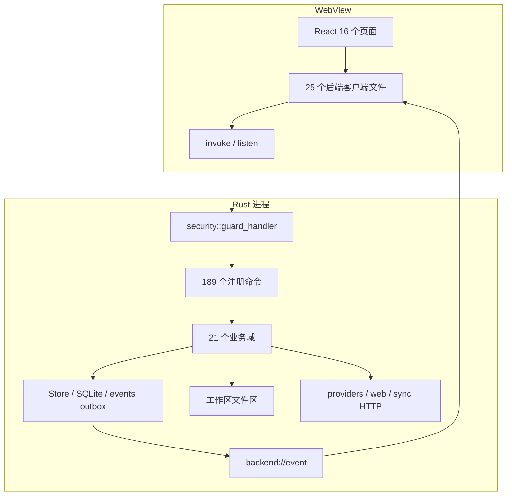
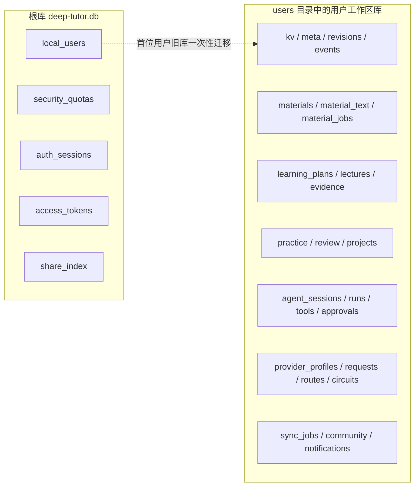
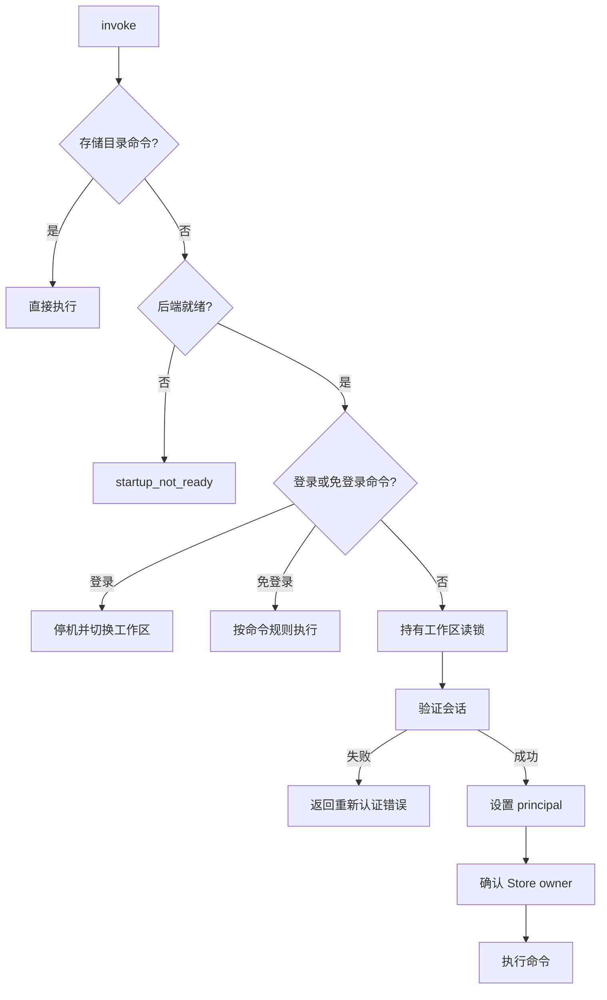
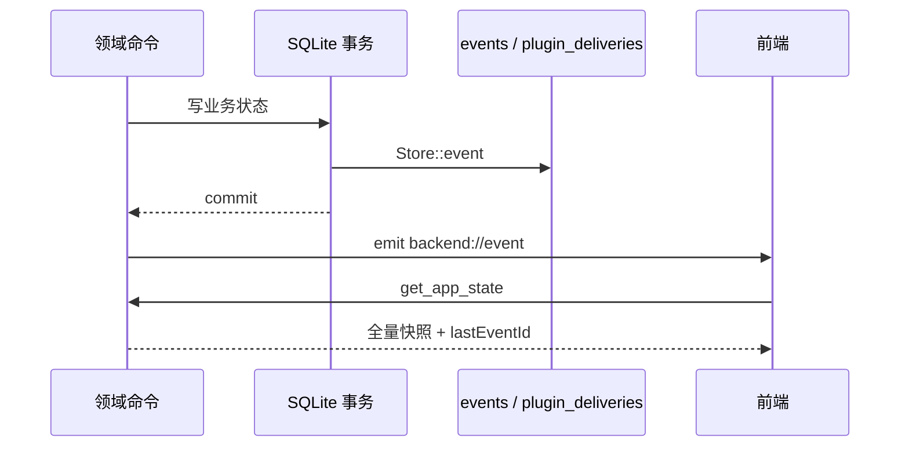
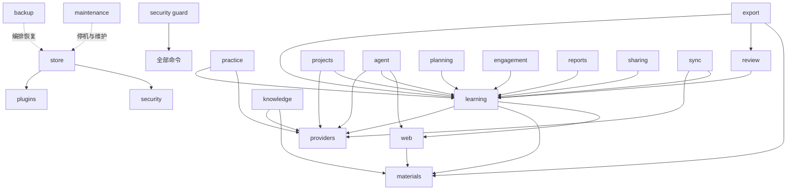

# 01 · 架构分析

> 路径未特别注明时均相对 `desktop/`。行为细节见 [02 运行原理](02-operation-principles.md)，业务与验证流程见 [03 工作流分析](03-workflow.md)。

## 1. 进程与分层

单一 Tauri 2 进程包含 Rust 原生后端和 WebView。React 不直接访问 SQLite、文件系统、系统密钥库或业务网络接口；对话框和系统浏览器通过受限插件调用。

- **表现层**：`src/pages/`、`src/components/`；负责展示、交互和请求刷新。
- **IPC 客户端**：`src/backend/`；封装命令、事件和运行时数据结构校验。
- **业务层**：`src-tauri/src/backend/`；每个域按命令入口、领域实现和测试组织。
- **数据层**：`store.rs` 管理通用表、快照和事件；领域模块管理各自表和文件。
- **横切层**：`error.rs`、`security/`、`plugins/`、`random.rs`、`reveal.rs`。

## 2. 应用装配与模块职责

`main.rs` 注册 dialog、opener 和 189 个命令，所有命令经 `security::guard_handler` 包装。正常启动在后台初始化数据层，主窗口立即显示。`--verify-native` 使用独立绝对目录，清空窗口配置，不占用单实例互斥体，完成真实装配和快照检查后退出。

| 模块 | 职责 | 主要运行状态 |
|---|---|---|
| backend 根 | 通用命令、存储、错误、随机数、定位与写盘遏制 | `BackendState`：`Store` 与 10 个域状态 |
| startup | 数据目录选择、初始化、重试、恢复与重启 | `StartupState` |
| security | 用户、JWT、PAT、配额、守卫和工作区隔离 | `SecurityState` |
| providers | 供应商档案、四种协议、流式请求、路由、熔断和用量 | `ProviderState` |
| web | DuckDuckGo 检索、安全抓取、HTML/文本提取 | 纯函数 |
| materials | 文件/文本/ZIP 导入、去重、解析队列和媒体读取 | `MaterialState` |
| notes | 笔记归档导入、知识库检查 | 使用 `Store` |
| learning | 八步方案、讲义、阅读进度、批注和知识证据 | `LearningState` |
| planning | 周视图、强度、目标和排期 | 复用 `LearningState` |
| knowledge | Wiki 引用问答和历史 | `KnowledgeState` |
| practice | 出题、判分、错题、变式和模拟考试 | `PracticeState` |
| review | 记忆卡和间隔复习 | `ReviewState` |
| projects | 项目版本、里程碑、模型量规和迭代笔记 | `ProjectState` 由 `LearningState` 派生 |
| agent | 通用/方案会话、工具循环、审批、记忆和产物 | `AgentState` |
| engagement | 搜索、通知、学习档案和首页摘要 | 使用 `Store` / `LearningState` |
| reports | 专注、打卡、报告、日历和 CSV | `ReportState` 由 `LearningState` 派生 |
| community | 本机讨论、小组、房间、预约和提醒 | `CommunityState` |
| plugins | 声明式事件插件、投递记录和开发者资产 | `PluginState` |
| backup | `.dtbackup` 导出、预演和追加导入 | 临时工作区与事务 |
| sharing | 只读分享、撤销、过期和离线包 | `SharingState` |
| sync | WebDAV/S3 配置同步、版本保留和调度 | `SyncService` 与活动任务表 |
| maintenance | 完整性检查、孤儿清理和 VACUUM | `OPERATION` 互斥 |
| export | Markdown、PDF、ICS、Anki、HTML、CSV、TXT、OPML | 无独立状态 |

## 3. 横切契约

### 3.1 错误模型

`BackendError { code, message }` 序列化为 IPC 拒绝载荷。调用方按 `code` 分支，不匹配错误文案。

- SQLite Busy/Locked → `database_busy`；损坏或非数据库文件 → `database_corrupt`；其他 SQLite 错误 → `storage_failed`。
- 磁盘满 → `disk_full`；其他 I/O → `storage_failed`。
- JSON → `invalid_record`；ZIP → `export_failed`；时间格式化 → `time_format_failed`。
- 会话过期、吊销、凭据缺失等错误进入统一重新认证集合。

### 3.2 通用存储

`Store` 建立四张通用表：

| 表 | 用途 |
|---|---|
| `kv(namespace,id,data,updated_at)` | tasks、notes、resources、projects、preferences 和 drafts |
| `meta(key,value)` | 初始化标记、schema 指纹和 schema 版本 |
| `revisions(namespace,value)` | 集合与草稿乐观锁版本 |
| `events(id,kind,payload,created_at)` | 单调递增事件 outbox；`events_kind_request` 索引支持按请求读取模型增量 |

打开数据库时启用 WAL、外键、10 秒 `busy_timeout` 和 `synchronous=NORMAL`。`max(PRAGMA user_version, meta.schema_version)` 高于代码侧 `SCHEMA_VERSION=5` 时返回 `unsupported_schema`。指纹不同或记录版本低于代码版本时，依次执行 materials、knowledge、providers、learning、projects、sharing、practice、review、agent、community、plugins、engagement、reports、security、sync 共 15 个模块的幂等迁移。

`app_state()` 返回四个业务集合、preferences、六个命名空间的 revision、`workspaceId` 和 `lastEventId`。普通集合写入返回轻量回执，不重复下载全部集合。`resources` 不允许通过通用集合命令绕过材料命令。

`replace_collection` 在校验后使用 IMMEDIATE 事务检查配额和 revision，再替换集合并写入 `state.changed`。笔记删除同步清理批注关联；项目删除清理版本和采用关联；任务删除保留专注历史但解除任务关联，并清理排期关联。

### 3.3 根库与工作区库

账户库路径为应用数据根下的 `deep-tutor.db`；用户库路径为其同级 `users/{user_id}/deep-tutor.db`。首位用户的旧单库数据只迁移一次，复制前执行 WAL checkpoint，并按 WAL 文件、主文件的顺序原子落位。

### 3.4 命令守卫与身份传播

`guard_handler` 按以下顺序处理：

1. 5 个存储目录命令直接执行。
2. 其他命令先检查 `startup::ensure_ready`。
3. `login_local_user` 进入工作区切换流程。
4. `get_security_overview`、`authenticate_access_token` 和三个只读分享命令按各自免登录规则执行。
5. 其余命令持有 `WORKSPACE_SWITCH` 读锁，验证会话，设置用户身份并确认当前 `Store` 属于该用户。

- `prepare_store` 使用 owner 镜像提供稳态快路径；镜像未命中时在锁内复核并换库。
- 用户切换并行停止 Agent、练习、知识问答、学习方案、模型请求、同步、资料解析和专注 8 个域，再替换工作区；失败时恢复旧工作区，结束后执行恢复族并重启同步调度。
- `with_user` 设置 thread-local principal；`security::thread_builder` 将其继承到后台线程。
- Tauri async 命令运行于 Tokio worker，不能读取 IPC 线程的 thread-local；命令须通过 `session_principal` 或只读的 `session_principal_existing` 从会话派生身份，再用 `with_principal` 传入 `spawn_blocking`。
- 生产环境没有 principal 时，`Store::new` 返回 `store_unavailable`，不得回退首位用户。

JWT 使用 HS256 和 7 天有效期，密钥及会话令牌保存在系统密钥库。签发新会话会撤销旧活动会话；登出撤销该用户全部会话。只有 `auth_sessions` 全表为空时才允许首启自动签发，登出后的重启不会自动登录。PAT 使用系统随机数，明文只在创建时返回，数据库保存 SHA-256 摘要；PAT 认证复用会话签发路径。

### 3.5 事件与插件投递

领域代码在事务内调用 `Store::event`，同一事务写入 `events` 和命中的 `plugin_deliveries`；事务提交后，命令层通过 `backend://event` emit。只有事务提交成功后才发送通知。

插件可订阅 `EVENT_NAMESPACES` 中的 22 个事件命名空间或 `*`（`*` 只覆盖这 22 项）。`state.changed` 是内部快照同步事件，`draft.saved`、`draft.deleted` 与 `application.reset` 是应用内部写入事件，四者均不开放给插件（通配订阅同样不命中）。后端实发事件、白名单和前端 `Integrations.tsx` 数组由源码扫描测试双向约束；前端投递判定与后端 `plugins::matches` 同口径的实现位于 `desktop/src/pluginEventScope.ts`，其内部命名空间清单由后端测试逐条比对。

## 4. 领域数据与文件

### 4.1 模型与学习

- **providers**：`provider_profiles`、`provider_meta`、`provider_requests`、`provider_route_runs`、`provider_route_attempts`、`provider_circuits`、`usage_rates`。支持 OpenAI Chat、OpenAI Responses、Anthropic Messages、Gemini Native；凭据只保存在系统密钥库，档案只暴露 `hasKey`。实际任务路由为 agent、plan、lecture、practice、wiki；resources/embedding 仅兼容旧配置和日志。
- **learning / planning / knowledge**：`learning_plans`、`learning_plan_steps`、`learning_plan_materials`、`learning_plan_adoptions`、`learning_plan_schedule_tasks`、`learning_plan_versions`、`learning_node_evidence`、`learning_reading_progress`、`learning_node_tasks`、`learning_lectures`、`learning_lecture_units`、`learning_lecture_versions`、`learning_annotations`、`knowledge_sessions`、`knowledge_session_materials`。方案包含图谱、阶段、排期、资源、五维校验和警告；资料为 0–8 份，空资料输出不得携带引用。
- **practice / review / projects**：`practice_sets`、`practice_questions`、`practice_answers`、`practice_mistakes`、`practice_bookmarks`、`review_cards`、`review_history`、`project_versions`。主观答案保存评分请求；错题通过 `variant_of` 形成变式链；复习卡保存到期时间、间隔、ease、重复和遗忘次数；项目反馈保存概念应用、实现质量、验证与反思评分。

### 4.2 材料、笔记与导出

- **materials**：`materials`、`material_text`、`material_jobs`。原件按 SHA-256 保存到工作区 `materials/originals/`；导入检查扩展名、文件签名、大小和哈希，媒体读取复核路径与哈希。
- **notes**：Markdown/TXT/ZIP 由 Rust 读取、校验并在事务中追加；知识库检查读取未关联笔记、重复正文、缺失原件和解析失败。
- **export**：八种格式由 Rust 生成；PDF 使用自写 CIDFontType2，Anki 生成真实 `collection.anki2`。导出和备份目的地由原生对话框选择，后端拒绝写入当前或旧默认应用数据目录。

### 4.3 Agent、社区与报告

- **agent**：`agent_sessions`、`agent_runs`、`agent_messages`、`agent_tool_calls`、`agent_artifacts`、`agent_approvals`、`agent_memory`。通用会话在数据库中使用空 `plan_id`，IPC 输出 `planId: null`；通用会话开放网络、记忆和历史 7 个工具，绑定已采用方案后增加 4 个 workspace 工具和 `artifact.promote`。产物路径、内容、哈希、审批和过期时间均持久化。
- **community**：`community_posts`、`community_replies`、`community_reactions`、`community_groups`、`community_group_members`、`community_rooms`、`community_reservations`、`community_reminders`。全部为当前工作区的本机记录。
- **engagement / reports**：`notifications`、`focus_sessions`、`study_checkins`。掌握度读取 `learning_node_evidence`；专注保存实际秒数、暂停和终态；报告不生成无记录的趋势。

### 4.4 备份、分享、同步与插件

- **backup**：`.dtbackup` 是包含 `manifest.json`、一致性 `state.db` 和文件区的 ZIP。67 张表白名单包含通用表和领域表；导出快照剔除 `auth_sessions`、`access_tokens`、`share_index`，系统凭据从不入包。导入采用预演、ID 映射、外键拓扑排序和追加语义。
- **sharing**：用户库保存 `shared_plans`，根库保存 `share_index`；原始令牌只返回给创建者，数据库保存哈希。在线读取检查撤销和过期；离线包脱离本机数据库，不能接收撤销。
- **sync**：`sync_config` 和 `sync_jobs` 保存脱敏配置与执行记录，WebDAV/S3 凭据保存在系统密钥库。远端保存当前对象和独立历史对象，只保留最近 10 个版本；同步内容不包含学习备份。
- **plugins**：`plugins`、`plugin_subscriptions`、`plugin_deliveries`、`plugin_reloads`。清单使用严格 JSON 结构，不执行任意脚本。开发者资产共 9 项：8 个历史 `SKILL.md` 和内置 `native-operations`；README、模板及 references 不嵌入二进制。

## 5. 模块依赖

`providers`、`materials` 和 `web` 提供底层外部能力；`learning` 是学习域枢纽；`backup` 和 `maintenance` 编排停机与恢复。`store` 在事件写入时调用 `plugins::dispatch`，插件实现再使用 `Store` 读取自身状态。

## 6. 前端结构

- `main.tsx` 挂载 `App.tsx`。无路由库，使用 `page` 状态和 hash 同步；`renderPage()` 分发 16 个页面。
- StudyRoom、Library、PlanGenerator、AgentCenter、Integrations、ProviderHub 六个页面通过 `React.lazy` 按需加载。
- 页面守卫顺序为只读分享、启动错误、重新登录、初始化加载、正常工作区。
- `useBackendState` 保存快照、`lastEventId`、`workspaceId` 和工作区代际。事件经 120ms 去抖后读取全量快照；旧代际或较旧快照不得覆盖新状态。草稿保存事件不触发全量快照。
- 集合写入接受值或更新函数，并按命名空间串行提交；写回执只携带 revision、事件游标和工作区标识。
- `useAgent` 按逻辑请求和上游请求映射消费模型增量，支持故障转移；delta 世代号防止旧快照覆盖已接收文本。
- 主题、大字号、高对比度和减弱动态效果由 preferences 持久化并应用到根元素。弹层通过统一栈管理 Esc、焦点和滚动锁。
- WebView 权限仅包括事件监听、原生打开/保存对话框和 `https://**` 系统浏览器打开；资源管理器定位由后端白名单命令执行。

## 7. 命令注册

| 分组 | 数量 | 代表命令 |
|---|---:|---|
| 启动与通用 | 14 | bootstrap、replace_collection、reset_application、set_storage_location |
| 安全 | 10 | login_local_user、create_access_token、set_security_quota |
| 供应商、路由与用量 | 20 | route_provider_chat、test_provider、export_usage_csv_file |
| 材料、笔记与网页导入 | 16 | import_material_archive、read_material_media_chunk、import_webpage |
| 学习、讲义、知识与排期 | 29 | start_learning_plan、generate_lecture、ask_knowledge |
| 练习、复习与项目 | 29 | submit_practice_answer、grade_review_card、submit_project_version |
| Agent | 9 | send_agent_message、approve_agent_request |
| 备份、分享、同步与运维 | 20 | import_full_backup、read_shared_plan、restore_sync_version |
| 社区、插件、导出、报告与搜索 | 42 | install_plugin、export_content、get_learning_report、search_workspace |
| **合计** | **189** | 前端直接调用 189 个 |

`events_since` 仅在 `cfg(test)` 构建中保留，用于 outbox 分页验证；`stream_provider_chat` 和 `get_agent_run` 已删除，分别由 `route_provider_chat` 和 `get_agent_session` 替代。`fetch_webpage` IPC 壳已删除，网页导入复用后端内部抓取链。模型中心手动测试由前端调用 `route_provider_chat`；全局导师通过 Agent 命令进入 Rust 工具循环。
