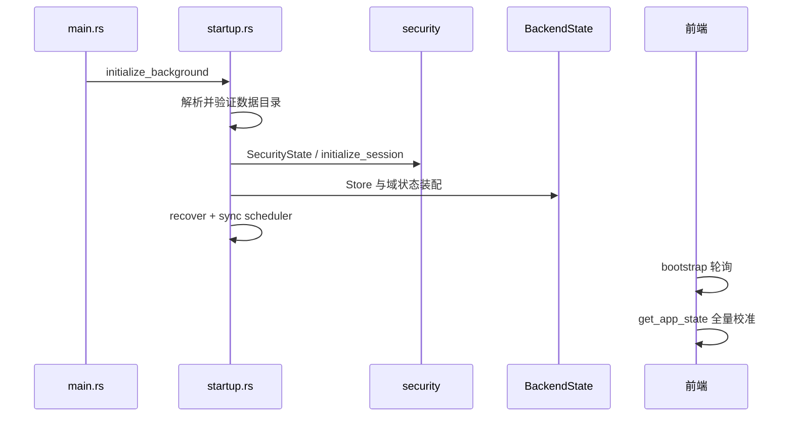
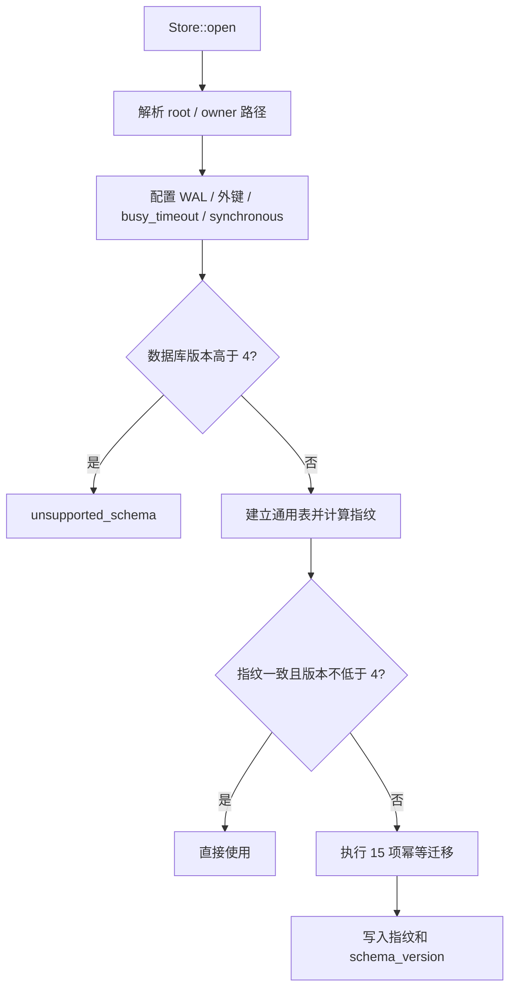
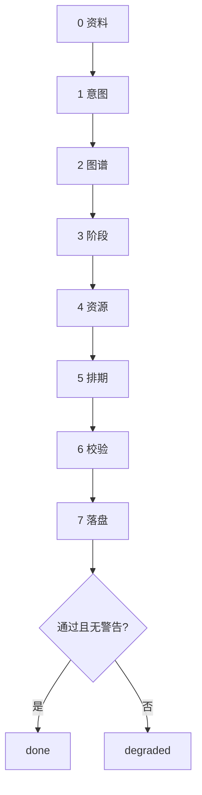
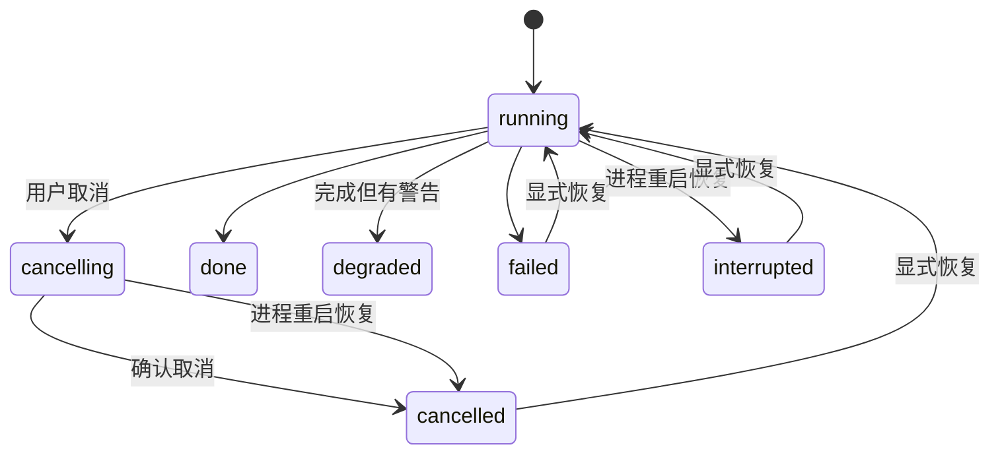

# 02 · 运行原理

> 路径未特别注明时均相对 `desktop/src-tauri/src/backend/`；前端路径以 `desktop/src/` 为根。模块职责与数据表见 [01 架构分析](01-architecture.md)。

## 1. 启动与数据目录

### 1.1 装配顺序

1. `main.rs` 解析默认应用数据目录和 `storage-location.json`。`--verify-native` 改用 `DEEPTUTOR_VERIFY_DATA_DIR` 指定的独立绝对目录，不读取日常目录配置、不创建窗口、不占用单实例互斥体。
2. `startup::assemble` 预热本地时区偏移，创建 `SecurityState` 和数据目录，以 user1 显式打开引导库，装配 `BackendState`。
3. 会话有效时切换到对应工作区，依次恢复 materials、provider chats、routing、learning、agent、practice、projects、knowledge、sync、reports，再启动同步调度。
4. 没有有效会话且需要重新认证时保留登录界面，不自动恢复旧用户任务。只有 `auth_sessions` 全表为空时才允许首位管理员自动签发。
5. 初始化 panic 转为 `startup_failed`；前端显示重试、修改目录和恢复默认入口，不留下无限加载。

### 1.2 目录规则

- 目录配置不超过 4096 字节，`version == 1`，只接受明确的本机绝对路径。
- 拒绝相对路径、根目录、`..`、UNC 网络目录、Windows 目录和 Program Files 目录。
- 默认目录自动创建。保存配置时验证目录与 SQLite，并同步更新内存中的 root；随后“重试”或下次启动使用新目录。
- 切换目录不搬移、覆盖或删除旧数据。迁移须先导出备份，再在新目录导入。
- 恢复默认只删除目录指针，不删除学习数据。目录指针使用临时文件和原子替换。
- `--verify-native` 完成真实 `bootstrap()` 后检查 tasks/preferences 形状，成功退出 0，契约失败或 panic 退出 2。

### 1.3 前端等待与恢复

`useBackendState` 对 `startup_not_ready` 每 250ms 重试 bootstrap，20 秒后显示恢复面板并继续轮询。初始化中每 1 秒检查一次，其他启动错误每 3 秒检查一次；就绪后自动重新启动状态装载。窗口聚焦和可见性恢复也会触发校准，隐藏窗口不执行该类刷新。

## 2. 数据库打开与迁移

`Store::open` 按以下顺序执行：

1. 解析根库或 `users/{user_id}/` 工作区库路径。
2. 首次打开路径时持有全局打开锁；同路径后续打开通过进程内登记跳过该锁。首位用户旧库迁移仍在首开临界区内完成。
3. 启用 WAL、`foreign_keys=ON`、`busy_timeout=10000`、`synchronous=NORMAL`。
4. 读取 `PRAGMA user_version` 和 `meta.schema_version`，两者最大值高于 `SCHEMA_VERSION=4` 时返回 `unsupported_schema`。
5. 建立 `kv`、`meta`、`revisions`、`events` 及事件表达式索引。
6. 对 `sqlite_master` 计算完整 schema 指纹。指纹与记录不同，或记录版本低于代码版本时，执行 15 个模块的幂等 `migrate`，再写入新指纹和版本。
7. `PRAGMA user_version` 按兼容惯例写 1；实际代码版本保存在 `meta.schema_version`。

`NORMAL` 与 WAL 配套使用，断电可能丢失最后一次已确认提交，但不破坏 WAL。事件顺序、请求记录和恢复流程用于重启后的状态对齐。指纹不一致只触发修复；只有版本高于当前应用才拒绝降级。

## 3. 事件、快照与断点续接

### 3.1 写路径

- `Store::event` 在业务事务内插入 `events`，并调用 `plugins::dispatch` 写入插件投递。
- 事务提交后，命令层通过唯一通道 `backend://event` 发送 `{id,kind,payload,createdAt}`。
- 终态事件只在终态事务提交后发送。同步终态提交后先释放活动任务登记，再发送事件，使事件回调可以立即启动下一任务。
- 应用重置删除旧事件并写入新的 `application.reset`；`sqlite_sequence` 不回退，事件 ID 继续单调递增。

### 3.2 前端校准

`useBackendState.sync()` 直接调用 `get_app_state`，不逐页读取 `events_since`。快照中的 `lastEventId` 是最新游标。

- 后端事件经 120ms 去抖后触发全量快照；同步期间到达的事件设置排队标记，当前请求结束后再校准一次。
- `workspaceId` 变化时重置游标；旧工作区代际和 `lastEventId` 回退的快照被丢弃。
- `security.session_started` 增加工作区代际并重新 bootstrap，旧用户的迟到响应不得覆盖新用户。
- `draft.saved` 和 `draft.deleted` 由编辑器消费写回执，不触发全量快照。
- 瞬态 `database_busy` 自动重试至多 5 次；会中期其他读取错误先保留现有界面，连续失败才进入错误页。

### 3.3 不重复执行

事件层负责通知，任务层负责幂等。模型步骤持久化 `request_id` 和 `attempt`；恢复时若 `providers::completed_chat` 已有完成结果，则复用该结果，不重新请求上游。取消和失败仍保留已产生的输出、Token 与成本。

本地材料解析是自动重跑例外：重启后 queued/parsing 任务重新排队，因为解析不产生模型费用且写入幂等。其他运行中任务转为 interrupted，cancelling 转为 cancelled，等待用户显式恢复。

## 4. 学习方案八步流水线

入口 `start_learning_plan` 验证目标、基础、每日 10–600 分钟、日期、0–8 份资料和供应商路由，然后在一个事务中创建 running 方案、8 个 pending 步骤和材料关联，再启动命名工作线程。

| 步骤 | 名称 | 实现与约束 |
|---:|---|---|
| 0 | 解析资料 | 读取 parsed/degraded 材料；文本合计不超过 192 KiB；空列表产生空快照 |
| 1 | 澄清意图 | 本地规范化输入，不调用模型 |
| 2 | 构建知识图谱 | 1–100 个节点，Kahn 算法检查拓扑；有资料时逐字校验引用，无资料时引用必须为空 |
| 3 | 设计渐进阶段 | 结构校验允许 1–20 个阶段、每阶段 1–100 个节点；认知负载要求 3–6 个阶段、每阶段 3–6 个节点。覆盖 required 节点，前置不得逆序，难度不得下降且相邻跳级不超过 2 |
| 4 | 检索学习资源 | `web::search(goal,3)`；仅实际抓取成功的网页标记 verified；失败标记 unavailable，部分失败标记 partial |
| 5 | 确定性排期 | 本地按每日分钟装箱，计算截止日期和里程碑可行性 |
| 6 | 五维校验 | 模型生成报告，原生复核依赖、难度、认知负载、里程碑和缺口；模型不可用时降级并保留警告 |
| 7 | 方案落盘 | 聚合步骤产物和警告；通过且无警告为 done，否则为 degraded |

模型 JSON 调用由 `model_json` 统一执行：`begin_step` → `routing::stream_chat` → 剥离可选代码围栏 → 类型与领域校验。失败最多尝试 2 次。步骤产物同时持久化在步骤输出和方案 artifacts 中。

`resume_learning_plan` 将 failed/cancelled/interrupted 重新置为 running。已完成步骤直接恢复，已完成的模型请求复用原 `request_id/attempt`。局部重生成保留旧版本；已采用方案不得原地覆盖，须创建新版本。

## 5. 模型协议、流式输出与取消

### 5.1 请求链

生产 IPC 入口为 `route_provider_chat`；`test_provider` 复用同一协议实现。Agent、方案、讲义、练习、Wiki 和项目反馈在 Rust 内部进入同一路由层。

1. `begin_chat` 创建 running 请求并注册取消标志。
2. 按档案协议分派到 OpenAI Chat、OpenAI Responses、Anthropic Messages 或 Gemini Native。
3. 校验消息、端点和密钥，执行真实 HTTP/SSE 请求。
4. 增量文本和思考分别写入 `provider_requests.output/reasoning`，并按 4 KiB 或 150ms 窗口写入 `provider.chat_delta`。
5. 结束时写入 done/cancelled/failed 和最终用量，再发送终态事件。运行中读取优先使用物化输出，事件重放只作崩溃后的兜底。

### 5.2 端点与传输

- 远程供应商必须使用 HTTPS，DNS 结果必须全部为公网地址；本地模型允许回环或私网地址，本地 HTTP 不得解析到公网地址。
- Base URL 不得包含凭据、query、fragment 或父级路径。
- 客户端禁用自动重定向和代理，使用 `resolve_to_addrs` 将连接固定到已校验地址，防止 DNS rebinding。
- HTTP 客户端按档案类型、主机和钉扎地址缓存，最多 32 项；连接超时 5 秒，常规请求超时 45 秒，SSE 数据块停滞超时 120 秒。
- 单上游默认最多尝试 2 次；只有错误可重试且尚未产生文本、思考或工具调用时才再次尝试。
- 消息为 1–64 条、总计不超过 256 KiB；JSON 错误响应和累计增量均设 1 MiB 上限。
- SSE 使用游标切分，兼容 CRLF/LF/裸 CR 和 BOM；零产出的 keepalive 不重置空闲预算。干净 FIN/EOF 但没有任何事件按 `endpoint_unreachable` 处理。
- 工具调用最多 256 项，同一 index 出现不同 ID 时拒绝。Responses 细分流内错误并兜底登记未知输出项；Gemini 用量取累计最大值。
- 取消通过路由层和直连层的 `AtomicBool` 级联到 SSE 循环；路由取消与迟到完成交叠时终态为 cancelled，已有输出和用量保留。

### 5.3 路由、预算与熔断

路由模式为 direct、routing、aggregate。首个启用的供应商档案在保存事务内成为 active，后续新增不覆盖已有选择；routing 模式只有显式任务路由时也可执行对应请求。

1. 按任务选择档案与模型。
2. 检查会话和每日美元预算；已有完成 attempt 时直接复用。
3. 创建 route run，逐个执行候选 attempt。
4. routing 模式按失败队列执行故障转移，并维护 closed/open/half_open 熔断状态；direct 和 aggregate 不使用候选级熔断与故障转移。
5. 默认连续 3 次失败打开熔断，冷却 60 秒后只允许一个 half_open 探测。探测成功关闭，失败或重启恢复重新打开。
6. 所有候选失败返回 `all_providers_unavailable`；用量按 `provider_requests.usage_json` 和费率聚合。

## 6. 材料导入、解析与媒体

### 6.1 导入

`validate_source` 依次检查规范路径、普通文件、非空、50 MiB 上限、500 字节文件名、19 种扩展名和文件签名，再计算 SHA-256。

- 同哈希资料复用已有记录，不重复占配额；原件缺失时按已有记录的类型回补。
- 新资料在写事务内复查配额，原件以哈希命名，经临时文件、rename 和 `sync_all` 落位，再创建 staged 记录和事件。
- 文本、网页和 ZIP 导入复用同一去重、配额、备份和事件链。

### 6.2 单线程解析队列

- `MAX_PARSE_WORKERS=1`。入队创建 queued 任务；已有工作线程时保留 SQLite 队列，不另开线程。
- 工作线程执行取消预检 → parsing/35 → 原件哈希复核 → 格式解析 → parsing/85 → 文本与终态同事务写入。
- PDF 按页上报 35–85 区间的实际进度；其他格式没有中间百分比。
- 解析文本上限 5 MiB，Office/XML 单条目上限 32 MiB，文档内部 ZIP 解压总量上限 64 MiB，PDF 上限 2000 页。
- 排队任务可直接取消；运行任务设置 `cancel_requested` 和 cancelling。停止后不自动启动下一项。
- 队尾先登记并启动下一个 queued 任务，再移除当前活动登记，避免提前显示空闲。
- 重启后未取消的 queued/parsing 任务重新排队；在途大文件从零进度重新解析，不保存解析断点。

### 6.3 ZIP 资料包

ZIP 使用两阶段流式导入：第一阶段逐条读取、校验并释放，第二阶段按序号 seek 回读并复用材料暂存链。

限制为压缩包 50 MiB、64 个文件、单项 50 MiB、总解压 200 MiB、200 倍压缩比。拒绝路径穿越、嵌套 ZIP、损坏和加密条目。全部条目通过校验前不落盘，不在文件系统解包。文件名按原始字节 UTF-8 → 无错且含 CJK 的 GB18030 → ZIP 默认解码处理。

### 6.4 媒体

媒体只提供原件预览，不生成 OCR、字幕或内容识别。读取前流式复核 SHA-256，单次分块不超过 256 KiB，通过 `tauri::ipc::Response` 返回原始字节。前端拼装 Blob 后再次调用完整性校验，再创建 object URL；不自动播放。

## 7. Agent 工具循环

### 7.1 会话与运行

- `planId: null` 创建通用会话，数据库内部使用空字符串标记；绑定会话必须指向已采用方案。
- 默认输出 Token 预算为 16000，可配置范围为 1024–65536；同时受全局美元预算约束。
- 同会话只允许一个活动 run。发送消息在 IMMEDIATE 事务中创建 running、用户消息和开始事件。
- 每轮依次检查取消、会话预算、全局预算和 25 步上限，再执行 `begin_step` 和路由请求。
- 历史重放先删除悬挂 tool calls、孤儿 tool 消息和跨响应重复工具调用 ID，再裁剪到最近 62 条和 200 KiB；每次模型请求前重新裁剪，给两条引导消息和本轮工具消息留空间。
- 单步最多 8 个工具调用；达到步数或预算上限时，已产生的部分输出以 partial 保存。恢复入口同样检查预算和步数。

### 7.2 工具与审批

通用会话提供 `web.search`、`web.fetch`、3 个 memory 工具和 2 个 history 工具。绑定已采用方案后增加 `workspace.list/read/write/edit` 和 `artifact.promote`；执行层独立校验方案范围，不能只依赖工具目录隐藏。

- 工具结果持久化和事件载荷上限为 64 KiB；发送给模型的内容上限为 16 KiB，超出部分使用合法 JSON 包装和截断说明。
- workspace 产物只接受 json/md/txt 相对路径，拒绝绝对路径、父级、符号链接和超过 6 层的路径；使用临时文件与 previous 文件原子替换。
- scratch 产物保存 SHA-256 和 24 小时过期时间。提升前复核内容哈希、阶段和讲义状态；已提升产物不得被 scratch 覆盖。
- `memory.save`、`memory.delete` 和 `artifact.promote` 需要审批。审批通过 CAS 从 pending 转换；产物删除、过期、哈希漂移或阶段不满足时，审批转为 expired，不永久停留 pending。
- 没有工具调用时 run 完成；有工具调用时先幂等登记 `agent_tool_calls`，执行后将 tool 消息写回历史。终态事件携带 sessionId。

## 8. 网页检索与抓取

`web.search` 使用 DuckDuckGo HTML 公开检索，查询为 1–300 字节，结果数为 1–5。只有候选页面实际抓取成功才返回 `verified: true`。全部候选共享 60 秒预算，超时返回已验证结果并记录省略原因。

`web.fetch` 和方案 URL 导入共用以下约束：

1. URL 不超过 900 字节，不允许内嵌凭据及常见 token/secret 查询参数。
2. DNS 结果必须为公网地址，连接固定到同一组地址，禁用代理和自动重定向。
3. 最多手工跟随 3 次重定向，每跳重新解析并校验。
4. 只接受 HTML 或纯文本，响应不超过 1 MiB，工具正文不超过 256 KiB。
5. 依次识别 BOM、响应头 charset、meta charset；按 BOM 处理 UTF-8/UTF-16，并由 `encoding_rs` 按声明标签解码，包含 GB18030，无法无错解码时拒绝。
6. gzip 由 HTTP 客户端自动解压；HTML 提取不执行脚本，保留纯文本正文，计算内容 SHA-256 和最终来源 URL。

测试回环例外只在 `cfg(test)` 中编译。

## 9. 判分、考试与复习

### 9.1 客观题和主观题

- 选择题要求合法选项下标并等于期望；填空题去除空白并转小写后全等。
- 简答和论述先创建 grading 答案，再由模型按量规评分。量规为 2–6 项，权重均大于 0 且总和为 1；分数乘权重求和并钳制，达到 0.8 判定正确。
- 主观评分复用模型请求并校验引用；项目量规只评估提交内容，不声称执行代码。
- hints 模式在数据库中保存分数，但 IPC 遮蔽逐题和整组分数、对错与解析；不写错题和掌握度证据。
- deferred 考试进行中返回考生本人作答，遮蔽判分字段；交卷后返回完整结果。

### 9.2 考试与变式

- 考试计时从生成完成后的首次成功 detail 读取开始，`exam_started_at` 原子置位，重启不重置；未拉卷时不计算 deadline。
- 交卷幂等。未答题保存 0 分答案和掌握度证据，但不写错题本，也不作为变式来源。
- 正常反馈模式答错后写错题；变式答对后，沿变式链将中间错题和原错题标记掌握。
- 进行中的考试不得通过错题本、导出或节点证据提前泄露答案。

### 9.3 间隔复习

`grade_review_card` 使用四档简化 SM-2：

| 反馈 | 间隔与 ease |
|---|---|
| again | 10 分钟；ease −0.2；repetitions 归零，lapses 加 1 |
| hard | 首轮 2 天，后续为原间隔 ×1.2；ease −0.15 |
| good | 首轮 5 天，后续为原间隔 ×ease |
| easy | 首轮 12 天，后续为原间隔 ×ease×1.3；ease +0.15 |

ease 限制为 1.3–3.0，间隔封顶 36500 天。证据分依次为 0、0.6、0.8、1.0。条件 UPDATE 要求原 `due_at` 未变化，防止并发重复评分；挂起卡片返回 `card_suspended`。

## 10. 备份、分享、同步与运维

### 10.1 全量备份

`.dtbackup` 包含 `manifest.json`、`state.db` 和文件区：

- 使用 `VACUUM INTO` 创建一致性快照；回填本地用户和配额后，以 `secure_delete=ON` 清除会话、PAT 和分享索引，再次 VACUUM。
- 文件包括材料原件、声明式插件和 Agent scratch；逐项验证路径、大小和 SHA-256。
- 上限为备份 2 GiB、数据库 512 MiB、单文件 50 MiB、清单 1 MiB。
- 缺失或漂移文件写入 manifest，预演和导入均必须返回对应警告。

导入先停全部子系统，检查结构、哈希和外键，再在 IMMEDIATE 事务中分配 ID、映射 JSON 内嵌引用、按外键拓扑追加记录并安装文件。材料按 SHA-256 复用，分享按令牌哈希复用；冲突 ID 保留双方，已有 preferences 和路由不覆盖。失败回滚数据库并删除本次已安装文件，完成后执行恢复族。

旧备份中已知的任务/项目悬挂引用按表跳过并警告；通知按确定性日期键跳过重复项。备份不包含系统凭据、PAT 摘要、JWT 会话或分享原始令牌。

### 10.2 只读分享

只有 done/degraded 方案可创建分享，快照不超过 2 MiB。原始 `dt_` 令牌只在创建时返回，数据库保存 SHA-256；根库索引用于定位用户工作区。索引未命中时可遍历不超过 10000 个用户目录并回填。撤销或过期统一返回 `share_unavailable`。

离线包包含格式、版本、令牌、方案、过期时间和校验值。离开本机数据库后不能接收撤销；校验值只检测损坏，不证明来源。

### 10.3 WebDAV/S3 同步

同步只上传脱敏供应商档案和任务路由，不上传学习备份或密钥。

1. PUT 独立历史对象和当前对象。
2. GET 回读两个对象并比较内容，不一致返回 `sync_verify_failed`。
3. 列出历史对象，按时间倒序删除第 10 个之后的版本，并复查保留数量。
4. 恢复必须选择当前配置 `versions/` 下的真实历史对象。

自动调度正常每 24 小时执行；上传失败后 1 小时内重试，成功或用户取消恢复 24 小时周期。切换 WebDAV/S3 时清理另一类型的凭据槽。进度只能更新 running；cancelling 的完成路径固定为 cancelled。

### 10.4 数据运维

健康检查读取 SQLite 完整性、外键、journal mode、页面和 WAL 状态。孤儿清理由数据库记录和白名单驱动，覆盖无引用原件、Agent scratch、插件残留、同步超量版本和可识别临时文件；缺失原件只报告，不生成替代文件。

清理和 VACUUM 使用 `OPERATION` 互斥，先停止活动任务，结束后统一恢复后台服务。同步版本保留 10 份，下载临时件有 24 小时宽限，scratch 按过期时间回收，单批最多 500 项。应用重置同时清理数据库、事件、材料、Agent 工作区和同步文件。

## 11. 任务状态机

| 实体 | 业务状态与恢复 |
|---|---|
| learning_plans / steps | running、cancelling、done、degraded、failed、cancelled、interrupted；步骤另有 pending |
| learning_lectures | empty、running、cancelling、done、failed、cancelled、interrupted；取消时保留已生成单元但不落新版本 |
| knowledge_sessions | running、cancelling、done、failed、cancelled、interrupted |
| practice_sets | generating、cancelling、ready、failed、cancelled、interrupted；ready 后 completed |
| practice_answers | grading、cancelling、done、failed、cancelled、interrupted |
| project_versions | running、cancelling、done、failed、cancelled、interrupted；取消时保留评价但终态为 cancelled |
| agent_runs | running、cancelling、done、failed、cancelled、interrupted |
| agent_approvals | pending → approved/cancelled/expired |
| provider_requests | running、done、failed、cancelled、interrupted |
| provider_route_runs | running、cancelling、done、failed、cancelled、interrupted |
| provider_circuits | closed、open、half_open |
| material_jobs | queued、parsing、cancelling、done、failed、cancelled |
| sync_jobs | running、cancelling、done、failed、cancelled、interrupted；stage 表示请求、版本、回读和保留阶段 |
| focus_sessions | running ⇄ paused → completed/cancelled；崩溃残留恢复为 interrupted |
| shared_plans | active → revoked/expired |
| local_users | active 与软删除状态 |

恢复和迟到失败只更新仍处于预期活跃状态的主行；受影响行数为 0 时，不更新子行、不发送终态事件。讲义、项目反馈和路由均使用取消优先规则。

## 12. 并发、停止与重置

- 后台线程经 `security::thread_builder` 创建并继承 principal；命名线程覆盖启动、方案、讲义、Wiki、练习、项目、Agent、材料和同步。线程入口使用 `catch_unwind` 将 panic 转为任务失败。
- `BackendState.store` 是主工作区互斥连接；`WORKSPACE_SWITCH` 防止切换期间执行普通命令；各域活动表保存取消标志。
- Agent send/resume、练习 generate/resume 和主观评分 submit/resume 的活动锁只覆盖运行复查与登记，不覆盖整个 IMMEDIATE 事务，避免长写事务阻塞取消和登出。
- 配额、防重复运行、备份 ID 分配和熔断读改写使用 IMMEDIATE 事务；复习评分和专注收尾使用条件 UPDATE。
- `stop_all` 并行停止 8 个域并汇总错误。各域设置取消标志、取消模型请求并等待活动登记清空；等待上限按域定义，同步域最长 50 秒。
- 维护、备份导入、用户切换和重置共用停止与恢复协议。维护失败不代表后台必须保持停止，恢复族允许重入。
- 重置先停止任务并备份待删除原件清单，再在单事务中清理业务数据和旧事件、写入默认偏好与 `application.reset`；数据库成功后才删除文件和凭据，失败时保留原件。

## 13. 前端实时与媒体细节

- 页面按事件 kind/prefix 和业务 ID 决定刷新命令；大多数 payload 字段只用于审计。流式页面按 requestId 读取 `get_provider_chat`。
- `useAgent` 区分逻辑请求和故障转移后的上游请求，使用 delta 世代号防止快照覆盖新增文本；会话读取使用序号守卫和 200ms 合并。
- 主题、大字号、高对比度和减弱动态效果写入 preferences，并同步到根元素；系统减弱动态效果通过 `matchMedia` 跟随。
- 媒体播放器先读取信息和哈希，再循环读取二进制分块、拼接 Blob、复核完整性并创建 object URL；卸载时撤销 URL。
- 专注计时由后端保存状态。暂停冻结实际秒数，恢复时重写起始时间以保持墙钟连续；开始和收尾分别使用 IMMEDIATE 事务和活跃状态条件 UPDATE。
