# 02 · 运行原理

> 基准：main 分支 commit `0c47bfd7`。引用形如 `文件:行号`，相对 `desktop/` 目录。`L/`=learning，`P/`=providers，`M/`=materials，`K/`=knowledge，`SEC/`=security。

## 1. 启动流程

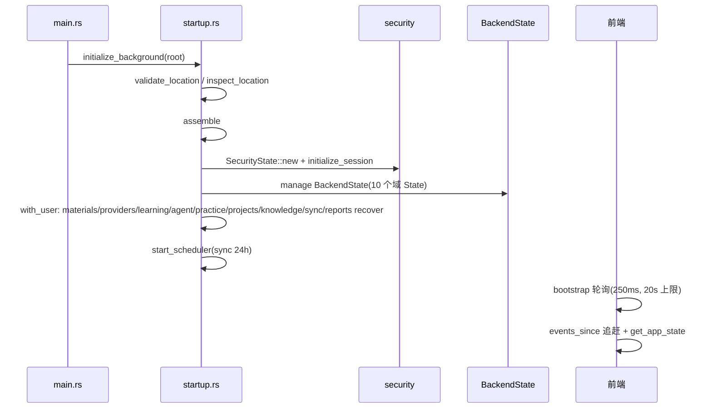

1. 目录决策（`startup.rs:18-36`）：读 `app_local_data_dir/storage-location.json`（≤4096B，version==1，`StoredLocation` :22-27）失败则回退 `app_data_dir`。`validate_location`（:91-135）拒绝：相对路径/根目录/`..` 段/UNC 网络目录/Windows 与 Program Files 目录。`prepare_directory`（:159）自动创建缺失目录，无对话框。
2. `assemble`（:345-401）顺序：`SecurityState` → `prepare_directory` → `Store::new` → 10 个域 State 构造（materials/providers/learning/knowledge/agent/practice/review/sharing/community/plugins）→ `BackendState` manage → `security::initialize_session`（无有效会话且存在活跃管理员时自动签发首位会话，`SEC/mod.rs` initialize :747）→ `with_user(principal)` 内重建 store 连接并逐模块 `recover`（materials→providers chats/routing→learning→agent→practice→projects→knowledge→sync→reports，`startup.rs:388-398`；reports 把残留 running/paused 专注会话收尾为 interrupted）→ 独立 `with_user` 启动 sync 调度线程（:399-401）。
3. 失败语义：初始化线程 panic 被 catch（:312-320）置 `startup_failed`；前端 20 秒看门狗（`src/backend/useBackendState.ts` armTimeout :114）后显示 DataDirectoryPanel，提供重试（`retry_storage_initialization` 仅在未运行且无 pending 时重新 `initialize`，`startup.rs:448-468`）、改目录（写 pointer 原子替换 `.tmp`+rename，:225-240）、恢复默认（只删 pointer 不动数据，:244-256）、立即重启。
4. 命令可用性：未就绪时守卫 `ensure_ready`（`SEC/guard.rs:150`）对除存储外的命令返回 `startup_not_ready`，前端据此继续轮询。

启动目录决策与失败出口：

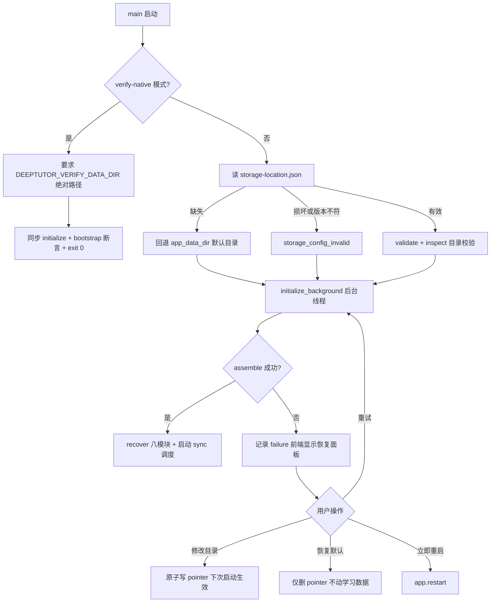

## 2. 数据库打开与 schema 指纹迁移

`Store::open`（`store.rs:124-262`）每次打开：
1. 解析工作区路径（无 owner=根库；有 owner=`users/{id}/`）。
2. `STORE_OPEN_LOCK` 全局互斥（store.rs:20）串行化打开与 user-1 旧库复制。
3. PRAGMA：WAL（非 WAL 才切换）、`foreign_keys=ON`、`busy_timeout=10000`、`synchronous=NORMAL`（WAL 常规搭配：断电最多丢最后一次已确认提交，outbox 顺序与重放语义不变）。
4. `user_version > 1` → `unsupported_schema` 拒绝降级（:185-191）。
5. 建四张通用表（:187-210，events 附表达式索引 `events_kind_request ON events(kind, json_extract(payload, '$.requestId'))`，流式 delta 重放免全表扫描），计算 `schema_fingerprint`（sqlite_master 全量 SHA-256，:100-125）；与 `meta.schema_fingerprint` 或 `schema_version` 记录不一致时依次执行 15 个模块 `migrate`（:230-250），再回写指纹与版本（:253-258）。指纹未变则重复重开零迁移（测试 `store.rs:1287` 起）；DROP 表造成的漂移会被修复重跑。

各模块 migrate 均为幂等 `CREATE TABLE IF NOT EXISTS` + `PRAGMA table_info` 检测补列（如 providers/mod.rs:284-295、reports/mod.rs:197-199、practice/exams.rs:26-44）。

打开决策链：

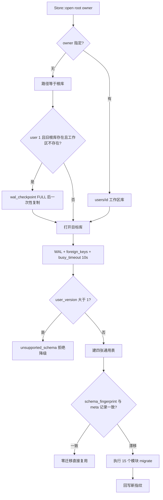

## 3. 事件系统与 Last-Event-ID 续接

后端写路径（事务内 `Store::event` store.rs:492-505 → commit → `emit` backend/commands.rs:22）保证**终态先落盘再发送**。事件 id 由 events 表 AUTOINCREMENT 单调递增。

前端双通道（`src/backend/useBackendState.ts`）：
1. 实时：`listen('backend://event')` 逐条应用。
2. 追赶：`sync()` 以 `events_since(lastId)` 循环翻页（每页 200，`store.rs:786` LIMIT 201 判定 has_more）直到无更多，再 `get_app_state()` 全量校准；`applySnapshot` 丢弃 `lastEventId` 回退的过期事件并在 workspaceId 变化时重置游标（:33-43）；瞬态 `database_busy` 自动重试至多 5 次（:96）。
3. 触发点：bootstrap 后、窗口 focus/visibilitychange（:201）、`security.session_started` 全量重载（:162）。

断线不重复执行的机制不在事件层，而在任务层：每个模型步骤持久化 `request_id`+`attempt`，恢复时 `providers::completed_chat` 为真则复用原请求结果不再调上游（见 §5）。

写路径与前端追赶：

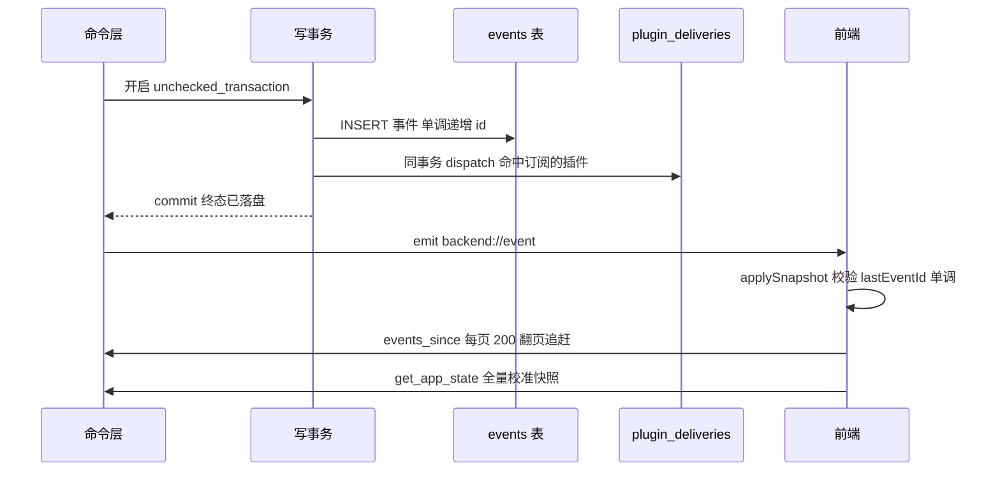

## 4. 方案生成八步流水线（learning）

入口 `start_learning_plan` → `learning::start`（L/mod.rs:411）：
1. `validate_input`（L/mod.rs:286）：goal/level ≤1000B、daily_minutes∈10..600、deadline 日期格式、materials 1-8 份去重并经 `materials::detail` 校验、provider 经 `routing::provider_for_task("plan")`（:323）。
2. 事务 INSERT `learning_plans('running')` + 8 行 `learning_plan_steps('pending')` + materials 关联 + `plan.started`（:426-442）。
3. `launch`（:376）用 `security::thread_builder()` 起线程 `learning-plan-{id}`，catch_unwind 兜底 `fail_plan`。

`pipeline::run`（L/pipeline.rs:636）循环 `execute_index`（:527）：

| 步 | 名称 | 实现 | 关键约束 |
|---|---|---|---|
| 0 | 解析资料 | sources :54 | 逐份 materials::detail，status 须 parsed/degraded，文本合计 ≤192KB 否则 `context_too_large` |
| 1 | 澄清意图 | 本地 | 无模型调用，落规范化输入 |
| 2 | 知识图谱 | graph_prompt :139 → model_json :195 | `validate_graph`（validate.rs:18）：节点 1-100、引用 quote 必须为资料原文子串（:68）、Kahn 拓扑判环（:110-125） |
| 3 | 渐进阶段 | stages_prompt :148 | `validate_stages`（:199）覆盖全部 required、依赖不逆序 |
| 4 | 资源检索 | resources :92 | `web::search(goal,3)` 真实抓取验证；rejected>0 → partial；失败 → unavailable，不虚构链接 |
| 5 | 确定性排期 | validate::schedule :206 | 纯本地按 daily_minutes 逐日装箱，算 within_deadline/within_milestone |
| 6 | 五维校验 | validation_prompt :158 | 模型输出无效降级 unavailable_model；`validation_report`（:354）原生复核依赖/难度/认知负载 |
| 7 | 方案落盘 | finish_result :453 | warnings 聚合；status=done（passed 且无警告）否则 degraded（complete_plan L/mod.rs:784-800） |

模型调用统一 `model_json`（pipeline.rs:263）：`begin_step` → `routing::stream_chat`（request_id=`plan-{id}-{步}-{attempt}`，L/mod.rs:656-670）→ `parse_model_json`（剥 ``` 围栏，:177）→ 校验 → 失败共 2 次尝试（1 次重试）。

**断点续接**：done 步骤的产物持久化在 `steps.output_json` 与 `artifacts_json $.stepN`（`complete_step` L/mod.rs:698 json_set）；`run` 先经 `step_output`+`persisted_artifact`（pipeline.rs:391 起）还原再执行未完成步骤。`begin_step`（L/mod.rs:647-660）对 status==interrupted 且 `providers::completed_chat` 的请求**复用原 request_id/attempt**，不重调上游、不重复计费。恢复入口：用户 `resume_learning_plan`（failed/cancelled/interrupted → running，L/mod.rs:461-478）与重启 `recover`（:915，running/cancelling → interrupted/cancelled）。

八步流水线与分支：

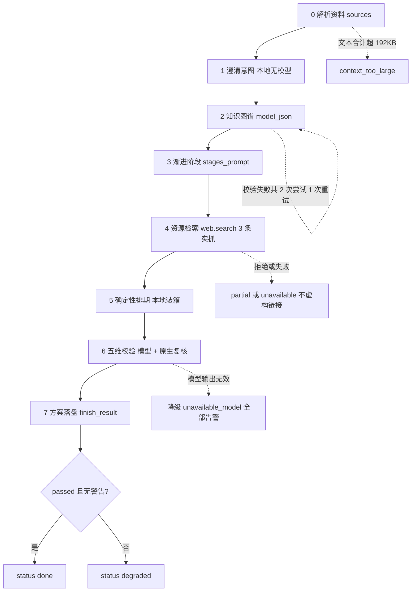

## 5. 提供商调用、流式与取消

直连链：`stream_provider_chat`（P/commands.rs:92，async 命令；另有 test_provider/route_provider_chat 同构）先经 `security::session_principal`（SEC/mod.rs:76）从会话派生当前用户——async 命令体由 `respond_async` spawn 到 tokio worker，guard 的 thread-local principal 不可见——再 `spawn_blocking` + `with_principal` 传播 → `stream_chat_with_policy`（P/mod.rs:1118）：
1. `begin_chat`（:981）INSERT `provider_requests('running')` + 注册取消标志 + emit `provider.chat_started`。
2. enabled/has_key 校验 → `protocol::stream_chat_with_policy`（protocol.rs:346）按 `profile.protocol` 分派：OpenAI Chat（openai.rs:632 自建 SSE 泵 `stream_once` :1000）/ OpenAI Responses（responses.rs:86）/ Anthropic（anthropic.rs:98）/ Gemini（gemini.rs:97）。
3. HTTP 客户端（openai.rs:248）：禁自动重定向 + DNS 解析后固定 IP（防 DNS rebinding）+ `public_address` 拒绝非公网（:103）；`endpoint`（:154）做 SSRF/路径穿越校验。
4. 流式约束：`validate_messages` 1-64 条/256KB（openai.rs:550）；响应 1MB（read_json :298）；增量文本累计 1MB（protocol.rs:23）；SSE 每 chunk 超时窗口前后各检查一次取消（protocol.rs cancel 检查）。
5. 每个 delta 双写：`Store::event("provider.chat_delta")` 落库 + emit（P/mod.rs:1143 起）——delta 事件同时是恢复重建源（`completed_chat` :970）。
6. 结束 UPDATE status=done/cancelled/failed + 终态事件（P/mod.rs:1199 起）。

取消：`cancel_provider_chat`（P/commands.rs:122）→ 路由层 `cancel_inner`（routing.rs:1105）置 `Arc<AtomicBool>`（Acquire/Release）→ 级联直连层 flag → SSE 泵检测后以 `cancelled` 错误收尾。

直连流式时序：

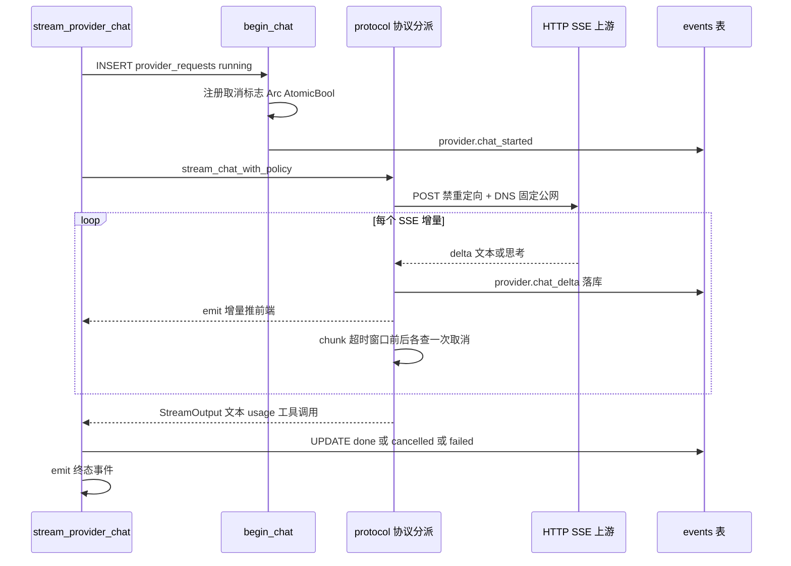

## 6. 路由、聚合、故障转移与熔断

`route_provider_chat`（P/commands.rs:169）→ `routing::stream_chat`（routing.rs:872）：
1. `select`（:402）按 RoutingSettings.mode（direct/routing/aggregate）选 profile+model；任务路由表 `routes: BTreeMap<task, providerId>`。
2. 幂等：已存在同 request_id attempt 直接复用（:888-910）。
3. `usage::ensure_budget`（usage.rs:462）按 session_usd/daily_usd 拒绝超预算——消耗经 `budget_spend`（usage.rs:432）SQL 聚合 usage_rates 加权，不再全表读入内存。
4. INSERT `provider_route_runs('running')` + `provider.route_started`（routing.rs:933）。
5. 候选循环（failover 队列）：`circuit_permit`（:626）——熔断 open 且冷却未到 → `circuit_open` 拒绝；到期 CAS 置 half_open（:634）；`save_attempt`（:729）逐试次落库 + `provider.route_attempt` 事件（携带 upstream_request_id，前端借此切换流匹配，`useAgent.ts:129`）；调用直连层（StreamPolicy 取自 circuit timeout/retries）；成功 `record_circuit`（:670）closed 复位 failures；失败且 `can_failover`（:592）→ 下一候选。熔断读-改-写在 IMMEDIATE 事务内，消除并发窗口。
6. 全部不可用 → `all_providers_unavailable`（routing.rs:1095）。

熔断状态机（`provider_circuits.state`）：closed→open（failures≥3）；open→half_open（冷却 60s 到期 CAS）；half_open→closed（成功）/→open（失败或重启恢复，recover routing.rs:1272）。

路由候选循环（**仅 routing 模式生效**；direct/aggregate 单上游直连：无熔断、无故障转移、无候选级重试，与界面文案一致）：

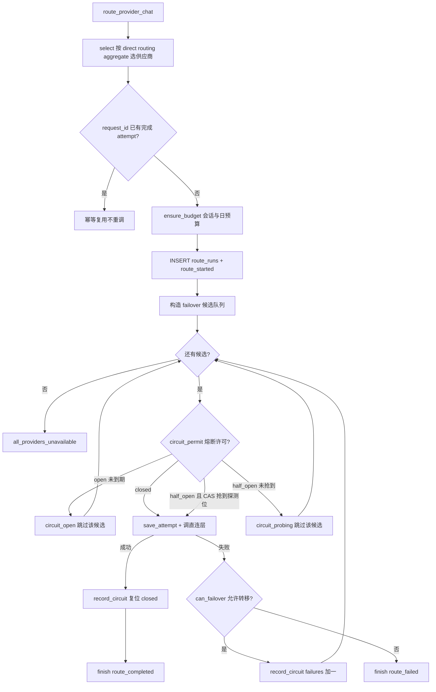

熔断状态转换：

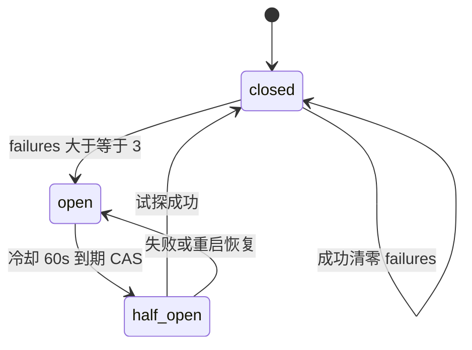

用量：每次请求 usage_json 落 `provider_requests`；`overview`（usage.rs:314）聚合日/模型/会话口径；`export_csv` 防公式注入（:504）。

## 7. 材料导入与解析队列

导入链（`import_material_files` M/commands.rs:14 → `import_files` M/mod.rs:713 → `stage_one` :654）：
`validate_source`（:441：canonicalize→普通文件→非空→≤50MB→文件名≤500B→19 种扩展名白名单→读盘比对→魔数 `validate_content` :486）→ SHA-256 → `stage_validated`（:515：sha256 查重返回 deduplicated=true（不占配额）→ 写事务内配额复查（`ensure_quota_in_tx`）→ 原件写 `originals/{sha256}.{kind}`（临时文件+rename）→ 事务 INSERT 'staged' + `sync_resources` + `material.staged` 事件）。

解析队列（单工作线程语义，`MAX_PARSE_WORKERS=1` M/mod.rs:30）：
- `enqueue`（:996）：media/metadata_only 拒绝 → 活跃任务查重 → 事务 INSERT `material_jobs('queued')` + materials→queued/progress=10 + `material.queued` → `spawn_job`（:864）：`active.len()>=1` 则不启动（留在 queued）。
- 工作线程 `run_job`（:779）：取消预检 → parsing/35 → 重读原件并哈希复核 → `parse`（parse.rs:42，PDF/docx/pptx/epub/txt/md/媒体元数据等）→ parsing/85 → 事务 UPSERT `material_text` + materials→parsed(或 degraded)/100 + jobs→done + `material.parsed`。
- 队尾 `schedule_next`（:1124）：取下一个 queued 先 spawn 再移除本 id（接续登记先于旧任务移除，不能提前显示空闲）。
- 取消：排队中直接置 cancelled（:1025）；运行中置 AtomicBool + `cancel_requested=1` + status='cancelling'（:1011-1014）。
- 恢复：`recover`（:1157）对 queued/parsing/cancelling：cancel_requested=1 → cancelled，否则回置 queued 重新 spawn。

ZIP 资料包（materials/archive.rs:125 `import_archive` → `read_archive` :19）：扩展名 zip → 1-50MB → 内存 `ZipArchive` → 条目≤64 → `enclosed_name` 防穿越 → 拒嵌套 zip（:72）→ 单项≤50MB、压缩比≤200× → 总解压≤200MB → 逐条 `stage_bytes` 复用导入链；不在文件系统解包。

媒体（media.rs）：`info`（:132）整读校验 SHA-256；`chunk`（:165）offset 合法 + ≤256KiB 分块读；路径约束 originals 目录内 + 拒绝符号链接。

材料导入链：

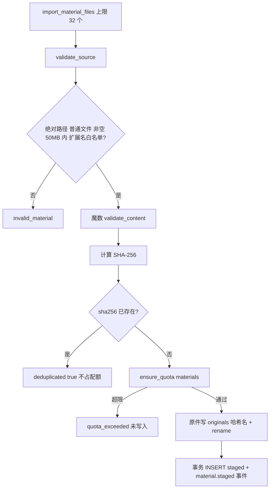

解析队列与单工作线程语义：

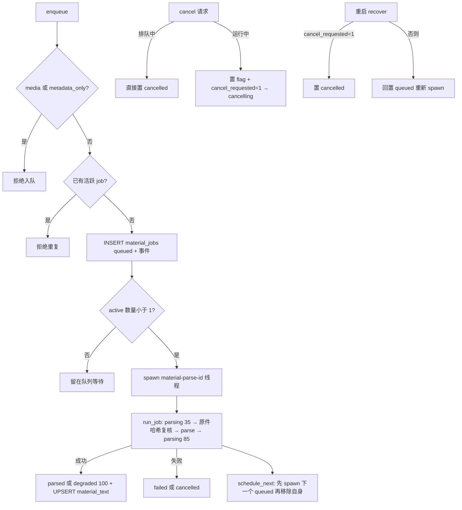

## 8. Agent 工具循环

`send_agent_message`（agent/mod.rs:574）：
1. 预算闸：会话累计 output_tokens ≥ budget_tokens 拒绝（:562）；同会话 running 查重（:577）。
2. Immediate 事务 INSERT `agent_runs('running')` + 用户消息 + `agent.run_started`；注册取消标志（:588-597）。
3. 线程 `agent-run-{id}`（:515）跑 `run_loop`（:811）：每轮首查取消 → 会话预算 → `usage::ensure_budget` → `begin_step`（:647，25 步上限；可复用已完成请求；request_id=`agent-{run}-{attempt}-{step}`）→ `routing::stream_chat("agent")` 带 12 工具目录。too_many/取消判定在 assistant 消息落库**之前**——超限中断时已产生的部分输出以 partial=true 保存，不再丢弃。
4. 成本从 `provider_requests.usage_json` 聚合，会话口径 GLOB `agent-<id>-*`（:608,786-792）。
5. 无 tool_calls → `finish_run("done")`；有则工具循环：`tools::execute`（tools.rs:413）先幂等登记 `agent_tool_calls`（ON CONFLICT 重放或 `tool_active`）再分发。

工具目录（tools.rs:13-91）：workspace.list/read/write/edit、web.search/web.fetch（走 §9 抓取链）、memory.save/recall/delete、history.load/search、artifact.promote。写文件产物 `commit_artifact`（:258）：阶段/单元校验 → `lecture::validate_content` → `artifact_path`（:167，拒绝对对路径/父级/>6 层/非 json-md-txt/符号链接/越界）→ 原子写（tmp+previous 双 rename :218）→ `agent_artifacts`（expires_at=+24h）。
审批：memory.save/delete、artifact.promote 产生 `agent_approvals('pending')`；`approve_agent_request` CAS pending→approved 执行——promote 校验 sha256 与阶段未漂移，讲义须 done，整版本拷贝 `learning_lecture_units` 并推进版本。历史重放修剪：`history()`（:658）重放前剔除悬挂 tool_calls（无完整对应 tool 回复）与孤儿 tool 消息（无对应声明）——OpenAI 系端点对不自洽序列返回 400，取消/超限中断后的 run 曾因此永久无法恢复。

Agent 工具循环：

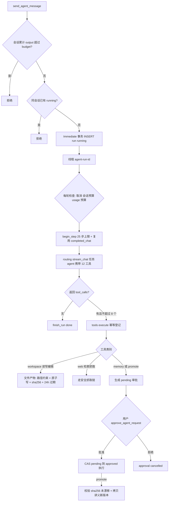

## 9. 网页检索与抓取（web/）

- `search`（web/mod.rs:341）：query 1-300B、limit 1-5 → `https://html.duckduckgo.com/html/`（:68）→ `document`（:146）循环：`resolve`（:78）URL ≤900B、query 拒 token/secret 键、DNS `to_socket_addrs` 后拒绝非公网（`ssrf_blocked`，复用 providers::openai::public_address）→ 禁代理+禁重定向客户端 → 手工跟随重定向 ≤3 次逐次重校验 → Content-Type 白名单 → 非 UTF-8 拒 → 1MB 上限 → `html::parse`（html.rs:197，标签扫描遇未闭合引号跳过该字符继续，正文不截断）→ `candidate_url`（:320）展开 DDG 跳转 → 逐条 `fetch` 真实抓取后才标记 verified（:387）。
- `fetch`（:268）：`html::parse(body,false)` 剥脚本样式 → text/plain 保留原文 → 空拒 → `truncate`（:260）256KB → sha256 内容哈希。

抓取校验链：

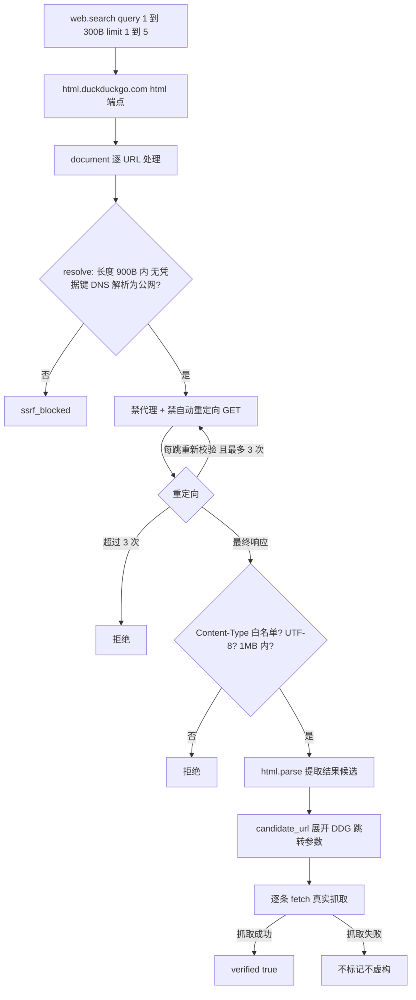

## 10. 判分与复习调度算法

**客观题**（practice/mod.rs 判分段）：choice——answer 须为合法选项下标且等于期望；fill——`normalize`（去空白+lowercase，:1082）后全等；`correct`（:1139）同时决定错题与掌握度写入——hints 模式作答不进错题本、不置掌握（遮蔽承诺）。
**主观题**（subjective.rs:189 起）：INSERT `practice_answers('grading')` + request_id=`practice-grade-{id}-1` → 线程 `grade`（:385）：题面+参考答案+rubric+学生作答 prompt → `stream_chat` 4096 → `evaluate`（:325）逐项 `score∈[0,1]×points` 求和并 clamp，`correct = score≥0.8`（:372）→ 二次 `validate_citations`。rubric 校验 2-6 项、points∈(0,1]、总和=1（:56）。
**共同尾部**：错题 upsert wrong_count+1（hints 模式除外）；逐节点写 `learning_node_evidence`（kind practice/exam、evidence_key=`practice-answer-{answer_id}`，mod.rs:1190）；变式答对 → 原错题 mastered=1（variants.rs:106-133）；全部作答完 → set completed。
**模拟考交卷**（exams.rs:74）：幂等；评分中拒收（:112）；未答题逐题 0 分 + mistakes('未作答') + evidence(0)（:138-165）。
**复习调度**（review/mod.rs:403 grade，SM-2 简化、4 档无 q 因子；挂起卡片返回 `card_suspended`）：
- 间隔（:419-428）：again=10 分钟；首轮 hard=2/good=5/easy=12 天；后续 hard=prev×1.2、good=prev×ease、easy=prev×ease×1.3。
- ease（:429-435）：again −0.2 / hard −0.15（下限 1.3）、easy +0.15（上限 3.0）；again 重置 repetitions=0、lapses+1。
- 并发防护：条件 UPDATE 带 `due_at<=?8`，仅一行生效（:438-447，测试 :768）。
- 证据映射：again/hard/good/easy = 0/0.6/0.8/1.0（:453-465）。

判分分流：

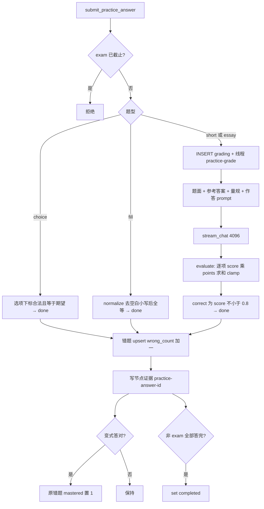

复习评分调度：

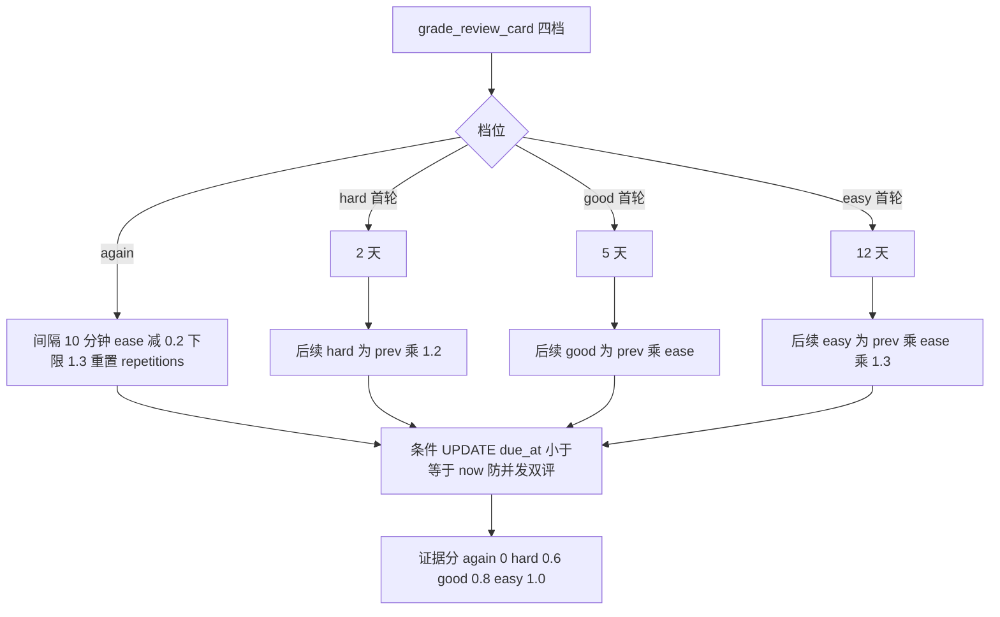

## 11. 备份、分享、同步、运维

- **导出**（backup/archive.rs:364）：停 sync → `.dtbackup` 扩展名校验 → RAII 临时目录 → `VACUUM INTO state.db` → 回填 local_users/security_quotas → `secure_delete=ON` 清三张敏感表再 VACUUM（:410-416）→ 收集三类文件（原件/插件清单/agent scratch 仅 json-md-txt）→ 写入前逐项哈希重验防 TOCTOU → zip ≤2GB → `materials::atomic_export` + `backup.exported`。
- **预演/导入**（transfer.rs:1175）：预演只读统计；导入前停全部子系统（backup/commands.rs）；schema 双端比对（唯一容忍 focus_sessions.paused_at）→ IMMEDIATE 事务内 `prepare_ids`（:197）：materials 按 sha256 复用已有 ID、shared_plans 按 token_hash 复用、security_quotas 按 (user_id,resource) 复合键跳过、主键=外键子表（material_text/community_group_members/community_reservations）随父表映射重写、其余 INTEGER 主键 MAX+1、文本主键 `imported-{n}`、kv 重编号、preferences 已有则跳过 → `stage_files`（:1069，须在 prepare_ids 之后：插件清单目标路径按重映射 id 落位）→ 外键拓扑排序（:529）→ `transform`（:574）重写列与 `*_json` 内嵌 ID → 单事务 import_rows（:925）+ install_files（canonicalize+hard_link）→ 失败回滚删已装文件 → 收尾各模块 recover + `backup.imported(appendOnly:true)`。
- **分享**（sharing/mod.rs:263 create）：仅 done/degraded 方案、快照≤2MB；令牌 `dt_` 46 字符只存 SHA-256（token_hash）+ 根库 share_index；读取无登录时先查索引定位 owner，`with_user` 切库读取，仍未命中遍历 users/ 目录（≤10000）回填索引（:375-426）；revoked/expired 一律 `share_unavailable`。
- **同步**（sync/）：上传 = `providers::export_config`（脱敏，无 apiKey，测试断言）→ PUT 历史对象+当前对象 → GET 回读双双比对（`sync_verify_failed`）→ 版本保留：list（S3 list-type=2 / WebDAV PROPFIND）按时间倒序 skip(10) 删除，复查 remaining>10 → `sync_retention_failed`（versions.rs:236 起）。调度线程 1s tick/60s 检查，auto_sync 且距上次上传 ≥24h 触发（scheduler.rs:40）。凭据 WebDAV 密码/S3 密钥存 keyring，库中 sync_config 脱敏（mod.rs:150）；下载/恢复的目的地拒绝落在应用数据目录内（数据根遏制）。
- **运维**（maintenance/）：`health` 读 PRAGMA integrity_check/foreign_key_check/journal_mode/page 统计/WAL 字节数（mod.rs:106 起）；孤儿扫描白名单=DB 记录的原件 + agent scratch + 有效插件清单 + 可识别临时目录，缺失原件只报告；清理/VACUUM 前置 `OPERATION` 互斥（commands.rs:9）+ 停全部任务 + 锁 store，结束必重启调度（commands.rs:51）。

备份导出：

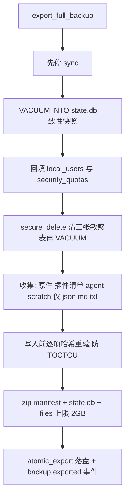

备份导入（预演 + 追加）：

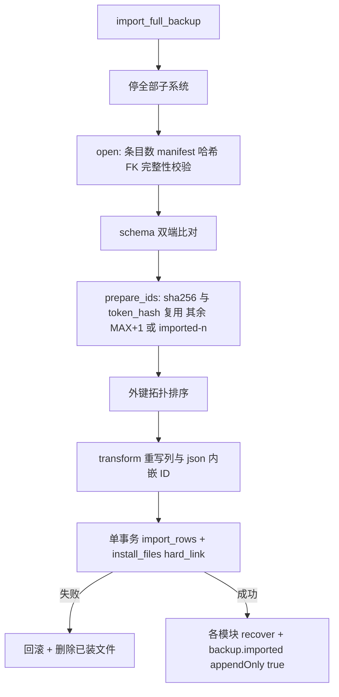

分享创建与读取：

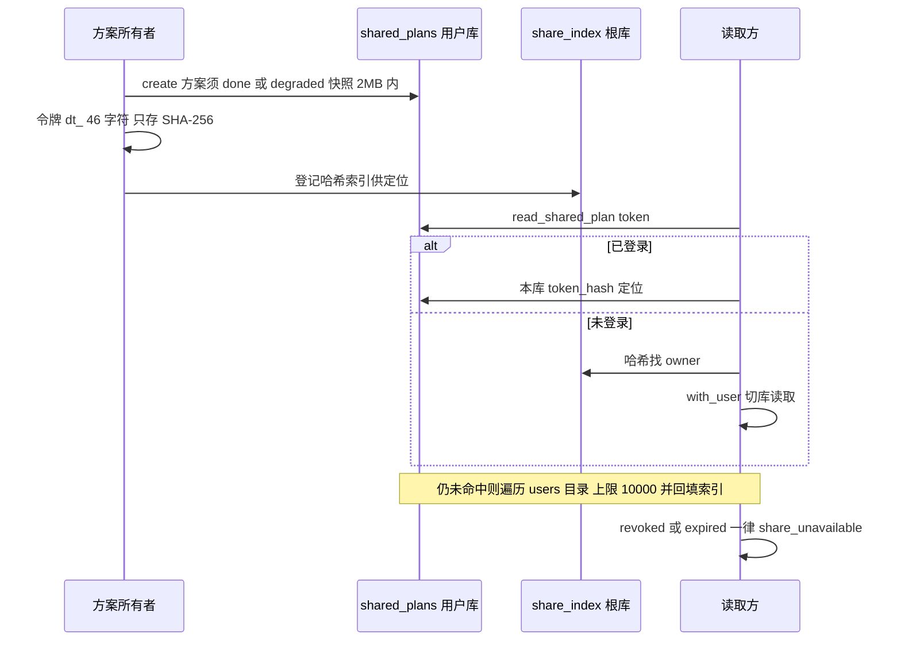

同步上传与版本保留：

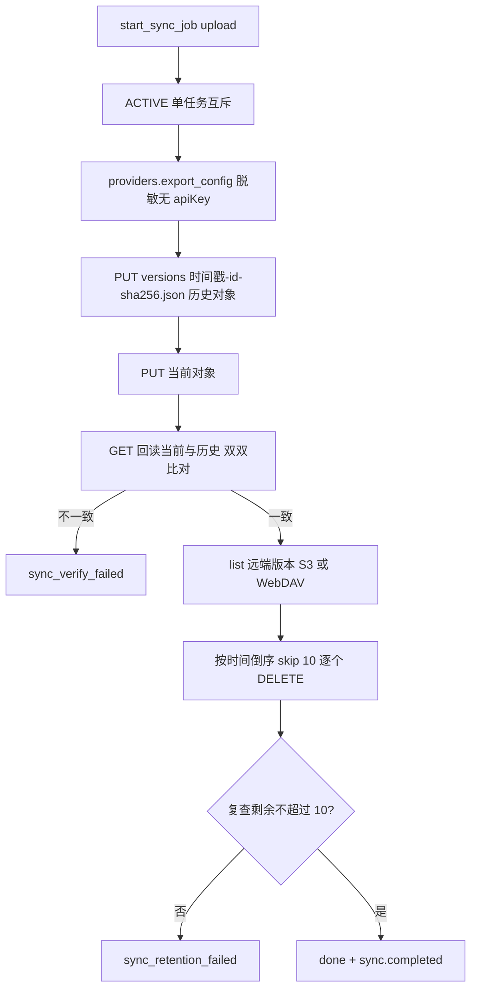

## 12. 状态机汇总

全部长任务实体共用同一生命周期模式（个别域多一个 ready/completed 或 degraded 业务态）：

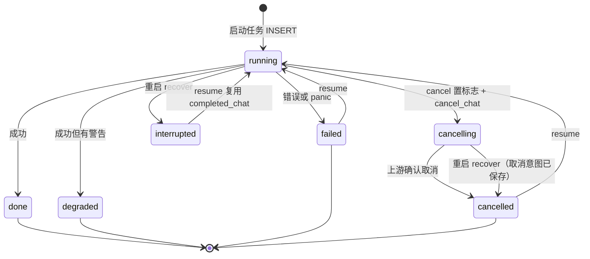

| 实体（表.列） | 状态集 | 终态 | 恢复函数 |
|---|---|---|---|
| learning_plans.status | running/cancelling → done/degraded/failed/cancelled；interrupted | done/degraded/failed/cancelled | recover L/mod.rs:915 |
| learning_plan_steps.status | pending/running/done/failed/cancelled/interrupted | done/failed/cancelled | 同上 + begin_step 复用 |
| learning_lectures.status | empty/running/cancelling → done/failed/cancelled；interrupted | done/failed/cancelled | lecture::recover :806 |
| knowledge_sessions.status | running/cancelling → done/failed/cancelled；interrupted | done/failed/cancelled | K::recover :858 |
| practice_sets.status | generating/cancelling → ready/failed/cancelled；interrupted；ready→completed | ready/completed/failed/cancelled | practice::recover :1449 |
| practice_answers.status | grading/cancelling → done/failed/cancelled；interrupted | done/failed/cancelled | subjective::recover :658 |
| project_versions.status | running/cancelling → done/failed/cancelled；interrupted | done/failed/cancelled | projects::recover :571 |
| agent_runs.status | running/cancelling → done/cancelled/failed；interrupted | done/cancelled/failed | agent::recover :1127 |
| agent_approvals.status | pending → approved/cancelled/expired | approved/cancelled/expired | 过期由 promote 惰性置 :770-791 |
| provider_requests.status | running → done/cancelled/failed；interrupted | done/cancelled/failed | recover_chats P/mod.rs:1254 |
| provider_route_runs.status | running/cancelling → 终态；interrupted | done/failed/cancelled | routing::recover :1272 |
| provider_circuits.state | closed/open/half_open | — | recover :1272 |
| material_jobs.status | queued/parsing/cancelling → done/failed/cancelled | done/failed/cancelled | materials::recover :1157 |
| sync_jobs.status | running(stage:request/version/verify/retention)/cancelling → done/failed/cancelled；interrupted | done/failed/cancelled | sync::recover :858 |
| focus_sessions.status | running ⇄ paused → completed/cancelled；崩溃残留由启动 recover 收尾为 interrupted | completed/cancelled/interrupted | — |
| shared_plans（派生） | active → revoked/expired | revoked/expired | — |
| local_users.active | 1 ⇄ 0；软删 deleted_at | — | — |

通用规律：取消 = AtomicBool 置位 + status='cancelling' + `providers::cancel_chat` 上游中断三件套；重启 = `recover` 把 running→interrupted、cancelling→cancelled，永不自动重跑；用户 `resume` 显式续接，且 `providers::completed_chat(request_id)` 为真时复用已完成请求不重计费。

声明的例外：materials 域的本地文本解析在重启后对 queued/parsing 任务自动回到 queued 并重新解析（`materials/mod.rs` recover→spawn_job）——解析幂等、不产生模型费用，属有意为之的例外，不适用"永不自动重跑"。

## 13. 并发模型总览

- **线程**：全部后台线程经 `security::thread_builder()`（SEC/mod.rs:83）创建以继承 principal（thread-local PRINCIPAL :34；`session_principal` :76 供 async 命令从会话派生）。裸线程无 principal 时 `Store::new` 返回 `store_unavailable`（fail-closed，store.rs:74-88；测试环境回退根库语义）。命名线程：`backend-startup`、`learning-plan-{id}`、`lecture-{id}`、`wiki-answer-{id}`、`practice-generate-{id}`、`practice-grade-{id}`、`project-feedback-{id}`、`agent-run-{id}`、`material-parse-{id}`、`sync-{id}`、调度线程。全部 catch_unwind，panic 映射 `task_panicked` 落失败态。
- **锁**：`BackendState.store: Mutex<Store>`（全局单连接）；`STORE_OPEN_LOCK`（打开互斥）；`WORKSPACE_SWITCH: RwLock`（切换写锁/命令读锁）；各域 `active: Mutex<HashMap<id, Arc<AtomicBool>>>` 取消注册表；maintenance `OPERATION`；sync 全局 `ACTIVE/NEXT_JOB`；startup `LOCATION_LOCK`（pointer 原子写）。
- **SQLite 并发**：WAL + synchronous=NORMAL + busy_timeout 10s；写路径 `unchecked_transaction`；关键防重用 Immediate 事务（agent send、resume、start_focus、备份 prepare_ids、熔断读改写）或条件 UPDATE（review grade）。
- **停止协议**：`stop`/`stop_all` 置全部取消标志 + 取消全部上游请求 + 15s 轮询等待 active map 清空（learning L/mod.rs:856、providers P/mod.rs:1282、materials M/mod.rs:106、agent :1085、sync :896）；重置（reset_application，backend/commands.rs:82）先停五类任务，DB reset 成功后才删原件备份与凭据。

停止协议：

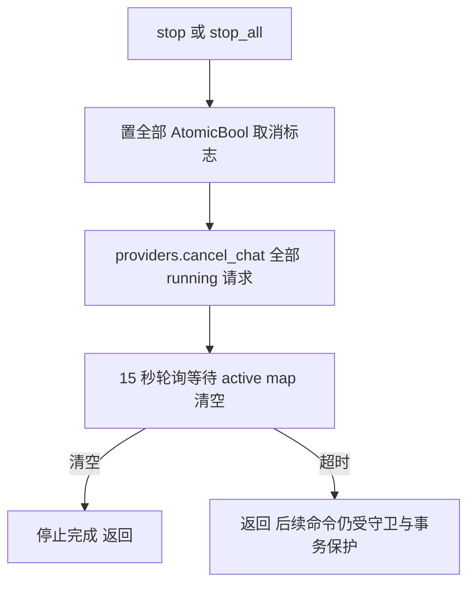

应用重置：

```mermaid
flowchart TD
    A[reset_application] --> B[停五类任务 agent practice knowledge learning providers chats sync]
    B --> C[materials.prepare_reset 备份原件清单]
    C --> D[store.reset 单事务清 15 模块表 + kv + 种子默认偏好]
    D -->|成功| E[finish_reset 删除原件 + purge 全部凭据 + 插件文件重置]
    D -->|失败| F[恢复备份 不删原件与凭据]
```

## 14. 前端运行原理要点

- 启动：bootstrap 对 `startup_not_ready` 每 250ms 重试至 20s（useBackendState.ts 看门狗 armTimeout :114）；认证错误码集合切 loginRequired；bootstrap/sync 的瞬态 `database_busy` 自动重试至多 5 次（:96）不弹错。
- 实时渲染：页面按事件 kind 前缀 + 业务 id 过滤后调用对应 get 命令刷新（如 PlanGenerator.tsx:105 起 `plan.*` → getLearningPlan；`provider.chat_delta` 按 requestId 命中后 getProviderChat 拉增量）。
- 媒体预览：MediaPlayer.tsx:19-36 `get_material_media_info` → 循环 `read_material_media_chunk(256KB)` → 拼 Blob → `crypto.subtle` SHA-256 与 info 比对 → objectURL 渲染，卸载 revoke。
- 主题/无障碍：preferences 经 `replace_collection('preferences')` 持久化，App.tsx:173 同步 `data-theme/large-text/high-contrast/reduce-motion` 到 `<html>`；reduce-motion 另经 matchMedia 跟随系统偏好（App.tsx:243），`html.reduce-motion` 规则同时关闭 smooth scroll。

前端启动与实时流：

```mermaid
flowchart TD
    A[bootstrap] --> B{startup_not_ready?}
    B -->|是 每 250ms 重试 上限 20s| A
    B -->|认证类错误码| C[loginRequired → SecurityPanel 选用户]
    B -->|其他错误| D[startupError → DataDirectoryPanel 恢复面板]
    B -->|成功| E[events_since 翻页追赶 + get_app_state 校准]
    E --> F[listen backend://event]
    F --> G{workspaceId 变化?}
    G -->|是| H[游标归零 重新 bootstrap]
    G -->|否| I[丢弃 lastEventId 回退事件 应用增量]
    C --> J[登录成功 session_started]
    J --> H
    D --> K{用户操作}
    K -->|重试| A
    K -->|改目录或恢复默认| L[下次启动生效 或立即重启]
```

页面级实时消费（以方案生成页为例）：

```mermaid
sequenceDiagram
    participant PG as PlanGenerator 页面
    participant IN as invoke 命令
    participant BE as Rust 后端
    participant WS as 工作线程
    PG->>IN: startLearningPlan
    IN->>WS: 起流水线线程
    loop 每个事件
        WS->>BE: 事务落盘 plan 步骤事件
        BE-->>PG: emit backend://event
        PG->>PG: plan 前缀按 planId 匹配
        PG->>IN: getLearningPlan 刷新步骤进度
        PG->>IN: chat_delta 命中时 getProviderChat 拉增量
    end
    WS->>BE: 终态 done 或 degraded
    BE-->>PG: 终态事件 页面切换结果视图
```

## 15. 观察到的边界情况

- reports 模块 `start_focus`/`finish_focus` 在 IMMEDIATE 事务内执行（防并发双开）；`finish_focus` 的 UPDATE 条件为 `status IN ('running','paused')` 且检查受影响行数，不命中时报 `no_active_focus`、不发终态事件。
- `fetch_webpage` 注册但前端不直接调用——它由 `import_webpage` 在后端内部复用（同一 SSRF 校验抓取链）；`authenticate_access_token` 已接入 SecurityPanel 的 PAT 登录入口，验证通过后经 `issue()` 建立会话。工具调用流量统一走 `route_provider_chat`（tools 参数化）。
