# 03 · 工作流分析

> 基准：main 分支 commit `cf2cb36c`。引用形如 `文件:行号`，相对仓库根（`desktop/` 内引用会显式标注）。

## 1. 开发与构建工作流

| 入口 | 命令 | 实际动作 |
|---|---|---|
| Makefile:22 | `make lint` | `cargo fmt --all -- --check`（desktop/src-tauri）+ `npm run build`（tsc -b && vite build） |
| Makefile:25 | `make test` | `cargo test --release --locked -- --test-threads=1`（desktop/src-tauri） |
| Makefile:28 | `make check` | lint + test |
| Makefile:18 | `make build` | `npm run tauri build` → tauri.mjs 复制唯一 `*_{version}_*-setup.exe` 到根 `dist/` 并双向 SHA-256 校验（`desktop/scripts/tauri.mjs:24-38`） |
| Makefile:30 | `make hooks` | `git config core.hooksPath .githooks`；pre-push 执行 `make check`（.githooks/pre-push:3） |

本地 Rust 工具链复用：`F:\DevCache\toolchains\1.95-x86_64-pc-windows-msvc`，`CARGO_HOME=F:\DevCache\cargo`、`RUSTUP_HOME=F:\DevCache\rustup`（AGENTS.md 约定）。

CI（.github/workflows/ci.yml）：PR + 手动触发；windows-latest；Node 24（npm cache 以 desktop/package-lock.json 为键）→ `npm ci` → 前端构建 → `cargo fmt --check` → 原生测试（同 --test-threads=1）→ NSIS 安装包 → 上传构件 `deep-tutor-windows-nsis`（`if-no-files-found: error`）。无部署阶段。

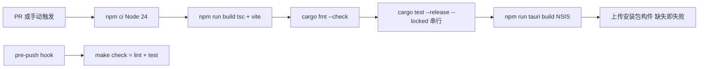

发布节奏证据：dist/ 下 1.0.0→1.0.4 五个安装包；版本号三处同步（package.json、tauri.conf.json、Cargo.toml 均为 1.0.4）。

## 2. 测试策略

- 组织：每域 `tests.rs` 与实现同目录；关键域拆分（providers: protocol_tests/test_support、security: guard_tests/workspace_tests、practice: exam_tests/subjective_tests/variant_tests、sync: versions_tests）。共 112 个 .rs 文件中约 1/3 为测试。
- 运行方式：`--release --locked -- --test-threads=1` 串行，避免 SQLite 文件与全局锁（STORE_OPEN_LOCK、ACTIVE）竞争。
- 测试基建：
  - `tauri::test::MockRuntime` + `mock_builder` 驱动真实命令 IPC（startup.rs:613-671 `mock_app/ipc` 辅助函数）。
  - 本机回环 TestServer 线程模拟 LLM/WebDAV/S3 协议（providers/test_support.rs:35-70），断言真实 HTTP 行为而非 mock 返回值。
  - `MemoryCredentials`（providers/mod.rs:151）替代系统密钥库。
  - `defer` 布尔关闭真实线程 spawn（learning/mod.rs:372、materials、sync 同型），使流水线测试同步化。
  - MIGRATION_RUNS 计数器验证指纹迁移幂等（store.rs:20-26,1162-1185）。
- 覆盖重点（抽样断言）：恢复不重复调上游（learning/tests.rs:439-499 server 计数不变；subjective_tests.rs:230）；事件 outbox 分页与重启续接（store.rs:1126-1159）；备份 ID 映射与重复导入保留双方（backup/tests.rs:235-242,423,494）；同步回读校验与保留恰 10 个（sync/tests.rs:223-225,396-430；versions_tests.rs:133-135）；并发 grade 仅一次生效（review/mod.rs:768）；两用户文件隔离（security/workspace_tests.rs:70-74）。
- 环境边界：真实供应商、真实媒体编解码播放、交互安装为独立验收项，协议夹具不替代（plan/README.md 约定；无界面安装验证走 `--verify-native` + `DEEPTUTOR_VERIFY_DATA_DIR`，main.rs:14-72）。

## 3. 业务工作流：学习闭环

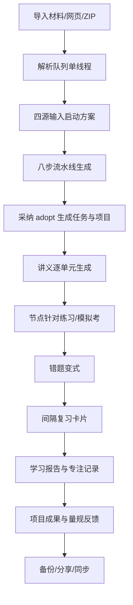

### 3.1 材料进入（Materials）
决策链（materials/mod.rs:408-544）：

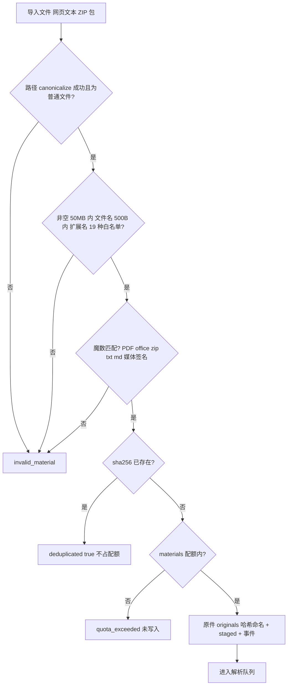

### 3.2 方案生成与采纳（Learning/Planning）
- 启动前置：材料 1-8 份已解析、daily_minutes 10-600、路由存在（learning/mod.rs:281-346）。
- 采纳 `adopt_learning_plan`（learning/actions.rs:19）：幂等（已有 adoptions 直接返回）；创建 project + 每 `learning_plan_schedule_tasks` 一条 tasks 集合任务 + `plan.adopted`。
- 目标修改 `update_learning_goal`（planning/mod.rs:431）：进入原生再生成（受 `regeneration_limit=2` 限制，actions.rs:147）；**已采纳方案不原地重跑**——`regenerate`（actions.rs:121）scope 2..=6 局部重跑，旧版本存 `learning_plan_versions`，version+1。
- 强度调整 `apply_plan_intensity`（planning/mod.rs:313）：factor 稳妥 0.8/标准 1.0/冲刺 1.2（:259）；`round(m×target/current)` 下限 15 分钟（:271）——按比例避免往返切换累积缩放；乐观锁 preferences/tasks revision（:329-342）。

方案生命周期：

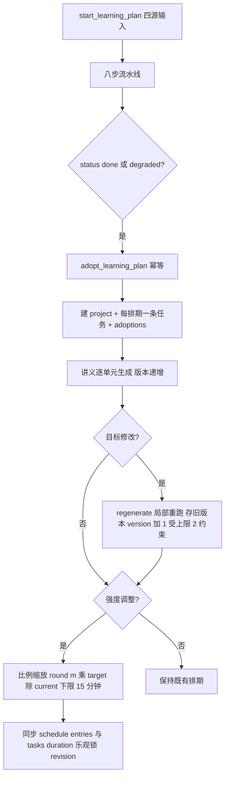

错题变式闭环：

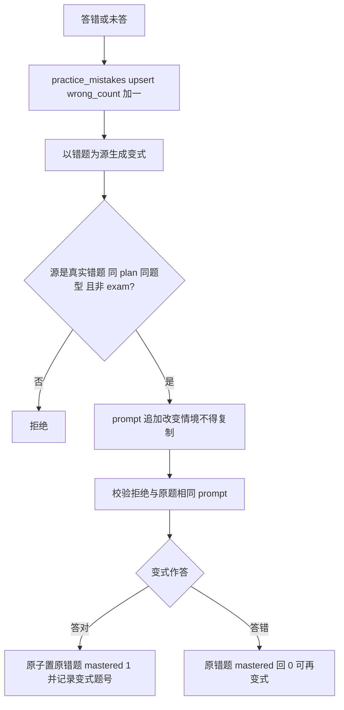

### 3.3 练习与复习（Practice/Review）
- 出题范围约束：nodeId 必须属于方案图谱、所选阶段且属变式 node_ids（practice/mod.rs:591-614）；生成 prompt 与题目校验均受该范围约束（:816-844）；恢复任务不扩大范围。
- 错题变式：`variant_of` 只接受真实错题且同 plan 同题型（variants.rs:65-78）；prompt 追加"改变情境不得复制"（mod.rs:424）；生成校验拒绝与原题同 prompt（:797-799）；答对后原子置原错题 mastered（variants.rs:106-133）。
- 复习到期：`next_review_card` 取 `due_at<=now` 最旧（review/mod.rs:361）；grade 公式见 02 §10。

### 3.4 项目成果（Projects）
提交 `submit_project_version`（projects/mod.rs:278）：content 1-100000B 无 NUL；可选材料须已解析；每项目单反馈任务（事务内复查 :313）；INSERT 'running' + **commit 后才 emit** `project.feedback_started`（:329-335）；量规由模型按概念应用/实现质量/验证与反思 0-100 评分（:443-448），`validate_feedback`（:351）限分≤100、summary≤6000、建议 1-5 条；不声称执行代码。恢复：completed_chat 为真直接重放 evaluate，否则 interrupted（:571-602）。迭代笔记写入真实 notes 集合（:607-648）。

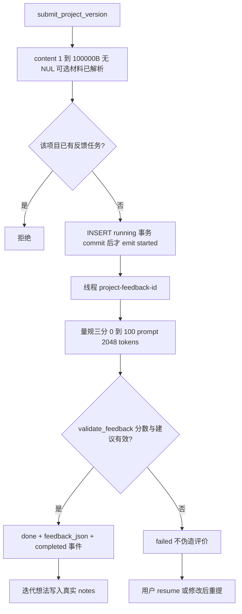

### 3.5 报告（Reports）
只聚合真实记录：专注实际秒数（running 时实时推导 `now-started_at`，pause 冻结，resume 改写 started_at=now-actual 保持时钟连续，reports/mod.rs:226-244,394,417-420）；完成任务保留计划分钟并区分；掌握度来自 `learning_node_evidence` AVG；无证据不填示例趋势；建议采纳一次提交（:914）；CSV/报告导出经后端（:982）。

专注会话时钟语义：

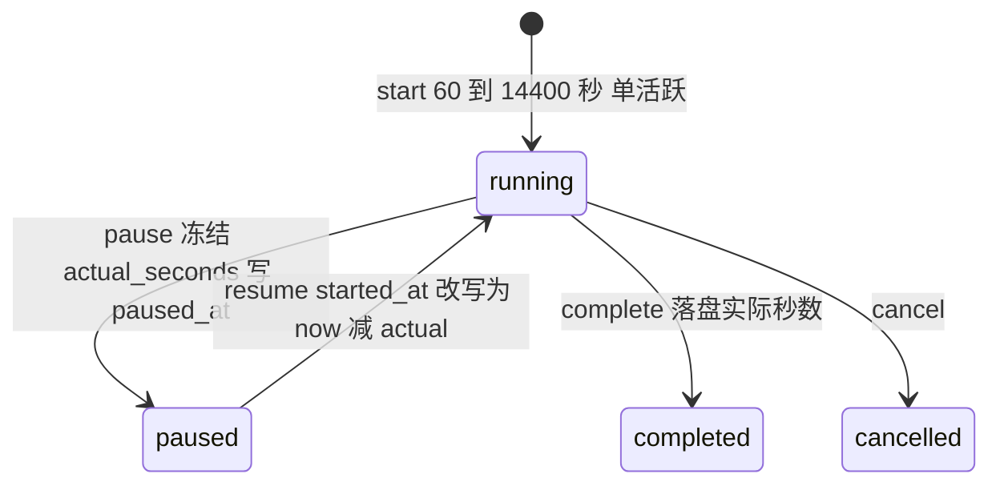

### 3.6 知识库与 Wiki（Knowledge/Notes）
- 问答 `ask_knowledge`（knowledge/mod.rs:454）：1-8 份已解析资料为 scope；每份截 16000 字符（MAX_SOURCE_CHARS :24）标记 truncated；系统提示强约束只用提供资料；answer≤30000B；**引用双重校验**：material_id 必须在 scope 白名单（`citation_out_of_scope` :602）+ quote 必须能在资料原文 `text.find` 定位（`citation_mismatch` :182，得 char_start/char_end/line）；`UPDATE ... WHERE status='running'` 防取消后写入（:612-617）。

引用双重校验：

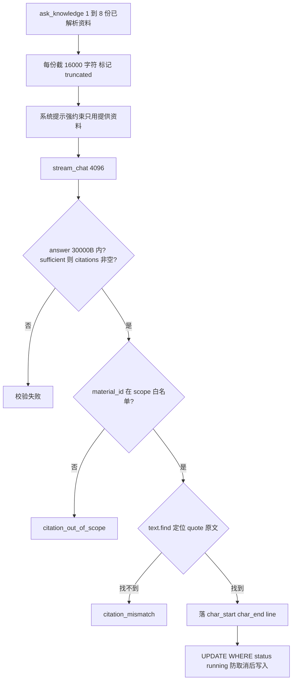

- 知识关联：笔记↔节点映射只来自学习阶段批注（learning_annotations）；删除笔记同步清理（store.rs:517）。
- 知识库体检 `get_library_overview`（notes/library.rs:67）：未关联自由笔记、完全相同正文、缺失原件、解析失败四类真实项；支持打开对应记录；不自动删除。

### 3.7 社区与提醒（Community）
预约 `reserve`（community/mod.rs:719）：房间须 scheduled 未过期、小组须已加入、`remind_at=max(start-15min,now)`；前端轮询 `claim_community_reminders`（:832）逐条置 delivered_at 并发 `community.reminder_due`；取消预约/房间同步删提醒（:789-792,821-825）。

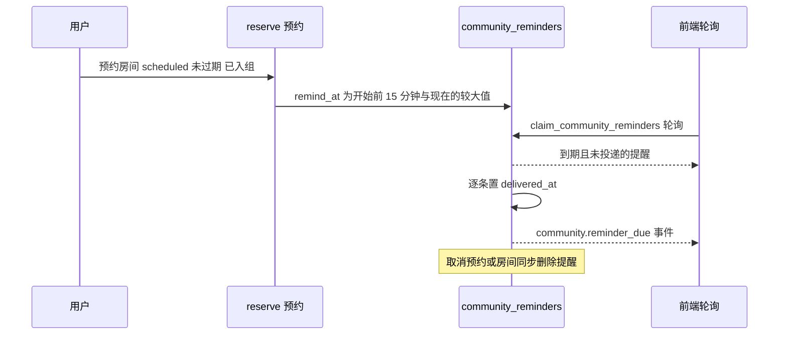

## 4. 数据生命周期工作流

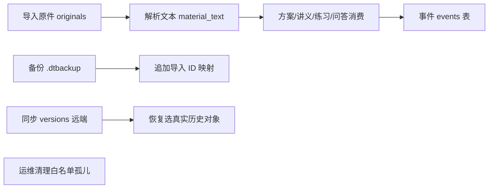

- 备份排除项：auth_sessions、access_tokens、share_index（secure_delete 后 VACUUM，backup/archive.rs:392-398）；系统凭据本就不在库中（keyring）。
- 导入追加语义：冲突 ID 保留双方（materials 按 sha256 复用）；已有 preferences/routing 不覆盖（transfer.rs:862-866）；agent_memory 重名加"· 导入 n"后缀（:900-914）。
- 同步只含脱敏供应商档案与任务路由，不含学习备份（sync/mod.rs:525-554）；恢复必须选择真实历史对象（versions.rs:31 校验路径属本配置 versions/ 目录）。
- 数据目录切换：不搬移不删除旧数据；目录配置不作为备份中的绝对路径恢复（startup.rs:194-243；plan/README.md 约定）。

## 5. 异常恢复矩阵

| 失败点 | 处理 | 恢复路径 | 证据 |
|---|---|---|---|
| 启动目录配置损坏 | typed error storage_config_invalid，不开错工作区 | 主窗口内恢复默认/重选/重试 | startup.rs:557-569,724-747 |
| 数据库损坏 | Store::root 拒绝打开（storage_failed） | 用户指定目录级恢复；维护页 integrity_check | startup.rs:571-601 |
| 数据库降级 | user_version>1 拒绝（unsupported_schema） | 升级应用 | store.rs:135-141 |
| 写锁竞争 | busy_timeout 10s → database_busy | 前端提示重试 | store.rs:134；error.rs:38 |
| 模型步骤中断 | 步骤 interrupted + request_id 持久化 | resume 复用 completed_chat，不重调上游 | learning/mod.rs:655-668 |
| 提供商连续失败 | 熔断 open 60s | half_open 试探恢复 | routing.rs:626-714 |
| 全部候选失败 | all_providers_unavailable | 换供应商/调路由 | routing.rs:1082 |
| 预算超限 | ensure_budget 拒绝（session/daily USD） | 用户调预算设置 | usage.rs:426 |
| 解析线程崩溃 | catch_unwind → failed + internal_error | 重新 enqueue | materials/mod.rs:862,897 |
| 同步回读不一致 | sync_verify_failed，任务失败 | 重试上传 | versions.rs:196-203 |
| 备份导入中途失败 | 单事务回滚 + 删除已装文件 | 修正后重新导入 | transfer.rs:1121-1125 |
| 应用重置 | 先停任务；DB 成功后才删原件/凭据，失败保留备份 | reset_application | backend/commands.rs:82-110 |
| 用户切换工作区 | 写锁停 7 子系统 → 换库 → 失败回滚 | 守卫 switch | security/guard.rs:49-127 |

## 6. 安全工作流

密钥生命周期：

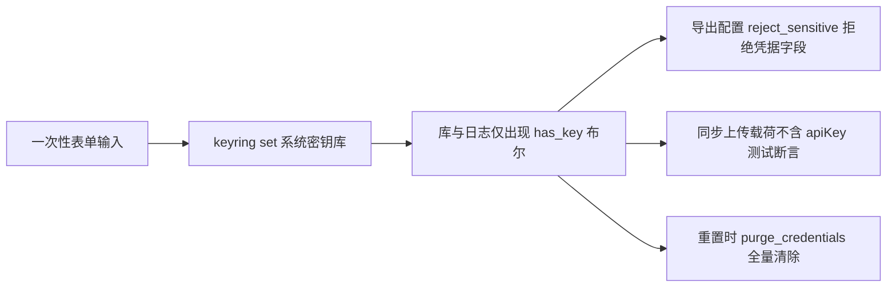

- 密钥流：一次性表单 → `CredentialBackend.set`（keyring）→ 库/日志/导出/同步只出现 `has_key` 布尔；导出配置 `reject_sensitive`（providers/sync_config.rs:30）拒绝凭据字段；上传载荷测试断言无 apiKey。
- 鉴权流：guard 五层（02 §1；security/guard.rs:132-183）；停用/删除用户即吊销全部会话与 PAT 并删 keyring 条目（security/mod.rs:939-953,1004-1006）。
- 配额流：四资源（notes 500/materials 200/sessions 200/threads 500 默认，security/mod.rs:135）提交前强制；拒绝写入不影响其他用户（store.rs:284-329）。
- 分享流：令牌只存哈希；哈希索引仅暴露给只读定位；快照带工作区 ID 与事件代次（sharing/mod.rs:129-136）。
- 网络流：全部出站经 `public_address`/DNS pin/禁代理绕过/重定向逐跳校验（providers/openai.rs:103,243-254；web/mod.rs:71-181）。

## 7. 前端页面 × 命令矩阵（摘要）

| 页面 | 主命令 | 监听事件前缀 |
|---|---|---|
| Dashboard | get_dashboard | state.changed/focus./plan./practice./review. |
| PlanGenerator | start/cancel/resume/regenerate/adopt、import_material_*、import_webpage | material./plan./provider.chat_delta |
| Plan | get_plan_overview、apply_plan_intensity、update_learning_goal、replace_collection(tasks) | plan./state.changed/security.session_started |
| StudyRoom | get_lecture、generate_lecture、set_reading_progress、save_study_note | lecture./study.progress_changed/agent.artifact_promoted |
| KnowledgeMap | get_knowledge_overview/path、add_knowledge_task | plan.adopted/study.progress_changed |
| AgentCenter | send_agent_message、approve_agent_request（useAgent） | agent./provider.chat_delta/route_attempt |
| Practice | generate/submit_practice_answer/submit_exam | practice./provider.chat_delta |
| Review | next/grade_review_card | review./plan. |
| Library | saveDraft（防抖）、import_notes、get_library_overview | material./study.note_saved/state.changed |
| Projects | submit_project_version、cancel/resume_feedback | project./provider.chat_delta |
| Reports | get_learning_report/calendar、focus 全套 | focus./study.checkin/practice./review./plan. |
| Community | get_community_overview、post/reply/reserve、claim_community_reminders | community. |
| Integrations | 插件全套 | plugin. |
| ProviderHub | 供应商/路由/熔断/日志、stream_provider_chat | 经 refresh |
| Settings | 学习档案、setPreferences | security.session_started/state.changed |
| SharedPlan | read_shared_plan、read_shared_plan_package | 无 |

组件归属：DataDirectoryPanel/BackupPanel/SecurityPanel/SyncPanel/MaintenancePanel/UsagePanel/ExportCenter/SharePlanDialog/MediaPlayer/WikiPanel/ExamWorkspace/SubjectivePractice/TutorPanel/AgentTaskCenter（components/）。

## 8. 命令与事件契约一致性

前端 24 个客户端文件调用的命令名与 main.rs:75-264 注册表逐一核对一致；事件通道唯一（`backend://event`），事件体 `{id,kind,payload,createdAt}` 双端一致；参数 camelCase 与 Tauri 默认映射一致（backend/commands.rs:230-236 IPC 测试同形验证）。
