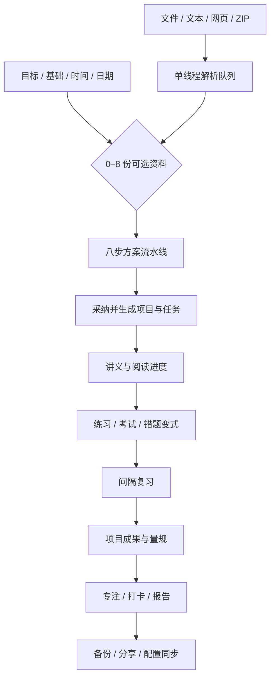
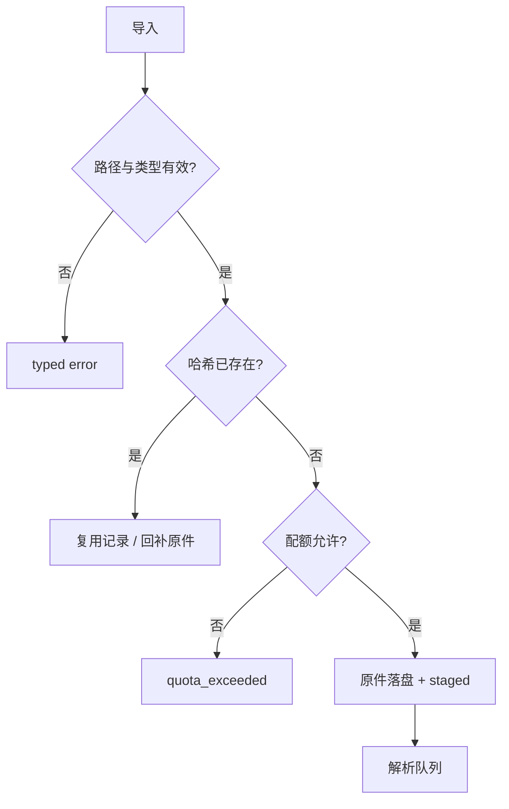
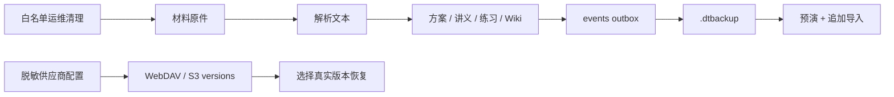
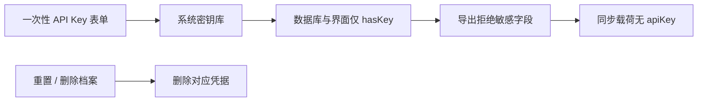

# 03 · 工作流分析

> 本文说明构建、验证、业务决策和数据生命周期。命令与模块见 [01 架构分析](01-architecture.md)，算法与状态机见 [02 运行原理](02-operation-principles.md)。

## 1. 构建、发布与 CI

### 1.1 本地入口

| 命令 | 实际动作 |
|---|---|
| `make lint` | Rust 格式检查、六处版本一致性、架构文档命令指标核对、TypeScript/Vite 生产构建、npm runtime 与 dev 双口径审计 |
| `make test` | 先跑 Node 自带的构建脚本与前端回归测试，再在 `desktop/src-tauri` 执行 `cargo test --release --locked -- --test-threads=1` |
| `make dev-smoke` | 检查 43198 端口，启动 strictPort Vite，断言应用挂载标记，终止自身进程树并清理该端口残留监听 |
| `make check` | `lint + test + dev-smoke` |
| `make build` | 先执行 lint，再收集第三方许可、构建 NSIS，将安装包复制到根 `dist/` 并双向校验 SHA-256，最后清理旧版本安装包 |
| `make hooks` | 将 Git hooks 路径设为 `.githooks`；pre-push 执行 `make check` |

`npm run tauri build -- -- --locked` 与 `make build` 使用相同的 `beforeBuildCommand` 和许可收集链。`--locked` 传递给 Cargo，锁文件不一致时构建失败。

六处版本为 `desktop/package.json`、`desktop/package-lock.json`、`desktop/src-tauri/tauri.conf.json`、`desktop/src-tauri/Cargo.toml`、Cargo.lock 工作区包条目和根 README。当前版本为 1.1.16。

本地使用 Rust 1.99.1 GNU host、winlibs 的 dlltool 和 F 盘 Cargo/Rustup 缓存；CI 使用同版本默认 MSVC host。两种 host ABI 的构建问题不能互相替代验证。

### 1.2 CI 顺序

```mermaid
flowchart LR
    A[push main / PR / 手动] --> B[Windows + Node 24 + Rust 1.99.1]
    B --> C[npm ci]
    C --> D[tsc --noEmit]
    D --> D1[前端单测]
    D1 --> D2[构建脚本单测]
    D2 --> E[dev server smoke]
    E --> F[npm audit 双口径]
    F --> G[cargo fmt --check]
    G --> H[cargo test release locked 串行]
    H --> I[版本校验]
    I --> I2[架构文档指标核对]
    I2 --> J[许可收集 + NSIS build]
    J --> K[--verify-native]
    K --> L[上传 exe 与 sha256]
```



CI 不部署应用，也不创建 GitHub Release。构建脚本在复制安装包后清理 `dist/` 与 NSIS bundle 目录中的旧版本安装包，`dist/` 只保留当前安装包及摘要；推送和发布由用户决定。

## 2. 验证策略

### 2.1 测试组织

- 当前有 324 个 Rust `#[test]`，使用 release、锁定依赖和 `--test-threads=1` 串行执行。共享进程状态包括检索端点、迁移计数和同步测试开关。
- Node 测试通道两条：`scripts/frontend-test.mjs`（前端 Markdown 与主题缓存等）与 `scripts/build-test.mjs`（构建脚本：安装包发布顺序与旧版本清理），均用 Node 自带 test runner，不新增依赖，`make test` 与 CI 各执行一次。
- 每域测试与实现同目录；providers、security、practice、sync 等按协议、守卫、考试、主观题、变式或版本拆分。
- `tauri::test::MockRuntime` 驱动真实命令 IPC；SQLite 使用真实临时数据库；系统密钥库在测试中使用内存实现。
- 本机回环 `TestServer` 验证 LLM、WebDAV、S3 和网页的实际 HTTP 请求、状态码、用量与错误映射，不把协议夹具称为真实供应商验收。
- learning 使用 defer 内联执行流水线，materials 在测试中等待任务完成，sync 可暂停调度线程。
- 事件测试覆盖持久化、快照游标、终态顺序、取消恢复和结果重放；恢复测试断言上游请求计数不增加。
- 备份测试覆盖 ID 映射、外键重写、缺件警告和重复导入；同步测试覆盖回读和保留 10 份；安全测试覆盖用户工作区与异步 principal。

### 2.2 独立验收

真实供应商、真实媒体编解码播放、交互安装/运行/卸载、真实拖放和系统对话框必须分别验收。编译、协议夹具和无界面测试不能替代这些环境证据。

原生安装契约使用：

```bash
DEEPTUTOR_VERIFY_DATA_DIR=F:/Github/repo/Deep-tutor/TEMP/<独立目录> <可执行文件> --verify-native
```

该入口只访问指定目录，完成真实装配和 SQLite 初始化后退出，不打开窗口。自动化不得驱动前台窗口、模拟键鼠或截屏。临时文件使用仓库 `TEMP/`，结束后清理。

## 3. 学习业务工作流



### 3.1 材料进入

材料必须依次通过路径、类型、签名、大小和哈希检查。SHA-256 去重发生在配额写入前；新原件先安全落盘，再创建数据库记录。文本解析由单工作线程执行，媒体只读取原件。



### 3.2 方案采纳、再生成与强度

- `adopt_learning_plan` 只接受 done/degraded 方案；重复采用直接返回现有快照。首次采用在一个事务中创建项目、按阶段创建里程碑、按排期创建任务和采用关联。
- `regenerate_learning_plan` 支持从步骤 2–6 开始局部重跑，保存覆盖前版本并递增 version。已采用方案返回 `plan_adopted`，必须另建新方案；重生成次数受 `regeneration_limit` 约束，默认上限为 2。
- `update_learning_goal` 在同一流程中校验状态、次数、目标和每周 1–80 小时，再更新输入并局部重跑，避免只保存目标而未执行再生成。
- 强度因子为稳妥 0.8、标准 1.0、冲刺 1.2。按 `round(当前分钟 × 目标因子 / 当前因子)` 缩放排期、任务和阶段；每日分钟额外钳制到 10–600。
- 往返强度切换使用当次存储值计算，独立取整可能产生每项 ±1 分钟漂移。替代方案按实际分钟计算。
- 强度调整保存覆盖前快照，同步写排期表、任务集合、方案结果、artifacts.step5 和步骤 5 输出；preferences/tasks 使用 revision 乐观锁，事务内复查方案状态。
- 强度调整不改变日期，因此不重算 `within_deadline` 和 `within_milestone`。

### 3.3 练习、错题与复习

- 练习可按方案、阶段和知识节点限定范围；nodeId 必须属于该方案和阶段，恢复任务不得扩大范围。
- 错题变式只能引用同方案、同题型且非考试的真实错题；生成结果不得复制原题干。
- 变式答对沿链更新中间错题和原错题的掌握状态；未作答考试题不进入错题或变式链。
- 复习按 due_at 选择最旧到期卡片，评分公式、并发守卫和挂起语义见运行原理。

### 3.4 项目成果

`submit_project_version` 接受 1–100000 字节且不含 NUL 的正文、可选里程碑和已解析资料。每项目只允许一个活动反馈任务。

版本和 running 状态在 IMMEDIATE 事务中提交后才发送开始事件。模型按概念应用、实现质量、验证与反思三个 0–100 分字段评分，返回不超过 6000 字节的总结和 1–5 条建议；不声称执行代码。无效输出进入 failed，不生成替代评价。取消与结果同时到达时保留反馈，但终态为 cancelled 并发送取消终态事件。迭代想法写入真实 notes 集合。

### 3.5 报告与统计口径

报告周期为 4w、8w、semester。秋季学期从 9 月 1 日到次年 2 月末，春季学期从 3 月 1 日到 8 月末；寒暑假月归入刚结束的学期。

- 首页和周报使用任务级口径：同一已完成任务的计划分钟与关联专注秒取较大者；任务未勾选或完成时间不在窗口内时，关联专注仍按实际秒计入。未关联任务的专注按实际秒计入。
- 84 天学习日历使用日级口径：每日自报分钟与专注分钟取较大者，任务勾选分钟不进入日历，自报打卡不进入周报。来源标签取实际提供较大值的来源。
- 连续记录允许今天尚无记录的一天宽限，从昨天继续计算；打卡率分母为窗口内首个活跃日起的天数，无记录时为 0。
- 主动练习只统计实际作答；掌握度来自有效学习证据，无证据时返回空值，不生成示例趋势。
- 专注计划时长为 60–14400 秒，保存实际秒数与暂停恢复；完成任务保留计划分钟，二者在展示和聚合中明确区分。
- 学习报告和用量 CSV 由后端导出；用量 CSV 对公式前缀转义，避免表格软件执行单元格内容。

### 3.6 Wiki 与知识库

Wiki 问答要求 1–8 份已解析资料，问题为 1–8000 字节。每份资料最多 16000 字符，合计最多 64000 字符，超出部分标记截断；回答不超过 30000 字节。

模型声称资料充分时必须提供引用。范围外或无法在原文定位的引用被剔除并计入警告；重复引用去重。若声称充分但有效引用全部为空，返回 `citation_mismatch`。引用定位使用大小写不敏感的字符窗口，保存起止字符和行号。

笔记与知识节点的关联只来自学习阶段批注；删除笔记同步清理关联。知识库检查报告未关联自由笔记、完全相同正文、缺失原件和解析失败，不自动删除内容。

### 3.7 本机社区与提醒

社区数据只保存在当前工作区，不创建在线成员或音视频房间。创建房间和预约都在写事务内检查时段重叠；关联小组的房间要求预约者已加入。

预约提醒时间为 `max(开始前 15 分钟, 当前时间)`。前端每 60 秒领取到期提醒，窗口恢复可见时补领；后端在 IMMEDIATE 事务中通过 `delivered_at IS NULL` 条件更新防止重复投递。房间结束时刻使用 `>= 当前时间` 的可领取边界，结束后不再领取。取消预约或房间会删除提醒和对应通知。

免打扰启用且 start==end 表示全天静默；disabled 表示关闭免打扰。静默时段提醒仍进入通知中心，但不主动弹出。

### 3.8 全局导师与 Agent

全局导师通过 `TutorPanel → useAgent → create_agent_session/send_agent_message` 使用 Agent 会话，支持 `planId: null`，不默认绑定首个方案。模型中心的手动测试面板才由前端直接调用 `route_provider_chat`。

通用 Agent 只开放网络、记忆和历史工具；绑定已采用方案后开放 workspace 和 artifact 工具。Wiki 引用问答要求资料范围，通用问答与 Wiki 是两条独立调用链。

## 4. 数据生命周期



- 全量备份包含学习数据、材料、插件和 Agent scratch，不包含系统凭据、JWT 会话、PAT 摘要或分享索引。
- 导入采用追加语义。材料按 SHA-256 复用，冲突 ID 重映射并保留双方，已有 preferences 和 routing 不覆盖；已知旧版悬挂引用按表降级并警告。
- 同步只包含脱敏供应商档案和任务路由，不包含学习备份。上传必须回读校验，恢复必须选择真实历史对象。
- 数据目录切换不自动迁移；目录绝对路径不随备份恢复。
- 清理只删除无数据库引用的白名单文件和可识别临时项；仍被方案、Wiki、项目或 Agent 产物引用的材料拒绝删除。
- 应用重置在同一数据库事务中删除业务数据和旧事件并写入新的 `application.reset`，数据库成功后再删除文件证据，事件序列保持递增。

## 5. 异常恢复矩阵

| 失败点 | 错误与处理 | 恢复方式 |
|---|---|---|
| 目录配置损坏 | `storage_config_invalid`，不打开其他工作区 | 恢复默认、重选目录或重试 |
| 数据库损坏或非数据库文件 | `database_corrupt` | 使用空目录启动并导入全量备份 |
| 数据库版本过高 | `unsupported_schema`，拒绝降级修改 | 升级应用 |
| SQLite 写锁竞争 | 10 秒等待后 `database_busy`；前端读路径有限重试 | 稍后重试；写路径必须明确提示 |
| 模型步骤中断 | 保存 interrupted 和请求标识 | 显式 resume，复用已完成请求 |
| 路由全部失败 | `all_providers_unavailable` | 修改档案或故障转移队列 |
| 预算超限 | 会话或每日预算拒绝执行 | 调整预算或供应商 |
| 材料解析崩溃 | panic 转 failed | 重新入队；重启后可自动重跑本地解析 |
| 同步回读不一致 | `sync_verify_failed` | 修复远端或网络后重试 |
| 备份导入失败 | 事务回滚并删除本次安装文件 | 修正备份后重新导入 |
| 用户切换失败 | 停止失败或换库失败时回滚旧工作区并恢复后台 | 消除错误后重试 |
| 应用重置失败 | 数据库未成功前不删除原件与凭据 | 重试或从备份恢复 |

## 6. 安全工作流

### 6.1 密钥与身份



JWT 使用 HS256 和 7 天有效期；单活动会话在签发时撤销旧会话。PAT 使用系统随机数，数据库只保存 SHA-256。停用或移除用户会撤销会话和 PAT。登出后保留已撤销会话记录，重启不得自动登录。

默认配额为 Agent 会话 200、笔记 500、材料 200、社区帖子与回复合计 500、Agent 记忆 500。提交前在写事务内复查，一个用户的拒绝不影响其他用户。

### 6.2 网络、分享与文件

- 远程模型和网页请求执行公网地址检查、DNS 钉扎、禁代理和重定向约束；本地模型使用独立端点规则。
- 网页 URL 拒绝凭据和密钥参数；网页内容限制类型、大小和编码，不执行脚本。
- 分享令牌只存哈希，快照不包含工作区 ID；离线包不证明来源且不能撤销。
- 材料、归档和 Agent 产物检查路径、签名、大小、数量和哈希；导出使用原子写和目的地遏制。
- API Key、同步凭据、JWT 和 PAT 不得进入日志、导出、备份、同步载荷或测试夹具。
- 前端只能打开 `https://**` 外链；资源管理器定位只接受数据根或本进程登记的导出回执。

## 7. 页面与命令

| 页面 | 主要命令 | 主要事件或刷新来源 |
|---|---|---|
| Dashboard | get_dashboard | App 统一下发；state.changed、focus、plan、practice、review |
| PlanGenerator | start/cancel/resume/regenerate/adopt、材料与网页导入 | material、plan、provider.chat_delta |
| Plan | get_plan_overview、apply_plan_intensity、update_learning_goal、assign_task_date | plan、state.changed、security.session_started |
| StudyRoom | get_lecture、generate_lecture、set_reading_progress、save_study_note | lecture、study、agent.artifact_promoted |
| KnowledgeMap | get_knowledge_overview/path、add_knowledge_task | plan.adopted、study.progress_changed |
| AgentCenter | create/list/get/send/cancel/resume、approve_agent_request | agent、provider.chat_delta、provider.route_attempt |
| Practice | generate/submit_practice_answer、submit_exam、变式与错题命令 | practice、provider.chat_delta |
| Review | list/next/grade_review_card、卡片 CRUD | review、plan |
| Library | 集合命令、saveDraft、import_notes、get_library_overview | material、study.note_saved、state.changed |
| Projects | get_project_workspace、submit/cancel/resume、迭代笔记 | project、provider.chat_delta |
| Reports | get_learning_report/calendar、focus、打卡与建议 | focus、study.checkin、practice、review、plan |
| Community | get_community_overview、帖子/回复/小组/房间命令 | community；App 每 60 秒领取提醒 |
| Integrations | 插件安装、启停、重载、卸载、事件与资产 | plugin |
| ProviderHub | 档案、路由、熔断、日志、test_provider、route_provider_chat | 命令返回与主动刷新 |
| Settings | 偏好、学习档案、安全、备份、同步、运维和导出 | security.session_started、state.changed |
| SharedPlan | read_shared_plan、read_shared_plan_file | 只读命令返回 |

18 个组件为 DataDirectoryPanel、BackupPanel、SecurityPanel、SyncPanel、MaintenancePanel、UsagePanel、ProviderRouting、ExportCenter、SharePlanDialog、MediaPlayer、WikiPanel、ExamWorkspace、SubjectivePractice、TutorPanel、AgentTaskCenter、ReportViews、UI 和 icons（图标装饰包装层）。

## 8. 命令与事件一致性

- `main.rs` 注册 189 个命令，前端直接调用 189 个（25 个后端客户端文件中 22 个含直接 `invoke(` 调用点，其余 3 个经 `client.ts` 封装）；命令名和 camelCase 参数由 IPC 测试与 TypeScript 类型共同约束。
- `read_shared_plan_package`（按分享包字符串读取）只有客户端封装 `sharingBackend.readPackage`，没有页面调用方；SharedPlan 页实际只调用 `read_shared_plan`（令牌）与 `read_shared_plan_file`（文件路径）。
- `events_since` 仅在 `cfg(test)` 构建中保留；`stream_provider_chat` 和 `get_agent_run` 已删除，当前读取与执行分别使用 `route_provider_chat` 和 `get_agent_session`。`fetch_webpage` IPC 壳已删除。
- 所有后端事件使用 `{id,kind,payload,createdAt}` 和唯一 `backend://event` 通道。
- 前端通常只消费事件 kind/prefix 及 materialId、planId、sessionId、runId、requestId、stageId、namespace 等标识，再执行命令读取权威状态；其他 payload 字段用于审计。
- `isCancelRace` 统一处理任务已结束、另一操作已登记、审批已解决和预约已变化等竞态错误。普通写错误必须显示。
