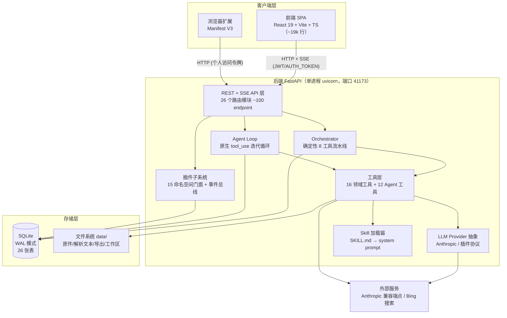

# Deep-tutor 项目深度分析笔记

> 分析时间：2026-10-12
> 分析范围：`F:\Github\repo\Deep-tutor` 全仓库（backend / frontend / plugins / extension / skills / scripts / CI）
> 分析模式：完整分析（后端核心文件逐行深读，前端与周边由并行子代理深扫后汇总）
> 代码规模：后端 app ~23,800 行 Python · 后端测试 ~26,800 行 · 前端 ~19,400 行 TS/TSX · 插件实例 ~870 行 · 浏览器扩展 ~260 行
> 按用户要求：本次**不包含** AI 替代建议与 Skill Blueprint

## 项目一句话定位

**本地优先、单机开箱即用的 AI 学习助手**：把"想学的东西"（PDF/链接/一句话需求）变成结构化学习方案，并陪伴整个学习过程（做题、间隔复习、自学讲义、笔记、知识库、AI 对话）。

## 笔记目录

| # | 笔记 | 内容 |
|---|------|------|
| 1 | [架构总览](01-架构总览.md) | 技术栈、分层架构、模块依赖图、目录功能角色、设计模式 |
| 2 | [数据模型](02-数据模型.md) | 26 张表逐一详解、枚举、级联策略、ER 图、文件系统存储布局 |
| 3 | [生成流水线](03-生成流水线.md) | Orchestrator 8 工具流水线：SSE 生成全流程、反馈循环、局部重生成、断线续接（函数级调用链 + 多张流程图） |
| 4 | [Agent对话与记忆系统](04-Agent对话与记忆系统.md) | 原生 tool_use Agent 循环、Thread/Run/Message/RunStep 持久化、工作区沙箱、草稿提升审批（图） |
| 5 | [LLM供应商与成本计量](05-LLM供应商与成本计量.md) | Provider 抽象、三级回退工厂、插件协议、模型计费表、预算守卫（图） |
| 6 | [API 全览](06-API全览.md) | 全部 ~100 个 endpoint 清单、认证链、统一错误、限流、配额 |
| 7 | [插件系统](07-插件系统.md) | 后端插件框架：15 个命名空间门面、事件总线、热重载、9 个内置插件（图） |
| 8 | [核心基础设施](08-核心基础设施.md) | 配置、安全（JWT/PBKDF2/开放模式）、存储、DB 引擎与迁移、备份、运维 |
| 9 | [工具契约清单](09-工具契约清单.md) | 16 个流水线/领域工具 + 12 个 Agent 工具的签名、入出参、降级默认 |
| 10 | [前端架构](10-前端架构.md) | React SPA：路由、API 客户端、SSE、任务引擎、插件注入机制（图） |
| 11 | [周边与工程化](11-周边与工程化.md) | 浏览器扩展、Skills 资产、CI、启动脚本、测试策略、设计文档族谱 |
| 12 | [Reasonix改造决策](12-Reasonix改造决策.md) | **改造宪法**：2026-10-15 定稿（五轮 61 项决策）+ 修订记录（2026-10-17 #37 修订为全量吸收）；四阶段划分、四大张力点 |
| — | [graft/STAGE.md](graft/STAGE.md) | 上游嫁接一手进度档案（随内核吸收入库，2026-10-15 止；吸收执行记录见根 stage.md iter R1/R2） |

## 阅读建议

- **改造相关工作 → 先读 12（改造决策档案）与 plan/reasonix/（完整改造方案），再按需回读 01–11 的对应域**
- 想快速了解项目怎么组织的 → 读 01，再看 02
- 想理解"生成一个学习方案"到底发生了什么 → 读 03（核心中的核心）
- 想理解 AI 对话/记忆/工具调用 → 读 04 + 09
- 想做二次开发/写插件 → 读 07 + 06 + API.md
- 想部署运维 → 读 08 + 11

## 顶层架构速览

## 核心发现（TL;DR）

1. **双执行模型**：方案生成走"确定性编排器"（`app/agent/orchestrator.py` 固定 8 工具流水线 + 校验反馈循环 + 并行段），AI 对话走"自由 Agent 循环"（`app/agent/agent_loop.py` 原生 tool_use，最多 25 步）。两者共享工具注册表与 ExecContext，但状态机、持久化、SSE 流完全独立。
2. **成本意识贯穿到底**：每次 LLM 调用即时落 `api_usage`（防"成本黑洞"——项目历史上多次迭代都在堵这个洞），三级计费解析（用户计费表 → Anthropic 族默认 → 记 0 告警），会话预算 + 日预算双重守卫。
3. **记忆系统仿 OpenAI Assistants**：Thread/Message/Run/RunStep/RunArtifact/Memory 六表，append-only 消息历史、按需召回记忆（非自动召回）、Claude Code 式沙箱工作区（scratch→commit→promote 三段生命周期 + 用户审批）。
4. **插件系统是完整的二次开发框架**：单文件 Python 插件经 `register(api)` 获得 15 个命名空间（tools/parsers/exporters/providers/llm/mcp/scheduler/storage/webhooks/middleware/routes/events/settings/deps/memory），失败自动回滚、支持热重载、事件总线与 SSE 实时事件流打通前端。
5. **工程质量异常扎实**（对个人项目而言）：~26,800 行测试（约 105 个测试文件覆盖几乎所有 API/工具/插件）、26 张表 Alembic 迁移链、统一错误信封、SSRF/zip bomb/XSS/路径穿越防护、原子写、有界队列背压——错误处理链路在每份笔记中都有专门小节。
