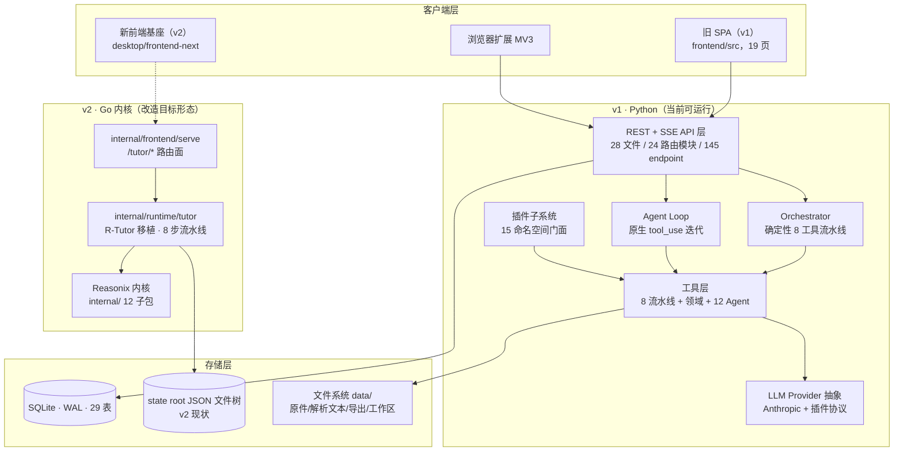

# Deep-tutor 项目分析笔记

> 分析范围：`F:\Github\repo\Deep-tutor` 全仓库（backend / frontend / plugins / extension / skills / internal / cmd / sdk / desktop / tools / docs / plan）
> 重基线日期：2026-10-20（分支 `refactor/reasonix`）
> 行号口径：以重基线日工作区为准；`backend/` 与 `frontend/` 为 Python v1 实现，`internal/` 与 `cmd/` 为 Go 内核改造形态。
> 统计口径：代码行数按**总行数**计（`[System.IO.File]::ReadAllLines` 逐文件累加，等价 `wc -l`），与文中行号引用同口径；表数取 `Base.metadata.tables`；端点数取 OpenAPI 实际导出。

## 目录

| # | 笔记 | 内容 |
|---|------|------|
| 1 | [架构总览](01-架构总览.md) | 分层架构与依赖方向、模块依赖图、关键设计模式、Go 侧现状与阶段①进度 |
| 2 | [数据模型](02-数据模型.md) | 29 张表逐一详解、枚举全集、两条状态机、级联策略、文件系统布局、Go 侧数据层现状与目标 |
| 3 | [生成流水线](03-生成流水线.md) | Orchestrator 8 工具流水线：SSE 生成全流程、反馈循环、局部重生成、断线续接、Go 侧同构实现与差异 |
| 4 | [Agent对话与记忆系统](04-Agent对话与记忆系统.md) | 原生 tool_use Agent 循环、记忆六表、工作区三段生命周期、审批与提示、Go 侧对应实现与缺口 |
| 5 | [LLM供应商与成本计量](05-LLM供应商与成本计量.md) | Provider 抽象、三级回退工厂、插件协议、模型计费表、三层预算守卫、Go 侧 Provider 与官方费率表 |
| 6 | [API全览](06-API全览.md) | 145 个 endpoint 清单、认证链、统一错误信封、限流配额、横切守卫矩阵、Go 侧 `/tutor/*` 路由面 |
| 7 | [插件系统](07-插件系统.md) | 后端插件框架：15 个命名空间门面、事件总线、热重载、MCP 客户端、Go 侧扩展体系 |
| 8 | [核心基础设施](08-核心基础设施.md) | 配置、安全、存储、DB 引擎与迁移、凭证、限流、备份、运维、Skill 加载器、Go 侧基础设施现状与目标 |
| 9 | [工具契约清单](09-工具契约清单.md) | 8 个流水线工具 + 领域工具 + 12 个 Agent 工具的签名、入出参、降级默认、Go 侧工具面 |
| 10 | [前端架构](10-前端架构.md) | React SPA：路由、API 客户端、SSE、任务引擎、插件注入机制、新前端基座现状 |
| 11 | [周边与工程化](11-周边与工程化.md) | 插件实例、浏览器扩展、Skills、CI、启动脚本、测试策略、文档资产链、Go 侧周边资产 |
| 12 | [Reasonix改造决策](12-Reasonix改造决策.md) | **改造宪法**：2026-10-15 定稿（五轮 61 项决策）+ 修订记录（含 2026-10-20 上游无关资产清除） |
| 13 | [本机全局提示词](13-全局提示词.md) | **本机级**（跨项目跨 Agent）的 MiniMax Code 全局指令：落点 `F:\MiniMax\Data\.minimax\AGENTS.md`、运行时读取链路源码依据、规则全文、与本仓规约的重合与分歧 |
| — | [graft/STAGE.md](graft/STAGE.md) | 上游嫁接一手进度档案（随内核吸收入库，2026-10-15 止；吸收执行记录见根 stage.md iter R1/R2） |

## 阅读建议

- 改造相关工作 → 先读 12（决策宪法）与 [plan/reasonix/](../plan/README.md)（完整方案），再按需回读 01–11 的对应域
- 想知道「本机所有 MiniMax 任务都遵守哪些通用规范」→ 读 13（本机级，不属于本仓专属规约）
- 快速了解项目组织方式 → 读 01，再读 02
- 理解「生成一个学习方案」的实际流程 → 读 03
- 理解 AI 对话、记忆、工具调用 → 读 04 + 09
- 插件二次开发 → 读 07 + 06 + [API.md](../API.md)
- 部署运维 → 读 08 + 11

## 仓库形态

仓库同时存在两代实现：

| | v1（Python） | v2（Go 内核改造） |
|---|---|---|
| 目录 | `backend/` `frontend/` `extension/` `plugins/` `plugin-examples/` `skills/` | `internal/` `cmd/` `tools/` `sdk/` `desktop/` `docs/kernel/` |
| 形态 | FastAPI + React SPA + SQLite 26→29 表 + 进程内插件 | Reasonix 内核 + 多用户 SQL 域 + `/api` 兼容层 + 四前端 |
| 端口 | 41173（当前可运行） | 41173（阶段① M5 验收后接管） |
| 状态 | 保留至阶段④删除 | 阶段① M1 完成，M2–M5 未开始 |

## 规模基线（2026-10-20 实测）

| 区域 | 规模 |
|---|---|
| `backend/app` | 94 个 `.py`，31 311 行 |
| `backend/tests` | 201 个 `.py`（188 个 `test_*.py`），45,055 行，1729 个 test 函数（pytest 收集 1736 用例） |
| `backend/alembic/versions` | 26 个迁移 |
| `backend/app/api` | 28 个 `.py`（24 个路由模块 + `deps.py`/`errors.py`/`sse_utils.py`/`__init__.py`）；OpenAPI 120 paths / 146 operations |
| `backend/app/db/models.py` | 29 张 ORM 表 |
| `frontend/src` | 73 个 `.ts`/`.tsx`（另 1 个 `.css` 219 行），20 569 行；19 页 + 38 组件 |
| `plugins/` | 8 个 `.py` + 1 个 `.disabled`（891 行，不含 README） |
| `extension/` | 7 个代码文件（343 行）+ README（27 行） |
| `skills/` | 8 个目录，19 个文件 |
| `internal/` | 12 个一级子包，4812 个 `.go`，834 739 行 |
| `cmd/` | 5 个入口目录，21 个 `.go` |

## 架构速览

## 核心结论

1. **双执行模型**：方案生成走确定性编排器（`backend/app/agent/orchestrator.py` 的 8 工具流水线 + 校验反馈循环 + 并行段），AI 对话走自由 Agent 循环（`backend/app/agent/agent_loop.py` 的原生 tool_use，最多 25 步）。两者共享工具注册表与 ExecContext，状态机、持久化、SSE 流独立。
2. **成本计量贯穿全链**：每次 LLM 调用即时落 `api_usage`，三级计费解析（用户计费表 → Anthropic 族默认 → 记 0 并告警），会话预算 + 日预算 + 重生成次数三重守卫。Go 侧改为 Reasonix 官方费率表（append-only + superseded）权威。
3. **记忆系统仿 OpenAI Assistants**：Thread/Message/Run/RunStep/RunArtifact/Memory 六表，append-only 消息历史，按需召回记忆（工具显式召回，不自动注入），工作区 scratch→committed→promoted 三段生命周期 + 用户审批。
4. **插件体系是完整的二次开发框架**：单文件 Python 插件经 `register(api)` 获得 15 个命名空间，失败自动回滚、支持热重载、事件总线与 SSE 事件流打通前端。v2 以 Reasonix 插件包 / Extension Protocol v2 / MCP / skill 承接。
5. **工程质量密度高**：188 个测试文件（1736 个 pytest 用例）、26 个 alembic 迁移、统一错误信封、SSRF/zip bomb/XSS/路径穿越防护、原子写、有界队列背压。Go 侧门禁工具（repolint/covergate/pricecheck）随内核吸收入库，但基线尚未按本仓树重建，且未接入 CI。
6. **内核吸收已完成**：R-Tutor studio 快照 8289 文件入库，`internal/runtime/tutor` 的 8 步流水线与 v1 同构；存储当前为 JSON 文件态，阶段① M2/M3 改为 SQL 并补 `/api` 兼容层。
