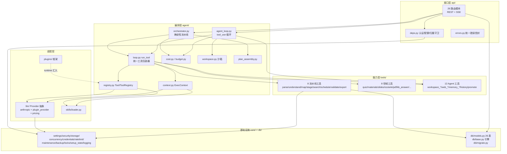

# 01 · 架构总览

> 证据基线：`backend/app/**`、`frontend/src/**`、`plugins/**`、`extension/**`，行号以 2026-10-12 工作区（分支 FIX-Filter）为准。

## 1. 项目画像

| 维度 | 事实 |
|------|------|
| 名称/版本 | Deep-tutor v0.1.0.0（`backend/app/main.py:157`） |
| 定位 | 本地优先、单机开箱即用的 AI 学习助手（README.md:24） |
| 后端 | Python 3.11+ · FastAPI · SQLAlchemy 2 (Mapped) · Alembic · SQLite(WAL) · pydantic v2 · httpx · anthropic SDK |
| 前端 | React 18.3 · TypeScript · Vite · TanStack Query 5 · zustand · react-router 6（无 UI 组件库，自绘组件） |
| 默认端口 | 41173（避开 Windows 保留端口段，README.md:140） |
| 部署形态 | 单进程 uvicorn（`scripts/start.ps1`/`start.sh` 一键脚本：venv→依赖→构建前端→迁移→启动→开浏览器） |
| 测试 | pytest，~105 个测试文件 / ~26,800 行（`backend/tests/`） |
| CI | GitHub Actions：ruff lint + pytest + 前端 tsc + vite build（`.github/workflows/ci.yml`） |
| 分支策略 | main + 8 条功能/修复分支（DEV-PPT、DEV-memory、Dev-API、FIX-Chat、FIX-Filter、FIX-Price、dev-StarHope） |
| 依赖外部 | Anthropic 兼容 LLM 端点（推荐 deepseek-v4-flash）、Bing 搜索（API Key 或免 Key 网页版） |

### 代码规模

| 区域 | 文件数（约） | 行数 |
|------|------------|------|
| backend/app（业务代码） | ~110 | 23,789 |
| backend/tests | ~105 | 26,774 |
| backend/alembic | 22 迁移 | — |
| frontend/src | ~85 | 19,369 |
| plugins（内置插件实例） | 9 | 866 |
| extension（浏览器扩展） | 5 | 261 |

## 2. 仓库顶层结构

```
Deep-tutor/
├── backend/            # FastAPI 后端（本笔记主体）
│   ├── app/
│   │   ├── main.py         # 入口：lifespan + CORS + body 限制 + SPA 托管
│   │   ├── api/            # 26 个路由模块（表现/接口层）
│   │   ├── agent/          # 编排器 + Agent 循环 + 预算/成本/工作区（业务编排层）
│   │   ├── tools/          # 16 领域工具 + 12 Agent 工具（能力层）
│   │   ├── llm/            # LLM Provider 抽象 + 计价（外部服务适配层）
│   │   ├── plugins/        # 后端插件框架（扩展点层）
│   │   ├── skills/         # SKILL.md 加载器（prompt 资产层）
│   │   ├── core/           # 配置/安全/存储/并发/凭证/备份/运维（基础设施层）
│   │   └── db/             # ORM 模型 + 引擎 + 迁移（数据访问层）
│   ├── alembic/versions/   # 22 个迁移
│   └── tests/              # pytest 测试树
├── frontend/           # React SPA（详见 10-前端架构）
├── plugins/            # 9 个内置后端插件实例（详见 07/11）
├── extension/          # 浏览器扩展（剪藏到资料库）
├── skills/             # 8 个 SKILL.md prompt 资产（详见 11）
├── scripts/            # start.ps1 / start.sh 启动编排
├── plan/               # 12 份设计文档（架构/工具/API/风险/技能/前端/学习流/数据格式/审计/集成/极端案例）
├── data/               # 运行时数据（SQLite + 会话文件树，gitignore 但仓库留了样例）
├── API.md              # 117KB 接口契约文档（含后端插件 API v1.20.0）
├── README.md / err.md / stage.md / chat.md   # 自述 / 87 项自审记录 / 651KB 迭代日志 / 对话记录
└── plugin-examples/    # 插件示例
```

## 3. 分层架构与依赖方向

后端采用**严格分层 + 单向依赖**：api → agent → tools → llm/core/db。`core` 不依赖任何业务层；`db` 只被上层引用。例外是插件层通过"运行时汇入"（`tools/__init__.py:54` 在 `default_registry()` 里把插件工具并入注册表）实现横切扩展，而非编译期依赖。



### 依赖规则要点（证据）

- `app/api/__init__.py:8-36`：26 个路由模块逐一挂载到 `/api` 前缀下。
- `app/tools/__init__.py:25-64`：`default_registry()` 汇集 16 核心工具 + 12 Agent 工具 + 插件工具，并在末尾调用 `check_parallel_groups_safe()` 做 import 期静态断言。
- `app/agent/loop.py:47-70`：`run_tool()` 是所有工具的唯一执行入口（LLM 工具/Python 工具分流）。
- `app/core/settings.py:18`：`_REPO_ROOT` 锚定仓库根，所有相对路径（db/data/skills/plugins/frontend_dist）不依赖启动 cwd（err.md C7 修复）。

## 4. 关键设计模式（出现位置）

| 模式 | 位置 | 说明 |
|------|------|------|
| **两层执行模型**（本项目的架构核心） | `agent/orchestrator.py:1-13` vs `agent/agent_loop.py:1-26` | 确定性 pipeline（plan-gen）与自由 agent 循环（chat）并存，共享注册表与上下文 |
| **注册表 + 声明式工具** | `agent/registry.py:29-54`（`Tool` dataclass：name/llm/skill_name/output_model/default_data/requires/upstream_reads/func） | 工具即数据；`PIPELINE`/`PLAN_SECTIONS`/`FEEDBACK_TARGETS` 三张声明表 + import 期一致性断言（orchestrator.py:69-71） |
| **策略/适配器** | `llm/base.py:105-168`（LLMProvider 基类：chat/stream/chat_agentic/stream_agentic） | AnthropicProvider 与 PluginProvider 可互换；`get_provider()` 工厂三级回退（llm/__init__.py:102-152） |
| **观察者/事件总线** | `plugins/bus.py`（on/subscribe_all/emit/emit_async） | 宿主广播 plan_created/quiz_submitted/run_completed 等；SSE 事件流经 subscribe_all 转发（api/events.py:141） |
| **中间件** | main.py:164（CORS）、main.py:173-204（body 限额）；plugins/api.py:797 MiddlewareNamespace（插件 HTTP 中间件） | |
| **仓储/DAO 味道** | `api/deps.py:246-265` get_owned_session/get_owned_plan（统一 404 防枚举）；ORM 模型即领域模型 | |
| **单例/缓存** | skills/loader.py `_CACHE`；anthropic_provider.py `_clients`（按 (api_key,base_url) 有界 8 个共享 AsyncAnthropic 客户端）；settings 单例 | |
| **模板方法** | `_SessionStream`（plans.py:130）与 `_ChatStream`（memory.py:623）同构：publish/subscribe/mark_terminal/慢订阅踢出/终态副本兜底 | SSE 会话缓冲模式被复制成两份（有意为之，见 sse_utils.py:1-10 注释——plan-gen 流携带运行态不通用） |
| **沙箱** | agent/workspace.py（路径 resolve+relative_to 防穿越；写一律 tmp+os.replace 原子写） | |
| **降级默认（Pillar 2）** | loop.py:275-289 `_degraded()`：修复重试 3 次失败后，有 default_data 则 status="repaired" 继续流水线 | |

## 5. 技术栈全景（后端 requirements 关键项）

- **Web**：fastapi + uvicorn + starlette（StreamingResponse SSE）
- **ORM**：sqlalchemy 2.x（Mapped/mapped_column 声明式）+ alembic
- **校验**：pydantic v2 + pydantic-settings（.env）
- **LLM**：anthropic（AsyncAnthropic，原生流式 + tool_use）
- **HTTP 客户端**：httpx（搜索/URL 验证/网页抓取/插件 webhook）
- **文档解析**：marker（PDF 深度解析，含 OCR）、python-docx、python-pptx、pytesseract（可选 OCR）、faster-whisper（可选转写）
- **导出**：weasyprint（可选 PDF）、genanki（Anki 卡片）、icalendar 自拼（build_ics.py）
- **插件协议**：自研 MCP client（plugins/mcp.py，HTTP+SSE 与 stdio 两种传输，协议版本 2025-06-18）

## 6. 横切关注点速览

| 关注点 | 机制 | 证据 |
|--------|------|------|
| 认证 | JWT（Bearer）→ AUTH_TOKEN 回退 → 个人访问令牌 → 开放本机模式，四级链 | api/deps.py:60-135 |
| 多用户隔离 | 所有资源查询经 get_owned_* 守卫，跨用户一律 404 | api/deps.py:242-265 |
| 成本 | api_usage 落账 + 会话 BudgetTracker + 日预算 402 | agent/budget.py、api/deps.py:198-239 |
| 并发 | 全局 LLM 信号量 16 + 生成全局 8/用户 1 + chat 全局 8/线程 1 + SSE 有界队列 + 慢订阅踢出 | core/concurrency.py、plans.py:95-127 |
| 取消 | cancel_event 贯穿编排器/agent 循环/工具；客户端断连自动取消孤儿 run | memory.py:730-734 |
| 审计 | tool_calls（每次工具调用）+ run_steps（每轮）+ api_usage（每次计费） | db/models.py:514-558、798-823 |
| 崩溃恢复 | 启动时 stale running → interrupted；终态幂等回放；工作区磁盘持久 + committed 标志 | main.py:68-95 |
