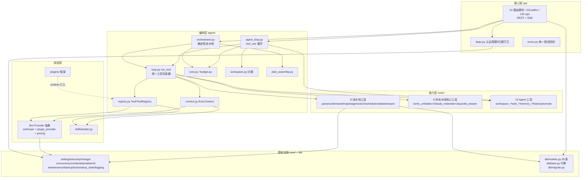

# 01 · 架构总览

> 证据基线：`backend/app/**`、`frontend/src/**`、`plugins/**`、`extension/**`、`internal/**`、`cmd/**`、`go.mod`、`Makefile`、`.github/workflows/ci.yml`；行号以 2026-10-20 工作区（分支 `refactor/reasonix`）为准。
> 统计口径：Python/Go 行数均按**非空行**计（PowerShell `Get-Content | Measure-Object -Line`）；文件数按磁盘实际条目计。
> 两代实现并存：v1 = Python/FastAPI（`backend/` + `frontend/`，端口 41173，当前可运行）；v2 = Go/Reasonix 内核改造（`internal/` + `cmd/`，目标形态，模块名仍为 `reasonix`）。

## 1. 项目画像

| 维度 | 事实 |
|------|------|
| 名称/版本 | Deep-tutor v0.1.0.0（README.md:3）；FastAPI 应用 `version="0.1.0"`（`backend/app/main.py:195`） |
| 定位 | 本地优先的单机 AI 学习助手（README.md:5） |
| 后端 | Python 3.11+ · FastAPI · SQLAlchemy 2 (Mapped) · Alembic · SQLite(WAL) · pydantic v2 · httpx · anthropic SDK |
| 前端 | React 18.3 · TypeScript · Vite · TanStack Query 5 · zustand · react-router 6（无 UI 组件库，自绘组件） |
| 默认端口 | 41173（避开 Windows 保留端口段，README.md:110） |
| 部署形态 | 单进程 uvicorn（`scripts/start.ps1`/`start.sh` 一键脚本：venv→依赖→构建前端→迁移→启动→开浏览器） |
| 接口规模 | OpenAPI 实测 119 paths / 145 operations，全部带 `/api` 前缀（`backend/app/api/__init__.py:10`） |
| 测试 | pytest，177 个测试文件 / 1458 个 test 函数（`backend/tests/`），`pytest --collect-only` 实测收集 1462 用例 |
| CI | GitHub Actions **只跑 Python v1 门禁**：ruff lint + pytest（`--cov-fail-under=80`）+ OpenAPI 可导出契约检查 + 前端 `npm run build`（`.github/workflows/ci.yml:9-59`） |
| Go 门禁 | **不在 CI 内**，只在 Makefile：`make lint`（golangci-lint + repolint）、`make check`（repolint -changed）、`make test`（`go test ./...` + desktop/sdk 嵌套模块）（`Makefile:34-97`） |
| 分支策略 | 改造在 `refactor/reasonix`（README.md:9）；Python 时代历史分支 DEV-PPT、DEV-memory、Dev-API、FIX-Chat、FIX-Filter、FIX-Price、dev-StarHope 仍在 |
| 依赖外部 | Anthropic 兼容 LLM 端点（推荐 deepseek-v4-flash）、Bing 搜索（API Key 或免 Key 网页版） |

### 代码规模

| 区域 | 文件数 | 行数 |
|------|--------|------|
| `backend/app`（业务代码） | 94 `.py` | 22,614 |
| `backend/tests` | 177 `.py`（1458 个 test 函数） | 29,438 |
| `backend/alembic/versions` | 26 迁移 | — |
| `frontend/src` | 73 `.ts`/`.tsx`（另 1 个 `.css` 206 行） | 19,190 |
| `frontend/src/pages` | 19 `.tsx` | — |
| `frontend/src/components` | 38 `.tsx` | — |
| `plugins`（内置插件实例） | 9（8 `.py` + `example_hello.py.disabled`） | 765 |
| `extension`（浏览器扩展） | 5（`.js`/`.json`） | 256 |
| `skills` | 8 个目录 | — |
| `internal/`（Go 内核） | 12 个一级子包 / 169 个二级子包 / 4,819 `.go` | 774,044 |
| `cmd/`（Go 入口） | 5 个目录 / 21 `.go` | — |

## 2. 仓库顶层结构

```
Deep-tutor/
├── backend/            # FastAPI 后端（本笔记第 1–6 节主体）
│   ├── app/
│   │   ├── main.py         # 入口：lifespan + CORS + body 限制 + 安全头 + SPA 托管
│   │   ├── api/            # 28 个 .py：24 个路由模块 + deps/errors/sse_utils + __init__
│   │   ├── agent/          # 编排器 + Agent 循环 + 预算/成本/工作区（业务编排层）
│   │   ├── tools/          # 16 核心工具 + 12 Agent 工具（能力层）
│   │   ├── llm/            # LLM Provider 抽象 + 计价（外部服务适配层）
│   │   ├── plugins/        # 后端插件框架（扩展点层）
│   │   ├── skills/         # SKILL.md 加载器（prompt 资产层）
│   │   ├── core/           # 配置/安全/存储/并发/凭证/备份/运维（基础设施层）
│   │   └── db/             # ORM 模型 + 引擎 + 迁移（数据访问层）
│   ├── alembic/versions/   # 26 个迁移
│   └── tests/              # pytest 测试树（177 文件）
├── frontend/           # React SPA（详见 10-前端架构）
├── plugins/            # 9 个内置后端插件实例（详见 07/11）
├── extension/          # 浏览器扩展（剪藏到资料库）
├── skills/             # 8 个 SKILL.md prompt 资产目录（详见 11）
├── scripts/            # start.ps1 / start.sh 启动编排
├── plan/               # README.md + reasonix/（6 份改造方案）
├── note/               # 13 份领域语义笔记（00-INDEX + 01–12）
├── docs/               # archive/（Python 时代归档）+ kernel/（上游内核文档）
├── data/               # 运行时数据（SQLite + 会话文件树，gitignore 但仓库留了样例）
│
├── internal/           # Go 内核（改造目标形态；12 子包）
│   ├── assembly/ base/ contract/ ext/ frontend/ model/
│   ├── platform/ runtime/ safety/ session/ state/ tools/
│   └── runtime/tutor/   # R-Tutor 移植：Deep-tutor 领域（pipeline/tools/service/store）
├── cmd/                # Go 入口 7 个（reasonix / reasonix-studio-host / ...）
├── desktop/            # Studio 桌面端（electron / frontend-next / packaging）
├── sdk/go/             # Go SDK（嵌套模块，make sdk-test 单独跑）
├── benchmark/          # Go 基准（parse/store/frontend_bundle）
├── tools/              # repolint / covergate / pricecheck 等仓库工具
├── plugin-examples     # 插件示例
├── Makefile            # Go 门禁与构建（lint / check / test / build / cross）
├── go.mod              # module reasonix，go 1.26.0，toolchain go1.26.9
├── API.md              # 121KB 接口契约文档（含后端插件 API v1.20.0）
├── NOTICE              # 上游引用与修改披露（上游 https://github.com/esengine/DeepSeek-Reasonix，MIT）
├── LICENSE-REASONIX    # 上游许可全文
├── README.md / stage.md / AGENTS.md   # 自述 / 进度跟踪 / 协作指引
└── .github/workflows/ci.yml            # 仅 Python v1 门禁
```

> 上游无关资产树已在本轮清理，原样说明见 `NOTICE`。现存 `benchmark/`（单数）为 Go 基准包（parse/store/frontend_bundle），与已清理的旧资产树无关。

## 3. 分层架构与依赖方向

后端采用**严格分层 + 单向依赖**：api → agent → tools → llm/core/db。`core` 不依赖任何业务层；`db` 只被上层引用。例外是插件层通过“运行时汇入”（`tools/__init__.py:54-57` 在 `default_registry()` 里把插件工具并入注册表）实现横切扩展，而非编译期依赖。



### 依赖规则要点（证据）

- `app/api/__init__.py:8-36`：24 个路由模块逐一挂载到 `/api` 前缀下（`share` 模块贡献 3 个 router：管理/公开/创建）。
- `app/tools/__init__.py:25-64`：`default_registry()` 汇集 16 核心工具 + 12 Agent 工具 + 插件工具，并在末尾调用 `check_parallel_groups_safe()` 做 import 期静态断言。
- `app/agent/loop.py:47-70`：`run_tool()` 是所有工具的唯一执行入口（LLM 工具/Python 工具分流）。
- `app/core/settings.py:18`：`_REPO_ROOT` 锚定仓库根，所有相对路径（db/data/skills/plugins/frontend_dist）不依赖启动 cwd（err.md C7 修复）。

## 4. 关键设计模式（出现位置）

| 模式 | 位置 | 说明 |
|------|------|------|
| **两层执行模型**（本项目的架构核心） | `agent/orchestrator.py:1-13` vs `agent/agent_loop.py:1-26` | 确定性 pipeline（plan-gen）与自由 agent 循环（chat）并存，共享注册表与上下文 |
| **注册表 + 声明式工具** | `agent/registry.py:29-53`（`Tool` dataclass：name/llm/skill_name/output_model/default_data/requires/upstream_reads/func/inline_prompt/post_process/description） | 工具即数据；`PIPELINE`/`PLAN_SECTIONS`/`FEEDBACK_TARGETS` 三张声明表 + import 期一致性断言（orchestrator.py:69-71） |
| **策略/适配器** | `llm/base.py:108-173`（LLMProvider 基类：chat/stream/chat_agentic/stream_agentic） | AnthropicProvider 与 PluginProvider 可互换；`get_provider()` 工厂三级回退（llm/__init__.py:111-161） |
| **观察者/事件总线** | `plugins/bus.py:55/76/195/203`（subscribe_all/on/emit/emit_async） | 宿主广播 plan_created/quiz_submitted/run_completed 等；SSE 事件流经 subscribe_all 转发（api/events.py:203） |
| **中间件** | main.py:201-207（CORS）、main.py:210-246（body 限额）、main.py:280-285（安全响应头）；plugins/api.py:880 MiddlewareNamespace（插件 HTTP 中间件） | |
| **仓储/DAO 味道** | `api/deps.py:316-335` get_owned_session/get_owned_plan（统一 404 防枚举）；ORM 模型即领域模型 | |
| **单例/缓存** | skills/loader.py:27 `_CACHE`；anthropic_provider.py:43/42 `_clients`（按 (api_key,base_url) 的 LRU，容量 32，共享 AsyncAnthropic 客户端）；settings 单例 | |
| **模板方法** | `_SessionStream`（plans.py:147）与 `_ChatStream`（memory.py:673）同构：publish/subscribe/mark_terminal/慢订阅踢出/终态副本兜底 | SSE 会话缓冲模式被复制成两份（有意为之，见 sse_utils.py:1-10 注释——plan-gen 流携带运行态不通用） |
| **沙箱** | agent/workspace.py（路径 resolve+relative_to 防穿越；写一律 tmp+os.replace 原子写） | |
| **降级默认（Pillar 2）** | loop.py:274-289 `_degraded()`：修复重试 3 次失败后，有 default_data 则 status="repaired" 继续流水线 | |

## 5. 技术栈全景（后端 requirements 关键项）

- **Web**：fastapi + uvicorn + starlette（StreamingResponse SSE）
- **ORM**：sqlalchemy 2.x（Mapped/mapped_column 声明式）+ alembic
- **校验**：pydantic v2 + pydantic-settings（.env）
- **LLM**：anthropic（AsyncAnthropic，原生流式 + tool_use）
- **HTTP 客户端**：httpx（搜索/URL 验证/网页抓取/插件 webhook）
- **文档解析**：marker（PDF 深度解析，含 OCR）、python-docx、python-pptx、pytesseract（可选 OCR）、faster-whisper（可选转写）
- **导出**：weasyprint（可选 PDF）、genanki（Anki 卡片）、icalendar 自拼（build_ics.py）
- **插件协议**：自研 MCP client（plugins/mcp.py，HTTP+SSE 与 stdio 两种传输，协议版本 2025-06-18）
- **Go 侧（v2）**：Go 1.26.0（toolchain go1.26.9）· `module reasonix` · 依赖含 `modernc.org/sqlite`（纯 Go SQLite 驱动）、`go.starlark.net`（沙箱）、tree-sitter 全家桶、goldmark（Markdown）、bubbletea/lipgloss（终端 UI）、gorilla/websocket、x/crypto、x/term

## 6. 横切关注点速览

| 关注点 | 机制 | 证据 |
|--------|------|------|
| 认证 | JWT（Bearer）→ AUTH_TOKEN 回退 → 个人访问令牌 → 开放本机模式，四级链 | api/deps.py:111-137 |
| 多用户隔离 | 所有资源查询经 get_owned_* 守卫，跨用户一律 404 | api/deps.py:316-335 |
| 成本 | api_usage 落账 + 会话 BudgetTracker + 日预算 402 | agent/budget.py:16-44、api/deps.py:263-309 |
| 并发 | 全局 LLM 信号量 + 生成全局 8/用户 1 + chat 全局 8/线程 1 + SSE 有界队列 500/512 + 慢订阅踢出 | core/concurrency.py:56-95、plans.py:93-135 |
| 取消 | cancel_event 贯穿编排器/agent 循环/工具；客户端断连自动取消孤儿 run | memory.py:722-724 |
| 审计 | tool_calls（每次工具调用）+ run_steps（每轮）+ api_usage（每次计费） | db/models.py:518-566、806-831 |
| 崩溃恢复 | 启动时 stale running → interrupted（编排器与 run 双向收敛）；终态幂等回放；工作区磁盘持久 + committed 标志 | main.py:72-110 |

---

# Go 侧（改造目标形态）现状

> 证据：`go.mod`、`internal/**`、`cmd/**`、`Makefile`、`plan/reasonix/01·02·05`、`stage.md`（iter R41，2026-10-20）。
> Go 侧为 **上游 Reasonix 内核 + R-Tutor（Deep-tutor 领域移植）** 的合并体，尚未做任何 Deep-tutor 品牌化改造。

## 7.1 internal/ 12 个子包职责

| 子包 | 子包数 | `.go` 文件 | 职责（据子包构成归纳） |
|------|-------|-----------|------------------------|
| `assembly` | 1 | 343 | 内核装配与启动序列（`boot`） |
| `base` | 23 | 179 | 无业务语义基元：文件锁/引用/临时目录/外部 URL/网络客户端/密钥/文本/分词计数/工作区 ID 等 |
| `contract` | 17 | 505 | 对外契约：配置（`config`）、事件与事件线格式、工具/供应商/定价/权限规则/计划模式/可观测性规格 |
| `ext` | 15 | 539 | 扩展生态：插件包、技能、MCP 注册与启动、主题、扩展协议、命令、钩子、市场 |
| `frontend` | 9 | 864 | 前端宿主：`serve`（HTTP 服务与 `/tutor/*` 路由）、`cli`、`tui`、`acp`、`doctor`、`capdiag`、`remotehost`、`traystate`、`termrender` |
| `model` | 10 | 126 | 模型接入：anthropic/openai/responses 协议、boundedllm 限流、providerbroker、visionimage、billing、catalog |
| `platform` | 28 | 435 | 平台能力：账号、应用身份与更新、浏览器/剪图/崩溃上报、git、安装布局、远程与远程云、遥测、工作树、wsl |
| `runtime` | 24 | 754 | 运行时：agent 循环与协调、任务契约与调度、恢复、委派/子代理、能力协商、计划契约、**`tutor`（Deep-tutor 领域）** |
| `safety` | 8 | 195 | 安全：出网管控、端点客户端、证据、权限、跳转守卫、沙箱、shell 安全、类型安全 |
| `session` | 1 | 323 | 会话控制：`control`（Controller 侧会话生命周期与流控） |
| `state` | 25 | 342 | 会话状态：checkpoint、exec journal、history、memory、迁移、观察、投影库、统计、存储、轨迹、工作区租约 |
| `tools` | 8 | 214 | 工具实现：advisor、builtin、jobs、productdocs、script、sessiontool、shellrun、websearch |

## 7.2 cmd/ 入口（实际 7 个）

| 入口 | 职责 |
|------|------|
| `cmd/reasonix` | 配置与插件驱动的编码 agent CLI（`internal/frontend/cli`） |
| `cmd/reasonix-studio-host` | 在回环 socket 上跑 Studio 内核的 hub/面板/事件流（桌面 shell 的非窗口半边） |
| `cmd/reasonix-plugin-example` | 参考插件示例：stdio 上的最小 MCP server（JSON-RPC 2.0 换行分隔） |
| `cmd/extension-protocol-gen` | 生成扩展协议产物（`-check` 只比对不落盘） |
| `cmd/studio-delta` | Studio 发布包 → 增量索引与分块（build），并回放旧版本更新（simulate） |

> `cmd/` 实有 5 个入口目录（21 个 `.go`）：`reasonix`、`reasonix-studio-host`、`reasonix-plugin-example`、`extension-protocol-gen`、`studio-delta`。上游评测 CLI `cmd/e2ebench` 与发布签名校验器 `cmd/signpath-contract` 已于 2026-10-20 随上游无关资产清除（见 note/12 修订记录）。上游 `Makefile` 的 `build` 目标只产出 `bin/reasonix` 与 `bin/reasonix-plugin-example` 两个二进制；`bin/deep-tutor.exe` 属 M1.6 待建。

## 7.3 internal/runtime/tutor：R-Tutor 移植体

| 项 | 事实 | 证据 |
|----|------|------|
| 规模 | 67 个 `.go`（45 个实现文件 + 22 个 `_test.go`） | `internal/runtime/tutor/` |
| 关键文件 | `pipeline.go`（Runner/事件/反馈循环/重生成窗口）、`tools.go`（8 工具常量 + `pipeline`/`parallelGroups`/`feedbackTargets` + 降级输出）、`service.go`（传输无关驱动 + 占用表 + 预算）、`store.go`（JSON 文件态存储）、`types.go`（领域类型与枚举） | 同目录 |
| 领域枚举 | `MaterialKind`/`VerifyLabel`/`ResourceType`/`QuizType`/`ProgressStatus` 与 v1 同名同值；编排状态 `Status`（idle/running/paused_clarify/done/error/interrupted）对应 v1 `OrchestratorStatus` | `types.go:5-61` |
| 流水线 | 8 步同构：`parse_material→understand_intent→build_knowledge_map→design_stages→{search_resources ∥ schedule_plan}→validate_plan→export_plan`；`maxFeedbackRounds = 2`；`defaultMaxToolCalls = 20` | `tools.go:13-51`、`pipeline.go:60` |
| 存储形态 | **JSON 文件态**：state root 下 JSON 文件树，无 SQL、无 ORM | `store.go:23-31`、`store.go:87-89` |
| 存储根路径 | `<state root>/tutor/`（`Roots.TutorDir()` = `<RootState 目录>/tutor`） | `internal/contract/config/paths.go:453-458`、`internal/frontend/serve/tutor.go:45-54` |
| 文件树 | `sessions/<id>/session.json`、`sessions/<id>/materials/<mid>.json`、`sessions/<id>/originals/<mid>.<ext>`、`sessions/<id>/parsed/<mid>.txt`、`plans/<id>/plan.json` + `plans/<id>/versions/vNNN.json`、`plans/index.json`、`plans/<id>/{quizzes,attempts,progress,logs,materials}.json`、`notes/<id>.json` | `store.go:87-89,134-136,219,269,280,355-357,413,525,549,571,586,684` |
| 写入语义 | 每次写 `fileutil.AtomicOverwriteFile`（tmp + 原子替换）；列表读走 stat 校验的解码缓存（`storecache.go`） | `store.go:91-100`、`store.go:23-27` |
| 挂载方式 | serve 层按 state root 缓存**单例** Service（进程内多面板共享，保证“一会话一跑”占用规则跨面板成立） | `internal/frontend/serve/tutor.go:28-66` |

## 7.4 /tutor/* 路由面（实测 78 条）

| 分组 | 条数 | 端点域 | 证据 |
|------|-----|--------|------|
| 会话与材料 | 16 | `POST/GET/DELETE /tutor/sessions`、`materials` 的 text/url/upload/confirm/parse/delete、`generate`/`clarify`/`retry`/`cancel`、`plans/{pid}/regenerate` | `internal/frontend/serve/tutor.go:221-238` |
| 方案/测验/进度/笔记/搜索/用量 | 38 | `plans` 列表与版本、`export.md/.ics/.pdf/.apkg/.html`、`units/{uid}/export.html`、`materials`、`quiz` 生成/读取/错题/stats、`quizzes/{qid}/submit`、`progress` 写入与复习队列/统计/日志、`notes` CRUD 与 zip 导入导出、`search`、`usage` | `internal/frontend/serve/tutor_data.go:21-63` |
| 知识库 | 16 | `kb/documents` 上传/文本/URL/列表/详情/改名/删除/确认/解析/原文/解析文本、`kb/export`、`kb/generate`、`kb/chat`、`kb/chats` | `internal/frontend/serve/tutor_kb.go:22-39` |
| 分享 | 5 | `plans/{id}/share` 创建/查询/撤销、`shares` 列表、`shared/{token}` 免登录只读 | `internal/frontend/serve/tutor_share.go:16-20` |
| 备份 | 3 | `backup/export`、`backup/preview`、`backup/import` | `internal/frontend/serve/tutor_backup.go:21-23` |

> **不存在 `/api` 兼容层**：`internal/frontend/serve/` 全目录无 `/api` 前缀路由串；旧 SPA（`frontend/src/pages` 19 页在位）当前无法对接 Go 服务。`/api` shim 属阶段① M3.5 待建项。

## 7.5 与 v1 的对应关系

| v1（Python） | v2（Go）现状 | 差异 |
|--------------|--------------|------|
| `backend/app/api/*` 24 路由模块 / 119 paths / 145 ops | `internal/frontend/serve/tutor*.go` 6 文件 / 78 条 `/tutor/*` | 路径前缀与错误信封体系统一待建（M3.5） |
| `db/models.py` 29 张 ORM 表 | `internal/runtime/tutor/store.go` JSON 文件树 | **无 SQL**，领域数据尚未落库（M2/M3.1） |
| `agent/orchestrator.py` 8 步 PIPELINE + 并行段 + ≤2 轮反馈 | `runtime/tutor/pipeline.go` + `tools.go` 同构 | 语义一致，工具实现改为 Go 原生 |
| `agent/registry.py` 声明式工具注册表 | `runtime/tutor/tools.go` 常量表 + 工具函数 | 形态不同，工具名与顺序一致 |
| `agent/agent_loop.py` 原生 tool_use 循环 | `internal/runtime/agent`（Reasonix 内核 agent） | Go 侧以 Reasonix 内核 agent 为承载 |
| `core/storage.py` 文件树 + `db/models.py` | `internal/state/*`（会话/checkpoint/memory）+ `runtime/tutor/store.go` | 内核自身状态走 `internal/state`，领域数据走 tutor store |
| `plugins/`（9 实例） | `internal/ext/plugin*` + `internal/ext/pluginpkg`（插件包机制） | v1 插件实例目录制 → Go 插件包制 |
| `skills/`（8 目录） | `internal/ext/skill` + `runtime/tutor/skills.go` | SKILL.md 资产机制延续 |
| `frontend/`（React SPA 19 页） | `desktop/frontend-next`（新前端在库）+ `internal/frontend/{cli,tui,acp}` | 19 页产品能力迁移属阶段① M5.4 |

## 7.6 阶段① M1 进度（实测）

| 项 | 内容 | 状态 | 证据 |
|----|------|------|------|
| M1.1 | 拷贝内核 + 裁剪（上游快照全量入库） | ✅ 已完成 | `internal/`、`cmd/`、`desktop/`、`sdk/`、`tools/`、`docs/kernel/` 在库（stage.md iter R41 记录构建绿） |
| M1.2 | 模块/import 重命名 `reasonix` → `deep-tutor` | ❌ 未完成 | `go.mod:1` 仍为 `module reasonix` |
| M1.3 | 多实例 spike（`plan/reasonix/04` §四矩阵） | ❌ 未完成 | `plan/reasonix/04` §四标注「M1 spike 产出后回填」，spike 未执行 |
| M1.4 | 品牌化 + MIT 署名核对 + `DEEPTUTOR.md` 工程规约建档 | ❌ 未完成 | 根目录无 `DEEPTUTOR.md`；`NOTICE`/`LICENSE-REASONIX` 已在位 |
| M1.5 | 门禁基线重建 + CI 重建（Go job） | ❌ 未完成 | `.github/workflows/ci.yml` 仅 Python v1 两 job，无 Go job；`Makefile:34-97` 仍为上游版，`build` 产 `bin/reasonix` |
| M1.6 | Makefile/构建产物 `bin/deep-tutor.exe`（serve 可启动空壳） | ❌ 未完成 | `cmd/` 下无 `deep-tutor` 入口 |
| M2 | SQLite + sqlc + 迁移框架（领域数据入 SQL） | ❌ 未开始 | 目标见 `plan/reasonix/02` §二、§三 |
| M3.5 | `/api` 兼容层（shim：路径/错误码/SSE 翻译） | ❌ 未开始 | `internal/frontend/serve/` 无 `/api` 路由 |

> 阶段划分与验收口径见 `plan/reasonix/05`（M1–M5 五阶段）；决策依据见 `note/12`（61 项）。Python v1 保留至阶段① M5 验收后停用、阶段④删除（README.md:8）。
