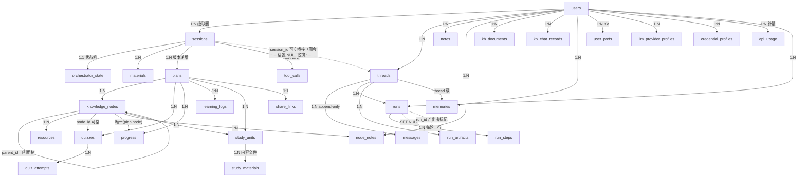
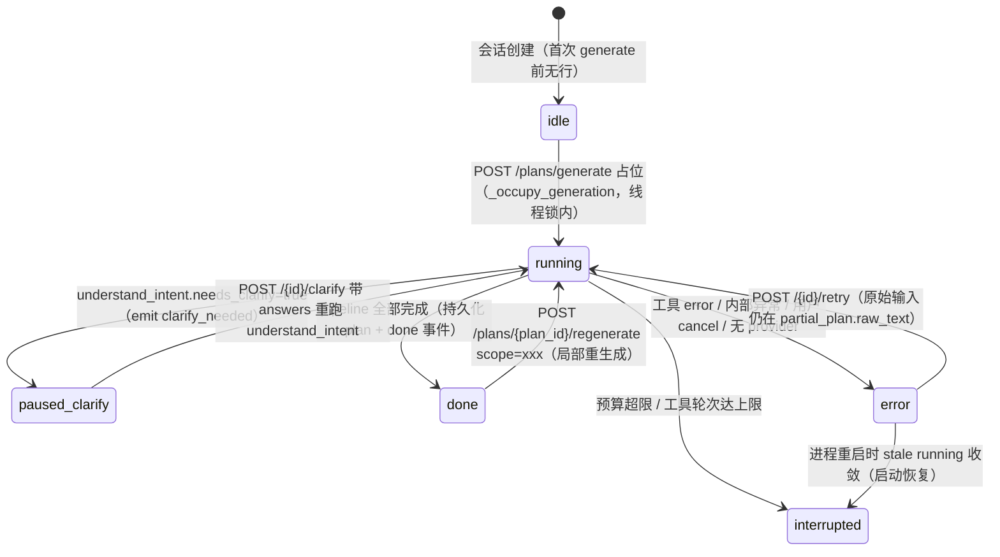
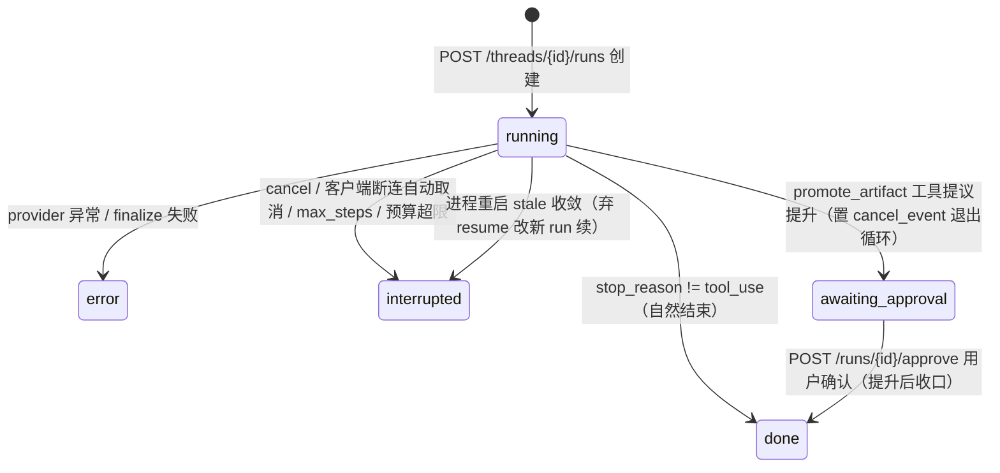

# 02 · 数据模型（26 张表 + 文件存储）

> 证据：`backend/app/db/models.py`（871 行，全部 ORM 定义）、`backend/app/db/base.py`（引擎）、`backend/app/core/storage.py`（文件树）、`backend/alembic/versions/`（22 个迁移）。

## 1. 总览

**存储哲学**（models.py:1-5）：大内容（解析文本/自学材料/导出/大方案 JSON）入**文件系统**，DB 只存路径与元数据。SQLite 开 WAL + `synchronous=NORMAL` + `foreign_keys=ON` + `busy_timeout`（base.py:52-63），连接池 QueuePool（默认 20 常驻 + 80 溢出）。

### 表清单（按域分组）

| 域 | 表 | 职责一句话 |
|----|----|-----------|
| 身份 | `users` | 用户（P4 多用户；username 唯一、pbkdf2 密码、is_admin、tokens_valid_after 吊销水位） |
| 生成会话 | `sessions` | 一次"生成方案"的会话容器（user_id、title、created_at） |
| | `orchestrator_state` | 编排器状态机（1:1 session；status/current_tool/partial_plan/last_error/trace_id/last_event_id/budget_used） |
| | `materials` | 会话资料（kind=file/text/url/image/audio/video、parsed_text_path、content_hash 去重、status=pending/confirmed/parsed） |
| 方案 | `plans` | 方案版本行（content JSON + version 递增；>512KB 溢出 content_path 文件） |
| | `knowledge_nodes` | 知识点（plan 内 sid 如 "k1" + 自引用 parent_id 树、difficulty 1-5、must_learn） |
| | `resources` | 检索到的学习资源（挂 node；type=tutorial/video/doc/book、verified=ok/uncertain/invalid） |
| 学习闭环 | `quizzes` / `quiz_attempts` | 题目（payload JSON：题干/选项/答案/解析）与作答记录 |
| | `progress` | 每 (plan_id,node_id) 至多一行（唯一约束）；status + mastery 0-1 |
| | `learning_logs` | 打卡/学习时长（date+minutes+note） |
| | `study_units` / `study_materials` | 自学单元（node_sids/prerequisites/objectives/order/done_at）与单元内容文件 |
| 笔记/KB | `node_notes` | 知识点批注（每用户每节点一条） |
| | `notes` | 独立自由笔记（标题+Markdown 正文，不挂方案） |
| | `kb_documents` | 知识库文档索引（original_path/parsed_text_path/content_hash/status） |
| | `kb_chat_records` | KB 问答记录（question/answer/citations/omitted_titles/doc_ids 快照） |
| 配置 | `user_prefs` | 用户 KV（daily_budget_usd、model_pricing、llm_max_tokens…） |
| | `llm_provider_profiles` | LLM 供应商档案（base_url/api_key/model/kind 协议/is_active 唯一） |
| | `credential_profiles` | 凭证档案（kind=anthropic/bing/auth_token 三类多卡片） |
| 审计 | `tool_calls` | 每次工具调用（input/output/status/tokens/cost/duration_ms/run_id） |
| | `api_usage` | 每次计费 LLM 调用（user_id/provider/model/4 类 token/cost） |
| 分享 | `share_links` | 方案只读分享（plan_id 唯一、token 随机、撤销=删行） |
| 记忆系统 | `threads` | AI 对话会话容器（仿 OpenAI Assistants；kind=chat/plan_generation；可桥接 session_id） |
| | `messages` | append-only 消息（content 存 Anthropic block list 原生形态） |
| | `runs` | 任务执行记录（kind=chat/plan_generation；status 状态机含 awaiting_approval；workspace_dir/committed） |
| | `run_steps` | 每轮一步（type=message/thinking/tool_call/tool_result/error/approval + tokens/cost） |
| | `run_artifacts` | 工作区产物登记（kind=draft/committed/promoted + promoted_to 如 'plan:12'） |
| | `memories` | 记忆库（scope=thread/user；agent 主动存取，非自动召回） |

## 2. ER 图（核心关系）



## 3. 枚举全集（models.py:36-104）

| 枚举 | 值 | 用途 |
|------|----|------|
| `OrchestratorStatus` | idle / running / paused_clarify / done / error / interrupted | 编排器状态机 |
| `MaterialKind` | file / text / url / image / audio / video | 资料类型（Material 与 KbDocument 共用） |
| `ResourceType` | tutorial / video / doc / book | 资源类型 |
| `VerifyLabel` | ok / uncertain / invalid | 链接验证结论 |
| `QuizType` | choice / fill / short / essay | 题型 |
| `ProgressStatus` | not_started / learning / done | 知识点学习状态 |
| `ToolCallStatus` | ok / error / repaired | 工具调用结果（repaired=降级默认） |
| `MessageRole` | user / assistant / system | 消息角色（tool_result 嵌在 user 消息内，Anthropic 约定） |
| `RunKind` | chat / plan_generation | run 类型 |
| `RunStatus` | running / done / error / interrupted / awaiting_approval / cancelled | run 状态机 |

## 4. 两条状态机（本项目最核心的状态模型）

### 4.1 OrchestratorStatus（方案生成，`orchestrator_state` 表）



> 关键守护：启动时批量把 `running` 收敛为 `interrupted`（main.py:76-85），防止崩溃残留让会话永久 409；`trace_id` 用于区分新旧任务（finalize 时校验，防旧任务写新会话，plans.py:641-648）。

### 4.2 RunStatus（Agent 对话 / plan-gen overlay，`runs` 表）



> `workspace_committed` 是崩溃 liveness 判据：run 正常结束才置位（workspace.py:191）。

## 5. 级联删除策略（一处反复修过的地方）

项目不依赖 FK `ondelete`，全部走 **ORM 级 cascade="all, delete-orphan"**（迁移库与 create_all 库行为一致）：

- `User` 删除 → 级联 sessions/plans/kb/notes/threads/runs/memories/prefs/profiles/usage（models.py:130-164）
- `KnowledgeNode` 删除 → 级联 children/resources/notes/**quizzes/progress/study_units**（iter 353 补齐，此前缺 relationship 导致删 session 撞 FK 500，models.py:353-367）
- `Session` 删除 → `Thread.session_id` 置 NULL **脱钩保留**（对话归 user，不随生成会话删除，models.py:188-191）
- 磁盘文件另由 `users.py delete_user` 调 `storage.delete_kb_files` 清理；孤儿目录由 maintenance 定期清

## 6. 文件系统存储布局（core/storage.py + workspace.py）

```
data/
├── deep-tutor.db                     # SQLite（WAL）
├── logs/deep-tutor.log               # 旋转日志 5MB×5
├── sessions/<session_id>/
│   ├── originals/  m<material_id>.<ext>    # 上传原件（原子写）
│   ├── parsed/     m<material_id>.txt      # 解析文本（≤500k chars）
│   ├── exports/    plan_<plan_id>.json     # >512KB 大方案溢出
│   │               plan_<plan_id>.md/.pdf/.ics/.apkg ...
│   └── materials/  u<unit_id>.md [+ .part2/.part3...]   # 单元内容（>500 行分片）
├── kb/<user_id>/originals/ + parsed/       # 知识库文档
├── runs/<run_id>/workspace/                # Agent 临时沙箱（scratch）
├── workspaces/<thread_id>/<run_id>/        # commit 后持久区
├── plugins/<plugin_id>/                    # 插件私有数据目录
└── backups/                                # 备份导出
```

要点：
- **原子写**贯穿：`_atomic_write_bytes`（tmp + os.replace，storage.py:78-96）；工作区写、promote 复制同款（workspace.py:95-103、agent_tools.py:331-339）。
- **单元分片**：单元 Markdown 超 500 行按标题切 `.partN`（storage.py:122-190），读取时拼接。
- **路径安全**：所有用户可控文件名经 `_resolve_in`（拒 `..`、拒绝对路径、resolve 后 relative_to 校验，workspace.py:73-83）。

## 7. 迁移策略（db/migrate.py）

启动时 `run_migrations()`（main.py:66）处理三类库：
1. 全新库 → `alembic upgrade head` 建全部表；
2. 有 `alembic_version` → 增量升级；
3. **无 version 的旧库**（历史 create_all 所建）→ 按 schema 特征探测代际（`_has_table`/`_has_column` 探测器从新到旧匹配）先 `stamp` 再 upgrade（migrate.py:19-40）。

随后 `init_db()` 的 `create_all` 兜底（对已存在表 no-op；测试夹具 drop_all 后靠它重建，main.py:62-67）。

22 个迁移命名可读出功能演进史：initial_schema → users 多用户 → provider_profiles → kb_documents/chat_records → notes/node_notes/user_prefs/share_links/credential_profiles → memory_system（iter 345 六表）→ 各种加列（username/password_hash/tokens_valid_after/kind/content_hash/sid/done_at/last_error）与 FK 索引收敛。
