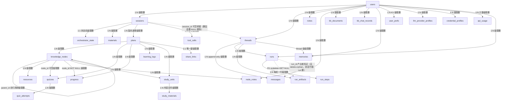
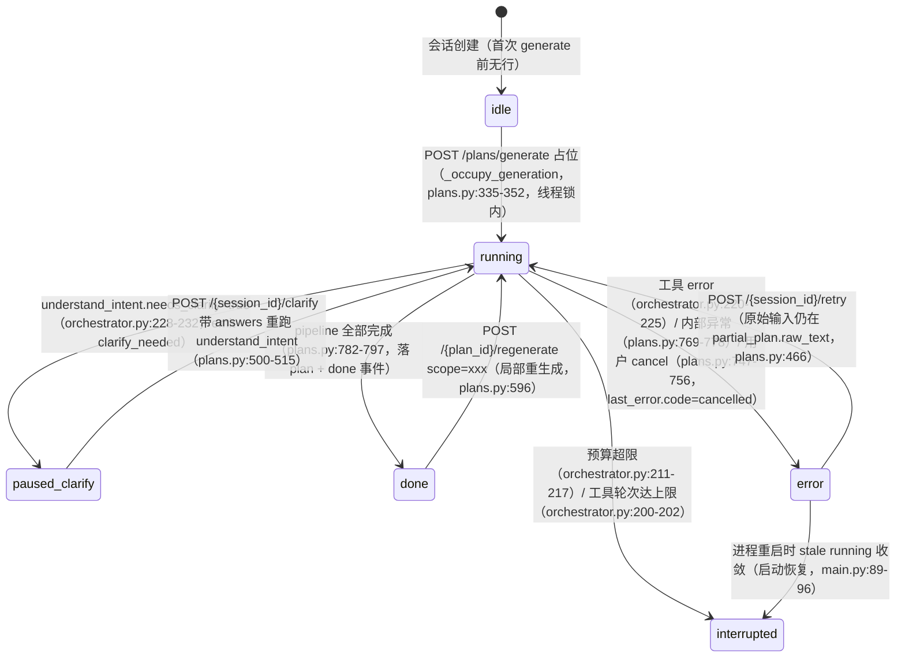
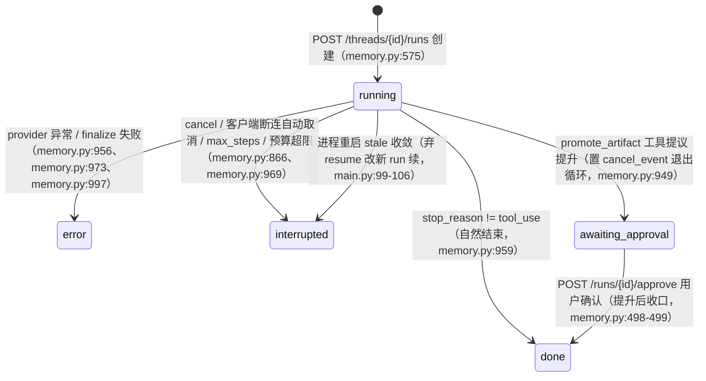

# 02 · 数据模型（29 张表 + 文件存储）

> 证据：`backend/app/db/models.py`（879 行，全部 ORM 定义）、`backend/app/db/base.py`（引擎）、`backend/app/core/storage.py`（文件树）、`backend/app/db/migrate.py`（迁移包装）、`backend/alembic/versions/`（26 个迁移）、`internal/runtime/tutor/{store,types}.go`（Go 侧）；行号以 2026-10-20 工作区（分支 `refactor/reasonix`）为准。
> 表数口径：`Base.metadata.tables` 实测 **29** 张（与 `models.py` 中 `Base` 子类计数一致）。
> 行数口径：**总行数**（`[System.IO.File]::ReadAllLines` 逐文件累加，等价 `wc -l`），与文中行号引用同口径。

## 1. 总览

**存储哲学**（models.py:1-5）：大内容（解析文本/自学材料/导出/大方案 JSON）入**文件系统**，DB 只存路径与元数据。SQLite 开 WAL + `synchronous=NORMAL` + `foreign_keys=ON` + `busy_timeout` + `journal_size_limit`（base.py:41-58），连接池 QueuePool，容量可配（`db_pool_size` 默认 20 常驻 + `db_max_overflow` 默认 80 溢出，base.py:29-36；`db_busy_timeout_ms` 默认 10,000）。

### 表清单（按域分组，共 29 张）

| 域 | 表 | 职责一句话 |
|----|----|-----------|
| 身份 | `users` | 用户（username 唯一约束 `uq_users_username`、pbkdf2 密码、is_admin、tokens_valid_after 吊销水位） |
| 生成会话 | `sessions` | 一次"生成方案"的会话容器（user_id、title、created_at） |
| | `orchestrator_state` | 编排器状态机（1:1 session；status/current_tool/partial_plan/last_error/tool_call_ids/trace_id/last_event_id/budget_used/updated_at） |
| | `materials` | 会话资料（kind=file/text/url/image/audio/video、parsed_text_path、content_hash 去重、status=pending/confirmed/parsed、parsed_chars、meta） |
| 方案 | `plans` | 方案版本行（content JSON + version 递增；>512KB 溢出 content_path 文件） |
| | `knowledge_nodes` | 知识点（plan 内 sid 如 "k1" + 自引用 parent_id 树、difficulty 1-5、must_learn） |
| | `resources` | 检索到的学习资源（挂 node；node_id 可空；type=tutorial/video/doc/book、verified=ok/uncertain/invalid） |
| 学习闭环 | `quizzes` / `quiz_attempts` | 题目（payload JSON：题干/选项/答案/解析，node_id 可空）与作答记录 |
| | `progress` | 每 (plan_id,node_id) 至多一行（唯一约束 `uq_progress_plan_node`）；status + mastery 0-1 |
| | `learning_logs` | 打卡/学习时长（date+minutes+note；复合索引 `ix_learning_logs_plan_date`） |
| | `study_units` / `study_materials` | 自学单元（node_sids/prerequisites/objectives/order/done_at/stage_index）与单元内容文件 |
| 笔记/KB | `node_notes` | 知识点批注（每用户每节点一条，唯一约束 `uq_node_notes_user_node`） |
| | `notes` | 独立自由笔记（标题+Markdown 正文，不挂方案） |
| | `kb_documents` | 知识库文档索引（title/kind/ext/source/original_path/parsed_text_path/content_hash/status） |
| | `kb_chat_records` | KB 问答记录（question/answer/citations/omitted_titles/doc_ids/context_docs 快照） |
| 配置 | `user_prefs` | 用户 KV（唯一约束 `uq_user_prefs_user_key`；键含 daily_budget_usd、model_pricing、llm_max_tokens） |
| | `llm_provider_profiles` | LLM 供应商档案（唯一约束 `uq_provider_user_name` = (user_id, name)；base_url/api_key/model/kind 协议/is_active。**同一用户至多一个 active 由 API 层保证**，非 DB 约束） |
| | `credential_profiles` | 凭证档案（唯一约束 `uq_credential_user_kind_name`；kind=anthropic/bing/auth_token 三类多卡片） |
| 审计 | `tool_calls` | 每次工具调用（input、output、status、tokens、cost、duration_ms、run_id 可空） |
| | `api_usage` | 每次计费 LLM 调用（user_id 可空/provider/model/4 类 token/cost；复合索引 `ix_api_usage_user_created`） |
| 分享 | `share_links` | 方案只读分享（plan_id 唯一、token 唯一随机、撤销=删行） |
| 记忆系统 | `threads` | AI 对话会话容器（仿 OpenAI Assistants；kind=chat/plan_generation；可桥接 session_id） |
| | `messages` | append-only 消息（content 存 Anthropic block list 原生形态；run_id 标记产出者） |
| | `runs` | 任务执行记录（kind=chat/plan_generation；status 状态机含 awaiting_approval；workspace_dir/workspace_committed） |
| | `run_steps` | 每轮一步（type=message/thinking/tool_call/tool_result/error + tokens/cost/model/duration_ms） |
| | `run_artifacts` | 工作区产物登记（kind=draft/committed/promoted + promoted_to 如 'plan:12'） |
| | `memories` | 记忆库（scope=thread/user；agent 主动存取，非自动召回） |

> 建表来源：`alembic/versions/beba50db3cc1_initial_schema.py` 建 15 张；`e1b7c3d94a08_memory_system.py` 建 6 张（threads/runs/messages/run_steps/run_artifacts/memories）；另外 8 张由后续单表迁移补建（llm_provider_profiles、share_links、node_notes、user_prefs、kb_documents、kb_chat_records、credential_profiles、notes）。15 + 6 + 8 = 29。

## 2. ER 图（核心关系）



## 3. 枚举全集（models.py:37-105，共 10 个）

| 枚举 | 值 | 用途 |
|------|----|------|
| `OrchestratorStatus` | idle / running / paused_clarify / done / error / interrupted | 编排器状态机 |
| `MaterialKind` | file / text / url / image / audio / video | 资料类型（Material 与 KbDocument 共用） |
| `ResourceType` | tutorial / video / doc / book | 资源类型 |
| `VerifyLabel` | ok / uncertain / invalid | 链接验证结论 |
| `QuizType` | choice / fill / short / essay | 题型 |
| `ProgressStatus` | not_started / learning / done | 知识点学习状态 |
| `ToolCallStatus` | ok / error / repaired | 工具调用结果（repaired=降级默认） |
| `MessageRole` | user / assistant / system | 消息角色（tool_result 嵌在 user 消息内，Anthropic 约定） |
| `RunKind` | chat / plan_generation | run 类型 |
| `RunStatus` | running / done / error / interrupted / awaiting_approval / cancelled | run 状态机（`cancelled` 已定义但当前无写入路径，见 §4.2） |

## 4. 两条状态机（本项目最核心的状态模型）

### 4.1 OrchestratorStatus（方案生成，`orchestrator_state` 表）



> 关键守护：启动时批量把 `running` 收敛为 `interrupted`（main.py:89-96），防止崩溃残留让会话永久 409；`trace_id` 用于区分新旧任务（finalize 时校验，防旧任务写新会话，plans.py:722-724）。
> `OrchestratorStatus` **无 `cancelled` 值**：用户取消落 `error` + `last_error.code="cancelled"`（plans.py:754），工具层取消落 `ToolCallStatus` 之外的错误码 `cancelled`（loop.py:55、loop.py:114）。

### 4.2 RunStatus（Agent 对话 / plan-gen overlay，`runs` 表）



> `RunStatus.cancelled` 已在枚举中定义（models.py:105），但当前代码无写入路径：取消统一收敛为 `interrupted` 并带 `error="cancelled"`（memory.py:866）；仅 `backup.py:175`/`backup.py:631` 在校验终态取值时把 `cancelled` 视为合法终态。
> `workspace_committed` 是崩溃 liveness 判据：run 正常结束才置位（workspace.py:191）。

## 5. 级联删除策略（一处反复修过的地方）

项目不依赖 FK `ondelete`，全部走 **ORM 级 cascade="all, delete-orphan"**（迁移库与 create_all 库行为一致）：

- `User` 删除 → 级联 sessions/plans/kb/notes/threads/runs/memories/prefs/profiles/usage（models.py:131-165，共 12 组 relationship）
- `KnowledgeNode` 删除 → 级联 children/resources/notes/**quizzes/progress/study_units**（iter 353 补齐，此前缺 relationship 导致删 session 撞 FK 500，models.py:346-369）
- `Session` 删除 → `Thread.session_id` 置 NULL **脱钩保留**（对话归 user，不随生成会话删除，models.py:192）
- `RunArtifact.run_id` 用裸 FK `ondelete="SET NULL"`（唯一显式 ondelete，models.py:846）：删 run 不删已 commit 产物
- `Message.run_id` 无 delete-orphan（models.py:803）：删 run 不级联删消息（消息归 thread 管）
- 磁盘文件另由 `users.py delete_user` 调 `storage.delete_kb_files` 清理（users.py:190）；孤儿目录由 maintenance 定期清

## 6. 文件系统存储布局（core/storage.py + workspace.py）

```
data/
├── deep-tutor.db                     # SQLite（WAL）
├── .jwt_secret / .setup_state.json / plugin_state.json
├── logs/deep-tutor.log               # 旋转日志 5MB×5
├── sessions/<session_id>/
│   ├── originals/  <material_id>.<ext>    # 上传原件（原子写，ext 白名单化）
│   ├── parsed/     <material_id>.txt      # 解析文本
│   ├── exports/    plan_<plan_id>.json     # >512KB 大方案溢出
│   │               plan_<plan_id>.md/.pdf/.ics/.apkg ...
│   └── materials/  unit_<unit_id>.md [+ .part2/.part3...]   # 单元内容（>500 行分片）
├── kb/<user_id>/originals/ + parsed/       # 知识库文档
├── runs/<run_id>/workspace/                # Agent 临时沙箱（scratch）
├── workspaces/<thread_id>/<run_id>/        # commit 后持久区
├── plugins/<plugin_id>/                    # 插件私有数据目录
└── backups/                                # 备份导出（按需创建）
```

要点：
- **原子写**贯穿：`_atomic_write_bytes`（tmp + os.replace + Windows 占用退避重试，storage.py:78-109）；工作区写同款（workspace.py:95-103）。
- **单元分片**：单元 Markdown 超 500 行按标题切 `.partN`（`_MAX_UNIT_FILE_LINES = 500`，storage.py:145-203），读取时拼接。
- **路径安全**：所有用户可控文件名经 `_resolve_in`（拒 `..`、拒绝对路径、resolve 后 relative_to 校验，workspace.py:73-83）；原件扩展名经 `safe_ext` 白名单（storage.py:72-75）。
- **会话目录防穿越**：`_session_root` 校验 sid 仅含字母数字且 resolve 后仍在 data 根内（storage.py:33-45）。

## 7. 迁移策略（db/migrate.py）

启动时 `run_migrations()`（main.py:75-78）处理三类库：
1. 全新库 → `alembic upgrade head` 建全部表；
2. 有 `alembic_version` → 增量升级；
3. **无 version 的旧库**（历史 create_all 所建）→ 按 schema 特征探测代际（`_REVISION_PROBES` 25 条代际探针，从新到旧匹配，兜底 base `beba50db3cc1`，migrate.py:97-125）先 `stamp` 再 upgrade（`detect_stamp` migrate.py:142-151，`run_migrations` migrate.py:163-178）。

随后 `init_db()` 的 `create_all` 兜底（对已存在表 no-op；测试夹具 drop_all 后再次重建，main.py:78、base.py:64-68）。

26 个迁移的实际链路（自 base 到 head，括号内为该迁移引入的特征）：

```
beba50db3cc1 initial_schema（15 张基表）
→ baa9cf610047 knowledge_nodes_add_sid
→ 69bb0fe9ca9f study_units_add_done_at
→ 3deb4164602b add_llm_provider_profiles
→ 169af26b09e7 users_add_username_password_hash_is_admin
→ a1c4f7e20b58 provider_profiles_api_usage_add_user_id
→ c7e2a9f41d35 share_links
→ d8f3b1a92c67 materials_add_content_hash
→ f2a8c1d94e07 progress_add_unique_plan_node
→ a3b91c2e4f56 users_add_tokens_valid_after
→ e5b21c8f90a3 node_notes
→ b4e19f0c7a25 user_prefs
→ c4d91e7b2a05 orchestrator_state_add_last_error
→ 5226d813e363 kb_documents
→ b7e3f1a92c48 kb_chat_records
→ d9e4b2c17f05 credential_profiles
→ e5f7a3c82d19 upload_status
→ f6a1c3d58e42 notes
→ a7f3e5c91d02 fk_filter_indexes
→ c0f2a4b18d33 provider_profile_kind
→ e1b7c3d94a08 memory_system（threads/messages/runs/run_steps/run_artifacts/memories 六表）
→ f0a2c5d839b1 materials_node_sids
→ d8a2f5c91b34 provider_profile_pricing
→ c5d7e9a13b28 remove_provider_profile_pricing
→ e8c4a1f63b02 api_usage_composite_index
→ b9d2e4f71a35 hot_query_indexes（head）
```

功能演进史读法：initial_schema → 知识点 sid/单元 done_at → provider_profiles → 用户多用户字段（username/password_hash/is_admin → tokens_valid_after）→ provider/api_usage 按用户隔离 → share_links → materials content_hash → progress 唯一约束 → node_notes → user_prefs → orchestrator_state last_error → kb_documents → kb_chat_records → credential_profiles → 上传三段制 status → notes → FK 过滤索引 → provider kind 协议 → memory_system 六表 → 材料 node_sids → 每卡计价加列与删列（计价改由 UserPref `model_pricing` 承担）→ api_usage 复合索引 → 热查询索引（head）。

---

## 8. Go 侧数据层现状与目标

> 证据：`internal/runtime/tutor/store.go`（695 行）、`internal/runtime/tutor/types.go`（254 行）、`internal/runtime/tutor/usage.go`、`internal/runtime/tutor/kb.go`、`internal/runtime/tutor/share.go`、`internal/contract/config/paths.go:453-458`、`internal/frontend/serve/tutor.go:45-54`、`plan/reasonix/02`。

### 8.1 现状：JSON 文件态存储（无 SQL）

| 项 | 事实 | 证据 |
|----|------|------|
| 存储形态 | `Store` 结构体持有 `root` 字符串 + 解码缓存，**全部读写为 JSON 文件**，无 SQL、无 ORM、无 schema | `store.go:23-31` |
| 存储根 | `<state root>/tutor/`（`Roots.TutorDir()` = `RootState` 目录下的 `tutor` 子目录） | `internal/contract/config/paths.go:453-458`、`internal/frontend/serve/tutor.go:45-54` |
| 写入语义 | `writeJSON` = `json.MarshalIndent` + `fileutil.AtomicOverwriteFile`（原子替换） | `store.go:91-100` |
| 读缓存 | 列表读走 stat 校验的解码缓存：每次仍 stat 文件，未变更则跳过 JSON 解码 | `store.go:23-27`、`storecache.go` |
| 主键 | 12 字节 crypto/rand → 24 字符 hex（`newID`），**非自增整数** | `store.go:116-122` |
| 实体 | `GenSession`/`Plan`/`PlanSummary`/`Material`/`Note`/`Quiz`/`QuizAttempt`/`Progress`/`LearningLog`/`StudyUnit`（types.go）+ `KbDoc`/`Share`（kb.go/share.go） | `types.go:63-254`、`store.go:35-50`、`kb.go:75-124`、`share.go:84-88` |
| 编排状态 | `Status` 枚举（idle/running/paused_clarify/done/error/interrupted），与 v1 `OrchestratorStatus` 同名同值 | `types.go:50-61` |
| 会话状态机 | `GenSession` 单文件承载 `status/current_tool/step_index/total_steps/last_error/raw_text/plan_id/plan_version/clarify_questions/cost`（v1 拆成 `orchestrator_state` + `sessions` 两表） | `store.go:35-50` |
| 方案版本 | `plans/<id>/plan.json` + `plans/<id>/versions/vNNN.json`（v1 为 `plans` 表 version 列） | `store.go:402-421` |
| 方案索引 | `plans/index.json`（含 size+mtime 戳，按戳复用摘要） | `store.go:63-69`、`store.go:445-498` |
| 知识点 | 嵌在 `Plan.knowledge_map`（`KnowledgeMap`/`KnowledgeNode`/`KnowledgeEdge`），**无独立表、无独立行**（v1 有 `knowledge_nodes` 表） | `types.go:74-92` |
| 进度 | `plans/<id>/progress.json`（每行 node_id/status/mastery/next_review_at） | `store.go:569-582`、`types.go:216-222` |
| 测验/作答 | `plans/<id>/quizzes.json`、`plans/<id>/attempts.json` | `store.go:524-567` |
| 学习日志 | `plans/<id>/logs.json` | `store.go:584-626` |
| 自学单元 | `plans/<id>/materials.json`（整表一次写入）+ `materials-index.md` | `store.go:355-384`、`store.go:342-353` |
| 笔记 | `notes/<id>.json`（全局单层目录，无 user_id 维度） | `store.go:87-89`、`store.go:628-694` |
| 知识库 | `kb/documents/<id>.json` + `kb/chats/<id>.json` + `kb/originals/<id>.<ext>` + `kb/parsed/<id>.txt` | `kb.go:75-77`、`kb.go:123`、`kb.go:133-134`、`kb.go:176-182` |
| 分享 | `shares/<token>.json` | `share.go:84-88` |
| 材料原件/解析 | `sessions/<id>/originals/<mid>.<ext>`、`sessions/<id>/parsed/<mid>.txt` | `store.go:264-317` |
| 计量 | **按本地日一个文件** `usage/<YYYY-MM-DD>.json`（`DailyUsage{Cost, Runs}`），每次 LLM 跑批后追加 | `usage.go:9-48` |
| 级联删除 | 删 session 时连带删除该 plan 目录与该 plan 的分享链接（`DeleteSession`） | `store.go:155-172` |
| 缺失能力 | 无 users/auth 表、无 user_prefs、无 llm_provider_profiles、无 credential_profiles、无 tool_calls、无 run_steps、无 run_artifacts、无 memories、无 api_usage 行级台账、无 events | `internal/runtime/tutor/` 全目录 |

### 8.2 目标：阶段① M2 数据层（plan/reasonix/02）

| 项 | 目标 | 依据 |
|----|------|------|
| 引擎 | SQLite 默认（WAL + busy_timeout + foreign_keys=ON），PG 预留；DSN `data/deep-tutor.db` | `plan/reasonix/02` §二 |
| 访问层 | **sqlc**：`internal/web/store/` 下 `queries.sql` + `schema.sql` 生成代码，每域一个 query 文件 | `plan/reasonix/02` §二、§三 |
| 迁移 | 自研轻量 runner（`migrations/NNNN_*.sql` + `schema_migrations` 表），启动时自动 up；**不实现旧库代际探测** | `plan/reasonix/02` §二 |
| 加密 | provider api_key / PAT / Bing key 用服务级主密钥（env `DEEPTUTOR_SECRET`，缺省首次生成写 `data/secret.key` 0600）AES-GCM 加密；PAT 只存 hash | `plan/reasonix/02` §二 |
| 存储改写 | `tutor.Service` 的 `*Store` 结构体改为接口，实现体换成 sqlc 版；数据落点由 `<state root>/tutor/*.json` 变为 SQL 表 + `data/users/<uid>/materials|exports/…` 文件 | `plan/reasonix/02` §四、§五 |
| 验收口径 | v1 语义对拍：note/03 流水线语义 + R-Tutor pipeline 测试逐条迁移（工具事件序列、反馈重跑、降级 default_data、预算/拒绝码） | `plan/reasonix/02` §四、阶段① M3.1 |

### 8.3 v1 29 表 → Go 侧目标归属

| v1 表 | Go 侧目标归属 | 目标表 / 落点 | 说明 |
|-------|--------------|---------------|------|
| `users` | SQL | `users` | 同旧；`username` 唯一、pbkdf2、`tokens_valid_after` 吊销 |
| `user_prefs` | SQL | `user_prefs` | 每用户 KV（`daily_budget_usd`、`default_model`、`websearch_provider` 等） |
| `llm_provider_profiles` | SQL | `provider_profiles` | 与 `credential_profiles` 合并为「每用户档案为权威」；`api_key` 存密文 |
| `credential_profiles` | SQL | `provider_profiles`（合并）+ `credentials`（bing 等非 LLM 凭据） | 原生 `kind` 三类拆为两表 |
| `sessions` | SQL | `sessions` | 编排状态机并入 `sessions.status`（v1 的 `orchestrator_state` 表瘦身消失） |
| `orchestrator_state` | SQL | `sessions`（合并） | `status`/`current_tool`/`last_error`/`budget_used` 进 sessions 列 |
| `materials` | SQL | `materials` | 三段制 status 保留；`content_hash` 去重 |
| `plans` | SQL | `plans` | `intent`/`knowledge`/`stages`/`schedule`/`validation` 各自 JSON 列 + `meta`；>512KB 溢出 `content_path` |
| `knowledge_nodes` | SQL | `knowledge_nodes` | 与旧 `progress` 合并（唯一 `(plan_id, sid)`），列含 `mastery`/`next_review_at` |
| `resources` | SQL | `resources` | 同旧 |
| `quizzes` | SQL | `quizzes` | `node_sids` JSON + `payload` JSON |
| `quiz_attempts` | SQL | `quiz_attempts` | 每次尝试落账（错题本/统计依据） |
| `progress` | SQL | `knowledge_nodes`（合并） | 见上 |
| `learning_logs` | SQL | `learning_logs` | 打卡/热力图数据源 |
| `study_units` | SQL | `study_units` | `index`/`title`/`markdown_path`/`parts`/`status` |
| `study_materials` | SQL | `unit_materials` | 单元内容分片索引（正文仍在文件） |
| `notes` | SQL | `notes` | 独立自由笔记 |
| `node_notes` | SQL | `node_notes` | Wiki 节点批注 |
| `kb_documents` | SQL | `kb_documents` | 原件/解析文本仍在文件，表存路径 |
| `kb_chat_records` | SQL | `kb_chat_records` | 引用问答记录 |
| `share_links` | SQL | `share_links` | 免登录只读分享（增 `revoked_at`） |
| `threads` | SQL（索引）+ 文件态（内容） | `threads` | **消息历史不进 DB**：存内核会话文件；`threads` 只是索引 + 领域元数据 |
| `messages` | **文件态**（内核 transcript） | 内核会话文件 | 归 `internal/state/history` + `internal/session/control`；`threads` 表不复制正文 |
| `runs` | SQL（领域投影）+ 文件态（执行体） | `runs` | 表记 status/stop_reason/usage/起止时间；执行体在内核会话/事件流 |
| `run_steps` | SQL（审计索引）+ 文件态（内容） | `run_steps` | 指向内核事件流/会话文件偏移，**不复制内容** |
| `run_artifacts` | SQL（台账）+ 文件态（产物） | `artifacts` | 记 kind/target_type/target_id/path/approved_at；文件在 `workspaces/` |
| `memories` | SQL（受控例外） | `memories` | 内核 memory 工具的 MemoryStore 接口以 SQL 实现（`plan/reasonix/02` §三对话域注） |
| `api_usage` | SQL | `api_usage` | 扩列：feature/model/provider/4 类 token/cost/currency/occurrence；计价源改 Reasonix 费率表 |
| `tool_calls` | SQL | `tool_calls` | 统一落账（生成流水线 + Chat 同表） |
| —（v1 无对应表） | SQL | `events` | 全局事件流持久层（断线补发窗口） |
| —（v1 无对应表） | 文件态 | `data/users/<uid>/kernel/{sessions,checkpoints,memory,skills,settings.json}` | **内核自身状态保留文件态**，按用户分 root（决策 #31） |

> 归类判据（`plan/reasonix/02` §一）：**需要跨特性查询/聚合/归属隔离的入 SQL；内核自己读写闭环的留文件**。大内容（原件/解析文本/导出产物/工作区文件）一律在文件系统，DB 存路径与元数据——沿用 v1 存储哲学。
