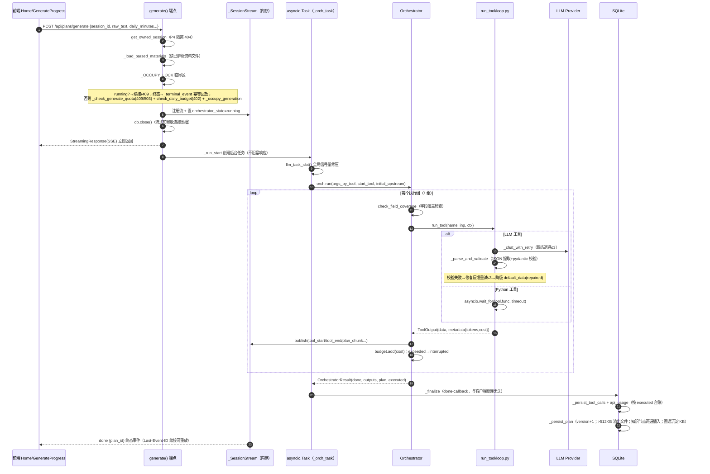
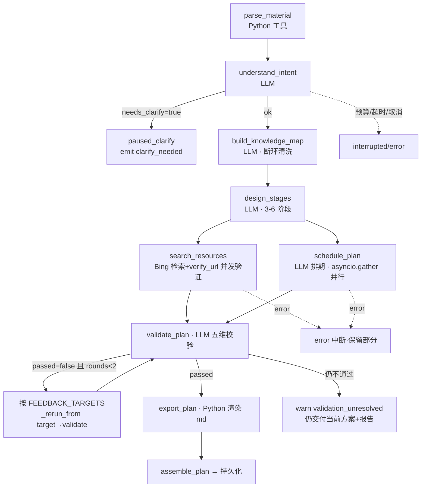
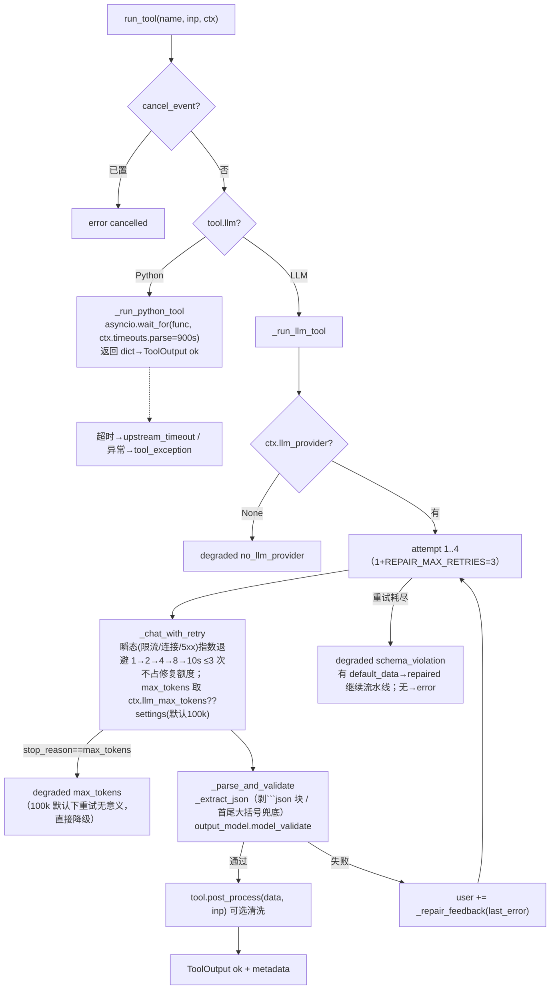
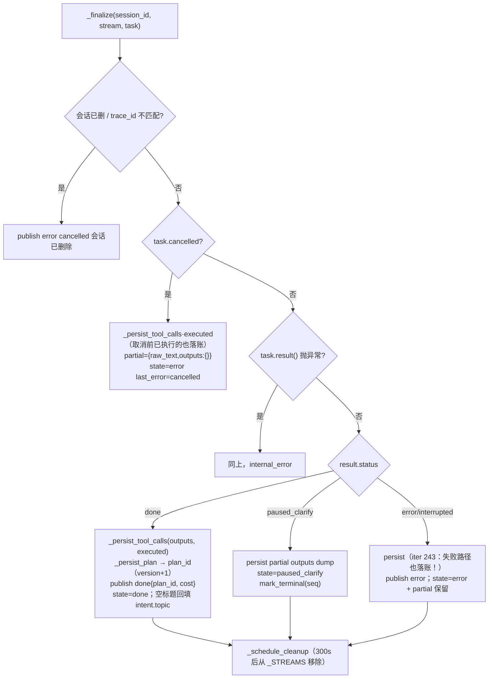

# 03 · 方案生成流水线（项目核心流程）

> 证据：`backend/app/agent/orchestrator.py`（421 行）、`backend/app/agent/loop.py`（299 行）、`backend/app/api/plans.py`（2,588 行）、`backend/app/agent/plan_assembly.py`。

## 0. 全景图：一次 POST /api/plans/generate 的完整生命周期



## 1. 流水线定义（orchestrator.py:32-71）

```python
PIPELINE = [parse_material, understand_intent, build_knowledge_map,
            design_stages, search_resources, schedule_plan,
            validate_plan, export_plan]          # 规范顺序（步骤序号/重生成区间的唯一定义）

_PARALLEL_GROUPS = [[parse_material],[understand_intent],[build_knowledge_map],
                    [design_stages],[search_resources, schedule_plan],   # ← R2 并行段
                    [validate_plan],[export_plan]]

FEEDBACK_TARGETS = {dependency_closure→build_knowledge_map,
                    difficulty_step/cognitive_load/milestone_feasibility/gap_analysis→design_stages}
MAX_FEEDBACK_ROUNDS = 2
```

**三张声明表 + import 期静态断言**（69-71 行）：`FEEDBACK_TARGETS ⊆ PIPELINE`、`PLAN_SECTIONS ⊆ PIPELINE`、分组展开 == PIPELINE 同序等集。另有 `check_parallel_groups_safe()`（74-98 行）：**并行组成员互不读取对方输出**（依据 `Tool.upstream_reads` 声明），违例启动即 ValueError——把"注释约定"升级为 import 期强制（iter 235）。

### 执行流程图（含并行段与反馈循环）



## 2. Orchestrator 核心函数（函数级）

### 2.1 `Orchestrator.run(args_by_tool, start_tool=None, initial_upstream=None) -> OrchestratorResult`（orchestrator.py:175-276）

逐步逻辑（变量级）：

| 步 | 操作 | 关键变量/条件 |
|----|------|--------------|
| 1 | `outputs = dict(initial_upstream)` | 预填充上游（如已解析资料注入的 parse_material 输出） |
| 2 | start_tool 不在 PIPELINE → 直接 error 结果 | 防 B18 静默回退 |
| 3 | `for group in _window_groups(start_tool)` | 区间切分：`[start..end]` 闭区间按分组过滤保序；start 落在并行组中间时首组只留该工具+同组后续成员（orchestrator.py:104-114） |
| 4 | 每组：过滤已注册工具 → `call_count >= max_tool_calls`（默认 20）→ interrupted | 并行组允许超出上限 ≤组员数-1（软守卫语义） |
| 5 | `_exec_group(names, ...)` 并发执行；结果按 PIPELINE 顺序写回 outputs | 单工具组直接 await；多工具组 `asyncio.gather` |
| 6 | 预算：组内成本全部归集后 `budget.add`×N → `exceeded()` → emit budget_exceeded → interrupted | 并行段固有"已发起的两个调用都会计完"的有界超支 |
| 7 | 错误：组内按 PIPELINE 顺序取**首个** error → error 结果（确定性） | emit error{code, stage} |
| 8 | 澄清：understand_intent.data.needs_clarify → emit clarify_needed → paused_clarify | partial 保留在 outputs |
| 9 | 反馈循环（仅 validate_plan 组后）：`while not passed and rounds < 2` | `_feedback_target(report)` 找首个 fail 项 → `_rerun_from(target, fixes=report.fixes, attempt=rounds+1)` |
| 10 | 每组产出后 emit `plan_chunk {partial_plan: assemble_plan(outputs)}` | 前端"查看部分"边生成边看 |
| 11 | 返回 `OrchestratorResult(status, outputs, plan, errors, executed=list(self.executed))` | executed 是台账快照（成本落账唯一事实源） |

### 2.2 `_exec(name, args_by_tool, outputs, fixes, attempt)`（290-328）

```
step = {tool, step_index: PIPELINE.index(name)+1, total_steps: 8, attempt}
  ↓
check_field_coverage(tool, outputs)          # tool.requires 点号路径如 "understand_intent.topic"
  ├─ 缺失 → ToolOutput(error, missing_upstream_field)  # 不调 LLM，但事件已发、台账留痕（零成本行）
  ↓
inp = ToolInput(tool, session_id, args(+fixes), upstream={t:{data}})   # 上游全量广播
out = await run_tool(name, inp, ctx)          # → loop.py
emit tool_end {status, metadata} ; executed.append(out)
```

### 2.3 `_rerun_from(target, ..., fixes, attempt)`（360-390）

从 target 重跑到 validate_plan（含）。fixes 只发给 `fixes_for=target` 指定的工具（其余为 None）。重跑链路工具 error **上抛**给主循环按 error 中断（err.md B10：曾因吞错以旧 ok 输出交付过错误方案）。

### 2.4 `check_field_coverage(tool, outputs)`（130-144）

对 `tool.requires` 每个 `"tool.field"`：上游输出不存在或 status=error → 缺失；字段名不在 data → 缺失。

## 3. run_tool：统一工具包装器（loop.py:47-70 → 三个子路径）



**Prompt 守卫**（err.md B2，loop.py:35-39、191-217）：
- `_sanitize_for_prompt`：同层 dict 同时有 `text` 与 `chunks` 时丢 chunks（parse_material 同内容双拷贝）；单字符串 >20,000 字符截断标注。
- user 消息整体 >200,000 字符硬截断。

**system prompt 解析优先级**（loop.py:180-188）：`ctx.skill_registry[tool.skill_name]`（SKILL.md 正文）→ `tool.inline_prompt` → `DEFAULT_SKILL_PROMPT`。

**成本归集**：`accumulate_usage` 跨重试累加 4 类 token；`_billed()` 保证**异常/取消/超时出口也回填已累积 usage**（iter 243 修"成本黑洞"：这些路径 metadata 全零则已烧 token 进不了 api_usage，日预算只信 api_usage 求和）。

## 4. SSE 基础设施：_SessionStream（plans.py:130-209）

**单会话事件缓冲 + 订阅扇出**。发布者（编排器 event_cb）与消费者（每个 HTTP 连接的 `_relay` 协程）完全解耦——**客户端断连不影响后台任务完成与持久化**（防 stale running / 丢进度）。

| 成员/方法 | 语义 |
|-----------|------|
| `seq` / `_events` | 递增事件 id + 有界历史（`_MAX_BUFFERED_EVENTS=500`，超限丢最旧→降级重放） |
| `publish(event, data) -> eid` | 入历史 + 扇出到所有订阅者有界队列（`_SUB_QUEUE_MAX=512`）；**慢订阅 put_nowait 抛 QueueFull 即踢出**（客户端 Last-Event-ID 重连自愈，不丢数据） |
| `mark_terminal(eid)` | 标记终态 + 保存终态副本（慢订阅被踢后 `_relay` 用副本兜底投递，防空转挂死——iter 363） |
| `subscribe(last_event_id) -> Queue` | 新建有界队列，先重放 `id > last_event_id` 的历史再接实时 |
| `task` / `budget` / `executed` / `current_tool` / `step_index` / `cost` | 后台任务句柄 + 运行态（live 字段供 GET /sessions 只读端点展示实时进度，iter 185 B5；executed 与编排器台账共享同一 list 对象，任务被取消时 finalize 仍能落账） |
| `_cleanup_timer` | 终态后 300s 保留窗口的清理定时器；同 session 重新占位时必须取消旧定时器（防误删新流，iter 237） |

`_relay(stream, last_event_id)`（913-944）：订阅→循环 `wait_for(q.get(), 0.2)`→yield `format_sse_frame(event, data, event_id=eid)`；超时时若终态已标记则兜底退出；空闲 15s 发 `: keepalive` 心跳注释行。

### SSE 事件类型清单（plan-gen 流）

| 事件 | 载荷要点 | 发出时机 |
|------|---------|---------|
| `tool_start` | {tool, step_index(1-8), total_steps, attempt} | 每工具执行前 |
| `tool_end` | 同上 + {status, metadata{tokens,cost,model}} | 每工具执行后 |
| `clarify_needed` | {questions[]} | understand_intent 需澄清 |
| `warn` | {code: validation_failed/validation_unresolved, message} | 反馈循环重跑/仍不通过 |
| `plan_chunk` | {partial_plan} | 每组产出后 |
| `budget_exceeded` | {spent, limit} | 预算守卫触发 |
| `error` | {code, message, stage, retryable?} | 工具错误/取消/内部错误/终态回放 |
| `done` | {plan_id, metadata{tools, cost}} | 成功收口 |

## 5. 五个入口端点共享同一状态机

| 端点 | 前置状态 | 动作 | plans.py |
|------|---------|------|----------|
| `POST /plans/generate` | running→续接；终态→幂等回放；否则新起 | 拼 initial_upstream（parse_material 注入）+ understand_intent args（含结构化时间字段 authoritative 覆盖） | 339-394 |
| `POST /{id}/retry` | 仅 error/interrupted | 用 `partial_plan.raw_text` 重跑全量；原始输入丢失→409 | 443-473 |
| `POST /{id}/clarify` | 仅 paused_clarify | answers 注入 understand_intent，从 partial outputs 续跑 | 476-509 |
| `POST /{id}/cancel` | 有活动任务 | `call_soon_threadsafe(task.cancel)`→finalize 发 error{cancelled} | 512-541 |
| `POST /plans/{plan_id}/regenerate` | 非 running + version ≤ max_regenerations(2) | `_reconstruct_upstream`（tool_calls 每工具最新行重建上游）→ 从 scope 起级联重跑 | 544-599 |

**占位原子性**（err.md A1）：状态检查与占位（注册流 + 置 running）在 `_OCCUPY_LOCK`（threading.Lock）同一临界区；端点是同步 def（线程池执行），并发请求不会交错通过检查。

**终态快路径**（`_terminal_event`，275-311）：done→回放最新 plan_id；paused_clarify→回放 questions；error/interrupted→回放持久化的 `{code,message}`+retryable。**页面刷新/断线重连不触发重复生成（防重复计费）**。

## 6. _finalize：唯一持久化路径（plans.py:630-746）

任务结束回调（add_done_callback，与流客户端无关）。决策树：



### `_persist_plan`（1054-1086）副作用链

1. `version = max(existing)+1`；
2. JSON >512KB → 写 `exports/plan_<id>.json`，DB content 置空存 content_path；
3. `_persist_knowledge_nodes`：nodes[:100] 两遍插入（先建行取 id，再回填 parent_id）；
4. `_sink_knowledge_map_to_kb`：主事务**提交后**把知识图谱沉淀为 KB 文本文档（同用户 content_hash 去重）——旧实现主事务内用独立 session 写，SQLite 单写者锁自死锁（iter 348 缺陷 D）；
5. `plugin_bus.emit("plan_created", {plan_id, session_id, version, topic})`。

### `_persist_tool_calls`（978-1051）——成本落账规则

- **executed 台账**：本次运行实际执行的每次调用（执行序，含反馈循环被覆盖的早轮、失败/取消前已完成的）——**全部落账**；
- **outputs**：仅补登"注入上游"行（如首跑 parse_material 未经编排器执行），且 DB 无该工具记录时才登（防重复）；
- 每行 ToolCall → 若有 token 则配一行 ApiUsage（user_id 归属会话所有者）；
- cost 按用户当前"模型计费表"重算（`estimate_cost_from_metadata`，设置页改价后落账统一按最新表）。

## 7. 局部重生成与上游重建

`_reconstruct_upstream(db, session_id, start_tool)`（249-265）：取该会话全部 tool_calls 按 id 排序，每工具**最新一行**的 output 重建 `ToolOutput`；缺失工具不注入（后续字段覆盖检查兜底）。约束：`understand_intent` 必须在上游（否则需原始 raw_text 不支持）→ regenerate 的 scope 只能是 build_knowledge_map 及之后。

`_window_groups(start, end)` 的精妙处：scope=schedule_plan（落在并行组中间）时首组仅含 schedule_plan，同组上游 search_resources 的既有输出由 initial_upstream 保留、不重跑（重跑范围最小化）。

## 8. 材料生成端点（同文件后半，1348-2588 行）

`POST /plans/{plan_id}/materials`（1815 行起）支持三种响应（内容协商）：
- `Accept: text/event-stream` → `_materials_sse`：逐单元流式生成（每单元一次 `generate_unit_content` LLM 调用，单元间有依赖则串行、无依赖并发），事件 unit_start/unit_done/materials_done；
- 同步 JSON：全部生成完一次返回；
- 后台模式：`_schedule_quiz_background` 同款模式（asyncio.create_task + 强引用防 GC）。

单元切分算法（generate_study_materials.py:228-330）：知识点按难度加权分钟数（`_NODE_WEIGHT` 1→15min ... 5→60min）聚合成单元，单元目标 ~55 分钟、最多 3 个知识点、<3 个知识点回退阶段制。引文清洗 `sanitize_citations`：正文 URL 不在方案资源集内则降级为纯文本（防 LLM 幻觉引用）。

Quiz 端点（2472 行起）：`_generate_quiz_spec` 调 generate_quiz 工具（每知识点一题），`ensure_quiz_coverage` post_process 保证覆盖；`_quiz_type_safe` 归一化题型；后台生成模式配 `_schedule_quiz_background`。
