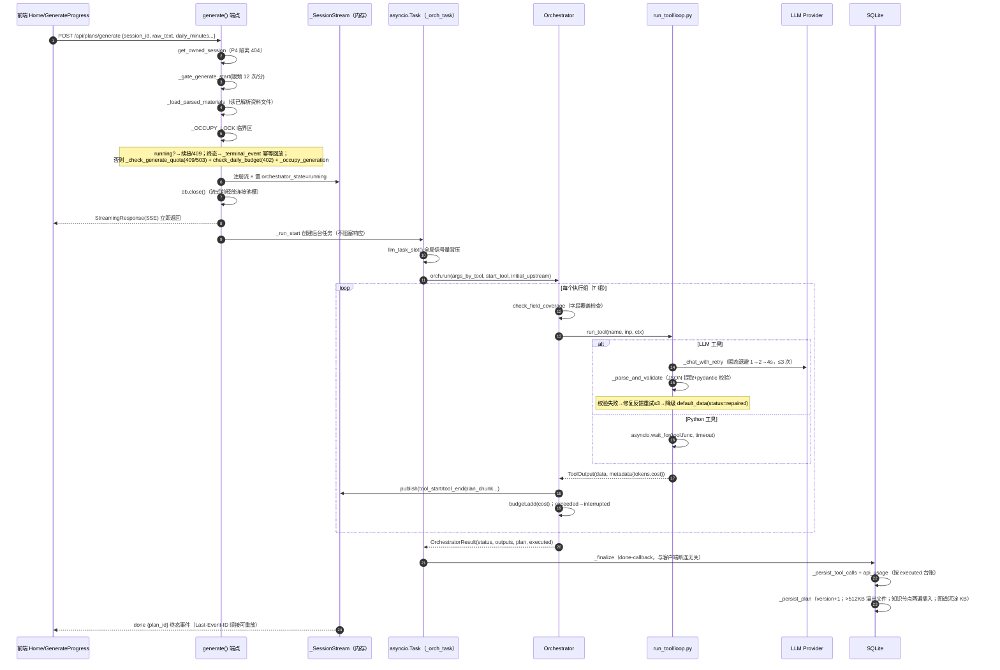
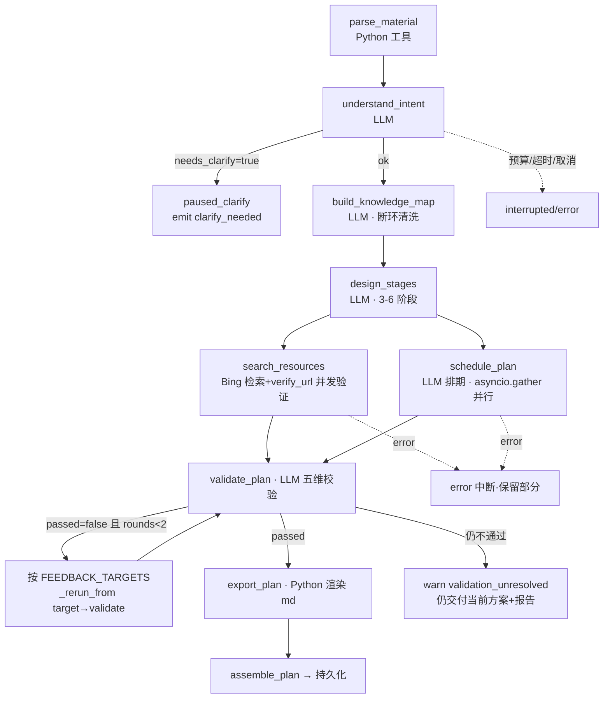
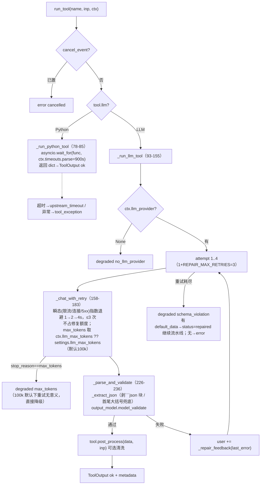
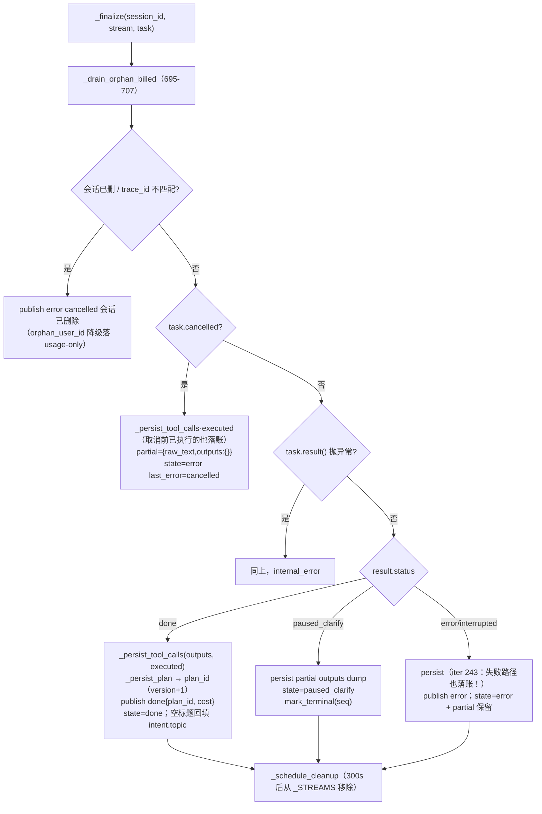

# 03 · 方案生成流水线（项目核心流程）

> 证据基线（2026-10-20 实测，分支 `refactor/reasonix`；行号以当前工作区为准）
>
> | 范围 | 依据 |
> |---|---|
> | Python v1 编排 | `backend/app/agent/orchestrator.py`（421 行）、`backend/app/agent/loop.py`（298 行）、`backend/app/api/plans.py`（2,899 行）、`backend/app/agent/registry.py`（75 行） |
> | Python v1 工具 | `backend/app/tools/*.py`（21 个模块）、`backend/app/tools/__init__.py`（126 行）、`backend/app/agent/plan_assembly.py`（52 行） |
> | Go v2 编排 | `internal/runtime/tutor/pipeline.go`（417 行）、`tools.go`（531 行）、`service.go`（663 行）、`stream.go`（210 行）、`llm.go`（212 行） |
> | Go v2 路由 | `internal/frontend/serve/tutor.go`（601 行）、`tutor_data.go`（709 行） |
> | 代码规模 | `backend/app` 22,614 非空行；`frontend/src`（.ts/.tsx）19,190 非空行；`backend/tests` 177 个 .py、1,458 个 test 函数（pytest 收集 1,461 用例） |
> | API 面 | `backend/app/api/*.py` 28 个文件（`__init__.py` + `deps.py` + `errors.py` + `sse_utils.py` + 24 个路由模块）；OpenAPI 实测 119 paths / 145 operations，全部带 `/api` 前缀 |
> | 数据面 | ORM 29 张表；alembic 26 个迁移 |
> | 扩展面 | `plugins/` 9 个实例（8 个 .py + `example_hello.py.disabled`）；`skills/` 8 个目录 |
> | 端口 | 41173 |
>
> 本文覆盖两代实现：§0–§8 为 Python v1，§9 为 Go v2（Reasonix 内核改造）。

## 0. 全景图：一次 POST /api/plans/generate 的完整生命周期



## 1. 流水线定义（orchestrator.py:32-71）

```python
PIPELINE = [parse_material, understand_intent, build_knowledge_map,
            design_stages, search_resources, schedule_plan,
            validate_plan, export_plan]          # 规范顺序（步骤序号/重生成区间的唯一定义）

_PARALLEL_GROUPS = [[parse_material],[understand_intent],[build_knowledge_map],
                    [design_stages],[search_resources, schedule_plan],   # ← R2 并行段
                    [validate_plan],[export_plan]]

FEEDBACK_TARGETS = {dependency_closure→build_knowledge_map,
                    difficulty_step/cognitive_load/milestone_feasibility/gap_analysis→design_stages}
MAX_FEEDBACK_ROUNDS = 2
```

| 声明 | 位置 | 说明 |
|---|---|---|
| `PIPELINE` | orchestrator.py:32-41 | 8 个工具；`total_steps` 取 `len(PIPELINE)`（orchestrator.py:302） |
| `_PARALLEL_GROUPS` | orchestrator.py:47-55 | 7 组；第 5 组含 2 个工具（并行段） |
| `FEEDBACK_TARGETS` | orchestrator.py:58-64 | 5 个校验项 → 2 个重跑目标 |
| `MAX_FEEDBACK_ROUNDS` | orchestrator.py:66 | = 2，与 `settings.max_regenerations` 对齐 |

**三张声明表 + import 期静态断言**（orchestrator.py:69-71）：`FEEDBACK_TARGETS ⊆ PIPELINE`、`PLAN_SECTIONS ⊆ PIPELINE`、分组展开 == PIPELINE 同序等集。另有 `check_parallel_groups_safe()`（orchestrator.py:74-98）：**并行组成员互不读取对方输出**（依据 `Tool.upstream_reads` 声明），违例启动即 ValueError——把注释约定升级为 import 期强制（iter 235）；调用点 `tools/__init__.py:61-63`。

### 执行流程图（含并行段与反馈循环）



## 2. Orchestrator 核心函数（函数级）

### 2.1 `Orchestrator.run(args_by_tool, start_tool=None, initial_upstream=None) -> OrchestratorResult`（orchestrator.py:175-276）

逐步逻辑（变量级）：

| 步 | 操作 | 关键变量/条件 | 行号 |
|----|------|--------------|------|
| 1 | `outputs = dict(initial_upstream)` | 预填充上游（如已解析资料注入的 parse_material 输出） | 186 |
| 2 | start_tool 不在 PIPELINE → 直接 error 结果 | 防 B18 静默回退 | 192-195 |
| 3 | `for group in _window_groups(start_tool)` | 区间切分：`[start..end]` 闭区间按分组过滤保序；start 落在并行组中间时首组只留该工具+同组后续成员 | 196 / 104-114 |
| 4 | 每组：过滤已注册工具 → `call_count >= max_tool_calls`（默认 20，`settings.max_tool_calls`）→ interrupted | 并行组允许超出上限 ≤组员数-1（软守卫语义） | 197-202 |
| 5 | `_exec_group(names, ...)` 并发执行；结果按 PIPELINE 顺序写回 outputs | 单工具组直接 await；多工具组 `asyncio.gather` | 204-207 / 330-358 |
| 6 | 预算：组内成本全部归集后 `budget.add`×N → `exceeded()` → emit budget_exceeded → interrupted | 并行段固有"已发起的两个调用都会计完"的有界超支 | 211-217 |
| 7 | 错误：组内按 PIPELINE 顺序取**首个** error → error 结果（确定性） | emit error{code, stage} | 220-225 |
| 8 | 澄清：understand_intent.data.needs_clarify → emit clarify_needed → paused_clarify | partial 保留在 outputs；**不 emit plan_chunk**（在 232 提前 return） | 228-232 |
| 9 | 反馈循环（仅 validate_plan 组后）：`while not passed and rounds < 2` | `_feedback_target(report)` 找首个 fail 项 → `_rerun_from(target, fixes=report.fixes, attempt=rounds+1)` | 235-262 |
| 10 | 每组产出后 emit `plan_chunk {partial_plan: assemble_plan(outputs)}` | 前端"查看部分"边生成边看 | 274 |
| 11 | 返回 `OrchestratorResult(status, outputs, plan, errors, executed=list(self.executed))` | executed 是台账快照（成本落账唯一事实源） | 276 / 280-288 |

### 2.2 `_exec(name, args_by_tool, outputs, fixes, attempt)`（orchestrator.py:290-328）

```
step = {tool, step_index: PIPELINE.index(name)+1, total_steps: 8, attempt}
  ↓
check_field_coverage(tool, outputs)          # tool.requires 点号路径如 "understand_intent.topic"
  ├─ 缺失 → ToolOutput(error, missing_upstream_field)  # 不调 LLM，但事件已发、台账留痕（零成本行）
  ↓
inp = ToolInput(tool, session_id, args(+fixes), upstream={t:{data}})   # 上游全量广播
out = await run_tool(name, inp, ctx)          # → loop.py
emit tool_end {status, metadata} ; executed.append(out)
```

`_exec_group`（orchestrator.py:330-358）：单工具组直接 `_exec`；多工具组 `asyncio.gather` 并发，组内输入基于同一 outputs 快照、写回由调用方按 PIPELINE 顺序进行。

### 2.3 `_rerun_from(target, ..., fixes, attempt)`（orchestrator.py:360-390）

从 target 重跑到 validate_plan（含）。fixes 只发给 `fixes_for=target` 指定的工具（余下工具为 None）。重跑链路工具 error **上抛**给主循环按 error 中断（err.md B10：曾因吞错以旧 ok 输出交付过错误方案）。

### 2.4 `check_field_coverage(tool, outputs)`（orchestrator.py:130-144）

对 `tool.requires` 每个 `"tool.field"`：上游输出不存在或 status=error → 缺失；字段名不在 data → 缺失。

## 3. run_tool：统一工具包装器（loop.py:47-70 → 三个子路径）



**状态语义**：`ToolOutput.status` 取值域为 `pending | running | ok | error | repaired`（`backend/app/tools/base.py:14`）。`_degraded()`（loop.py:274-288）在工具带 `default_data` 时返回 `status="repaired"`，否则 `status="error"`——「降级」在 v1 落为 `repaired`，不是 `degraded`。

**Prompt 守卫**（err.md B2，loop.py:35-39、206-219）：
- `_sanitize_for_prompt`（loop.py:206-219）：同层 dict 同时有 `text` 与 `chunks` 时丢 chunks（parse_material 同内容双拷贝）；单字符串 >`_MAX_PROMPT_FIELD_CHARS`=20,000 字符截断标注。
- `_build_user`（loop.py:197-203）：user 消息整体 >`_MAX_PROMPT_CHARS`=200,000 字符硬截断。

**system prompt 解析优先级**（loop.py:186-194）：`ctx.skill_registry[tool.skill_name]`（SKILL.md 正文）→ `tool.inline_prompt` → `DEFAULT_SKILL_PROMPT`（loop.py:41-44）。

**成本归集**：`accumulate_usage` 跨重试累加 4 类 token（loop.py:117）；`_billed()`（loop.py:104-109）保证**异常/取消/超时出口也回填已累积 usage**（iter 243 修"成本黑洞"：这些路径 metadata 全零则已烧 token 进不了 api_usage，日预算只信 api_usage 求和）。`asyncio.CancelledError` 分支（loop.py:142-147）把部分 usage 寄存 `ctx.orphan_billed`，由 plans.py `_drain_orphan_billed`（695-707）统一落账。

## 4. SSE 基础设施：_SessionStream（plans.py:147-232）

**单会话事件缓冲 + 订阅扇出**。发布者（编排器 event_cb）与消费者（每个 HTTP 连接的 `_relay` 协程）完全解耦——**客户端断连不影响后台任务完成与持久化**（防 stale running / 丢进度）。

| 成员/方法 | 语义 | 行号 |
|-----------|------|------|
| `seq` / `_events` | 递增事件 id + 有界历史（`_MAX_BUFFERED_EVENTS=500`，超限丢最旧→降级重放） | 157-158 / 93 |
| `publish(event, data) -> eid` | 入历史 + 扇出到所有订阅者有界队列（`_SUB_QUEUE_MAX=512`）；**慢订阅 put_nowait 抛 QueueFull 即踢出**（客户端 Last-Event-ID 重连自愈，不丢数据） | 190-208 / 96 |
| `mark_terminal(eid)` | 标记终态 + 保存终态副本（慢订阅被踢后 `_relay` 用副本兜底投递，防空转挂死——iter 363） | 210-216 |
| `subscribe(last_event_id) -> Queue` | 新建有界队列，先重放 `id > last_event_id` 的历史再接实时 | 218-226 |
| `unsubscribe(q)` | 退订（慢订阅剔除与 relay 收尾共用） | 228-232 |
| `task` / `budget` / `executed` / `current_tool` / `step_index` / `cost` | 后台任务句柄 + 运行态（live 字段供 GET /sessions 只读端点展示实时进度，iter 185 B5；executed 与编排器台账共享同一 list 对象，任务被取消时 finalize 仍能落账） | 162-188 |
| `_cleanup_timer` | 终态后 300s 保留窗口（`_RETENTION_SECONDS=300.0`）的清理定时器；同 session 重新占位时必须取消旧定时器（防误删新流，iter 237） | 175 / 144 |

`_relay(stream, last_event_id)`（plans.py:1074-1105）：订阅→循环 `wait_for(q.get(), 0.2)`→yield SSE 帧；超时时若终态已标记则兜底退出；空闲超 `_HEARTBEAT_SECONDS` 发 `: keepalive` 心跳注释行。

### SSE 事件类型清单（plan-gen 流）

| 事件 | 载荷要点 | 发出时机 | 行号 |
|------|---------|---------|------|
| `tool_start` | {tool, step_index(1-8), total_steps, attempt} | 每工具执行前 | 316 |
| `tool_end` | 同上 + {status, metadata{tokens,cost,model}} | 每工具执行后 | 319-326 |
| `clarify_needed` | {questions[]} | understand_intent 需澄清 | 231 |
| `warn` | {code: validation_failed/validation_unresolved, message} | 反馈循环重跑/仍不通过 | 243 / 269 |
| `plan_chunk` | {partial_plan} | 每组产出后 | 274 |
| `budget_exceeded` | {spent, limit} | 预算守卫触发 | 215 / 265 |
| `error` | {code, message, stage, retryable?} | 工具错误（编排器层只有 code+stage）/取消/内部错误/终态回放 | 224 / 735 / 757 / 779 / 831 |
| `done` | {plan_id, metadata{tools, cost}} | 成功收口 | 786-787 |

## 5. 五个入口端点共享同一状态机

| 端点 | 前置状态 | 动作 | plans.py 行号 |
|------|---------|------|----------|
| `POST /plans/generate` | running→续接（有活动流）或 409（stale）；终态→幂等回放；否则新起 | 拼 initial_upstream（parse_material 注入）+ understand_intent args（含结构化时间字段 authoritative 覆盖） | 363-419 |
| `POST /{id}/retry` | 仅 error/interrupted | 用 `partial_plan.raw_text` 重跑全量；原始输入丢失→409 | 466-497 |
| `POST /{id}/clarify` | 仅 paused_clarify（running→409） | answers 注入 understand_intent，从 partial outputs 续跑 | 500-540 |
| `POST /{id}/cancel` | 有活动任务 | `call_soon_threadsafe(task.cancel)`→finalize 发 error{cancelled} | 583-593（调度在 543-557） |
| `POST /plans/{plan_id}/regenerate` | 非 running + version ≤ max_regenerations(2) + 上游含 understand_intent | `_reconstruct_upstream`（tool_calls 每工具最新行重建上游）→ 从 scope 起级联重跑 | 596-652 |

**占位原子性**（err.md A1）：状态检查与占位（注册流 + 置 running）在 `_OCCUPY_LOCK`（plans.py:92，`threading.Lock`）同一临界区；端点是同步 def（线程池执行），并发请求不会交错通过检查。

**终态快路径**（`_terminal_event`，plans.py:298-327）：done→回放最新 plan_id；paused_clarify→回放 questions；error/interrupted→回放持久化的 `{code,message}`+retryable。**页面刷新/断线重连不触发重复生成（防重复计费）**。

**并发与频控**（plans.py:101-106、116-141）：`_MAX_GENERATE_PER_USER`=`settings.max_concurrent_generations_per_user`（默认 1，冲突 409）、`_MAX_GENERATE_GLOBAL`=`settings.max_concurrent_generations`（默认 8，繁忙 503）、`_GEN_START_RATE_PER_MIN`=12（`limit` 限频，generate/retry/clarify/regenerate/materials 共桶）。日预算守卫 `check_daily_budget`（plans.py:406/493/525/635）按 `api_usage` 当日求和判定。

## 6. _finalize：唯一持久化路径（plans.py:710-874）

任务结束回调（`add_done_callback`，plans.py:1065），与流客户端无关。决策树：



### `_persist_plan`（plans.py:1265-1300）副作用链

1. `version = max(existing)+1`（投影聚合 `func.max`，iter 367）；
2. JSON >`PLAN_OVERFLOW_BYTES`=512KB → 原子写 `exports/plan_<id>.json`，DB content 置空存 content_path（1275-1282）；
3. `_persist_knowledge_nodes`（1303-1337）：nodes[:100] 两遍插入（先建行取 id，再回填 parent_id）；
4. `_sink_knowledge_map_to_kb`（1338-1375）：主事务**提交后**把知识图谱沉淀为 KB 文本文档（同用户 content_hash 去重）——旧实现主事务内用独立 session 写，SQLite 单写者锁自死锁（iter 348 缺陷 D）；
5. `plugin_bus.emit("plan_created", {plan_id, session_id, version, topic})`（1289-1299）。

### `_persist_tool_calls`（plans.py:1139-1229）——成本落账规则

- **executed 台账**：本次运行实际执行的每次调用（执行序，含反馈循环被覆盖的早轮、失败/取消前已完成的）——**全部落账**；
- **outputs**：仅补登"注入上游"行（如首跑 parse_material 未经编排器执行），且 DB 无该工具记录时才登（防重复，1214-1219）；
- 每行 ToolCall → 若有 token 则配一行 ApiUsage（user_id 归属会话所有者；会话已删时降级 `_persist_usage_only`，1232-1262）；
- cost 按用户当前"模型计费表"重算（`estimate_cost_from_metadata`，设置页改价后落账统一按最新表）。

## 7. 局部重生成与上游重建

`_reconstruct_upstream(db, session_id, start_tool)`（plans.py:272-288）：取该会话全部 tool_calls 按 id 排序，每工具**最新一行**的 output 重建 `ToolOutput`；缺失工具不注入（后续字段覆盖检查兜底）。约束：`understand_intent` 必须在上游（否则需原始 raw_text 不支持）→ regenerate 的 scope 只能是 build_knowledge_map 及之后（plans.py:628-633；Go 侧同样约束见 service.go:340-342）。

`_window_groups(start, end)`（orchestrator.py:104-114）的取用点：scope=schedule_plan（落在并行组中间）时首组仅含 schedule_plan，同组上游 search_resources 的既有输出由 initial_upstream 保留、不重跑（重跑范围最小化）。

## 8. 材料生成端点与测验端点（plans.py 后半）

`POST /plans/{plan_id}/materials`（plans.py:2108-2273）支持三种响应（内容协商）：
- `Accept: text/event-stream` → `_materials_sse`（1843-2057）：逐单元流式生成，事件 `unit_start`（1894）→ `unit_done`（1997）×N → `done`（2048）；异常兜底 `error`（2055）。**并发**：`_MATERIALS_CONCURRENCY`=3 的信号量（plans.py:1827、1896），单元间 worker 并行、按 order 顺序消费并逐单元提交；单元数上限 `_MAX_MATERIAL_UNITS`=12（1826）；
- 同步 JSON：全部生成完一次返回（`generate_study_materials` 一次 LLM 调用 → `render_materials_md`）；
- 后台模式：`_schedule_quiz_background`（2769-2789）同款模式（`asyncio.create_task` + 强引用集合防 GC）。

单元切分算法（generate_study_materials.py:225-323）：知识点按难度加权分钟数（`_NODE_WEIGHT` 1→15 / 2→25 / 3→40 / 4→55 / 5→60，228 行）聚合成单元，单元目标 `_UNIT_TARGET_MINUTES`=55（229 行）、最多 `_UNIT_MAX_NODES`=3（230 行）、知识点 <`_NODE_FALLBACK_MIN`=3 回退阶段制（231 行）。分组器 `group_nodes_into_units`（266-323）按 (阶段 index, 难度) 排序后聚类，difficulty ≥4 的难点单独成单元。

引文清洗 `sanitize_citations`（generate_study_materials.py:95-149）：白名单来源 `collect_material_urls`（63-77，仅 `verified ∈ {ok, uncertain}` 入池）；正文 URL 不在白名单则按链接形态分别降级——标准链接去链接留文本、列表项整行丢弃、autolink 移除、引用定义整行移除、裸 URL 改行内代码；代码块与行内代码内的 URL 跳过。

测验端点（plans.py:2792-2839）：`_generate_quiz_spec`（2661-2715）调 generate_quiz 工具（题源来自单元"检查理解"小节，`extract_check_questions` 每单元 ≤4、总 ≤20），`ensure_quiz_coverage` post_process 保证每知识点必有题；`_quiz_type_safe`（2612-2620）归一化题型；后台生成模式 `_schedule_quiz_background` + `_generate_quiz_background`（2722-2766）。

## 9. Go 侧流水线实现（internal/runtime/tutor/）

### 9.1 结构映射

| v1 构件 | Go 构件 | 位置 |
|---------|---------|------|
| `orchestrator.py` PIPELINE / `_PARALLEL_GROUPS` / `FEEDBACK_TARGETS` / `MAX_FEEDBACK_ROUNDS` | `pipeline` / `parallelGroups` / `feedbackTargets` / `maxFeedbackRounds` | tools.go:24-28 / 32-40 / 43-49 / 51 |
| `Orchestrator.run` | `Runner.Run(ctx, RunInput, emit)` | pipeline.go:62-108 |
| `Orchestrator._exec_group` + `_exec` | `Runner.runGroups` + `Runner.execTool` | pipeline.go:114-191 / 234-271 |
| `Orchestrator._rerun_from` + `_feedback_target` | `Runner.feedbackLoop` + `firstFailingCheck` | pipeline.go:195-232 / 294-309 |
| `Orchestrator._window_groups` | `windowGroups` / `groupsThrough` | pipeline.go:314-333 / 337-347 |
| `loop.run_tool` / `_run_llm_tool` / `_parse_and_validate` / `_degraded` | `runJSONTool` / `decodeStrict` / `Default` 回调 | llm.go:136-181 / 183-189 |
| `ToolOutput` 信封 | `ToolOutput{Status, Degraded, Data, Error, Meta}` | tools.go:63-69 |
| `plans._SessionStream` / `_relay` | `sessionStream` / `streamSubscriber` | stream.go:36-42 / 130-199 |
| `plans._finalize` | `Service.finalize` | service.go:451-552 |
| `plans._persist_tool_calls` + `api_usage` 表 | `Store.AddUsage` 日文件台账 | usage.go:38-48 |

### 9.2 同构部分

- **流水线顺序**：8 步与 v1 完全一致（tools.go:24-28），`pipelineStep`（pipeline.go:349-356）给出 1-8 序号，`total_steps` 取 `len(pipeline)`（pipeline.go:137）。
- **并行段**：`parallelGroups`（tools.go:32-40）同样 7 组，第 5 组 `[search_resources, schedule_plan]`；`runGroups`（pipeline.go:127-156）用 `sync.WaitGroup` + goroutine 并发，`tool_start`/`tool_end` 交错发出，结果按组内索引回写 `outputs`。
- **反馈循环**：`maxFeedbackRounds = 2`（tools.go:51），`feedbackLoop`（pipeline.go:195-232）按 `feedbackTargets` 找首个 fail 项，`groupsThrough(windowGroups(target), "validate_plan")` 圈定重跑窗口，`attempt` 取 `round+1`（与 v1 的 `rounds+1` 同值）。
- **区间切分**：`windowGroups`（pipeline.go:314-333）取 start 所在组的后缀 + 后续整组；与 v1 `_window_groups(start, None)` 的结果集合逐场景一致（如 start=schedule_plan 同得 `[[schedule_plan],[validate_plan],[export_plan]]`）。`groupsThrough`（337-347）在含 endTool 的组内按 `group[:idx+1]` 截断，对应 v1 的 `_window_groups(target, "validate_plan")`。
- **SSE 事件词表**：stream.go:9-17 定义 8 个常量 `tool_start / tool_end / clarify_needed / warn / plan_chunk / budget_exceeded / error / done`，与 v1 事件名逐字一致。
- **流缓冲常量**：`maxBufferedEvents=500`、`subscriberQueueMax=512`、`terminalRetireSec=300`（stream.go:19-21），与 v1 `_MAX_BUFFERED_EVENTS=500` / `_SUB_QUEUE_MAX=512` / `_RETENTION_SECONDS=300` 同值。
- **终态收敛**：`Service.finalize`（service.go:451-552）先落盘（`SaveRunState` → `SaveSession` → `AddUsage`）再发终态事件，与 v1「持久化在终态事件之前」一致。
- **修复重试**：`repairAttempts = 3`（llm.go:131），`runJSONTool` 的尝试次数为 `attempt <= repairAttempts`（llm.go:138），与 v1 `range(1, REPAIR_MAX_RETRIES+2)` 同为 4 次尝试；耗尽后有 `Default` 则降级、否则报错（llm.go:177-180）。

### 9.3 差异部分

| 维度 | Python v1 | Go v2 | 证据 |
|---|---|---|---|
| 状态词表 | `ok / repaired / error`（base.py:14） | `ok / degraded / error`，降级原因另存 `Degraded` 字段 | tools.go:55-59, 63-69 |
| 降级载体 | `status="repaired"` + `errors[]`（loop.py:274-288） | `status="degraded"` + `Degraded` 字符串，无 errors 列表 | 同上 |
| 字段覆盖检查 | `check_field_coverage` + `Tool.requires` → `missing_upstream_field` | **无对应机制**，无 `requires` 概念 | orchestrator.py:130-144 / tools.go 无 |
| 并行安全静态断言 | `check_parallel_groups_safe` + `Tool.upstream_reads`，import 期 ValueError | **无对应机制**，无 `upstream_reads` 声明 | orchestrator.py:74-98 / registry.py:41 |
| 工具注册 | `ToolRegistry` + `default_registry()`，插件工具可汇入、同名覆盖 | `execTool` 的硬编码 switch（pipeline.go:237-270），无注册表、无插件注入 | tools/__init__.py:25-64 |
| 预算守卫 | 成本口径（`BudgetTracker.limit` USD，`>=` 判超限） | token 口径（`Runner.BudgetTokens`，`result.Tokens > limit`） | budget.py:40-44 / pipeline.go:158-164 |
| 日预算 | `check_daily_budget` 查 `api_usage` 当日求和 | `Service.budgetExceeded` 读 `usage/<date>.json` 日台账 | service.go:68-78 / usage.go:28-35 |
| 成本台账 | `tool_calls` 行 + `api_usage` 行（含 provider/model/4 类 token/cost） | 仅日台账 `usage/<date>.json`（date/cost/runs），**无按工具/按模型明细行** | plans.py:1139-1229 / usage.go:17-21 |
| 执行台账 | `OrchestratorResult.executed` 为成本落账唯一事实源 | **无 executed 台账**，`RunResult` 只带 Tokens/Cost 合计 | orchestrator.py:123-127 / pipeline.go:51-58 |
| 工具端元数据键 | `metadata`（tokens_in/out/cache_read/cache_write/cost/duration_ms/model/provider） | `meta`（duration_ms/tokens 合计/cost/model/degraded），**无 provider 归属、无 cache 分项** | base.py:24-36 / llm.go:192-198 |
| plan_chunk 时机 | 反馈循环之后 emit；澄清暂停时**不** emit | 先 emit plan_chunk，再判澄清暂停 | orchestrator.py:232/274 / pipeline.go:176-183 |
| 失败判据 | `_is_fail`：False / "fail" / "failed" / "error" / `passed=False` | 仅 `status == "fail"` | orchestrator.py:147-154 / pipeline.go:294-309 |
| done 载荷 | {plan_id, metadata{tools, cost}} | {plan_id, version, metadata{tokens, cost}} | plans.py:786 / service.go:525-528 |
| 澄清终止事件 | 编排器 emit `clarify_needed`，finalize 只 `mark_terminal` | 编排器 emit 被丢弃，**由 finalize 单独发** `clarify_needed` | orchestrator.py:231 / service.go:409-414, 533-540 |
| parse_material | 真解析：file/text/url/image/audio/video，marker/pypdf/OCR/whisper | 流水线侧仅聚合已解析资料（`materialsParsedOutput`），真解析在资料解析路径（materials.go:172 → `ParseMaterial`） | tools.go:140-177 / material.go:59-110 |
| verify_url | 注册为独立工具（tools/__init__.py:33） | 无独立工具，`verifyURL` 为 WebSearcher 内部函数 | verify.go:412 |
| 瞬态重试 | `_chat_with_retry` 自带指数退避（1→2→4s，≤3 次） | 传输层重试在 provider 适配器，`runJSONTool` 只处理形状修复 | loop.py:158-183 / llm.go:46-48 |
| 瞬态退避上限 | `min(delay*2, 10.0)`（实际 3 次退避 1/2/4s） | 无该层退避常量 | loop.py:182 |
| 提示词守卫 | `_sanitize_for_prompt`（去 chunks / 截断单字段 20k / 整体 200k） | 仅 `truncateForPrompt`（material.go:228-234）单点截断 | loop.py:206-219 |
| API 前缀 | 全部路由带 `/api` 前缀（119 paths） | **无 `/api` 兼容层**，路由为 `/tutor/*` | internal/frontend/serve/tutor.go:221-238 |
| 路由前缀 | `/api/plans/*` | `/tutor/sessions/*`、`/tutor/plans/*` | 同上 |

### 9.4 Go 侧当前缺少的 v1 能力

1. **成本台账落到明细行**：v1 按每次工具调用写 `tool_calls` + `api_usage`（provider / model / 4 类 token / cost），Go 仅写日文件 `usage/<date>.json` 的 cost 与 runs 合计（usage.go:17-21）。
2. **按 provider / 按模型的用量拆分**：Go 的 `Usage`（llm.go:27-34）与 `toolMeta`（llm.go:192-198）无 provider 归属字段，也无 cache 分项进台账。
3. **字段覆盖检查**（`missing_upstream_field` 早失败）与 **`upstream_reads` 并行安全断言**：Go 侧无等价声明机制。
4. **插件工具注入**：v1 的 `default_registry()` 汇入插件工具（同名覆盖核心实现），Go 的 `execTool` 为硬编码 switch。
5. **瞬态错误指数退避**：v1 在 `loop.py` 层自带（限流/连接/5xx 不占修复额度），Go 依赖 provider 适配器层。
6. **提示词守卫**（text/chunks 双份裁剪、单字段 20k、整体 200k 三级）：Go 仅单点截断。
7. **`/api` 兼容层**：Go 路由前缀为 `/tutor/*`，与 v1 的 `/api/plans/*` 无映射层（阶段① M3.5 待建）。
8. **Agent 工具集**：v1 注册 12 个 Agent 工具（工作区文件 / 联网 / 记忆 / 历史 / 产物提升），Go 侧 tutor 包内只落地 `promote_artifact`（promote.go:17-29），另外 11 个未移植。

### 9.5 Go 侧入口端点

`tutor.go:221-238` 注册 15 条 tutor 路由：4 条会话路由（221-224）、6 条材料路由（226-232）、5 条生成族路由（234-238：`POST /tutor/sessions/{id}/generate`、`/clarify`、`/retry`、`/cancel`、`POST /tutor/plans/{pid}/regenerate`）。状态前置条件见 `service.go`：`StartGenerate`（221-241）区分续接/终态回放/新起；`Clarify`（246-271）要求 `paused_clarify` 且 answers 非空；`Retry`（274-300）要求 error/interrupted 且保留 raw_text；`Cancel`（303-315）要求有活动运行；`Regenerate`（320-356）要求 scope 在 pipeline 内且不含前两步、上游含 understand_intent、version ≤ `maxRegenerations()`（默认 2）。
