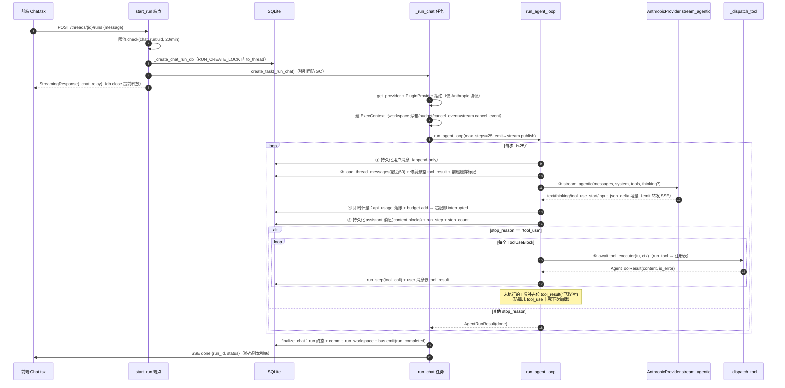

# 04 · Agent 对话与记忆系统（iter 345 新子系统）

> 证据：`backend/app/agent/agent_loop.py`（426 行）、`backend/app/api/memory.py`（911 行）、`backend/app/agent/workspace.py`（233 行）、`backend/app/tools/agent_tools.py`（439 行）、`backend/app/api/events.py`。

## 0. 与 Orchestrator 的关系

两套执行模型**并存**（agent_loop.py:1-13）：
- `plan_generation` → 确定性 Orchestrator（见 [03](03-生成流水线.md)），旁挂 `runs(kind=plan_generation)` overlay 行（settings.agent_runs_enabled，默认关）；
- `chat` → 本模块 `run_agent_loop`：原生 tool_use 迭代循环，工具执行器**注入**（本模块只跑循环逻辑，便于 fake provider/executor 单测）。

## 1. 全景流程图

## 2. run_agent_loop 逐步语义（agent_loop.py:266-419）

每步（step）七段：

1. **守卫**：`cancel_event.is_set()` → interrupted；`run.status == awaiting_approval` → 立即 done 退出（promote 提议后 approve 竞态窗口收窄，agent_tools.py:371 还会主动 set cancel_event）。
2. **历史加载**：`load_thread_messages(db, thread_id, limit=50)`——按 id 倒序取 50 条再反转为时间序；**修剪开头悬空 tool_result**（历史窗口恰好切在 tool_use/tool_result 之间时丢弃，否则 Anthropic API 报错）；`_apply_prefix_cache` 在「最新 user 轮之前」的末块打 `cache_control:{type:ephemeral}`（Anthropic 无状态每轮重发全史，不缓存则 O(n²) 输入成本；DB JSON 读出是全新对象，标记不污染 DB）。
3. **流式调用**：`provider.stream_agentic`；`_StreamAccumulator` 把分片重组为 `[thinking?, text?, tool_use...]` content 块（tool_use 按 id 聚合 input_json_delta 分片；非法 JSON 输入保留 `_raw` 原串排查不崩）。
4. **即时计量**（iter 243 教训）：本轮 usage 非零 → `accumulate_usage` → `record_metadata_usage` 落 api_usage → `budget.add` → 超限即 interrupted（run_step 记 budget_exceeded）。**provider 异常路径同样入账**（iter 365 B1：异常前 message_start 已到的 input_tokens 已计费）。
5. **持久化**：assistant 消息（blocks 原生形态保交织顺序）+ run_step(type=message, stop_reason, tokens, cost, duration) + `step_count` bump——全部经 `asyncio.to_thread`（iter 366：SQLite 写移出事件循环，100 用户高并发提交不再冻结 loop）。
6. **终止判定**：`stop_reason != "tool_use"` 或无工具块 → done。
7. **工具执行**：逐个（顺序）`tool_executor(tu, ctx)`；单工具异常隔离（记 error tool_result 不杀循环）；硬异常（CancelledError/DB 抖动）补占位后 raise。**占位补全**：未执行的 tool_use 一律补 `tool_result("已取消", is_error=True)`——否则 assistant tool_use 与 user tool_result 数不匹配，下次 run 加载历史被 Anthropic 拒（卡死会话）。

守卫参数：`MAX_AGENT_STEPS=25`、`DEFAULT_HISTORY_LIMIT=50`、会话预算同 settings.budget_per_session_usd。

## 3. SSE 流（_ChatStream，memory.py:623-698）

与 plans._SessionStream 同构（有界事件 FIFO 500 条、订阅队列 512、慢订阅踢出、终态副本兜底、15s 心跳）。特有：

- `cancel_event` 内嵌（`request_cancel()` 经 `call_soon_threadsafe` 跨线程安全触发）；
- `has_subscribers()` → `_chat_relay` finally 判定：**客户端断连（非终态）且无其他订阅者 → 自动取消后台 run**（防孤儿 agent 循环继续烧 token/占用全局槽直到 max_steps，memory.py:730-734）；
- `GET /threads/{id}/runs/active` 附流端点：切走再切回/多标签续看（DB running 但进程内无流 → 404 no_active_stream，前端静默改走正常拉消息）。

### SSE 事件类型（chat run）

`run_start {run_id, model}` → `message_start` → (`text_delta` / `thinking_delta` / `tool_call {id,name,step}` / `tool_progress {id,step}` / `tool_result {id,name,is_error,step}`)* → `message_end {step, stop_reason}` → …循环… → 终态 `done {run_id, status}` 或 `error {code,message}`。

## 4. Agent 工具集（agent_tools.py，12 个，全部 Python 工具）

| 工具 | 签名（args） | 行为要点 |
|------|-------------|---------|
| workspace_write | {name, content} | 沙箱内原子写（tmp+os.replace） |
| workspace_read | {name} | 读沙箱文件 |
| workspace_edit | {name, old, new, replace_all?} | Claude Code Edit 语义：old 须存在；多处须 replace_all |
| workspace_list | {} | 列沙箱全部文件（名+大小） |
| web_search | {query, count?} | Bing 双引擎（API/网页版），复用宿主检索栈 |
| web_fetch | {url} | 抓网页正文（SSRF 防护 + 正文提取 → markdown+引用） |
| memory_save | {content, kind?, scope: thread/user} | 写记忆库（scope=thread 须有 thread_id） |
| memory_recall | {q?, scope?, limit?} | 子串过滤按需召回（**非自动召回**） |
| memory_delete | {id} | 删记忆（归属校验） |
| load_thread_history | {limit?} | 按需回放会话内历史 |
| search_messages | {q} | 会话历史关键词搜索 |
| promote_artifact | {name, target_kind: plan/material/note} | **提议提升**（见下） |

`agent_tool_definitions()` 把上述工具 + `AGENT_TOOL_SCHEMAS`（手写 JSON Schema）打包为 ToolDefinition 广告给模型。

**工具回灌上限**：`_dispatch_tool` 把 ToolOutput.data JSON 化后截断（`_MAX_TOOL_RESULT_CHARS`，memory.py:831-836）——防 workspace_read/web_fetch 大输出（10MB+）单轮击穿 token 预算或超 context window。

## 5. 工作区生命周期（workspace.py）：scratch → committed → promoted

关键实现细节：
- `commit_run_workspace`（163-218）：Windows 下 rmtree 可能因文件锁部分失败致 dst 残留 → 改 `copytree(dirs_exist_ok=True)+清 src` 不错位（iter 363）；mid-commit 崩溃由 maintenance 兜；已登记的 artifact 跳过（防 awaiting_approval 与 approve 竞态重复登记）。
- `promote_artifact` 工具（agent_tools.py:303-375）：从 **scratch** 读草稿复制到 committed（旧逻辑据 workspace_committed 判定导致整条链路死代码——iter 363 修复）；原子复制；登记/复用 RunArtifact；`run.status = awaiting_approval` + run_step(type=approval) + **set cancel_event 让循环尽快退出**。

## 6. API 面（memory.py 全部端点）

| 端点 | 说明 |
|------|------|
| POST/GET /threads · GET/PATCH/DELETE /threads/{id} | 会话 CRUD（PATCH 改标题/模型） |
| GET /threads/{id}/messages · DELETE .../messages/{mid} | 消息历史（limit 参数）/删单条 |
| GET/POST /threads/{id}/memory · DELETE .../memory/{mid} | 会话级记忆管理 |
| GET/POST /memory · DELETE /memory/{mid} | 用户级记忆管理 |
| GET /threads/{id}/runs · GET /runs/{id} · GET /runs/{id}/steps | run 列表/详情（含 status/budget_used/error）/步骤 |
| DELETE /runs/{id} · POST /runs/{id}/cancel | 删 run / 取消（request_cancel） |
| GET /runs/{id}/files · GET /runs/{id}/files/{name:path} | 工作区产物列表/读取（committed 区） |
| POST /runs/{id}/approve | 确认提升（target_kind 路由到 plan/material/note 持久化） |
| POST /threads/{id}/runs · GET /threads/{id}/runs/active | 发起对话（SSE）/附流续看 |

所有资源访问经 `_owned_thread`/`_owned_run` 归属守卫（404 防枚举）；chat run 发起限流 `chat_run:{uid}` 20/min + 每 thread 至多 1 个 running（409）。

## 7. _finalize_chat 收口（memory.py:860-912）

try/finally 双保险：
- awaiting_approval **不被覆盖**；done → `commit_run_workspace`（失败不阻断）；interrupted/max_steps → interrupted；其余 → error；
- `run.budget_used = usage_cost(result.usage)` + ended_at + commit；
- `bus.emit("run_completed", {user_id, run_id, thread_id, status})`（→ /api/events/stream 按用户过滤转发）；
- finalize 自身异常 → `_force_run_terminal`（**全新 session 强写终态**——主 session commit 失败会让 run 永远 running，每 thread 至多 1 running 的硬约束导致该会话永久 409，iter 360 BUG-8）；
- finally：`stream.publish("done")` + mark_terminal + 从 `_RUN_STREAMS` 移除。

## 8. 实时事件流（api/events.py，150 行）

`GET /api/events/stream`（SSE）把插件事件总线转发给认证客户端（前端 EventsBridge / 外部替代前端）：
- **用户隔离**（safe-by-default）：payload 带 user_id 直归属；带 session_id 经短生命周期会话解析归属；**不可归属的非全局事件一律丢弃**；仅 startup/shutdown 广播全员。
- 有界队列 100（慢客户端丢事件防 OOM）+ 15s `: ping` 心跳；sink 经 `call_soon_threadsafe` 跨线程入队；断开 finally 退订。
- 认证用 `get_current_user_id`（解析即释放 db，流期不钉连接池槽——100 用户 EventsBridge 曾耗尽连接池）。
