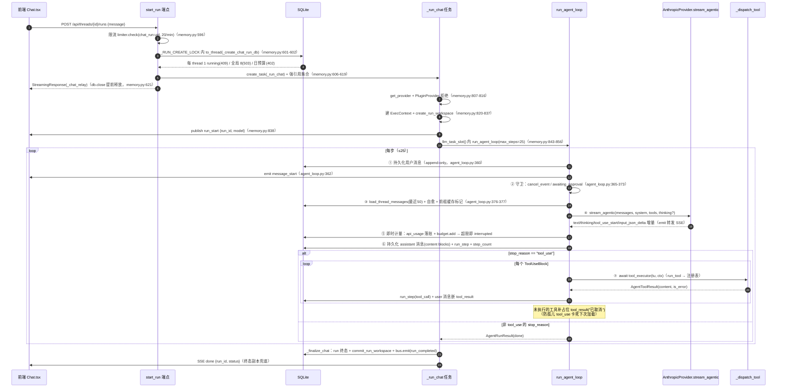
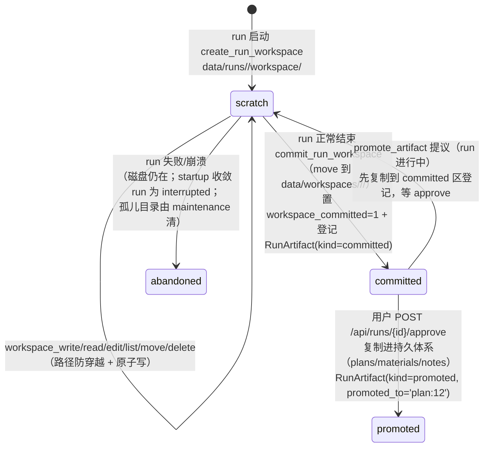

# 04 · Agent 对话与记忆系统

## 证据基线

| 项 | 值 |
|----|----|
| 核对日期 | 2026-10-20 |
| 分支 | `refactor/reasonix` |
| v1 证据 | `backend/app/agent/agent_loop.py`（561 行）、`backend/app/api/memory.py`（1001 行）、`backend/app/agent/workspace.py`（233 行）、`backend/app/tools/agent_tools.py`（559 行）、`backend/app/api/events.py`（214 行）、`backend/app/api/sse_utils.py`（41 行）、`backend/app/db/models.py`（879 行） |
| v2 证据 | `internal/runtime/tutor/`（67 个 .go）、`internal/frontend/serve/tutor.go`（601 行）、`internal/session/control/controller.go`（1254 行）、`internal/session/control/memory.go`（332 行）、`internal/runtime/agent/run_loop.go` |
| v1 规模 | `backend/app/api/*.py` 28 文件 / 24 路由模块；OpenAPI 119 paths / 145 operations；ORM 29 表；alembic 26 迁移；`backend/tests` 177 文件 / 1458 test 函数（pytest 收集 1461）；`backend/app` 22 614 行；`frontend/src` 19 190 行；plugins 9 实例；skills 8 目录；端口 41173 |
| v2 规模 | 根 `go.mod`：`module reasonix` / `go 1.26.0`；`/tutor/*` 路由集中在 `internal/frontend/serve/tutor*.go`，**无 `/api` 兼容层** |

## 0. 与 Orchestrator 的关系

两套执行模型并存（`backend/app/agent/agent_loop.py:1-26` 模块 docstring）：

- `plan_generation` → 确定性 Orchestrator（见 [03](03-生成流水线.md)），旁挂 `runs(kind=plan_generation)` overlay 行（`settings.agent_runs_enabled`，默认关，`backend/app/core/settings.py:119`）；
- `chat` → 本模块 `run_agent_loop`（`agent_loop.py:333-554`）：原生 tool_use 迭代循环，工具执行器**注入**（`agent_loop.py:47` `ToolExecutor` 类型别名）——本模块只跑循环逻辑，便于 fake provider + fake executor 单测。

## 1. 全景流程图

## 2. run_agent_loop 逐步语义（agent_loop.py:333-554）

每步（step）七段，位置取自 `backend/app/agent/agent_loop.py`：

| # | 段 | 位置 | 语义 |
|---|----|------|------|
| 1 | 守卫 | 365-373 | `ctx.cancel_event.is_set()` → `interrupted`；`run.status == awaiting_approval` → 立即 `done` 退出（promote 提议后 approve 竞态窗口收窄，`agent_tools.py:410` 主动 set `cancel_event`） |
| 2 | 历史加载 | 376-377 | `load_thread_messages(db, thread_id, limit=50)`（237-312）——按 id 倒序取 50 条再反转为时间序；**修剪开头悬空 tool_result**（255-261）；**剔除无 signature 的 thinking 块**（263-272，空 content 补占位文本）；**尾部/中途悬空 tool_use 补占位 tool_result**（274-311，仅修内存副本，不写库、幂等）。`_apply_prefix_cache`（315-325）在「最新 user 轮之前」的末块打 `cache_control:{type:ephemeral}`（Anthropic 无状态每轮重发全史，不缓存则 O(n²) 输入成本；DB JSON 读出是全新对象，标记不污染 DB） |
| 3 | 流式调用 | 380-395 | `provider.stream_agentic`；`_StreamAccumulator`（77-141）把分片重组为 `[thinking?, text?, tool_use...]` content 块（tool_use 按 id 聚合 `input_json_delta` 分片；非法 JSON 输入保留 `_raw` 原串排查不崩，118）；thinking 块仅在带 signature 时回传（94-95、122-127） |
| 4 | 即时计量 | 436-468 | 本轮 usage 非零 → `accumulate_usage` → `record_metadata_usage` 落 api_usage → `budget.add` → 超限即 interrupted（run_step 记 `budget_exceeded`）。**provider 异常路径同样入账**（419-434：message_start 已到的 input_tokens 已计费）；**取消路径补记并把累计 usage 挂到异常对象**（396-418，`partial_usage`），使 `run.budget_used` 不被空 usage 覆盖 |
| 5 | 持久化 | 470-490 | assistant 消息（blocks 原生形态保交织顺序）+ run_step(type=message, stop_reason, tokens, cost, duration) + `step_count` bump——全部经 `asyncio.to_thread`（166-234：SQLite 写移出事件循环，100 用户高并发提交不再冻结 loop） |
| 6 | 终止判定 | 492-494 | `stop_reason != "tool_use"` 或无工具块 → `done` |
| 7 | 工具执行 | 496-552 | 逐个（顺序）`tool_executor(tu, ctx)`；单工具异常隔离（517-532，记 error tool_result 不杀循环）；硬异常（CancelledError / DB 抖动）补占位后 raise（538-539、551-552）。**占位补全**（540-545）：未执行的 tool_use 一律补 `tool_result("已取消", is_error=True)`——否则 assistant tool_use 与 user tool_result 数不匹配，下次 run 加载历史被 Anthropic 拒（卡死会话） |

守卫参数：`MAX_AGENT_STEPS=25`（`agent_loop.py:43`）、`DEFAULT_HISTORY_LIMIT=50`（`agent_loop.py:44`）、会话预算同 `settings.budget_per_session_usd`（`backend/app/core/settings.py:122`，默认 1.0）。

## 3. SSE 流（_ChatStream，memory.py:673-745）

与 plans._SessionStream 同构：有界事件 FIFO 500 条（`memory.py:682`）、订阅队列 512 条（`memory.py:727`）、慢订阅踢出（`memory.py:705-709`、`743-745`）、终态副本兜底（`memory.py:688-689`、`712-717`）、15s 心跳（`sse_utils.py:24` `HEARTBEAT_SECONDS = 15.0`）。特有：

- `cancel_event` 内嵌（`memory.py:690`）；`request_cancel()`（719-724）经 `call_soon_threadsafe` 跨线程安全触发；
- `has_subscribers()`（739-741）→ `_chat_relay` finally 判定（779-785）：**客户端断连（非终态）且无订阅者 → 自动取消后台 run**（防孤儿 agent 循环继续烧 token / 占用全局槽直到 max_steps）；
- `GET /api/threads/{id}/runs/active` 附流端点（629-657）：切走再切回 / 多标签续看（DB 标 running 但进程内无流 → 404 `no_active_stream`，前端静默改走正常拉消息）；
- 帧格式由 `sse_utils.py:30-40` `format_sse_frame` 统一产出（`id:` 单调递增游标 + `event:` + `data:`）。

### 3.1 SSE 事件类型（chat run）

`run_start {run_id, model}`（`memory.py:838`）→ `message_start {run_id, role}`（`agent_loop.py:362`）→ (`text_delta` / `thinking_delta` / `tool_call {id,name,step}` / `tool_progress {id,step}` / `tool_result {id,name,is_error,step}`)* → `message_end {step, stop_reason}`（`agent_loop.py:489`）→ …循环… → 终态 `done {run_id, status}`（`memory.py:999`）或 `error {code,message}`（`memory.py:809`、`814`、`871`；code 取 `no_llm_provider` / `unsupported_provider` / `internal_error`）。

## 4. Agent 工具集（agent_tools.py，12 个，全部 Python 工具）

| 工具 | 签名（args） | 行为要点 | 位置 |
|------|-------------|---------|------|
| workspace_write | {name, content} | 沙箱内原子写（tmp + os.replace） | 58-73 |
| workspace_read | {name} | 读沙箱文件 | 74-89 |
| workspace_edit | {name, old, new, replace_all?} | Claude Code Edit 语义：old 须存在；多处须 replace_all | 90-108 |
| workspace_list | {} | 列沙箱全部文件（名 + 大小） | 109-120 |
| web_search | {query, count?} | Bing 双引擎（API / 网页版），复用宿主检索栈 | 121-141 |
| web_fetch | {url} | 抓网页正文（SSRF 防护 + 正文提取 → markdown + 引用） | 142-165 |
| memory_save | {content, kind?, scope: thread/user} | 写记忆库（scope=thread 须有 thread_id）；限流 60/分 + 单用户 2000 条上限 | 166-207 |
| memory_recall | {q?, scope?, limit?} | 子串过滤按需召回（**非自动召回**），limit 夹在 1..50 | 210-237 |
| memory_delete | {id} | 删记忆（归属校验） | 240-261 |
| load_thread_history | {limit?} | 按需回放会话内历史 | 262-288 |
| search_messages | {q} | 会话历史关键词搜索 | 289-321 |
| promote_artifact | {name, target_kind: plan/material/note} | **提议提升**（见第 5 节） | 335-420 |

`agent_tool_definitions()`（`agent_tools.py:548`）把上述工具 + `AGENT_TOOL_SCHEMAS`（手写 JSON Schema）打包为 `ToolDefinition` 广告给模型。

**工具回灌上限**：`_dispatch_tool`（`memory.py:881-904`）把 ToolOutput.data JSON 化后截断——`_MAX_TOOL_RESULT_CHARS = 20_000`（`memory.py:68`），截断点在 `memory.py:901-903`（截断后追加 `…[已截断]`）。防 workspace_read / web_fetch 大输出（可达 10MB+）单轮击穿 token 预算或超 context window。

## 5. 工作区生命周期（workspace.py）：scratch → committed → promoted

关键实现细节：

- `commit_run_workspace`（`workspace.py:163-218`）：Windows 下 rmtree 可能因文件锁部分失败致 dst 残留 → 改 `copytree(dirs_exist_ok=True)` + 清 src 不错位（185-186）；mid-commit 崩溃由 maintenance 兜；已登记的 artifact 跳过（199-200，防 awaiting_approval 与 approve 竞态重复登记）；空 scratch 也置 `workspace_committed`（190-191）。
- `promote_artifact` 工具（`agent_tools.py:335-420`）：从 **scratch** 读草稿复制到 committed（旧逻辑据 workspace_committed 判定导致整条链路死代码）；原子复制（tmp + `os.replace`，366-375）；登记 / 复用 RunArtifact（376-391）；`run.status = awaiting_approval` + run_step(type=approval)（392-404）；**set `cancel_event`**（408-410）让循环尽快退出。实际提升由 `POST /api/runs/{id}/approve` 执行（`memory.py:475`），底层原语 `promote_to_path`（`workspace.py:221`）。
- 路径防穿越：`_resolve_in`（`workspace.py:73-83`）拒 `..`、绝对路径与越界 resolve。

## 6. 记忆六表结构（models.py）

| 表 | 位置（`backend/app/db/models.py`） | 关键字段与语义 |
|----|---------|---------------|
| threads | 699-734 | `user_id` 归属；`kind` chat/plan_generation；`session_id` 可空（桥接「对话→生成方案」）；级联删覆盖 messages/runs/memories/artifacts（723-734） |
| messages | 775-803 | **append-only**（docstring 776）；`content` 存 Anthropic content 形态 list[block]（保交织顺序，含 tool_result 块）；`run_id` 标记产出 run（删 run 不删消息）；`summary` 预留摘要压缩 |
| runs | 737-772 | `kind` chat/plan_generation；`status` 含 awaiting_approval；`step_count` / `budget_used` / `workspace_dir` / `workspace_committed` / `trace_id` / `last_event_id` / `error` / `model` |
| run_steps | 806-831 | 一轮模型调用一行；`type` message/thinking/tool_call/tool_result/error；`name` 工具名或 assistant；tokens / cost / model / duration_ms 供单步计费展示 |
| run_artifacts | 834-855 | `kind` draft / committed / promoted；`promoted_to` 记去向（如 `plan:12`）；`run_id` ondelete=SET NULL（删 run 不删已 commit 产物）；`path` 相对 data_dir |
| memories | 858-879 | `scope` thread / user（默认 thread，869）；`kind`；`content`；`meta`；**按需召回，不做自动召回**（docstring 859-861） |

召回语义：记忆是 agent 主动保存的要点 / 事实 / 摘要（类 MemGPT archival），由 `memory_save` / `memory_recall` / `memory_delete` 三个工具读写（`agent_tools.py:166-261`），与 messages（转录）严格区分——召回是模型发起时才读取，不做自动注入。

## 7. API 面（memory.py 全部端点，前缀 /api）

| 端点 | 位置 | 说明 |
|------|------|------|
| POST /threads · GET /threads | 135 · 154 | 会话创建（kind 白名单 chat/plan_generation，104）/ 列表 |
| GET /threads/{id} · PATCH /threads/{id} · DELETE /threads/{id} | 167 · 172 · 196 | 会话详情 / 改标题与模型 / 删除（级联） |
| GET /threads/{id}/messages · DELETE .../messages/{mid} | 226 · 242 | 消息历史（limit 参数）/ 删单条 |
| GET /threads/{id}/memory · POST .../memory · DELETE .../memory/{mid} | 264 · 280 · 294 | 会话级记忆管理 |
| GET /memory · POST /memory · DELETE /memory/{mid} | 305 · 319 · 332 | 用户级记忆管理 |
| GET /threads/{id}/runs · GET /runs/{id} · GET /runs/{id}/steps | 373 · 380 · 385 | run 列表 / 详情（含 status / budget_used / error）/ 步骤 |
| DELETE /runs/{id} · POST /runs/{id}/cancel | 412 · 425 | 删 run / 取消（request_cancel + 硬取消 task） |
| GET /runs/{id}/files · GET /runs/{id}/files/{name:path} | 440 · 451 | 工作区产物列表 / 读取（committed 区） |
| POST /runs/{id}/approve | 475 | 确认提升（target_kind 路由到 plan / material / note 持久化） |
| POST /threads/{id}/runs · GET /threads/{id}/runs/active | 587 · 629 | 发起对话（SSE）/ 附流续看 |

配额与守卫：

- 归属校验 `_owned_thread`（82-87）、`_owned_run`（89-94）——user_id 不匹配一律 404，防枚举；
- chat run 发起限流 `chat_run:{uid}` 20/min（596）；每 thread 至多 1 个 running（409，`_create_chat_run_db` 560-562，阈值 `_MAX_RUNNING_PER_THREAD`，64）；全局 chat run 上限 `_MAX_CHAT_RUNS_GLOBAL`（67，默认 8）→ 503 `chat_run_busy`（563-569）；日预算检查 → 402（570）；
- `RunIn.max_steps` 上界 200（547）；
- 会话数上限 `_MAX_THREADS_PER_USER = 500`（70）、用户记忆条数 `_MAX_MEMORIES_PER_USER = 2000`（71）、会话记忆列表截断 `_THREAD_MEMORY_LIST_CAP = 200`（73）。

## 8. _finalize_chat 收口（memory.py:928-1001）

try/finally 双保险：

- `awaiting_approval` **不被覆盖**（949-950）；run 已非 running（approve 与循环退出的竞态窗口）也不降级覆盖（951-954）；done → `commit_run_workspace`（失败不阻断，960-967）；interrupted / max_steps → interrupted（968-971）；剩余分支 → error（972-974）；
- `run.budget_used = usage_cost(result.usage, 用户计费表)`（975-980，失败回退族默认）+ `ended_at` + commit（981-984）；
- `bus.emit("run_completed", {user_id, run_id, thread_id, status})`（987-993）→ `/api/events/stream` 按用户过滤转发；
- finalize 自身异常 → `_force_run_terminal`（907-925，**全新 session 强写终态**——主 session commit 失败会让 run 永远 running，每 thread 至多 1 running 的硬约束导致该会话永久 409）；
- finally：`stream.publish("done")` + `mark_terminal` + 从 `_RUN_STREAMS` 移除（998-1001）。

## 9. 实时事件流（api/events.py，214 行）

`GET /api/events/stream`（SSE，`events.py:164-214`）把插件事件总线转发给认证客户端（前端 EventsBridge / 外部替代前端）：

- **用户隔离**（safe-by-default）：`resolve_owner`（64-91）——payload 带 user_id 直归属；带 session_id 经 DB 即时解析归属（iter 381 移除 TTL 缓存，关死跨用户错发窗口）；`format_frame`（94-108）——归属非本用户时丢弃、不可归属的非全局事件丢弃、仅 `GLOBAL_EVENTS = {startup, shutdown}`（42）广播全员；事件名剥换行（106-107，防伪 data 行注入）；
- 有界队列 100（`events.py:186`）+ 15s `: ping` 心跳（`events.py:44`、`153-157`）；sink 经 `call_soon_threadsafe` 跨线程入队（189-201）；断开 finally 退订（205-210）；
- 认证用 `get_current_user_id`（解析即释放 db，流期不钉连接池槽）；Bearer JWT 提取 iat 随流，心跳周期重验吊销水位（172-184、`111-127`）。

## 10. Go 侧对应实现

### 10.1 `internal/runtime/tutor/` 现状

Go 侧 tutor 运行时当前实现的是**方案生成流水线**，不是 Agent 对话系统。逐条对读结果：

| v1 能力 | Go 现状 | 证据 |
|---------|---------|------|
| Chat 循环（tool_use 迭代） | 无。执行模型是固定 8 步流水线 | `internal/runtime/tutor/tools.go:13-28`（`pipeline` 常量表）、`tools.go:32-40`（`parallelGroups`，仅第 5 组 `search_resources` + `schedule_plan` 并发） |
| tool_result 回灌 / 悬空修剪 / 占位补全 | 无。`internal/runtime/tutor/` 全目录无 `tool_use` / `tool_result` 字样 | 目录 grep 无命中 |
| 前缀缓存 breakpoint | 无。tutor 层不设 `cache_control` | 目录 grep 无命中 |
| 六表（threads / messages / runs / run_steps / run_artifacts / memories） | 无 ORM。文件存储：一个 root 下按聚合分文件，原子写 | `internal/runtime/tutor/store.go:23-31`（Store 定义）、`store.go:87-89`（`sessions/` `plans/` `notes/` 目录）、`store.go:91-100`（原子写） |
| 每 run 的消息转录与步骤行 | 无。只有每会话一份 `run.json` 半程快照 | `internal/runtime/tutor/runstate.go:12-23`（RunState 字段：Trace / RawText / Answers / TimeFields / Outputs / Status / LastError / PlanID / Cost / UpdatedAt）、`runstate.go:28-31`（SaveRunState） |
| 记忆库（scope thread / user、按需召回） | 无 memories 表、无召回工具。知识库问答另走一路 | `internal/runtime/tutor/kbchat.go:123`（`KbChat`）、`kbchat.go:219-229`（`KbChatRecord` 落盘） |
| scratch → committed → promoted 三段 | 无中转区。promote 直接写笔记 / 知识库 | `internal/runtime/tutor/promote.go:54-109` |
| 会话级预算守卫（每轮 exceeded → interrupted） | 无 BudgetTracker。仅日预算 | `internal/runtime/tutor/service.go:68-78`（`budgetExceeded`） |
| 消息级 SSE 词表 | 无。流水线词表 8 种 | `internal/runtime/tutor/stream.go:9-22` |
| 归属校验 `_owned_thread` / `_owned_run` | 无多用户归属概念（本地单用户服务） | `internal/runtime/tutor/service.go` 无 user 维度字段 |

### 10.2 事件流对照

| 维度 | v1 `_ChatStream` | Go `sessionStream` |
|------|------------------|-------------------|
| 缓冲上限 | 500 条事件（`memory.py:682`） | 500 条事件（`stream.go:19`） |
| 订阅队列上限 | 512 条（`memory.py:727`） | 512 KB 字节预算（`stream.go:20`、`156-160`），超出丢最旧并标 kicked |
| 终态副本 | `terminal_event`（`memory.py:689`、`712-717`） | `terminal`（`stream.go:41`、`70-83`） |
| 断连处理 | 无订阅者 → 取消后台 run（`memory.py:784-785`） | 订阅被踢 → 客户端按 last id 重连补齐（`stream.go:85-95`） |
| 事件词表 | run_start / message_start / text_delta / thinking_delta / tool_call / tool_progress / tool_result / message_end / done / error | tool_start / tool_end / clarify_needed / warn / plan_chunk / budget_exceeded / error / done（`stream.go:10-17`） |

### 10.3 审批与工作区对应物

- v1：`promote_artifact`（`agent_tools.py:335-420`）只「提议」——复制草稿到 committed 区、登记 RunArtifact、置 `run.status = awaiting_approval`、记 run_step(type=approval)、set `cancel_event`（`agent_tools.py:410`）；实际提升由 `POST /api/runs/{id}/approve` 执行（`memory.py:475`）。
- Go：promote 工具本身即写入者（`promote.go:19-23` 注释明说）——`target_kind` 只允许 `note` / `kb`（`promote.go:48`、`70-72`），写入 `store.SaveNote`（`promote.go:105`）或 `svc.KbAddText`（`promote.go:95`）；审批交由宿主权限层在执行前询问（`promote.go:113` `ReadOnly() == false`）。**无 awaiting_approval run 状态、无二次 approve 端点、无 RunArtifact 登记**。
- 路径防穿越：v1 `_resolve_in`（`workspace.py:73-83`）拒 `..` 与绝对路径；Go `promoteDraftPath`（`promote.go:119-133`）同义，以 `filepath.Rel` 前缀校验为准。

### 10.4 目标基座与缺口

- 目标基座在 Reasonix 内核侧：`internal/session/control/controller.go`（1254 行）为对话回合控制器；`internal/session/control/memory.go`（332 行）`memoryManager` 管会话记忆快照（写后离锁重发现 + 轮尾提示，`memory.go:185-198`）；`internal/runtime/agent/run_loop.go` 为内核回合循环（`runToolLoop` 起于 264 行、`handleToolRound` 起于 671 行）。
- 接入现状：`/tutor/*` 路由只挂 `tutor.Service`（`internal/frontend/serve/tutor.go:220-244`、服务构造 `38-66`），内核的 Controller / Agent 未接入 tutor 命名空间；无 `/api` 兼容层，v1 的 `/api/threads/*` 在 Go 侧无对应端点。
- 缺口清单（相对 v1 记忆系统）：
  1. Chat 循环：tool_use 迭代 + tool_result 回灌 + 步数上限；
  2. 会话 / 消息 / 运行 / 步骤 / 产物 / 记忆六类持久化结构；
  3. chat SSE 词表与逐 token 增量；
  4. 会话级预算守卫与即时计量落账（Go 侧仅日预算，见 [05](05-LLM供应商与成本计量.md)）；
  5. 前缀缓存 breakpoint 与历史修剪 / 自愈；
  6. scratch → committed → promoted 的产物三段生命周期。
