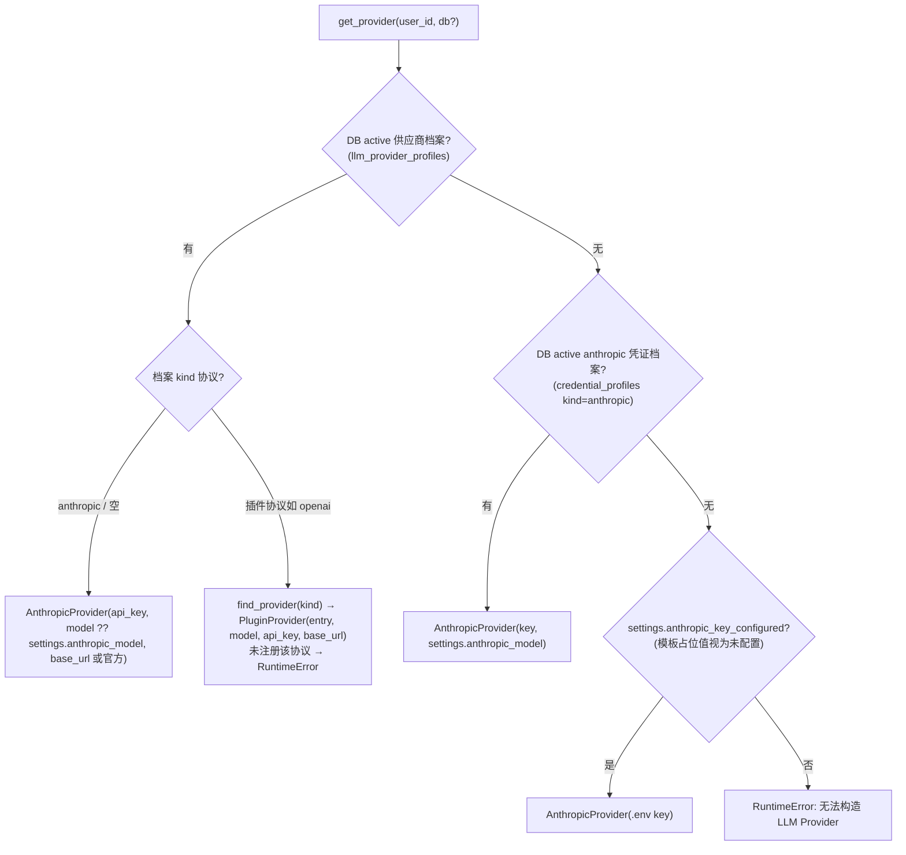
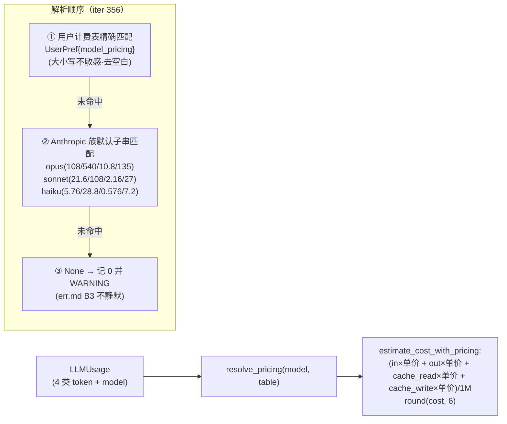
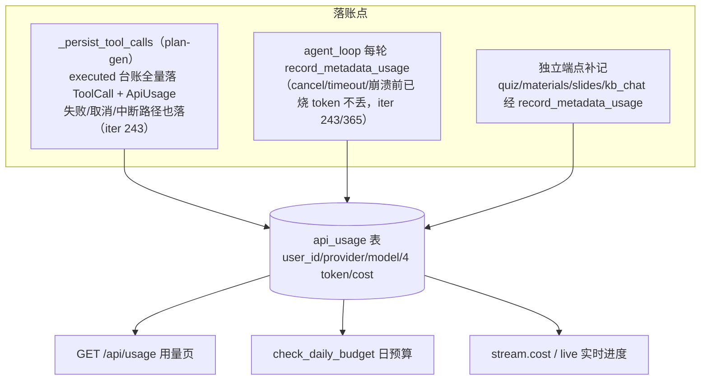

# 05 · LLM 供应商与成本计量

> 证据：`backend/app/llm/base.py`（168 行）、`anthropic_provider.py`（388 行）、`plugin_provider.py`、`pricing.py`（179 行）、`__init__.py`（153 行）、`agent/budget.py`、`agent/cost.py`（141 行）、`core/concurrency.py`。

## 1. Provider 抽象（llm/base.py）

```python
class LLMProvider:                                # base.py:105
    async def chat(system, user, *, model?, max_tokens=4096, cache_system=True) -> LLMResponse
    async def stream(...) -> AsyncIterator[StreamChunk]          # 默认实现：chat 后一次性 yield
    async def chat_agentic(messages, *, system, tools, ...) -> AgenticResponse      # 抛 NotImplementedError
    async def stream_agentic(...) -> AsyncIterator[AgenticStreamChunk]              # 同上
    def estimate_cost(usage) -> float
```

数据结构：

| 类型 | 字段 | 用途 |
|------|------|------|
| `LLMUsage` | input_tokens / output_tokens / cache_read_input_tokens / cache_creation_input_tokens / model | 4 类 token 全量计量（pydantic，拒 NaN） |
| `LLMResponse` | content / usage / stop_reason | 单轮 |
| `StreamChunk` | text / usage(末尾一次) | 单轮流式 |
| `ToolDefinition` | name / description / input_schema | 广告给模型的工具 |
| `ToolUseBlock` / `TextBlock` / `ThinkingBlock` | — | agentic content 块 |
| `AgenticStreamChunk` | text / thinking / tool_use_start(id,name) / tool_use_delta(id,partial_json) / usage / stop_reason | agentic 流式分片 |
| `TransientLLMError` | — | 瞬态标记（限流/连接/5xx），agent 层据此退避 |

## 2. 工厂：get_provider 三级回退（llm/__init__.py:102-152）



配套读取函数（均支持传入 db 复用会话防连接池 churn，iter 366）：`get_active_profile`、`get_active_model_pricing`（UserPref key=model_pricing）、`get_active_max_tokens`（UserPref key=llm_max_tokens，repr(int) 容错解析）。

## 3. AnthropicProvider 要点（anthropic_provider.py）

- **客户端缓存**：`_shared_client(api_key, base_url)` 按 (key,base_url) 有界缓存 8 个 AsyncAnthropic（FIFO 淘汰 + 记录创建时事件循环，跨循环自动重建防 "Event loop is closed"；淘汰/覆写旧 client `_schedule_aclose` 后台关闭防 fd/SSL 泄漏，iter 243/365 B3）。
- **异常映射**：`_map_transient`——RateLimit/APIConnection/InternalServerError 及 ≥500 状态 → TransientLLMError；其余原样（4xx 不重试）。
- **system 缓存**：`_build_system` 把 system 打包为 `[{"type":"text", text, cache_control:{type:ephemeral}}]`（Pillar 1 缓存优先，Skill prompt 稳定前缀跨调用复用）。
- **stream**：raw event stream → text_delta 逐块 yield；message_start/message_delta 摄取 input/output usage；**异常路径也 yield 一次部分 usage 再 raise**（成本黑洞修复）。
- **stream_agentic**：content_block_start(tool_use)→tool_use_start；input_json_delta→tool_use_delta（index→id 映射表归属）；thinking_delta；末尾 yield usage+stop_reason。
- **thinking**：`_thinking_budget = clamp(max_tokens-1024, 1024, 8000)`；max_tokens<2048 时抬到 2048。

## 4. PluginProvider（plugin_provider.py）

把 `api.providers.register(kind, handler)` 注册的插件 handler 适配为 LLMProvider：
- handler 契约：`(system, user, *, model, max_tokens, api_key, base_url) -> {content, model, stop_reason?, usage{input_tokens, output_tokens, cache_*?}}`；sync handler 走 to_thread。
- 凭证：档案传入优先，空串时插件自理（storage/环境变量）。
- 错误分类 `_classify`：异常上设 `transient=True` 或类型名/消息特征命中网络瞬态 → TransientLLMError；返回缺字段 → PluginProviderError。
- **不支持 agentic**（chat_agentic/stream_agentic 未实现）→ `_run_chat` 检测 `isinstance(provider, AnthropicProvider)` 否则拒绝 Agent 对话。

## 5. 计价体系（pricing.py，CNY ¥/1M tokens）



- 计费表由**设置页维护**（`PUT /api/settings/pricing`），默认预填 DeepSeek V4-Flash（1/2/0.02/1）与 V4-Pro（3/6/0.025/3）；4 个字段名 `input_per_mtok / output_per_mtok / cache_read_per_mtok / cache_write_per_mtok`。
- `build_metadata(total, model, model_pricing)` → ToolMetadata（tokens/cost/model）；`estimate_cost_from_metadata` 从 metadata 反向重建 usage 重算（落账时统一按最新价表）。

## 6. 预算与落账（budget.py + cost.py + deps.py）

**三层防线**：

| 层 | 机制 | 触发点 | 效果 |
|----|------|--------|------|
| 会话预算 | `BudgetTracker(limit=settings.budget_per_session_usd=1.0)`；`add()` 拒绝 NaN/负数（防守卫静默失效）；`exceeded()` 用 `>=`（B15：恰满即超） | Orchestrator 每组归集后判定；agent_loop 每轮判定 | 生成/对话 interrupted + budget_exceeded 事件 |
| 日预算 | `check_daily_budget(db, user_id)`：当日（**本地日** 'localtime' 口径，与用量页一致）api_usage.cost 求和 ≥ 有效预算（用户覆盖 UserPref{daily_budget_usd} 优先） | 触发 LLM 计费的端点执行前 | 402 budget_exceeded |
| 重生成上限 | `plan.version > settings.max_regenerations(2)` → 429 quota_exceeded | regenerate 端点 | 防同方案无限重跑 |

**落账路径**（"日预算只信 api_usage 求和"→ 落账缺口 = 预算绕过通道，历史上多次堵洞）：



## 7. 全局并发背压（core/concurrency.py）

- `llm_task_slot()`：进程级 asyncio.Semaphore（`max_concurrent_llm_calls` 默认 16，0=不限 NullSlot）——**每个生成任务/对话 run 整体包裹**（plans._orch_task、memory._run_chat），超额排队等待，防跨用户并发触发供应商速率限制风暴与内存线性膨胀。惰性创建按当前事件循环（`_loop_sem(key,size)`），reset 供测试。
- `webhook_slot()`：插件 webhook 出站并发上限（默认 16）。
- 另有（plans/memory 层）：生成全局 8/每用户 1；chat 全局 8/每 thread 1（均可配 settings）。
