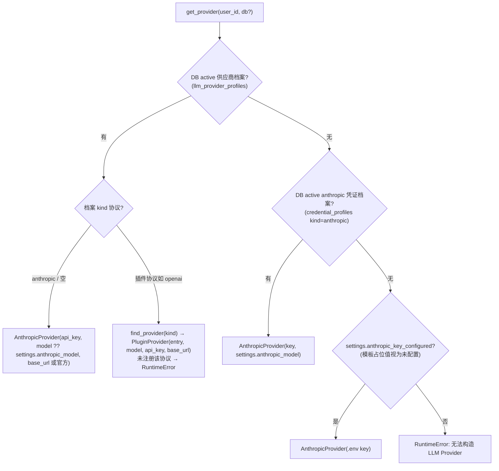
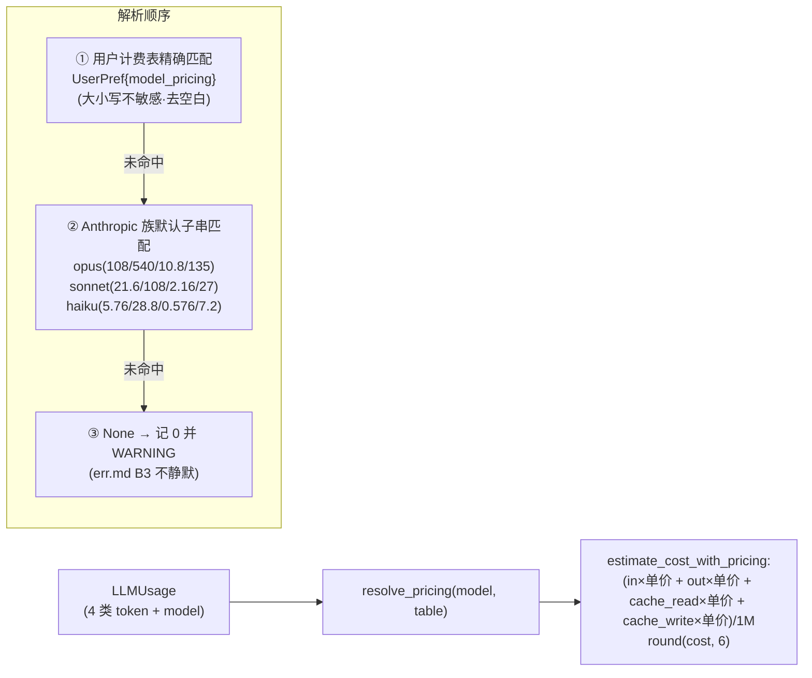
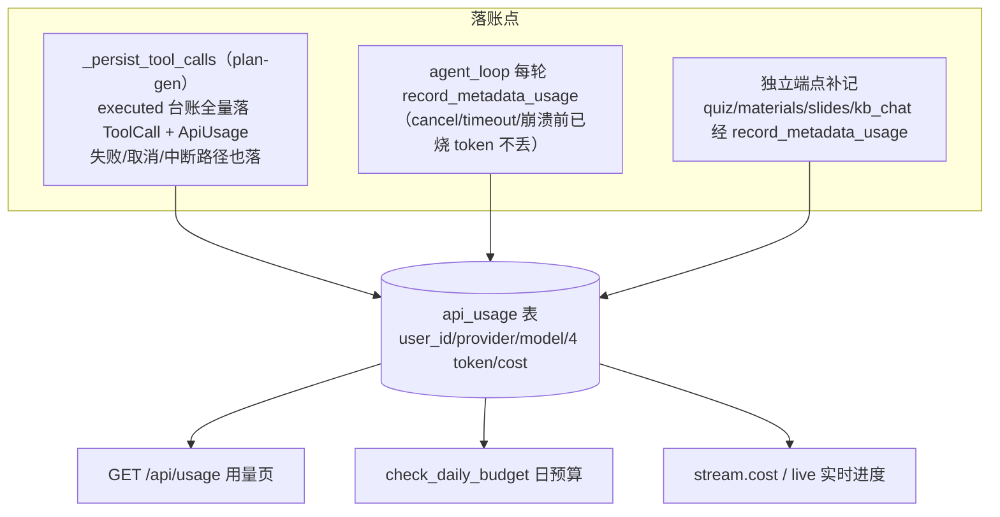

# 05 · LLM 供应商与成本计量

## 证据基线

> 行数口径：总行数（`[System.IO.File]::ReadAllLines` 逐文件累加，等价 `wc -l`），与文中行号引用同口径。

| 项 | 值 |
|----|----|
| 核对日期 | 2026-10-20 |
| 分支 | `refactor/reasonix` |
| v1 证据 | `backend/app/llm/base.py`（177 行）、`backend/app/llm/__init__.py`（161 行）、`backend/app/llm/anthropic_provider.py`（428 行）、`backend/app/llm/plugin_provider.py`（175 行）、`backend/app/llm/pricing.py`（178 行）、`backend/app/agent/budget.py`（44 行）、`backend/app/agent/cost.py`（150 行）、`backend/app/api/deps.py`（335 行）、`backend/app/core/concurrency.py`（95 行）、`backend/app/core/settings.py` |
| v2 证据 | `internal/model/openai/openai.go`、`internal/model/anthropic/anthropic.go`、`internal/model/responses/responses.go`、`internal/contract/provider/`（provider.go / usage.go / chunk.go）、`internal/contract/pricing/`（rates.go / catalog.go / quote.go / money.go / ledger.go）、`internal/runtime/tutor/llm.go`（212 行）、`internal/runtime/tutor/usage.go`（110 行）、`internal/runtime/tutor/service.go`（663 行）、`internal/frontend/serve/tutor.go`（680 行） |
| v1 规模 | `backend/app/api/*.py` 28 文件 / 24 路由模块；OpenAPI 120 paths / 146 operations；ORM 29 表；alembic 26 迁移；`backend/tests` 188 个 test_*.py / 1729 个 test 函数（pytest 收集 1736）；`backend/app` 31 311 行；`frontend/src` 20 250 行；端口 41173 |
| v2 规模 | 根 `go.mod`：`module reasonix` / `go 1.26.0`；`/tutor/*` 路由集中在 `internal/frontend/serve/tutor*.go`，**无 `/api` 兼容层** |

## 1. Provider 抽象（llm/base.py）

```python
class LLMProvider:                                          # base.py:108
    kind: str = "anthropic"                                 # base.py:115
    async def chat(system, user, *, model?, max_tokens=4096, cache_system=True) -> LLMResponse   # 117-126
    async def stream(...) -> AsyncIterator[StreamChunk]       # 128-140 默认实现：chat 后一次性 yield
    async def chat_agentic(messages, *, system, tools, ...) -> AgenticResponse                   # 146-158 抛 NotImplementedError
    async def stream_agentic(...) -> AsyncIterator[AgenticStreamChunk]                          # 160-173 同上
    def estimate_cost(usage) -> float                         # 175-177
```

数据结构：

| 类型 | 位置 | 字段与用途 |
|------|------|-----------|
| `LLMUsage` | base.py:17-22 | input_tokens / output_tokens / cache_read_input_tokens / cache_creation_input_tokens / model——4 类 token 全量计量（int 字段，pydantic 拒 NaN，见 `budget.py:32-33` 注释） |
| `LLMResponse` | base.py:25-28 | content / usage / stop_reason（单轮） |
| `StreamChunk` | base.py:39-47 | text / usage（末尾一次，单轮流式） |
| `ToolDefinition` | base.py:56-62 | name / description / input_schema（广告给模型的工具） |
| `TextBlock` / `ToolUseBlock` / `ThinkingBlock` | base.py:65-80 | agentic content 块 |
| `AgenticResponse` | base.py:82-89 | content 有序块列表 / usage / stop_reason（`stop_reason == "tool_use"` 表示需回灌 tool_result 继续循环） |
| `AgenticStreamChunk` | base.py:92-105 | text / thinking / signature / tool_use_start(id, name) / tool_use_delta(id, partial_json) / usage / stop_reason |
| `TransientLLMError` | base.py:31-36 | 瞬态标记（限流 / 连接 / 5xx），agent 层据此退避 |

## 2. 工厂：get_provider 三级回退（llm/__init__.py:111-161）



实现要点：档案 kind 为空 / 空白 / `anthropic` 走内置 AnthropicProvider，剩余 kind 分发到 PluginProvider（`__init__.py:126-149`）；档案的 base_url / model 为空分别回退官方端点 / `settings.anthropic_model`（145-148）；凭证档案回退路径 150-155；`.env` 路径要求 `settings.anthropic_key_configured`（`backend/app/core/settings.py:175-177`，模板占位值 `sk-ant-xxxxxxxx` 视为未配置），否则抛 RuntimeError（156-157）。

配套读取函数（均支持传入 db 复用会话防连接池 churn）：

| 函数 | 位置 | 语义 |
|------|------|------|
| `get_active_profile` | __init__.py:19-54 | 读 DB 中 is_active 的供应商档案（按 user_id 隔离，order_by(id) 定序防并发 activate 竞态）；DB 读失败回退 .env 并留 WARNING 日志 |
| `get_active_model_pricing` | __init__.py:57-77 | 读当前用户「模型计费表」（UserPref key=model_pricing） |
| `get_active_max_tokens` | __init__.py:80-108 | 读用户 llm_max_tokens 偏好覆盖（repr(int) 容错解析） |

## 3. AnthropicProvider 要点（anthropic_provider.py，428 行）

- **客户端缓存**：`_shared_client(api_key, base_url)`（71-90）按 (key, base_url) 缓存 `AsyncAnthropic`，**LRU 32 槽**（`_CLIENT_CACHE_MAX = 32`，42；iter 369 由 FIFO 8 改为 LRU 32——多用户档案下热点 key 不再被反复淘汰重建）；记录创建时事件循环，跨循环自动重建防 "Event loop is closed"（78、82-84）；淘汰 / 覆写旧 client 经 `_schedule_aclose`（52-68、83-87）后台关闭，防 fd / SSL 泄漏；`_HTTP_TIMEOUT` = connect 10 / read 300 / write 120 / pool 10（49）；`reset_client_cache`（93-98）供测试隔离。
- **异常映射**：`_map_transient`（101-108）——RateLimitError / APIConnectionError / InternalServerError 及 APIStatusError 且 status_code ≥ 500 → TransientLLMError；剩余异常原样返回（4xx 不重试）。
- **system 缓存**：`_build_system`（142-148）把 system 打包为 `[{"type":"text", text, "cache_control":{"type":"ephemeral"}}]`（Pillar 1 缓存优先，Skill prompt 稳定前缀跨调用复用）；空 system 返回 None。
- **stream**（170-233）：raw event stream → text_delta 逐块 yield；message_start 摄 input / cache token，message_delta 摄 output token；**异常路径先 yield 一次部分 usage 再 raise**（208-218，成本黑洞修复）；finally 显式关流（219-226）。
- **stream_agentic**（335-428）：content_block_start(tool_use) → tool_use_start（373-379）；input_json_delta → tool_use_delta（384-387，`index_to_id` 映射表归属，362）；text_delta → text（382-383）；thinking_delta → thinking（388-389）；signature_delta → signature（390-392，thinking 块回传必需）；message_delta 摄 output token 与 stop_reason（393-396）；末尾 yield usage + stop_reason（419-428）；**异常路径同样先 yield 部分 usage 再 raise**（397-410）。
- **thinking**：`_thinking_budget(max_tokens) = max(1024, min(8000, max_tokens - 1024))`（242-245）；max_tokens < 2048 时抬到 2048（269-272）。

## 4. PluginProvider（plugin_provider.py，175 行）

把 `api.providers.register(kind, handler)` 注册的插件 handler 适配为 LLMProvider：

- **handler 契约**（99-171）：`(system, user, *, model, max_tokens, api_key, base_url) -> {content, model, stop_reason?, usage{input_tokens, output_tokens, cache_read_input_tokens?, cache_creation_input_tokens?}}`；content 须为字符串（143-144），usage 的 input_tokens / output_tokens 必填、cache_* 缺省 0（148-167）；sync handler 走 `asyncio.to_thread`（123-133）；宿主级执行上限 `_HANDLER_TIMEOUT_S = 300.0`（46），超时映射 TransientLLMError（134-138）。
- **凭证**：档案传入优先，空串时插件自理（storage / 环境变量）。
- **错误分类 `_classify`**（53-73）：异常实例带 `transient = True` → TransientLLMError；类型名命中 ConnectError / TimeoutException / ReadTimeout / APIConnectionError / RateLimitError 或消息含 timeout / temporarily → TransientLLMError；剩余异常原样；非 Exception 基类 → PluginProviderError。返回缺字段 → PluginProviderError（`_require` 76-79、`_as_int` 82-86）。
- **不支持 agentic**（chat_agentic / stream_agentic 未实现）→ `_run_chat` 检测 `isinstance(provider, AnthropicProvider)`，否则拒绝 Agent 对话并发 `error{code:"unsupported_provider"}`（`backend/app/api/memory.py:811-816`）。

## 5. 计价体系（pricing.py，CNY ¥/1M tokens）



- `resolve_pricing(model, table)`（pricing.py:114-130）三级解析：① 用户计费表精确匹配（`_table_lookup` 103-111，大小写不敏感 + 去空白）；② Anthropic 族默认子串匹配（`get_pricing` 69-81，顺序敏感，opus 在前防误中；默认单价表 49-53）；③ `None` → 调用方记 0 并 WARNING（`estimate_cost` 143-149）。
- `estimate_cost_with_pricing(usage, pricing)`（153-161）：`(input×input_per_mtok + output×output_per_mtok + cache_read×cache_read_per_mtok + cache_creation×cache_write_per_mtok) / 1_000_000`，返回 `round(cost, 6)`。
- **4 个字段名**（`PRICING_FIELDS`，27-32）：`input_per_mtok` / `output_per_mtok` / `cache_read_per_mtok` / `cache_write_per_mtok`。
- 计费表由**设置页维护**（`GET /api/settings/pricing` 读、`PUT /api/settings/pricing` 写，`backend/app/api/settings.py:206`、`232`），默认预填 DeepSeek V4-Flash（1 / 2 / 0.02 / 1）与 V4-Pro（3 / 6 / 0.025 / 3）（`_DEFAULT_MODEL_PRICING` 63-66，`default_pricing_table()` 164-178）。
- `build_metadata(total, model, model_pricing)` → ToolMetadata（tokens / cost / model / provider，`backend/app/agent/cost.py:39-58`）；`estimate_cost_from_metadata`（82-94）从 metadata 反向重建 usage 重算——落账时统一按最新价表。

## 6. 预算与落账（budget.py + cost.py + deps.py）

**三层防线**：

| 层 | 机制 | 触发点 | 效果 |
|----|------|--------|------|
| 会话预算 | `BudgetTracker(limit=settings.budget_per_session_usd=1.0)`（budget.py:16-27；`settings.py:122`）；`add()` 拒绝 NaN / 负数（29-38，非法 cost 只 error 告警不污染累计值）；`exceeded()` 用 `>=`（40-44，恰满即超） | Orchestrator 每组归集后判定；agent_loop 每轮判定（`agent_loop.py:447-449`） | 生成 / 对话 interrupted + budget_exceeded |
| 日预算 | `check_daily_budget(db, user_id)`（`deps.py:263`）：当日（**本地日**口径，与用量页一致）api_usage.cost 求和 ≥ 有效预算（用户覆盖 UserPref{daily_budget_usd} 优先，`get_daily_budget` 243-261） | 触发 LLM 计费的端点执行前（如 `memory.py:570`） | 402 budget_exceeded |
| 重生成上限 | `plan.version > settings.max_regenerations(2)`（`settings.py:79`）→ 429 quota_exceeded | regenerate 端点 | 防同方案无限重跑 |

**落账路径**（日预算只信 api_usage 求和 → 落账缺口即预算绕过通道）：



落账点位置：

- `_persist_tool_calls`（`backend/app/api/plans.py:1139-1231`）——executed 台账全量落 ToolCall + ApiUsage（含反馈循环被覆盖的早轮、失败 / 取消 / 中断前已完成的调用）；outputs 仅用于补登「注入上游」行且仅当 DB 尚无该工具记录（1214-1219）；会话已删除时按 orphan_user_id 降级落 usage-only（1165-1170、1229-1231）。
- agent_loop 每轮 `record_metadata_usage`（`agent_loop.py:446`；异常路径 431；取消路径 411）。
- 独立端点补记统一经 `record_metadata_usage`（`backend/app/agent/cost.py:97-150`）——按当前用户计费表重算 cost 后写 api_usage 行；写失败只 rollback 不抛（144-150）。
- api_usage 表结构（`backend/app/db/models.py:544-567`）：user_id / provider / model / tokens_in / tokens_out / cache_read / cache_write / cost；复合索引 `(user_id, created_at)`（552）供日预算守卫走索引。

## 7. 全局并发背压（core/concurrency.py，95 行）

- `llm_task_slot()`（72-75）：进程级 asyncio.Semaphore（`settings.max_concurrent_llm_calls` 默认 16，`settings.py:98-101`；0 = 不限 → `_NullSlot` 占位，39-49）——**每个生成任务 / 对话 run 整体包裹**（plans._orch_task、`memory._run_chat` 843），超额排队等待，防跨用户并发触发供应商速率限制风暴与内存线性膨胀。惰性创建按当前事件循环（`_loop_sem` 56-69），`reset_llm_semaphore`（93-95）供测试隔离。
- `webhook_slot()`（78-82）：插件 webhook 出站并发上限（`settings.max_concurrent_webhook_deliveries` 默认 16，`settings.py:107-111`）。
- `search_fetch_slot()`（85-90）：Bing 免 Key 页面抓取进程级上限（`settings.max_concurrent_search_fetches` 默认 2，`settings.py:112-116`）。
- 另有（plans / memory 层）：生成全局 8 / 每用户 1；chat 全局 8 / 每 thread 1（`settings.py:94-97`）。

## 8. Go 侧 Provider 与成本计量

### 8.1 三种原生 provider kind

注册表在 `internal/contract/provider/provider.go`：`Register(kind, factory)`（673-682）、`New(kind, cfg)`（684-700）、`Kinds()`（702-705）。原生实现注册于 `internal/model/`：

| kind | 注册位置 | 说明 |
|-----|---------|------|
| `openai` | internal/model/openai/openai.go:58 | OpenAI 兼容协议（含 chaturl / host 判定 / effort / think 扩展） |
| `anthropic` | internal/model/anthropic/anthropic.go:60 | Anthropic Messages 协议（含 reasoning 回放、output_budget、web_search） |
| `responses` | internal/model/responses/responses.go:33-34 | OpenAI Responses 协议；另注册别名 `dashscope-responses` |
| `unconfigured` 占位 | internal/model/noprovider/noprovider.go:14（kind 常量 `internal/contract/config/provider_entry.go:13`） | 未配置供应商时的占位实现 |

统一接口 `Provider`（provider.go:530-538）：`Name() string` + `Stream(ctx, Request) (<-chan Chunk, error)`。分片类型 `Chunk`（internal/contract/provider/chunk.go:22-36）含 ChunkText / ChunkReasoning / ChunkToolCallStart / ChunkToolCallArgsDelta / ChunkToolCall / ChunkUsage / ChunkDone / ChunkError / ChunkResponsesItem / ChunkProviderTool——**供应商无关的分片词表**，v1 的 Anthropic 专用分片（text_delta / thinking_delta / tool_use_start / tool_use_delta）在 Go 侧被统一为 provider 层 Chunk。

### 8.2 官方费率表（append-only + superseded）

`internal/contract/pricing/`：

- **价格书结构**：`officialRates`（rates.go:36-146）按「供应商 × 模型 × 币种 × 计费模式」分行，行内 `Rates []rateGeneration` **按时间从旧到新追加**（rates.go:28-29 注释：改价追加一代而非编辑既有条目）。当前价 = 末条（`CurrentRate` 218-229）；历史价 = `SupersededRates`（234-245）——已存档价格若命中历史代，可被识别为本项目自带默认价而非用户自定价，刷新时可覆盖。
- **覆盖的供应商 / 模型**：deepseek（flash / pro，CNY 与 USD 双币种，rates.go:37-76）、longcat（LongCat-2.0，81-90）、mimo（v2.5 / v2.6 系列，92-145）；计费模式 `payg` 与 `subscription_equivalent` 两类（quote.go:13-16）。
- **高峰窗口**：DeepSeek 工作日 9-12 与 14-18 高峰、2026-08-23 起周末不再高峰、法定节假日全按平峰（catalog.go:39-44、49-66）；`RatesAt(t)` 按时刻选高峰卡或平峰卡（catalog.go:172-179）。
- **核对日期**：`CheckedOn` 字段（catalog.go:30-33），常量 checkedOn=2026-08-22 / deepseekCheckedOn=2026-09-13 / mimoCheckedOn=2026-10-06（catalog.go:69、74、77）——官方费率表靠人工核对，日期是唯一凭据。
- **官方端点映射**：`OfficialProviderForEndpoint(baseURL)`（catalog.go:101-109）按主机名判定适用供应商——转售商 / 代理按自身条款计价。
- **目录与指纹**：`OfficialCatalog()`（catalog.go:114-125）对每条目算 `PricingFingerprint`（quote.go:197-202，sha256 前 8 字节），供台账键使用；`LookupCatalog`（catalog.go:128-157）按供应商 / 模型 / 币种 / 计费模式查表，计费模式缺省按 payg，subscription_equivalent 行降级回 payg。

### 8.3 计价公式与定点金额

- `pricing.OriginalCostAmount(rates, usageTokens)`（quote.go:170-194）：`(cache_hit × CacheHit + (cache_miss − cache_write + billed_write) × Input + completion × Output) / 1e6`，返回定点 `Amount`。
- **定点金额**：`Amount` 为 int64、标度 1e9（money.go:22-28）；`Money` 包金额 + 币种（money.go:15-19）；`NormalizeCurrency`（159）与 `AddMoney`（230）做币种归一与同币种相加。
- **兼容层**：`provider.Pricing.Cost(u)`（internal/contract/provider/usage.go:79-111）保留历史 float 路径，注释明确新代码须走 `pricing.CostQuote`。
- **引号层**：`CostQuote`（quote.go:74-106）承载 original 金额、valuation（basis `identity` / `official_table`，quote.go:19-25）、selected 显示币种、coverage 与 displayStatus（`matched` / `fallback_original` / `bucketed` / `unavailable`，quote.go:30-35）、聚合模式（`single_currency` / `common_valuation` / `currency_buckets`，quote.go:38-42）、价带（`peak` / `off_peak` / `mixed`，quote.go:46-50）；`BuildQuote`（205）计算，`AggregateQuotes`（466）汇总。
- **台账**：`pricing.Ledger`（ledger.go:43-49），键 `LedgerKey(modelRef, usageSource, pricingFingerprint, rateDate)`（ledger.go:32-41），版本 `LedgerVersion = 1`（ledger.go:49）。

### 8.4 注入链与用量落盘

- **Provider 注入**：`internal/frontend/serve/tutor.go:141-162` `tutorProviderFromConfig`——每次 run 解析配置：`ResolveStartupChatModel` → `ResolveModel` → `provider.New(entry.Kind, provider.Config{...})`；未配置时返回 `tutor: no chat model is configured`。
- **计价器注入**：`tutorPricerFromConfig`（tutor.go:70-96）——按 modelRef 解析 config entry（失败回退启动 chat 模型），取 `entry.RateCardForModel(entry.Model)`（internal/contract/config/billing.go:123-138），再用 `pricing.OriginalCostAmount` 算钱，`Amount.Float64()` 出门。
- **tutor 层 LLM 抽象**：`internal/runtime/tutor/llm.go:16-19` —— `LLM` 接口只有 `Name()` 与 `Stream(ctx, provider.Request) (<-chan provider.Chunk, error)`，由 provider.Provider 实例满足；`ErrNoLLM`（23）标记未配置模型；`Usage`（27-34）记 InputTokens / OutputTokens / CacheReadTokens / CacheWriteTokens / Cost / Model；`Pricer` 类型（44）是 `func(model string, u Usage) float64`。
- **用量累加**：`runLLM`（55-96）从 Chunk 流里取 ChunkText 拼文本、ChunkUsage 累加 token（`addChunkUsage` 36-41）、ChunkError 直接返回；`metaFrom`（200-211）把 usage 折成 toolMeta（duration_ms / tokens / cost / model / degraded）。
- **落盘形态**：`internal/runtime/tutor/usage.go` —— **每日本地日一份 JSON**：`usagePath(date)` = `root/usage/<date>.json`（23-25）；`AddUsage`（38-48）在互斥锁内累加 cost 并计 runs；`UsageOfDay`（28-35）读当日（文件缺失即零日）；`UsageSeries`（64-86）返回近 N 日序列（1..90 天）；`UsageOverview`（90-109）汇总今日 / 序列 / 总额。
- **落账触发点**：`Service.finalize`（service.go:516-521）——totalCost > 0 才写，写失败只 Warn 不失败 run。
- **日预算**：`Service.budgetExceeded`（service.go:68-78）读当日 ledger，`cost >= DailyBudget` 即拒；`DailyBudget` 默认 10.0，来自环境变量 `TUTOR_DAILY_BUDGET`（tutor.go:118-128）。

### 8.5 v1 ↔ Go 差异与缺口

| 维度 | v1（Python） | Go（Reasonix） | 证据 |
|------|-------------|----------------|------|
| 供应商解析 | 三级回退（DB 档案 → 凭证档案 → .env），按用户隔离 | 单一入口：配置内 `entry.Kind` → `provider.New`，无多用户档案 | `backend/app/llm/__init__.py:111-161` / `internal/frontend/serve/tutor.go:141-162` |
| 协议插件化 | 插件注册任意 kind → PluginProvider（不支持 agentic） | kind 注册表在编译期（openai / anthropic / responses / 别名 / 占位） | `backend/app/llm/plugin_provider.py:89` / `internal/contract/provider/provider.go:673-705` |
| 流式分片 | Anthropic 专用（text / thinking / tool_use_start / tool_use_delta / signature） | provider 层统一 Chunk（10 种，含 tool_call args 增量、Responses item、服务端工具） | `backend/app/llm/base.py:92-105` / `internal/contract/provider/chunk.go:8-19` |
| 计价数据源 | 用户计费表（UserPref）+ Anthropic 族默认兜底 | **官方费率表为权威**，append-only + superseded 识别；用户价覆盖官方价 | `backend/app/llm/pricing.py:114-130` / `internal/contract/pricing/rates.go:36-146` |
| 金额类型 | float，`round(cost, 6)` | 定点 Amount（int64，标度 1e9）+ Money + 币种校验 | `backend/app/llm/pricing.py:153-161` / `internal/contract/pricing/money.go:15-28` |
| 单价维度 | 3 档（输入 / 输出 / 缓存读）+ 缓存写 4 字段 | 3 档（cache_hit / input / output）+ 高峰卡 + 币种 + 生效日期 | `backend/app/llm/pricing.py:27-32` / `internal/contract/pricing/catalog.go:13-34` |
| 计费窗口 | 无（单一价） | 高峰 / 平峰窗口 + 法定节假日表 + CheckedOn | `internal/contract/pricing/catalog.go:39-66` |
| 用量落盘 | api_usage 表逐行（user_id / provider / model / 4 token / cost），可按用户与模型查询 | 每日本地日一份 JSON，仅 cost 与 runs 两数，无按模型拆分 | `backend/app/db/models.py:544-567` / `internal/runtime/tutor/usage.go:9-11`、`50-52` |
| 日预算口径 | api_usage 求和 + 用户覆盖偏好（`deps.py:263`） | 当日 ledger 文件读数 + 环境变量阈值 | `backend/app/api/deps.py:263` / `internal/runtime/tutor/service.go:68-78` |
| 会话级预算 | 有（BudgetTracker，每轮 exceeded → interrupted） | 无 BudgetTracker | `backend/app/agent/budget.py:16-44` / `internal/runtime/tutor/` 无对应类型 |
| 即时计量 | 每轮 `record_metadata_usage` 落 api_usage | 每 run 收口一次性累加到当日 ledger | `backend/app/agent/cost.py:97-150` / `internal/runtime/tutor/service.go:516-521` |
| 台账键 | 无（表列即账） | modelRef + usageSource + pricingFingerprint + rateDate 四元键 | `internal/contract/pricing/ledger.go:32-49` |

Go 侧当前缺口：

1. **无会话 / 生成级预算守卫**——只有日预算（`service.go:68-78`），无 v1 的 `BudgetTracker` 逐轮截断；
2. **用量台账粒度粗**——每日期文件只有 cost 与 runs 两数，无按模型 / 按供应商拆分（`usage.go:50-52` 注释已明示），无法回答「哪个模型花了多少」；
3. **无 api_usage 等价的逐调用行**——崩溃 / 取消路径的已计费用量无逐条留痕，仅在 run 收口时累加一次；
4. **tutor 层无 agentic 计价路径**——`runLLM`（llm.go:55-96）只处理单轮补全文本，无 tool_use 迭代的逐轮 usage 累加；
5. **插件 Provider 协议在 Go 侧无对应**——v1 的 `api.providers.register` 插件协议（PluginProvider）在 Go 侧无等价机制（kind 注册表为编译期）。
