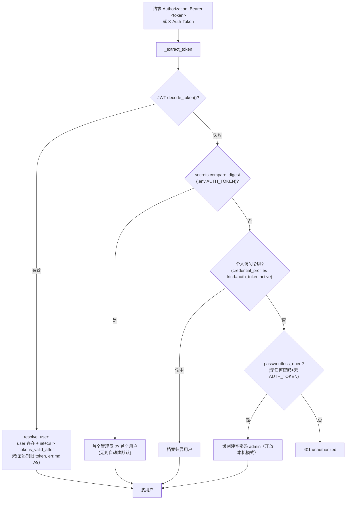

# 06 · API 全览（26 路由模块 / ~100 endpoint）

> 证据：`backend/app/api/__init__.py`（路由注册顺序）、各路由模块。全部挂在 `/api` 前缀；统一错误信封 `{"error": {code, message, details}}`。

## 1. 认证链（api/deps.py）

- 常量时间比较防时序攻击；**失败路径才查库**（已认证请求零额外 DB 查询）。
- 模板占位值 `change-me-please` / `sk-ant-xxxx` 视为未配置（iter 90：占位串认证会把用户锁死）。
- `get_current_user_id`：SSE/长连接专用——解析 user.id 后**立即释放** db（iter 366：否则 SSE 流期钉死连接池槽，100 用户 EventsBridge 耗尽连接池）。
- `require_admin`：非管理员 403（用户管理/插件热管理/MCP bridge/webhook config 等敏感端点）。

## 2. 统一错误（api/errors.py）

`ApiError(code, message, status?, details?)`；CODE_STATUS 映射 24 个业务码（unauthorized 401 / budget_exceeded 402 / not_found 404 / conflict 409 / payload_too_large 413 / validation_error 422 / rate_limited+quota_exceeded 429 / no_llm_provider+search_unavailable+server_busy 503 / upstream_timeout 504 / bad_gateway 502 …）。五个 handler 全覆盖：ApiError、HTTPException、Starlette 404/405、RequestValidationError 422（details 截 20 条防巨型回显）、未捕获 Exception 500（不回显敏感信息）。

## 3. 端点清单（按模块）

| 模块 | 端点（方法 路径） | 要点 |
|------|------------------|------|
| auth | POST /login · GET /me | JWT 签发（jwt_expire_days 默认 7 天）/ 当前用户 |
| health | GET /health | 无认证探活 |
| setup | GET /status · POST / · POST /dismiss | 首次设置向导（公开；needs_setup 判定） |
| sessions | POST · DELETE /{id} · GET · GET /{id} · GET /{id}/materials · DELETE /{id}/materials/{mid} | 会话 CRUD；GET /{id} 返回 **live 实时进度**（_STREAMS 内存态：current_tool/step/cost）；DELETE 级联取消生成 |
| materials | GET /formats · POST /upload · POST /{id}/confirm · POST /{id}/parse · POST /url · POST /text · GET /{unit_id} · GET /{unit_id}/export · POST /{unit_id}/done · POST /clip | 上传暂存-确认-解析三段制（status=pending/confirmed/parsed）；clip 供浏览器扩展 |
| plans | POST /generate(SSE) · GET · GET /today · GET /{id} · POST /{id}/retry(SSE) · POST /{id}/clarify(SSE) · POST /{id}/cancel · POST /{plan_id}/regenerate(SSE) · POST /{plan_id}/materials(SSE/JSON) · GET /{id}/materials 及 /export、/search 子路径 · POST /{id}/quiz · GET /{id}/quiz/wrong · GET /{id}/quiz/stats | 见 [03](03-生成流水线.md)；列表支持 mastery_asc/desc 排序与主题搜索 |
| exports | GET /formats · POST /{plan_id} | md/pdf/ics/apkg/slides 五格式（+插件 exporters 动态格式） |
| quizzes | POST /{quiz_id}/submit · GET /wrong-overview · GET /wrong-queue | 服务器判分（choice 按 options 原文比对）；错题体系 |
| progress | POST · GET /logs[/{plan_id}] · POST/DELETE /logs/{log_id} · GET /{plan_id} · GET /review/due · GET /review/queue · GET /stats/summary · /stats/calendar · /stats/by-plan | 掌握度更新（compute_mastery + next_review_date 间隔复习算法）；打卡日历 |
| search | GET /search | 全局四域聚合（方案/笔记/KB/知识点） |
| usage | GET · GET /daily · GET /by-model | 用量统计（本地日口径） |
| settings | GET · PUT /prefs · GET /pricing · PUT /pricing | 全局配置快照 / 用户偏好（daily_budget/llm_max_tokens…）/ 模型计费表 |
| providers | GET · GET /kinds · POST · PUT/{id} · DELETE/{id} · POST/{id}/activate · POST /deactivate · POST/{id}/test | LLM 供应商档案（kind 协议选择；api_key 掩码末 4 位；test 连通性） |
| credentials | GET · POST · PUT/{id} · DELETE/{id} · POST/{id}/activate · POST/{id}/deactivate · POST /deactivate-all | 三类凭证档案（anthropic/bing/auth_token；写限流） |
| users | GET · POST · PUT/{id} · DELETE/{id} | 管理员 CRUD（限流防 JWT 泄露滥用；delete 级联取消 chat run） |
| share | POST/{plan_id}/share · DELETE/GET /{plan_id}/share · （manage_router /shares）· （public_router /shared/{token} 免认证） | 只读分享（token 随机；撤销=删行）；全局分享管理 |
| backup | GET /export · POST /preview · POST /import | 全量备份（JSON；导入前预检摘要） |
| knowledge | GET · GET /notes · GET /notes/{node_id} · PUT /notes/{node_id} · GET /export | 个人 Wiki 聚合（跨方案知识点+笔记+统计+知识手册导出） |
| kb | POST /documents 的 upload/confirm/parse/text/url 五变体 · GET/PUT/DELETE /documents/{id} · GET /documents/{id}/raw 与 parsed · GET /export · POST /generate · POST /chat(限流) · GET /chats · DELETE /chats/{id} | 独立知识库（LLMWiki 式）；kb_chat 按有效上下文计费 |
| notes | GET · POST · POST /import · GET /export · GET/PUT/DELETE /{note_id} | 自由笔记（ZIP 互导） |
| memory | 见 [04](04-Agent对话与记忆系统.md) §6 | threads/messages/runs/memory/approve |
| plugins | GET · POST /{id}/reload · POST /{id}/disable · POST /{id}/enable | 管理员插件热管理 |
| events | GET /stream | 实时事件流 SSE（见 04 §8） |
| tools | GET | 工具发现（name/llm/requires/description） |

## 4. 横切守卫矩阵

| 守卫 | 位置 | 行为 |
|------|------|------|
| 认证 | 所有 /api（除 health/login/setup/shared） | 401 |
| 归属隔离 | get_owned_session/get_owned_plan/_owned_thread/_owned_run | 跨用户一律 **404**（防枚举） |
| 生成配额 | _check_generate_quota | 每用户并发 1 → 409；全局活跃 8 → 503 server_busy |
| chat 配额 | 每 thread 1 running → 409；全局 8 → 503 | |
| 日预算 | check_daily_budget | 402 |
| 重生成上限 | version > 2 | 429 |
| 限流 | SlidingWindowLimiter（core/ratelimit.py 滑动窗口） | chat_run 20/min、credentials 写、users admin CRUD、kb_chat 等 → 429 |
| body 限额 | main.py 中间件 | Content-Length 预检 413 + chunked 流式限量读（防绕过） |
| 上传限额 | max_upload_mb 50 | 格式/扩展名白名单 + magic 字节 + zip bomb 检查 |

## 5. 典型请求生命周期（以 POST /api/plans/generate 为例）

