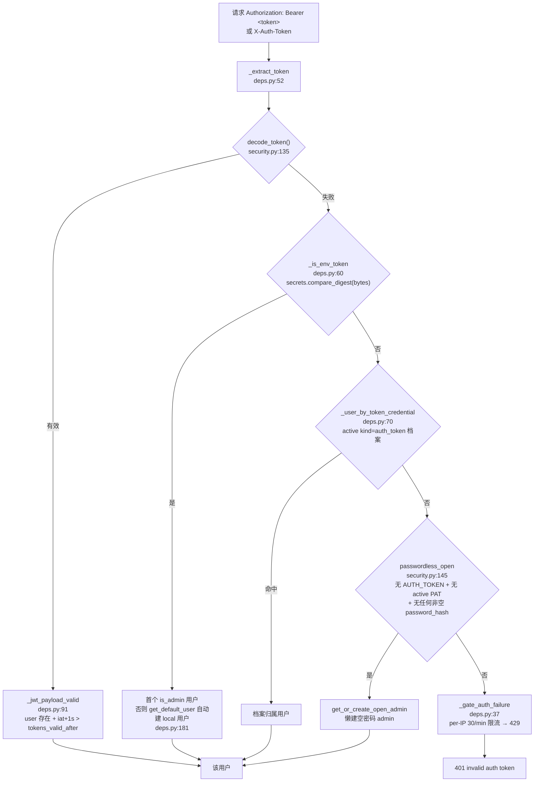

# 06 · API 全览（24 路由模块 / 145 operations / 119 paths）

> 证据基线（2026-10-20 复核，与代码一致）：
>
> - **OpenAPI 实测导出**：`PYTHONPATH=backend AUTH_TOKEN=<探针值> python -c "from app.main import create_app; app=create_app(); spec=app.openapi()"` → **119 paths / 145 operations**，全部带 `/api` 前缀。
> - **路由模块**：`backend/app/api/` 共 28 个文件 = `__init__.py` + `deps.py` + `errors.py` + `sse_utils.py` + **24 个路由模块**；`share.py` 贡献 3 个 router（`router` / `manage_router` / `public_router`），全库合计 26 个 `APIRouter` 实例。
> - **ORM 29 表**（`backend/app/db/models.py`）；**alembic 26 个迁移**（`backend/alembic/versions/`）。
> - **测试与体量**：`backend/tests/` 177 个文件；`backend/app` 26 583 行；`frontend/src` 20 469 行（`.ts`/`.tsx` 20 250 + `.css` 219；总行数口径，`[System.IO.File]::ReadAllLines` 逐文件累加）。
> - **资产**：`plugins/` 9 个插件文件（8 个 `.py` 可加载 + 1 个 `.disabled` 停用，见 `backend/app/plugins/loader.py:107-115`）；`skills/` 8 个目录；v1 监听端口 41173。
> - **Go 侧**：`go.mod` = `module reasonix` / `go 1.26.0`；`/tutor/*` 路由集中于 `internal/frontend/serve/tutor*.go`；**无 `/api` 兼容层**（阶段① M3.5 待建）。

## 1. 认证链（api/deps.py）

- **四级链顺序**（`require_auth` deps.py:121-137 / `resolve_user` deps.py:159-192）：JWT → `.env` AUTH_TOKEN → 个人访问令牌 → 开放本机模式。
- 常量时间比较：`.env` token 走 `secrets.compare_digest(token.encode(), settings.auth_token.encode())`（deps.py:65-67），PAT 走逐档 `compare_digest`（`core/credentials.py`，**摘要行比 sha256 摘要、旧明文行比明文**）——**先 encode 再比**，非 ASCII str 直接比较会抛 `TypeError` 把 401 变 500（deps.py:63-64）。
- **PAT 存储（iter 394）**：`credential_profiles.api_key` 对 `auth_token` 类存 `sha256:<hex>` 摘要（明文不入库——库/备份泄露即令牌泄露）；读路径兼容历史明文行，启动期 `upgrade_plaintext_tokens()` 一次性升级；新建/改写最小长度 **16** 位（8 -> 16：per-IP 30/min 的失败限流挡不住多 IP 分布式爆破）；掩码显示「****（摘要）」。
- **失败路径才查库**：已认证请求零额外 DB 查询（deps.py:131 注释）；PAT 匹配仅在 JWT 与 `.env` token 双失败后调用（deps.py:129）。
- 模板占位值 `change-me-please`（`core/settings.py:32`）/ `sk-ant-xxxxxxxx`（`core/settings.py:33`）经派生属性 `auth_token_configured` / `anthropic_key_configured` 视为**未配置**（settings.py:170-177）。
- 认证失败统一出口 `_gate_auth_failure`（deps.py:37-49）：`limiter.check(f"auth_fail:{ip}", 30)` 超限 → **429**（deps.py:30 `_AUTH_FAIL_PER_MIN = 30`），日志只记 ip + path，不记 token 原文。
- `get_current_user_id`（deps.py:219-240）：SSE / 长连接专用——解析 `user.id` 后在 `finally` 内 `db.close()` **立即释放连接**（deps.py:232-240），流期不再占用连接池槽位。唯一调用点为 `GET /api/events/stream`（api/events.py:166）。
- `require_admin`（deps.py:212-216）：非管理员 **403**；挂载于 users 全端点（api/users.py:77,111,143）与 plugins 全端点（api/plugins.py:45,63,79,92）。

## 2. 统一错误（api/errors.py）

- `ApiError(code, message, status?, details?)`（errors.py:18-30）：`status` 缺省时取 `CODE_STATUS.get(code, 400)`（errors.py:29）。
- `UnknownToolError`（errors.py:33-44）：双继承 `ApiError` + `ValueError`，`not_found` / 404，兼容插件 `except ValueError` 契约。
- **`CODE_STATUS` 实为 26 个业务码**（errors.py:48-75）：unauthorized 401 / forbidden 403 / not_found 404 / method_not_allowed 405 / conflict 409 / budget_exceeded 402 / bad_request 400 / unsupported_format 400 / empty_content 422 / payload_too_large 413 / upstream_timeout 504 / no_search_key 503 / search_unavailable 503 / no_llm_provider 503 / ssrf_blocked 400 / validation_error 422 / missing_upstream_field 400 / no_schedule 422 / no_quizzes 422 / no_wrong_quizzes 422 / invalid_scope 422 / quota_exceeded 429 / rate_limited 429 / server_busy 503 / bad_gateway 502 / internal_error 500。
- **HTTP 状态 → 通用码独立映射** `_STATUS_TO_CODE` 14 项（errors.py:124-139）：400→bad_request、401→unauthorized、402→budget_exceeded、403→forbidden、404→not_found、405→method_not_allowed、409→conflict、413→payload_too_large、422→validation_error、429→rate_limited、500→internal_error、502→bad_gateway、503→server_busy、504→upstream_timeout；未登记状态兜底 `>=500 → internal_error`，否则 `bad_request`（errors.py:142-143）。
- **五个异常处理器**（errors.py:82-119，注册于 main.py:295-300）：

| 处理器 | 触发 | 行为 |
|--------|------|------|
| `api_error_handler` | `ApiError` | 回显 `code` / `message` / `details`（errors.py:82-83） |
| `http_exception_handler` | FastAPI `HTTPException` | 状态经 `_status_to_code` 转码，`detail` 作 message（errors.py:86-89） |
| `starlette_http_exception_handler` | Starlette 层 404/405 | 同上，路由未命中亦走统一信封（errors.py:92-96） |
| `request_validation_handler` | `RequestValidationError` | 固定 422 + `validation_error`，`details.errors` **截断 20 条**（errors.py:99-108） |
| `unhandled_exception_handler` | 未捕获 `Exception` | 固定 500 + `internal_error`，**不回显异常文本**（R35），仅服务端日志（errors.py:111-119） |

- `/api` 未命中路径由 SPA 挂载层返回同款信封（main.py:323-327），不吞 404。

## 3. 端点清单（按路由模块，与 OpenAPI 导出逐条对齐）

注册顺序见 `api/__init__.py:10-36`（`api_router = APIRouter(prefix="/api")`）。

| 模块（tag） | 前缀 | 认证 | 数 | 端点（方法 路径） |
|------|------|------|----|------------------|
| auth | /auth | 端点级 | 2 | POST /login · GET /me |
| health | （无） | 公开 | 1 | GET /health |
| setup | /setup | 公开 | 3 | GET /status · POST / · POST /dismiss |
| sessions | /sessions | require_auth | 6 | POST · GET · GET /{session_id} · DELETE /{session_id} · GET /{session_id}/materials · DELETE /{session_id}/materials/{material_id} |
| materials | /materials | require_auth | 10 | GET /formats · POST /upload · POST /url · POST /text · POST /clip · POST /{material_id}/confirm · POST /{material_id}/parse · GET /{unit_id} · GET /{unit_id}/export · POST /{unit_id}/done |
| plans | /plans | require_auth | 15 | GET / · POST /generate(SSE) · GET /today · GET /{plan_id} · GET /{plan_id}/materials · POST /{plan_id}/materials · GET /{plan_id}/materials/export · GET /{plan_id}/materials/search · POST /{plan_id}/quiz · GET /{plan_id}/quiz/wrong · GET /{plan_id}/quiz/stats · POST /{plan_id}/regenerate(SSE) · POST /{session_id}/retry(SSE) · POST /{session_id}/clarify(SSE) · POST /{session_id}/cancel |
| export | /export | require_auth | 2 | GET /formats · POST /{plan_id} |
| usage | /usage | require_auth | 3 | GET / · GET /daily · GET /by-model |
| settings | /settings | require_auth | 4 | GET / · PUT /prefs · GET /pricing · PUT /pricing |
| progress | /progress | require_auth | 11 | POST / · GET /logs · POST /logs · DELETE /logs/{log_id} · GET /logs/{plan_id} · GET /{plan_id} · GET /review/due · GET /review/queue · GET /stats/summary · GET /stats/calendar · GET /stats/by-plan |
| quizzes | /quizzes | require_auth | 3 | POST /{quiz_id}/submit · GET /wrong-overview · GET /wrong-queue |
| search | /search | require_auth | 1 | GET /search |
| providers | /providers | require_auth | 8 | GET / · GET /kinds · POST / · PUT /{profile_id} · DELETE /{profile_id} · POST /{profile_id}/activate · POST /deactivate · POST /{profile_id}/test |
| users | /users | require_admin | 4 | GET / · POST / · PUT /{user_id} · DELETE /{user_id} |
| share | /plans | require_auth | 3 | POST /{plan_id}/share · DELETE /{plan_id}/share · GET /{plan_id}/share |
| share（管理） | /shares | require_auth | 1 | GET /shares |
| share（公开） | /shared | **免认证** | 1 | GET /shared/{token} |
| backup | /backup | require_auth | 3 | GET /export · POST /preview · POST /import |
| knowledge | /knowledge | require_auth | 5 | GET / · GET /notes · GET /notes/{node_id} · PUT /notes/{node_id} · GET /export |
| kb | /kb | require_auth | 16 | POST /documents/upload · POST /documents/text · POST /documents/url · POST /documents/{document_id}/confirm · POST /documents/{document_id}/parse · GET /documents · GET /documents/{document_id} · PUT /documents/{document_id} · DELETE /documents/{document_id} · GET /documents/{document_id}/raw · GET /documents/{document_id}/parsed · GET /export · POST /generate · POST /chat · GET /chats · DELETE /chats/{record_id} |
| credentials | /credentials | require_auth | 7 | GET / · POST / · PUT /{credential_id} · DELETE /{credential_id} · POST /{credential_id}/activate · POST /{credential_id}/deactivate · POST /deactivate-all |
| notes | /notes | require_auth | 7 | GET / · POST / · POST /import · GET /export · GET /{note_id} · PUT /{note_id} · DELETE /{note_id} |
| memory | （无前缀） | require_auth | 23 | GET /memory · POST /memory · DELETE /memory/{memory_id} · GET /threads · POST /threads · GET /threads/{thread_id} · PATCH /threads/{thread_id} · DELETE /threads/{thread_id} · GET /threads/{thread_id}/messages · DELETE /threads/{thread_id}/messages/{message_id} · GET /threads/{thread_id}/runs · POST /threads/{thread_id}/runs · GET /threads/{thread_id}/runs/active · GET /threads/{thread_id}/memory · POST /threads/{thread_id}/memory · DELETE /threads/{thread_id}/memory/{memory_id} · GET /runs/{run_id} · DELETE /runs/{run_id} · POST /runs/{run_id}/approve · POST /runs/{run_id}/cancel · GET /runs/{run_id}/files · GET /runs/{run_id}/files/{name} · GET /runs/{run_id}/steps |
| plugins | /plugins | require_admin | 4 | GET / · POST /{plugin_id}/reload · POST /{plugin_id}/disable · POST /{plugin_id}/enable |
| events | /events | require_auth | 1 | GET /stream（SSE） |
| tools | /tools | require_auth | 1 | GET /tools |
| **合计** | | | **145** | **119 paths** |

补充说明：

- **路由模块数 = 24**（`api/` 下除 `__init__.py` / `deps.py` / `errors.py` / `sse_utils.py` 外的文件）；**`APIRouter` 实例数 = 26**（不含 `api/__init__.py:10` 的根 `api_router`；`share.py:33,35,37` 贡献 3 个）。
- `memory` 模块的 router **无前缀**（api/memory.py:52），路径直挂 `/api/threads/*`、`/api/runs/*`、`/api/memory*`。
- `plans` 族的 `retry` / `clarify` / `cancel` 三个端点参数名是 `{session_id}` 而非 `{plan_id}`（OpenAPI 实测路径参数名）。
- `GET /api/sessions/{id}` 返回 **live 实时进度**（`_STREAMS` 内存态：current_tool / step / cost，api/plans.py:88）；`DELETE` 级联取消生成。
- `materials` 上传为「暂存 → 确认 → 解析」三段制（`status=pending/confirmed/parsed`）；`POST /materials/clip` 供浏览器扩展。
- `GET /api/export/formats` 列出 md/pdf/ics/apkg/slides 五格式 + 插件注册的动态格式。
- `quizzes` 服务端判分（choice 按 options 原文比对）；错题面为 `wrong-overview` + `wrong-queue`。
- `kb` 知识库独立于会话；`POST /kb/chat` 按有效上下文计费（`api/kb.py:837-839` 注入上限：单文档 19900 字符、全量 150000 字符、缺省最近 20 篇）。

## 4. 横切守卫矩阵

| 守卫 | 位置（file:line） | 阈值 / 行为 |
|------|------|------|
| 认证 | 各 router `dependencies=[Depends(require_auth)]`（26 个 router 中 20 个挂载） | 未认证 401；失败 per-IP 30/min → 429（deps.py:30） |
| 归属隔离 | `get_owned_session`（deps.py:316）· `get_owned_plan`（deps.py:327）· `_owned_thread`（api/memory.py:82）· `_owned_run`（api/memory.py:89） | 跨用户一律 **404 not_found**（防枚举） |
| 生成配额 | `_check_generate_quota`（api/plans.py:116-135） | 每用户并发 **1**（`max_concurrent_generations_per_user`）→ 409；全局 **8**（`max_concurrent_generations`）→ 503 server_busy |
| 生成族频控 | `_gate_generate_start`（api/plans.py:138-141） | `plans_gen:{uid}` **12/min**，generate/retry/clarify/regenerate/materials 共桶 → 429 |
| chat 配额 | api/memory.py:555-562 | 每 thread running **1**（`max_running_chat_per_thread`）→ 409；全局 **8**（`max_concurrent_chat_runs`）→ 503 |
| chat 频控 | api/memory.py:596 | `chat_run:{uid}` **20/min** → 429 |
| 日预算 | `check_daily_budget`（deps.py:263-309） | 用户覆盖优先（`user_prefs.daily_budget_usd`），本地日 `api_usage` 累计 ≥ 上限 → **402 budget_exceeded**；上限 ≤0 视为不限 |
| 重生成上限 | api/plans.py:620-626 | `plan.version > max_regenerations`（**2**）→ **429 quota_exceeded** |
| 限流 | `SlidingWindowLimiter`（core/ratelimit.py:14-55） | 滑动窗口 60s，实例 `limiter`，`check(key, limit)`；key 上限 100000（超限全清）；应用见下表 |
| body 限额 | main.py:27,210-246 | `_MAX_BODY_BYTES = max_upload_bytes + 5MB`（默认 **55MB**）；Content-Length 预检 413 + chunked 流式限量读；`/api/backup/import` 与 `/api/backup/preview` **豁免**（各端点自限 256MB） |
| 上传限额 | `settings.max_upload_mb`（core/settings.py:77）= **50** | `max_upload_bytes` = 50MB；扩展名白名单 + magic bytes 校验（api/materials.py:58-61,225-248）；备份 256MB（api/backup.py:34）；kb 原件 base64 内联 32MB（core/backup.py:50） |

限流键位实测（`limiter.check` 调用点）：

| 键 | 上限 | 位置 |
|----|------|------|
| `auth_fail:{ip}` | 30/min | deps.py:43 |
| `login:{ip}:{username}` / `login:acct:{username}` / `login:ip:{ip}` | 10 / 20 / 60 每分钟 | api/auth.py:57-62 |
| `plans_gen:{uid}` | 12/min | api/plans.py:140 |
| `chat_run:{uid}` | 20/min | api/memory.py:596 |
| `cred_write:{uid}` | 30/min | api/credentials.py:43 |
| `users_write:{admin}` | 20/min | api/users.py:79,111,144 |
| `provider_write` | 30/min | api/providers.py:96 |
| `thread_write` / `memory_write` | 30 / 60 每分钟 | api/memory.py:137,283,321 |
| `kb_upload` / `kb_parse` / `kb_text` / `url` / `kb_chat` | 20 / 20 / 30 / 10 / 10 每分钟 | api/kb.py:235,306,384,431,979 |
| `mat_upload` / `parse` / `text` / `url` | 20 / 20 / 30 / 10 每分钟 | api/materials.py:303,374,460,447 |
| `export:{uid}` | 12/min | api/exports.py:89；api/plans.py:2363；api/materials.py:537（共用同键） |
| `notes_write` / `notes_export` | 60 / 10 每分钟 | api/notes.py:45,202 |
| `knowledge_list` / `knowledge_export` / `node_note_write` | 30 / 10 / 60 每分钟 | api/knowledge.py:58,216,345 |
| `progress log` | 60/min | api/progress.py:34 |
| `quizzes submit` | 60/min | api/quizzes.py:50 |
| `search` | 30/min | api/search.py:31 |
| `sessions create` | 30/min | api/sessions.py:35 |
| `backup export` / `preview` / `import` | 10 / 10 / 5 每分钟 | api/backup.py:37-39 |

资源配额（超限 429 `quota_exceeded`）：sessions **200**/用户（api/sessions.py:32）、materials **20**/会话（api/materials.py:99）、notes **500**/用户（api/notes.py:32）、kb_documents **200**/用户（api/kb.py:74）、credential_profiles **20**/类/用户（api/credentials.py:34）、provider_profiles **50**/用户（api/providers.py:97）、threads **500**/用户（api/memory.py:70）、memories **2000**/用户（api/memory.py:71）、学习日志 **10000**/用户（api/progress.py:35）。

**iter 394：配额判定闭合「先查后写」竞态**——计数与插入之间若无互斥，并发请求可同时通过「未达上限」检查，实际写入数按并发数突破上限（25 个并发创建 -> 25 行，上限 20）。现经 `core/quota.py` 的 `quota_slot`（分段线程锁）与 `guarded_commit_async`（异步端点「检查 -> 入队 -> flush -> 落盘 -> 提交」同锁同线程）闭合，落地 8 个写入面（sessions / credentials / providers / notes / threads / memories / 学习日志 / materials / kb）。**必须含提交**：pysqlite 传统事务模式下未提交的 INSERT 其他连接不可见，只锁检查防不住。

**iter 394：两项出站/暴露面收紧**——
- `POST /api/setup` 与 `POST /api/setup/dismiss`（公开端点）在**开放模式**（无人设过口令、无 AUTH_TOKEN、无 active PAT）下**仅接受本机回环请求**（403）：这两个端点会**新建凭据**（认领管理员口令 / 翻转全局 dismiss 状态），开放给局域网任意客户端等于允许远程抢占管理员口令或翻转全局 dismiss 状态。LAN 部署改用 `.env` 的 `ADMIN_PASSWORD` / `AUTH_TOKEN`。
- **iter 397 修正**：iter 394 把 `POST /api/setup` 称作「**唯一**的认领管理员入口」——该前提**不成立**，本条已被证伪：`POST /api/users`（`is_admin` 直接取自请求体）、`PUT /api/users/{id}`（重置他人口令）、`POST /api/credentials`（`kind=auth_token` 的个人访问令牌）、`POST|PUT /api/providers`（`base_url` = 服务端出站目标）同样是**能在开放模式关闭后继续生效**的信任面建立入口。现统一口径为：**开放模式下「信任面建立」（认证凭据 + 出站目标）一律限回环客户端**——`api/deps.py::require_local_in_open_mode`（回环判定 `is_loopback_client` 从 `api/setup.py` 上提为共用），`users` 三个写端点 / `credentials` 的 PAT 创建·改写·启用 / `providers` 的创建·改写·启用接入。回环（本机）调用全程不受影响。判定置于 `resolve_user` 之前，避免远程未认证调用触发「懒创建 admin」的写副作用。
- 供应商档案 `base_url` 是**服务端出站目标**且用户可自选：默认**拦截私网/环回/链路本地/云元数据**目标（写时校验 + 调用前复检，422 / `ssrf_blocked`），确需指向本地模型服务（Ollama / LM Studio / 内网中转）时设 `ALLOW_PRIVATE_LLM_BASE_URL=1` 放行。判定规则单一事实源在 `core/urlguard.py`（与材料抓取的 SSRF 防护同源）。

**iter 395：并发写面与长驻资源面的四处加固**——
- **用户偏好原子 upsert**：`PUT /api/settings/prefs` 与 `PUT /api/settings/pricing` 此前是「先查后插」，并发首写同一格时双方都读到「无行」-> 都 INSERT -> 后者撞 `uq_user_prefs_user_key` -> `IntegrityError` 未捕获 -> **500**（实测 8 并发：prefs 4 个 500、pricing 7 个 500）。改用数据库原生 upsert（`INSERT ... ON CONFLICT DO UPDATE`，按方言分派 SQLite/PostgreSQL）单条 DML，冲突交数据库解决。
- **计费表不得被误清空**：`PUT /api/settings/pricing` 输入非空但清洗后为空（字段名写错 / 全为负数或非有限值）-> **400 拒绝**，不再静默清空用户整张表并回退默认价（一次字段名笔误即改掉成本口径，进而影响日预算守卫的计价）。显式空对象 `{}` 仍是「清空」。
- **事件流连接数上限**：`GET /api/events/stream` 单用户 **16** 条 / 全局 **256** 条，超限 429；槽位与 bus sink 的释放改挂 `BackgroundTask`（客户端提前断开时生成器 finally 不执行，只挂 finally 会永久泄漏）。
- **错题族读限流**：`GET /api/quizzes/wrong-overview` 与 `/wrong-queue` 此前无限流，每次都对本用户全部作答历史跑窗口函数 -> 补 30/min；`/wrong-queue` 的 `limit` 改 `Query(ge=1, le=200)`（此前裸 int，0/负值被夹取成 1）。

**iter 395：知识节点状态筛选下推 SQL**——`GET /api/knowledge?status=...` 此前在 `LIMIT` 之后于 Python 侧过滤：节点数 > limit 的重度用户按状态筛选只会看到「最新 limit 个节点」里的匹配项（结果严重偏少甚至为空），chip 计数同样失真。现 `status` 下推到 SQL（limit 之前），`stats` 改为按**全量匹配节点**分组统计。

**iter 395：作答记录保留策略（用户已决）**——`quiz_attempts` 是全库增速最快的表（每次提交一行、此前永不清理）。运维每日轮按 `settings.quiz_attempt_keep_per_quiz`（默认 **10**）**每题**保留最新 N 条（分批删除，避免长时间持写锁把并发写打成 503）。**最新一条始终保留** -> 错题本判定（每题最新作答 `correct IS False`）逐字不变；受影响的只有「总作答次数 / 正确率」统计（`GET /plans/{id}/quiz/stats`）与备份体积。`0` = 保留全部历史。

**iter 396：未审面续审（sessions / notes / memory / backup）后的七处加固**——
- **核心事件载荷直归属**：`plan_created` / `materials_completed` 此前仅带 `session_id`，SSE 端每事件 × 每订阅者查库解析 `session.user_id`，且解析依赖会话行存活（会话已删 -> 事件按 safe-by-default 丢弃，正主收不到通知）。现直传 `user_id`（后端插件 API 1.22.0 / 前端 1.19.0，载荷只增键），归属判定零查库。
- **笔记导入路径**（`POST /api/notes/import`）：① 配额竞态闭合——此前在函数开头数一次 `existing` 即判定 500 条上限、不持 `quota_slot`、不在提交前复查，两个并发 import（或 import 与并发 create_note）各看到同一 `existing` -> 实际落库可达 ~2 倍上限；现「计数 + 批量插入 + 提交」同在 `quota_slot("note:{uid}")` 内（与 create_note 同键）。② zip 解压内存放大封死——`zf.read(name)` 走 `ZipExtFile._read1(MAX_N=1<<31)`，zlib 把整个 deflate 成员一次性展开且**与中央目录声明的 `file_size` 无关**（声明值可谎报，原「声明值 > 100KB 即跳过」检查可被绕过）；实测 97KB 请求体 -> 峰值分配 **204.8MiB**（探针 `dt_probe_zip_amp2.py`），改 `zf.open()` + 64KiB 分块读后峰值 **0.3MiB**，并按**实际解压字节**判单条上限、累计超总预算即停（不再遍历解压后续条目）。③ 整段解析移入 `asyncio.to_thread`（此前在 async 端点内同步解压，大条目卡住全站请求与 SSE 心跳）。
- **删 thread 与在途 chat run 的写并发**（`DELETE /api/threads/{id}`）：此前只 cancel 不等收敛就删行，而 agent 落库写（`_persist_message` / `_persist_run_step`，走 `asyncio.to_thread` **不可中断**）可能落在「子行已删、thread 行未删」之间 -> 删 thread 行触发 `FOREIGN KEY constraint failed` -> **500 且 thread 未删**；落在 thread 行删除之后 -> 写入自身 FK 失败。现先 cancel 再等在途 run 收敛（`_wait_runs_settled`，同 sessions.py 范式），并对删除做**有界重试**（回滚 + 重载 ORM 对象），仍失败返回 409。
- **chat run 异常不再外泄内部细节**：SSE 的 `error` 事件此前直接回显 `str(exc)`（IntegrityError 文本含表名/列名/SQL 片段），现为固定文案 + 细节进服务端日志（与 `api/errors.py`「不回显敏感信息」口径一致）。
- **提升为笔记复用 notes 的上限与配额**：`POST /api/runs/{id}/approve` 直接建 Note（标题未截 256、正文未截 20000、不检查 500 条配额），现复用 `/notes` 的规范化常量与 `quota_slot("note:{uid}")`，超限 429。
- **会话列表去 N+1**：`GET /api/threads` 逐条 2 次查询（limit=100 即 201 次），改两次批量查询（各 thread 的 `max(message.id)` 与 running run 集合）后 Python 侧拼装。
- **备份还原路径**：① `provider_profiles.base_url` 补**写时 SSRF 校验**（与 `api/providers.py` 同口径，`check_outbound_url` 解析 DNS 后判私网；此前导入完全不校验，可写入 `file://` 或指向私网/云元数据的地址，调用期仅做字面量判定不解析 DNS）；② 还原侧 thread 上限 **200 -> 500**（与在线 API 对齐——200~500 个 thread 的用户「导出→导入」往返原本静默丢会话）；③ 方案版本号按会话内顺序**去重**（备份可能含重复 `version`，schema 无 `(session_id, version)` 唯一约束 -> 同会话重号版本）；④ 行数预算 `_count_payload_rows` 计入知识点笔记（每个带 `note` 的节点额外插一行 `NodeNote`，此前 10 万节点全带笔记时实际插入 20 万行，超预算一倍）。
- **会话删除端点不再独占工作线程**：`DELETE /api/sessions/{id}` 此前是同步端点，等在途生成收敛（最多 15s）期间独占一个 anyio 工作线程，并发删除可占满线程池（默认 40 槽）使全站同步端点（含登录）排队。现为 async 三段式：准备（写线程）-> 异步等待（`wait_generation_settled_async`，**不占线程**）-> 删除（写线程）+ 文件清理（线程池）；文件清理失败此前被 `except: pass` 静默吞掉，现记 warning。
- **备份覆盖面披露**（B8）：后端早已计算「未纳入备份的表」（审计流水 / 用量台账 / 分享链接 / 凭证档案等）与「因体积上限跳过的 kb 原件数」并随 export/preview/import 回传，UI 一律不显示 -> 「导出全部学习数据」的表述与实现不符。现新增 `GET /api/backup/coverage`（同一事实源），设置页折叠展示未备份清单。

## 5. 典型请求生命周期（以 POST /api/plans/generate 为例）

## 6. Go 侧 API 面现状

### 6.1 路由面（78 个 /tutor/* 端点）

注册入口 `Server.registerTutorRoutes`（`internal/frontend/serve/tutor.go:220-244`），由 `routes()` 挂载（`internal/frontend/serve/routes.go:39`），Hub 侧另有一处挂载（`internal/frontend/serve/hub.go:568`）。**不存在 `/api` 前缀兼容层**。

| 分组 | 数量 | 端点（方法 路径） | 位置 |
|------|------|------------------|------|
| 会话 | 4 | POST /tutor/sessions · GET /tutor/sessions · GET /tutor/sessions/{id} · DELETE /tutor/sessions/{id} | tutor.go:221-224 |
| 材料 | 7 | POST /tutor/sessions/{id}/materials/text · POST …/materials/url · POST …/materials/upload · GET …/materials · POST …/materials/{mid}/confirm · POST …/materials/{mid}/parse · DELETE …/materials/{mid} | tutor.go:226-232 |
| 生成 | 5 | POST /tutor/sessions/{id}/generate(SSE) · POST …/clarify(SSE) · POST …/retry(SSE) · POST …/cancel · POST /tutor/plans/{pid}/regenerate(SSE) | tutor.go:234-238 |
| 方案与导出 | 11 | GET /tutor/plans · GET /tutor/plans/{pid} · DELETE /tutor/plans/{pid} · GET /tutor/plans/{pid}/versions · GET /tutor/plans/{pid}/versions/{v} · GET /tutor/plans/{pid}/export.md · GET …/export.ics · GET …/export.pdf · GET …/export.apkg · GET …/export.html · GET /tutor/plans/{pid}/units/{uid}/export.html | tutor_data.go:21-31 |
| 方案材料 | 1 | POST /tutor/plans/{pid}/materials | tutor_data.go:33 |
| 测验 | 7 | POST /tutor/plans/{pid}/quiz · GET /tutor/plans/{pid}/quiz · GET …/quiz/wrong · GET …/quiz/stats · POST /tutor/quizzes/{qid}/submit · GET /tutor/quizzes/wrong-overview · GET /tutor/quizzes/wrong-queue | tutor_data.go:35-41 |
| 进度 | 10 | POST /tutor/progress · GET /tutor/plans/{pid}/progress · GET /tutor/progress/review/due · GET /tutor/progress/review/queue · GET /tutor/progress/stats/summary · GET /tutor/progress/stats/calendar · GET /tutor/progress/stats/by-plan · GET /tutor/progress/logs · POST /tutor/progress/logs · DELETE /tutor/progress/logs/{lid} | tutor_data.go:43-52 |
| 笔记 | 7 | GET /tutor/notes · POST /tutor/notes · GET /tutor/notes/export.zip · POST /tutor/notes/import · GET /tutor/notes/{nid} · PUT /tutor/notes/{nid} · DELETE /tutor/notes/{nid} | tutor_data.go:54-60 |
| 检索与用量 | 2 | GET /tutor/search · GET /tutor/usage | tutor_data.go:62-63 |
| 知识库 | 16 | POST /tutor/kb/documents/upload · POST /tutor/kb/documents/text · POST /tutor/kb/documents/url · GET /tutor/kb/documents · GET /tutor/kb/documents/{id} · PUT /tutor/kb/documents/{id} · DELETE /tutor/kb/documents/{id} · POST /tutor/kb/documents/{id}/confirm · POST /tutor/kb/documents/{id}/parse · GET /tutor/kb/documents/{id}/raw · GET /tutor/kb/documents/{id}/parsed · GET /tutor/kb/export · POST /tutor/kb/generate · POST /tutor/kb/chat · GET /tutor/kb/chats · DELETE /tutor/kb/chats/{id} | tutor_kb.go:22-39 |
| 分享 | 5 | POST /tutor/plans/{id}/share · GET /tutor/plans/{id}/share · DELETE /tutor/plans/{id}/share · GET /tutor/shares · GET /tutor/shared/{token} | tutor_share.go:16-20 |
| 备份 | 3 | GET /tutor/backup/export · POST /tutor/backup/preview · POST /tutor/backup/import | tutor_backup.go:21-23 |
| **合计** | **78** | | |

### 6.2 与 v1 /api 面的对应关系与差距

| v1 /api 能力 | Go /tutor 现状 |
|--------------|---------------|
| sessions CRUD + live 进度 | 已覆盖（`GET /tutor/sessions/{id}` 返回 `GenSession` 运行态字段 current_tool / step_index / cost，类型定义 `internal/runtime/tutor/store.go:35-50`） |
| materials 三段制（upload/text/url → confirm → parse） | 已覆盖，路径改为挂在 session 之下（`/tutor/sessions/{id}/materials/*`） |
| 生成 SSE（generate/retry/clarify/regenerate） | 已覆盖，SSE 事件词表 `tool_start/tool_end/plan_chunk/clarify_needed/warn/budget_exceeded/error/done`（`internal/frontend/serve/tutor.go:1-5`），支持 `Last-Event-ID` 续接（tutor.go:556-600） |
| 方案 / 测验 / 进度 / 笔记 / 检索 / 用量 / kb / 分享 / 备份 | 已覆盖（路径前缀 `/tutor` + 资源名改写） |
| 导出格式 | 拆为按扩展名的独立端点：`export.md` / `.ics` / `.pdf` / `.apkg` / `.html`（slides），另有单元级 `units/{uid}/export.html`（tutor_data.go:26-31）；v1 为 `GET /api/export/formats` + `POST /api/export/{plan_id}` 二元结构 |
| **auth / login / me / setup / users / providers / credentials / preferences / memory(threads,runs) / events / tools / plugins** | **未覆盖**：Go 侧无对应 /tutor 端点 |
| 配额与限流 | 仅保留重生成上限（`ErrRegenQuota` → 429 `tutor.regen_quota`，`internal/runtime/tutor/service.go:343-344`）、日预算（`ErrBudgetExceeded` → 402 `tutor.budget_exceeded`，service.go:68-78，阈值取 `TUTOR_DAILY_BUDGET` 环境变量，缺省 **10**，见 `internal/frontend/serve/tutor.go:118-128`）、单会话占用（`ErrBusy` → 409 `tutor.busy`，tutor.go:169-170）；**无 per-IP 限流、无 per-user 资源配额** |
| body 限额 | v1 为**通用中间件**（`main.py:210-246`，覆盖全部路由，55MB + chunked 限量读）；Go 侧**无通用 body 中间件**，改为逐端点 `MaxBytesReader` / `LimitReader`：tutor_data.go:169（1MB）· tutor_data.go:652（8MB）· tutor_kb.go:54（70MB）· tutor_kb.go:82（10MB）· tutor_kb.go:209（1MB）· tutor_backup.go:72（360MB） |
| 统一错误信封 | **形态不同**：Go 侧为 `refuse(w, status, code, message, nil)` 的扁平 `{code, message}` 结构（`internal/frontend/serve/tutor.go:165-214` 共 21 个哨兵错误分支），非 v1 的 `{"error": {code, message, details}}` 嵌套信封 |

### 6.3 shim 缺位事实

- **无 `/api` 兼容层**：Go 侧只暴露 `/tutor/*`（78 端点）+ 内核自身路由（`routes.go:12-111`），旧 SPA 依赖的 `/api/*`（145 operations）**在 Go 服务上全部 404**。阶段① **M3.5 待建** shim 映射层（设计见 `plan/reasonix/03-API设计与shim映射.md`）。
- **鉴权未落地到 tutor 面**：`/tutor/*` 走通用中间件链 `logMiddleware(auth.middleware(auth.hostGuard(csrfGuard(auth.mutationGate(routes())))))`（`internal/frontend/serve/serve.go:398`）；该链中 CSRF 守卫只要求 POST 带 `application/json`（serve.go:409-419），`mutationGate` 在无鉴权模式下要求 launch token（`internal/frontend/serve/launch_token.go:57-63`），**无 v1 式的用户级 JWT / 多用户归属隔离**——v1 的 `require_auth` 四级链、`get_owned_*` 归属守卫在 Go 侧不存在。
- **上传形态不同**：Go 侧材料上传收 JSON `{filename, content_base64}`（tutor.go:361-389），非 multipart 表单。
- **备份体量**：`/tutor/backup/import` 读包上限 `backupReaderCap = 360 << 20`（tutor_backup.go:18、72），解码后阈值对齐 v1 的 256MB。
