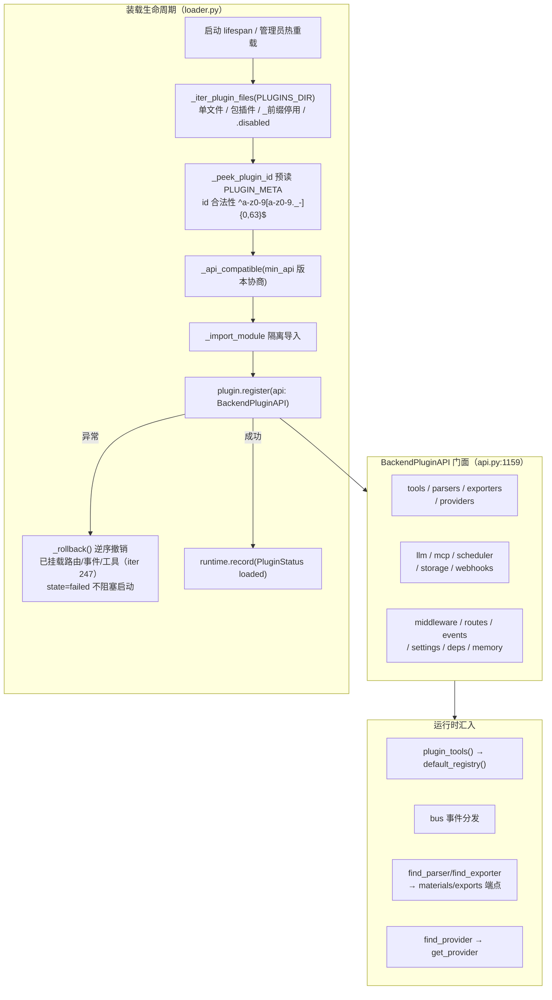

# 07 · 后端插件系统（二次开发框架）

> 证据：`backend/app/plugins/`（api.py 1,197 行 / loader.py 351 / bus.py 191 / runtime.py 73 / providers.py / parsers.py / exporters.py / mcp.py 295 / scheduler.py / webhooks.py）+ `API.md` §8 + 内置插件（见 [11](11-周边与工程化.md)）。

## 0. 架构总图

## 1. 事件总线（bus.py）

- 双通道：`on(event, fn)` 单事件订阅（未知事件名静默——前向兼容）+ `subscribe_all(sink)` 全事件 sink（SSE 事件流用）。
- `emit()`（同步安全，同步端点/线程池可调）：同步监听器就地执行；协程监听器有运行循环 → 调度后台任务（**强引用防 GC mid-execution**）；无循环 → 临时线程新循环（**有界信号量 max_plugin_event_threads=32，超额丢弃+告警**，防 OS 线程无界膨胀 OOM）。
- `emit_async()`（异步上下文）：按订阅顺序 await 全部监听器。
- 每个监听器独立 try/except——单个插件异常不影响其余与宿主。
- **核心事件清单**（宿主广播）：startup / shutdown / plan_created / progress_updated / quiz_submitted / materials_completed / quiz_ready / learning_log_added / run_completed。插件可 emit 自定义事件（建议 `myplugin.xxx` 命名空间）。

## 2. 15 个命名空间门面（BackendPluginAPI 属性）

| 命名空间 | 版本 | 能力 | 底层 |
|----------|------|------|------|
| `api.tools` | 1.7/1.8 | register_python(name, func)（注入注册表，可覆盖核心工具）/ call(name, args, user_id)（走 run_tool 全链路）/ list() | tools/__init__ + runtime.plugin_tools |
| `api.parsers` | 1.3 | register([exts], handler(path,parse_mode)->(text,meta), label, magic) | parsers.py（内置格式不写入注册表，仅插件项） |
| `api.exporters` | 1.4 | register(fmt, handler(plan,ctx)->{filename,content,mime}) | exporters.py（32MB 上限；格式名正则） |
| `api.providers` | 1.6 | register(kind, chat_handler, default_model, label) | providers.py → PluginProvider |
| `api.llm` | 1.5/1.14 | complete(user_id, prompt, system?, max_tokens?, provider_kind?) / stream(...) / is_configured(user_id)——复用宿主预算守卫+计量 | get_provider + record_metadata_usage |
| `api.mcp` | 1.9/1.12 | connect(url)（HTTP+SSE 或 stdio JSON-RPC，协议 2025-06-18）→ client.list_tools/call_tool/close | mcp.py（30s 超时；stdio 子进程） |
| `api.scheduler` | 1.10 | every(interval_s, fn, run_immediately?) / once(delay_s, fn) → TaskHandle.cancel() | scheduler.py（asyncio Task + 异常隔离 + 强引用） |
| `api.storage` | 1.11 | get/set/delete（插件私有 data/plugins/&lt;id&gt;/，JSON 持久化） | StorageNamespace |
| `api.webhooks` | 1.15/1.16 | register(url, events, secret?)——HMAC-SHA256 签名投递；all_events_sink | webhooks.py（10s 超时；**出站并发有界 webhook_slot 16**） |
| `api.middleware` | 1.17 | register(async mw(request, call_next))——全局 HTTP 中间件链 | FastAPI middleware |
| `api.routes` | 1.0 | 挂载 `/api/plugins/<id>/` 命名空间（默认带宿主认证，可选 auth=False 自行验签） | APIRouter |
| `api.events` | — | on/emit（bus 包装，自动记账回滚） | bus.py |
| `api.settings` | — | 只读配置视图（get） | settings |
| `api.deps` | — | get_current_user/require_admin（复用宿主认证依赖） | api/deps |
| `api.memory` | 1.19 | threads/messages/memories CRUD（归属校验 + limit 上界 500） | models |

**回滚台账**（iter 247）：`register()` 中途抛异常时，`api._rollback()` 逆序撤销失败前已挂载的路由/事件订阅/工具注册——状态台账与真实运行态一致，坏插件代码不在宿主残留。

## 3. 热重载与管理（loader.py + api/plugins.py）

| 操作 | 实现 |
|------|------|
| GET /api/plugins | 管理员：全部插件状态（id/name/version/state/loaded_at/error）+ api_version |
| POST /{id}/reload | unload（unimport + remove_status + remove_tool）→ 重新 _load_one |
| POST /{id}/disable | 移入 plugin_state.json 停用表（**不写插件文件**，`.disabled` 之外的运行时停用）+ unload |
| POST /{id}/enable | 从停用表移除 + 重新加载 |

`_load_disabled()/_save_disabled()` 持久化停用清单；`reload_plugin` 支持并发（热管理锁防 loader 并发状态错乱，iter 8 修复记录）。

## 4. MCP 客户端（mcp.py，295 行）

自研 MCP（Model Context Protocol）客户端，两种传输：
- `McpHttpClient`：HTTP + SSE（JSON-RPC over HTTP POST，SSE 收响应；`_extract_message` 从 SSE 流提取 JSON-RPC message，按 expected_id 匹配）。
- `McpStdioClient`：子进程 stdin/stdout JSON-RPC（newline-delimited），后台读线程。
- 协议版本常量 `2025-06-18`；默认 30s 超时；`initialize` 握手 + `tools/list` + `tools/call`。
- 用途：插件（如 mcp_bridge）把外部 MCP server 的工具桥接进宿主。

## 5. 安全模型（API.md §九 + plugins/README）

- 后端插件与宿主**同进程同权限**——只放置信任的插件（无沙箱）。
- 插件路由默认带宿主认证；`auth=False` 公开端点须自行验签。
- 敏感桥接端点（mcp_bridge /tools /invoke、webhook config、provider config）收紧 `require_admin`。
- 插件异常三层隔离：register 异常→回滚+failed；事件监听异常→独立 try/except；路由异常→FastAPI handler 统一 500（不崩宿主）。
