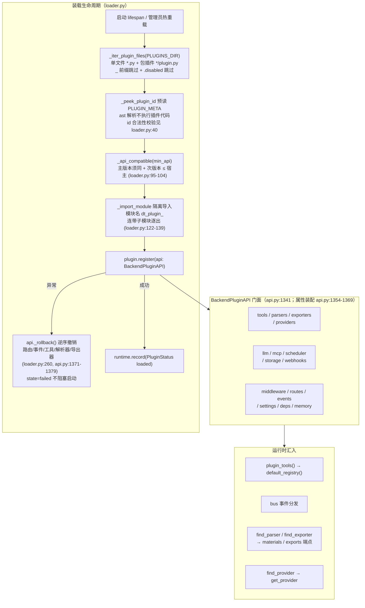

# 07 · 后端插件系统（二次开发框架）

> **证据基线（2026-10-20 实测；与 `AGENTS.md` 仓库状态速览一致）**
>
> | 项 | 值 | 出处 |
> |---|---|---|
> | Python 插件模块 | `backend/app/plugins/` 共 11 个 `.py` | 目录实测 |
> | 模块行数（总行数） | `api.py` 1379 / `loader.py` 400 / `bus.py` 226 / `runtime.py` 73 / `providers.py` 127 / `parsers.py` 152 / `exporters.py` 143 / `mcp.py` 295 / `scheduler.py` 219 / `webhooks.py` 112 / `__init__.py` 20 | `Get-Content .Count` |
> | 后端插件 API 版本 | `API_VERSION = "1.22.0"` | `backend/app/plugins/api.py:69` |
> | 内置插件实例 | `plugins/` 9 个（8 个 `.py` + `example_hello.py.disabled`） | 目录实测（清单见 [11](11-周边与工程化.md) §A） |
> | 前端插件宿主 | 前端插件 API `1.19.0`（`window.DeepTutor`，改造期已决策废弃——note/12 决策 #6） | `API.md:19`、note/12 #6 |
> | Go 侧扩展协议 | `reasonix.extension.v2`，`ProtocolMajor = 2` | `internal/ext/extension/protocol/protocol.go:22-29` |
> | Go 模块 | `module reasonix` / `go 1.26.0` | `go.mod:1-3` |
>
> 契约文档：`API.md` §八「后端插件 API」（`API.md:747`）、§九「插件开发规范」（`API.md:1655`）、§十「版本历史」（`API.md:1715`）。v1 契约在改造期冻结，只改勘误不改语义（`API.md:3-5`）。

## 0. 架构总图

## 1. 事件总线（bus.py，226 行）

- 双通道：`on(event, fn)` 单事件订阅（`bus.py:76-95`；未知事件名静默——前向兼容）+ `subscribe_all(sink)` 全事件 sink（`bus.py:55-73`；SSE 事件流端点 `app/api/events.py` 用）。
- `emit()`（`bus.py:195-200`）：同步安全，同步端点 / 线程池可调。分发按监听器形态分流（`bus.py:140-183`）：
  - 协程监听器 + 有运行循环 → `loop.create_task` 后台任务，任务入 `_bg_tasks` 强引用集合防 GC mid-execution（`bus.py:157-159`）。
  - 协程监听器 + 无运行循环 → 有界 daemon 线程；线程数上限 `settings.max_plugin_event_threads`（默认 32，`backend/app/core/settings.py:102-106`），信号量惰性创建于 `bus.py:45-52`，超额非阻塞 acquire 失败 → **丢弃事件 + 告警**（`bus.py:166-171`）。
  - 同步监听器 + 有运行循环 → 经 `asyncio.to_thread` 后台任务（避免插件误写阻塞调用卡死事件循环；代价：循环上下文内不再严格保序，`bus.py:176-179`）。
  - 同步监听器 + 无运行循环 → 就地执行（线程池线程，顺序不变，`bus.py:181`）。
- `emit_async()`（`bus.py:203-217`）：异步上下文，按订阅顺序逐个 await；协程监听器直接 await，同步监听器经 `_guard_to_thread` 保序执行。
- 每个监听器独立 try/except——单个插件异常不影响剩余监听器与宿主流程（`bus.py:182-183`、`bus.py:215-216`、`bus.py:191-192`）。
- **核心事件清单**（宿主广播，9 项，`API.md:1520-1528`）：`startup` / `shutdown` / `plan_created` / `progress_updated` / `quiz_submitted` / `materials_completed` / `quiz_ready` / `learning_log_added` / `run_completed`。插件可 emit 自定义事件（建议 `myplugin.xxx` 命名空间）。SSE 转发按归属用户过滤，`startup`/`shutdown` 广播全局（`API.md:1601-1605`）。**载荷归属键**（iter 396）：9 项中除 `startup`/`shutdown` 外全部带 `user_id`——`plan_created`/`materials_completed` 此前仅带 `session_id`，SSE 端每条订阅者需查库解析 `session.user_id`，且会话行已删时解析不出归属 -> 事件按 safe-by-default 丢弃（正主收不到）；后端 v1.22.0 起二者直传 `user_id`，归属判定零查库（与 `progress_updated` 等同一口径）。

## 2. 15 个命名空间门面（BackendPluginAPI 属性）+ `api.threads` 别名

`BackendPluginAPI` 定义于 `api.py:1341`，属性装配于 `api.py:1354-1369`；`api.version` 取 `API_VERSION`（`api.py:1345`）。

| 命名空间 | 引入版本 | 能力 | 实现位置 |
|----------|---------|------|---------|
| `api.tools` | 1.7 / 1.8 / 1.13 | `register(tool)`；`register_python(name, func, description=)`；`list()`（工具元数据 name/llm/requires/description）；`call(name, args, user_id, upstream=)`（走 run_tool 全链路，返回 `status/data/errors` 信封） | `api.py:83-215`；工具表 `runtime.py:55-68` |
| `api.parsers` | 1.3 | `register([exts], handler, label, magic, override)`——handler 签名 `(path, parse_mode) -> (text, meta)`；内置 ext 默认不生效（内置优先，`override=True` 才接管） | `api.py:218-275`；注册表 `parsers.py:68-123` |
| `api.exporters` | 1.4 | `register(fmt, handler, label, override)`——handler 签名 `(plan, ctx) -> dict`；二进制产物上限 `MAX_BYTES = 32 MiB`（`exporters.py:39`），格式名正则 `^[a-z0-9][a-z0-9_-]{0,31}$`（`exporters.py:35`） | `api.py:278-341`；注册表 `exporters.py:67-122` |
| `api.providers` | 1.6 | `register(kind, handler, default_model, label)`——kind 正则 `^[a-z0-9][a-z0-9_-]{0,31}$`（`providers.py:37`）；`anthropic` 为内置保留名，注册即拒（`providers.py:74-78`） | `api.py:516-579` |
| `api.llm` | 1.5 / 1.6 / 1.14 | `complete(user_id, prompt, system=, max_tokens=, provider_kind=)`；`stream(...)` 逐 token 增量；`is_configured(user_id)`。`max_tokens` 收敛到 `[1, 8192]`（`api.py:360`、`api.py:409`）；`provider_kind` 分发到插件 Provider，预算守卫 + `api_usage` 计量同宿主口径 | `api.py:344-513` |
| `api.mcp` | 1.9 / 1.12 | `connect(url, headers=, timeout=30.0)`（Streamable HTTP）；`connect_stdio(command, env=, read_timeout=30.0)`（子进程 stdin/stdout JSON-RPC） | `api.py:582-648` |
| `api.scheduler` | 1.10 | `every(interval_s, fn, run_immediately=)` / `once(delay_s, fn)` → `TaskHandle.cancel()`；任务不持久化，卸载统一取消 | `api.py:651-683`；调度器 `scheduler.py:37-215` |
| `api.storage` | 1.11 | `get/set/delete/has/keys/clear`——每插件私有 `storage.json`；原子写（tmp + `os.replace`，唯一 tmp 名 + PermissionError 重试 5 次）、JSON 可序列化校验、实例级锁 | `api.py:686-801` |
| `api.webhooks` | 1.15 / 1.16 | `register(url, events=None, secret=)` → `WebhookHandle.unregister()`；`events=None` 表示全事件（经 `subscribe_all` sink） | `api.py:804-877`；投递 `webhooks.py:56-112` |
| `api.middleware` | 1.17 | `register(async fn(request, call_next))`——全局 HTTP 中间件；fn 异常 → 透传原请求不阻断（`api.py:911-916`）；多次注册按 LIFO 生效（`api.py:923`） | `api.py:880-934` |
| `api.routes` | 1.0 | `mount(router, auth=True, prefix="")` → 实际前缀 `/api/plugins/<id><prefix>`；默认 `Depends(require_auth)`，`auth=False` 公开端点须自行验签；OpenAPI 标签 `plugin:<id>` | `api.py:937-991` |
| `api.events` | 1.0 | `on(event, fn)` → 退订函数；`emit(event, payload)` | `api.py:994-1010` |
| `api.settings` | 1.0 | `get(name, default)`——名称含 key/secret/password/token/dsn/conn/url 的字段一律返回默认值（`_DENY`，`api.py:1022`）；非安全边界 | `api.py:1013-1041` |
| `api.deps` | 1.0 | `get_db` / `get_current_user` / `require_auth` / `require_admin` / `get_owned_session` / `get_owned_plan`（宿主 FastAPI 依赖的 stable 引用） | `api.py:1044-1085` |
| `api.memory` | 1.19 | `list/create/get/delete_thread`、`list/add_message`、`save/recall/delete_memory`；按 `user_id` 归属校验；limit 上界 500（`api.py:1108`、`api.py:1194`、`api.py:1311`）；配额 threads 500 / memories 2000 / 字符上限 20000 | `api.py:1088-1338` |
| `api.threads` | 1.19 | `api.memory` 的同实例别名（`api.py:1369`） | `api.py:1369` |

**回滚台账**（iter 247）：`register()` 中途抛异常时，`api._rollback()`（`api.py:1371-1379`）逆序撤销失败前已挂载的路由 / 事件订阅 / 工具 / 解析器 / 导出器 / Provider / 调度任务 / Webhook / 中间件——每个回滚回调自身异常隔离（尽力而为，不掩盖原异常）。loader 在 `register` 异常路径调用回滚并清空状态台账的 5 类明细（`loader.py:256-268`），状态台账与真实运行态一致，坏插件代码不在宿主残留。

## 3. 热重载与管理（loader.py 400 行 + `backend/app/api/plugins.py` 99 行）

| 端点 | 实现 | 权限 |
|------|------|------|
| `GET /api/plugins` | 返回 `api_version` + 插件状态台账 + `subscribed_events`（`api/plugins.py:44-50`）；状态行含 id/name/version/state/error/file/routes/events/tools/parsers/exporters/providers/webhooks/middleware（`api/plugins.py:25-41`） | `require_admin` |
| `POST /api/plugins/{plugin_id}/reload` | `loader.reload_plugin(app, pid)`：定位文件 → `unload_plugin` → `remove_status` → 模块与 pyc 逐出 → `_load_one` 重跑（`loader.py:311-325`） | `require_admin` |
| `POST /api/plugins/{plugin_id}/disable` | `loader.disable_plugin(pid)`：卸载（若已加载）→ 记 `disabled` 状态行（保留 file 供 enable 定位）→ 写入停用表并持久化（`loader.py:328-352`） | `require_admin` |
| `POST /api/plugins/{plugin_id}/enable` | `loader.enable_plugin(app, pid)`：从停用表移除 → 持久化 → 清旧 `disabled` 状态行 → `_load_one`（`loader.py:355-364`） | `require_admin` |

- **停用表持久化**：`data/plugin_state.json`，格式 `{"disabled": [...]}`（`loader.py:52`、`loader.py:55-75`）。禁用**不写插件文件**——与 `.disabled` 文件后缀是两套机制（后者由 `_iter_plugin_files` 的 `*.py` 匹配天然排除）。
- **并发热管理锁**：模块级 `_management_lock = threading.RLock()`（`loader.py:48`），`unload/reload/disable/enable` 四路径均持锁（`loader.py:296`、`loader.py:313`、`loader.py:334`、`loader.py:357`）；RLock 可重入，`reload → unload` 同线程嵌套安全（iter 365 C11）。
- **热管理频控**：写端点经 `_gate_plugin_admin` 限速 `plugin_admin:<user_id>` 20 次 / 窗口，超限抛 `rate_limited`（429）（`api/plugins.py:53-59`）。
- **模块逐出**：`_evict_plugin_module` 同时清 `sys.modules` 中的父模块与子模块，并删插件目录 `__pycache__`（`loader.py:276-290`）——Windows 下源文件两次写入落在同一时间刻度时陈旧 pyc 会被直接复用，故必须删除。
- 三个写端点均为 `async def`（`api/plugins.py:63`、`79`、`92`）：`register` / 回滚 / `task.cancel()` 在事件循环线程执行，跨线程取消 asyncio Task 不安全（iter 384 R27）。

## 4. MCP 客户端（mcp.py，295 行）

自研 MCP（Model Context Protocol）客户端，两种传输：

- `McpHttpClient`（`mcp.py:61-168`）：Streamable HTTP——单端点 POST JSON-RPC，请求带 `Accept: application/json, text/event-stream`；响应为 `text/event-stream` 时由 `_extract_message` 逐行取 `data:` 内容、按 `expected_id` 匹配（`mcp.py:39-58`）；响应为 JSON 时直接解包，批量数组按 id 取（`mcp.py:115-125`）。握手捕获 `Mcp-Session-Id` 头，后续请求带上（`mcp.py:104-110`）。
- `McpStdioClient`（`mcp.py:171-295`）：spawn 子进程，stdin/stdout 行分隔 JSON-RPC；`stderr` 导向 `DEVNULL` 不污染宿主输出（`mcp.py:240`）；读响应按 id 匹配、跳过 server 通知（`mcp.py:213-226`）；`close()` 先 `terminate` 再 5s 超时后 `kill`（`mcp.py:278-294`）。
- 协议版本常量 `_PROTOCOL_VERSION = "2025-06-18"`（`mcp.py:35`）；默认超时 `_DEFAULT_TIMEOUT = 30.0` 秒（`mcp.py:36`）；`initialize` 握手 + `notifications/initialized` 通知 + `tools/list` + `tools/call`（`mcp.py:127-165`）。
- 门面侧校验：`connect` 要求 url 以 `http://` / `https://` 开头（`api.py:616-617`）；`connect_stdio` 要求 command 为非空字符串列表（`api.py:642`）。
- 用途：插件（如 `mcp_bridge`）把外部 MCP server 的工具桥接进宿主。

## 5. 安全模型（`API.md` §九 + `plugins/README.md`）

- 后端插件与宿主**同进程同权限**——只放置信任的插件（无沙箱）。
- 插件路由默认带宿主认证：`mount()` 在 `auth=True` 时注入 `Depends(require_auth)`（`api.py:963`）；`auth=False` 用于公开 webhook 等场景，须自行验签（`api.py:938-943`）。
- 敏感桥接端点收紧 `require_admin`：
  | 端点 | 出处 |
  |------|------|
  | `mcp_bridge` `POST /tools`、`POST /invoke` | `plugins/mcp_bridge.py:70`、`plugins/mcp_bridge.py:82`（iter 365：任意登录用户原可令服务器向指定 URL 发 JSON-RPC） |
  | `webhook_notify` 配置写 / 读 / 删 | `plugins/webhook_notify.py:55`、`63`、`77` |
  | `provider_bridge` `PUT /config` | `plugins/provider_bridge.py:88` |
  | 插件热管理三写端点 | `backend/app/api/plugins.py:63`、`79`、`92` |
- 插件异常三层隔离：register 异常 → `_rollback()` + `state=failed`（`loader.py:256-268`）；事件监听异常 → 独立 try/except（`bus.py:182-183`）；路由异常 → FastAPI 统一错误处理返回 500，不崩宿主。
- `api.settings` 为便利层而非安全边界——插件与宿主同进程，本可直接 import `app.core.settings`（`api.py:1016-1019`）。

## 6. Go 侧扩展体系（Reasonix 内核，v2 目标形态）

### 6.1 目录构成

`internal/ext/` 共 15 个子包、242 个非测试 `.go` 文件、48 796 行（递归统计各子包，含嵌套子包如 `extension/protocol`、`extension/sidecar`、`extension/rpcwire`）：

| 子包 | 非测试文件 / 行数 | 职责 |
|------|-------------------|------|
| `internal/ext/extension` | 68 / 13 653 | 扩展内核：把工具 / 技能 / 命令 / 提示 / 钩子 / MCP / provider / 主题 / 拦截器 / 替换槽统一建模为 `Contribution`，由确定性 `Builder` 装配为不可变 `RuntimeSnapshot`（`internal/ext/extension/doc.go:1-30`） |
| `internal/ext/plugin` | 51 / 10 715 | Reasonix 的 **MCP 客户端**：连接外部 MCP server 并把工具适配到 `tool.Tool`；传输分 stdio 子进程 / Streamable HTTP / 旧式 HTTP+SSE，差异由 transport 接口吸收（`internal/ext/plugin/plugin.go:1-8`） |
| `internal/ext/pluginpkg` | 20 / 4 082 | 已安装插件包：manifest v1 / v2 解析、安装态清单、导出（`internal/ext/pluginpkg/pluginpkg.go:1-6`） |
| `internal/ext/installsource` | 24 / 5 314 | `install_source` 工具：两阶段安装器（resolve → plan → apply），覆盖 URL / 本地文件或目录 / `.mcp.json` / 包名 / 本地可执行文件（`internal/ext/installsource/doc.go:1-6`） |
| `internal/ext/skill` | 19 / 3 706 | SKILL.md 技能：路径解析、内置技能、工具调用约定（`internal/ext/skill/`） |
| `internal/ext/hook` | 16 / 3 990 | 钩子：命令归一化、执行契约、跨平台批处理与 POSIX 语法、Windows 兼容 |
| `internal/ext/configbackup` | 10 / 1 944 | 全局配置快照：gzip + XChaCha20-Poly1305（Argon2id 派生密钥）封装，两步 plan / apply 还原；插件只作引用回填不落盘（`internal/ext/configbackup/doc.go:1-28`） |
| `internal/ext/market` | 9 / 1 550 | 社区市场：读注册表并经 `install_source` 安装；注册表行是**不可信数据**，市场不是信任根（`internal/ext/market/doc.go:1-4`） |
| `internal/ext/mcpsetup` | 7 / 696 | 把 MCP server 的三种输入形态（`mcpServers` JSON / 命令行 / URL）统一转成 `config.PluginEntry` 草案（`internal/ext/mcpsetup/doc.go:1-9`） |
| `internal/ext/theme` | 7 / 1 146 | 主题包：token 解析、资产、安装与移除 |
| `internal/ext/mcplaunch` | 4 / 532 | MCP server 进程启动（含 Windows / POSIX 差异） |
| `internal/ext/command` | 3 / 529 | 斜杠命令：定义、斜杠工具、检查 |
| `internal/ext/extensioncontract` | 2 / 267 | 能力契约：`Capability` / `Requirement` / provider 引用 |
| `internal/ext/mcpregistry` | 1 / 440 | 官方 MCP Registry 浏览 / 安装路径（不在启动与工具发现链路调用） |
| `internal/ext/pluginspec` | 1 / 232 | 已配置插件条目 → 运行时 `plugin.Spec` 的唯一转换点（`internal/ext/pluginspec/pluginspec.go:1-5`） |

`cmd/` 现存 5 个命令：`reasonix`（`cmd/reasonix/main.go`）、`reasonix-studio-host`（6 文件，Electron 宿主侧 Go 进程）、`reasonix-plugin-example`（`cmd/reasonix-plugin-example/main.go`，349 行）、`extension-protocol-gen`（`cmd/extension-protocol-gen/main.go`，协议文档生成器）、`studio-delta`（`cmd/studio-delta/main.go`）。

### 6.2 Extension Protocol v2（线协议）

- 协议标识 `reasonix.extension.v2`，`ProtocolMajor = 2`（`internal/ext/extension/protocol/protocol.go:22-29`）；机器可读 schema 在 `internal/ext/extension/protocol/schema.generated.json`，方法 / 事件 / 限额 / 错误码索引在 `docs/kernel/EXTENSION_PROTOCOL.generated.md`（`docs/kernel/EXTENSION_PROTOCOL.md:14-18`）。
- 传输：严格 JSON-RPC 2.0 over NDJSON（每行一个完整 JSON 对象）；帧上限 `FrameBytes = 8 MiB`，超限为连接致命错误 `frame_too_large`（`internal/ext/extension/protocol/limits.go:6-16`）；DTO 解码严格（未知字段拒绝），帧层容忍未知成员（`docs/kernel/EXTENSION_PROTOCOL.md:29-32`）。
- 生命周期：`extension/initialize` → 声明校验（订阅 / 替换槽 / provider / UI 动作必须是 manifest 的**子集**，越界以 `capability_not_declared` 失败握手）→ `extension/initialized` → `extension/shutdown`（`docs/kernel/EXTENSION_PROTOCOL.md:34-51`）。一代运行时最多并行初始化 4 个 sidecar，共享 30 秒启动预算（`docs/kernel/EXTENSION_PROTOCOL.md:37`）。
- 拦截点 **17 个冻结钩子点**（`internal/ext/extension/protocol/enums.go:39-69`）；决策 `continue` / `block` / `replace` / `allow` / `deny`；替换策略槽 `system_prompt` / `context` / `provider_request` / `provider_response` / `compaction` / `session_policy` / `permission` / `frontend_events` / `tool:<name>` / `provider:<ref>` 各有唯一属主（`docs/kernel/EXTENSION_PROTOCOL.md:61-77`）。
- 内容外置：可外置字段超 `64 KiB`（`ExternalizeFieldBytes`）落宿主内容库，`host/content/read` 按 `256 KiB`（`ContentRefChunkBytes`）分块回读，单对象上限 `8 MiB`（`ContentRefObjectBytes`）（`internal/ext/extension/protocol/limits.go:9-15`）。
- 流式 provider：`extension/provider/catalog` + `extension/provider/stream/open` → `stream/chunk` → `stream/end`；chunk 类型含 text / reasoning / tool_call / usage / done / error（`docs/kernel/EXTENSION_PROTOCOL.md:79-101`）。
- 结构化 UI：`host/ui/publish`（status / card / form / notification / panel / view）与 `host/ui/request`（confirm / input / select / multiselect）；动作命名空间 `/<plugin>:<action>`（`docs/kernel/EXTENSION_PROTOCOL.md:103-118`）。

### 6.3 插件包与声明式能力

- 插件包把 skills、hooks、MCP servers、prompts、themes、代码扩展打包为一个可安装单元（`docs/kernel/PLUGIN_PACKAGES.md:10-11`）。
- CLI 安装：`reasonix plugin install <source>`，`--dry-run` 预演、`--yes` 落盘、`--replace` 覆盖同名、`--name` 改名、`--link` 链接本地目录（`docs/kernel/PLUGIN_PACKAGES.md:37-83`）。安装态存于 `~/.reasonix/plugin-packages.json` 与 `~/.reasonix/plugins/<name>/`（`docs/kernel/PLUGIN_PACKAGES.md:86-91`）。
- manifest：原生 manifest 仅接受 `apiVersion` 精确等于 `reasonix.io/plugin/v2`；v1 与无 `apiVersion` 的原生 manifest 被解析器拒绝，受管目录下的旧 manifest 可显式升级或自动迁移（`internal/ext/pluginpkg/manifest_v2.go:18-23`、`69-80`）。
- 能力分两类（`docs/kernel/EXTENSIONS.md:18-25`）：**声明式**（skills / agents / commands / prompts / hooks / MCP servers / themes）随宿主权限运行；**代码运行时**（manifest v2 的 `runtime` 块）为 out-of-process sidecar，属**完全信任**——安装动作即授权，无二次确认（`docs/kernel/EXTENSIONS.md:38-43`）。
- 运行时热重载为原子操作：空闲时起新 sidecar、建新快照 → 成功则原子换版并继承会话路径 / 记录 / 审批授权 / goal 与恢复状态 → 失败则旧运行时原样保留 → 换版后旧 sidecar 才退役（`docs/kernel/EXTENSIONS.md:75-94`）。每个 turn 固定一个运行时代次。
- 技能：SKILL.md 体系（`docs/kernel/SKILLS.md`），加载与路径解析在 `internal/ext/skill/`。
- MCP：stdio / http / sse 三种传输 + OAuth（note/12 决策 #5）；服务端注册在 `internal/ext/mcpregistry/`，进程启动在 `internal/ext/mcplaunch/`，配置草案在 `internal/ext/mcpsetup/`。

### 6.4 Go SDK 与示例

- `sdk/go/` 为独立 Go module，标准库零依赖（`sdk/go/README.md:8-11`）；入口 `sdk/go/sdk.go:1-21`：SDK 负责线协议、握手屏障与关闭序列，扩展实现 `Handler`，可选实现 interceptors / Provider / UI 回调；Initialize 完成后 SDK 最多并发调 32 个回调（`sdk/go/sdk.go:12-13`）。
- SDK 文件规模：`sdk.go` 928 行 / `wire.go` 746 / `types_generated.go` 715 / `types_ext.go` 209 / `provider_open.go` 77 / `provider_stream.go` 74 / `intercept.go` 58 / `shutdown.go` 55 / `tools.go` 49 / `ui.go` 46。
- 示例 4 个（`sdk/go/examples/`）：`starterextension`（45 行，最小可安装扩展，订阅 `input.receive` 并改写输入）、`toolextension`（42 行）、`providerextension`（73 行）、`fullsidecar`（352 行，完整 sidecar）。

### 6.5 与 v1 Python 插件体系的对应关系

| v1 Python 能力面 | Go 侧对应 | 证据 |
|------------------|-----------|------|
| `api.tools` 注册 Python 工具 | manifest v2 `runtime.tools` 声明式工具（`ext__<plugin>__<tool>` 命名，经能力目录提供给模型） | `docs/kernel/EXTENSIONS.md:63-65` |
| `api.routes.mount` 进程内挂路由 | sidecar 无路由概念；对外能力经工具 / 拦截 / 结构化 UI 暴露 | `docs/kernel/EXTENSION_PROTOCOL.md:103-130` |
| `api.events` 事件订阅 | `extension/event` 观察同一批 17 个钩子点（fire-and-forget，队列饱和丢弃并告警） | `docs/kernel/EXTENSION_PROTOCOL.md:61-64` |
| `api.llm` 复用宿主 LLM | `providers` 能力贡献流式 provider，模型标识 `plugin/<plugin>/<provider>/<model>` | `docs/kernel/EXTENSION_PROTOCOL.md:79-101` |
| `api.providers` 注册新协议 Provider | 同上，provider 目录 + 流式协议 | `docs/kernel/EXTENSION_PROTOCOL.md:81-84` |
| `api.mcp` MCP 客户端 | `internal/ext/plugin` 为宿主侧 MCP 客户端（stdio / HTTP / SSE），插件侧由 sidecar 自行实现 | `internal/ext/plugin/plugin.go:1-8` |
| `api.scheduler` 周期任务 | 声明式 hooks / 计划任务与 sidecar 生命周期分离；无同构门面 | `docs/kernel/EXTENSIONS.md:20-25` |
| `api.storage` 插件私有 KV | 插件包目录 + `~/.reasonix/plugins/<name>/`；配置备份包 `internal/ext/configbackup` | `docs/kernel/PLUGIN_PACKAGES.md:86-91` |
| `api.webhooks` 事件外推 | 无同构门面；由 sidecar 自行实现出站 | — |
| `api.middleware` 全局中间件 | 17 钩子点中的拦截器（`extension/intercept` 阻塞 + `extension/event` 观察） | `docs/kernel/EXTENSION_PROTOCOL.md:59-77` |
| `api.parsers` / `api.exporters` 格式扩展 | Go 原生解析 / 导出链（阶段③ 落地，见下） | note/12 决策 #27、#28 |
| `api.memory` 记忆 CRUD | 内核 memory 能力 + `internal/contract`（会话存储在阶段①/② 重建） | note/12 决策 #21 |
| 前端 `window.DeepTutor` 九命名空间 | 前端扩展能力改接 Reasonix 插件包 / Extension 结构化 UI（`window.DeepTutor` 废弃） | note/12 决策 #6；`docs/kernel/EXTENSIONS.md:66-73` |

**阶段③ 等价表落点**：9 个内置插件的逐项等价映射表按 note/12 决策 #25 与 §四「已识别的四个张力点」第 3 条（`note/12:99`）先行编写，阶段③按表施工；等价物落点见下表与 note/12 修订记录 2026-10-20 条（`note/12:195`：`examples/` 移除后，原「example_hello → 扩展开发示例」的等价物落在 `sdk/go/examples/` 与本仓 `plugin-examples/`、`skills/`）。

| v1 插件 | 阶段③ 等价物落点（据 note/12:99） | Go 侧已有基座 |
|----------|------------------------------|---------------|
| `provider_bridge` | 原生多 kind provider | `internal/ext/extension/providerext/`（`internal/ext/extension/providerext/providerext.go`） |
| `mcp_bridge` | 原生 MCP | `internal/ext/plugin/` + `internal/ext/mcpregistry/` |
| `epub_reader` | Go 原生 epub 解析 | `internal/ext/skill/` 与 Go 原生解析链（note/12 决策 #27） |
| `webhook_notify` | hooks / sidecar 重写 | `internal/ext/hook/` + sidecar |
| `study_export_pack` | Go csv / txt / opml 导出器 | `internal/frontend/serve/tutor_data.go` 导出路由族 |
| `study_stats` | 统计端点 | `internal/frontend/serve/tutor_data.go:43-52`（progress / stats 路由族） |
| `ai_tutor` | 逐个评估 | `internal/runtime/tutor`（`internal/frontend/serve/tutor.go:25`） |
| `security_guard` | 逐个评估 | `internal/safety/` |
| `example_hello`(.disabled) | 扩展示例（sdk/go/examples + plugin-examples + skills） | `sdk/go/examples/` 4 例；`plugin-examples/frontend/` 4 例 |

**Go 侧 HTTP 现状**：`/tutor/*` 路由共 78 条，分布在 `internal/frontend/serve/tutor.go`（`tutor.go:221-238`）、`tutor_data.go`（`tutor_data.go:21-63`）、`tutor_kb.go`（`tutor_kb.go:22-39`）、`tutor_backup.go`（`tutor_backup.go:21-23`）、`tutor_share.go`（`tutor_share.go:16-20`）；插件管理面为 `/plugins`（`internal/frontend/serve/plugins.go:25-30`），扩展 UI 面为 `/extensions`（`internal/frontend/serve/extensions.go:14-17`）。**不存在 `/api` 兼容层**——`internal/frontend/serve/` 全目录无 `"/api` 字面量（实测 grep 无命中）。`/api` shim 核心属阶段① 的 M3.5（`plan/reasonix/05` M3 表），旧 SPA 的 users/plugins 页对接安装态属 M5.3；阶段① M1 仅完成内核吸收（2026-10-17），M1 余项未开始。
