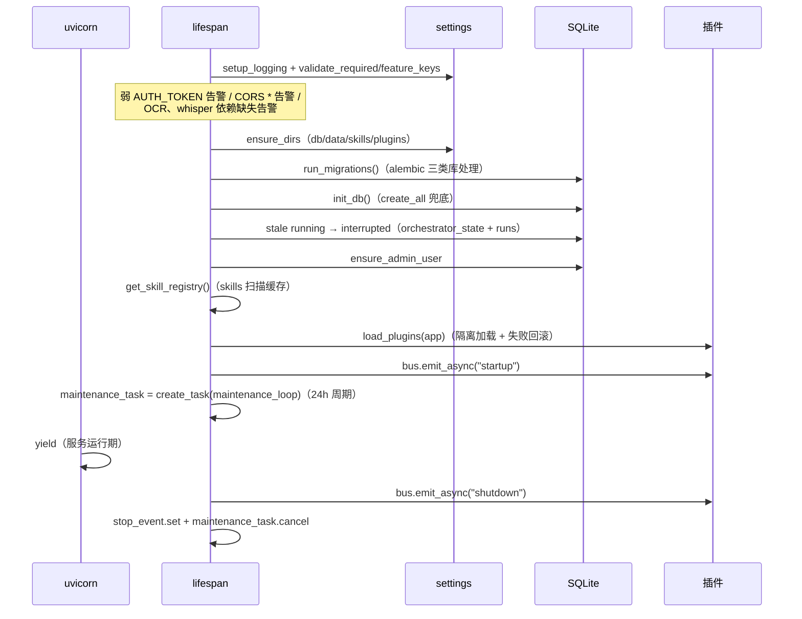

# 08 · 核心基础设施（core/ + db/ + skills/）

> 证据：`backend/app/core/*.py`、`backend/app/db/base.py|migrate.py`、`backend/app/skills/loader.py`、`backend/app/main.py`。

## 1. 配置（core/settings.py，264 行）

- pydantic-settings，`.env` **锚定仓库根**（`_REPO_ROOT` 由 `__file__` 上三级推导，任意 cwd 行为一致——err.md C7）；相对路径（db/data/skills/plugins/frontend_dist）经 `_anchor()` 统一锚定。
- 模板占位值识别：`TEMPLATE_AUTH_TOKEN="change-me-please"` / `TEMPLATE_ANTHROPIC_API_KEY="sk-ant-xxxx"` 经派生属性 `auth_token_configured` / `anthropic_key_configured` 视为未配置。
- 关键配置分组：

| 组 | 项（默认值） |
|----|-------------|
| LLM | anthropic_api_key / anthropic_model(claude-sonnet-5) / llm_max_tokens(100000) |
| 认证 | auth_token / admin_username(admin) / admin_password / jwt_secret(空→回退→每启动随机) / jwt_expire_days(7) |
| 存储 | db_path(data/deep-tutor.db) / database_url(空→SQLite) / data_dir / skills_dir / plugins_dir / frontend_dist |
| 限额 | max_upload_mb(50) / max_tool_calls(20) / max_regenerations(2) |
| 并发 | db_busy_timeout_ms(10000) / db_pool_size(20) / db_max_overflow(80) / db_pool_timeout(30) / max_concurrent_generations(8) / ..._per_user(1) / max_concurrent_chat_runs(8) / max_running_chat_per_thread(1) / max_concurrent_llm_calls(16) / max_plugin_event_threads(32) / max_concurrent_webhook_deliveries(16) |
| 预算 | budget_per_session_usd(1.0) / daily_budget_usd(10.0) |
| 搜索 | search_engine(auto/bing/bing_web) / bing_api_key |
| 多模态 | ocr_languages(eng+chi_sim) / whisper_model(base) / media_max_minutes(30) |

- **搜索引擎决策矩阵**（`effective_search_engine`，settings.py:231-255）：auto+key→bing_api；auto/bing_web 无 key→bing_web；**bing 无 key→回退 bing_web + WARNING**（iter 346 修正：旧版静默返回 none → search_resources 返回空 resources 且编排器只对 error 中断 → 用户感知"搜索失败"却无报错）。
- 配置解析失败 → SystemExit 带可读提示（非裸 ValidationError traceback）。

## 2. 安全（core/security.py，238 行）

| 函数 | 行为 |
|------|------|
| `hash_password(pw)` | pbkdf2$600000 iterations$salt$hash（OWASP 2023 下限） |
| `verify_password(pw, stored)` | 常量时间比对 |
| `dummy_verify(pw)` | 无用户名时也跑一次同成本哈希（防用户名枚举时序侧信道，err.md A8） |
| `_secret()` / `_load_or_create_persisted_secret()` | JWT secret 三级：.env jwt_secret → data/ 下持久化 secret 文件 → 每启动随机（重启即全部 JWT 失效） |
| `create_token(uid, username)` / `decode_token` | PyJWT HS256，iat/sub |
| `passwordless_open(db)` | 无任何管理员密码且无 AUTH_TOKEN → 开放本机模式（免登录） |
| `get_or_create_open_admin(db)` | 懒建空密码 admin（数据自始归属 admin） |
| `ensure_admin_user(db)` | 启动收敛：无 admin 建之（ADMIN_PASSWORD 配置时设置密码）；旧单用户数据归管理员 |

## 3. 文件存储（core/storage.py，308 行）

- 目录函数族：`originals_dir/parsed_dir/exports_dir/materials_dir(session_id)` → `data/sessions/<id>/...`；`_safe_ext` 白名单扩展名。
- **原子写**：`_atomic_write_bytes/_atomic_write_text`（tmp + os.replace）；`save_upload/write_parsed_text/write_unit_text` 全走原子写。
- **单元分片**：`write_unit_content` 超 500 行按标题（`_split_at_headings`）切 `.partN`；`read_unit_content` 拼接回读；`delete_unit_content` 连带分片。
- `_rmtree_orphan_aware`：删目录前识别孤儿（maintenance 配合）。

## 4. DB 引擎与迁移（db/base.py + db/migrate.py）

- SQLite 专属 PRAGMA（connect 事件）：`journal_mode=WAL`（读并发写串行）+ `synchronous=NORMAL` + `foreign_keys=ON` + `busy_timeout=settings(10s)`。
- QueuePool 20+80/30s——SSE 长连接曾以每连接钉一条连接的方式在 ~15 并发耗尽默认池（err.md C10 时代修复）。
- 迁移（见 [02](02-数据模型.md) §7）：三类库处理 + 代际探测 stamp。

## 5. 凭证（core/credentials.py）

- 三类 kind：`anthropic`（回退主 Key，每用户至多 1 active）/ `bing`（搜索 Key）/ `auth_token`（PAT，可多个 active 并存）。
- `resolve_bing_api_key(user_id)`：active 档案 → settings.bing_api_key → 空（走网页版）。
- `match_auth_token_credential(db, token)`：全表 active auth_token 常量时间比对。
- API 层不回显明文（仅掩码末 4 位）。

## 6. 限流（core/ratelimit.py）

`SlidingWindowLimiter`：滑动窗口计数（默认实例 `limiter`），`check(key, limit) -> bool`；`reset_rate_limiter()` 测试隔离。应用：chat_run 20/min、credentials 写、users admin CRUD、kb_chat 等（防 JWT 泄露滥用 + LLM 端点滥用）。

## 7. 定期运维（core/maintenance.py，169 行）

`maintenance_loop(stop_event)`：每 24h 执行 `run_maintenance()`（uvicorn lifespan 内 asyncio.create_task，iter 启动即跑第一轮）：

| 任务 | 实现 |
|------|------|
| VACUUM | 原生连接 + busy_timeout（防 DB 文件只增不减；9050e25 修复） |
| cleanup_orphan_session_dirs | data/sessions 下无对应 session 行的目录 |
| cleanup_orphan_run_dirs | data/runs 下无 run 行 / run 已 committed 的 scratch 壳；committed 区无有效 run 的目录 |
| cleanup_orphan_committed_dirs | mid-commit 崩溃兜底 |

另有 CLI 入口 `python -m app.core.maintenance`。

## 8. 备份（core/backup.py，772 行）

- 格式：`{format: "deep-tutor-backup", version: 1, exported_at, user, sessions[], plans[]（含知识节点/quiz/progress/学习日志/单元/材料文件内容内联）, notes[], node_notes[], prefs[], kb_documents[], kb_chat_records[], memories[]}`——大内容（方案 JSON、材料 md）从文件读出内联进备份（自包含）。
- `build_export(db, user)` / `validate_backup`（格式校验） / `preview_backup`（导入前摘要：各资源计数） / `restore_backup`（**追加式**导入：新 id 映射；枚举宽容 `_enum_or/_int_or/_float_or`；v1 兼容：旧备份缺 notes/memories 键不还原）。
- 配额与限额防滥用（备份条数上限 500 notes 等，iter 246 加固）。

## 9. 其他 core 模块

- **locks.py**（17 行）：`drop_lock(registry, key, lock)`——锁清理助手（memory/threads 的 RUN_CREATE_LOCK 类）。
- **setup_state.py**（65 行）：首次设置向导状态（data/setup_state.json；`is_dismissed/mark_dismissed`）。
- **logging.py**（56 行）：`setup_logging`——控制台 + RotatingFileHandler（data/logs/ 5MB×5）。
- **concurrency.py**：见 [05](05-LLM供应商与成本计量.md) §7。

## 10. Skill 加载器（skills/loader.py，115 行）

- `load_skills(dir) -> {name: 正文}`：`sorted(glob("*/SKILL.md"))` 确定性扫描；**永不抛异常**（目录缺失→{}；单文件失败→跳过+告警）。
- `_parse_skill`：utf-8-sig 容 BOM、CRLF 归一化、frontmatter 无 name 回退目录名；`_split_frontmatter` 仅整行 `---` 作开闭（容忍值内含 ---）。
- `get_skill_registry()`：模块级缓存 `_CACHE`，启动 lifespan 加载一次（main.py:120）；注入 `ExecContext.skill_registry` → loop.py 作 LLM 工具 system prompt。
- 稳定性契约（R13）：Skill 缺失 → 工具回退 inline_prompt → 再回退 DEFAULT_SKILL_PROMPT，三层降级。
- Skill↔工具映射见 [11](11-周边与工程化.md) §C。

## 11. 应用启动序列（main.py lifespan，时序）

create_app 装配：CORS（origins 来自配置、allow_credentials、白名单头含 X-Auth-Token）→ body 限额中间件（Content-Length 预检 + chunked 流式限量）→ api_router → 5 个异常 handler → FRONTEND_DIST 存在时挂 `_SPAStaticFiles`（未命中非 /api 路径回退 index.html；/api 404 不吞，main.py:235-252）。
