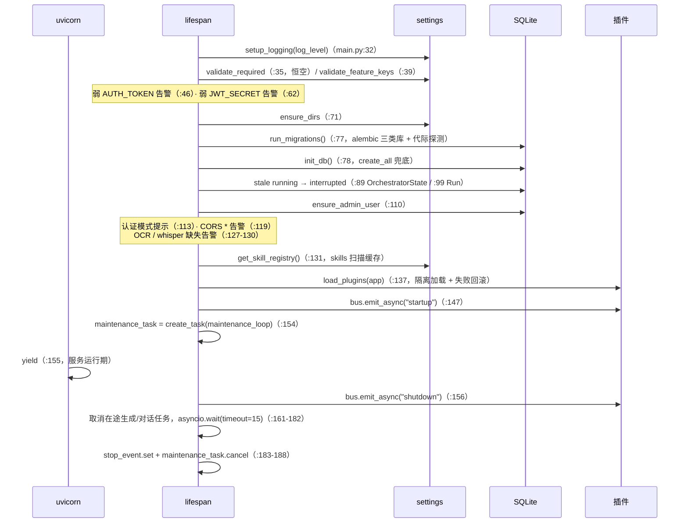

# 08 · 核心基础设施（core/ + db/ + skills/）

> 证据基线（2026-10-20 复核，与代码一致）：
>
> - **v1 源码规模**：`backend/app` 26 583 行；`backend/app/core/` 12 个文件（含 `__init__.py`）；`backend/app/api/` 28 个文件。
> - **模块行数实测**：`core/settings.py` 287 · `core/security.py` 238 · `core/storage.py` 331 · `core/credentials.py` 115 · `core/ratelimit.py` 59 · `core/maintenance.py` 345 · `core/backup.py` 1151 · `core/locks.py` 17 · `core/setup_state.py` 65 · `core/logging.py` 56 · `core/concurrency.py` 95 · `db/base.py` 76 · `db/migrate.py` 187 · `skills/loader.py` 128 · `app/main.py` 336。
> - **数据面**：ORM **29 表**（`backend/app/db/models.py`）；alembic **26 个迁移**（`backend/alembic/versions/`）；迁移代际探测 **25 个特征探针** + base revision `beba50db3cc1`（`db/migrate.py:97-125`）。
> - **资产**：`skills/` 8 个目录；`plugins/` 9 个插件文件（8 个 `.py` 可加载 + 1 个 `.disabled`）。
> - **Go 侧**：`go.mod` = `module reasonix` / `go 1.26.0`；存储根实现 `internal/contract/config/storage_roots.go`；tutor 运行时 `internal/runtime/tutor/`；HTTP 面 `internal/frontend/serve/`。

## 1. 配置（core/settings.py，287 行）

- pydantic-settings（`BaseSettings` + `SettingsConfigDict`，settings.py:36-42）：`env_file` 锚定仓库根 `Path(__file__).resolve().parents[3]`（settings.py:18,38），`extra="ignore"`、`case_sensitive=False`。
- **相对路径锚定**：`_anchor()`（settings.py:21-25）+ `@model_validator(mode="after") _anchor_paths`（settings.py:192-200）对 `db_path` / `data_dir` / `skills_dir` / `plugins_dir` / `frontend_dist` 统一锚定；任意 cwd 行为一致。
- **模板占位值**：`TEMPLATE_AUTH_TOKEN = "change-me-please"`（settings.py:32）、`TEMPLATE_ANTHROPIC_API_KEY = "sk-ant-xxxxxxxx"`（settings.py:33），经派生属性 `auth_token_configured`（settings.py:170-172）/ `anthropic_key_configured`（settings.py:175-177）视为**未配置**。
- 关键配置分组默认值（全部实测）：

| 组 | 项（默认值） |
|----|-------------|
| LLM | anthropic_api_key("") / anthropic_model(`claude-sonnet-5`) / llm_max_tokens(**100000**) |
| 认证 | auth_token("") / admin_username(`admin`) / admin_password("") / jwt_secret("") / jwt_expire_days(**7**) |
| 存储 | db_path(`data/deep-tutor.db`) / database_url("") / data_dir(`data`) / skills_dir(`skills`) / plugins_dir(`plugins`) / frontend_dist("") |
| 限额 | max_upload_mb(**50**) / max_tool_calls(**20**) / max_regenerations(**2**) |
| 并发 | db_busy_timeout_ms(**10000**) / db_pool_size(**20**) / db_max_overflow(**80**) / db_pool_timeout(**30**) / max_concurrent_generations(**8**) / max_concurrent_generations_per_user(**1**) / max_concurrent_chat_runs(**8**) / max_running_chat_per_thread(**1**) / max_concurrent_llm_calls(**16**) / max_plugin_event_threads(**32**) / max_concurrent_webhook_deliveries(**16**) / max_concurrent_search_fetches(**2**) / agent_runs_enabled(**False**) |
| 预算 | budget_per_session_usd(**1.0**) / daily_budget_usd(**10.0**) / api_usage_retention_days(**180**) / quiz_attempt_keep_per_quiz(**10**) |
| 运维节奏 | maintenance_interval_seconds(**86400**) / orphan_grace_seconds(**86400**) / share_default_expire_days(**90**) |
| 搜索 | search_engine(`auto`) / bing_api_key("") |
| 多模态 | ocr_languages(`eng+chi_sim`) / whisper_model(`base`) / media_max_minutes(**30**) |
| 杂项 | log_level(`info`) / cors_origins(`http://localhost:5173`) |

- **搜索引擎决策矩阵** `effective_search_engine`（settings.py:254-278，返回 `bing_api` | `bing_web` | `none`）：`bing_web` → `bing_web`；`auto`/`bing` 且有 key → `bing_api`；`auto` 无 key → `bing_web`；**`bing` 无 key → 回退 `bing_web` + WARNING**（旧实现返回 `none` 致 `search_resources` 静默返回空 resources，编排器只对 error 中断，用户感知「搜索失败」却无报错）。`normalize_search_engine`（settings.py:243-251）非法值归一为 `auto` + 告警。
- 配置解析失败 → `SystemExit` 带可读提示（settings.py:282-287），非裸 `ValidationError` traceback。
- 启动校验：`validate_required()` 恒返回空列表（零配置开箱即用，settings.py:214-222）；`validate_feature_keys()` 仅检查 `ANTHROPIC_API_KEY`（settings.py:224-233，`BING_API_KEY` 自 iter 222 起为可选项）。

## 2. 安全（core/security.py，238 行）

| 函数 | 行为 |
|------|------|
| `hash_password(pw)` | `pbkdf2$600000$salt_hex$hash_hex`（`_ITERATIONS = 600_000`，security.py:29-38，OWASP 2023 下限） |
| `verify_password(pw, stored)` | 按存储串内嵌轮数重算 + `hmac.compare_digest` 常量时间比对；格式错误/空串 → False 不抛异常（security.py:41-54） |
| `dummy_verify(pw)` | 对固定伪 hash 跑一次同成本 pbkdf2（security.py:60-68），消除用户名枚举的时序侧信道 |
| `_secret()` / `_load_or_create_persisted_secret()` | JWT secret **三级**：`settings.jwt_secret` → `data_dir/.jwt_secret` 持久化随机串（0600）→ 进程级随机（security.py:71-115）。**不回退 AUTH_TOKEN**（否则持 token 者可离线伪造任意用户 JWT）；持久化失败时告警「重启后所有登录态失效」 |
| `create_token(uid, username)` / `decode_token` | PyJWT HS256，payload `{sub, username, iat, exp}`；`exp = iat + jwt_expire_days*86400`；`iat` 取 `int(time.time())`（security.py:118-142） |
| `passwordless_open(db)` | 开放本机模式：无 `AUTH_TOKEN` **且** 无 active `auth_token` 凭证档案 **且** 库中无任何 `password_hash != ""` 的用户（security.py:145-161）；每请求实时查库，不缓存 |
| `get_or_create_open_admin(db)` | 返回首个 `is_admin` 用户；无则懒建 `username=admin_username` / `password_hash=""` 的 admin（空 hash 恒不可登录，仅作数据归属锚点，security.py:164-186） |
| `ensure_admin_user(db)` | 启动收敛（security.py:189-238）：命中同名 admin → 补 `is_admin` + 轮换/后补 `ADMIN_PASSWORD`（并更新 `tokens_valid_after` 吊销旧 JWT）；库中恰一个无 username 的旧用户 → 升级为管理员；`ADMIN_PASSWORD` 非空且无同名用户 → 建管理员；异常仅回滚不中断启动 |

## 3. 文件存储（core/storage.py，331 行）

- **目录族**（storage.py:48-70）：`originals_dir` / `parsed_dir` / `exports_dir` / `materials_dir` 四个函数，均落在 `data/sessions/<sid>/…`；`_session_root` 强制 `sid` 仅含字母数字并校验 `relative_to(root)`，越界抛 `ValueError`（storage.py:33-45）。
- **知识库目录族**（storage.py:273-331）：`data/kb/<uid>/{originals,parsed}`，同款越界校验；**不随会话过期清理**（maintenance 只扫 `data/sessions/`）。
- `_safe_ext`（storage.py:72-75）：扩展名仅保留字母数字，限长 8，lower。
- **原子写**（storage.py:96-118）：`_atomic_write_bytes`（`tempfile.mkstemp` + `_replace_with_retry`）/ `_atomic_write_text` / 公开的 `atomic_write_text`；`_replace_with_retry`（storage.py:78-93）对 Windows 的 `PermissionError` 做指数退避重试（4 次，间隔 0.2×i 秒）。`save_upload` / `write_parsed_text` / `write_unit_text` 全走原子写。
- **单元分片**（storage.py:145-239）：`_MAX_UNIT_FILE_LINES = 500`；超限按 `### ` 小节边界装箱切分（`_split_at_headings`，单节超限硬切）；分片文件名 `unit_<id>.p2.md` 起（`_part_path`，storage.py:148-150）；`write_unit_content` 先原子写新版本再清多余 `.pN`（`_delete_extra_parts`）；`read_unit_content` 自动串联回读；`delete_unit_content` 连带分片删除。
- `_rmtree_orphan_aware`（storage.py:20-26）：`shutil.rmtree(ignore_errors=True)` 后复查目录是否仍存在，存在则记 WARNING（此前静默吞错，Windows 文件锁下留下孤儿目录）。

## 4. DB 引擎与迁移（db/base.py 76 行 + db/migrate.py 187 行）

- **SQLite 专属 PRAGMA**（`connect` 事件，base.py:41-58）：`journal_mode=WAL` · `synchronous=NORMAL` · `foreign_keys=ON` · `busy_timeout=<db_busy_timeout_ms>`（默认 10000ms）· `journal_size_limit=67108864`（64MB，高位截断防 `-wal` 只增不减）。
- **连接池**（base.py:25-36）：显式 `QueuePool`，`pool_size=20` / `max_overflow=80` / `pool_timeout=30`；默认 QueuePool（5+10）在约 15 条并发 SSE 即耗尽，故按设置扩容。`connect_args={"check_same_thread": False}` 仅 SQLite 生效。
- `SessionLocal`：`autoflush=False, autocommit=False`（base.py:61）。
- **迁移三类库处理**（migrate.py:1-10,142-178）：① 全新库（无业务表）→ `upgrade head` 建全表；② 已有 `alembic_version` → 增量 `upgrade`；③ **无 `alembic_version` 的旧库** → 按 schema 特征 `stamp` 到匹配版本再 `upgrade`。
- **代际探测**：`detect_stamp`（migrate.py:142-151）遍历 `_REVISION_PROBES`（migrate.py:97-124，**25 项**，按迁移链从新到旧，探测器含表存在 / 列存在 / 索引存在 / 唯一约束列集合 / 组合特征）；全部不命中 → base revision `beba50db3cc1`（migrate.py:125）。
- `run_migrations`（migrate.py:163-178）先 `_ensure_sqlite_parent` 建库文件父目录，再 stamp + upgrade；`configure_logging=False` 防 alembic 的 `fileConfig` 禁用应用 logger（migrate.py:138）。

## 5. 凭证（core/credentials.py，iter 394 后 168 行）

- **三类 kind**（credentials.py:28-33）：`anthropic`（回退主 Key，**单活**）/ `bing`（搜索 Key，**单活**）/ `auth_token`（个人访问令牌 PAT，**多活**）；`SINGLE_ACTIVE_KINDS = (anthropic, bing)`。
- `resolve_bing_api_key(user_id)`：active `bing` 档案 → `settings.bing_api_key` → 空（走网页版）（credentials.py:92-97）。
- **iter 394：PAT 以 sha256 摘要存储**（`HASH_PREFIX = "sha256:"`，`hash_token()`）：明文入库会让库文件/备份泄露等同令牌泄露；`anthropic`/`bing` 两类仍存明文（须原样发往供应商）。
- `match_auth_token_credential(db, token)`：遍历全部 active `auth_token` 档案逐条 `secrets.compare_digest`（按字节比较，多字节头不炸 500）——摘要行比摘要、旧明文行比明文（读路径兼容历史数据）。
- `upgrade_plaintext_tokens(db)`：启动期一次性把历史明文 PAT 行升级为摘要（幂等；失败不阻断启动，旧行仍可认证）。
- `has_active_auth_token_credential(db)`：存在任一 active PAT 即视为已配置认证，开放本机模式关闭（credentials.py:150-163）。
- 解析函数返回 dict 而非 ORM 对象，避免会话关闭后的 `DetachedInstanceError`；DB 异常一律回退 `None` / 空列表。
- **PAT 最小长度 16 位**（iter 394，8 -> 16）：per-IP 30/min 的认证失败限流挡不住多 IP 分布式爆破，16 位随机串空间使爆破不可行；存量令牌不受影响。

## 6. 限流（core/ratelimit.py，59 行）

`SlidingWindowLimiter`（ratelimit.py:14-51）：滑动窗口计数，`check(key, limit, window_s=60.0) -> bool`；`threading.Lock` 包裹「读-改-写」，避免并发同 key 双双通过（ratelimit.py:22-25）；`_MAX_KEYS = 100_000`，key 洪泛时全清兜底；窗口外空闲 key 惰性淘汰。全局实例 `limiter`（ratelimit.py:55），`reset_rate_limiter()` 供测试隔离（ratelimit.py:58-59）。应用键位全表见 [06](06-API全览.md) §4。

## 7. 定期运维（core/maintenance.py，345 行）

`maintenance_loop(stop_event)`（maintenance.py:317-335）：**先等待一个周期再执行**（`asyncio.wait_for(stop_event.wait(), timeout=interval)`），避免启动即跑 VACUUM 在冷启动（迁移/恢复占写锁）时争抢资源——**启动后首轮运维推迟一个周期**。周期取 `settings.maintenance_interval_seconds`（默认 86400s）。

`run_maintenance()`（maintenance.py:307-314）一轮执行 6 项：

| 任务 | 实现 | 门控 |
|------|------|------|
| `cleanup_orphan_session_dirs` | `data/sessions/` 下无对应 sessions 行的数字目录 | 删除前**逐个即时重查 DB**（快照与删除间的建会话窗口）+ mtime 冷却窗（`orphan_grace_seconds`，默认 24h） |
| `cleanup_orphan_run_dirs` | ① `data/runs/<id>/`：非 running 的 run scratch 目录；② `data/workspaces/<tid>/<rid>/`：committed 区脱离 run 生命周期，仅在 run 行已删或 mid-commit 崩溃时清 | 快照后即时重查 + mtime 冷却；`awaiting_approval` 的 run 显式保留（`workspace_committed` 恒 False） |
| `prune_api_usage` | 按 `created_at` 删除超 `api_usage_retention_days`（默认 180 天）的行 | `days <= 0` 禁用；裁剪失败仅告警不拖垮运维轮 |
| `prune_quiz_attempts` | **每题**保留最新 `quiz_attempt_keep_per_quiz`（默认 10）条作答，其余删除（窗口函数 `ROW_NUMBER() OVER (PARTITION BY quiz_id ORDER BY created_at DESC, id DESC)`） | `keep <= 0` 禁用；**分批删除**（每批 2000 行一个事务，避免长时间持 SQLite 写锁把并发写打成 503）；最新一条始终保留 -> 错题本判定不变（iter 395） |
| `checkpoint_db` | `PRAGMA wal_checkpoint(TRUNCATE)`，把 `-wal` 并回主库并截断 | 存在长读事务时返回 busy → False，下轮重试 |
| `vacuum_db` | 原生连接执行 `VACUUM` | **空闲页占比 ≥10%**（`_VACUUM_FREE_RATIO = 0.10`）才执行；连接设 `busy_timeout`；非 SQLite 后端跳过 |

另有 CLI 入口 `python -m app.core.maintenance`（maintenance.py:338-345）。

## 8. 备份（core/backup.py，1151 行）

- **格式**（backup.py:46-47,260-274）：`{"format": "deep-tutor-backup", "version": **2**, "exported_at, user, provider_profiles, prefs, notes, sessions, threads, memories, kb_documents}`。v1 旧备份无 `threads` / `memories` / `kb_documents` 键 → 导入侧按空处理，往返兼容。
- **大内容内联**：方案 JSON（>512KB 溢出文件回读，`_PLAN_OVERFLOW_BYTES = 512*1024`，backup.py:52-54）、材料解析文本、单元正文内联进 JSON；kb 原件以 base64 内联，**单文件 ≤32MB**（`_KB_ORIGINAL_MAX_BYTES`，backup.py:50），超限跳过并记 `skipped`。
- **凭证边界**：`provider_profiles` 导出**不含 api_key**（backup.py:139-148）。
- 四个公开函数：`build_export`（backup.py:112）· `validate_backup`（backup.py:397）· `preview_backup`（backup.py:413，validate + 只读计数）· `restore_backup`（backup.py:475，**追加式**——全部以新行重建，不覆盖既有数据，枚举宽容 `_enum_or/_int_or/_float_or`）。
- **导入配额上限**（backup.py:505-506,587-592,703,749,804,839,863-864,1117）：sessions **200**/用户 · materials **20**/会话 · plans **50**/会话 · notes **500**/用户 · threads **500**/用户（iter 396 由 200 对齐在线 API 口径——200~500 个 thread 的用户「导出→导入」往返原本静默丢会话）· runs **2000**/thread · messages **5000**/thread · memories **2000**/用户 · kb_documents **200**/用户 · prefs **200** · provider_profiles **50**；单方案子对象：knowledge_nodes **100** · resources **200** · progress **500** · learning_logs **2000** · quizzes **200** · quiz_attempts **100** · study_units **100**。超限部分**跳过并记入 `summary["skipped"]`，导入不硬失败**。
- **iter 396 还原侧加固**：① `provider_profiles.base_url` 补写时 SSRF 校验（`check_outbound_url`，解析 DNS 后判私网；非法即跳过并记入 `skipped`；`ALLOW_PRIVATE_LLM_BASE_URL=1` 放行）——此前导入完全不校验，可写入 `file://` 或指向私网 / 云元数据（`169.254.169.254`）的地址，而调用期只做字面量判定、不解析 DNS。② 方案 `version` 按会话内顺序去重（备份可能含重复 `version`，schema 无 `(session_id, version)` 唯一约束 -> 同会话重号版本，方案列表 / 版本选择器错乱）；正常备份的 `version` 原样保留（往返保真）。③ 行数预算 `_count_payload_rows` 计入知识点笔记（每个带 `note` 的节点额外插一行 `NodeNote`，此前最多低估一倍）。
- **覆盖面披露**（iter 396）：`_NOT_BACKED_UP`（未纳入备份的 9 张表：编排状态 / 工具调用审计 / 用量台账 / Agent 步骤明细 / 产物登记 / 知识库问答记录 / 分享链接 / 凭证档案）经 `GET /api/backup/coverage` 对外暴露（`core/backup.not_backed_up()` 为唯一事实源），设置页折叠展示——此前后端已随 export/preview/import 计算并回传，UI 一律不显示 ->「导出全部学习数据」的表述与实现不符。
- API 层另有 256MB 请求体上限与 `import`/`preview` 互斥锁（见 [06](06-API全览.md) §4）。

## 9. 零散 core 模块

- **locks.py**（17 行）：`drop_lock(registry, key, lock)`（locks.py:8-17）——锁用尽后从模块级台账移除，防无界增长；契约要求「释放与本调用之间无 await」。
- **setup_state.py**（65 行）：首次设置向导状态，存 `data/.setup_state.json`（setup_state.py:27-29），结构 `{version: 1, dismissed: false}`；`load_state` / `save_state`（tmp + `os.replace` 原子写，失败仅告警）/ `is_dismissed` / `mark_dismissed`；读写**永不抛异常**。
- **logging.py**（56 行）：`setup_logging(level)`（logging.py:26-56）——控制台 + `RotatingFileHandler`（`data/logs/deep-tutor.log`，**5MB × 5** 份，logging.py:11-12,15-23）；目录不可写时降级为仅控制台；控制台流强制 UTF-8（Windows cp936 修正）。
- **concurrency.py**：见 [05](05-LLM供应商与成本计量.md) §7。
- **quota.py**（iter 394 新增，~90 行）：配额判定的并发互斥。`quota_slot(key)` 为**分段（striped）线程锁**（固定 64 条，按 key 哈希取，避免「每用户每类一条锁」的无界增长）；`guarded_commit_async(db, obj, check, key, after_flush=None)` 为异步端点的「检查 + 入队 + flush + (落盘) + 提交」原子化 helper——**必须含提交**：pysqlite 传统事务模式下未提交的 INSERT 其他连接不可见，只锁检查防不住并发突破配额。
- **urlguard.py**（iter 394 新增，~120 行）：出站 URL 目标安全判定（SSRF 防护**单一事实源**）。`is_private_ip` / `host_block_reason`（**字面量**判定，纯计算不触网，可在事件循环线程内同步调用）/ `resolve_block_reason`（DNS 解析，TTL 5min 缓存）/ `check_outbound_url(url, resolve=True)`。材料抓取（tools/verify_url.py）与 LLM 供应商 base_url（api/providers.py）共用同一套规则；后者受 `ALLOW_PRIVATE_LLM_BASE_URL` 开关控制（默认 0=拦截私网/环回/元数据）。

## 10. Skill 加载器（skills/loader.py，128 行）

- `load_skills(dir) -> {name: 正文}`（loader.py:33-49）：`sorted(root.glob("*/SKILL.md"))` 确定性扫描，**仅一级子目录**；目录缺失 → `{}`；单文件失败 → 跳过 + WARNING，**永不抛异常**。
- `_parse_skill`（loader.py:69-95）：`utf-8-sig` 容 BOM；CRLF / CR 归一化为 LF；frontmatter 无 `name` → 回退目录名；**正文上限 64000 字符**（`_MAX_BODY_CHARS`，loader.py:30），超限截断 + 告警（正文整段进 system prompt，防超大 SKILL.md 逐次注入）。
- `_split_frontmatter`（loader.py:98-116）：**仅整行 `---`** 作开闭标记，容忍值内含 `---`；无 frontmatter 或无闭合 → 视作无 frontmatter。
- `get_skill_registry()`（loader.py:52-57）：模块级缓存 `_CACHE`，启动 lifespan 加载一次（**main.py:131**），注入 `ExecContext.skill_registry` → loop 作 LLM 工具 system prompt；`reset_skill_registry()` 供测试隔离。
- 稳定性契约（R13）：Skill 缺失 → 工具回退 inline_prompt → 再回退 DEFAULT_SKILL_PROMPT，**三层降级**。
- 当前 `skills/` 8 个目录：deep-tutor-intent / deep-tutor-knowledge-map / deep-tutor-quiz / deep-tutor-resources / deep-tutor-stages / deep-tutor-validate / ppt-slide-builder / self-study-guide。

## 11. 应用启动序列（main.py lifespan，时序）

`create_app` 装配顺序（main.py:192-313）：

1. `FastAPI(title="Deep-tutor", version="0.1.0", lifespan=lifespan)`（main.py:193-198）。
2. **CORS**（main.py:201-207）：`allow_origins=settings.cors_origin_list`、`allow_credentials=True`、`allow_methods=["*"]`、`allow_headers=["Authorization", "Content-Type", "Last-Event-ID", "X-Auth-Token"]`。
3. **body 限额中间件** `_limit_request_body`（main.py:210-246）：`_MAX_BODY_BYTES = settings.max_upload_bytes + 5MB`（main.py:27）→ 默认 55MB；Content-Length 预检 413 + chunked 流式限量读；`/api/backup/import` 与 `/api/backup/preview` 豁免。
4. **安全响应头中间件** `_add_security_headers`（main.py:280-285）：`X-Content-Type-Options: nosniff` · `X-Frame-Options: DENY` · `Referrer-Policy: no-referrer` · CSP（main.py:259-272）。注册在 body 限额之后 → Starlette 后注册者在外层，**413 短路响应同样带这些头**（main.py:249-250）。CSP 的 script/style 保留 `'unsafe-inline'`（v1 插件运行时注入 inline 脚本；已核全仓零 `eval`/`new Function`，**不含** `unsafe-eval`）。
5. `app.include_router(api_router)`（main.py:287）。
6. **5 个异常 handler**（main.py:295-300）。
7. **SPA 挂载**（main.py:302-311）：`settings.frontend_dist` 下有 `index.html` 时挂 `_SPAStaticFiles`（main.py:316-333）——未命中的非 `/api` 路径回退 `index.html`；`/api` 路径 404 不吞（main.py:322-327）。

## 12. Go 侧基础设施现状与目标

> 严格区分「已实现」（可在 Go 源码中定位到 file:line）与「目标」（`plan/reasonix/02` 的设计条目，尚未落地）。

### 12.1 已实现

| v1 模块 | Go 对应 | 位置 | 差异 |
|---------|---------|------|------|
| `core/settings.py` | `internal/contract/config` | `paths.go:33-52`、`storage_roots.go:16-26,65-73` | **配置来源不同**：v1 为 `.env` + pydantic-settings 单例；Go 为用户级 `config.toml`（`Roots.userConfigPath`）+ 项目级 `reasonix.toml`，存储根再由 `[storage]` 段 + 环境变量 `REASONIX_HOME` / `REASONIX_STATE_HOME` / `REASONIX_CACHE_HOME` 决定。**无 `_REPO_ROOT` 锚定**（改用 OS 用户目录 + 约定目录） |
| 存储根（`data/`） | `internal/contract/config` Roots | `storage_roots.go:16-26` | 5 个根：`RootHome`（`config.toml` + 凭据 `.env`，**不可迁移**）· `RootState`（transcript / archive / stats / per-project memory，**可迁移**）· `RootCache`（catalog 与派生产物）· `RootWorktrees`（隔离 git worktree）· `RootLocks`（不可迁移） |
| 领域数据库（29 表 SQLite + alembic） | **未落地** | — | Go 侧唯一的 SQLite 是 `internal/state/projectiondb`（`modernc.org/sqlite`，projectiondb.go:20-21,205），用途是**只读投影 / 目录 catalog**（projectiondb.go:338 以 `mode=ro&immutable=1` 打开），**不是** v1 的领域库。领域表改造目标见 12.2 |
| `core/storage.py`（原子写 + 目录族） | `internal/base/fileutil` + `internal/runtime/tutor` | `atomicwrite.go:141-146`；`internal/runtime/tutor/store.go:91-100` | Go 侧 `AtomicOverwriteFile` 走 tmp + rename，且**保留目标文件权限位与 symlink 目标**（v1 的 `os.replace` 不保留）；tutor store 全部 JSON 写入经此路径。**目录族形态不同**：tutor 用 `sessions/<id>/session.json` / `plans/<id>/` / `notes/`（store.go:87-89,134），**无** v1 的 `originals/parsed/exports/materials` 四目录分工 |
| `core/locks.py`（asyncio 锁台账） | `internal/base/filelock` | `filelock.go:35-95` | v1 仅 17 行、进程内 asyncio 锁清理助手；Go 提供**跨进程建议文件锁** `Acquire(ctx, path)` / `TryAcquire(path)`，带本地 registry 回收与 deadline 约束 |
| `skills/loader.py`（frontmatter + 扫描） | `internal/base/frontmatter` + `internal/ext/skill` | `frontmatter.go:1,21,29`；`internal/ext/skill/skill.go:6-13,440-451,783-799` | v1 手写逐行解析、只扫一级子目录、模块级缓存；Go 用**独立 frontmatter 包**（`Parse` / `Decode` / `SplitLegacy`），发现面更广：`.reasonix` / `.agents` / `.agent` / `.claude` 多个约定目录（项目根与 home 下），目录式 `<name>/SKILL.md` 与 Claude 根的扁平 `<name>.md` 并存，**按需加载**（正文不进稳定前缀索引） |
| 方法论 Skill 资产 | `internal/runtime/tutor/skills.go` | `skills.go:8-19` | Go 侧 **6 个方法论 skill 以 `//go:embed` 内嵌**（intent / knowledge-map / quiz / resources / stages / validate），`SkillPrompt(name)` 直接返回正文；v1 为 8 个运行时目录（另含 ppt-slide-builder、self-study-guide，**Go 侧未内嵌**） |
| `core/security.py`（用户级认证） | `internal/frontend/serve/auth.go` + `host_guard.go` + `launch_token.go` | `serve.go:398`；`host_guard.go:96-102`；`launch_token.go:57-63` | **形态不同**：Go 侧是「服务级」门控（`authNone` / `authInvalid` 模式、Host 白名单、launch token、CSRF 仅允许 `application/json`，serve.go:409-419），**无用户级 JWT、无多用户归属隔离**——v1 的四级认证链与 `get_owned_*` 守卫在 Go 侧不存在 |
| 凭证存储（`core/credentials.py` + `credential_profiles` 表） | `internal/contract/config` 的 `[[providers]]` + `internal/base/secrets` | `credpaths.go:34-37,169-173` | v1 存 DB 表、api_key 明文落库（API 层仅掩码回显）；Go 侧凭据在 `config.toml`，`internal/base/secrets` 负责**凭据文件读取拒绝**（`CredentialReadPath` / `ForbiddenReadPaths`），**无 v1 式三类 kind 档案与 active 互斥** |
| SSRF / 出网防护（v1 散落 `app/tools/verify_url`） | `internal/safety/{egress,redirectguard,shellsafe,sandbox,permission,typesafe}` | `internal/safety/` 下 8 个子包 | Go 侧为**独立安全包群**：权限判定、shell 命令分解与审批、URL 重定向守卫、出网管控、类型安全工具参数。v1 无对等分层 |
| 限流（`core/ratelimit.py` 滑动窗口） | **无对等物** | — | Go 侧 tutor 面只保留三道配额：日预算（`TUTOR_DAILY_BUDGET`，缺省 10，`internal/frontend/serve/tutor.go:118-128`）、重生成上限（`internal/runtime/tutor/service.go:343-344`）、kb 配额；**无 per-IP / per-user 滑动窗口限流器** |
| body 限额（v1 `main.py:210-246` 通用中间件） | 逐端点 `MaxBytesReader` / `LimitReader` | `internal/frontend/serve/tutor_data.go:169,652`；`tutor_kb.go:54,82,209`；`tutor_backup.go:72` | v1 为**覆盖全部路由**的中间件（Content-Length 预检 + chunked 流式限量读，默认 55MB）；Go 侧**无通用 body 中间件**，限额下沉到各端点（1MB / 8MB / 10MB / 70MB / 360MB 不等） |
| `core/maintenance.py`（VACUUM + 孤儿清扫） | `internal/state/migration`（内核状态迁移）+ `internal/base/scratch`（临时目录回收） | `internal/state/migration/migration.go`；`internal/base/scratch/scratch.go:128` | Go 侧无 v1 式「孤儿会话目录 / orphan run scratch / WAL checkpoint / VACUUM 门控」组合；改为内核状态迁移 + 临时目录回收 |
| `core/backup.py`（追加式全量备份） | `internal/runtime/tutor/backup.go` | `internal/frontend/serve/tutor_backup.go:16-18,72` | Go 侧读包上限 `backupReaderCap = 360 << 20`（留 base64 膨胀余量），解码后阈值对齐 v1 的 256MB；`/tutor/backup/{export,preview,import}` 三端点已实现（tutor_backup.go:21-23） |
| `core/logging.py`（5MB×5 轮转文件） | **无同构实现** | — | Go 侧统一用标准库 `slog`（分散调用点，如 `internal/base/scratch/scratch.go:128`）；请求日志面在 `internal/frontend/serve/requestlog.go`，崩溃报告在 `internal/platform/crashreport`。`internal/base`、`internal/platform`、`internal/assembly` 中**未找到轮转文件日志的对应实现** |
| `core/setup_state.py` | **无对等物** | — | Go 侧首次设置向导状态无 v1 式 JSON 文件态 |

### 12.2 目标（`plan/reasonix/02`，未落地）

- **两制并存**（§一）：领域数据（产品语义）全 SQL；内核文件态按用户分 root 保留文件形态。判据：表里有的 = 要跨特性查询/聚合/归属隔离的；文件里有的 = 内核自己读写闭环的。
- **技术栈**（§二）：SQLite（WAL / busy_timeout / foreign_keys=ON）默认、PG 预留；访问层改用 **sqlc**（`internal/web/store/`，queries.sql + schema.sql 生成代码）；迁移改用**自研轻量 runner**（`migrations/NNNN_*.sql` + `schema_migrations` 表，启动时自动 up），并**明确不实现旧库代际探测**（全新开始）；凭据改用**服务级主密钥**（env `DEEPTUTOR_SECRET`，缺省首次生成写 `data/secret.key` 0600）+ AES-GCM 加密，**PAT 只存 hash**。
- **领域 schema 草案**（§三）：users / user_prefs / provider_profiles / credentials / sessions / materials / plans / knowledge_nodes / resources / quizzes / quiz_attempts / learning_logs / study_units / unit_materials / notes / node_notes / kb_documents / kb_chat_records / threads / runs / run_steps / artifacts / memories / api_usage / tool_calls / events / share_links 诸族；主键 `id TEXT`（ULID），时间戳 UTC 存储。
- **tutor.Service 存储改写**（§四）：`internal/runtime/tutor/store.go` 的 JSON 文件读写全部替换为 sqlc 实现，`*Store` 结构体改为接口，方法集 = 现有 JSON 操作面；落点由 `<state root>/tutor/…` JSON 变为 SQL 表 + `data/users/<uid>/materials|exports/…` 文件（大内容）。
- **data/ 目录总图**（§五）：`deep-tutor.db` / `secret.key` / `users/<uid>/{kernel,materials,exports,workspaces}` / `plugins/` / `mcp/` / `backups/`；内核 per-user root 由 `boot.Build` 的路径参数注入（`internal/assembly/boot/options.go:34`、`runtime.go:102,119` 已提供该注入点）。
- **备份恢复**（§六）：SQL 全量导出 + 用户 kernel/materials 文件树打包 zip；导入 = 追加式 + KB 内容去重；备份不含凭据明文。
- **并发与预算口径**（§七）：SQLite WAL + busy_timeout 10s；预算三层防线（会话预算默认 1、日预算默认 10、超限 402、重生成上限 version>2 → 429）——与 v1 现行默认值一致（§1 表）。
- **多用户与装配**（`plan/reasonix/04` §一–§三、§九、§十，**未落地**）：用户差异全部体现在装配参数（路径 root、provider 解析器、policy、扩展快照），`internal/web` 之外的任何内核包不出现 user 概念；进程级 bootstrap 顺序为「配置 → SQL 连接+迁移 → 主密钥 → 全局扩展资产只读快照 → 事件总线 → HTTP mux（/api → auth → 路由族，shim 挂载）→ 监听 41173」；per-user 装配在首次触达时构建并缓存，键为 user_id；配额信号量（生成全局 8/用户 1、chat 全局 8/线程 1、LLM 16）→ 409/503 语义与 v1 一致；全部客户端经 `/api` 登录（JWT/PAT）。

### 12.3 差距小结

| 维度 | v1 现状 | Go 现状 | 目标 |
|------|--------|--------|------|
| 领域存储 | 29 表 SQLite + 26 个 alembic 迁移 + 代际探测 | 未落地（tutor 走 JSON 文件） | sqlc + SQL 迁移 runner，不做代际探测 |
| 配置 | `.env` + pydantic-settings | `config.toml` + `reasonix.toml` + 5 个存储根 | 沿用 Go 形态，领域表另立 |
| 认证 | 四级链 + 用户级归属隔离 | 服务级门控（auth 模式 / host 白名单 / launch token / CSRF） | 按 `plan/reasonix/04` §十 补 `/api` 登录（JWT/PAT）与 §三 per-user 装配 |
| 限流 | 滑动窗口，48 处 `limiter.check` 调用点 | 无 | 随领域服务重建 |
| Skill | 运行时目录扫描 + 缓存 | 6 个内嵌方法论 + 多约定目录按需加载 | 保持 Go 形态 |
| 备份 | 追加式全量，256MB | `/tutor/backup/*` 三端点已实现 | 补 SQL 全量 + 文件树打包 |
