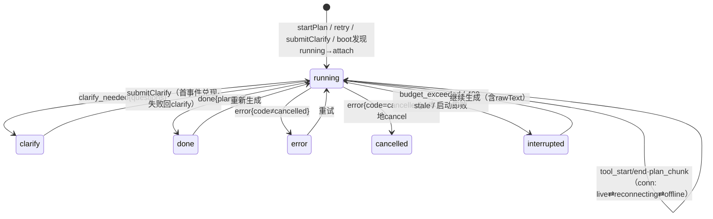
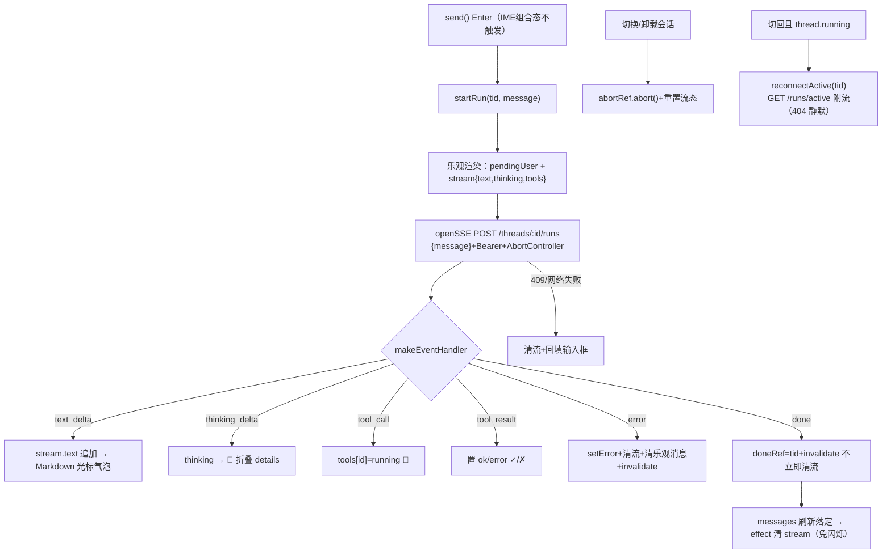
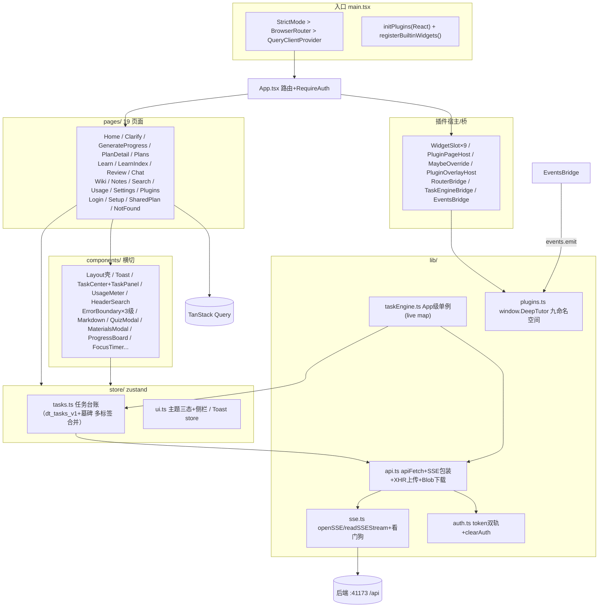

# 10 · 前端架构（React SPA）

> 证据：`frontend/src/**`（~19.4k 行）。本笔记由并行子代理全量通读 19 页面/36 组件/9 lib+store 模块后汇总，行号以当前工作区为准。

## 1. 技术栈与构建

- **运行时**：React 18.3 + react-dom、react-router-dom 6.26（BrowserRouter + 嵌套 Routes）、@tanstack/react-query 5.59（服务端状态）、zustand 4.5（客户端状态）、react-markdown 9 + remark-gfm/math + rehype-katex/sanitize、react-window（虚拟列表）。
- **构建**：Vite 5.4 + TS 5.6 strict（`tsc --noEmit && vite build`）；Tailwind 3.4。dev 端口 5173，`/api` 反代 `http://localhost:8000`（vite.config.ts:20-28）；手动 vendor 分包（react-vendor / markdown-vendor，vite.config.ts:11-18）。**无路径别名**，全部相对导入。
- **入口**（main.tsx）：QueryClient 全局默认 `refetchOnWindowFocus:false, retry:1, staleTime:5s`；挂载顺序 `registerBuiltinWidgets()` → `initPlugins(React)`（挂 window.DeepTutor + 恢复皮肤 + 自动加载持久化插件）→ StrictMode > BrowserRouter > QueryClientProvider > App。

## 2. 路由结构（App.tsx:62-117）

公开路由：`/login`、`/setup`（首次设置向导）、`/shared/:token`（只读分享，链接即凭证）。

鉴权区（`RequireAuth > Layout`，内挂 TaskEngineBridge + EventsBridge）：

| path | 组件 | 说明 |
|------|------|------|
| `/` | Home | 生成入口，`MaybeOverride hostPath="home"` |
| `/chat` | Chat | AI 对话（SSE） |
| `/generate/:sessionId` | GenerateProgress | 生成进度 |
| `/clarify/:sessionId` | Clarify | 澄清问答 |
| `/plans` `/plans/:planId` | Plans / PlanDetail | MaybeOverride 可覆盖 |
| `/learn` `/learn/:planId` | LearnIndex / Learn | 学习仪表盘/单方案 |
| `/review` | Review | 间隔复习+错题翻卡 |
| `/wiki` | Wiki | 知识库三视图 |
| `/notes` | Notes | 自由笔记 |
| `/search` `/usage` | Search / Usage | 全局搜索/用量 |
| `/plugins` `/settings` | Plugins / Settings | **受保护不可被插件覆盖** |
| `/p/*` | PluginPageHost | 插件页面命名空间 |
| `*` | NotFound | |

**RequireAuth 四段判定**（App.tsx:37-60）：setup 状态加载中→spinner；needs_setup→/setup；open_mode（零配置免登录）放行；无 token→/login 记住 from。

**Layout 应用壳**：吸顶毛玻璃顶栏（HeaderSearch `/` 快捷键、ShortcutsHelp `?`、主题三态切换、UsageMeter、ReviewDueBadge、TaskCenter、用户区）+ 可折叠侧栏（11 项 NAV_ITEMS + PluginNavItems + TaskPanel + footer 插槽）+ 开放模式/未配 Key 常驻横幅 + 页面级 ErrorBoundary（resetKey=pathname 路由切换自愈）。另有 WidgetSlot 内 WidgetErrorBoundary、PluginOverlayHost 内 OverlayErrorBoundary 两级细粒度边界。

## 3. 数据层

### 3.1 API 客户端（lib/api.ts，1,451 行）

```ts
class ApiError extends Error { code, status }                       // api.ts:14-18
async function apiFetch<T>(path, init?: RequestInit & {timeoutMs?}): Promise<T>   // :35-75
```

- **baseURL**：`VITE_API_BASE ?? '/api'`——dev 走 Vite 代理、生产同源反代。
- **认证头**：每次注入 `Authorization: Bearer ${token()}`；**token 双轨**（auth.ts:29-31）：`localStorage['dt_token']（JWT）?? VITE_AUTH_TOKEN（构建期注入）?? ''`——JWT 绝对优先；两者安全权衡在 auth.ts:5-9 明示（明文 localStorage/打包进 bundle，仅限本机/受信局域网）。
- **超时**：默认 120s（AbortController），导出/测验/KB 问答放宽 300s。
- **错误**：401 → `handleUnauthorized`（清 auth + 跳登录）；非 2xx 解析 `body.error` 抛 `ApiError(code,message,status)`；204 → undefined。
- **上传走 XHR**（fetch 无进度）：`uploadMaterial/uploadKbDocument` 带 onprogress 字节级进度、10 分钟超时。
- **Blob 下载族**：`saveBlob` 解析 Content-Disposition（RFC5987 中文名）；`fetchKbRawBlob` 用 fetch 转 objectURL（img/iframe 标签无法带 Authorization 头）。

### 3.2 SSE 实现（lib/sse.ts + api.ts 重连层）

- **选型**：fetch + ReadableStream 而非 EventSource——需要带 Authorization 头（sse.ts:1-2）。
- `openSSE(url, opts) -> Promise<lastId|undefined>`：构造头（Accept + Bearer + **Last-Event-ID 续接游标** + JSON body），支持 GET/POST。
- `readSSEStream(body, onEvent, idleTimeoutMs=60_000)`：逐行解析事件流（CRLF 剥离、多行 data 拼接、`:` 注释跳过）；**空闲看门狗** 60s（4×后端 15s 心跳）无字节即 cancel 并抛错，防代理缓冲挂死。
- **重连策略 `ssePostWithReconnect`**（api.ts:1102-1160）：终态事件（done/error/budget_exceeded/clarify_needed）不重连；收到真实事件重置 attempt；**边投递边推进 lastId 并实时上报**（断后只重放增量）；4xx 非瞬态直接抛；最多 3 次 full-jitter 指数退避（防多用户惊群）。`clarifyStream` 走不重连版本（端点非幂等）。

### 3.3 认证（lib/auth.ts）

`dt_token`/`dt_user` 存 localStorage；`AUTH_CHANGED_EVENT='dt-auth-changed'` 自定义事件驱动 Layout 响应式刷新；`clearAuth()` 额外清任务台账持久化（`dt_tasks_v1`/墓碑，防公共设备换用户读到前任 rawText）。

### 3.4 任务引擎（lib/taskEngine.ts 459 行 + store/tasks.ts 551 行）——前端架构核心

**设计**：SSE 连接从页面组件上收到 **App 级模块单例**（不进 React 树），页面只订阅 zustand store——切页/刷新/关弹窗不 abort 流、不丢任务可见性。

**状态机**（TaskPhase）：`running ⇄ (conn: live/reconnecting/offline)` → 终态 `done | error | cancelled | interrupted | clarify`。

- 台账 `TaskEntry`：易变数据（steps/cost/tokens/partialPlan）与恢复字段（rawText/lastEventId/questions）分离——**仅恢复字段持久化 localStorage**（`dt_tasks_v1`，容量 200 条），易变进度靠 attach 时 SSE 重放重建。
- **多标签页墓碑**：删除任务写 `dt_tasks_v1_tombstones`；他页 storage 事件合并时墓碑较新则不复活。
- `applyEvent(id, event, data)`：事件→相位状态机（tool_start 按 tool+attempt 去重、tool_end 累加 cost/tokens、plan_chunk 存 partialPlan、clarify_needed→clarify、done→done+resultPlanId…）。
- `boot()`：listSessions → reconcile（服务端状态单向覆盖本地）→ 对 running 任务自动 attach（刷新无感续看）。
- `startPlan`：启动即败（409 并发/402 预算/503 过载）抛给调用方做**引导矩阵**（Home.tsx:230-252 分别 toast+跳转）；409 特例尝试 attach 现有流视为成功。
- `submitClarify`：**race(started, done)**——收到首个流事件即 resolve（前端据此立刻跳进度页），失败恢复 clarify 相位（草稿仍在 localStorage）。
- `handleStreamError`：404→移除台账；409 stale→interrupted；网络类→仅 conn=offline **相位保持 running（后端仍在跑）**，UI 提供「重试连接」（=attach 重放续看）/「重试生成」。
- 终态副作用 `notifySettled`：invalidate sessions/plans/usage + 打扰抑制 toast（用户正在任务页则不打扰）+ 插件事件桥广播 `taskchange`。



## 4. 核心页面速览

| 页面 | 职责与关键机制 |
|------|---------------|
| **Home**（616 行） | 需求+资料上传（每文件选解析深度 full/fast/none）+结构化时间输入；草稿 localStorage 自动保存；`start()` 主流程：createSession → **有界并发池 3** 上传/抓 URL → 失败回滚 deleteSession → engine.startPlan → 引导矩阵 |
| **Clarify** | 问题三级回退（location.state → 台账 → GET）；回答草稿 localStorage；提交 race 跳进度页 |
| **GenerateProgress** | 纯订阅视图（渲染台账任务）；相位驱动：clarify→跳转、done→1.5s 倒计时自动跳方案、running→进度条+步骤列表（attempt>1 显示 ↻ 重跑徽标）+秒表/tokens/费用；断线双横幅；plan_chunk 部分方案预览弹窗 |
| **PlanDetail**（887 行） | 四 Tab（路径/时间线/资源✅⚠️❌/校验报告）；导出五格式（slides 走 Blob URL 新窗口）；分享创建/撤销；**局部重生成**（scope 四选+feedback，done 事件 nav 新版本）；版本对比弹窗（结构化 diff） |
| **Learn / LearnIndex** | 跨方案仪表盘 + 单方案：FocusTimer 番茄钟（完成自动打卡）、今日/本周目标、补卡、CheckinCalendar |
| **Review** | 双队列（到期知识点翻卡 + 错题重练）；三档自评回写 mastery；键盘流（Space 翻面/1-2-3 自评）；重练薄弱收窄循环 |
| **Chat**（480 行） | 见下方流程图：乐观渲染、makeEventHandler 统一分发、done 不立即清流（防终态闪烁）、切回会话经 `GET /runs/active` 附流续看、409 回填输入框 |
| **Notes**（822 行） | 双栏分屏实时预览（150ms 防抖+滚动比例同步）；未保存草稿双保险（beforeunload + localStorage 防抖，恢复前校验 baseUpdatedAt 防旧草稿复活）；ZIP 导入导出 |
| **Wiki**（662 行） | 三视图：docs（KB 文档库+KbChatPanel 问答）/ nodes（知识点+笔记+掌握度）/ notes（笔记总览）；StudyHeatmap 打卡热力图（84 天） |
| **Search / Usage / Settings / Plugins / Setup / Login / SharedPlan / Plans** | 全局搜索（键盘闭环漫游）；用量统计（纯 CSS 图表）；设置组合页（用户/供应商/计费/凭证/分享/备份/密码）；前端插件管理+后端插件热管理（403 降级提示）；两步可跳过向导；登录回跳；只读分享；列表+进行中会话占位区（活跃时 5s 轮询） |

### Chat 页 SSE 对话流程



## 5. 插件前端（window.DeepTutor v1.17.0，lib/plugins.ts 1,434 行）

**九命名空间**：`widgets`（9 命名插槽）、`pages`（/p/* 整页 + 侧栏导航 + **override 覆盖宿主路由**，受保护路由除外）、`router`（SPA 导航门面，RouterBridge 注入）、`overlay`（background/content/top 三层 portal，z-index -1/45/9999）、`ui`（makeDraggable/Resizable/Droppable/Sortable/toast）、`skins`（CSS 变量令牌 `--dt-*`，亮暗切换重放）、`events`（类型化总线，含后端桥事件 plan_created/progress_updated/quiz_submitted/quiz_ready…）、`api`（REST 代理走宿主 apiFetch——同登录态/401 处理）、`plugins`（load/unload/disable/enable）。

**热启停**：`_currentPluginUrl` 在脚本注入前置位（同步执行期间 register 记账）；disable/unload 时 `_clearTrackedRegistrations` 按键逆注册。脚本注入 15s 超时；并发 load 共享 Promise。

**桥组件**：RouterBridge（模块单例获得 navigate）、TaskEngineBridge（engine.bind + boot + setCurrentPath）、EventsBridge（登录区挂载，SSE `/api/events/stream` → events.emit 转发插件，full-jitter 重连 ≤30s，401 不重连）。

**宿主渲染**（全部 useSyncExternalStore 响应）：WidgetSlot×9（单组件错误边界）、PluginPageHost、MaybeOverride（包裹 9 个宿主页）、PluginOverlayHost（三层 createPortal，层容器 pointer-events:none 仅 'auto' 拦截指针）、PluginNavItems。内置小组件（homeDashboard 四卡）走同一 API 注册自证。

## 6. 横切组件

- **Toast**：zustand store + 模块级 `toast.success/info/error`（**非组件环境可调用**——taskEngine/plugins 复用）；最多 4 条、TTL 3s/8s、两段退场动画。
- **TaskCenter/TaskPanel 双形态**：顶栏指示器（活动计数+ping 点+document.title 角标 `(n)`）/侧栏常驻；复用 TaskRow（进度、conn 状态、取消/重试、TOOL_LABELS 8 工具中文名）。
- **UsageMeter**：staleTime 30s 刻意不 refetchOnWindowFocus（由 taskEngine 终态 invalidate 驱动，防高负载抖动）。
- **HeaderSearch**：`/` 聚焦（IME/修饰键/dialog 不劫持）、250ms 防抖 + AbortController、四域建议、combobox 键盘漫游。
- **Markdown**：全站唯一渲染入口；插件链顺序关键：remark-gfm → remark-math → **rehype-sanitize → rehype-katex**（sanitize 必须在 katex 前且放行 math 类名）。

## 7. 前端整体架构图



## 8. 关键签名清单

```ts
// lib/api.ts
apiFetch<T>(path, init?: RequestInit & {timeoutMs?}): Promise<T>        // :35
generateStream(sessionId, rawText, onEvent, signal?, opts?, timeOpts?)   // :832
regenerateStream / retryStream / clarifyStream / generateMaterialsStream
ssePostWithReconnect(path, body, onEvent, signal?, opts?): Promise<void> // :1102
openEventStream(onEvent, signal)                                         // :890
uploadMaterial(sessionId, file, onProgress?): Promise<MaterialOut>       // :187 (XHR)

// lib/sse.ts
openSSE(url, opts): Promise<string|undefined>                            // :36
readSSEStream(body, onEvent, idleTimeoutMs=60_000): Promise<string|undefined>  // :64

// lib/taskEngine.ts（engine 单例）
bind(d) / setCurrentPath(path) / isLive(taskId) / boot() / attach(sessionId)
startPlan(sessionId, rawText, title?, timeOpts?) / retry(sessionId)
submitClarify(sessionId, answers) / cancel(sessionId) / startMaterials(planId, opts)

// store/tasks.ts
planTaskId(sessionId) / materialsTaskId(planId)
useTaskStore: upsert / update / applyEvent / setConn / remove / clearFinished / reconcile
```

## 9. 前端亮点总结

1. **SSE 一栈三用且策略分化**：生成流（Last-Event-ID 续接 + full-jitter ≤3 次）、事件桥（常驻重连 ≤30s）、Chat run（组件生命周期 abort + active 附流）——同一底座按语义选择策略。
2. **任务引擎是前端架构核心**：SSE 连接上收模块单例 + zustand 台账 + localStorage 恢复字段 + 墓碑多标签同步，彻底解决"切页丢进度"。
3. **插件系统完备**：九命名空间 + 注册追踪热启停 + 三级错误边界 + 能力发现（slots()/layers()），内置小组件走同一 API 自证。
4. **工程细节密集**：IME 组合态 Enter 防误触、isHttpUrl 防 javascript: 注入、防惊群退避、打扰抑制 toast、旧响应覆盖防护（cancelled 标志）。
