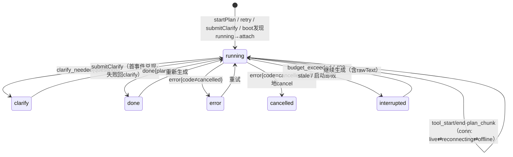
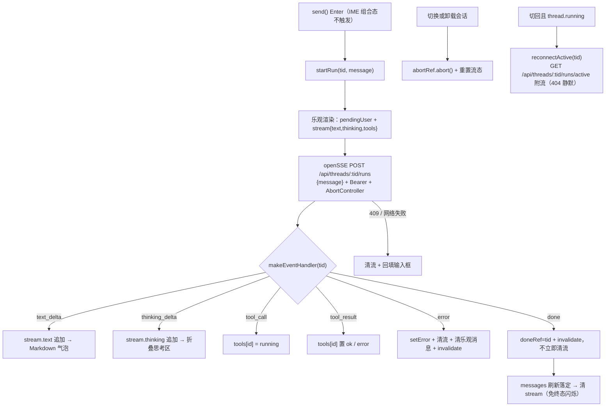
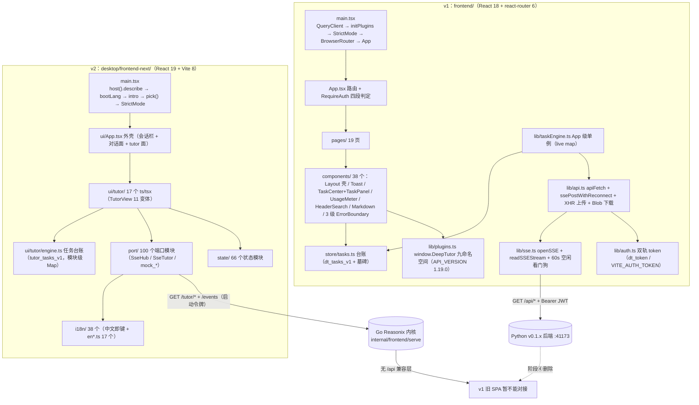

# 10 · 前端架构（v1 React SPA 与 Go 侧新前端）

> 覆盖范围：两代前端。v1 = `frontend/`（React 18 SPA，配 Python v0.1.x 后端，端口 41173，当前仍可运行）；v2 = `desktop/frontend-next/`（React 19 SPA，Go/Reasonix 内核改造底座，阶段④统一前端基座）。

## 0 · 证据基线（2026-10-20 实测）

| 项 | 实测值 | 取证 |
|---|---|---|
| v1 前端源码量 | `frontend/src` 73 文件 / 20250 行 | `[System.IO.File]::ReadAllLines` 逐文件累加 |
| v1 前端源码量（非空行口径） | 19 190 行 | `Get-Content \| Measure-Object -Line`（空行不计），与上行的总行数口径差 1 060 行 |
| v1 组件清单行数口径 | 同上（ReadAllLines） | 下文 §1.6 / §1.7 表格行数一律用 ReadAllLines 口径 |
| v1 页面 | `frontend/src/pages/` 19 个 `.tsx` / 8167 行 | 目录枚举 |
| v1 组件 | `frontend/src/components/` 38 个 `.tsx` / 7358 行 | 目录枚举 |
| v1 lib / store / widgets | 10 文件 / 3833 行；2 文件 / 645 行；1 文件 / 56 行 | 目录枚举 |
| v1 后端契约 | OpenAPI 119 paths / 145 operations | `backend/.venv/Scripts/python.exe` 实跑 `create_app().openapi()` |
| v1 后端数据面 | ORM 29 表；alembic 26 迁移；`app/api/` 28 文件 | `backend/app/db/models.py` 类计数；`backend/alembic/versions/` |
| Go 侧新前端 | `desktop/frontend-next/src` 1101 个 ts/tsx / 131811 行（含 549 个测试文件） | 目录枚举 |
| Go 侧桌面宿主 | `desktop/electron/src/` 37 个 JS 模块 | 目录枚举 |
| 端口 | v1 后端与 SPA 同端口 41173；v1 前端 dev 5173；新前端 dev 5273 | `scripts/start.ps1:73`；`frontend/vite.config.ts:26`；`desktop/frontend-next/vite.config.ts:58` |
| Go 侧模块名 | `module reasonix`（未改名，`deep-tutor` 改名属 M1.2 未完成项） | 根 `go.mod` |

> 已删除目录不在本笔记的现存目录清单内：`release-notes/` `benchmarks/` `examples/` `workers/` `npm/` `output/` `cmd/e2ebench` `cmd/signpath-contract` `.signpath/` `prod_fast_test` 已于 2026-10-20 移除。

---

## 1 · v1 前端（`frontend/`）

### 1.1 技术栈与构建配置

| 项 | 实测 | 证据 |
|---|---|---|
| 运行时 | react/react-dom ^18.3.1；react-router-dom ^6.26.2；@tanstack/react-query ^5.59.0；zustand ^4.5.5；react-markdown ^9.0.1；remark-gfm ^4.0.0；remark-math ^6.0.0；rehype-sanitize ^6.0.0；rehype-katex ^7.0.1；react-window ^1.8.11；katex ^0.18.10 | `frontend/package.json:11-24` |
| 构建 | Vite ^5.4.8；TypeScript ^5.6.2（`strict` + `noUnusedLocals` + `noUnusedParameters` + `noFallthroughCasesInSwitch`）；Tailwind ^3.4.13（`darkMode: 'class'`） | `frontend/package.json:25-35`；`frontend/tsconfig.json:15-18`；`frontend/tailwind.config.js:4` |
| 构建命令 | `tsc --noEmit && vite build` | `frontend/package.json:8` |
| 分包 | 手动 vendor 分包：`react-vendor`（react / react-dom / react-router-dom）、`markdown-vendor`（react-markdown / remark-gfm / rehype-sanitize） | `frontend/vite.config.ts:16-23` |
| dev 代理 | `port 5173`；`/api` → `VITE_API_PROXY_TARGET ?? 'http://localhost:8000'`，`changeOrigin: true` | `frontend/vite.config.ts:25-33` |
| 路径别名 | 无。`tsconfig.json` 不含 `paths`，全部相对导入 | `frontend/tsconfig.json`（全文 21 行） |

> 代理默认目标为 8000（Vite dev 默认），而 v1 实际监听端口为 41173——dev 需设 `VITE_API_PROXY_TARGET` 才能命中真实后端（`frontend/vite.config.ts:7-9` 注释即为此写明）。

### 1.2 入口挂载顺序（`frontend/src/main.tsx`）

1. 构造 `QueryClient`，查询默认项 `refetchOnWindowFocus: false, retry: 1, staleTime: 5_000`（`main.tsx:11-17`）。
2. 注册身份-缓存同步：`AUTH_CHANGED_EVENT` 监听 + `storage` 事件监听，用户 id 变化即 `queryClient.clear()`（`main.tsx:22-39`）。
3. `registerBuiltinWidgets()` → `void initPlugins(React)`（`main.tsx:42-43`）。`initPlugins` 挂 `window.DeepTutor`、恢复皮肤、订阅亮暗切换重放皮肤、自动加载持久化插件（`lib/plugins.ts:1417-1459`）。
4. `ReactDOM.createRoot(...).render(<StrictMode><BrowserRouter><QueryClientProvider><App/></QueryClientProvider></BrowserRouter></StrictMode>)`（`main.tsx:45-53`）。

挂载顺序：QueryClient → 插件初始化 → StrictMode → BrowserRouter → QueryClientProvider → App。

### 1.3 路由结构（`frontend/src/App.tsx`）

顶层 `App.tsx:70-128` 先渲染 `RouterBridge`（`App.tsx:74`）与 `PluginOverlayHost`（`App.tsx:77`），二者挂在 `Routes` 外、`BrowserRouter`/`QueryClientProvider` 内。

公开路由（`App.tsx:79-83`）：

| path | 组件 | 说明 |
|---|---|---|
| `/login` | Login | 登录 |
| `/setup` | Setup | 首次设置向导（零配置开箱即用） |
| `/shared/:token` | SharedPlan | 只读分享，链接本身即凭证 |

鉴权区（`App.tsx:84-124`）：`RequireAuth > Layout`，Layout 内挂 `TaskEngineBridge`（`App.tsx:90`）与 `EventsBridge`（`App.tsx:92`），再嵌内层 `Routes`：

| path | 组件 | 覆盖点 |
|---|---|---|
| `/` | Home | `MaybeOverride hostPath="home"`（`App.tsx:94`） |
| `/chat` | Chat | 无（`App.tsx:95`） |
| `/generate/:sessionId` | GenerateProgress | 无（`App.tsx:96`） |
| `/clarify/:sessionId` | Clarify | 经 `RemountByKeyParam` 以 sessionId 为 key 强制重挂（`App.tsx:100`，组件 `App.tsx:65-68`） |
| `/plans` | Plans | `hostPath="plans"`（`App.tsx:101`） |
| `/plans/:planId` | PlanDetail | `hostPath="plans/:planId"`（`App.tsx:102`） |
| `/learn` | LearnIndex | `hostPath="learn"`（`App.tsx:104`） |
| `/learn/:planId` | Learn | `hostPath="learn/:planId"`（`App.tsx:105`） |
| `/review` | Review | `hostPath="review"`（`App.tsx:107`） |
| `/wiki` | Wiki | `hostPath="wiki"`（`App.tsx:108`） |
| `/notes` | Notes | `hostPath="notes"`（`App.tsx:109`） |
| `/search` | Search | 无（`App.tsx:111`） |
| `/usage` | Usage | `hostPath="usage"`（`App.tsx:112`） |
| `/plugins` | Plugins | 无（`App.tsx:114`） |
| `/settings` | Settings | 无（`App.tsx:115`） |
| `/p/*` | PluginPageHost | 插件页面命名空间（`App.tsx:117`） |
| `*` | NotFound | 显式 404（`App.tsx:119`） |

覆盖点共 9 处（`home` `plans` `plans/:planId` `learn` `learn/:planId` `review` `wiki` `notes` `usage`），与插件 API 的 `OVERRIDABLE_ROUTES` 白名单一一对应（`lib/plugins.ts:189-193`）。受保护路由 4 条：`plugins` `settings` `login` `setup`，注册期即拒覆盖（`lib/plugins.ts:187, 232-234`）。

**RequireAuth 四段判定**（`App.tsx:37-61`）：

1. `useSetupStatus()` 加载中 → 居中 spinner（`App.tsx:40-47`）。
2. `status.needs_setup` → `Navigate to="/setup"`（`App.tsx:49-51`）。
3. `status.open_mode`（零配置免登录）→ 放行（`App.tsx:52-54`）。
4. 无 token → `Navigate to="/login"`，`state.from` 记 `pathname + search`（`App.tsx:56-59`）。

`useSetupStatus` 查询失败（`isError`）时跳过第 2/3 段，回退「仅查 token」旧逻辑（`App.tsx:48`）。

### 1.4 Layout 应用壳（`frontend/src/components/Layout.tsx`，365 行）

| 区 | 内容 | 证据 |
|---|---|---|
| 顶栏 | 吸顶 + 毛玻璃（`sticky top-0 z-30 backdrop-blur-md`）；品牌链接、HeaderSearch、ShortcutsHelp、主题三态按钮、UsageMeter、ReviewDueBadge、TaskCenter、用户区（用户名 + 管理员标 + 注销，仅 JWT 会话渲染） | `Layout.tsx:185-237` |
| 侧栏 | 桌面态 `sticky` 贴左缘，可折叠（宽 `w-48` / `w-16`），高 `calc(100vh - headerH)`，`ResizeObserver` 测顶栏高 | `Layout.tsx:108-119, 263-283` |
| 导航项 | `NAV_ITEMS` 11 项：新建方案 / AI 对话 / 方案列表 / 学习中心 / 知识库 / 复习 / 笔记 / 搜索 / 用量 / 插件 / 设置 | `Layout.tsx:22-34` |
| 侧栏附挂 | `PluginNavItems`（插件页导航）、`TaskPanel`（仅展开态）、`WidgetSlot slot="sidebar.footer"`（插件 footer 插槽）、收起按钮 | `Layout.tsx:170-171, 271-282` |
| 窄屏抽屉 | 遮罩 + 左滑面板，Esc 关闭、焦点移入/还原 | `Layout.tsx:86-104, 286-331` |
| 状态横幅 | `open_mode` 未设密码（琥珀色）、`!llm_configured` 未配 Key（蓝色），各带跳转链接 | `Layout.tsx:240-259` |
| 主区 | `<main id="main-content" key={location.pathname}>`，内容 `max-w-5xl` 居中；页面级 `ErrorBoundary resetKey={location.pathname}`（路由切换自愈） | `Layout.tsx:335-340` |
| 另有 | skip link、回到顶部悬浮按钮（滚动 > 400px 出现）、`<Toaster />`、footer | `Layout.tsx:178-183, 349-362, 343-347` |

错误边界共 3 级：页面级 `ErrorBoundary`（`Layout.tsx:338`）、小组件级 `WidgetErrorBoundary`（`components/WidgetSlot.tsx:16-30`）、覆盖层级 `OverlayErrorBoundary`（`components/PluginOverlayHost.tsx`）。

### 1.5 数据层

#### 1.5.1 API 客户端（`frontend/src/lib/api.ts`，1542 行）

```ts
class ApiError extends Error { code, status; details? }              // api.ts:14-21
async function apiFetch<T>(path, init?: RequestInit & {timeoutMs?}): Promise<T>  // api.ts:38
```

| 机制 | 实测 | 证据 |
|---|---|---|
| baseURL | `VITE_API_BASE ?? '/api'` | `api.ts:8` |
| 认证头 | 每次注入 `Authorization: Bearer ${token()}` | `api.ts:57-61` |
| 默认超时 | 120 000 ms（`AbortController`），超时抛 `ApiError('upstream_timeout', …, 504)` | `api.ts:36, 41-44, 64` |
| 放宽超时 | 导出（`/export/{planId}`）与测验生成各 300 000 ms | `api.ts:303, 374` |
| 调用方取消 | `init.signal` 合并入同一 controller，调用方中止时原样上抛 | `api.ts:46-50, 65` |
| 错误处理 | 非 2xx → `handleUnauthorized(status)` + 解析 `body.error` → `ApiError(code, message, status)`；422 附加 `details.errors` 字段级明细 | `api.ts:70-75`；`api.ts:955-973` |
| 空体处理 | 204 → `undefined`；200 空体 → `undefined`；非 JSON → `ApiError('bad_response', …)` | `api.ts:76-85` |
| SSE data 解析 | 单条畸形 JSON 不炸流，返回 `{}` | `api.ts:24-32` |
| XHR 上传 | `uploadMaterial` 走 XHR，`upload.onprogress` 字节级进度，`xhr.timeout = 10 分钟`，支持 `AbortSignal` | `api.ts:200-255` |
| KB 上传 | `uploadKbDocument` 同为 XHR 上传族 | `api.ts:1325` |
| Blob 下载 | `saveBlob` 解析 `Content-Disposition`（RFC 5987 `filename*=UTF-8''` 星号形式优先，`filename="…"` 形式次之） | `api.ts:976-986` |
| KB 原始文件 | `fetchKbRawBlob` 以 fetch 转 objectURL（img/iframe 标签无法带 Authorization 头） | `api.ts:1474` |

#### 1.5.2 SSE 实现（`frontend/src/lib/sse.ts`，124 行）

| 项 | 实测 | 证据 |
|---|---|---|
| 选型 | fetch + ReadableStream（EventSource 不能带自定义头） | `sse.ts:1-2` |
| `openSSE(url, opts)` | 构造 `Accept: text/event-stream` + 可选 `Authorization` + 可选 `Last-Event-ID` + 可选 `Content-Type`；支持 GET/POST；非 2xx 走 `handleUnauthorized` 后抛 `SseError(status, …)` | `sse.ts:36-53` |
| `readSSEStream(body, onEvent, idleTimeoutMs = 60_000)` | 逐行解析；BOM 剥除（首块）；行尾三形态切分 `/\r\n\|\r\|\n/`；`:` 开头注释行跳过；多行 `data` 以 `\n` 拼接；空 `data` 块不派发但 `id` 仍记账 | `sse.ts:64-123` |
| 空闲看门狗 | 默认 60 000 ms（后端心跳 15 s 的 4 倍）无字节即 `reader.cancel()` 并抛 `SseError(undefined, …)` | `sse.ts:60-62, 75-91` |
| 错误类型 | `SseError` 带 `status`（`undefined` 表示网络/超时类） | `sse.ts:7-12` |

**重连策略 `ssePostWithReconnect`**（`api.ts:1153-1211`）：

| 策略点 | 实测 | 证据 |
|---|---|---|
| 终态事件 | `done` / `error` / `budget_exceeded` / `clarify_needed` 收到即不重连 | `api.ts:1108-1110, 1184, 1203` |
| 重试计数复位 | 收到真实事件即 `attempt = 0`（心跳为注释行，不经回调，不误复位） | `api.ts:1173-1175` |
| 游标推进 | 边投递边更新 `lastId` 并经 `opts.onEventId` 实时上报；断后只重放增量 | `api.ts:1179-1182` |
| 非瞬态 4xx | 400–499 且非 408 / 429 → 直接抛出，不重连 | `api.ts:1191-1200` |
| 退避 | full-jitter：随机化到 `[250 ms, cap]`，`cap = min(1000 × 2^(attempt-1), 8000)`，最多 3 次 | `api.ts:1103-1117, 1204-1209` |
| 不重连版本 | `clarifyStream` 走 `ssePost`（端点非幂等） | `api.ts:910-917, 1127-1142` |

流族入口：`generateStream`（`POST /api/plans/generate`，`api.ts:871-886`）、`regenerateStream`（`/api/plans/{id}/regenerate`，`api.ts:889-898`）、`retryStream`（`/api/plans/{sessionId}/retry`，`api.ts:901-908`）、`clarifyStream`（`/api/plans/{sessionId}/clarify`，`api.ts:910-917`）、`generateMaterialsStream`（`api.ts:319`，按 content-type 分流 JSON 与 SSE）、`openEventStream`（`GET /api/events/stream`，`api.ts:929-934`）。

#### 1.5.3 认证（`frontend/src/lib/auth.ts`，99 行）

- 双轨 token：`localStorage['dt_token'] ?? import.meta.env.VITE_AUTH_TOKEN ?? ''`，JWT 绝对优先（`auth.ts:32-34`）。
- 安全权衡在文件头明示：JWT 明文存 localStorage 可被 XSS 窃取；`VITE_AUTH_TOKEN` 打包进 bundle，仅限开发/受信网络单用户部署（`auth.ts:5-9`）。
- `AUTH_CHANGED_EVENT = 'dt-auth-changed'` 自定义事件驱动 Layout 响应式刷新（`auth.ts:18, 27-29`）。
- `AUTH_STORAGE_KEYS = ['dt_token', 'dt_user']` 供 `main.tsx` 跨标签监听（`auth.ts:15`）。
- `clearAuth()` 额外清 `dt_tasks_v1`、`dt_tasks_v1_tombstones`、`dt-search-history`（`auth.ts:65-81`）。
- `handleUnauthorized(status)`：401 且有 JWT 会话 → `clearAuth()` + 整页跳 `/login`；无任何 token 的 401 同样跳登录（`auth.ts:89-99`）。

#### 1.5.4 任务引擎与任务台账

**`frontend/src/lib/taskEngine.ts`（495 行）**：SSE 连接从页面组件上收到 App 级模块单例，页面只订阅 zustand store。

| 机制 | 实测 | 证据 |
|---|---|---|
| 单例 | `export const engine`（`taskEngine.ts:265`）；`live` Map 保同任务单连接，`AbortController` 随任务 id 登记 | `taskEngine.ts:45, 200-202` |
| 状态机相位 | `running` / `clarify` / `done` / `error` / `cancelled` / `interrupted`；连接态 `live` / `reconnecting` / `offline` / `closed` | `store/tasks.ts:12-13` |
| `boot()` | `listSessions({limit: 50})` → `reconcile` → 对 running 的 plan 任务逐个 `attach`；对账失败按 10 s / 20 s / 30 s 有限退避重试（上限 3 次），登出后放弃 | `taskEngine.ts:280-324` |
| `attach(sessionId)` | 判态后行动：`running` → 续接（游标取台账 `lastEventId`）；`paused_clarify` → 不回放流，直接以 `clarify_questions` 落相位；终态 → 静默对账（不 toast）；`idle` → 不发起 | `taskEngine.ts:333-364` |
| `startPlan` | `Promise.race([started, done])`：收到首个流事件即兑现（前端据此跳转）；启动即败抛给调用方；409 特例先试 `attach`，服务端报 running 视为成功 | `taskEngine.ts:370-410` |
| 引导矩阵 | 启动即败按 HTTP 状态分流：409 并发 → toast + 跳 `/plans`；503 过载 → toast + 跳 `/plans`；402 预算 → toast + 跳 `/settings`；余者内联报错 | `pages/Home.tsx:244-261` |
| `retry(sessionId)` | 走 `/plans/{id}/retry`；失败时回滚相位 | `taskEngine.ts:413-428` |
| `submitClarify` | 同样 `race(started, done)`；启动阶段任何失败（网络/5xx/4xx）均恢复 `clarify` 相位并保留问题（答案草稿仍在 localStorage） | `taskEngine.ts:435-458` |
| `cancel(sessionId)` | 调后端取消；本页未挂流时本地立即落 `cancelled` | `taskEngine.ts:461-471` |
| `startMaterials(planId, opts)` | 材料流纳入引擎（关弹窗不 abort）；单元事件映射为 `unit_start` / `unit_done` / `done` / `sync` | `taskEngine.ts:474-494` |
| `handleStreamError` | 404 → 移除台账；409 stale → `interrupted`（errorCode `stale`）；`ApiError` 非网络类 → `error`；材料流断连 → `error`（errorCode `conn_lost`，已生成单元已逐单元落库）；余下（网络/重连耗尽）→ 仅 `conn = 'offline'`，**相位保持 running**（后端仍在跑） | `taskEngine.ts:144-188` |
| `notifySettled` | 相位落定副作用：失效 `sessions`；plan 终态失效 `plans` + `usage`；材料终态失效 `plans` + `materials`；打扰抑制 toast（用户在该任务页则不打扰）；顺带清除 `dt_clarify_draft_<sessionId>` | `taskEngine.ts:70-124` |
| 相位迁移广播 | 每次相位迁移向插件事件总线广播 `taskchange` | `taskEngine.ts:126-133` |

**`frontend/src/store/tasks.ts`（557 行）**：全局任务台账。

| 项 | 实测 | 证据 |
|---|---|---|
| 台账键 | `dt_tasks_v1` | `store/tasks.ts:82` |
| 墓碑键 | `dt_tasks_v1_tombstones`，上限 200 条（按删除时间新者留） | `store/tasks.ts:185-186, 200-211` |
| 容量护栏 | `_MAX_PERSISTED_TASKS = 200`；超限淘汰最旧终态条目，活动条目不淘汰；内存台账同步裁剪 | `store/tasks.ts:88, 140-153, 474-478` |
| 持久化字段 | 仅恢复字段：`rawText` / `lastEventId` / `questions` / `errorCode` / `errorMessage` / `resultPlanId` / `materialsTotal` / `materialsUnits` / 时间戳；易变的 `steps` / `cost` / `tokens` / `partialPlan` 不落盘 | `store/tasks.ts:90-128, 471-478` |
| 任务 id | `plan:<sessionId>` / `materials:<planId>` | `store/tasks.ts:74-75` |
| `applyEvent` 映射 | plan：`tool_start`（按 tool+attempt 去重后追加）、`tool_end`（累加 `cost`，tokens 取 `tokens_in`+`tokens_out`）、`plan_chunk`（存 `partialPlan`）、`clarify_needed`（→ clarify + questions）、`budget_exceeded`（→ interrupted）、`error`（`code==='cancelled'` → cancelled，否则 error）、`done`（→ done + `resultPlanId` + 终态费用校准）；materials：`unit_start` / `unit_done` / `done`\|`sync` / `error` | `store/tasks.ts:308-397` |
| 墓碑多标签同步 | `storage` 事件监听：墓碑键按删除时间大者合并并删本地对应条目；台账键按 `updatedAt` 大者合并（仅采纳恢复字段，保留本页易变进度）；另页清空（`newValue == null`）→ 本页台账同步清空 | `store/tasks.ts:484-556` |
| `reconcile(items)` | 服务端单向覆盖本地：`running`/`paused_clarify` 补轻量条目待 attach；服务端终态覆盖本地非终态；终态且本地无条目则不补（避免历史会话淹没台账） | `store/tasks.ts:424-468` |



### 1.6 19 个页面职责

| 页面 | 行数 | 职责与关键机制 |
|---|---|---|
| Home | 630 | 需求输入 + 资料上传（每文件选解析深度 full/fast/none，`pages/Home.tsx:17-20`）+ 结构化时间输入；草稿存 `dt-home-draft`（`pages/Home.tsx:13`）；`start()` 主流程：createSession → 有界并发池 3（`_POOL = 3`，`pages/Home.tsx:174`）上传/抓 URL → 上传失败回滚 `deleteSession`（`pages/Home.tsx:226-230`）→ `engine.startPlan` → 引导矩阵（`pages/Home.tsx:244-261`） |
| Clarify | 202 | 问题三级回退（location.state → 台账 → `GET /sessions/{id}.clarify_questions`）；回答草稿存 `dt_clarify_draft_<id>`；提交经 `engine.submitClarify` |
| GenerateProgress | 451 | 纯订阅视图（渲染 store/tasks 台账），SSE 连接由任务引擎持有；相位驱动：clarify → 跳转、done → 倒计时自动跳方案、running → 进度条 + 步骤列表（`attempt > 1` 显示重跑徽标，`pages/GenerateProgress.tsx:337`）+ 秒表/tokens/费用；`plan_chunk` 部分方案预览 |
| PlanDetail | 912 | 方案详情多 Tab（路径/时间线/资源/校验报告）；导出五格式（slides 走 Blob URL 新窗口）；分享创建/撤销；局部重生成（scope + feedback）；版本对比 |
| Plans | 568 | 方案列表 + 分页；上方「进行中的会话」占位区（running/待澄清/失败/中断/草稿） |
| Learn | 433 | 单方案进度看板 + 复习提醒（`next_review <= 今日`）+ 打卡 |
| LearnIndex | 126 | `/learn` 聚合页：今日学习任务 + 各方案进度卡片，drill-down 进 `/learn/:planId` |
| Review | 594 | 双队列（到期知识点翻卡 + 错题重练）；三档自评回写 mastery；键盘流（Space 翻面 / 1-2-3 自评） |
| Chat | 621 | Agent 对话 SSE：POST `/threads/{id}/runs`，事件 `text_delta`/`thinking_delta`/`tool_call`/`tool_result`/`done`（`pages/Chat.tsx:1-9`）；乐观渲染；`makeEventHandler` 统一分发（`pages/Chat.tsx:205`）；done 不立即清流（免闪烁，`pages/Chat.tsx:271-279`）；切回会话且 `thread.running` 时经 `GET /threads/{id}/runs/active` 附流续看（`pages/Chat.tsx:148-152, 291-303`）；409 / 网络失败清流并回填输入框（`pages/Chat.tsx:280-287`） |
| Notes | 845 | 双栏分屏实时预览；未保存草稿双保险（beforeunload + localStorage 防抖，恢复前校验 `baseUpdatedAt` 防旧草稿复活）；ZIP 导入导出 |
| Wiki | 670 | 知识库三视图：docs（KB 文档库 + KbChatPanel 问答）/ nodes（知识点 + 笔记 + 掌握度）/ notes（笔记总览）；StudyHeatmap 打卡热力图（84 天） |
| Search | 304 | 全局搜索四域聚合（方案/笔记/KB 文档/知识节点）；`?q=` 为唯一查询源；命中关键词高亮；深链落点跨页跳转 |
| Usage | 193 | 用量统计（纯 CSS 图表） |
| Settings | 750 | 设置组合页（用户/供应商/计费/凭证/分享/备份/密码） |
| Plugins | 412 | 前端插件管理 + 后端插件热管理（403 降级提示） |
| Setup | 217 | 两步可跳过的首次设置向导 |
| Login | 97 | 登录回跳（`from` 含 `pathname + search`） |
| SharedPlan | 119 | 只读分享页，无需登录 |
| NotFound | 23 | 显式 404 |

合计 8167 行，与目录实测一致。

**Chat 页 SSE 对话流程**（`pages/Chat.tsx`）：



### 1.7 横切组件

| 组件 | 行数 | 关键机制 |
|---|---|---|
| Toast | 104 | zustand store + 模块级 `toast.success/info/error`（**非组件环境可调用**，taskEngine 与 plugins 复用，`components/Toast.tsx:50-55`）；最多叠 4 条（`slice(-3)`，`components/Toast.tsx:37`）；TTL 3 s，带动作 8 s（`components/Toast.tsx:29-30`）；退场动画 200 ms 两段（`components/Toast.tsx:31, 41-46`） |
| TaskCenter | 279 | 顶栏指示器（活动计数 + ping 点 + `document.title` 角标）；下拉面板；`TOOL_LABELS` 8 工具中文名（`components/TaskCenter.tsx:17-27`）；`PHASE_META` 相位元数据 |
| TaskPanel | 40 | 侧栏常驻任务面板（仅展开态，`components/Layout.tsx:271`） |
| UsageMeter | 30 | `staleTime: 30_000`，显式移除 `refetchOnWindowFocus`（由 taskEngine 终态 `invalidateQueries(['usage'])` 驱动，`components/UsageMeter.tsx:10-16`） |
| HeaderSearch | 207 | `/` 快捷键聚焦（IME 组合态/修饰键/弹窗不劫持，`components/HeaderSearch.tsx:47`）；`DEBOUNCE_MS = 250`、`MIN_CHARS = 2`（`components/HeaderSearch.tsx:33-34`）；cleanup 同步 abort 在途请求（`components/HeaderSearch.tsx:97-101`）；`role="combobox"` 键盘漫游（`components/HeaderSearch.tsx:164-170`） |
| Markdown | 44 | 全站唯一渲染入口；插件链顺序 **remark-gfm → remark-math → rehype-sanitize → rehype-katex**（`components/Markdown.tsx:35-39`）；sanitize 在 katex 之前，schema 放行 `math` / `math-inline` / `math-display` / `language-math` 类名（`components/Markdown.tsx:24-30`） |
| ErrorBoundary | 66 | 页面级边界，`resetKey` 随路由 pathname 变化重置 |
| WidgetSlot | 66 | 单组件级 `WidgetErrorBoundary`；插件重注册同 id 新组件时重置失败态（`components/WidgetSlot.tsx:27-30`） |
| PluginOverlayHost | 113 | 三层 portal：background z-index -1 / content 45 / top 9999（`components/PluginOverlayHost.tsx:22-30`）；层容器 `pointer-events: none`，仅注册时 `pointerEvents: 'auto'` 的 overlay 拦截指针 |
| 另 | — | ShortcutsHelp 142、ProgressBoard 343、QuizModal 461、MaterialsModal 412、FocusTimer 274、Timeline 109、KbChatPanel 331、KbDocsView 796、StudyMaterialReader 718、ProviderManager 348、CredentialManager 325、UserManager 320、ModelPricingManager 229、NodeNoteEditor 143、PlanOutline 188、CheckinCalendar 123、HomeKbGenerate 78、KbViewerModal 253、MaterialsPanel 116、Skeleton 35、EmptyState 22、Card 25 |

### 1.8 前端插件宿主（`frontend/src/lib/plugins.ts`，1461 行）

`API_VERSION = '1.19.0'`（`lib/plugins.ts:18`）。

**九命名空间**（`lib/plugins.ts:1393-1434` 的 `DeepTutorAPI` 接口与 `initPlugins` 组装）：

| 命名空间 | 能力 | 证据 |
|---|---|---|
| `widgets` | 9 命名插槽：`home.dashboard` `sidebar.footer` `plan.detail` `plans.toolbar` `review.dashboard` `learn.dashboard` `notes.toolbar` `usage.dashboard` `wiki.dashboard`；`slots()` 供能力发现 | `lib/plugins.ts:71-82, 139-141` |
| `pages` | `/p/*` 整页 + 侧栏导航 + override 覆盖宿主路由（受保护路由除外） | `lib/plugins.ts:148-153, 184-193, 230-238` |
| `router` | SPA 导航门面（RouterBridge 注入） | `lib/plugins.ts:1403` |
| `overlay` | background / content / top 三层 portal（z-index -1 / 45 / 9999） | `lib/plugins.ts:1405`；`components/PluginOverlayHost.tsx:22-30` |
| `ui` | makeDraggable / Resizable / Droppable / Sortable / toast | `lib/plugins.ts:1407` |
| `skins` | CSS 变量令牌 `--dt-*`，亮暗切换后重放（订阅 `resolvedTheme`） | `lib/plugins.ts:1445-1449` |
| `events` | 类型化总线（含 `taskchange`、后端桥事件 `plan_created` / `progress_updated` / `quiz_submitted` / `quiz_ready`） | `lib/plugins.ts:1398`；`lib/taskEngine.ts:137-141` |
| `api` | REST 代理走宿主 `apiFetch`（同登录态 / 401 处理） | `lib/plugins.ts:1409` |
| `plugins` | load / unload / disable / enable | `lib/plugins.ts:1399` |

热启停机制：`_currentPluginUrl` 在脚本注入前置位，`register()` 同步记账（`lib/plugins.ts:32, 1277-1282`）；disable/unload 时按注册键逆注册（`lib/plugins.ts:46-63`）；脚本注入超时 `SCRIPT_TIMEOUT_MS = 15_000`（`lib/plugins.ts:1255`）。

桥组件：`RouterBridge`（25 行，插件 `navigate` 注入）、`TaskEngineBridge`（21 行，`engine.bind` + `boot` + `setCurrentPath`）、`EventsBridge`（87 行，登录区挂载，`GET /api/events/stream` → `events.emit` 转发插件；full-jitter 重连，上限 30 s；401 不重连——`components/EventsBridge.tsx:13-14, 41-53`）。

宿主渲染全部经 `useSyncExternalStore` 响应：WidgetSlot ×9、PluginPageHost（56 行）、MaybeOverride（20 行）、PluginOverlayHost（113 行）、PluginNavItems（44 行）。内置小组件 `widgets/homeDashboard.tsx`（56 行）走同一 API 注册自证。

---

## 2 · CI 与构建口径

`.github/workflows/ci.yml`（59 行）当前**只跑 Python v1 四步门禁**，**未接入任何 Go 门禁**：

| Job | 步骤 | 证据 |
|---|---|---|
| `backend`（矩阵 ubuntu-latest + windows-latest，working-directory `backend`） | 1) `ruff check app tests` | `ci.yml:29-30` |
| | 2) `python -m pytest tests/ -q --cov=app --cov-report=term-missing --cov-fail-under=80` | `ci.yml:31-34` |
| | 3) OpenAPI 契约检查（`create_app().openapi()` 断言 `paths` 非空） | `ci.yml:35-42` |
| `frontend`（ubuntu-latest，working-directory `frontend`） | 4) `npm ci` + `npm run build`（即 `tsc --noEmit && vite build`） | `ci.yml:44-59` |

触发条件：`pull_request` + `workflow_dispatch`（`ci.yml:6-7`）。

Go 侧门禁命令在 `Makefile`，**尚未进入 CI**：

| 目标 | 命令 | 证据 |
|---|---|---|
| `make lint` | `lint-go`（golangci-lint 版本校验）+ `go run ./tools/repolint` | `Makefile:34-35` |
| `make check` | `go run ./tools/repolint -changed`（只扫工作区改动） | `Makefile:53-54` |
| `make test` | `studio-test` + `sdk-test` + `go test ./...` | `Makefile:87-88` |
| `make studio-test` | `cd desktop && go test ./...`（`desktop/` 为嵌套 Go 模块，根模块 `go test ./...` 触不到） | `Makefile:91-92` |
| `make sdk-test` | `cd sdk/go && go test ./...` | `Makefile:94-95` |
| 另有 | `make coverage-gate`（`tools/covergate`）、`make pricecheck`（`tools/pricecheck`）、`make lint-cross`（六平台 GOOS 交叉 lint） | `Makefile:63-64, 74, 77-78` |

前端侧另有两项 Go 侧一致性门禁（随 Go 测试跑，未进 CI workflow）：`internal/frontend/serve/frontend_contract_test.go:17` 校验前端 `src/port/` 调用的路径在 Go 路由表内全部存在；`internal/frontend/serve/route_parity_test.go:20` 校验 `desktop/frontend-next/vite.config.ts` 的 `ROUTES` 代理前缀与 Go 路由表一致。

---

## 3 · Go 侧新前端（`desktop/frontend-next/`）现状

### 3.1 定位与体量

`desktop/frontend-next/` 是 Reasonix Studio 的 renderer SPA，也是阶段④改造的统一前端基座；Go 内核 `internal/frontend/serve` 从 `desktop/frontend-next/dist` 取构建产物作为浏览器外壳（`internal/frontend/serve/page.go:21-42` 的 `FindPage`，候选路径含 `frontend-next/dist`）。

| 项 | 实测 | 证据 |
|---|---|---|
| 包名 | `reasonix-frontend-next` | `desktop/frontend-next/package.json:2` |
| 源码量 | `src` 1101 个 ts/tsx / 131811 行，含 549 个测试文件 | 目录枚举 |
| 目录规模 | `ui/` 857 个 ts/tsx；`port/` 100 文件；`state/` 66 文件；`i18n/` 38 文件；`styles/` CSS 为主；另有 `boot/` `e2e/` `assets/` `data/` | 目录枚举 |
| 脚本 | `build` = `tsc -b && vite build`；`test` = `vitest run`；另有 `typecheck` / `census` / `census:verify` | `package.json:7-12` |

### 3.2 依赖与构建配置

| 项 | 实测 | 证据 |
|---|---|---|
| 运行时 | react/react-dom ^19.3.0；react-markdown ^10.1.0；remark-gfm ^4.0.1；remark-math ^6.0.0；rehype-sanitize ^6.0.0；rehype-katex ^7.0.1；rehype-raw ^7.0.0；rehype-highlight ^7.0.2；remark-gemoji ^8.0.0；katex ^0.19.0；zod 3.25.76 | `package.json:44-53` |
| UI / 编辑器 | @mantine/core + @mantine/hooks + @mantine/charts 9.7.2；codemirror 6 系列（11 个语言包）；recharts 3.10.1；maplibre-gl 6.14.0 + react-map-gl 8.1.3；@a2ui/react + @a2ui/web_core 0.13.0 | `package.json:15-45` |
| 开发 | typescript ^7.0.2；vite ^8.3.3；vitest ^5.0.3；@vitejs/plugin-react ^6.1.2；playwright ^1.64.0；jsdom ^30.1.2 | `package.json:55-67` |
| TS 配置 | `strict: true`、`noUnusedLocals`、`noUnusedParameters`、`noFallthroughCasesInSwitch`、`verbatimModuleSyntax`；`moduleResolution: bundler`；`noEmit` | `tsconfig.json:8-18` |
| dev 端口 | 5273 | `vite.config.ts:58` |
| dev 代理 | `REASONIX_SERVE` 环境变量给出内核地址；按 `ROUTES` 声明的前缀表逐条代理，并改写 `origin` 头绕过内核 CSRF 校验 | `vite.config.ts:33-76` |
| 代理前缀表 | 98 个前缀，含 `/tutor`（`vite.config.ts:28`）；注释说明缺项会退化为 SPA 外壳 | `vite.config.ts:8-29` |
| 分包 | rolldown `codeSplitting.groups`：`react-runtime`（react / react-dom / scheduler，priority 10） | `vite.config.ts:77-93` |
| 无代理时 | `vite dev` 下探测 `/runtimes`；生产构建探测不到内核直接报错，不回落 fixture | `src/main.tsx:85-119` |

### 3.3 `src` 目录结构与职责

| 目录 | 职责 | 证据 |
|---|---|---|
| `src/port/`（100 文件） | 端口层：与内核通信的每个主题一个模块（`tutor.ts` `sse_tutor.ts` `hub.ts` `sse.ts` `sse_http.ts` `session.ts` `provider.ts` `market.ts` `mcp.ts` `workspace.ts` `usage.ts` `upload.ts` `host.ts` `remote.ts` …），另有一组 `mock_*.ts` 假实现供无内核开发使用 | 目录枚举 |
| `src/state/`（66 文件） | 客户端状态：按主题一个文件（`session.ts` `graph.ts` `queue` `trajectory.ts` `usage.ts` `checkpoints.ts` `find.ts` `fold.ts` …） | 目录枚举 |
| `src/ui/`（857 个 ts/tsx） | 视图层：`cards/` 52、`chart/` 13、`panels/` 19、`surface/` 17 个 ts/tsx + 1 CSS、`tutor/` 17 个 ts/tsx + 1 CSS，加根级组件（`App.tsx` `Shell.tsx` `Sidebar.tsx` `Rail.tsx` `Transcript.tsx` `Settings.tsx` `Providers.tsx` `Workspaces.tsx` `WorkbenchPanel.tsx` `Queue.tsx` `Plan.tsx` …） | 目录枚举 |
| `src/ui/tutor/`（18 文件） | 学习导师面：`Tutor.tsx`（140）+ `Home.tsx`（481）+ `Generate.tsx`（181）+ `Clarify.tsx`（101）+ `Confirm.tsx`（72）+ `Plans.tsx`（65）+ `PlanDetail.tsx`（356）+ `Learn.tsx`（132）+ `Review.tsx`（242）+ `Notes.tsx`（182）+ `UsageView.tsx`（65）+ `SearchView.tsx`（101）+ `Kb.tsx`（486）+ `MaterialsPanel.tsx`（121）+ `QuizPanel.tsx`（225）+ `engine.ts`（450）+ `Tutor.css`（278） | 目录枚举 |
| `src/i18n/`（38 文件） | 国际化：机制与词条 | 见 §3.4 |
| `src/styles/` | CSS 设计令牌与分域样式（`tokens.css` `app.css` `studio.css` `themes.css` 等）；`TOKENS.md` `LAYOUT.md` 为随码文档 | 目录枚举 |
| `src/boot/` | 启动序列：`gate.ts` `intro.ts` `shards.ts` `sky.ts` | 目录枚举 |
| `src/e2e/` | 端到端夹具与观察器（含 `fixtures/trace_readings.json`，被 Go 侧 `internal/frontend/serve/trace_fixture_test.go:19` 读取做 reducer 一致性核对） | `internal/frontend/serve/trace_fixture_test.go:19` |
| `src/actions.ts` `src/main.tsx` | 动作注册表与挂载入口 | `src/main.tsx` |

**挂载顺序**（`src/main.tsx`）：`host().describe()` 写 `documentElement.dataset.shell/platform/titlebar`（`main.tsx:125-132`）→ `bootLang()` + `loadLang()` 在首帧前定语言（`main.tsx:147-148`）→ `play(document.getElementById("boot"))` 播放启动动画（`main.tsx:153`）→ `pick()` 选端口：`/runtimes` 探活成功用 `SseHub`，否则 dev 用 `MockHub`、生产报错（`main.tsx:85-119`）→ `installFileDrop()` → `root.render(<StrictMode><RemoteAwareApp hub={hub} …/></StrictMode>)`（`main.tsx:186-196`）。

### 3.4 i18n 机制（`src/i18n/`）

| 机制 | 实测 | 证据 |
|---|---|---|
| 语言集合 | `Lang = "zh" \| "en"`，仅两种 | `src/i18n/index.ts:4` |
| 键模型 | **中文原文即键**；英文词条为 `dict[zh]` 的映射，缺失回落原文（非空串） | `src/i18n/index.ts:6-10, 118-120` |
| 会话固定 | `boot()` 在首帧前读 `localStorage['rx-lang']`（键 `STORAGE = "rx-lang"`）并写 `document.documentElement.lang`；切换语言靠重载窗口 | `src/i18n/index.ts:18, 27-34, 105-115` |
| 词条加载 | 中文窗口不加载任何词条；英文窗口动态 `import("./en")` 按需拉取，缓存于 `catalogue` | `src/i18n/index.ts:42-52` |
| 语言判定 | `resolve()` 只认显式 `zh`/`en`，否则跟随系统 `navigator.languages[0]`；中文判定按 `zh`/`yue`/`cmn`/`hans`/`hant` 标签匹配 | `src/i18n/index.ts:69-93` |
| 词条文件 | 17 个 `en*.ts`（`en.ts` + `en_backup` `en_community` `en_composer` `en_feedback` `en_graph` `en_kernel` `en_metrics` `en_remote` `en_settings` `en_sponsor` `en_storage` `en_surfaces` `en_trajectory` `en_tutor` `en_usage` `en_window`），另含 `kernel.ts` `rich.tsx` `format.ts` `notices.ts` 等 21 个机制文件 | 目录枚举 |
| 一致性门禁 | 词条完整性由测试保证；`internal/frontend/serve/refusal_parity_test.go:82` 读 `src/i18n/kernel.ts` 的错误码词条与 Go 侧拒绝码核对 | `internal/frontend/serve/refusal_parity_test.go:76-88` |

### 3.5 Electron 宿主（`desktop/electron/`）

| 项 | 实测 | 证据 |
|---|---|---|
| 包 | `reasonix-studio-electron`，Electron 44.7.0，electron-builder ^26.15.3；入口 `src/main.js` | `desktop/electron/package.json:2, 8, 24-29` |
| 主进程 | `src/main.js` 583 行：窗口、菜单、托盘、对话框、全屏、电源守卫、崩溃目录、主机启停 | `desktop/electron/src/main.js:1-60` |
| 模块规模 | `src/` 37 个 JS 模块（`browserviews.js` 377、`browserguard.js` 83、`browserprotocol.js` 125、`cua.js` 152、`host.js` 178、`preload.js` 106、`windowstate.js` 109、`tray.js` 88 等） | 目录枚举 |
| 打包 | `packaging/` 10 个脚本 + `electron-builder.yml`（153 行）+ `assets/`（图标、entitlements、installer.nsh） | 目录枚举 |
| 测试 | `test/unit.mjs` 2443 行、`test/smoke.js` 357 行等 12 个测试文件 | 目录枚举 |
| 边界 | 渲染层不感知宿主形态，页面做不了的能力一律经 `HostPort`（`frontend-next/src/port/host.ts`）向主进程索取；主进程只持有 OS 能力，不持业务状态 | `desktop/README.md:27-30` |
| 装配关系 | `electron` 主进程 spawn 并持有 `cmd/reasonix-studio-host` 租约；SPA 经 loopback HTTP + SSE 打到内核 `internal/frontend/serve` | `desktop/README.md:8-25` |
| 嵌套模块 | `desktop/` 自成 Go 模块（`module reasonix/desktop`，`replace reasonix => ../`），根模块的 `go build/vet/test ./...` 跳过该目录 | `desktop/README.md:46-52` |

### 3.6 新前端已具备的能力（已实现）

| 能力 | 实现位置 | 证据 |
|---|---|---|
| 任务台账（v1 任务引擎的对应物） | `src/ui/tutor/engine.ts`：模块级 `Map` + `AbortController` 表，**不进 React 树**，关页不 abort 生成；相位 `running`/`clarify`/`done`/`error`/`cancelled`/`interrupted`，连接态 `live`/`reconnecting`/`offline`/`closed` | `src/ui/tutor/engine.ts:11-12, 43-45, 1-9` |
| 台账持久化 | `localStorage['tutor_tasks_v1']`，只存恢复字段（phase/questions/errorCode/errorMessage/planId/rawText/lastEventId），上限 200 条 | `src/ui/tutor/engine.ts:40, 88-119` |
| 事件映射 | `applyFrame` 处理 `tool_start` / `tool_end` / `plan_chunk` / `warn` / `clarify_needed` / `budget_exceeded` / `error` / `done` | `src/ui/tutor/engine.ts:151-219` |
| 重连策略 | 最多 3 次（`MAX_RETRY = 3`）；4xx（除 408/429）不重连；full-jitter 退避 `250 + random × min(4000, 2^attempt × 250)`；重连经 attach 门径重发 `raw_text` 而非 `retry`/`regenerate`（后者在运行中返回 409） | `src/ui/tutor/engine.ts:41, 268-293` |
| 工具中文名表 | `TOOL_LABEL` 8 工具 | `src/ui/tutor/engine.ts:72-86` |
| 视图层 | `Tutor.tsx` 以 `TutorView` 联合类型作视图切换（无 URL router），11 个变体：`home` `generate` `clarify` `plans` `plan` `learn` `review` `notes` `usage` `kb` `search` | `src/ui/tutor/Tutor.tsx:33-44, 115-125` |
| 方案 Tab | `PlanTab = "outline" \| "schedule" \| "resources" \| "validation" \| "materials" \| "quiz"` | `src/ui/tutor/Tutor.tsx:46` |
| 假数据端口 | `src/port/mock_*.ts` 一族，无内核即可开发 | 目录枚举 |

### 3.7 与 v1 旧 SPA 的能力差距（迁移未完成）

| v1 能力（19 页） | 新前端现状 | 差距 |
|---|---|---|
| Home / GenerateProgress / Clarify / Plans / PlanDetail / Learn / Review / Notes / Usage / Wiki / Search | 均有对应 tutor 视图（§3.6） | 基本覆盖，路由形态从 URL 路径改为 `TutorView` 视图联合 |
| LearnIndex（`/learn` 聚合页） | 折叠进 `learn` 视图（`TutorView` 的 `learn` 变体带可选 `pid`） | 视图合并，无独立聚合页 |
| Chat（Agent 对话页） | 不在 tutor 面；由 Reasonix 内核的对话面承担（`src/ui/Transcript.tsx` 等） | 形态不同：v1 是独立 SPA 路由页，新前端是内核对话面 |
| Login | 内核侧为启动令牌 / cookie / Bearer 认证（`internal/frontend/serve/launch_token.go:37-46`），不是 JWT 登录页 | 无 JWT 多用户登录页 |
| Setup（首次设置向导） | 内核侧为 `/provider-setup` 页（`internal/frontend/serve/routes.go:16-17`） | 无 v1 同形态的两步向导 |
| Settings（750 行组合页） | 应用级 `src/ui/Settings.tsx`（设置在会话外壳层，不在 tutor 面） | 归属不同，tutor 面仅提供跳设置入口（`src/ui/tutor/Tutor.tsx:60`） |
| Plugins 页 | 应用级插件管理（`src/ui/AddPlugin.tsx` + `src/port/plugin.ts`，后端插件包模型） | 形态不同：v1 另有前端插件系统（九命名空间 `window.DeepTutor`），新前端**没有**前端扩展 API（`src/` 内 `DeepTutor` 零命中） |
| SharedPlan（只读分享页） | Go 侧有 `GET /tutor/shared/{token}`（`internal/frontend/serve/tutor_share.go:20`）与分享创建/撤销/列表（`tutor_share.go:16-19`） | 后端具备，前端**无**只读分享视图（`src/` 内 `tutorShared` 仅出现在 `src/port/mock_tutor.ts`） |
| NotFound | 由外壳处理 | 无独立页 |
| 前端插件系统（`window.DeepTutor` 九命名空间） | 无 | 整块能力未迁移 |

结论：19 页产品能力迁移**尚未完成**——新前端的 tutor 面已覆盖 11 个视图，登录/向导/设置/插件/只读分享 5 项形态不同或缺页，LearnIndex 与 NotFound 被合并或由外壳承担。

---

## 4 · Go 侧事件流与前端桥接的对应关系

### 4.1 Go 侧产品面三条 SSE 通道

| 通道 | 端点 | 服务端实现 | 帧格式 | 终态 |
|---|---|---|---|---|
| 内核控制器事件流 | `GET /events` | `internal/frontend/serve/eventstream.go:246`（`events`）+ `streamFrames`（`:270`） | 有编号帧写 `id: %d\n` + `data: %s\n\n`（无 `event:` 字段）；无编号帧只写 `data:`（`:292-297`） | 不断流，随客户端断开结束 |
| 生成/学习流 | `POST /tutor/sessions/{id}/generate`（另 `/clarify` `/retry` `/tutor/plans/{pid}/regenerate`） | `internal/frontend/serve/tutor.go:556`（`tutorStream`） | `id: %d\nevent: %s\ndata: %s\n\n`（`tutor.go:588`） | `done` / `error` / `clarify_needed` 即关流（`tutor.go:590-593`） |
| 材料生成流 | `POST /tutor/plans/{pid}/materials`（`Accept: text/event-stream` 时分流） | `internal/frontend/serve/tutor_data.go:155-210` | `id: %d\nevent: %s\ndata: %s\n\n`（`tutor_data.go:185`），单元事件 `unit_start` / `unit_done` / `done` | 事件 `done` / `error`（`tutor_data.go:196`） |

补充：`GET /events/replay` 返回 `{frames, complete, watermark}`，供断线后补齐（`eventstream.go:25-36`）。

服务端 SSE 写出点全表：全仓 Go 非测试代码中设置 `text/event-stream` 响应头的位置共 **4 处**，均在 `internal/frontend/serve`——上表 3 处 + `GET /browser-host/stream`（注册 `browser_host.go:183`，写头 `:195`）。`/browser-host/stream` 是 browser-host 窗口侧中继，仅在 `opts.BrowserHost != nil` 时注册（`browser_host.go:180-182`），不计入产品面。其余命中项均为客户端侧：`internal/ext/plugin/transport_http.go:150`、`transport_sse.go:111,126`（MCP SSE 传输）与 `internal/model/anthropic/anthropic.go:311`、`internal/model/openai/chat_headers.go:19`（上游 LLM 请求 Accept 头）。

### 4.2 帧格式、心跳与续接游标

| 机制 | Go 侧 | v1 前端侧 | 对应关系 |
|---|---|---|---|
| 续接游标 | `lastEventID(r)` 读 `Last-Event-ID` 头，无头时读 `lastEventId` 查询参数；解析为 `int64`，非法值归 0（`eventstream.go:41-51`） | `openSSE` 置 `Last-Event-ID` 头（`sse.ts:39`）；`ssePostWithReconnect` 边投递边推进 `lastId` 并实时上报（`api.ts:1179-1182`） | 头名一致；Go 侧额外支持查询参数兜底 |
| 心跳 | `sseKeepaliveInterval = 15 * time.Second`（`eventstream.go:241`）；`/events` 的 keepalive 同时发 `: ping` 注释行**与**一帧真实数据 `{"kind":"stream_watermark","seq":N}`（`eventstream.go:299-305`）；`/tutor/*` 的 keepalive 只发 `: ping`（`tutor.go:594-596`） | `readSSEStream` 空闲看门狗默认 60 s（后端心跳的 4 倍），超时即 cancel 并抛错（`sse.ts:60-62, 75-91`） | 同一约定（15 s 心跳 / 60 s 看门狗） |
| 缓冲预算 | 重放日志 8 MB、订阅队列 4 MB，超限丢弃最旧可丢帧（`eventstream.go:58-61, 168-195`） | 无对应机制（前端只消费） | Go 侧独有 |
| 连接建立 | 建流即写 `: connected\n\n` 并 flush（`eventstream.go:280`；`tutor.go:577`） | v1 前端未显式处理该注释（`:` 开头行跳过，`sse.ts:114`） | 一致 |

### 4.3 与 v1 SSE 通道的对应（v1 四类 / Go 侧三条产品面）

| v1 通道（Python v0.1.x） | v1 客户端实现 | Go 侧对应 | 差距 |
|---|---|---|---|
| 事件总线流 `GET /api/events/stream` | `openEventStream`（`lib/api.ts:929-934`）→ `EventsBridge`（`components/EventsBridge.tsx:16-87`）转发为 `window.DeepTutor.events` | `GET /events`（`eventstream.go:246`），经 `Broadcaster` 扇出 | 路径前缀不同（`/api/events/stream` vs `/events`）；帧格式不同（v1 带 `event:` 名，Go 侧 `/events` 只带 `data:`） |
| 生成流 `POST /api/plans/generate` | `generateStream` → `ssePostWithReconnect`（`lib/api.ts:871-886, 1153-1211`） | `POST /tutor/sessions/{id}/generate` → `tutorStream`（`tutor.go:455-478, 556-601`） | 路径不同；事件名同构（`tool_start`/`tool_end`/`plan_chunk`/`clarify_needed`/`budget_exceeded`/`error`/`done`，见 `tutor.go:1-5`）；v1 客户端的 60 s 空闲看门狗与 full-jitter 重连在新前端改为端口层 `tutorEventStream` 自行实现（`src/port/sse_tutor.ts:301-311`） |
| 材料流 `POST /api/plans/{id}/materials`（`Accept: text/event-stream`） | `generateMaterialsStream`（`lib/api.ts:319-345`）；一次性流，不做断线重连（`api.ts:307`） | `POST /tutor/plans/{pid}/materials` SSE 分支（`tutor_data.go:155-210`） | 路径不同；事件名同构（`unit_start`/`unit_done`/`done`，`tutor_data.go:196`） |
| Chat run 流 `POST /api/threads/{id}/runs` + `GET /api/threads/{id}/runs/active` | `pages/Chat.tsx:261-303` | Reasonix 内核侧为 `/submit` + `/events` 组合（`internal/frontend/serve/routes.go:29, 21`） | 机制不同：v1 是「POST 跑 + GET 附流」双端点，Go 侧是「POST 提交 + 全局事件流」 |

### 4.4 `/api` 兼容层缺位：v1 旧 SPA 暂不能对接

| 事实 | 证据 |
|---|---|
| Go 侧 `internal/frontend/serve` 的路由全表**无 `/api` 前缀** | `internal/frontend/serve/routes.go:10-113`（文件共 113 行，`routes()` 逐条枚举全部路由，无 `/api/...`） |
| `/tutor/*` 路由集中在 5 个文件，合计 78 条 | `tutor.go:220-244`（16 条）、`tutor_data.go:21-63`（38 条）、`tutor_kb.go:22-39`（16 条）、`tutor_share.go:16-20`（5 条）、`tutor_backup.go:21-23`（3 条） |
| 认证形态不同 | v1 走 JWT（`Authorization: Bearer <JWT>`，后端校验用户会话）；Go 侧走启动令牌（cookie `reasonix_token` 或 `Authorization: Bearer <launch token>`，`internal/frontend/serve/launch_token.go:37-46`），无多用户 JWT 概念 |
| v1 前端 baseURL 写死 `/api` 前缀 | `frontend/src/lib/api.ts:8`（`VITE_API_BASE ?? '/api'`）；`lib/api.ts` 内 71 处以 `/` 开头的端点路径字面量，19 页再叠加直连调用 |
| 中间件链 | `logMiddleware(auth.middleware(auth.hostGuard(csrfGuard(auth.mutationGate(routes())))))`（`internal/frontend/serve/serve.go:398`） |

结论：v1 旧 SPA 的 `/api/*` 调用与 `Authorization: Bearer <JWT>` 在 Go 侧既无路径映射也无等价认证，**暂不能直接对接**；需先建 `/api` 兼容层（shim），把 v1 契约翻译到 `/tutor/*` 与内核路由（`plan/reasonix/01` §五、`plan/reasonix/05` M3.5）。

---

## 5 · 两代前端对照总表

| 维度 | v1（`frontend/`） | Go 侧新前端（`desktop/frontend-next/`） |
|---|---|---|
| 框架 | React 18.3 + react-router-dom 6.26（URL 路由） | React 19.3 + 无 URL 路由（`TutorView` 视图联合 / 外壳自管） |
| 服务端状态 | @tanstack/react-query 5.59 | 自研端口层 + `state/` 模块（100 + 66 文件） |
| 客户端状态 | zustand 4.5 | `useSyncExternalStore` 自建订阅（`src/ui/tutor/engine.ts:48-66`） |
| 构建 | Vite 5.4 + TS 5.6 + Tailwind 3.4 | Vite 8.3 + TS 7.0 + CSS 令牌（无 Tailwind） |
| 端口 | dev 5173，API 前缀 `/api` | dev 5273，无前缀直打内核路由 |
| 认证 | JWT（localStorage `dt_token`）+ `VITE_AUTH_TOKEN` 双轨 | 启动令牌（cookie / Bearer），无多用户 JWT |
| 事件流 | 4 类 SSE（事件桥 `/api/events/stream`、生成流 `/api/plans/generate` 族、材料流、Chat run），客户端侧 60 s 空闲看门狗 + full-jitter 重连（≤3 次） | 产品面 3 条 SSE（`/events` 控制器流、`/tutor/...` 生成流、`/tutor/plans/{pid}/materials` SSE 分支）+ browser-host 窗口中继 1 条（条件注册），心跳 15 s + 水位帧 |
| 国际化 | 无（中文硬编码） | 中文原文即键 + 英文目录按需加载，17 个词条文件 |
| 任务台账 | `dt_tasks_v1` + `dt_tasks_v1_tombstones`（多标签墓碑同步，容量 200） | `tutor_tasks_v1`（容量 200，无墓碑多标签同步） |
| 前端扩展 | 九命名空间 `window.DeepTutor`（widgets/pages/router/overlay/ui/skins/events/api/plugins），API_VERSION 1.19.0 | 无前端扩展 API；插件为后端包模型 |
| 测试 | 无前端测试 | 549 个测试文件（vitest + playwright） |
| 状态 | 可运行实现（端口 41173） | 阶段④改造底座，19 页产品能力迁移未完成 |

**两代前端结构对照**：



---

## 6 · 关键签名清单

```ts
// frontend/src/lib/api.ts
apiFetch<T>(path, init?: RequestInit & {timeoutMs?}): Promise<T>        // :38
login(username, password): Promise<AuthUser>                            // :90
uploadMaterial(sessionId, file, onProgress?, signal?): Promise<MaterialOut>  // :200（XHR）
generateStream(sessionId, rawText, onEvent, signal?, opts?, timeOpts?)   // :871
regenerateStream / retryStream / clarifyStream                         // :889 / :901 / :910
openEventStream(onEvent, signal)                                        // :929
ssePostWithReconnect(path, body, onEvent, signal?, opts?)               // :1153

// frontend/src/lib/sse.ts
openSSE(url, opts): Promise<string|undefined>                            // :36
readSSEStream(body, onEvent, idleTimeoutMs=60_000)                       // :64

// frontend/src/lib/taskEngine.ts（engine 单例，:265）
bind(d) / setCurrentPath(path) / isLive(taskId) / boot() / attach(sessionId)
startPlan(sessionId, rawText, title?, timeOpts?) / retry(sessionId)
submitClarify(sessionId, answers) / cancel(sessionId) / startMaterials(planId, opts)

// frontend/src/store/tasks.ts
planTaskId(sessionId) / materialsTaskId(planId)                           // :74-75
useTaskStore: upsert / update / applyEvent / setConn / remove / clearFinished / reconcile
```

```go
// internal/frontend/serve/tutor.go
func (s *Server) registerTutorRoutes(mux *http.ServeMux)   // :220
func (s *Server) tutorStream(w, r, sessionID string)        // :556

// internal/frontend/serve/eventstream.go
func (s *Server) events(w, r)                              // :246
func (s *Server) eventsReplay(w, r)                        // :25
func lastEventID(r *http.Request) int64                    // :41
const sseKeepaliveInterval = 15 * time.Second              // :241
```
