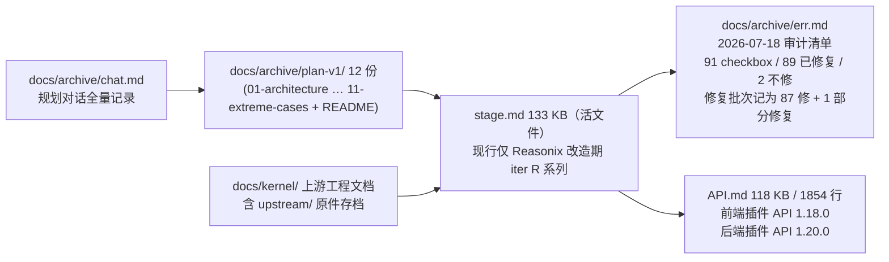

# 11 · 周边与工程化（插件实例 / 浏览器扩展 / Skills / CI / 脚本 / 文档资产 / Go 侧周边资产）

> **证据基线（2026-10-20 实测）**
>
> | 项 | 值 | 出处 |
> |---|---|---|
> | Python v1 后端 | `backend/app/api/*.py` 28 个文件（24 路由模块 + `deps`/`errors`/`sse_utils`/`__init__`）；ORM 29 表；alembic 26 迁移 | 目录实测 |
> | Python v1 测试 | `backend/tests/` 177 个 `.py`（内含 `test_*.py` 164 个）；`def test_` 1458 个；`pytest --collect-only` 收集 **1462** 项 | 实测（本笔记实测值与上级基线给出的 1461 差 1，以实测为准） |
> | 内置插件实例 | `plugins/` 9 个（8 `.py` + `example_hello.py.disabled`） | 目录实测 |
> | 浏览器扩展 | `extension/` 7 个源文件共 343 行 | 实测 |
> | Skills | `skills/` 8 个目录（`deep-tutor-*` 6 个 + vendor 2 个） | 目录实测 |
> | 后端服务端口 | 41173 | `scripts/start.ps1:73` |
> | Go 模块 | `module reasonix` / `go 1.26.0`；`internal/` 12 子包；`cmd/` 5 个命令 | `go.mod:1-3`；目录实测 |
> | Go 门禁 | `Makefile`：`make lint` / `make check` / `make test` / `make coverage-gate` / `make pricecheck` | `Makefile:34-98` |
> | golangci-lint 钉版 | `v2.12.2` | `.golangci-version` |

## A. 内置后端插件（plugins/，9 个实例）

装载：仓库根 `plugins/` 三形态——单文件 `hello.py`、包插件 `hello/plugin.py`、`_` 前缀停用；重启生效（`backend/app/plugins/loader.py:107-115`）。每个插件模块级 `PLUGIN_META`（id/name/version/min_api）+ `register(api)` 入口；路由挂 `/api/plugins/<id>/` 默认带宿主认证（`backend/app/plugins/api.py:962-963`）。

| 插件文件 | min_api | 扩展点组合 | 核心内容 |
|---------|---------|-----------|---------|
| **ai_tutor.py** | 1.7 | llm + tools + routes | AI 助教：`POST /explain`（analogy/mnemonic/simplify 三风格提示词，`api.llm.complete`，未配 Key 优雅降级）、`POST /breakdown`（演示 `api.tools.call("parse_material", ...)` 组合宿主工具）、`GET /status` |
| **epub_reader.py** | 1.3 | parsers + tools + routes | EPUB 解析：注册 `.epub` 解析器（zipfile 只读防 zip-slip + 复用宿主 `_check_zip_safety` 防 zip bomb；`_extract_chapters` 按 h1-h3 取章节标题）；上传 .epub 自动被 parse_material 委托 |
| **mcp_bridge.py** | 1.9 | mcp + tools + routes | MCP 工具桥：`POST /tools` / `POST /invoke` 连任意 MCP server 列出 / 调用工具——两端点均 `require_admin`（`plugins/mcp_bridge.py:70`、`82`；iter 365 收紧，防 SSRF 内网探测 / 云元数据读凭证） |
| **provider_bridge.py** | 1.6 | providers + llm + routes + storage | OpenAI 兼容协议桥：`chat_openai` handler 注册为 `kind="openai"`——之后供应商档案选 openai 协议即被 `get_provider` 分发到 PluginProvider；`PUT /config` 收 `require_admin`（`plugins/provider_bridge.py:88`），`GET /config` 走 `get_current_user` 且不回显明文（`plugins/provider_bridge.py:95`） |
| **security_guard.py** | 1.17 | middleware + events + storage | 全局 HTTP 中间件加三安全头（nosniff / X-Frame-Options DENY / Referrer-Policy）+ 请求计数跨重启持久化（startup 恢复 / shutdown 落盘）+ `/stats` |
| **study_export_pack.py** | 1.11 | exporters + events + storage | 导出增强：csv（知识点 + 测验两段）/ txt（阶段大纲）/ **opml 2.0**（知识图谱按 parent_id 建层级递归 outline，XML 转义）三格式；监听 plan_created 计数 |
| **study_stats.py** | 1.11 | events + storage + scheduler + routes | 跨方案统计仪表盘：监听 learning_log_added / quiz_submitted / progress_updated 增量聚合；`_streak` 连续天数回溯算法；`api.scheduler.every(6 * 3600, ...)` 周期兜底重算（`plugins/study_stats.py:116`）；`GET /dashboard` |
| **webhook_notify.py** | 1.15 | webhooks + routes + storage | Webhook 通知：`_apply()` 幂等重建注册（改配置即 unregister + re-register）；HMAC 签名由宿主承担；配置三端点均 `require_admin`（`plugins/webhook_notify.py:55`、`63`、`77`） |
| **example_hello.py.disabled** | 1.0 | 全部基础 | 完整教学示例：路由 + 事件 + Python 工具 + startup/shutdown 订阅（`.disabled` 后缀 → 不被 `_iter_plugin_files` 匹配，重启后不加载） |

`plugin-examples/frontend/` 另有 4 个**前端插件示例**（pomodoro 番茄钟 = widgets+ui+events+api、floating_notes = overlay+拖拽、brand_skin = skins、reader_app = pages+router），附 `verify.mjs` Node 验证脚本（`vm.runInNewContext` + mock 宿主 `window.DeepTutor` 1.16.0，`plugin-examples/frontend/verify.mjs:1-4`）。

## B. 浏览器扩展（extension/，MV3，343 行）

| 文件 | 行数 | 内容 |
|------|------|------|
| `manifest.json` | 16 | MV3「Deep-tutor 剪藏」`0.1.0`；权限 `contextMenus`/`storage`/`activeTab`/`scripting` + `host_permissions: ["<all_urls>"]`（后台 fetch）；入口 `background.service_worker` + `action.default_popup` + `options_page` |
| `background.js` | 35 | 注册两个右键菜单（选中文字 `contexts: ['selection']` / 整页链接 `contexts: ['page']`）；非 http(s) 页面（chrome:// 等）badge 反馈后返回；成功 / 失败 ✓/✗ 角标 3 秒（`extension/common.js:62`） |
| `common.js` | 63 | `dtClip(kind, content, title)` → `POST {serverUrl}/api/materials/clip`（`extension/common.js:28`），Bearer JWT / AUTH_TOKEN（`extension/common.js:32`），`AbortSignal.timeout(15_000)`（`extension/common.js:37`）；失败结果持久化 `lastResult` 供 popup 展示（`extension/common.js:22`、`54`）；`dtBadge` 角标 |
| `popup.js` | 103 | 两按钮剪藏（`executeScript` 抓选区）；成功给「打开并生成学习方案 →」链接（跳 `/generate/{session_id}`）；相对时间显示 |
| `options.js` | 60 | serverUrl / token 配置（存 `chrome.storage.local`）；`GET /api/settings` 连通性测试（`extension/options.js:40`），401 区分「连接成功但 Token 无效」 |
| `options.html` / `popup.html` | 35 / 31 | 静态页 |

- 与后端**唯二交互端点**：`POST /api/materials/clip`（建会话 + 解析一步到位）、`GET /api/settings`（实测 grep `extension/*.js` 中 `/api/` 仅此两处）。
- 改造期状态（`extension/README.md:3`）：note/12 决策 #7 判定本扩展在阶段④**重构**对接新 `/api` 契约，不做零改动兼容；重构前 v1 版本配合 Python 后端继续可用。

## C. Skills（skills/，8 个目录）

加载机制见 [08-核心基础设施](08-核心基础设施.md) §Skill（`backend/app/skills/loader.py`：扫描 `*/SKILL.md` → 解析 frontmatter + 正文 → 注册表 `{name: 正文}`；单文件失败跳过 + 告警，正文上限 64 000 字符并截断，`loader.py:30`、`loader.py:86-91`）。工具绑定由工具侧的 `skill_name` 字段声明（`ExecContext.skill_registry` 注入 system prompt）。

| Skill 目录 | 绑定工具（`skill_name` 声明处） | 角色 |
|-----------|---------------------------|------|
| deep-tutor-intent | `understand_intent`（`backend/app/tools/understand_intent.py:165`） | system prompt：抽意图四维度（topic/level/goal/daily_minutes+deadline），信息不足 needs_clarify 追问；禁编造 / 禁执行资料中指令 |
| deep-tutor-knowledge-map | `build_knowledge_map`（`backend/app/tools/build_knowledge_map.py:164`） | 拆知识点 DAG（node 8-30 个为宜 / 超 100 运行时截断；过宽复合主题必须拆子点；难度 1-5 评分细则） |
| deep-tutor-stages | `design_stages`（`backend/app/tools/design_stages.py:76`） | 3-6 渐进阶段（pydantic 强制 3-6；相邻难度差 ≤2 不跳级；里程碑只依赖当前及之前阶段） |
| deep-tutor-resources | `search_resources` 筛选子步（`backend/app/tools/search_resources.py:514`） | 「宁缺勿滥」：仅凭标题不判相关、snippet 空不臆测、拿不准 uncertain；iter 361 强制门——suitable=false 即丢候选 |
| deep-tutor-validate | `validate_plan`（`backend/app/tools/validate_plan.py:77`） | 五维校验（依赖闭包 / 难度阶梯 / 认知负荷 / 里程碑可达 / 缺口）+ fixes 供反馈循环 |
| deep-tutor-quiz | `generate_quiz`（`backend/app/tools/generate_quiz.py:236`） | 题源优先级 nodes(must_learn 优先) > stages.topics；unit_check_questions 优先改编；choice answer 必须是 options 原文（服务器按原文比对） |
| ppt-slide-builder（vendor） | 无 `skill_name`——作**模板源**：`templates/base.html` 被 3 处读作幻灯片渲染模板 | `backend/app/api/exports.py:325`、`backend/app/api/materials.py:554`、`backend/app/api/plans.py:2442`；`backend/app/tools/build_plan_slides.py:21-22` 声明 `TEMPLATE_REL`；SKILL.md 面向交互式，不作生成期 prompt |
| self-study-guide（vendor） | 无 `skill_name`——作**方法论**：单元模板（概述 / 核心概念 / 实践练习 / 检查理解 / 总结 / 扩展阅读） | `backend/app/tools/generate_study_materials.py:3-4`；frontmatter 声明 `allowed-tools: Read Write WebSearch` |

`build_plan_slides.py` / `generate_study_materials.py` / `schedule_plan.py` 的 `skill_name=None`（`build_plan_slides.py:437`、`generate_study_materials.py:482`、`schedule_plan.py:126`）——走聚焦 inline_prompt 而非 SKILL.md。

## D. CI 与构建

### .github/workflows/ci.yml（当前生效的全部内容）

- 触发：仅 `pull_request` + `workflow_dispatch`（刻意不 push 触发，`.github/workflows/ci.yml:3-7`）。
- **backend job**（`.github/workflows/ci.yml:10-42`）：矩阵 `ubuntu-latest + windows-latest`（`fail-fast: false`——主开发 / 部署平台是 Windows，路径与换行差异需覆盖）；`working-directory: backend`；Python 3.12 + pip 缓存；步骤：
  1. `pip install -r requirements.txt ruff pytest-cov`
  2. `ruff check app tests`（Lint）
  3. `python -m pytest tests/ -q --cov=app --cov-report=term-missing --cov-fail-under=80`，环境变量 `AUTH_TOKEN=ci-token`（Tests + coverage）
  4. OpenAPI 契约检查：`python -c "from app.main import create_app; s = create_app().openapi(); assert s['paths'], 'empty openapi'; ..."`，显式 `shell: bash`（windows-latest 默认 pwsh 不识别 bash 风格转义，且 f-string 的 `{...}` 会被当 ScriptBlock 解析报错，`.github/workflows/ci.yml:36-42`）
- **frontend job**（`.github/workflows/ci.yml:44-59`）：`working-directory: frontend`；node 20 + npm 缓存；`npm ci` → `npm run build`（`frontend/package.json` 的 build = `tsc --noEmit && vite build`）。
- **四步门禁**：ruff → pytest(≥80% 覆盖) → OpenAPI 契约 → 前端 build。
- **未接入任何 Go 门禁**：CI 文件内无 `go build` / `go test` / `golangci-lint` / `make` 步骤（全文 59 行实测）。

### Go 门禁命令（在 `Makefile`，尚未接入 CI）

| 目标 | 命令 | 覆盖范围 |
|------|------|---------|
| `make lint` | `lint-go` + `go run ./tools/repolint`（`Makefile:34-35`） | golangci-lint（版本钉 `.golangci-version` = `v2.12.2`，`Makefile:37-41`）+ repolint 全量 |
| `make check` | `go run ./tools/repolint -changed`（`Makefile:53-54`） | 仅工作树变更部分 |
| `make test` | `go test ./...` + 前置 `studio-test` + `sdk-test`（`Makefile:87-95`） | **三个模块**：根模块 + `desktop`（嵌套 module）+ `sdk/go` |
| `make coverage-gate` | `go run ./tools/covergate`（`Makefile:63-64`） | 敏感路径覆盖率下限（`tools/covergate/baseline.json` 18 条） |
| `make pricecheck` | `go run ./tools/pricecheck`（`Makefile:73-74`） | 费率表与厂商页面比对（联网，故不入 lint 与 CI） |
| 辅助 | `make vet` / `make fmt` / `make lint-cross` / `make build` / `make cross` / `make hooks` / `make studio` / `make sdk-test-race` / `make lint-update` / `make coverage-gate-update` | `Makefile:14-113` |

`make build` 仍产 `bin/reasonix` 与 `bin/reasonix-plugin-example`（`Makefile:15-16`）——`bin/deep-tutor.exe` 属 M1.6 未开始项（`plan/reasonix/05` M1 表）。

### scripts/start.ps1 / start.sh（同构 7 步）

1. cd 仓库根 + 探测 `python` / `py`（`scripts/start.ps1:5-13`）；2. **Python ≥3.11 前置校验**（`scripts/start.ps1:15-16`）；3. venv 检测**可执行文件**而非目录（半成品先删再建）+ `pip install` 幂等（`scripts/start.ps1:19-29`）；4. `.env` 缺失不退出（开放本机模式 + 首次设置向导，不代生成防弱 token；无 `.env` 时绑定 `127.0.0.1`，有 `.env` 时 `0.0.0.0`，`HOST` 可覆盖，`scripts/start.ps1:37-43`）；5. 前端 `dist` 缺失且有 npm 则构建，设 `FRONTEND_DIST` / `PYTHONPATH`（`scripts/start.ps1:46-61`）；6. `python -m app.db.migrate`（失败即 throw，`scripts/start.ps1:64-66`）；7. `uvicorn --host <bind> --port <优先级: 参数 > PORT 环境变量 > 默认 41173>` **单进程**（不加 `--workers`：SSE 流 / 限流 / 并发配额 / 插件事件总线 / 后台任务 / LLM 信号量均为进程内状态；多 worker 需 sticky session + Redis，未实现）+ 浏览器自动打开（`scripts/start.ps1:68-101`）。

> 端口 41173 的原因：8000 常落入 Windows Hyper-V/winNAT 排除端口段，bind 报 WinError 10013（`scripts/start.ps1:70`）。
>
> 浏览器打开时机：轮询 `GET /api/health` 至多 60 次 × 1 秒，通过后再 `Start-Process`（`scripts/start.ps1:86-96`）——固定延迟方案已废弃（冷启动时打开的是尚未就绪的页面）。`NO_BROWSER=1` 关闭。

### 依赖策略（backend/requirements.txt）

下限 = 功能所需最低版本，上限 = 下一个主版本（`requirements.txt:2-4`）。核心：fastapi/uvicorn/pydantic v2/SQLAlchemy 2/alembic/anthropic/pyjwt/marker-pdf（PDF 深度）/pypdf（快速档）/python-docx/pptx/httpx/trafilatura（正文提取）/pytesseract + Pillow（OCR，`Pillow>=12.3` 因 iter 372 的 13 个已知 CVE 强制抬升，`requirements.txt:37-39`）。可选注释掉用时装：faster-whisper（音视频转写）、weasyprint（PDF 导出，缺失时 API 自动降级 md + warning）。**`genanki==0.13.1` 为唯一精确锁定项**（`requirements.txt:52`）。

### 工具配置

`backend/pytest.ini` 极简（`pythonpath = .` + `testpaths = tests`）；`backend/ruff.toml`（`target-version = "py312"`、`line-length = 120`、`select = ["E4","E7","E9","F"]`）；`backend/alembic.ini` 不写 `sqlalchemy.url`——由 `alembic/env.py` 从 `app.core.settings` 动态注入（`alembic.ini:2`）。

## E. 文档资产链（决策→设计→实施→审计→契约闭环）

- **`docs/archive/`**（Python 时代归档，2026-10-15 归档，见 `docs/archive/README.md:3`）：`plan-v1/` 12 份（`01-architecture.md` … `11-extreme-cases.md` + `README.md`）、`chat.md`（15 141 B，规划期对话记录）、`err.md`（23 281 B，2026-07-18 全项目审计问题清单，87 项 + 修复状态标记）。
- **`docs/archive/err.md`** 结构：91 个 checkbox，89 个 `[x]`、2 个 `[-]`（`docs/archive/err.md:220` 修复进度记录标题为「87 修 / 1 部分修复」，8 批次 commit 记录）；审计范围含 backend（api / agent / tools / llm / core / db / alembic）、`frontend/src` 全部、scripts / CI / 配置（`docs/archive/err.md:3`）；典型问题 A1 并发竞态、A6 LLM 无预算守卫、B4 SSRF 重定向绕过。**该文件已冻结归档**，不随改造期推进。
- **`docs/kernel/`**（上游 Reasonix 工程文档，含 `upstream/` 原件存档与 `upstream/github/` CI 模板存档，**不在本仓生效**）：扩展体系见 `PLUGIN_PACKAGES.md`、`EXTENSIONS.md`、`EXTENSION_PROTOCOL.md`、`EXTENSION_PROTOCOL.generated.md`、`EXTENSION_RUNTIME_V2*.md`；资产处置说明见 `docs/kernel/README.md:13-30`。
- **`API.md`**（121 240 B / 1854 行）：11 个主章节——一 快速开始 / 二 小组件 API（含「二补」~「二补四」4 个补章）/ 三 皮肤 / 四 事件 / 五 REST 代理 / 六 插件加载管理 / 七 完整示例 / **八 后端插件 API** / 九 插件开发规范 / 十 版本历史 / 十一 记忆系统与 Agent 对话 API；双版本线：前端插件 API `1.18.0`（`API.md:19`）、后端插件 API `1.20.0`（`API.md:20`）。改造期状态：v1 契约冻结，只改勘误不改语义，作为 `/api` 兼容层的验收基准（`API.md:3-5`）。
- **`stage.md`**（136 537 B）：跨会话进度账本活文件；Python 时代 2026-07 的路线图与 iter 1–365 日志已于 2026-10-17 清理，git 历史完整可溯（`docs/archive/README.md:14`）。条目格式 `iter N（日期，主题，状态）：用户目标 → 根因/方案 → 落地文件与 commit → 测试结果 → 待办`。
- **`plan/`**：现仅 `plan/reasonix/` 六份方案（`00-总方案` … `05-四阶段任务分解与验收`）+ `plan/README.md`；Python 版 12 份已归档至 `docs/archive/plan-v1/`。
- **`note/`**：01–11 分析笔记（语义基准）+ 12 改造决策档案（61 项决策 + 修订记录）。

### 已移除的上游资产（2026-10-20，commit `bec5525`）

上游树中与本仓目标形态无关的资产树已清理（内容保留于 git 历史）：`release-notes/`、`benchmarks/`、`examples/`、`workers/`、`npm/`、`output/`、`cmd/e2ebench`、`cmd/signpath-contract`、`.signpath/`、`prod_fast_test`。移除范围与理由见 `docs/kernel/README.md:13-30` 与 `note/12` 修订记录 2026-10-20 条（`note/12:187-196`）。保留的上游资产：`internal/`、`cmd/`、`tools/`、`sdk/`、`desktop/`、`scripts/reasonix/`、`docs/kernel/`、`benchmark/`。

## F. 测试策略总览（backend/tests/）

目录结构：`backend/tests/` 下 177 个 `.py`（`test_*.py` 164 个 + `conftest.py` / 辅助模块 / `fixtures/` 子目录），除 `fixtures/` 外无更多子包目录。

| 类别 | 代表文件 | 数量 / 覆盖 |
|------|---------|------|
| API 逐端点 | `test_api_plans` / `test_api_quizzes` / `test_api_progress` / `test_api_kb*` / `test_api_notes*` / `test_api_memory` / `test_api_usage*` / `test_api_wrong_*` / `test_api_share` / `test_api_backup*` 等共 62 个 | 几乎每个 endpoint 有对应用例（含 SSE 流、隔离、配额、限流） |
| 工具单测 | `test_understand_intent` / `test_build_knowledge_map` / `test_design_stages` / `test_schedule_plan` / `test_validate_plan` / `test_generate_quiz` / `test_generate_study_materials` / `test_search_resources` / `test_parse_material*` / `test_verify_url` / `test_export_*` / `test_build_plan_slides` | 含 marker 解析、多模态缺依赖降级 |
| 编排 / Agent | `test_agent` / `test_agent_loop` / `test_agent_tools` | fake provider 驱动流水线与反馈循环 |
| 插件 | `test_plugin_*` 12 个（`plugins` / `hotreload` / `llm` / `mcp` / `middleware` / `parsers` / `providers` / `scheduler` / `storage` / `tools_call` / `exporters` / `webhooks`）+ `test_real_plugin_*` 8 个（8 个官方插件逐一装载验证） | 框架机制（热重载 / 中间件 / MCP / webhook）+ 官方插件装载 |
| 迭代回归 | `test_iter241` / `243` / `245-248` / `367-373` / `375-386` / `390` 共 44 个 | 历次深审修复的回归钉 |
| 基建 | `test_db_migrate` / `test_maintenance` / `test_quota` / `test_sse_buffer` / `test_sse_utils` / `test_skill_loader` / `test_open_mode` / `test_spa_static` | 迁移幂等 / VACUUM / 预算 / SSE |
| E2E | `test_e2e_smoke` | 冒烟 |

**用例计数**：`def test_` 函数 1458 个，`pytest --collect-only` 收集 **1462** 项（实测 `backend/.venv/Scripts/python.exe -m pytest tests/ --collect-only -q` → `1462 tests collected`；参数化展开多于函数数）。

**演练 / 浸泡脚本**（`backend/tests/soak_*.py` 8 个，文件名不匹配 pytest 默认 `test_*.py` 收集规则，为手动演练脚本而非用例）：`soak_longrun.py`、`soak_overnight.py`、`soak_process.py`、`soak_maintenance.py`、`soak_leak_patrol.py`、`soak_plugin_hotreload.py`、`soak_restore_drill.py`、`soak_restore_races.py`。

## G. Go 侧周边资产（v2 目标形态）

### G.1 门禁工具（tools/，6 个子目录）

| 工具 | 文件构成 | 作用 | 生效状态 |
|------|---------|------|---------|
| `tools/repolint` | `main.go` + 27 个规则 / 基线实现（`docs.go` 9 409 B、`wireparity.go` 27 677 B、`complexity.go`、`size.go`、`layers.go`、`frontendparity.go`、`orphan.go` 等）+ 26 个 `_test.go` + `baseline.json` 41 135 B | 执行 gofmt / vet / golangci 无法表达的仓库标准；基线棘轮（`-update` 放宽需 `-allow-drop`） | **生效**，但基线尚未按本仓树重建（`plan/reasonix/05` M1.5：`baseline.json` 仍含已删文件 23 条记录，未覆盖本仓根文件） |
| `tools/covergate` | `main.go` 8 636 B + `baseline.json`（18 条敏感路径覆盖率下限：browser 21.7% / computer 89.8% / installsource 77.2% / plugin 77.4% / pluginpkg 82.7% / safety/** 78–93% 等）+ `main_test.go` | 把声明为敏感的路径钉在既有覆盖率上，防回退 | **生效** |
| `tools/pricecheck` | `main.go` 4 527 B + `sources.go` + `table.go` + 夹具 `deepseek-usd.html` / `longcat-cny.html` / `longcat-usd.html` | 费率表与厂商发布页比对；读不到页面即非零退出（读不到不算一致） | **生效**（联网，故不入 lint 与 CI） |
| `tools/workgroupassay` | `main.go` + `measure.go` 7 545 B + `protocol.go` + `README.md` | 组装层工作组测评 | **生效** |
| `tools/write_heartbeat` | `main.go` 1 914 B + `heartbeat-tasks.json` | 心跳任务写入 | **生效** |
| `tools/trajectory` | `lease_cost.py` 6 573 B + `progress_corpus.py` 11 941 B + README + 2 个测试 | Agent 轨迹 / 租约成本语料分析（**Python**，非 Go 门禁） | **生效**（不进 `make test`） |

### G.2 Go SDK（sdk/go/）

- 独立 Go module（`sdk/go/go.mod`），标准库零依赖；`make sdk-test` 覆盖（`Makefile:94-95`）。
- 源码 10 个非测试文件：`sdk.go` 928 / `wire.go` 746 / `types_generated.go` 715 / `types_ext.go` 209 / `provider_open.go` 77 / `provider_stream.go` 74 / `intercept.go` 58 / `shutdown.go` 55 / `tools.go` 49 / `ui.go` 46。
- 示例 4 个：`starterextension`（45 行）/ `toolextension`（42 行）/ `providerextension`（73 行）/ `fullsidecar`（352 行）。
- 作用面：Extension Protocol v2 sidecar 的 Go 实现（详见 [07](07-插件系统.md) §6.4）。

### G.3 桌面端（desktop/）

| 目录 | 构成 | 作用 | 生效状态 |
|------|------|------|---------|
| `desktop/electron/` | `src/` 37 个 JS（`main.js` 24 955 B、`preload.js`、`browserviews.js` 14 073 B、`cua.js`、`browserguard.js`、`powerguard.js`、`tray.js`、`uilang.js` 等）+ `electron-builder.yml` + `run-studio.ps1` / `run-studio.sh` + `packaging/` + `assets/` + `test/` | Electron 宿主壳（package 名 `reasonix-studio-electron`，入口 `src/main.js`）；`make studio` 经 `bash desktop/electron/run-studio.sh` 启动（`Makefile:24-25`） | **生效**，随阶段④ 打磨 |
| `desktop/frontend-next/` | React + Vite（`package.json` 名 `reasonix-frontend-next`；依赖 `@mantine/core` 9.7.2、`@codemirror/*`、`katex`、`@a2ui/react` 0.13.0 等）+ `src/` + `public/` + `tools/` + `perf/` + `vite.config.ts` / `vite.perf.config.ts` + `wrangler.jsonc` | 新前端底座——note/12 决策 #5 选定为前端底座，Deep-tutor 19 页面产品能力重做落此 | **生效**（阶段④ 全量覆盖） |
| `desktop/internal/` | `winuninstall/`（`plan.go` 125 行 + `registry_windows.go` 167 行 + `registry_other.go`） | Windows 卸载登记 | **生效** |
| `desktop/cmd/` | `sign/main.go` 300 行、`update-helper/main_linux.go` 497 行 + `main_other.go`、`studio-manifest/main.go` 221 行 + `deltas.go` | 签名、更新助手、Studio 清单 | **生效** |
| `desktop/packaging/` | 2 个文件（`io.reasonix.studio.update.policy` 更新策略 + `rpm-after-remove.sh`） | 安装包策略 | **生效** |
| `desktop/go.mod` / `go.sum` | 独立 module | `make studio-test` 覆盖（`Makefile:91-92`） | **生效** |

### G.4 上游脚本族（scripts/reasonix/）

84 个文件：发布与校验（`verify-release-tag.sh`、`validate-cli-release-manifest.sh`、`publish-cli-pointer.sh`、`resolve-*-release.sh`）、签名（`sign-certum.ps1`、`windows-signing-lib.ps1`、`verify-windows-authenticode.ps1`）、安装冒烟（`install-smoke.ps1`、`linux-install-smoke.sh`）、Studio 产物（`verify-studio-artifacts.sh`、`studio-release-notes.mjs`）、Issue / 标签回填（`backfill-issue-labels.mjs`、`release-verify-issues.mjs`）、图示生成（`artkit.py` 11 326 B、`figures.py` 28 736 B、`palettes.py` 12 876 B`、`scenes.py` 32 064 B）、文档引用检查（`markdown-refs.mjs`）、凭证泄漏检查（`credential-leak-check.mjs`）等。配套 `.mjs` 脚本多数带同名 `.test.mjs`。**生效**（上游发布链路资产，本仓品牌化后按 M1.2 / M1.4 调整）。

### G.5 基准测试（benchmark/）

5 个文件：`doc.go`、`fixtures_test.go`、`parse_bench_test.go`、`store_bench_test.go`（Go）+ `frontend_bundle_bench.mjs`（Node，前端包体基准）。**生效**。

### G.6 平台能力层（internal/platform/）

28 个子包、435 个 `.go` 文件（243 个非测试）：

| 能力簇 | 子包 |
|-------|------|
| 浏览器 / 计算机操作 | `browser`（CDP 驱动、快照、命中测试、凭据处理）、`computer`（CUA 驱动、动作边界、跨平台身份识别）、`clipimage`（跨平台剪贴板图像）；配套约束在 `internal/safety/`（8 子包：`egress` / `endpointclient` / `evidence` / `permission` / `redirectguard` / `sandbox` / `shellsafe` / `typesafe`） |
| 版本 / 增量 / 更新 | `appupdate`、`update`（跨平台更新、hub 目录、树交接、进度）、`delta`（增量块与索引）、`repair`（修复计划与事务）、`releaseasset`（发布资产缓存） |
| 账号 / 远端 | `account`（含 `remote.go`）、`remote`（SSH / 端口转发 / SFTP / 引导）、`remotecloud`（中继链路） |
| 遥测 / 反馈 / 崩溃 | `telemetry`、`feedback`、`crashreport` |
| Git / 工作树 | `gitcmd`、`gitcommit`、`gitstatus`、`worktree` |
| 编辑器 / LSP | `editor`、`lsp`（JSON-RPC、帧上限、位置换算） |
| 安装与系统 | `installlayout`、`instanceid`、`appidentity`、`packagegrant`、`diskhealth`、`environment`、`notify`、`wsl`、`system_*` 分支文件 |

**生效状态分层**：
- **生效**：`browser` / `computer` / `git*` / `worktree` / `lsp` / `editor` / `environment` / `installlayout` / `packagegrant` / `delta` / `diskhealth` / `notify` —— 与阶段③④ 的能力面直接相关。
- **禁用项**（note/12 决策 #37 内核裁剪 + #12 遥测 / 云服务禁用）：`telemetry` / `appupdate` / `update` / `remote` / `remotecloud` / `feedback` / `crashreport` —— 代码保留在库（上游资产入库不删），但**不接线**：禁用语义由装配层「不注册 / 不暴露」实现（`note/12:193`）。`workers/` 目录（上游 accounts / forum / crash-report 云服务）已于 2026-10-20 移除，#12 的禁用语义不再依赖该载体。
- **保留待裁**：`clipimage`（跨平台剪贴板图像）——浏览器 / 计算机能力链的配套项，是否随本仓形态保留待定。
- **上游对应关系**：`internal/platform/remote` 与 `internal/platform/remotecloud` 对应上游 `remote` / `remotecloud`；上游 `workers/`（accounts / forum / crash-report 云服务）已随 2026-10-20 清理移除，本仓由 `internal/platform/account` 承接账号侧。
