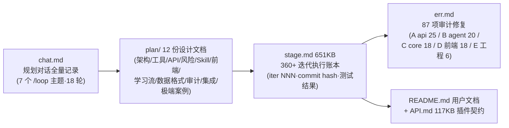

# 11 · 周边与工程化（插件实例 / 浏览器扩展 / Skills / CI / 脚本 / 文档资产）

> 证据：`plugins/**`、`extension/**`、`skills/**`、`.github/workflows/ci.yml`、`scripts/*`、`README.md`、`API.md`、`plan/**`、`err.md`、`stage.md`、`chat.md`。本笔记由并行子代理全量通读后汇总。

## A. 内置后端插件（plugins/，9 个）

装载：仓库根 `plugins/` 三形态——单文件 `hello.py`、包插件 `hello/plugin.py`、`_` 前缀停用；重启生效。每个插件模块级 `PLUGIN_META`（id/name/version/min_api）+ `register(api)` 入口；路由挂 `/api/plugins/<id>/` 默认带宿主认证。

| 插件 | min_api | 扩展点组合 | 核心内容 |
|------|---------|-----------|---------|
| **ai_tutor** | 1.7 | llm + tools + routes | AI 助教：`POST /explain`（analogy/mnemonic/simplify 三风格提示词，`api.llm.complete`，未配 Key 优雅降级）、`POST /breakdown`（演示 `api.tools.call("parse_material",...)` 组合宿主工具）、`GET /status` |
| **epub_reader** | 1.3 | parsers + tools + routes | EPUB 解析：注册 `.epub` 解析器（zipfile 只读防 zip-slip + 复用宿主 `_check_zip_safety` 防 zip bomb；`_extract_chapters` 按 h1-h3 取章节标题）；上传 .epub 自动被 parse_material 委托 |
| **mcp_bridge** | 1.9 | mcp + tools + routes | MCP 工具桥：`POST /tools`/`POST /invoke` 连任意 MCP server 列出/调用工具（**iter 365 收紧 require_admin**——防 SSRF 内网探测/云元数据读凭证） |
| **provider_bridge** | 1.6 | providers + llm + routes + storage | OpenAI 兼容协议桥：`chat_openai` handler 注册为 kind="openai"——之后供应商档案选 openai 协议即被 `get_provider` 分发到 PluginProvider；PUT/GET /config 管凭证（不回显明文） |
| **security_guard** | 1.17 | middleware + events + storage | 全局 HTTP 中间件加三安全头（nosniff/X-Frame-Options DENY/Referrer-Policy）+ 请求计数跨重启持久化（startup 恢复/shutdown 落盘）+ `/stats` |
| **study_export_pack** | 1.11 | exporters + events + storage | 导出增强：csv（知识点+测验两段）/ txt（阶段大纲）/ **opml 2.0**（知识图谱按 parent_id 建层级递归 outline，XML 转义）三格式；监听 plan_created 计数 |
| **study_stats** | 1.11 | events + storage + scheduler + routes | 跨方案统计仪表盘：监听 learning_log_added/quiz_submitted/progress_updated 增量聚合；`_streak` 连续天数回溯算法；`api.scheduler.every(6h)` 周期兜底重算；`GET /dashboard` |
| **webhook_notify** | 1.15 | webhooks + routes + storage | Webhook 通知：`_apply()` 幂等重建注册（改配置即 unregister+re-register）；HMAC 签名由宿主承担；config 管理端点 require_admin |
| **example_hello**(.disabled) | 1.0 | 全部基础 | 完整教学示例：路由+事件+Python 工具+startup/shutdown 订阅 |

`plugin-examples/frontend/` 另有 4 个**前端插件示例**（pomodoro 番茄钟=widgets+ui+events+api、floating_notes=overlay+拖拽、brand_skin=skins、reader_app=pages+router），附 `verify.mjs` Node 验证脚本（vm.runInNewContext + mock 宿主，CI 可跑）。

## B. 浏览器扩展（extension/，MV3，~261 行）

- **manifest.json**：MV3「Deep-tutor 剪藏」；权限 contextMenus/storage/activeTab/scripting + host_permissions `<all_urls>`（后台 fetch）；入口 background service worker + popup + options。
- **background.js**：注册两个右键菜单（选中文字/整页链接）；非 http(s) 页面（chrome:// 等）badge 反馈后返回；成功/失败 ✓/✗ 角标 3 秒。
- **common.js**：`dtClip(kind, content, title)` → `POST {serverUrl}/api/materials/clip`（Bearer JWT/AUTH_TOKEN，15s 超时）；失败结果持久化 `lastResult` 供 popup 展示；`dtBadge` 角标。
- **popup.js**：两按钮剪藏（executeScript 抓选区）；成功给「打开并生成学习方案 →」链接（跳 `/generate/{session_id}`）；相对时间显示。
- **options.js**：serverUrl/token 配置；`GET /api/settings` 连通性测试（401 区分"连接成功但 Token 无效"）。
- 与后端唯二交互端点：`POST /api/materials/clip`（建会话+解析一步到位）、`GET /api/settings`。

## C. Skills（skills/，8 个）

加载机制见 [08-核心基础设施](08-核心基础设施.md) §Skill。Skill → 工具映射：

| Skill | 绑定工具 | 角色 |
|-------|---------|------|
| deep-tutor-intent | understand_intent | system prompt：抽意图四维度（topic/level/goal/daily_minutes+deadline），信息不足 needs_clarify 追问；禁编造/禁执行资料中指令 |
| deep-tutor-knowledge-map | build_knowledge_map | 拆知识点 DAG（node 8-30 个为宜/超 100 运行时截断；过宽复合主题必须拆子点；难度 1-5 评分细则） |
| deep-tutor-stages | design_stages | 3-6 渐进阶段（pydantic 强制 3-6；相邻难度差 ≤2 不跳级；里程碑只依赖当前及之前阶段） |
| deep-tutor-resources | search_resources 的内容适配筛选子步 | "宁缺勿滥"：仅凭标题不判相关、snippet 空不臆测、拿不准 uncertain；iter 361 强制门——suitable=false 即丢候选 |
| deep-tutor-validate | validate_plan | 五维校验（依赖闭包/难度阶梯/认知负荷/里程碑可达/缺口）+ fixes 供反馈循环 |
| deep-tutor-quiz | generate_quiz | 题源优先级 nodes(must_learn 优先)>stages.topics；unit_check_questions 优先改编；choice answer 必须是 options 原文（服务器按原文比对） |
| ppt-slide-builder（vendor） | build_plan_slides 等的**模板源** | 不作 prompt（SKILL.md 面向交互式）；`templates/base.html` 被 exports.py/plans.py/materials.py 三处读作幻灯片渲染模板 |
| self-study-guide（vendor） | generate_study_materials 的方法论 | 单元模板（概述/核心概念/实践练习/检查理解/总结/扩展阅读）；prompt 用聚焦 inline 而非 SKILL.md |

## D. CI 与构建

### .github/workflows/ci.yml

- 触发：仅 `pull_request` + `workflow_dispatch`（刻意不 push 触发）。
- **backend job**：矩阵 `ubuntu-latest + windows-latest`（fail-fast: false——主开发平台是 Windows，路径/换行差异需覆盖）；步骤：ruff check → `pytest --cov=app --cov-fail-under=80`（AUTH_TOKEN=ci-token）→ **OpenAPI 契约检查**（create_app().openapi() 非空；Windows 显式 shell: bash 防 pwsh 把 f-string `{...}` 当 ScriptBlock）。
- **frontend job**：node 20 → npm ci → `npm run build`（tsc 类型检查 + vite 构建）。
- 四步门禁：ruff → pytest(≥80% 覆盖) → OpenAPI 契约 → 前端 build。

### scripts/start.ps1 / start.sh（同构 7 步）

1. cd 仓库根 + 探测 python/py；2. **Python ≥3.11 前置校验**；3. venv 检测**可执行文件**而非目录（半成品先删再建）+ pip install 幂等；4. `.env` 缺失不退出（开放本机模式 + 首次设置向导，不代生成防弱 token）；5. 前端 dist 缺失且有 npm 则构建，设 FRONTEND_DIST/PYTHONPATH；6. `python -m app.db.migrate`（失败即 throw）；7. `uvicorn --host 0.0.0.0 --port <优先级: 参数>PORT>默认 41173>` **单进程**（不加 --workers：SSE 流/限流/并发配额/插件事件总线/后台任务/LLM 信号量均为进程内状态；多 worker 需 sticky session + Redis 未实现）+ 延迟 3s 开浏览器（NO_BROWSER=1 关）。

> 端口 41173 的原因：8000 常落入 Windows Hyper-V/winNAT 排除端口段报 WinError 10013。

### 依赖策略（requirements.txt）

下限=功能所需最低、上限=下一主版本。核心：fastapi/uvicorn/pydantic v2/SQLAlchemy 2/alembic/anthropic/pyjwt/marker-pdf（PDF 深度）/pypdf（快速档）/python-docx/pptx/httpx/trafilatura（正文提取）。可选注释掉用时装：faster-whisper、weasyprint（缺失 API 自动降级）。genanki==0.13.1 唯一精确锁定。

### 工具配置

pytest.ini 极简（pythonpath=. + testpaths=tests）；ruff.toml（py312、line-length 120、select E4/E7/E9/F）；alembic.ini 不写 URL——由 env.py 从 settings 动态注入。

## E. 文档资产链（决策→设计→实施→审计→契约闭环）

- **API.md**（117KB，1819 行）：前端插件 API 1.17.0 + 后端插件 API 1.20.0 双线版本；11 主章节覆盖 window.DeepTutor 九命名空间、后端 api 门面全部命名空间、9 个核心事件（startup/shutdown/plan_created/progress_updated/quiz_submitted/materials_completed/quiz_ready/learning_log_added/run_completed）、SSE 事件流契约、插件开发规范、记忆系统 API。
- **err.md**：2026-07-18 全项目审计 91 项 checkbox（89 修复/2 不修），8 批次 commit 记录；典型问题如 A1 并发竞态、B2 prompt 无守卫、B4 SSRF 重定向绕过。
- **stage.md**：跨会话进度账本（"新会话先读它确定下一步"），条目格式 `iter N（日期，主题，状态）：用户目标 → 根因/方案 → 落地文件与 commit → 测试结果 → 待办`。

## F. 测试策略总览（backend/tests/，~105 文件）

| 类别 | 代表文件 | 覆盖 |
|------|---------|------|
| API 逐端点 | test_api_plans/quizzes/progress/kb/notes/memory... | 几乎每个 endpoint 有对应用例（含 SSE 流、隔离、配额、限流） |
| 工具单测 | test_understand_intent/parse_material/search_resources/... | 含 marker 解析、media、多模态缺依赖降级 |
| 编排/Agent | test_agent/test_agent_loop/test_design_stages | fake provider 驱动流水线与反馈循环 |
| 插件 | test_plugin_* 12 个 + test_real_plugin_* 8 个 | 框架机制（热重载/中间件/MCP/webhook）+ 官方插件装载验证 |
| 迭代回归 | test_iter241/243/245-248 | 历次深审修复的回归钉 |
| 基建 | test_db_migrate/test_maintenance/test_quota/test_sse_buffer | 迁移幂等/VACUUM/预算/SSE |
| E2E | test_e2e_smoke | 冒烟 |
