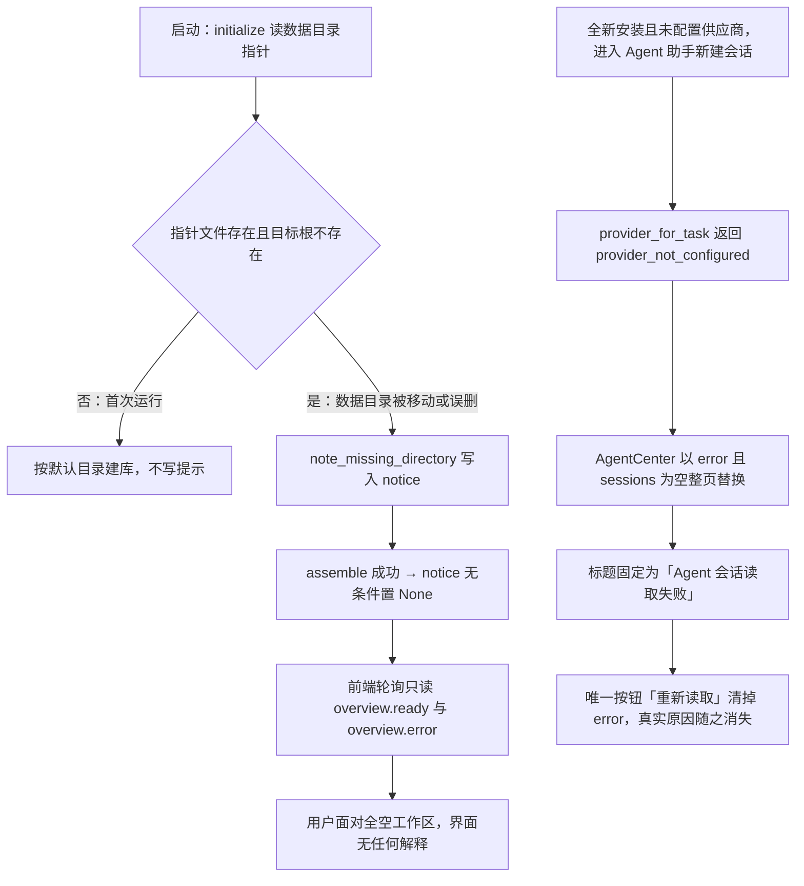

# 初次使用与新手旅程（首次运行、导航与空态、引导与死路）

本组收录首次运行、页面导航、空态呈现与引导流程相关的问题：启动期提示被无条件清除、跨页跳转目标缺少一次性消费语义、错误提示渲染层级低于打开中的模态遮罩、无供应商用户在引导路径上被整页错误页覆盖、练习统一反馈的遮蔽口径在持久化路径失效、导出目的地遏制在父目录缺失时被绕过，以及文档与实现不一致等。每条问题均已在本轮复核代码原文；涉及 Rust 行为的结论以静态代码引用为据，本组仅 P-056 附本轮在实物机运行的探针输出，其余条目不含探针输出。

本组两条主链路的实际走向如下，分别对应 P-001 与 P-053：



---

## P-001 「目录缺失已新建空工作区」桥接提示在初始化成功后被无条件清除，用户面对空库无任何解释

严重度：高 | 状态：已复核 | 分类：logic | 位置：desktop/src-tauri/src/startup.rs:398,411-418（提示本体 350-364；消费点 desktop/src/components/DataDirectoryPanel.tsx:99）

### 详细说明

触发条件：配置指向的数据目录在启动时不存在（数据目录被移动或重命名、外置盘符变更、目录被误删），且后端按该路径重建目录成功。

实际行为：`initialize` 先调用 `note_missing_directory`（startup.rs:398）。该函数在指针文件存在而目标根不存在时写入提示文案（startup.rs:350-364），原文为「配置的数据目录不存在，已按该路径新建了空工作区：{}。若你刚移动过数据目录，请在下方重新选择正确位置，避免在新空库中重复建数据。」随后 `assemble` 成功即进入 `succeeded` 分支，把 `notice` 无条件置为 `None`（startup.rs:411-418），不区分 `pending` 是否存在。提示的唯一渲染点是 `DataDirectoryPanel` 的 `overview.notice`（DataDirectoryPanel.tsx:99），该面板只在启动错误页（App.tsx:470）与设置页（Settings.tsx:145）挂载；初始化期间的轮询只读取 `overview.ready` 与 `overview.error`（useBackendState.ts:115-131），不读 `notice`。

用户可见后果：目录缺失→原路径新建空库→装配成功属于毫秒级正常路径，早于前端 20 s 超时页出现（useBackendState.ts:205、218），提示因此不会到达任何界面。应用呈现全空工作区，用户看到的是「学习数据全部消失」且没有任何解释；提示中「避免在新空库中重复建数据」的警告同样不可达，用户极易在新空库中重复建数据。127#12 的清除逻辑本意是消除 notice 与 pending 文案并存，条件应为 pending 存在时才清除。

### 代码证据

```rust
// desktop/src-tauri/src/startup.rs:350-364（提示写入）
fn note_missing_directory<R: Runtime>(app: &AppHandle<R>, root: &Path, pointer: &Path) {
    if !pointer.exists() || root.exists() || !root.is_absolute() {
        // 无配置文件 = 首次运行走默认目录，新建是正常路径，不提示
        return;
    }
    let message = format!(
        "配置的数据目录不存在，已按该路径新建了空工作区：{}。若你刚移动过数据目录，请在下方重新选择正确位置，避免在新空库中重复建数据。",
        root.display()
    );
    if let Some(state) = app.try_state::<StartupState>() {
        if let Ok(mut notice) = state.notice.lock() {
            *notice = Some(message);
        }
    }
}
```

```rust
// desktop/src-tauri/src/startup.rs:396-418（写入后无条件清除）
    note_missing_directory(app, root, pointer);
    ...
    // 127#12：目录已重建成功时清除「已按缺失路径新建」提示——原先与新
    // pending 文案并存矛盾；目录仍缺失（note 重新写入）保持提示
    if succeeded {
        if let Some(state) = app.try_state::<StartupState>() {
            if let Ok(mut notice) = state.notice.lock() {
                *notice = None;
            }
        }
    }
```

```tsx
// desktop/src/components/DataDirectoryPanel.tsx:99（notice 的唯一渲染点）
{overview.notice && <div className="form-error" role="status">{overview.notice}</div>}
```

```tsx
// desktop/src/App.tsx:470（错误页挂载 DataDirectoryPanel）与 desktop/src/pages/Settings.tsx:145（设置页挂载）
    return <main className="page-loading startup-recovery"><h1>本地数据或实时连接打开失败</h1><p role="alert">{startupError}</p><DataDirectoryPanel /><ToastStack toasts={toasts} onClose={dismissToast} /></main>
```

### 合并来源

- 后端-启动与主入口-1
- 横切-旅程-恢复与多用户-2

---

## P-047 免打扰时段预约提醒仍可能主动弹出：suppressed 判定在通知未加载时静默失效

严重度：中 | 状态：已复核 | 分类：flow | 位置：desktop/src/App.tsx:253；desktop/src/backend/engagement.ts:66-68

### 详细说明

触发条件有二：其一，应用启动时两个 effect 同时开跑——`loadNotifications()` 走异步命令（会话解析 + spawn_blocking + 全量扫描，engagement/commands.rs:32-44），`claimDueReminders` 是同步轻命令（community/commands.rs:126-132），当恰有预约到期且 claim 先返回时，免打扰判定读到的仍是初始的 `null`；其二，`get_notifications` 持续失败时 `notifications` 恒为 `null`，失败只写入 `notificationsError`（App.tsx:198-200），抑制永久失效。

实际行为：预约提醒弹层以 `notificationsRef.current?.suppressed` 为静默依据（App.tsx:253）。`notifications` 初始为 `null`（App.tsx:95），`notificationsRef` 随其同步（App.tsx:99-100），故在通知加载完成前取值为 `undefined`，`!undefined` 为 `true`，弹层照发。

用户可见后果：设置「全天不通知」的用户在启动瞬间或通知读取故障期间仍收到主动弹出的预约 toast，违背决策第 27 条与设置页「通知仍保留在中心，不主动弹出提醒」的承诺（note/产品与技术决策.md:295-298）。

### 代码证据

```tsx
// desktop/src/App.tsx:95,99-100（notifications 初值为 null，ref 同步取值）
  const [notifications, setNotifications] = useState<NotificationOverview | null>(null)
  const notificationsRef = useRef(notifications)
  useEffect(() => { notificationsRef.current = notifications }, [notifications])
```

```tsx
// desktop/src/App.tsx:246-257（suppressed 判据在 null 时失效）
    const claim = async () => {
      try {
        const due = await communityBackend.claimDueReminders()
        claimFailures = 0
        // 115#4：免打扰时段不主动弹层（通知中心仍保留行，30s 轮询刷新）
        if (active && due.length && !notificationsRef.current?.suppressed) {
          const titles = due.map(item => item.title)
```

```tsx
// desktop/src/App.tsx:193-201（通知读取失败时 notifications 保持 null）
  const loadNotifications = useCallback(async () => {
    const ticket = ++notificationsSeq.current
    try {
      const next = await engagementBackend.notifications()
      if (notificationsLive.current && ticket === notificationsSeq.current) { setNotifications(next); setNotificationsError('') }
    } catch (error) {
      if (notificationsLive.current && ticket === notificationsSeq.current) { setNotificationsError(backendErrorMessage(error)); reportBackendError(error) }
    }
  }, [])
```

```rust
// desktop/src-tauri/src/backend/community/commands.rs:126-132（claim 为同步命令）
#[tauri::command]
pub fn claim_community_reminders<R: Runtime>(
    app: AppHandle<R>,
    state: State<'_, BackendState>,
) -> Result<Vec<ReminderView>> {
    super::claim_due_reminders(&app, &state.community)
}
```

```text
// note/产品与技术决策.md:295-298（决策第 27 条）
27. 免打扰语义：起止相等不再被后端拒绝——「全天不通知」= enabled + 00:00/00:00
    （命中 quiet() 全天分支），「关闭免打扰」= disabled（quiet() 先查 enabled）；
    两个组合由设置页显式提供并在通知中心 suppressed 提示解释，预约提醒弹层
    在免打扰时段只落通知中心不主动弹（2026-11-11 起生效）。
```

---

## P-048 studyTarget 缺一次性消费语义：任一知识地图/搜索跳转后，之后每次进入学习空间都被强制拉回该课程与阶段

严重度：中 | 状态：已复核 | 分类：flow | 位置：desktop/src/pages/StudyRoom.tsx:57,121,131-137；desktop/src/App.tsx:67,412,449

### 详细说明

触发条件：用户从知识地图「开始学习」或搜索结果跳转到某方案某阶段一次，之后在页面内手动切换到其他课程或阶段，再离开学习空间（路由切换卸载组件）后重新进入。

实际行为：目标消费依赖组件内 `useRef` 记忆 `consumedTarget`（StudyRoom.tsx:57），组件卸载即丢失。重挂载后 `targetKey` 与空 ref 不等，重新消费目标：`refreshPlans` 在 `target` 存在时无条件按 `target.planId` 选方案（StudyRoom.tsx:121），stageId effect 再 `setStageId(target.stageId)`（StudyRoom.tsx:131-137）。

用户可见后果：用户每次进入学习空间都被拉回很久以前的跳转目标，页内手动选择永不生效，除非再次从知识地图或搜索跳转一个新目标。同一文件中知识地图定位目标有对应的清除范式（App.tsx:449 `onFocusConsumed={() => setMapNodeTarget(null)}`）、练习页有 `onTargetConsumed`（App.tsx:450），`studyTarget` 无对应机制，属遗漏而非设计。

### 代码证据

```tsx
// desktop/src/pages/StudyRoom.tsx:57（组件卸载即丢失的消费记录）
  const consumedTarget = useRef('')
```

```tsx
// desktop/src/pages/StudyRoom.tsx:120-123（target 存在时无条件按目标选方案）
      setPlan(current => {
        if (target) return items.find(item => item.id === target.planId) || current || items[0] || null
        return current ? items.find(item => item.id === current.id) || items[0] || null : items[0] || null
      })
```

```tsx
// desktop/src/pages/StudyRoom.tsx:130-137（重挂载后重新消费目标）
  const targetKey = target ? `${target.planId}:${target.stageId}:${target.nonce}` : ''
  useEffect(() => {
    const stages = plan?.result?.stages || []
    if (target && targetKey !== consumedTarget.current && target.planId === plan?.id && stages.some(stage => stage.id === target.stageId)) {
      consumedTarget.current = targetKey
      setStageId(target.stageId)
      return
    }
```

```tsx
// desktop/src/App.tsx:449-450（对照：知识地图与练习页均有消费后清除机制）
      case 'map': return <KnowledgeMap onNavigate={navigate} notify={notify} initialPlanId={mapPlanId} focusTarget={mapNodeTarget} onFocusConsumed={() => setMapNodeTarget(null)} onStudy={(planId, stageId) => { setStudyTarget({ planId, stageId, nonce: Date.now() }); navigate('study') }} onPractice={(planId, stageId, nodeId) => { setPracticeTarget({ planId, stageId, nodeId, nonce: Date.now() }); navigate('practice') }} />
      case 'practice': return <Practice notify={notify} target={practiceTarget} onTargetConsumed={() => setPracticeTarget(null)} onNavigate={navigate} />
```

---

## P-049 path_not_found 错误横幅不随后续操作清除，「重试」以相同参数重跑注定再失败

严重度：中 | 状态：已复核 | 分类：flow | 位置：desktop/src/pages/KnowledgeMap.tsx:141-169,177,181,185

### 详细说明

触发条件：在知识地图中把「补学目标」选为当前选中节点的前置节点（目标位于起点上游），后端有向 BFS 返回 `path_not_found`「所选节点之间没有可用的前置学习路径」。这是日常选择下的常见结果。

实际行为：错误写入页面级 `error` 状态，`errorSource='path'`（KnowledgeMap.tsx:149）。清除途径只有横幅上的「重试」按钮，而 `retry` 按 `errorSource` 重跑 `generatePath`，参数 `(selected, target)` 与上次完全相同（KnowledgeMap.tsx:163-169），必然再次失败并把同一错误写回。更换目标下拉（`setTarget` + `setPath(null)`，KnowledgeMap.tsx:181）与点击其他节点（`setSelected` + `setPath(null)`，KnowledgeMap.tsx:185）都不调用 `setError('')`。`errorSource='task'` 的「加入方案」失败同样滞留（KnowledgeMap.tsx:158）。

用户可见后果：用户换成一对合法起终点后，旧横幅仍留在页面顶部，与实际状态矛盾；页面没有主动关闭入口（横幅内唯一按钮是重试），只能靠一次成功的路径生成覆盖该横幅。

### 代码证据

```tsx
// desktop/src/pages/KnowledgeMap.tsx:163-169（重试以相同参数重跑）
  const retry = () => {
    setError('')
    if (errorSource === 'path') void generatePath()
    else if (errorSource === 'task') void addTask()
    else if (errorSource === 'plans') void refreshPlans()
    else { void refreshPlans(); void refreshOverview() }
  }
```

```tsx
// desktop/src/pages/KnowledgeMap.tsx:181（更换目标不清错误）
<select aria-label="补学目标" value={target} onChange={event => { setTarget(event.target.value); setPath(null) }}>
```

```tsx
// desktop/src/pages/KnowledgeMap.tsx:185（点击节点不清错误）
onClick={() => { setSelected(item.id); setPath(null) }}
```

```tsx
// desktop/src/pages/KnowledgeMap.tsx:177（横幅仅含重试按钮，无关闭入口）
    {error && <div className="form-error" role="alert"><CircleDashed size={16} />{error}<Button variant="ghost" size="sm" onClick={retry}>重试</Button></div>}
```

---

## P-050 切换页签后 WikiPanel 重挂载，用户显式选择的引用范围丢失并静默重置为最老 2 份资料

严重度：中 | 状态：已复核 | 分类：flow | 位置：desktop/src/pages/Library.tsx:422；desktop/src/components/WikiPanel.tsx:11

### 详细说明

触发条件：在「笔记与 Wiki」页的「Wiki 问答」页签内勾选特定资料作为引用范围，随后切换到「笔记」或「资料库」页签（侧栏空态文案本身引导「先在本页上方的资料库页签导入」），再切回「Wiki 问答」。

实际行为：`Library` 以条件渲染挂载 `WikiPanel`（Library.tsx:422 `{tab === 'Wiki 问答' && <WikiPanel resources={resources} notify={notify} />}`），引用范围 `selected` 是组件内 `useState`，初值为 `resources.filter(resource => resource.progress === 100).slice(0, 2)`（WikiPanel.tsx:11）。切页卸载组件后重挂载，选择被重置为按资料顺序最老的两份已解析资料。

用户可见后果：用户显式选择的引用范围被静默替换，问答实际使用的资料与此前意图不符；提问框只显示「基于 N 份实际资料作答」，不显示资料身份变化，会话保存的「实际范围」同样与用户认知不同。

### 代码证据

```tsx
// desktop/src/pages/Library.tsx:422（条件渲染，切页即卸载）
    {tab === 'Wiki 问答' && <WikiPanel resources={resources} notify={notify} />}
```

```tsx
// desktop/src/components/WikiPanel.tsx:11（初值为最老 2 份已解析资料）
  const [selected, setSelected] = useState<number[]>(() => resources.filter(resource => resource.progress === 100).slice(0, 2).map(resource => resource.id))
```

---

## P-051 项目页驻留期间经全局拖放导入的资料不会出现在「关联已解析资料」下拉

严重度：中 | 状态：已复核 | 分类：flow | 位置：desktop/src/pages/Projects.tsx:85（监听条件）与 203（下拉渲染）；触发路径 desktop/src/pages/Library.tsx:235、desktop/src/pages/PlanGenerator.tsx:272

### 详细说明

触发条件：用户停留在「项目与报告」页，通过全局拖放导入资料并等待解析完成。

实际行为：「关联已解析资料」下拉的数据源 `materials` 只在组件挂载时的 `load()` 中拉取（Projects.tsx:72）；`load()` 的重拉仅由 `project.*`、`security.session_started`、`state.changed(projects)` 触发，不监听 `material.*`（Projects.tsx:85）。而拖放导入是全局入口（App.tsx:283-295，在包括项目页在内的所有页面生效），导入与解析完成只发 `material.*` 事件。

用户可见后果：用户拖入资料、等解析完成（有 toast 提示已导入），点「提交真实阶段成果」打开弹窗（Projects.tsx:203），资料下拉仍是旧列表，不含刚导入的资料且无任何提示；只能切换页面再返回（强制重挂载）才能选到。想在提交时附加刚导入资料的流程被无声阻断。

### 代码证据

```tsx
// desktop/src/pages/Projects.tsx:69-78（materials 仅在 load 内拉取）
    const load = async () => {
      const ticket = ++loadSeq.current
      try {
        const [workspace, allPlans, allMaterials] = await Promise.all([projectsBackend.workspace(), backend.listLearningPlans(), backend.listMaterials()])
        ...
        setMaterials(allMaterials.filter(item => ['parsed', 'degraded'].includes(item.status) && item.textLength > 0))
```

```tsx
// desktop/src/pages/Projects.tsx:84-85（事件重拉条件不含 material.*）
    void onBackendEvent(event => {
      if (active && (event.kind.startsWith('project.') || event.kind === 'security.session_started' || (event.kind === 'state.changed' && event.payload.namespace === 'projects'))) void load()
```

```tsx
// desktop/src/App.tsx:283-291（全窗口拖放导入，projects 页同样生效）
    void getCurrentWebview().onDragDropEvent(event => {
      ...
      void importMaterialPaths(paths, (processed, total) => { if (!disposed) setImportProgress(`正在导入资料 ${processed}/${total}`) })
        .then(summary => notify(summarizeMaterialImport(summary)))
        .catch(error => reportBackendError(error, 'write'))
```

```tsx
// desktop/src/pages/Projects.tsx:203（弹窗下拉的数据源）
<label>关联已解析资料<select value={materialId} onChange={event => setMaterialId(event.target.value)}><option value="">不附加资料</option>{materials.map(item => <option key={item.id} value={item.id}>{item.title}</option>)}</select></label>
```

---

## P-052 弹窗内操作失败时错误提示只写在页面/面板级 error 状态，渲染层级低于打开中的模态遮罩：局部重生成与远端版本恢复两处同型，失败后用户零反馈

严重度：中 | 状态：已复核 | 分类：flow | 位置：desktop/src/pages/PlanGenerator.tsx:330-339,354,370；desktop/src/components/SyncPanel.tsx:120-128,144,187-193；desktop/src/styles.css:233

### 详细说明

触发条件（两处同型）：① 局部重生成——用户在第 3 步点「确认局部重生成」后命令失败，可达错误包括 `plan_not_ready`（learning/actions.rs:135-139，方案状态非 done/degraded）、`task_start_failed`、`database_busy`、`storage_failed`；② 远端历史版本恢复——恢复动作只能从「远端历史版本」弹窗内触发（SyncPanel.tsx:191），失败时最易达的是 `sync_busy`（sync/mod.rs:743-747，已有同步任务正在执行）。

实际行为：两处 `catch` 都只写页面级或面板级 `error` 状态（PlanGenerator.tsx:338、SyncPanel.tsx:127）。该错误渲染在页面流（PlanGenerator.tsx:354）与面板流（SyncPanel.tsx:144），而打开中的模态遮罩 `.overlay` 为 `position: fixed; inset: 0; z-index: 70` 且带 `backdrop-filter: blur(6px)`（styles.css:233）。错误横幅既不在 regen Modal 内（PlanGenerator.tsx:370），也不在版本 Modal 内（SyncPanel.tsx:187-193），两处弹窗内容都没有 error 渲染槽。该路径未调用 `notify` 或 `reportBackendError`，toast 通道（z-index: 100，styles.css:243）也不会出现。

用户可见后果：失败后弹窗停留在原地、按钮从转圈恢复可点、页面上没有任何错误提示。局部重生成场景下用户无从判断任务是否启动，只能反复点击重复失败；远端恢复场景下用户会误以为恢复已受理。43#7 已为「远端列举失败」把 `versionsError` 下沉到弹窗内，restore 路径与 PlanGenerator 的 regen Modal 属同型漏配。

### 代码证据

```tsx
// desktop/src/pages/PlanGenerator.tsx:330-339（失败只写页面级 error）
  const regenerate = async () => {
    if (!plan) return
    setBusy('regenerate')
    try {
      setPlan(await backend.regenerateLearningPlan(plan.id, regenScope))
      setRegenOpen(false)
      setStep(2)
      notify(`已开始重跑「${regenerationNames[regenScope]}」及其下游步骤`)
    } catch (cause) { setError(backendErrorMessage(cause)) } finally { setBusy('') }
  }
```

```tsx
// desktop/src/pages/PlanGenerator.tsx:354（错误横幅在页面流，位于遮罩之下）
    {error && <div className="form-error" role="alert"><AlertTriangle size={16} />{error}<Button variant="ghost" size="sm" onClick={() => setError('')}>关闭</Button></div>}
```

```tsx
// desktop/src/pages/PlanGenerator.tsx:370（regen Modal 内无 error 渲染槽）
    <Modal open={regenOpen} onClose={() => setRegenOpen(false)} title="局部重生成"><div className="form-stack"><p className="regen-description">保留已确认资料与目标，旧版本会保留。仅重跑所选步骤及其下游；已采用的方案不能直接改写。</p><label>重生成范围<select value={regenScope} onChange={event => setRegenScope(Number(event.target.value))}>{Object.entries(regenerationNames).map(([id, name]) => <option key={id} value={id}>{name}</option>)}</select></label><div className="modal-callout"><Route size={17} />「{regenerationNames[regenScope]}」及其下游将使用新的真实模型请求与排期。</div><Button onClick={() => void regenerate()} disabled={busy === 'regenerate'}><RefreshCw size={16} />确认局部重生成</Button></div></Modal>
```

```tsx
// desktop/src/components/SyncPanel.tsx:120-128 与 :144（restore 失败写面板级 error）
  const restoreVersion = async (path: string) => {
    setBusy('restore')
    setError('')
    try {
      const accepted = await syncBackend.restore(path)
      notify(`历史版本恢复任务 ${accepted.id} 已启动，将按真实配置追加导入`)
      await refresh()
    } catch (cause) { setError(backendErrorMessage(cause)) } finally { setBusy('') }
  }
```

```css
/* desktop/src/styles.css:233（模态遮罩层级与模糊） */
.overlay { position: fixed; inset: 0; z-index: 70; display: grid; place-items: center; padding: 18px; background: oklch(0.14 0.02 165 / .58); backdrop-filter: blur(6px); animation: fade-in .18s ease-out; }
```

```rust
// desktop/src-tauri/src/backend/sync/mod.rs:743-747 与 desktop/src-tauri/src/backend/learning/actions.rs:135-139（可达错误）
        if !active.is_empty() {
            return Err(BackendError::new(
                "sync_busy",
                "已有同步任务正在执行，请等待完成或取消",
            ));
        }
```

### 合并来源

- 前端-设置面板-2
- 横切-错误呈现-1
- 横切-错误呈现-2

---

## P-053 无供应商时首次新建会话/发送消息把整页替换为「Agent 会话读取失败」，标题与事实相反，唯一按钮还会清掉真实原因

严重度：中 | 状态：已复核 | 分类：flow | 位置：desktop/src/pages/AgentCenter.tsx:119（配合 desktop/src/backend/useAgent.ts:207,230 与 desktop/src-tauri/src/backend/agent/mod.rs:376）

### 详细说明

触发条件：全新安装、未配置任何模型供应商，进入「Agent 助手」页点任一 starter 建议、发送消息或点「创建真实会话」。

实际行为：后端 `create_agent_session` 在写入会话前调用 `provider_for_task`（agent/mod.rs:376），direct 模式下无 active 档案即返回 `provider_not_configured`（routing.rs:477-479）。前端 `createSession` 与 `send` 的 `catch` 写同一个 error 状态（useAgent.ts:207、230）；`AgentCenter` 用 `if (error && !sessions.length)` 把整页替换为错误页（AgentCenter.tsx:119），标题固定为「Agent 会话读取失败」——此时会话列表读取实际成功，失败的是创建或发送。页内唯一操作是「重新读取」，`retry` 会清掉 error 并返回正常页面，真实原因（`provider_not_configured`：请先配置并选择模型供应商）随之消失；再次尝试得到同样的整页错误。

用户可见后果：标题与事实相反；页面内没有前往模型接入中心的入口，starter 空态文案「直接开始通用学习问答」（AgentCenter.tsx:140）也没有任何供应商前置说明，形成「看似瞬时读故障」的循环。对照 TutorPanel（148#1 已修）在空态明示供应商前置并把错误内联显示，两个 Agent 入口行为不一致。

### 代码证据

```tsx
// desktop/src/pages/AgentCenter.tsx:119（整页错误页，标题固定）
  if (error && !sessions.length) return <div className="page-loading" role="alert"><h2>Agent 会话读取失败</h2><p>{error}</p><Button onClick={() => void retry()}>重新读取</Button></div>
```

```tsx
// desktop/src/backend/useAgent.ts:207 与 :230（create 与 send 共用同一 error 状态）
    } catch (cause) { setError(backendErrorMessage(cause)); return null } finally { setBusy('') }
```

```rust
// desktop/src-tauri/src/backend/agent/mod.rs:376（写入会话前解析供应商）
    let provider_id = providers::routing::provider_for_task(&state.providers, "agent")?;
```

```rust
// desktop/src-tauri/src/backend/providers/routing.rs:477-479（无 active 档案时的错误码）
        let active = active(state)?.ok_or_else(|| {
            BackendError::new("provider_not_configured", "请先配置并选择模型供应商")
        })?;
```

---

## P-054 无供应商横幅的「前往模型接入中心」按钮导航离页即丢失第 1 步全部表单输入与第 0 步资料勾选

严重度：中 | 状态：已复核 | 分类：flow | 位置：desktop/src/pages/PlanGenerator.tsx:41,48-53,125,365（配合 desktop/src/App.tsx:442）

### 详细说明

触发条件：无供应商用户在第 1 步已填目标（≤1000 字节）、当前基础（≤1000 字节）、每日分钟、截止日期与里程碑后，点击无供应商预警横幅中的「前往模型接入中心」（该横幅存在的目的场景，PlanGenerator.tsx:365），配置供应商后返回方案生成页。

实际行为：`goal`/`level`/`minutes`/`deadline`/`milestone`/`milestoneDate`/`selectedIds` 全部是组件本地 `useState`（PlanGenerator.tsx:41、48-53），全文件无草稿持久化调用（grep `saveDraft`/`draft`/`localStorage`/`sessionStorage` 无命中）。`App` 的 `renderPage` 按当前 page 分发，切到 providers 即卸载组件（App.tsx:442、457）。返回后重新挂载，`refreshPlans` 发现零方案时执行 `if (!items.length) setStep(0)`（PlanGenerator.tsx:125）。

用户可见后果：用户落回第 0 步：目标与基础长文本、日期、里程碑全部清空，至多 8 份资料的选择也要逐个重勾（导入的材料本体在库中保留）。引导按钮本身触发输入丢失，裸新手最长的两段输入（目标、当前基础）需要重写一遍。

### 代码证据

```tsx
// desktop/src/pages/PlanGenerator.tsx:41,48-53（全部为本地 state）
  const [selectedIds, setSelectedIds] = useState<number[]>([])
  const [goal, setGoal] = useState('')
  const [level, setLevel] = useState('')
  const [minutes, setMinutes] = useState(45)
  const [deadline, setDeadline] = useState(localDeadline)
  const [milestone, setMilestone] = useState('')
  const [milestoneDate, setMilestoneDate] = useState('')
```

```tsx
// desktop/src/pages/PlanGenerator.tsx:365（引导按钮离页）
{noProvider && <div className="capacity-warning" role="alert"><AlertTriangle size={18} /><div><strong>尚未选择可用模型供应商</strong><p>开始生成会真实调用模型。请先添加并启用供应商；首个启用档案会自动成为默认项。</p><Button variant="secondary" size="sm" onClick={() => onNavigate('providers')}>前往模型接入中心</Button></div></div>}
```

```tsx
// desktop/src/pages/PlanGenerator.tsx:125（重挂载后零方案即回退第 0 步）
      if (!items.length) setStep(0)
```

```tsx
// desktop/src/App.tsx:442,457（按 page 分发，切页即卸载）
      case 'generator': return <PlanGenerator onNavigate={navigate} notify={notify} />
      case 'providers': return <ProviderHub notify={notify} />
```

---

## P-055 deferred 非考试练习进行期，错题本/徽标/掌握度证据/变式事件立即泄露对错与完整解析，违反「统一反馈」遮蔽口径

严重度：中 | 状态：已复核 | 分类：security | 位置：desktop/src-tauri/src/backend/practice/mod.rs:1412,1423,1544；主观路径 desktop/src-tauri/src/backend/practice/subjective.rs:529,538；消费面 desktop/src/pages/Practice.tsx:249,266 与 desktop/src-tauri/src/backend/learning/knowledge.rs:96

### 详细说明

触发条件：生成一组反馈方式为「全部完成后反馈」（deferred，`practice/mod.rs:618` 允许的取值之一）的练习，答错任意一题。

实际行为：统一反馈练习承诺「进行期分数、对错与解析置空」（note/产品与技术决策.md:210-213；界面文案 Practice.tsx:266「全部题目提交后统一显示答案与解析」）。hints 模式与考试模式两族守卫已逐条修复（考试错题本过滤、evidence 延迟到交卷、hints 跳过错题本/evidence/掌握事件），唯独 deferred 非考试的三个守卫只排除 hints 与 exam，不排除 deferred：

1. 客观路径 `mod.rs:1412` `!correct && set.feedback_mode != "hints"` 即写 `practice_mistakes`，`reason` 为完整解析；主观路径同型（subjective.rs:529）。
2. `mod.rs:1423` `set.feedback_mode != "hints" && set.mode != "exam"` 即写 `learning_node_evidence`；主观同型（subjective.rs:538）。
3. `mistakes()` 的过滤（mod.rs:1544）只过滤进行中考试（`NOT (s.mode = 'exam' AND s.status != 'completed')`），deferred 集合即时可见。

另，变式答对即时 `mark_mastered` 并发出 `practice.mistake_mastered_by_variant` 事件（mod.rs:1460-1464、subjective.rs:578-585），标准答案与判分信息提前曝光。

用户可见后果：同页「错题本」标签立即出现该题与完整解析，未巩固徽标计数 +1（Practice.tsx:249），导出 JSON 同样带出；知识图谱节点即时显示「N 项测评记录 · 0/1」（knowledge.rs:96），逐题对错被三个旁路实时泄露；变式通过后错题本即时显示「变式 #N 通过」，反馈遮蔽在持久化路径整体失效。

### 代码证据

```rust
// desktop/src-tauri/src/backend/practice/mod.rs:1409-1417（错题本写入守卫只排除 hints）
    // hints 模式的作答不进错题本（反馈面与遮蔽口径一致）
    if !correct && set.feedback_mode != "hints" {
        tx.execute(
            "INSERT INTO practice_mistakes (question_id, reason, last_wrong_at) VALUES (?1, ?2, ?3) ON CONFLICT(question_id) DO UPDATE SET wrong_count = wrong_count + 1, last_wrong_at = excluded.last_wrong_at, mastered = 0, mastered_question_id = NULL",
            params![question_id, explanation, timestamp],
        )?;
    }
```

```rust
// desktop/src-tauri/src/backend/practice/mod.rs:1418-1423（evidence 写入守卫只排除 hints 与 exam）
    // 101#4：考试承诺「交卷后统一反馈」，逐题提交即写 evidence 会经
    // 知识图谱掌握度在交卷前泄露对错（考试强制 deferred，hints 跳过
    // 不覆盖此面）——进行中的考试统一延迟到交卷（exams::finalize）补写
    if set.feedback_mode != "hints" && set.mode != "exam" {
```

```rust
// desktop/src-tauri/src/backend/practice/subjective.rs:529 与 :538（主观路径同型）
    if !correct && task.feedback_mode != "hints" {
    if task.feedback_mode != "hints" && task.mode != "exam" {
```

```rust
// desktop/src-tauri/src/backend/practice/mod.rs:1544（错题本查询只过滤进行中考试）
    let mut statement = store.conn.prepare("SELECT m.question_id, q.set_id, s.plan_id, s.stage_id, q.kind, q.prompt, q.node_ids_json, m.reason, m.wrong_count, m.last_wrong_at, m.mastered, m.mastered_question_id, q.options_json, q.answer_json, q.citations_json FROM practice_mistakes m JOIN practice_questions q ON q.id = m.question_id JOIN practice_sets s ON s.id = q.set_id WHERE NOT (s.mode = 'exam' AND s.status != 'completed') ORDER BY m.last_wrong_at DESC LIMIT 500")?;
```

```tsx
// desktop/src/pages/Practice.tsx:249（节选：错题本未巩固徽标计数）
{item.id === 'mistakes' && <span>{mistakes.filter(item => !item.mastered).length}</span>}
```

```rust
// desktop/src-tauri/src/backend/learning/knowledge.rs:95-99（知识图谱掌握度标签）
            let mut label = if count > 0 {
                format!("{count} 项测评记录 · {score}/{maximum}")
            } else {
                "尚无测评证据".into()
            };
```

### 合并来源

- 后端-练习A-2
- 后端-练习B-2

---

## P-056 导出目的地父目录不存在时遏制被绕过：canonicalize 返回 \\?\ 前缀而回退的词法路径无此前缀，starts_with 永不匹配

严重度：中 | 状态：已复核 | 分类：security | 位置：desktop/src-tauri/src/backend/mod.rs:40-64

### 详细说明

触发条件：导出命令的目的地父目录不存在，且目的地位于数据根（或旧默认数据根）之内。正常 UI 经保存对话框选择既有目录不受影响。

实际行为：守卫把 root canonicalize 成 Windows verbatim 形态（`\\?\C:\…`，mod.rs:41-43）；目的地父目录不存在时 `parent.canonicalize()` 失败，`candidate` 回退为 `lexical_absolute` 的普通形态（`C:\…`，mod.rs:51-57）。Rust 的 `Path::starts_with` 按组件精确比较，verbatim 前缀（`Prefix::VerbatimDisk`）与盘符前缀（`Prefix::Disk`）不相等，因此 `candidate.starts_with(&root)` 恒为 `false`，守卫放行；随后 `atomic_export` 的 `create_dir_all(parent)`（materials/mod.rs:1542-1546）会在数据根内新建子目录并写盘。

本轮在实物机用项目工具链（rustc 1.99.1）编译运行复刻 `mod.rs` 比较逻辑的探针，输出如下（探针目录已清理）：`root(guard) = "\\?\F:\Github\repo\Deep-tutor\TEMP\probe_guard\root"`；场景 A（父目录不存在）`candidate = "F:\Github\repo\Deep-tutor\TEMP\probe_guard\root\new-sub-dir\payload.txt"`，`starts_with = false`，守卫结果为 ALLOWED（绕过）；场景 B（父目录存在，对照）`candidate = "\\?\F:\Github\repo\Deep-tutor\TEMP\probe_guard\root\payload.txt"`，`starts_with = true`，守卫结果为 REJECTED。

影响范围：全部经该守卫的命令——`export_content`（export/commands.rs:15）、`export_notes_archive`（export/commands.rs:47）、`export_material_original`（materials/commands.rs:112）、`export_material_text`（materials/commands.rs:139）、用量 CSV 导出（reports/commands.rs:128）、分享包导出（sharing/commands.rs:71）、同步导出（sync/commands.rs:29、84）、全量备份导出（backup/commands.rs:37）与 `write_export_bytes`（backend/mod.rs:101）。

用户可见后果与安全后果：守卫注释自述的保护目标为「注入脚本若借导出命令写盘，也不能覆盖工作区数据库、原件或配置」（mod.rs:37-39 的 A-12 说明）。绕过成立时，被注入的 WebView 可向数据根内不存在的新子目录写入任意文件；既有文件因父目录存在、canonicalize 匹配而被正确拦截，故属植入而非覆盖。既有测试（commands.rs:584-614、650-686）只覆盖父目录存在的场景，未覆盖该分支。

### 代码证据

```rust
// desktop/src-tauri/src/backend/mod.rs:37-64（守卫实现）
    // A-12：root 规范化失败回退词法形态而非放行——三处 fail-open 使
    // 「数据根内新建子目录」可穿透（先 create_dir_all 再写入，父目录
    // canonicalize 时已存在），守卫语义与声明不符
    let root = state.data_root();
    let root = root
        .canonicalize()
        .unwrap_or_else(|_| lexical_absolute(&root));
    let default_root = state.default_data_root();
    let default_root = default_root
        .canonicalize()
        .unwrap_or_else(|_| lexical_absolute(default_root));
    // 目标可能尚不存在：优先规范化已存在的父目录；不存在时词法绝对化
    let candidate = match destination
        .parent()
        .and_then(|parent| parent.canonicalize().ok())
    {
        Some(parent) => parent.join(destination.file_name().unwrap_or_default()),
        None => lexical_absolute(destination),
    };
    if candidate.starts_with(&root) || candidate.starts_with(&default_root) {
        return Err(error::BackendError::new(
            "unsafe_export_destination",
            "导出目的地不能位于应用数据目录内",
        ));
    }
```

```rust
// desktop/src-tauri/src/backend/materials/mod.rs:1542-1546（放行后由导出路径建目录写盘）
    let parent = destination
        .parent()
        .filter(|path| !path.as_os_str().is_empty())
        .unwrap_or_else(|| Path::new("."));
    fs::create_dir_all(parent)?;
```

```text
// 本轮探针输出（rustc 1.99.1，Windows，编译运行复刻 mod.rs 的比较逻辑）
root(guard)       = "\\?\F:\Github\repo\Deep-tutor\TEMP\probe_guard\root"
A candidate       = "F:\Github\repo\Deep-tutor\TEMP\probe_guard\root\new-sub-dir\payload.txt"
A starts_with     = false
B candidate       = "\\?\F:\Github\repo\Deep-tutor\TEMP\probe_guard\root\payload.txt"
B starts_with     = true
A guard_result    = ALLOWED (bypass)
```

---

## P-057 备份导入/应用重置与登录切换并发时可写入（或清空）另一用户的工作区，造成跨用户数据污染

严重度：中 | 状态：已复核 | 分类：security | 位置：desktop/src-tauri/src/backend/backup/commands.rs:103-109（重置同型于 desktop/src-tauri/src/backend/commands.rs:258-266；切换换库点在 desktop/src-tauri/src/backend/security/guard.rs:227-256）

### 详细说明

触发条件：用户 A 发起「导入全量备份」或「重置应用」；两个命令体先 `stop_all`（八域并行停，agent 网络等待约 15 s、同步上传最长 50 s）再取 store 锁；在 `stop_all` 与取锁之间的窗口内，用户在安全面板点击「切换」登录另一用户。

实际行为：`import_full_backup` 与 `reset_application` 是 async 命令，guard 的 `WORKSPACE_SWITCH` 读锁只在 IPC 派发瞬间持有，不覆盖阻塞线程池上的命令体——guard.rs:277-278 的注释自证了这一点（「多窗口/异步化后不存在旧用户上下文以新用户库执行的交错」），该注释只给 PAT 认证补了写锁，导入/重置未补。`switch`（主线程同步命令）完成自己的 stop_all→换库→签发新会话→resume 后，导入/重置线程才拿到 store 锁，此时锁到的已是新用户的库（guard.rs:254-256）。

用户可见后果：A 发起的导入把 A 的备份行写进 B 的工作区库，而原件文件按命令体捕获的旧 principal 落在 A 的 users/A/materials 目录（learning/mod.rs:105-107 的 `workspace_path` 走线程局部 principal），B 得到一批「原件缺失」的资料行、A 目录留下无库引用的文件；重置则直接清空 B 的全部学习数据（含文件与凭据）。stop_all 等待越久，窗口越宽。

### 代码证据

```rust
// desktop/src-tauri/src/backend/backup/commands.rs:102-112（先 stop_all，再取 store 锁）
            let outcome = (|| -> Result<Value> {
                super::super::security::guard::stop_all(&backend)?;
                let result = {
                    let store = backend
                        .store
                        .lock()
                        .unwrap_or_else(|poisoned| poisoned.into_inner());
                    super::import(&app, &store, &learning, std::path::Path::new(&path))
                };
                result
            })();
```

```rust
// desktop/src-tauri/src/backend/commands.rs:255-267（重置同型）
    tauri::async_runtime::spawn_blocking(move || {
        super::security::with_principal(principal, || {
            let state = app.state::<BackendState>();
            super::security::guard::stop_all(&state)?;
            let provider_ids = super::providers::credential_ids(&state.providers)?;
            let backup = super::materials::prepare_reset(&state.materials)?;
            let result = {
                state
                    .store
                    .lock()
                    .unwrap_or_else(|poisoned| poisoned.into_inner())
                    .reset()
            };
```

```rust
// desktop/src-tauri/src/backend/security/guard.rs:244-256（switch 换库）
        let mut store = match state.store.lock() {
            ...
        };
        previous_store = Some(std::mem::replace(&mut *store, next));
        // 73#1：换库后同步 owner 镜像，其余命令恢复无锁快路径
        note_store_owner(Some(target));
```

```rust
// desktop/src-tauri/src/backend/security/guard.rs:277-284（写锁只覆盖 PAT 认证路径）
// 31#34：PAT 认证的停机/撤旧签新段持 WORKSPACE_SWITCH 写锁——与 switch
// 对称，多窗口/异步化后不存在旧用户上下文以新用户库执行的交错
pub(super) fn exclusive<T>(operation: impl FnOnce() -> T) -> Result<T> {
    let _write = WORKSPACE_SWITCH
        .write()
        .map_err(|_| BackendError::new("workspace_unavailable", "工作区切换锁不可用"))?;
    Ok(operation())
}
```

---

## P-100 生成中切走再切回阶段后，进行中单元的直播预览消失直到该单元结束（上游 id 映射被清且不会重建）

严重度：低 | 状态：已复核 | 分类：ipc | 位置：desktop/src/pages/StudyRoom.tsx:62,176-183

### 详细说明

触发条件：某阶段讲义生成运行中，用户切换到其他阶段或课程再切回。

实际行为：切换时 `routeUpstreams` 被清空（StudyRoom.tsx:62），而正在生成单元 M 的 `provider.route_attempt` 事件已发过不会重发。切回后 M 的 `provider.chat_delta` 携带的是上游 id（`-f1` 形态），查表 miss 后 `logicalId` 退化为上游 id 本身（StudyRoom.tsx:178），再与 units 中 running 单元的 `requestId`（逻辑 id）比较必然失配（StudyRoom.tsx:179），节流拉取被跳过，`liveRequest` 保持 `null`。

用户可见后果：切回后生成弹窗只有进度条，长达单个单元的生成时长内无任何模型输出预览，与「正在生成」状态矛盾，易被判断为卡死。后端存在按上游 id 取请求的路径：`get_chat` 先查 `routing::latest_chat`，遇 `not_found` 回退到按 `request_id` 直查 `provider_requests` 的 `chat`（providers/mod.rs:1096-1102、1032-1039），而 `provider_requests` 中存在以 `upstream_request_id` 为键的行（routing.rs:998-1000 以 upstream id 查询该表），前端匹配条件未利用该回退。

### 代码证据

```tsx
// desktop/src/pages/StudyRoom.tsx:62（切换即清空映射）
  useEffect(() => { routeUpstreams.current = {} }, [plan?.id, stageId])
```

```tsx
// desktop/src/pages/StudyRoom.tsx:176-183（miss 后以上游 id 匹配逻辑 id 必失败）
      if (event.kind === 'provider.chat_delta' && typeof event.payload.requestId === 'string') {
        const requestId = event.payload.requestId
        const logicalId = routeUpstreams.current[requestId] ?? requestId
        if (lectureUnitsRef.current?.some(unit => unit.status === 'running' && unit.requestId === logicalId)) {
          // 多条 delta 合并为一次全量拉取，长回答期间不再逐条重放
          throttledFetch(() => void backend.getProviderChat(logicalId).then(setLiveRequest).catch(cause => setError(backendErrorMessage(cause))))
        }
      }
```

```rust
// desktop/src-tauri/src/backend/providers/mod.rs:1096-1102（后端按 id 取请求的回退）
pub fn get_chat(state: &ProviderState, request_id: &str) -> Result<ProviderRequest> {
    match routing::latest_chat(state, request_id) {
        Ok(request) => Ok(request),
        Err(error) if error.code == "not_found" => chat(state, request_id),
        Err(error) => Err(error),
    }
}
```

---

## P-136 知识地图首帧在方案列表加载完成前显示「尚未采用学习方案」假空态，无加载态

严重度：低 | 状态：已复核 | 分类：flow | 位置：desktop/src/pages/KnowledgeMap.tsx:47,88,171

### 详细说明

触发条件：每次进入知识地图页（路由切换即卸载重挂、重新拉取）。

实际行为：挂载时 `plans` 为空数组、`plan` 为 `null`（KnowledgeMap.tsx:47-48），`listLearningPlans` 返回前页面命中 `if (!plan || !graph)` 早退分支，渲染「尚未采用学习方案」空态与「前往 AI 方案生成」按钮（KnowledgeMap.tsx:171）；数据就绪后整页切换为真实地图。两页均无 loading 态。

用户可见后果：已有采用方案的用户短暂看到与事实相反的空态；方案与结果 JSON 较大时该窗口拉长，期间误点「前往 AI 方案生成」会被带去生成页。刷新失败路径有正确的错误态（「知识地图读取失败」+ 重新读取），仅加载中缺位。

### 代码证据

```tsx
// desktop/src/pages/KnowledgeMap.tsx:47-48（初始为空）
  const [plans, setPlans] = useState<LearningPlan[]>([])
  const [plan, setPlan] = useState<LearningPlan | null>(null)
```

```tsx
// desktop/src/pages/KnowledgeMap.tsx:88（挂载即拉取）
  useEffect(() => { void refreshPlans() }, [refreshPlans])
```

```tsx
// desktop/src/pages/KnowledgeMap.tsx:171（加载未完成即渲染假空态）
  if (!plan || !graph) return <div className="page map-page">…{error ? <div className="provider-empty"><MapIcon size={26} /><h2>知识地图读取失败</h2><p role="alert">{error}</p><Button variant="secondary" onClick={retry}>重新读取</Button></div> : <div className="provider-empty"><MapIcon size={26} /><h2>尚未采用学习方案</h2><p>先根据目标生成并采用方案，辅助资料可选；知识节点、依赖和阅读记录会出现在这里。</p><Button onClick={() => onNavigate('generator')}>前往 AI 方案生成<ArrowRight size={16} /></Button></div>}</div>
```

---

## P-140 Integrations 投递记录的事件刷新只覆盖 4 个命名空间前缀，订阅其余 18 个白名单命名空间的插件投递不刷新记录列表

严重度：低 | 状态：已复核 | 分类：flow | 位置：desktop/src/pages/Integrations.tsx:69（白名单 desktop/src/pages/Integrations.tsx:10）

### 详细说明

触发条件：用户停留在「集成」页期间，后台仍在产生事件的域——`community.reminder_due`（App.tsx:246-264 每分钟全局领取）、`provider.chat_*`（导师抽屉与全局模型任务）、`agent.run_*`（后台运行）、`focus.*`（专注计时）——被启用插件订阅并产生新投递。

实际行为：事件订阅白名单共 22 个命名空间（Integrations.tsx:10，与后端 `EVENT_NAMESPACES` 一致），插件可订阅任意组合；而 overview 刷新的触发前缀只匹配 `plugin.`、`material.`、`practice.`、`knowledge.` 四个（Integrations.tsx:69）。`dispatch` 对任意 enabled 插件的任意白名单命名空间投递并只写库、不发事件（plugins/mod.rs:771-785），记录列表的唯一更新途径就是本前缀过滤触发的 `refresh`（Integrations.tsx:22-36、69-72）。

用户可见后果：订阅这些命名空间的插件在正常投递，事件记录面板却停在旧值，用户会误以为插件未生效，须切走页面再切回（重挂载才刷新）或手动点 ping 才能看到。

### 代码证据

```tsx
// desktop/src/pages/Integrations.tsx:10（22 项白名单）
const namespaces = ['plan', 'practice', 'review', 'material', 'agent', 'knowledge', 'community', 'provider', 'plugin', 'share', 'content', 'backup', 'sync', 'maintenance', 'focus', 'study', 'lecture', 'report', 'security', 'notifications', 'usage', 'project']
```

```tsx
// desktop/src/pages/Integrations.tsx:66-72（刷新前缀过滤只含 4 个命名空间）
    onBackendEvent(event => {
      // 32#22：过滤收窄——原先 `.completed` 等后缀命中 provider.chat_completed，
      // 任意模型请求完成都触发插件 overview 全量刷新
      if (event.kind.startsWith('plugin.') || event.kind.startsWith('material.') || event.kind.startsWith('practice.') || event.kind.startsWith('knowledge.')) {
        if (refreshTimer !== undefined) window.clearTimeout(refreshTimer)
        refreshTimer = window.setTimeout(() => { refreshTimer = undefined; void refresh() }, 250)
      }
    })
```

```rust
// desktop/src-tauri/src/backend/plugins/mod.rs:771-784（投递只写库，不发事件）
pub fn dispatch(conn: &Connection, event_id: i64, kind: &str) -> Result<()> {
    let mut statement = conn.prepare("SELECT plugin_id, pattern FROM plugin_subscriptions JOIN plugins ON plugins.id = plugin_subscriptions.plugin_id WHERE plugins.enabled = 1")?;
    ...
    for (plugin_id, pattern) in subscriptions {
        if matches(&pattern, kind) {
            conn.execute("INSERT INTO plugin_deliveries (plugin_id, event_id, created_at) VALUES (?1, ?2, ?3) ON CONFLICT(plugin_id, event_id) DO NOTHING", params![plugin_id, event_id, now()?])?;
        }
    }
    Ok(())
}
```

---

## P-141 带令牌浏览时打开另一个分享包失败，会清空当前有效视图且无任何恢复入口

严重度：低 | 状态：已复核 | 分类：flow | 位置：desktop/src/pages/SharedPlan.tsx:29-31,40-48

### 详细说明

触发条件：用户经只读预览带 token 进入分享页并正常浏览，点击「打开另一个分享包」选择了一个损坏、过期或非 `.dtshare` 的文件。

实际行为：`catch` 分支执行 `setView(null)`（SharedPlan.tsx:42，注释说明是为避免误以为新包已打开），而读取 effect 仅依赖 `[token]`（SharedPlan.tsx:31），token 未变不会重新读取；页面上也没有「返回原分享」或重试按钮（SharedPlan.tsx:48）。

用户可见后果：原本有效的分享内容直接消失，页面只剩标题「分享内容不可用」与所选文件的错误信息——标题会让用户误以为原分享本身失效（实际失效的是刚选的那个文件）；要找回原视图必须点「返回应用」退出再从对话框重新预览，且仅当创建对话框的 created 状态仍在时可行。

### 代码证据

```tsx
// desktop/src/pages/SharedPlan.tsx:29-31（读取 effect 仅依赖 token）
    sharingBackend.read(token).then(result => { if (active) setView(result) }).catch(cause => { if (active) setError(backendErrorMessage(cause)) }).finally(() => { if (active) setLoading(false) })
    return () => { active = false }
  }, [token])
```

```tsx
// desktop/src/pages/SharedPlan.tsx:40-44（失败即清空视图）
    } catch (cause) {
      // 打开新包失败时清空旧内容并给出提示，避免用户误以为新包已打开
      setView(null)
      setError(backendErrorMessage(cause))
    } finally { setOpening(false) }
```

```tsx
// desktop/src/pages/SharedPlan.tsx:48（无恢复入口）
  if (!view) return <div className="shared-missing"><LockKeyhole size={36} /><h1>{token ? '分享内容不可用' : '打开只读学习方案'}</h1><p>{error || '选择由知舟导出的 .dtshare 分享包，查看不可变的方案快照。'}</p>…<Button onClick={() => void openPackage()} disabled={opening}><FileUp size={17} />{opening ? '正在等待选择文件' : '选择分享包'}</Button></div>
```

---

## P-142 复习页快捷键守卫用 .overlay 类名查询判「有弹层打开」，与 MODAL_STACK 真源脱钩（133#7 已在 App 侧修复的同型遗留）

严重度：低 | 状态：已复核 | 分类：flow | 位置：desktop/src/pages/Review.tsx:93；对照 desktop/src/components/UI.tsx:161-165

### 详细说明

触发条件（当前为潜在风险，暂无可见故障）：出现不自渲染 `.overlay` 类的弹层，或弹层类名重构。

实际行为：Review 的 Space 翻卡与数字键评分快捷键以 `document.querySelector('.overlay, .drawer-overlay, .focus-overlay')` 判定弹层打开即跳过（Review.tsx:93）。133#7 注释明确该模式的失效面（「App 级键盘仲裁原先以 document.querySelector('.overlay') 类名查询判『有弹层打开』，与 MODAL_STACK 脱钩（自绘弹层/类名重构即静默失效）」），并为此导出 `hasOpenModal()`（UI.tsx:161-165）；Review 的守卫没有改用该真源。

用户可见后果（失效后）：弹窗开着时按数字会在后台真实调 `grade()` 写库（19#1 曾修过该场景），空格会翻卡，改变 SM-2 间隔数据。

### 代码证据

```tsx
// desktop/src/pages/Review.tsx:90-93（类名查询守卫）
      // 19#1：全局搜索/通知/快速记录/导师抽屉/专注层等 App 级弹层打开时
      // 不响应复习快捷键——否则空格被吞无法输入，翻面态数字键会在后台
      // 真实评分写库；焦点在输入框内同样跳过
      if (document.querySelector('.overlay, .drawer-overlay, .focus-overlay')) return
```

```tsx
// desktop/src/components/UI.tsx:161-165（弹层栈真源）
// 133#7：弹层栈真源判定——App 级键盘仲裁原先以 document.querySelector('.overlay')
// 类名查询判「有弹层打开」，与 MODAL_STACK 脱钩（自绘弹层/类名重构即静默失效）
export function hasOpenModal() {
  return MODAL_STACK.length > 0
}
```

---

## P-143 强度确认弹窗文案「手动调整过的排期也会被覆盖」与实际行为（日期全部保留）矛盾，且与替代安排弹窗「保留当前任务日期」同屏冲突

严重度：低 | 状态：已复核 | 分类：doc | 位置：desktop/src/pages/Plan.tsx:238（对照 Plan.tsx:236、desktop/src-tauri/src/backend/planning/mod.rs:544-551）

### 详细说明

触发条件：用户在「计划」页切换每周强度并确认。

实际行为：确认弹窗文案为「会以该强度重新保存全部方案任务的时长与日期，手动调整过的排期也会被覆盖；此操作不可撤销。」（Plan.tsx:238）；实现只按比例缩放分钟，不改任何日期（planning/mod.rs:544-551 仅写 `entry.minutes`，`date` 字段不动），手动指定的任务日期全部原样保留。同一页面的「本周替代安排」弹窗文案却正确写明「保留当前任务日期」（Plan.tsx:236）。

用户可见后果：文案与实现矛盾，读确认弹窗会误以为手动安排的日期将被重排，可能因此放弃本想执行的强度调整，或切换后误以为日期已变；同页两个弹窗自相矛盾。

### 代码证据

```tsx
// desktop/src/pages/Plan.tsx:238（强度确认文案）
    <ConfirmDialog open={intensityTarget !== null} onClose={() => setIntensityTarget(null)} onConfirm={() => { const next = intensityTarget; setIntensityTarget(null); if (next) void changeIntensity(next) }} title={`按「${intensityTarget ?? ''}」重排全部任务？`} description="会以该强度重新保存全部方案任务的时长与日期，手动调整过的排期也会被覆盖；此操作不可撤销。想先看各强度的工作量，可点「查看替代安排」预览。" confirmLabel="确认重排" busy={busy === 'intensity'} />
```

```tsx
// desktop/src/pages/Plan.tsx:236（同页对照文案）
<small>占每周可投入时间的 {item.loadPercent}%，保留当前任务日期</small>
```

```rust
// desktop/src-tauri/src/backend/planning/mod.rs:544-551（实现只缩放分钟）
    for entry in &mut result.schedule.entries {
        entry.minutes = scaled(entry.minutes, &current.intensity, &intensity)?;
    }
    // 31#15：阶段视图分钟与排期同步缩放——PlanOverview.stages 读
    // result.stages[].minutes，原先不缩放导致强度切换后阶段卡停留旧值
    for stage in &mut result.stages {
        stage.minutes = scaled(stage.minutes, &current.intensity, &intensity)?;
    }
```

---

## P-144 文档称条件 UPDATE「要求原 due_at 未变化」，实现的条件是「due_at <= 当前时刻」

严重度：低 | 状态：已复核 | 分类：doc | 位置：desktop/src-tauri/src/backend/review/mod.rs:472；docs/architecture/02-operation-principles.md:258

### 详细说明

触发条件：无用户可见触发条件；属文档机制描述与代码不符。

实际行为：`docs/architecture/02-operation-principles.md:258` 描述防并发重复评分的机制为「条件 UPDATE 要求原 `due_at` 未变化，防止并发重复评分」。实际 SQL 条件是 `due_at <= ?8`（`?8` 为 UPDATE 时新取的 `now()`，review/mod.rs:472-473），并非与读取值比对原 `due_at`。防重复效果仍成立：`grade` 用 `TransactionBehavior::Immediate` 串行化写者（review/mod.rs:425-427），第二个评分者在读取阶段即以 `card_not_due` 失败（review/mod.rs:428-433），`due_at <= now` 只是第二道兜底；仓库内并发测试为 `concurrent_grade_is_applied_once_and_reset_clears_review_evidence`（review/mod.rs:836），本轮未执行测试套件，该结论来自源码阅读。

用户可见后果：无；按文档审计并发防护会找不到「due_at 未变化」条件。

### 代码证据

```text
// docs/architecture/02-operation-principles.md:258
ease 限制为 1.3–3.0，间隔封顶 36500 天。证据分依次为 0、0.6、0.8、1.0。条件 UPDATE 要求原 `due_at` 未变化，防止并发重复评分；挂起卡片返回 `card_suspended`。
```

```rust
// desktop/src-tauri/src/backend/review/mod.rs:425-433（写者串行化与早检查）
    let tx = store
        .conn
        .transaction_with_behavior(TransactionBehavior::Immediate)?;
    let card = get_card(&tx, id)?;
    if parse_time(&card.due_at)? > OffsetDateTime::now_utc() {
        return Err(BackendError::new(
            "card_not_due",
            "这张记忆卡尚未到复习时间",
        ));
    }
```

```rust
// desktop/src-tauri/src/backend/review/mod.rs:471-473（实际条件为 due_at <= now）
    let changed = tx.execute(
        "UPDATE review_cards SET due_at = ?1, interval_days = ?2, ease = ?3, repetitions = ?4, lapses = ?5, updated_at = ?6 WHERE id = ?7 AND deleted = 0 AND suspended = 0 AND due_at <= ?8",
        params![due_at, next_interval, ease, if grade == "again" { 0 } else { card.repetitions + 1 }, if grade == "again" { card.lapses + 1 } else { card.lapses }, now()?, id, now()?],
    )?;
```

---

## P-145 模型声称充分但一条引用都未提供时返回 invalid_model_output，与文档规定的 citation_mismatch 不符

严重度：低 | 状态：已复核 | 分类：doc | 位置：desktop/src-tauri/src/backend/knowledge/mod.rs:656-663,685-690（文档 docs/architecture/03-workflow.md:138）

### 详细说明

触发条件：模型返回 `sufficient=true` 且 `citations=[]`。

实际行为：`docs/architecture/03-workflow.md:138` 规定「若声称充分但有效引用全部为空，返回 `citation_mismatch`」。实现把该情形拆成两档：模型 `citations` 为空数组（且 `sufficient=true`）时归并进 `invalid_model_output`（mod.rs:656-664，消息「回答为空、过长或缺少必要的资料引用」，与空回答、超长回答共用同一码）；仅当模型给出了引用但全部被剔除或去重后为空时才返回 `citation_mismatch`（mod.rs:685-690）。

用户可见后果：会话 failed、回答不保存、可恢复——行为层面与文档一致，但错误码与消息文案与文档条文不一致；按 `code` 分支提示的调用方会走错分支，无法区分「模型输出违约」与「引用定位失败」。

### 代码证据

```rust
// desktop/src-tauri/src/backend/knowledge/mod.rs:656-664（citations 为空数组归并进 invalid_model_output）
    if draft.answer.trim().is_empty()
        || draft.answer.len() > 30_000
        || (draft.sufficient && draft.citations.is_empty())
    {
        return Err(BackendError::new(
            "invalid_model_output",
            "回答为空、过长或缺少必要的资料引用",
        ));
    }
```

```rust
// desktop/src-tauri/src/backend/knowledge/mod.rs:685-690（仅剔除后为空才返回 citation_mismatch）
    if draft.sufficient && citations.is_empty() {
        return Err(BackendError::new(
            "citation_mismatch",
            "模型声称依据充分，但全部引用都无法在资料原文中逐字定位，回答不可信",
        ));
    }
```

```text
// docs/architecture/03-workflow.md:138
模型声称资料充分时必须提供引用。范围外或无法在原文定位的引用被剔除并计入警告；重复引用去重。若声称充分但有效引用全部为空，返回 `citation_mismatch`。引用定位使用大小写不敏感的字符窗口，保存起止字符和行号。
```

---

## P-146 workflow 文档把 read_shared_plan_package 记为 SharedPlan 页消费的命令，但前端无任何调用方

严重度：低 | 状态：已复核 | 分类：doc | 位置：docs/architecture/03-workflow.md:239；desktop/src/backend/sharing.ts:28；desktop/src/pages/SharedPlan.tsx:37-39

### 详细说明

触发条件：无运行时触发条件；属文档与命令面记录不一致。

实际行为：`docs/architecture/03-workflow.md` 第 7 节表格把 SharedPlan 页的主要命令记为 `read_shared_plan`、`read_shared_plan_package`。实际 `SharedPlan.tsx` 只调用 `sharingBackend.read`（`read_shared_plan`，SharedPlan.tsx:29）与 `readFile`（`read_shared_plan_file`，SharedPlan.tsx:39）。本轮对 `desktop/src` 与 `desktop/src-tauri/src` 全量 grep `read_shared_plan_package|readPackage` 的结果为：`desktop/src/backend/sharing.ts:28`（封装定义）、`desktop/src-tauri/src/main.rs:376`（命令注册）、`desktop/src-tauri/src/backend/security/guard.rs:316`（只读命令白名单）、`desktop/src-tauri/src/backend/sharing/commands.rs:41`（命令实现）及其测试——前端组件无任何调用方。

用户可见后果：无直接可见后果；文档描述与实际命令契约不一致，误导后续维护者以为字符串包读取是在用路径。

### 代码证据

```text
// docs/architecture/03-workflow.md:239
| SharedPlan | read_shared_plan、read_shared_plan_package | 只读命令返回 |
```

```ts
// desktop/src/backend/sharing.ts:28（唯一封装定义，无组件调用）
  readPackage: (content: string) => invoke<SharedPlanView>('read_shared_plan_package', { package: content }),
```

```tsx
// desktop/src/pages/SharedPlan.tsx:37-39（实际调用的两个命令）
      const path = await sharingBackend.openFile()
      if (!path) return
      setView(await sharingBackend.readFile(path))
```

```text
// 本轮 grep 结果（desktop/src 与 desktop/src-tauri/src）
desktop/src/backend/sharing.ts:28
desktop/src-tauri/src/main.rs:376
desktop/src-tauri/src/backend/security/guard.rs:316
desktop/src-tauri/src/backend/sharing/commands.rs:41
desktop/src-tauri/src/backend/sharing/tests.rs:80
```
