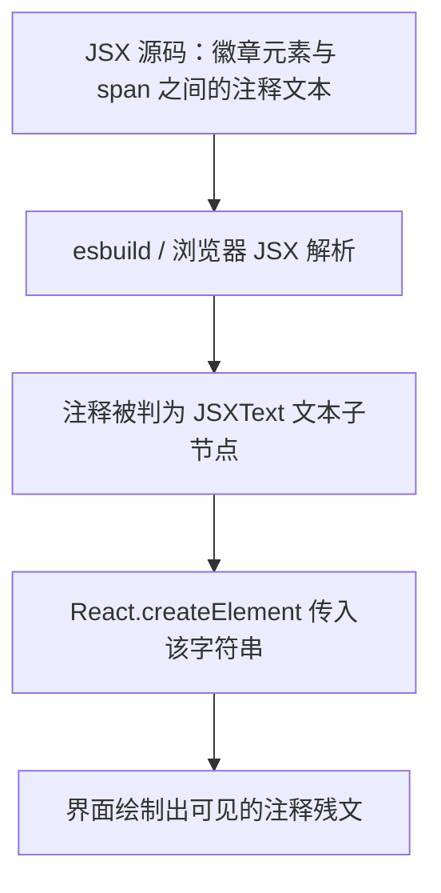
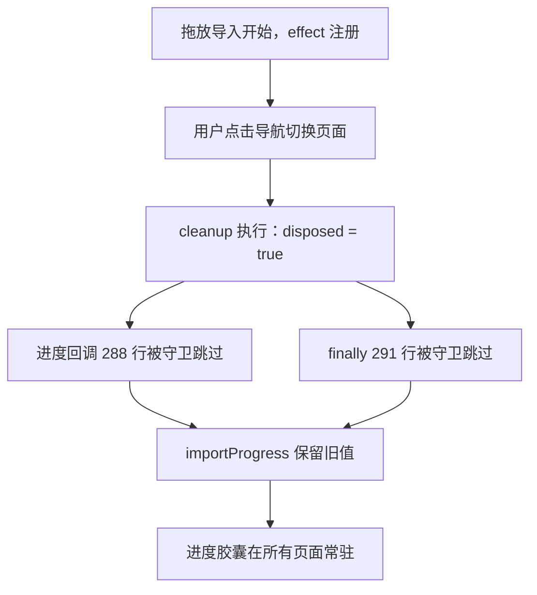
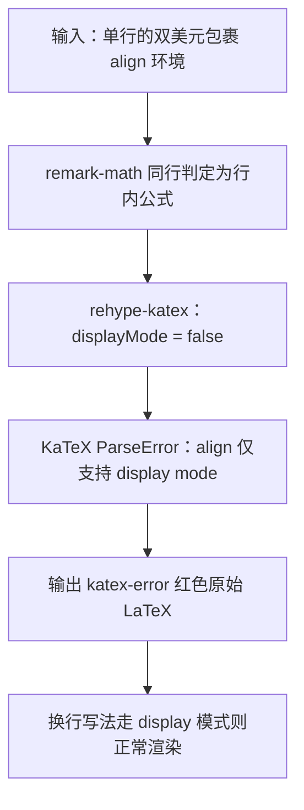
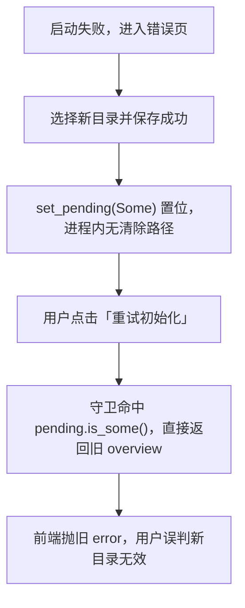
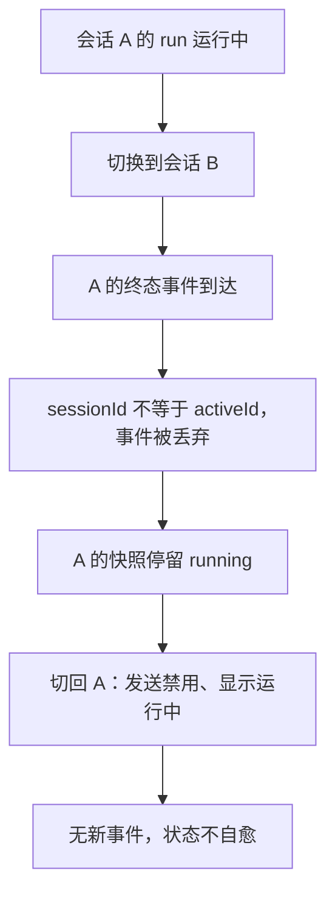
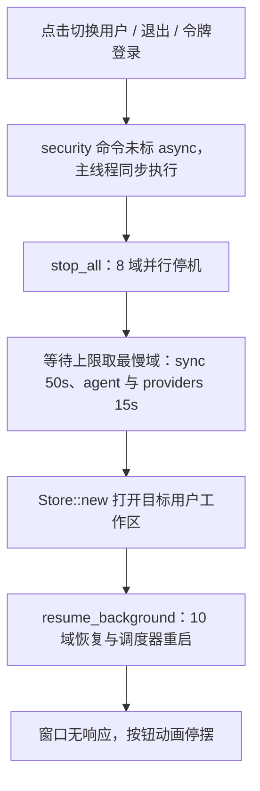
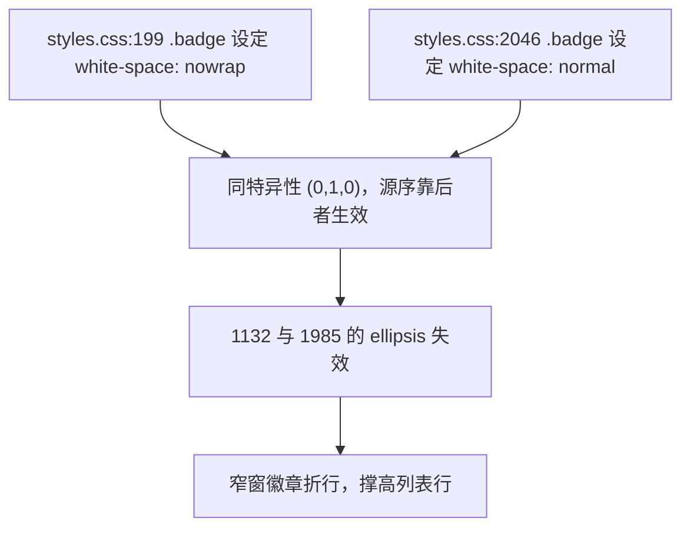
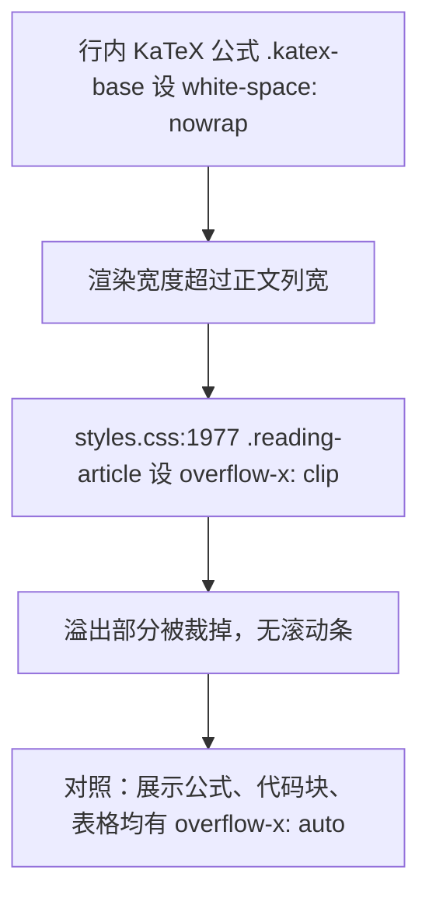

# 前端显示与布局（渲染、文案、网格与浮层）

本组收录 45 条问题，覆盖前端渲染结果（残留文本与数值显示、溢出与遮挡）、网格与浮层定位、样式与主题、空态与错误呈现、文案口径、控件交互与视图状态。所有条目均在本工作区逐条复核，复核方式与命令记录在各条「代码证据」节。

---

## P-036 校验说明落入三列网格第二行，五维校验卡片挤压错位

严重度: medium | 状态: 已复核 | 分类: display | 位置: desktop/src/pages/PlanGenerator.tsx:369; desktop/src/styles.css:1185

### 详细说明

触发条件：方案生成向导第 3 步的任一校验项 status 为 warn 或 fail 且 details 非空（desktop/src-tauri/src/backend/learning/validate.rs:349-353、:370-407——降级方案与逾期方案必现；模型校验 pass 亦常带说明文本）。

实际行为：每个校验卡片含 4 个子元素（图标、名称 span、Badge、说明 small），而样式只定义 `grid-template-columns: auto 1fr auto` 三列，无跨列规则（styles.css:1185）。按 CSS Grid 自动放置，第 4 个子元素 small 被排到第 2 行第 1 列；第 1 列（auto 轨道）需同时容纳图标与整句说明文本，其基础尺寸取 min-content（中文约 1 字符宽），增长上限取 max-content（整句一行宽）。

用户可见后果：桌面默认 ≥700px 的五列布局下每卡约 120px 宽，说明文字与校验名被挤入约 1 字/行的窄列竖排（如「依赖闭包」4 字排 4 行，20 字说明排 20 行），五维校验结果实质不可读；两列布局下同样整卡错位。

### 代码证据

```tsx
// desktop/src/pages/PlanGenerator.tsx:369（validation-grid 卡片结构）
<div className="validation-grid">{validationNames.map(([key, name]) => { const check = result.validation[key]; return <div key={key}>{check.status === 'pass' ? <Check size={16} /> : <AlertTriangle size={16} />}<span>{name}</span><Badge tone={check.status === 'pass' ? 'green' : check.status === 'warn' ? 'amber' : 'red'}>{check.status === 'pass' ? '通过' : check.status === 'warn' ? '警告' : '未通过'}</Badge>{check.details && <small>{check.details}</small>}</div>})}</div>
```

```css
/* desktop/src/styles.css:1185 */
.validation-grid > div { display: grid; grid-template-columns: auto 1fr auto; align-items: center; gap: 7px; padding: 11px; border-radius: 8px; background: var(--accent-soft); color: var(--accent); font-size: 12px; }
```

---

## P-037 知识地图同层节点实际高度超过 76px 行距假设，长标题节点互相叠压

严重度: medium | 状态: 已复核 | 分类: display | 位置: desktop/src/pages/KnowledgeMap.tsx:35; desktop/src/pages/KnowledgeMap.tsx:185; desktop/src/styles.css:558; desktop/src/styles.css:1981-1982

### 详细说明

触发条件：任一层内存在 2 个及以上节点，且节点标题折行超过 2 行（8 字左右的中文标题即达 3 行）。

实际行为：图谱节点为 112px 定宽、`grid-template-columns: auto 1fr auto` 的单行网格（styles.css:558），三个子元素（15px 状态图标、标题、状态小字）同行排列。扣除 18px 内边距、15px 图标、2×5px 间距与约 36px 小字后，标题列仅约 33px 宽，12px 字号下每行只放 2 至 3 个汉字；常见 8 至 12 字标题折成 3 至 5 行，节点实际高度 76 至 115px。画布按「66px 节点高」假设以 76px 行距扩画布（KnowledgeMap.tsx:35），与实际高度不符。此外 styles.css:1981 的 `.map-node > div { min-width: 0; }` 针对 div 子元素，而当前节点 DOM 中不存在 div 子元素（KnowledgeMap.tsx:185），该规则不生效。

用户可见后果：同层相邻节点互相叠压约 15 至 40px，DOM 靠后的节点覆盖相邻节点的状态文字与边框，被遮部分不可读，点击命中顶层节点，主视图上的掌握状态被遮挡或目标节点点不到。

本条尺寸结论来自样式推算，未做实际渲染测量：本项目禁止前台 UI 自动化与原生窗口操作，本环境无法执行渲染层验证。

### 代码证据

```css
/* desktop/src/styles.css:558 */
.map-node { position: absolute; transform: translate(-50%, -50%); width: 112px; min-height: 66px; display: grid; grid-template-columns: auto 1fr auto; align-items: center; gap: 5px; padding: 9px; border: 1px solid var(--border-strong); border-radius: 11px; background: var(--surface-raised); box-shadow: 0 4px 12px oklch(0.25 0.02 160 / .07); text-align: left; transition: transform .18s ease, border-color .18s ease; }
```

```tsx
// desktop/src/pages/KnowledgeMap.tsx:35
  const height = Math.max(390, (perLevel + 1) * 76)
```

```tsx
// desktop/src/pages/KnowledgeMap.tsx:185（节点内无 div 子元素）
<button key={item.id} className={`map-node ...`} ...><span className="node-status">{hasEvidence && (mastery ?? 0) >= 80 ? <Check size={15} /> : middle ? <GitBranch size={15} /> : <CircleDashed size={15} />}</span><strong>{item.title}</strong><small>{!hasEvidence ? (nodeProgress?.readingCompleted ? '已阅读' : '待评估') : `${mastery}%`}</small></button>
```

```css
/* desktop/src/styles.css:1981-1982 */
.map-node > div { min-width: 0; }
.map-node strong { overflow-wrap: anywhere; }
```

---

## P-038 复习数据读取失败时同时渲染假空态「现在没有到期卡片／明日到期 0 张」

严重度: medium | 状态: 已复核 | 分类: display | 位置: desktop/src/pages/Review.tsx:8; desktop/src/pages/Review.tsx:54-61; desktop/src/pages/Review.tsx:167; desktop/src/pages/Review.tsx:180

### 详细说明

触发条件：refresh 中任一命令失败，包括备份或维护 checkpoint 期间由事件驱动的刷新命中 database_busy/store_busy。此类错误在读路径被 reportBackendError 静默不弹 toast（desktop/src/backend/client.ts:575 同段逻辑），但 setLoadError 仍生效，横幅照常出现。

实际行为：失败分支只设置 loadError，card 保持 null、stats 保持初始值 emptyStats（dueToday=0、retention=null、estimatedMinutes=0、tomorrow=0、calendar 为空数组，Review.tsx:8）。复习工作区在错误横幅下方渲染 review-complete 分支，其中含大号对勾图标、「现在没有到期卡片」标题与「本次完成 0 次主动回忆；明日到期 0 张」（Review.tsx:180）。代码注释声明「加载失败保留错误横幅（含重试），与『现在没有到期卡片』空态区分」（Review.tsx:61），但实现为两者同时呈现而非互斥。

用户可见后果：视觉权重大于横幅的假空态使使用者得出「今天没有卡要复习」的结论并离开页面，而实际可能存在一批到期卡；「明日到期 0 张」为凭空数据。

### 代码证据

```tsx
// desktop/src/pages/Review.tsx:8
const emptyStats: ReviewStats = { dueToday: 0, retention: null, estimatedMinutes: 0, tomorrow: 0, calendar: [] }
```

```tsx
// desktop/src/pages/Review.tsx:54-61
    } catch (error) {
      // 156#4：错误路径过 ticket 守卫——旧刷新的失败晚到不再在成功清错后重设横幅
      if (ticket === refreshSeq.current) { setLoadError(backendErrorMessage(error)); reportBackendError(error) }
    }
  }, [])

  useEffect(() => {
    // 加载失败保留错误横幅（含重试），与"现在没有到期卡片"空态区分
```

```tsx
// desktop/src/pages/Review.tsx:180
        </> : <div className="review-complete"><span><Check size={32} /></span><h2>{reviewed ? '本轮到期卡片复习完成' : '现在没有到期卡片'}</h2><p>本次完成 {reviewed} 次主动回忆；明日到期 {stats.tomorrow} 张。暂停或未来到期的卡片不会提前出现。</p><div><Button onClick={() => { void refresh().catch(reportBackendError) }}><RotateCcw size={17} />刷新到期队列</Button><Button variant="secondary" onClick={() => setManageOpen(true)}>查看全部记忆卡</Button></div></div>}
```

---

## P-039 三处 JSX 行内注释被渲染为界面上的可见文本（客观题头、考试计时器旁、项目版本列表）

严重度: medium | 状态: 已复核 | 分类: display | 位置: desktop/src/pages/Practice.tsx:258; desktop/src/components/ExamWorkspace.tsx:203; desktop/src/pages/Projects.tsx:197

### 详细说明

JSX 元素之间出现的 `/* … */` 不是注释语法，而是 JSXText 文本节点。三处此类写法在渲染时成为可见字符串。

触发条件为常态渲染，无需任何特殊操作：

1. `Practice.tsx:258`——每道客观题的题头，在节点徽章与「单选题 · 难度」之间固定显示 `/* 148#4：key 用节点 id——标题可同名 */`。
2. `ExamWorkspace.tsx:203`——模拟考试头部计时区，在「剩余 MM:SS」之后显示 `/* 150#4：无时限路径不再显示「剩余 00:00」 */`。
3. `Projects.tsx:197`——展开「查看本次提交与历史版本」后，在提交正文 `<pre>` 与版本列表之间显示 `/* 147#18 */`。

实际行为：上述字符串作为文本子节点传入 React 元素，被浏览器绘制为普通文本。

用户可见后果：三处均位于新手完整闭环的必经页面（做题、考试、复盘项目版本），用户每次进入都会看到开发注释残文。



### 代码证据

`desktop/src/pages/Practice.tsx:258`：

```
<div className="question-top"><div>{nodes.map(id => <Badge tone="green" key={id}>{plan?.result?.graph.nodes.find(node => node.id === id)?.title || id}</Badge>)} /* 148#4：key 用节点 id——标题可同名 */<span>{question.kind === 'choice' ? '单选题' : '填空题'} · 难度 {question.difficulty}/5</span></div><span>第 {index + 1} / {objectiveQuestions.length} 题</span></div>
```

`desktop/src/components/ExamWorkspace.tsx:203`：

```
<span role="timer" aria-label={completed ? '已交卷' : `考试剩余时间 ${time}`}>{completed ? '已交卷' : exam.examRemainingSeconds == null ? '不计时' : `剩余 ${time}`} /* 150#4：无时限路径不再显示「剩余 00:00」 */</span>
```

`desktop/src/pages/Projects.tsx:197`：

```
<pre style={{ whiteSpace: 'pre-wrap', overflowWrap: 'anywhere' }}>{currentVersion.content}</pre> /* 147#18 */<div className="practice-history-list">
```

本会话执行的验证脚本（使用项目内 vite 依赖的 esbuild 0.25.12，对 `desktop/src` 下四个文件做 `transformSync(..., { loader: 'tsx' })`，再用正则 `/"[^"]*\/\* \d+#\d+[^"]*"/g` 匹配输出；脚本写于仓库 `TEMP/` 下，验收后已清理）：

```js
import { readFileSync } from 'node:fs'
import { transformSync } from 'file:///F:/Github/repo/Deep-tutor/desktop/node_modules/esbuild/lib/main.js'

const ROOT = 'F:/Github/repo/Deep-tutor/desktop/src'
const FILES = ['pages/Practice.tsx', 'components/ExamWorkspace.tsx', 'pages/Projects.tsx', 'components/SubjectivePractice.tsx']
const PATTERN = /"[^"]*\/\* \d+#\d+[^"]*"/g

for (const file of FILES) {
  const src = readFileSync(`${ROOT}/${file}`, 'utf8')
  const out = transformSync(src, { loader: 'tsx', jsx: 'transform' }).code
  const hits = [...out.matchAll(PATTERN)].map(m => m[0])
  console.log(`=== ${file} ===`)
  console.log(`hits=${hits.length}`)
  for (const hit of hits) console.log(`  ${hit}`)
  console.log('')
}
```

输出：

```
=== pages/Practice.tsx ===
hits=1
  " /* 148#4\uFF1Akey \u7528\u8282\u70B9 id\u2014\u2014\u6807\u9898\u53EF\u540C\u540D */"

=== components/ExamWorkspace.tsx ===
hits=1
  " /* 150#4\uFF1A\u65E0\u65F6\u9650\u8DEF\u5F84\u4E0D\u518D\u663E\u793A\u300C\u5269\u4F59 00:00\u300D */"

=== pages/Projects.tsx ===
hits=1
  " /* 147#18 */"

=== components/SubjectivePractice.tsx ===
hits=0
```

### 合并来源

前端-练习套件-3、横切-旅程-完整闭环-2

---

## P-040 拖放导入进行中切换页面后，导入进度胶囊永久冻结滞留

严重度: medium | 状态: 已复核 | 分类: display | 位置: desktop/src/App.tsx:288,291,295

### 详细说明

拖放导入 effect 的依赖数组为 `[ready, loginRequired, page, notify]`（295 行），`page` 变化即触发 cleanup，cleanup 将当前闭包的 `disposed` 置为 `true`。

触发条件：拖入文件后、导入结束前点击任一导航项切换页面。

实际行为：

1. 此后每文件进度回调（288 行）因 `if (!disposed)` 守卫不再更新 `importProgress`，进度停在最后一次数值。
2. 导入完成时的 `.finally`（291 行）同样因守卫跳过 `setImportProgress('')`，胶囊不清空。
3. 进度胶囊渲染在应用外壳层（530 行），对所有页面可见且不随切页卸载，胶囊以最后一次数值（如「正在导入资料 0/12」）配合 `spin` 动画与 `role="status"` 播报持续存在，直到下一次拖放或进程重启。

补充事实：导入终态 toast 照常弹出，因为 `notify` 不受 `disposed` 守卫，`importMaterialPaths(...).then(summary => notify(summarizeMaterialImport(summary)))` 位于 289 行。因此界面同时存在「正在导入中」的常驻胶囊与「已导入完成」的 toast，两者互相矛盾。

用户可见后果：进度胶囊位于应用外壳层，对所有页面常驻，停留在最后一次数值（如「正在导入资料 0/12」）并持续旋转，同一时刻导入终态 toast 弹出「已导入完成」，界面同时呈现「正在导入中」与「已导入完成」两种互斥状态；胶囊以 `role="status"` 持续播报已过期的进度数值，用户无法据界面判断本次导入是否仍在进行。



### 代码证据

`desktop/src/App.tsx:288`：

```
void importMaterialPaths(paths, (processed, total) => { if (!disposed) setImportProgress(`正在导入资料 ${processed}/${total}`) })
```

`desktop/src/App.tsx:291`：

```
.finally(() => { if (!disposed) setImportProgress('') })
```

`desktop/src/App.tsx:295`：

```
}, [ready, loginRequired, page, notify])
```

`desktop/src/App.tsx:530`（胶囊位于外壳层，不随页面卸载）：

```
{importProgress && <div className="import-progress" role="status" aria-live="polite"><LoaderCircle size={15} className="spin" />{importProgress}</div>}
```

### 合并来源

前端-应用骨架-1

---

## P-041 考试历史列表行是 button，但 CSS 只写了 `.exam-history > div`，整列回落浏览器默认按钮样式

严重度: medium | 状态: 已复核 | 分类: display | 位置: desktop/src/components/ExamWorkspace.tsx:236; desktop/src/styles.css:695-698

### 详细说明

样式表中该区块只有三条规则，`.exam-history`、`.exam-history > div`、`.exam-history > div strong` 与 `.exam-history p`，选择器全部针对 `div` 子元素；本会话执行 `grep -n "exam-history" src/styles.css` 的返回只有 695、696、697、698 四行，不存在任何 `.exam-history button` 或 `.exam-history > button` 规则。而 JSX 中历史行全部是 `<button>` 元素。

触发条件：进入「练习与测评 → 模拟考试」且存在任一历史考试记录（`history.filter(item => item.mode === 'exam')` 非空）即必现；窄屏单列与 ≥1024px 侧栏布局下同样出现。

实际行为与用户可见后果：

1. 每条历史记录渲染为 WebView2 默认系统按钮——灰底、默认边框、系统内边距、文字居中。
2. 方案标题、「第 N 次尝试 · 状态」与得分 `strong` 全部按 inline 流挤在一起，无两端对齐、无分隔线。
3. 得分 `strong` 的 accent 大字号规则（`.exam-history > div strong`）不生效，与全站列表视觉体系脱节。

附带影响：`.exam-history > div` 现在命中的是 `SectionHeader` 渲染的 `div`，给区块标题误加 `padding: 14px 0` 与 `border-bottom` 分隔线。

### 代码证据

`desktop/src/styles.css:695-698`：

```
.exam-history { padding: 24px; align-self: start; }
.exam-history > div { display: flex; justify-content: space-between; padding: 14px 0; border-bottom: 1px solid var(--border); font-size: 13px; }
.exam-history > div strong { color: var(--accent); font-size: 20px; }
.exam-history p { margin: 18px 0 0; font-size: 12px; }
```

`desktop/src/components/ExamWorkspace.tsx:236`：

```
<aside className="surface exam-history"><SectionHeader title="真实测评历史" description="成绩来自已保存的交卷结果" />{history.filter(item => item.mode === 'exam').map(item => <button key={item.id} disabled={busy || selecting} onClick={() => void selectSet(item.id)}><span>{plans.find(plan => plan.id === item.planId)?.goal ?? item.planId}<small>{item.completedAt ? new Date(item.completedAt).toLocaleString() : statusName(item.status)}</small></span><strong>{item.status === 'completed' && item.score !== null && item.maxScore !== null ? `${item.score} / ${item.maxScore}` : `${item.answeredQuestions} / ${item.totalQuestions}`}</strong></button>)}</aside>
```

### 合并来源

横切-页面布局复核-2

---

## P-042 单行 `$$…$$` 被解析为行内公式，align 环境直接渲染成红色报错块

严重度: medium | 状态: 已复核 | 分类: display | 位置: desktop/src/pages/StudyRoom.tsx:20; desktop/src/pages/Library.tsx:427; desktop/src/styles.css:1974,1977

### 详细说明

remark-math 默认把同一行内的 `$$…$$` 当作行内（text）公式处理，而 align 环境只允许显示模式。应用的 Markdown 渲染管线未对 remark-math 配置任何分隔符或显示模式选项（`rehypePlugins={[rehypeKatex]}` / `remarkPlugins={[remarkGfm, remarkMath]}`，均无 options）。

触发条件：用户粘贴一行式块公式（聊天记录、网页、AI 回答中常见的 `$$\begin{align} a &= b \end{align}$$` 写法），或后端生成的讲义把块级公式写成单行（`desktop/src-tauri/src/backend/learning/lecture.rs:602` 的提示词只要求「Markdown 正文」，未约束公式写法）。

实际行为：整段输出 `class="katex-error"` 的红色 span，内容是未渲染的原始 LaTeX，悬浮提示为 `ParseError: KaTeX parse error: {align} can be used only in display mode.`。

用户可见后果：讲义与笔记预览中出现一整块红色源码而非公式，用户看到的是「内容被原样吐出并染红」，而不是「请换行写成块公式」的可执行提示。

对照事实：同一内容换行写成 `$$\n…\n$$` 实测正常（`display=true`、`error=false`）。应用自身的「公式」工具栏插入的正是换行模板（`Library.tsx:426` 插入 `\n$$\n…\n$$\n`），因此自产内容无此问题，缺陷只在粘贴内容一侧显现。

附带影响：应用只为 `.katex-display` 配了滚动容器（`styles.css:1974`，另有笔记预览 `styles.css:1508`），行内公式不在其中；而 `.reading-article` 是 `overflow-x: clip`（`styles.css:1977`），因此被误判为行内的超宽块公式还会被裁切且无滚动条。



### 代码证据

`desktop/src/pages/StudyRoom.tsx:20`：

```
return <ReactMarkdown remarkPlugins={[remarkGfm, remarkMath]} rehypePlugins={[rehypeKatex]} components={{ a: MarkdownLink }}>{text}</ReactMarkdown>
```

`desktop/src/pages/Library.tsx:427`：

```
<ReactMarkdown remarkPlugins={[remarkGfm, remarkMath]} rehypePlugins={[rehypeKatex]} components={{ a: MarkdownLink }}>{previewText || '实时预览将在这里显示。'}</ReactMarkdown>
```

`desktop/src/styles.css:1974`、`:1977`：

```
.reading-article .katex-display { overflow-x: auto; overflow-y: hidden; padding: 2px 0; }
.reading-article { overflow-x: clip; }
```

本会话执行的验证脚本（用仓库内 unified + remark-parse + remark-math 6.0.0 + remark-rehype + rehype-katex 构建同源管线，遍历 hast 树读取 `class`/`title`/`style`；脚本写于仓库 `TEMP/` 下，验收后已清理）：

```js
import { unified } from 'file:///F:/Github/repo/Deep-tutor/desktop/node_modules/unified/index.js'
import remarkParse from 'file:///F:/Github/repo/Deep-tutor/desktop/node_modules/remark-parse/index.js'
import remarkMath from 'file:///F:/Github/repo/Deep-tutor/desktop/node_modules/remark-math/index.js'
import remarkRehype from 'file:///F:/Github/repo/Deep-tutor/desktop/node_modules/remark-rehype/index.js'
import rehypeKatex from 'file:///F:/Github/repo/Deep-tutor/desktop/node_modules/rehype-katex/index.js'

const processor = unified().use(remarkParse).use(remarkMath).use(remarkRehype).use(rehypeKatex)

function walk(node, visit) {
  if (!node || typeof node !== 'object') return
  visit(node)
  for (const child of node.children ?? []) walk(child, visit)
}

function classList(node) {
  const value = node.properties?.className
  if (Array.isArray(value)) return value.join(' ')
  return typeof value === 'string' ? value : ''
}

async function probe(label, md) {
  const tree = processor.runSync(processor.parse(md))
  let errorTitle = ''
  let mathcolor = false
  let display = false
  const errTexts = []
  walk(tree, node => {
    if (node.type !== 'element') return
    const cls = classList(node)
    if (cls.includes('katex-error')) {
      errorTitle = node.properties?.title ?? ''
      let inner = ''
      walk(node, n => { if (n.type === 'text') inner += n.value })
      errTexts.push(inner)
    }
    if (cls.includes('katex-display')) display = true
    const style = node.properties?.style
    if (typeof style === 'string' && style.includes('color:#cc0000')) mathcolor = true
  })
  let text = ''
  walk(tree, node => { if (node.type === 'text') text += node.value })
  console.log(`=== ${label} ===`)
  console.log(`display=${display} error=${Boolean(errorTitle)} mathcolor=${mathcolor}`)
  if (errorTitle) console.log(`ERROR-TITLE: ${errorTitle}`)
  if (errTexts.length) console.log(`ERRTEXT: ${errTexts.join(' | ')}`)
  console.log(`TEXT: ${text.trim().slice(0, 200)}`)
  console.log('')
}

await probe('oneline-align', '$$\\begin{align} a &= b \\end{align}$$')
await probe('multiline-align', '$$\n\\begin{align} a &= b \\end{align}\n$$')
await probe('inline-math', '公式 $x^2 + y^2$ 结束')
await probe('mhchem-ce', '反应式 $\\ce{H2O}$ 结束')
await probe('bracket-display', '公式 \\[x^2 + y^2 = z^2\\] 结束')
await probe('paren-inline', '公式 \\(x^2\\) 结束')
```

输出（脚本共 6 个探针调用，此处只摘录前 2 项 `oneline-align` 与 `multiline-align`；其余 4 项的输出分别见 P-128 的 `mhchem-ce`、P-129 的 `bracket-display` 与 `paren-inline`，`inline-math` 一项的输出未被任何条目引用）：

```
=== oneline-align ===
display=false error=true mathcolor=true
ERROR-TITLE: ParseError: KaTeX parse error: {align} can be used only in display mode.
ERRTEXT: \begin{align} a &= b \end{align}

=== multiline-align ===
display=true error=false mathcolor=false
```

### 合并来源

补审-5-3、补审-9-1

---

## P-043 公式解析失败只显示红色原始 LaTeX 与英文 hover 提示，界面无任何可理解的错误说明

严重度: medium | 状态: 已复核 | 分类: flow | 位置: desktop/node_modules/rehype-katex/lib/index.js:104-113

### 详细说明

rehype-katex 捕获 KaTeX 抛错后，以 `strict: 'ignore', throwOnError: false` 兜底重渲染（`desktop/node_modules/rehype-katex/lib/index.js:108-113`）。按 KaTeX 文档（`desktop/node_modules/katex/dist/README.md:82-84`：`The examples above use the throwOnError: false option, which renders invalid inputs as the TeX source code in red (by default), with the error message as hover text.`），非法输入被渲染成红色源码加英文悬浮错误文本。

触发条件：讲义正文、笔记预览或检查题答案（`StudyRoom.tsx:299`）中出现 KaTeX 无法解析的公式写法（如在行内位置使用 `{align}` 环境），经 rehype-katex 渲染时命中 `throwOnError: false` 兜底分支。

实际行为：输出 `<span class="katex-error" title="ParseError: KaTeX parse error: {align} can be used only in display mode." style="color:#cc0000">…</span>`。

应用层缺失两项配套处理：

1. 未消费 rehype-katex 写入 vfile 的 `file.message`（`rehype-katex/lib/index.js:96-102` 调用 `file.message('Could not render math with KaTeX', …)`），该诊断信息在渲染链路上被丢弃。
2. 无 `.katex-error` 样式与中文文案。本会话执行 `grep -n "\.katex" src/styles.css`，返回仅 1508 与 1974 两行，均为 `.katex-display` 规则，无任何 `.katex-error` 规则。

用户可见后果：用户在中文讲义、笔记预览、检查题答案（`StudyRoom.tsx:299`）中看到的是一坨红色 LaTeX 源码，无法判断是渲染失败还是内容本身，唯一线索是英文 `title` 悬浮提示。

与 P-042 的区分：本条根因为「错误呈现缺失」，与「单行 `$$` 被判为行内公式」的解析模式根因不同，不合并。

### 代码证据

`desktop/node_modules/rehype-katex/lib/index.js:96-113`：

```
file.message('Could not render math with KaTeX', {
  ancestors: [...parents, element],
  cause,
  place: element.position,
  ruleId,
  source: 'rehype-katex'
})

// KaTeX *should* handle `ParseError` itself, but not others.
try {
  result = katex.renderToString(value, {
    ...settings,
    displayMode,
    strict: 'ignore',
    throwOnError: false
  })
```

`desktop/node_modules/katex/dist/README.md:82-84`：

```
The examples above use the `throwOnError: false` option, which renders invalid
inputs as the TeX source code in red (by default), with the error message as
hover text.
```

本会话探针输出（同 P-042 的 hast 探针）：

```
=== oneline-align ===
display=false error=true mathcolor=true
ERROR-TITLE: ParseError: KaTeX parse error: {align} can be used only in display mode.
```

`grep -n "\.katex" src/styles.css` 返回：

```
1508:.note-preview .katex-display { overflow-x: auto; overflow-y: hidden; }
1974:.reading-article .katex-display { overflow-x: auto; overflow-y: hidden; padding: 2px 0; }
```

### 合并来源

补审-9-2

---

## P-044 保存目录（或恢复默认）后「重试初始化」被 pending 守卫永久短路，与决策 20 不符

严重度: medium | 状态: 已复核 | 分类: flow | 位置: desktop/src-tauri/src/startup.rs:606-613,670,686-688; desktop/src/components/DataDirectoryPanel.tsx:59-75,104

### 详细说明

`set_storage_location` 成功后无条件调用 `set_pending(Some(selected))`（670 行）。进程内不存在任何清除 pending 的路径：本会话执行 `grep -n "set_pending" src-tauri/src/startup.rs`，返回 124（定义）、670、688 三行，670 与 688 是仅有的两处赋值点，均无清除分支。

`retry_storage_initialization` 的守卫第三个条件 `state.pending()?.is_some()`（610 行）使重试在保存后对整个进程生命周期都是 no-op，即使启动处于失败态（无 `BackendState`，换目录重装配完全安全）亦然。

与决策不符：`note/产品与技术决策.md:257` 明文承诺「保存时验证目录与 SQLite，保存后重试或下次启动使用新目录」。

触发条件与用户可见后果：

1. 启动失败（如 `database_corrupt`、`storage_config_invalid`）→ 错误页选择新目录并保存成功 → 点击「重试初始化」。
2. 后端原样返回旧 `overview`（旧 failure 仍在）→ 前端 `DataDirectoryPanel.tsx:61` 的 `if (next.error) { throw next.error }` 把修复前的旧错误再次作为红字显示，用户会误以为新选择的目录同样无效。
3. 同一屏内面板还并列显示旧 `overview.error`（104 行）与保存成功的文案，信号互相矛盾。
4. 错误页的 3 秒恢复轮询只等 `ready`（`useBackendState.ts:186-188`），不会就此自愈。唯一出路是点「保存并立即重启」，而面板文案「请稍后重试或重启应用」（`DataDirectoryPanel.tsx:68`）中的「稍后重试」做不到。



### 代码证据

`desktop/src-tauri/src/startup.rs:606-613`：

```
let (root, default_root, pointer, configuration_error) = {
    let state = app.state::<StartupState>();
    if state.running()
        || (state.failure()?.is_none() && app.try_state::<BackendState>().is_some())
        || state.pending()?.is_some()
    {
        return overview(&app);
    }
```

`desktop/src-tauri/src/startup.rs:670`：

```
app.state::<StartupState>().set_pending(Some(selected))?;
```

`desktop/src/components/DataDirectoryPanel.tsx:59-61`：

```
const retry = () => run('retry', async () => {
  const next = await storageBackend.retry()
  if (next.error) { throw next.error }
```

`desktop/src/components/DataDirectoryPanel.tsx:104`：

```
{overview.error && <div className="form-error" role="alert">{overview.error.code}：{overview.error.message}</div>}
```

`note/产品与技术决策.md:256-258`：

```
20. 数据目录可在“设置 → 隐私、备份与数据”中修改。独立配置文件保存在应用本地配置目录，
    只接受明确的本机绝对目录；保存时验证目录与 SQLite，保存后重试或下次启动使用新目录。切换不
    自动搬移、覆盖或删除旧目录数据，需要迁移时先导出备份再在新目录导入；目录配置不
```

### 合并来源

后端-启动与主入口-2、前端-设置核心-2

---

## P-045 项目删除后关联该方案的记忆卡任何编辑保存都被拒绝，方案下拉显示空白

严重度: medium | 状态: 已复核 | 分类: flow | 位置: desktop/src-tauri/src/backend/review/mod.rs:217-224; desktop/src-tauri/src/backend/store.rs:943; desktop/src/pages/Review.tsx:53,184

### 详细说明

触发条件：用户为采用中的方案节点创建记忆卡，随后删除对应项目。删除路径为 `App.tsx:64` 的 `replaceCollection('projects')` → 后端 `store.rs:943` 按项目 GC 删除 `learning_plan_adoptions`，方案回到未采用态（155#2 决策）。

此后编辑该卡时，后端 `validate_scope` 对「未变化但仍携带」的 `planId` 校验 `adopted_project_id`，为 `None` 时返回 `invalid_card_scope`「只能关联已采用的学习方案」。任何内容修改（哪怕只改正面错别字）都走该校验路径。

用户可见后果：

1. 保存必失败并弹出错误 toast。
2. 编辑弹窗的方案下拉只列采用中方案（`Review.tsx:53` 过滤 `plan.adoptedProjectId !== null && plan.result`），该方案已不在列表中，下拉显示空白——既不显示「不关联方案」之外的原方案名，也无任何说明，用户无从得知失败原因。
3. 唯一出路是改选「不关联方案」，保存后卡片与知识节点的证据联动永久中断。

前后端判定不一致：同一张卡走 `grade_review_card` 不做采用校验（`mod.rs:494` 起直接写 `learning_node_evidence`），评分照常进行——「方案有效性」在编辑与评分两条路径上结论相反。

### 代码证据

`desktop/src-tauri/src/backend/review/mod.rs:217-224`：

```
if let Some(id) = &input.plan_id {
    let plan = learning::get(&state.learning, id)?;
    if plan.adopted_project_id.is_none() {
        return Err(BackendError::new(
            "invalid_card_scope",
            "只能关联已采用的学习方案",
        ));
    }
```

`desktop/src-tauri/src/backend/store.rs:940-943`：

```
// 155#2：learning_plan_adoptions.project_id NOT NULL 无 FK——
// 项目删除后悬挂行使备份导入整单拒绝（invalid_backup_reference）；
// 删除采用记录（方案回到未采用态，语义自洽）
tx.execute("DELETE FROM learning_plan_adoptions WHERE project_id NOT IN (SELECT CAST(id AS INTEGER) FROM kv WHERE namespace = 'projects')", [])?;
```

`desktop/src/pages/Review.tsx:53`：

```
setPlans(allPlans.filter(plan => plan.adoptedProjectId !== null && plan.result))
```

`desktop/src/pages/Review.tsx:184`：

```
<label>关联学习方案<select value={input.planId ?? ''} disabled={busy} onChange={event => setInput({ ...input, planId: event.target.value || null, nodeId: null })}><option value="">不关联方案</option>{plans.map(plan => <option key={plan.id} value={plan.id}>{plan.goal}</option>)}</select></label>
```

`desktop/src-tauri/src/backend/review/mod.rs:494`（评分路径无采用校验）：

```
if let (Some(plan_id), Some(node_id)) = (&card.plan_id, &card.node_id) {
```

### 合并来源

后端-复习-1、前端-图谱与复习-6

---

## P-046 run 进行中切换到其他会话再切回：会话视图永久停留在「运行中」，发送框禁用且无事件自愈

严重度: medium | 状态: 已复核 | 分类: flow | 位置: desktop/src/backend/useAgent.ts:37-45,190; desktop/src/pages/AgentCenter.tsx:124

### 详细说明

`selectSession`（`useAgent.ts:37-45`）只更新本地状态，不发起任何数据拉取——函数体内无 `getAgentSession` 或等价调用。事件处理侧，`agent.*` 事件仅在事件归属会话等于当前激活会话时才刷新该会话数据（190 行的 `sessionId === activeIdRef.current` 守卫）。

触发条件：用户在会话 A 的 run 运行中切到会话 B。

实际行为与用户可见后果：

1. A 的 `run_completed` 等终态事件到达时，因 A ≠ 当前激活会话而被跳过；A 在 `sessions` 里的快照停留在 `running`。
2. 切回 A 后，`activeRun` 取自陈旧快照，界面显示「Agent 正在执行真实工具循环（第 X / 25 步）」与取消按钮。
3. 发送按钮因 `running` 守卫被禁用（`AgentCenter.tsx:52` 的 `running` 判定、`:102` 的提交守卫、`:143` 的按钮 `disabled`）。
4. run 已结束，不会再产生 A 的事件，该状态不会自愈；用户只能离开 AgentCenter 页面重新进入（组件重挂载触发全量 `refresh`），或等待 `session_created` / `session_deleted` / `approval_expired` 等无关事件。



### 代码证据

`desktop/src/backend/useAgent.ts:37-45`：

```
const selectSession = useCallback((id: number | null) => {
  activeIdRef.current = id
  setActiveId(id)
  setLiveRequest('')
  liveLogicalRef.current = ''
  routeUpstreams.current.clear()
  setStream(emptyStream)
  setError('')
}, [])
```

`desktop/src/backend/useAgent.ts:190`：

```
else if (sessionId !== null && sessionId === activeIdRef.current) refreshSessionCoalesced(sessionId)
```

`desktop/src/pages/AgentCenter.tsx:52`、`:102`、`:124`、`:143`：

```
const running = activeRun?.status === 'running' || activeRun?.status === 'cancelling'
if (!value || running || busy === 'send' || busy === 'create') return
<div className="session-list">{filteredSessions.map(session => <button key={session.id} className={activeId === session.id ? 'active' : ''} aria-current={activeId === session.id ? 'true' : undefined} onClick={() => selectSession(session.id)}>
<button type="submit" aria-label="发送" disabled={!input.trim() || running || busy === 'send' || busy === 'create'}>
```

### 合并来源

后端-Agent-3

---

## P-058 切换用户、退出会话、令牌登录走未标 async 的命令，guard 在主线程串行执行停机/恢复族

严重度: medium | 状态: 已复核 | 分类: perf | 位置: desktop/src-tauri/src/backend/security/commands.rs:13-14,22-28,77-84; desktop/src-tauri/src/backend/security/guard.rs:39-40,227-232,307-308,337; desktop/src-tauri/src/backend/sync/mod.rs:963

### 详细说明

`security/commands.rs` 中全部命令未标 `async`。本会话执行 `grep -n "#\[tauri::command" src-tauri/src/backend/security/commands.rs`，返回 10 处（第 5、13、22、30、40、50、59、68、77、86 行），全部为 `#[tauri::command]` 无参数形式；对照 `backend/commands.rs:74-75` 的 `#[tauri::command(async)] pub async fn bootstrap`，说明同族命令已因同一问题迁移到后台线程，security 命令族是尚未迁移的例外。

本仓库自身注释佐证主线程冻结：`guard.rs:39-40`「登出/切换/清理在主线程按此冻结；并行后等待上限收敛为最慢单域（sync 50s）」；`startup.rs:597-601`、`backend/commands.rs:70-74`、`113-115` 显示 103#6 / 106#4 / 127#1 已因同一问题把 `retry_storage_initialization`、`bootstrap`、`get_collection` 等移出主线程。

`login_local_user` 的完整调用链都在主线程同步执行：

1. `switch()`（`guard.rs:307`）先 `stop_all`（`guard.rs:228`）停 8 个域。域内并行执行但等待上限取最慢域——`sync/mod.rs:963` 停机 deadline 50s，`agent/mod.rs:1419` 与 `providers/mod.rs:1564` 各 15s。
2. 再 `Store::new`（`guard.rs:236`）打开目标用户工作区；`store.rs:267-269` 自述「user1 首迁整库复制（GB 级可达数十秒）」。
3. handler 签发会话后再跑 10 个域的 `recover` 与调度器重启（`guard.rs:106-157`）。

`logout_local_user` 同样在主线程执行 `stop_all`。

触发条件与用户可见后果：

- a) Agent 任务运行中切换用户——冻结最长约 15 秒。
- b) 同步任务运行中登出或切换——冻结最长约 50 秒。
- c) 目标用户工作区在本进程首次打开且为大库——冻结可达数十秒。

上述三种情形下整个窗口无响应（Windows 标记「未响应」），`SecurityPanel.tsx:121` 切换按钮上的 `LoaderCircle` 旋转动画停摆，用户既无法取消也看不到进度。

PAT 登录路径不同：`authenticate_access_token`（`commands.rs:77-84`）不调用 `switch` 换库，把工作区换库/首开推迟到登录后的第一条受守卫命令（`guard.rs:337` 的 `prepare_store` 仍在主线程执行），冻结点从「点击登录」转移到登录后的首次操作。



### 代码证据

`desktop/src-tauri/src/backend/security/commands.rs:13-14`、`:22-28`、`:77-84`：

```
#[tauri::command]
pub fn login_local_user<R: Runtime>(
...
#[tauri::command]
pub fn logout_local_user<R: Runtime>(
...
#[tauri::command]
pub fn authenticate_access_token<R: Runtime>(
```

`desktop/src-tauri/src/backend/security/guard.rs:39-40`：

```
// （agent/practice/knowledge/learning/providers 各 15s + sync 50s ≈140s），
// 登出/切换/清理在主线程按此冻结；并行后等待上限收敛为最慢单域（sync 50s）
```

`desktop/src-tauri/src/backend/sync/mod.rs:963`、`agent/mod.rs:1419`、`providers/mod.rs:1564`：

```
let deadline = Instant::now() + Duration::from_secs(50);
let deadline = Instant::now() + Duration::from_secs(15);
let deadline = Instant::now() + std::time::Duration::from_secs(15);
```

`desktop/src-tauri/src/backend/store.rs:267-269`：

```
// 107#5：稳态打开（同路径已完成首开）不走全局锁——user1 首迁整库
// 复制（GB 级可达数十秒）原先让进程内所有 Store::new 排队，每命令
```

调用链：`desktop/src/components/SecurityPanel.tsx:121` → `invoke login_local_user` → `guard.rs:307` `switch` → `guard.rs:228` `stop_all` → `guard.rs:236` `Store::new` → `guard.rs:273` `resume`。

### 合并来源

后端-安全-1、前端-设置核心-1、横切-主线程阻塞-3

---

## P-103 知识地图证据标签直接格式化 f64，显示长尾小数

严重度: low | 状态: 已复核 | 分类: display | 位置: desktop/src-tauri/src/backend/learning/knowledge.rs:96; desktop/src/pages/KnowledgeMap.tsx:191

### 详细说明

触发条件：知识节点的测评证据聚合结果中分数或其分母为非整二进制小数。

实际行为：NodeProgress.evidence 以 `format!("{count} 项测评记录 · {score}/{maximum}")` 直接 Display 两个 f64（knowledge.rs:96），二者均为 SUM 聚合值（knowledge.rs:62-68）。当前写入方 max_score 恒为 1、score 为 0 至 1 的 REAL（desktop/src-tauri/src/backend/practice/mod.rs:1427），其中复习路径写入的是非二进制度量的分数——grade 为 again/hard/good/easy 时分别写 0.0/0.6/0.8/1.0（desktop/src-tauri/src/backend/review/mod.rs:495-501）。同一行的掌握度百分比已做 round 处理（knowledge.rs:89），证据标签未做同口径格式化。

用户可见后果：分数为 0.6、0.8 这类非整二进制小数时，SUM 聚合结果落在二进制不可精确表示的区间，Rust 的 `{}` 格式化输出最短可往返十进制表示，标签即显示长尾小数。同一知识节点积累 3 条 grade 为 good 的复习记录（每条 score 均为 0.8，evidence_key 按 history_id 区分，review/mod.rs:504）时，`SUM(score)` 为 2.4000000000000004（三个 0.8 的求和结果与行序无关）、`SUM(max_score)` 为 3，KnowledgeMap.tsx:191 显示「3 项测评记录 · 2.4000000000000004/3」。

### 代码证据

```rust
// desktop/src-tauri/src/backend/learning/knowledge.rs:96
                format!("{count} 项测评记录 · {score}/{maximum}")
```

```rust
// desktop/src-tauri/src/backend/learning/knowledge.rs:68（聚合值为 f64 直出）
            evidence.insert(node, (count, score, maximum));
```

```rust
// desktop/src-tauri/src/backend/practice/mod.rs:1427（max_score 恒为 1，score 为 REAL）
                "INSERT INTO learning_node_evidence (plan_id, node_id, kind, score, max_score, details_json, created_at, evidence_key) VALUES (?1, ?2, ?3, ?4, 1, ?5, ?6, ?7) ON CONFLICT(plan_id, node_id, evidence_key) DO UPDATE SET score = excluded.score, max_score = excluded.max_score, details_json = excluded.details_json, created_at = excluded.created_at",
```

```rust
// desktop/src-tauri/src/backend/review/mod.rs:495-501（非二进制度量的分数写入方）
            let score = match grade {
                "again" => 0.0,
                "hard" => 0.6,
                "good" => 0.8,
                "easy" => 1.0,
                _ => unreachable!(),
            };
```

- 本次复核（node 复算 f64 求和）：`0.8 + 0.8 + 0.8 = 2.4000000000000004`，三个 0.8 的全部 6 种排列结果一致；`String(2.4000000000000004)` 为 `2.4000000000000004`，与 Rust `{}` 对 f64 的最短可往返输出相同。

---

## P-104 context_too_large 错误建议「选择较小章节」，产品无按章节选择资料的入口

严重度: low | 状态: 已复核 | 分类: display | 位置: desktop/src-tauri/src/backend/learning/pipeline.rs:76-79

### 详细说明

触发条件：所选资料的解析文本合计超过 192 KB。

实际行为：步骤 0 逐份读取 input.material_ids 对应资料的完整解析文本并累计长度（pipeline.rs:57-73），超限时返回 context_too_large，提示文本为「所选资料文本超过 192 KB，请减少资料或选择较小章节后重试」（pipeline.rs:75-79）。产品链路的资料粒度为整份文件——材料导入为整份文件，方案生成按整份材料勾选，不存在章节级选择能力；且此时方案已创建并固定了资料关联。

用户可见后果：错误提示的后半句指向不存在的功能，使用者无法执行；「减少资料」是唯一可行路径，提示文本与实际能力不符。

### 代码证据

```rust
// desktop/src-tauri/src/backend/learning/pipeline.rs:75-79
        if total_bytes > 192 * 1024 {
            return Err(BackendError::new(
                "context_too_large",
                "所选资料文本超过 192 KB，请减少资料或选择较小章节后重试",
            ));
        }
```

```rust
// desktop/src-tauri/src/backend/learning/pipeline.rs:57-73（逐整份资料取全文，无章节粒度）
    for id in &input.material_ids {
        let detail = super::super::materials::detail(&state.materials, *id)?;
```

---

## P-105 资料详情弹窗无截断直接渲染最多 5 MiB 的解析全文

严重度: low | 状态: 已复核 | 分类: display | 位置: desktop/src/pages/Library.tsx:435

### 详细说明

触发条件：导入文本层接近 5 MiB 的大型文档（如千页 PDF）解析完成后，在资料库点击该资料打开详情弹窗。

实际行为：get_material 返回整篇解析文本，上限为 5 MiB（desktop/src-tauri/src/backend/materials/parse.rs:12；解析期截断警示文案见 parse.rs:104）。终态打开详情时，Library 把 activeMaterial.text 整体放入单个 `<pre>` 文本节点渲染，无虚拟化与截断（Library.tsx:435）。

用户可见后果：WebView 渲染数 MB 文本节点使弹窗打开出现秒级卡顿、滚动迟滞。IPC 侧已移至后台处理，仅显示层缺少上限保护。

### 代码证据

```tsx
// desktop/src/pages/Library.tsx:435
{activeMaterial.text ? <pre style={{ whiteSpace: 'pre-wrap', overflowWrap: 'anywhere' }}>{activeMaterial.text}</pre> : <p>{['queued', 'parsing', 'cancelling'].includes(activeMaterial.status) ? '正在等待原生后端写入解析结果。' : '当前没有已保存的解析文本。'}</p>}
```

```rust
// desktop/src-tauri/src/backend/materials/parse.rs:12
pub const MAX_TEXT_BYTES: usize = 5 * 1024 * 1024;
```

---

## P-106 DuckDuckGo 检索端点被 DNS 拦截时报「网页地址不得指向本机、私网或保留地址」

严重度: low | 状态: 已复核 | 分类: display | 位置: desktop/src-tauri/src/backend/web/mod.rs:435; desktop/src-tauri/src/backend/web/mod.rs:132-135; desktop/src-tauri/src/backend/web/mod.rs:67-68

### 详细说明

触发条件：本机 DNS 将 html.duckduckgo.com 解析到 0.0.0.0 或私网地址（部分广告过滤规则表收录该域名），或该域名直接解析失败。

实际行为：search() 的首个请求是对固定端点的 document() 调用（mod.rs:435），该调用复用面向用户输入 URL 的 resolve() 校验；校验不通过时由 openai.rs 的 public_address 判定为非公网，返回 ssrf_blocked（mod.rs:132-135）；域名解析失败时返回「无法解析网页主机地址」。

用户可见后果：使用者在 agent 中调用 web.search 或在方案生成中触发资源检索时只输入了查询词，从未输入任何网页地址，错误文案却描述为地址类限制，无法定位问题，也不提示检索服务端点被本机网络拦截；命中该情形后 web.search 与方案资源检索整体不可用。

### 代码证据

```rust
// desktop/src-tauri/src/backend/web/mod.rs:67-68
    #[cfg(not(test))]
    "https://html.duckduckgo.com/html/".into()
```

```rust
// desktop/src-tauri/src/backend/web/mod.rs:435
    let document = document(endpoint, 0)?;
```

```rust
// desktop/src-tauri/src/backend/web/mod.rs:132-135
        return Err(BackendError::new(
            "ssrf_blocked",
            "网页地址不得指向本机、私网或保留地址",
        ));
```

---

## P-107 解析失败/部分解析资料的状态徽标是灰色中性色，与 Library 页红色失败口径不一致

严重度: low | 状态: 已复核 | 分类: display | 位置: desktop/src/pages/PlanGenerator.tsx:363; desktop/src/pages/Library.tsx:26-31

### 详细说明

触发条件：方案生成向导第 0 步的暂存列表中出现 `parsed`、`staged` 以外的状态——解析失败（`failed`）、仅取得元数据（`degraded`）或解析进行中（`queued`/`parsing`/`cancelling`）。

方案生成向导第 0 步暂存列表的徽标只区分 `parsed`（绿）、`staged`（琥珀），其余状态全部落到 `neutral`。对照 Library 页 `materialTone`：`failed` 为红、`degraded` 为绿、`queued`/`parsing`/`cancelling` 为琥珀。

同文件 30 行注释自称 78#1「与 Library/后端状态表统一叫法」，但只统一了文案未统一色调。

用户可见后果：所选资料解析失败时徽标显示灰底「解析失败」，与「已暂存」「仅元数据」视觉同级；同时「继续澄清目标 / 无资料，直接制定计划」按钮因 `ready=false` 被禁用且无禁用原因提示，用户难以把灰色徽标与按钮禁用关联起来，只能自行排查后取消勾选失败资料。

### 代码证据

`desktop/src/pages/PlanGenerator.tsx:363`：

```
<Badge tone={material.status === 'parsed' ? 'green' : material.status === 'staged' ? 'amber' : 'neutral'}>{materialStatusNames[material.status] || material.status}</Badge>
```

`desktop/src/pages/Library.tsx:26-31`：

```
function materialTone(status: string): 'neutral' | 'green' | 'amber' | 'red' {
  if (status === 'parsed' || status === 'degraded') return 'green'
  if (status === 'failed') return 'red'
  if (['queued', 'parsing', 'cancelling'].includes(status)) return 'amber'
  return 'neutral'
}
```

### 合并来源

前端-方案生成器-4

---

## P-108 拖放区整块显示 pointer 光标并写「选择本地学习资料」，但区域本身无点击处理

严重度: low | 状态: 已复核 | 分类: display | 位置: desktop/src/pages/PlanGenerator.tsx:358; desktop/src/styles.css:1102

### 详细说明

触发条件：用户在方案生成向导第 0 步「文件上传」标签下点击大虚线拖放区的任意空白处，或按文案首句「选择本地学习资料」理解为点击该区域即可选择文件。

`.source-dropzone` 的 CSS 为整块设置了 `cursor: pointer`，文案首句为「选择本地学习资料，或将文件拖入窗口」，引导用户点击。但 JSX 中该 `div` 没有 `onClick`；打开文件对话框的唯一入口是内部的「选择文件」按钮（调用 `backend.openMaterialFiles`）。拖放导入由 App 全局监听处理（`App.tsx:283-291`），与本区域无绑定。

用户可见后果：点击大虚线区任意空白处（视觉上最强的高亮可点击区域）无任何反应，只能找到下方的按钮，与光标形态和文案给出的可供性相悖。

### 代码证据

`desktop/src/pages/PlanGenerator.tsx:358`：

```
{sourceTab === '文件上传' && <div className={dragOver ? 'source-dropzone is-drag-over' : 'source-dropzone'}><CloudUpload size={28} /><strong>选择本地学习资料，或将文件拖入窗口</strong><p>PDF / DOCX / PPTX / EPUB / TXT / Markdown，单文件不超过 50 MB</p><span>文档由原生文本解析；音视频与图片仅作原件预览，不提供 OCR 或内容识别。ZIP 由 Rust 预检后逐项暂存。</span><Button onClick={() => void importFiles()} disabled={Boolean(busy)}>{busy === 'files' ? <LoaderCircle size={16} className="spin" /> : <Upload size={16} />}{busy === 'files' ? `正在导入${importCount ? ` ${importCount}` : ''}…` : '选择文件'}</Button></div>}
```

`desktop/src/styles.css:1102`：

```
.source-dropzone { min-height: 250px; display: flex; flex-direction: column; align-items: center; justify-content: center; padding: 28px; border: 1px dashed var(--border-strong); border-radius: 12px; background: var(--surface-soft); text-align: center; cursor: pointer; }
```

### 合并来源

前端-方案生成器-7

---

## P-109 计划页把「overview 加载中」渲染成「尚未创建学习方案」空态，每次进入页面闪现误导内容

严重度: low | 状态: 已复核 | 分类: display | 位置: desktop/src/pages/Plan.tsx:33,204,209

### 详细说明

`overview` 初始值为 `null`（`Plan.tsx:33`），首次渲染时 `plan` 为 `null`，目标区直接落入「尚未创建学习方案」空态分支（`Plan.tsx:209`）。

触发条件：已有方案的用户每次进入计划页（页面切换即组件重挂载），在 IPC 返回前都会看到这一误导性空态；库越大首读越慢。误点其中的「创建真实方案」按钮会进入生成页。

失败路径下信号矛盾：若首次读取失败（如 `database_busy`），顶部错误横幅（`Plan.tsx:204`）与「尚未创建学习方案」空态同时呈现。

用户可见后果：界面在数据到达前呈现「尚未创建学习方案」，用户无法区分「方案尚未创建」与「正在加载」；首次读取失败时错误横幅与该空态同时呈现，界面同时声明读取失败与「尚未创建」，用户对方案是否存在的判断失去依据。

对照组件：`Dashboard.tsx:18-19` 对同一情形分别给出「学习摘要读取失败 + 重新读取」错误态与「正在读取真实学习摘要…」加载态；Plan 页只有错误横幅，没有 `overview === null` 的加载/空态区分。

### 代码证据

`desktop/src/pages/Plan.tsx:33`：

```
const [overview, setOverview] = useState<PlanOverview | null>(null)
```

`desktop/src/pages/Plan.tsx:209`：

```
: <section className="surface"><EmptyState title="尚未创建学习方案" description="填写目标即可生成方案，辅助资料可选；采用后会出现排期与阶段。你也可以直接添加并保存自己的任务。" action={<Button onClick={() => onNavigate('generator')}>创建真实方案</Button>} /></section>}
```

`desktop/src/pages/Dashboard.tsx:18-19`（对照）：

```
if (!overview && error) return <div className="page-loading" role="alert"><CircleAlert size={25} /><h2>学习摘要读取失败</h2><p>{error}</p><Button onClick={onRetrySummary}>重新读取</Button></div>
if (!overview) return <div className="page-loading" role="status"><LoaderCircle size={22} className="spin" />正在读取真实学习摘要…</div>
```

### 合并来源

前端-计划与首页-2

---

## P-110 无辅助资料方案切到「资料」标签只显示孤零零的标题，缺少空态说明

严重度: low | 状态: 已复核 | 分类: display | 位置: desktop/src/pages/StudyRoom.tsx:310（对照 :311）

### 详细说明

触发条件：方案 `materialIds` 为空（0–8 份资料的下界，产品决策 101 明确支持；生成弹窗自述「本方案没有辅助资料，将生成通用讲解且不伪造引用」），`resources.items` 为空数组，用户点「资料」标签。

实际行为：整页只有大标题「本方案关联资料」，`items.map` 无产出，且该分支没有 `else` 空态，与视频标签的完整空态（`StudyRoom.tsx:311` 的「尚未导入音视频」+ 前往资料库按钮）形成不一致。

用户可见后果：误以为资料加载失败或功能缺失。

### 代码证据

`desktop/src/pages/StudyRoom.tsx:310`：

```
{tab === '资料' && <div className="chapter-resources"><h1>本方案关联资料</h1>{plan.result.resources.items.map(item => <button key={item.materialId} disabled={busy === 'export'} onClick={() => void exportMaterial(item.materialId, item.title)}><FileText size={21} /><div><strong>{item.title}</strong><span>资料 #{item.materialId} · SHA-256 {item.sha256.slice(0, 16)}… · {busy === 'export' ? '正在等待选择保存位置…' : '点击导出原件'}</span></div><ArrowRight size={17} /></button>)}</div>}
```

`desktop/src/pages/StudyRoom.tsx:311`（对照）：

```
{tab === '视频' && <div className="chapter-resources"><h1>本地音视频原件</h1><p>只显示当前用户实际导入的媒体，不展示演示视频或虚构课程关联。</p>{selectedMedia ? <></> : <div className="provider-empty"><Video size={26} /><h2>尚未导入音视频</h2><p>请在资料库导入真实 MP4、WebM、MP3、WAV 等原件，再在这里预览。</p><Button onClick={() => onNavigate('library')}>前往资料库</Button></div>}</div>}
```

### 合并来源

前端-学习空间-3

---

## P-111 翻卡正反面不保留换行，多行录入的卡片内容折成单段，与管理列表 pre-wrap 显示不一致

严重度: low | 状态: 已复核 | 分类: display | 位置: desktop/src/pages/Review.tsx:175-176; desktop/src/styles.css:724,1899

### 详细说明

卡片正反面用多行 `textarea` 录入（`Review.tsx:184` 的 `rows={3}` 与 `rows={4}`，背面限 20000 字节，placeholder 为「保留关键解释，避免整段复制」），但翻卡两面的 `h2` 无 `white-space` 规则。`styles.css:724` 的 `.flashcard-face h2` 只声明了 `max-width`、`font-size`、`line-height`、`font-weight` 与 `overflow-wrap: anywhere`，默认 `white-space: normal` 把换行折叠为空格。

管理列表的标题 `h3` 则有 `white-space: pre-wrap`（`styles.css:1899`，系此前的专门修复）。

触发条件：卡片内容含换行（多段问题、步骤清单、代码片段）。

用户可见后果：复习作答时最需要保留的行结构在卡片主视图丢失，多步答案连成一长段；同一内容在管理列表与翻卡两处显示不一致，降低长答案可读性。

### 代码证据

`desktop/src/styles.css:724`：

```
.flashcard-face h2 { max-width: 650px; font-size: clamp(19px, 3vw, 28px); line-height: 1.6; font-weight: 580; overflow-wrap: anywhere; }
```

`desktop/src/styles.css:1899`：

```
.review-card-row h3 { margin: 9px 0; font-size: 15px; white-space: pre-wrap; }
```

`desktop/src/pages/Review.tsx:175-176`：

```
<div className="flashcard-face flashcard-front"><span>问题</span><h2>{card.front}</h2><small><CircleHelp size={15} />先在心里作答，再点击查看答案</small></div>
<div className="flashcard-face flashcard-back"><span>参考答案</span><h2>{card.back}</h2><small>对照你的回答，再诚实选择记忆程度</small></div>
```

### 合并来源

前端-图谱与复习-5

---

## P-112 错题本未掌握错题显示节点原始 slug 而非节点标题

严重度: low | 状态: 已复核 | 分类: display | 位置: desktop/src/pages/Practice.tsx:276（对照 :258）

### 详细说明

触发条件：打开「错题本」tab 查看任一未掌握错题。

错题行的 Badge 在未掌握态直接 join 节点 id。节点 id 的语义是标题（全应用其他位置——`Practice.tsx:242`/`258` 的题头徽章、侧栏「本组依据」、生成弹窗节点下拉——都做了 `graph.nodes` 标题查找），仅此处没有。节点 id 形态由 `learning/pipeline.rs:141` 的提示词约定为「小写英文短横线标识」。

`plans` 数组在该组件作用域内可用（`Practice.tsx:241` 已按 `planId` 查找），具备修复条件。

用户可见后果：错题本里看到一串英文标识符，无法对应到知识地图上的知识点名称，错题定位价值下降。

### 代码证据

`desktop/src/pages/Practice.tsx:276`：

```
<Badge tone={item.mastered ? 'green' : 'neutral'}>{item.mastered ? item.masteredQuestionId ? `变式 #${item.masteredQuestionId} 通过` : '手动标记掌握' : item.nodeIds.join('、')}</Badge>
```

`desktop/src/pages/Practice.tsx:258`（对照）：

```
{plan?.result?.graph.nodes.find(node => node.id === id)?.title || id}
```

`desktop/src-tauri/src/backend/learning/pipeline.rs:141`（节点 id 约定）：

```
构建知识图谱。只返回 {\"nodes\":[...],\"edges\":[...]}。\nnodes 每项必须是 {\"id\":\"小写英文短横线标识\",\"title\":\"...\",...
```

### 合并来源

前端-练习套件-4

---

## P-113 解析取消终态（cancelled）也写 progress=100，Wiki 侧栏将其显示为「已解析」

严重度: low | 状态: 已复核 | 分类: display | 位置: desktop/src/components/WikiPanel.tsx:162; desktop/src-tauri/src/backend/materials/mod.rs:1046-1048,316-329

### 详细说明

触发条件：资料解析进入 `cancelling` 状态后被取消，后端执行取消交叠终态写入（`materials/mod.rs:1046-1048`），该终态同时写入 `progress=100`。

后端取消交叠终态写 `status='cancelled', progress=100, text_length=…`（`materials/mod.rs:1046-1048`，注释「取消交叠：终态 cancelled，结果照存」，`error_message` 为「解析完成前已请求取消，结果已保留」）。`sync_resources` 把 `progress` 原样透传进 `resources` 列表（`materials/mod.rs:367-373`），同时 `meta` 字段由 `status_label(&status)` 生成（`:351-360`），对 `cancelled` 返回「已取消」（`:325`）。

WikiPanel 以 `resource.progress === 100 ? '已解析' : 解析进度 x%` 判定（`WikiPanel.tsx:162`）。

用户可见后果：同一份资料在 Wiki 侧栏显示「已解析」，并满足自动预选条件 `progress === 100`（可被初始选中），在资料库列表 meta 行却显示「已取消」。用户无法从 Wiki 侧栏辨别该资料的解析是完整的还是取消时保留的部分结果，两处状态口径互相矛盾。

### 代码证据

`desktop/src/components/WikiPanel.tsx:162`：

```
<span>{resource.type} · {resource.progress === 100 ? '已解析' : `解析进度 ${resource.progress}%`}</span>
```

`desktop/src-tauri/src/backend/materials/mod.rs:1046-1048`：

```
let cancel_changed = tx.execute(
    "UPDATE materials SET status = 'cancelled', progress = 100, text_length = ?2, parse_mode = ?3, warning = COALESCE(?4, warning), error_code = 'cancelled', error_message = '解析完成前已请求取消，结果已保留', updated_at = ?5 WHERE id = ?1 AND status = 'cancelling'",
```

`desktop/src-tauri/src/backend/materials/mod.rs:316-329`（对照，`status_label` 映射）：

```
fn status_label(status: &str) -> &str {
    match status {
        "staged" => "已暂存",
        ...
        "cancelled" => "已取消",
```

### 合并来源

前端-资料库与Wiki-4

---

## P-114 LineChart 逐点渲染全部日期标签，学期周期下 x 轴文字完全重叠

严重度: low | 状态: 已复核 | 分类: display | 位置: desktop/src/components/UI.tsx:266; desktop/src-tauri/src/backend/reports/mod.rs:542-559

### 详细说明

趋势图对每个数据点渲染一个 x 轴日期 `text`，无抽稀、无最小间距判据。

触发条件与实际行为：报告周期支持 `semester`（`reports/mod.rs:545-559`：秋季 9/1 起至次年 2 月末、春季 3/1 起至 8 月末，`days` 随学期起点与今日动态计算，最长约 180 天以上）。`trend` 按有证据的日期逐日出点，每日练习或复习的用户在学期视图下会产生一百多个数据点，等量日期标签均布在 640 宽的 `viewBox`（`UI.tsx:253`）内互相覆盖。

用户可见后果：x 轴完全不可读，只剩折线形状可辨。`4w`（28 天）与 `8w`（56 天）周期点数较少，不受影响。

### 代码证据

`desktop/src/components/UI.tsx:266`：

```
{points.map((p, i) => <g key={i}><circle cx={p.x} cy={p.y} r="4" fill={color} /><text x={p.x} y={height - 4} textAnchor="middle" className="chart-label">{labels[i]}</text></g>)}
```

`desktop/src/components/UI.tsx:253-254`：

```
const width = 640
const height = 220
```

`desktop/src-tauri/src/backend/reports/mod.rs:545-559`：

```
"semester" => {
    // 03#13-10：学期按“秋季 9/1 起至次年 2 月末、春季 3/1 起至 8 月末”取起点，
    let year = local.year();
    let month = local.month() as u8;
    let start = if month >= 9 { ... } else if month >= 3 { ... } else { ... }
    (today.date() - start).whole_days().max(0) + 1
}
```

### 合并来源

前端-项目与报告-7

---

## P-115 导师抽屉的审批卡片不展示被批准内容（记忆键值/产物 ID），用户无法知情批准

严重度: low | 状态: 已复核 | 分类: display | 位置: desktop/src/components/TutorPanel.tsx:62; desktop/src/pages/AgentCenter.tsx:37

### 详细说明

导师会话的工具目录包含 `memory.save` 与 `memory.delete`（未绑定方案也开放，`agent/tools.rs:60-74`），运行中产生的 pending 审批会渲染在导师抽屉里。

但 `TutorPanel` 的审批卡片只有「保存记忆需要批准 / 删除记忆需要批准 / 讲义提升需要批准」三种静态文案与批准、取消按钮，不显示 payload（记忆 key/value、产物 ID）。决策文档 `docs/architecture/02-operation-principles.md:212` 把这三类工具列为需用户审批的敏感操作。`AgentCenter` 的同款卡片展示了 `产物 #ID` 与 `key · value`（`AgentCenter.tsx:37`）。

触发条件：导师对话中模型调用 `memory.save` / `memory.delete` / `artifact.promote` 产生 pending 审批，用户只在导师抽屉中操作。

用户可见后果：用户在不知道要保存或删除哪条记忆（或提升哪个产物）的情况下被要求批准；删除操作尤其危险，盲批可能删掉不想删的记忆。要看详情必须另开 Agent 工作台。

### 代码证据

`desktop/src/components/TutorPanel.tsx:62`：

```
{activeSession?.approvals.map(approval => <div className="artifact-approval" key={approval.id}><strong>{approval.kind === 'artifact.promote' ? '讲义提升需要批准' : approval.kind === 'memory.delete' ? '删除记忆需要批准' : '保存记忆需要批准'}</strong><div><Button size="sm" disabled={busy === `approval-${approval.id}`} onClick={() => void resolveApproval(approval.id, true)}>批准</Button><Button size="sm" variant="ghost" disabled={busy === `approval-${approval.id}`} onClick={() => void resolveApproval(approval.id, false)}>取消</Button></div></div>)}
```

`desktop/src/pages/AgentCenter.tsx:37`（对照）：

```
<span>{artifact ? `产物 #${String(approval.payload.artifactId)} · 批准后创建新讲义版本` : `${String(approval.payload.key ?? '')}${!removing ? ` · ${String(approval.payload.value ?? '')}` : ''}`}</span>
```

`desktop/src-tauri/src/backend/agent/tools.rs:60-74`：

```
definition(
    "memory.save",
    "请求批准后保存一条学习偏好",
...
definition(
    "memory.delete",
    "请求批准后删除一条学习偏好",
```

`docs/architecture/02-operation-principles.md:212`：

```
- `memory.save`、`memory.delete` 和 `artifact.promote` 需要审批。审批通过 CAS 从 pending 转换；产物删除、过期、哈希漂移或阶段不满足时，审批转为 expired，不永久停留 pending。
```

### 合并来源

前端-Agent界面-3

---

## P-116 被取消/中断的悬空工具调用永久显示「等待模型完成」，文案还声称结果已持久化

严重度: low | 状态: 已复核 | 分类: display | 位置: desktop/src/pages/AgentCenter.tsx:76; desktop/src-tauri/src/backend/agent/mod.rs:1127-1140,1177-1179

### 详细说明

`run_loop` 先保存带 `tool_calls` 的 assistant 消息（`agent/mod.rs:1127-1140`），再逐个执行工具。若在执行某个调用前检测到取消标志（`mod.rs:1177-1179` 返回 `cancelled` 错误），或进程中断（recover 把 running 工具行翻成 `interrupted` 且无 tool 消息落库），该调用在 `agent_messages` 中没有对应的 tool 回复。

前端 `toolEvents` 对无结果的调用把 `status` 记为 `'waiting'`（`AgentCenter.tsx:76` 的 `result?.status ?? 'waiting'`），Badge 落到兜底文案「等待模型完成」，detail 落到「工具结果已持久化，可从会话历史恢复」。

两处文案都与事实相反：运行已终态，结果从未产生，也从未持久化。

触发条件：用户在工具循环执行阶段点取消，或应用重启中断，之后打开该会话的「运行过程」面板。

用户可见后果：终态运行里永远挂着一个转不动的等待项，用户误以为仍有步骤未完成，或以为可以恢复取回该工具结果。

### 代码证据

`desktop/src/pages/AgentCenter.tsx:76`：

```
return { id: call.id, name: call.name, status: result?.status ?? 'waiting', detail: result?.error?.message ?? (result?.truncated ? result.notice ?? '工具结果过长，已截断保存头部预览' : result?.status === 'approval_required' ? '后端已创建真实审批，等待用户决定' : '工具结果已持久化，可从会话历史恢复') }
```

`desktop/src-tauri/src/backend/agent/mod.rs:1177-1179`：

```
if cancel_requested(state, run_id)? {
    return Err(BackendError::new("cancelled", "Agent 运行已取消"));
}
```

`desktop/src-tauri/src/backend/agent/mod.rs:1127-1140`（assistant 消息先落库）：

```
save_message(
    app,
    state,
    session_id,
    run_id,
    step,
    "assistant",
    request.output.clone(),
    request.reasoning.clone(),
    &request.tool_calls,
    None,
    None,
    false,
)?;
```

### 合并来源

前端-Agent界面-5

---

## P-117 Community 初载成功后的刷新失败没有任何页面内错误提示或重试入口

严重度: low | 状态: 已复核 | 分类: display | 位置: desktop/src/pages/Community.tsx:182（失败分支 :58-61; 对照 desktop/src/pages/Integrations.tsx:142）

### 详细说明

`loadError` 横幅的渲染条件是 `!data && loadError`（讨论区 `Community.tsx:182`、小组区 183 行同型）。`data` 一旦有值，后续 `refresh` 失败（catch 分支 `Community.tsx:58-61` 会 `setLoadError` 并 `reportBackendError`）就没有任何渲染点。

错误呈现还受 `client.ts:569` 约束：`reportBackendError` 对 `database_busy`、`store_busy` 两类错误在读路径直接 return，不弹 toast，因此这两类失败完全静默；其他错误只有 5 秒的全局 toast。

触发条件：发帖、点赞等写操作成功后 `await refresh()` 失败（写库争用、账户库不可读等）。

用户可见后果：看到「讨论已保存」的成功 toast，但列表没有新帖；页面无任何提示说明当前列表可能是旧值，也无重试按钮。

与同族页不一致：`Integrations.tsx:142` 的 `{data && staleBanner}` 正是同款修复模式，其 134#7 注释明确「事件刷新失败原先完全静默——补横幅」，Community 漏配。

### 代码证据

`desktop/src/pages/Community.tsx:182`：

```
</article>)}{!data && loadError && <div className="form-error" role="alert"><span>{loadError}</span><Button variant="secondary" size="sm" onClick={() => { setLoadError(''); void refreshRef.current().catch(error => { setLoadError(backendErrorMessage(error)); reportBackendError(error) }) }}>重试</Button></div>}{!data && !loadError && <div className="page-loading" role="status"><LoaderCircle size={20} className="spin" />正在读取真实讨论…</div>}
```

`desktop/src/pages/Community.tsx:58-61`：

```
if (ticket === refreshSequence.current) {
  setLoadError(backendErrorMessage(error))
  reportBackendError(error)
}
```

`desktop/src/pages/Integrations.tsx:134-142`（对照）：

```
// 115#7：事件刷新失败原先完全静默（loadError 仅在 data 为空时渲染、连
// toast 都没有）——插件启停/事件记录停留旧值零提示；成功刷新即清除
const staleBanner = loadError ? <div className="form-error" role="alert">…</div> : null
...
{data && staleBanner}
```

`desktop/src/backend/client.ts:569`：

```
if (kind === 'read' && typeof error === 'object' && error !== null && 'code' in error && ['database_busy', 'store_busy'].includes(String((error as Partial<BackendError>).code))) return
```

### 合并来源

前端-社区与集成-2

---

## P-118 「有效事件订阅」计数把已停用插件的订阅也计入，与投递只认启用插件的实现不符

严重度: low | 状态: 已复核 | 分类: display | 位置: desktop/src/pages/Integrations.tsx:145; desktop/src-tauri/src/backend/plugins/mod.rs:772

### 详细说明

概要卡统计对全部插件求和订阅数：`data.plugins.reduce((sum, plugin) => sum + plugin.subscriptions.length, 0)`。而后端 `dispatch` 只对 `plugins.enabled = 1` 的插件投递。

触发条件：安装插件并声明若干订阅后保持停用状态。安装默认停用（`Integrations.tsx:83` 的提示「插件「…」已安装，默认停用；审查清单后可启用」）。

用户可见后果：面板显示「有效事件订阅 N」大于实际生效的订阅数——刚安装尚未启用的插件也立刻抬高该计数；「有效」一词误导用户以为订阅已生效。与相邻的「已启用插件 X / Y」（区分启用数与总数）口径不一致。

### 代码证据

`desktop/src/pages/Integrations.tsx:145`：

```
<div><Layers3 size={23} /><span>有效事件订阅</span><strong>{data.plugins.reduce((sum, plugin) => sum + plugin.subscriptions.length, 0)}</strong></div>
```

`desktop/src-tauri/src/backend/plugins/mod.rs:772`（投递只认启用）：

```
let mut statement = conn.prepare("SELECT plugin_id, pattern FROM plugin_subscriptions JOIN plugins ON plugins.id = plugin_subscriptions.plugin_id WHERE plugins.enabled = 1")?;
```

`desktop/src/pages/Integrations.tsx:83`：

```
notify(`插件「${plugin.name}」已安装，默认停用；审查清单后可启用`)
```

### 合并来源

前端-社区与集成-4

---

## P-119 「最大输出 tokens」输入框清空即回弹为 1，继续键入会拼成 12/123 之类的错误值

严重度: low | 状态: 已复核 | 分类: display | 位置: desktop/src/pages/ProviderHub.tsx:426; desktop/src/components/UsagePanel.tsx:15-19

### 详细说明

`maxTokens` 为受控值，每次 `onChange` 即时钳制：清空输入时 `Number('') || 1` 归一为 1 并立即回写输入框；随后键入的数字追加在「1」之后——想输 2 会得到 12，想输 30 会得到 130。

同仓库已在 `UsagePanel` 用「字符串草稿 + 保存时解析」修掉同一类缺陷（115#2 注释：键入「1.」被归一成 1、小数点被吃、想输 1.5 变 15），该输入框未获同款处理。

触发条件：退格清空后直接键入新数字。

用户可见后果：多生成一个数量级的 tokens（1 → 130），受 16384 上限约束仍可能放大输出与计费；规避方式（全选后直接覆盖）无任何提示。

### 代码证据

`desktop/src/pages/ProviderHub.tsx:426`：

```
<label>最大输出 tokens<input type="number" min={1} max={16384} value={maxTokens} onChange={event => setMaxTokens(Math.max(1, Math.min(16384, Number(event.target.value) || 1)))} /></label>
```

`desktop/src/components/UsagePanel.tsx:15-17`（对照）：

```
// 115#2：预算输入改字符串草稿——原先受控值即时 Number()，键入「1.」时
// type=number 坏输入态被归一成 1/0 回写，小数点被吃（想输 1.5 变 15），
// 防线数值被静默放大；解析推迟到保存时（费率输入同款模式）
```

### 合并来源

前端-模型中心-3

---

## P-120 非管理员视图下每个配额把「used / limit」重复显示两遍

严重度: low | 状态: 已复核 | 分类: display | 位置: desktop/src/components/SecurityPanel.tsx:136

### 详细说明

触发条件：以「成员」角色登录（`administrator = false`）查看「成员与访问安全 → 资源用量与配额上限」。

同一格子里 `<span>{名称} · {used} / {limit}</span>` 之后又渲染 `<strong>{used} / {limit}</strong>`，五项资源各出现一次相同的「3 / 200」式数字对，用户会误以为有两个不同指标。管理员分支（输入框 + 保存按钮）不受影响。属渲染分支未按角色区分展示内容的小错误。

用户可见后果：同一格内上下两处显示完全相同的「3 / 200」数字对，且无标题、无副标题区分二者，用户会读成两个不同指标；管理员视图下该格为输入框加保存按钮，不出现重复。

### 代码证据

`desktop/src/components/SecurityPanel.tsx:136`：

```
<div className="quota-grid">{data.quotas.map(quota => <div key={quota.resource}><span>{quotaNames[quota.resource] || quota.resource} · {quota.used} / {quota.limit}</span>{administrator ? <label>上限<input type="number" min={1} max={100000} step={1} value={quotaDrafts[quota.resource] ?? quota.limit} disabled={Boolean(busy)} onChange={event => setQuotaDrafts({ ...quotaDrafts, [quota.resource]: event.target.value })} /><Button variant="ghost" size="sm" disabled={Boolean(busy) || !/^\d+$/.test(quotaDrafts[quota.resource] || '') || Number(quotaDrafts[quota.resource]) < 1 || Number(quotaDrafts[quota.resource]) > 100000 || Number(quotaDrafts[quota.resource]) === quota.limit} onClick={() => void run(`quota-${quota.resource}`, () => securityBackend.setQuota(current.id, quota.resource, Number(quotaDrafts[quota.resource])), `${quotaNames[quota.resource]}上限已保存`)}>保存</Button></label> : <strong>{quota.used} / {quota.limit}</strong>}</div>)}</div>
```

### 合并来源

前端-设置核心-3

---

## P-121 无可导出方案/无已完成单元时八个导出按钮全部静默禁用，缺少空态说明

严重度: low | 状态: 已复核 | 分类: display | 位置: desktop/src/components/ExportCenter.tsx:120,145,149

### 详细说明

两个空态只有禁用态没有解释：

1. `needsPlan` 范围（完整方案 / 讲义 / 日程）下没有任何 `done`/`degraded` 方案时，方案选择器 disabled、占位项写「请选择已完整生成的方案」，全部格式按钮同时 disabled，新用户看不出是「还没有可导出的方案」还是功能不可用。
2. 讲义范围下讲义已加载但没有 `status === 'done'` 的单元时，单元选择器 disabled，只有「请选择已生成单元」占位，按钮全禁，无「该阶段尚未生成任何单元」类提示。对照：读取失败已有横幅加重试（120#4 / 121#5 已覆盖错误态），空态路径未覆盖。

触发条件为常规新用户路径：先打开导出中心再生成方案。

用户可见后果：新用户看到的是八个置灰的格式按钮与两个禁用的选择框，界面没有任何说明指出「尚无可导出的方案或单元」，使用者无法判断是功能不可用还是自身数据尚未就绪。

### 代码证据

`desktop/src/components/ExportCenter.tsx:145`：

```
{needsPlan && <label>学习方案<select value={planId} onChange={event => { setPlanId(event.target.value); setDone(null) }} disabled={!plans.length}><option value="">请选择已完整生成的方案</option>{plans.map(item => <option key={item.id} value={item.id}>{item.goal} · v{item.version}</option>)}</select></label>}
```

`desktop/src/components/ExportCenter.tsx:149`：

```
<label>已保存单元<select value={unitIndex ?? ''} onChange={event => setUnitIndex(event.target.value === '' ? null : Number(event.target.value))} disabled={!lecture}><option value="">请选择已生成单元</option>{lecture?.units.filter(unit => unit.status === 'done').map(unit => <option key={unit.index} value={unit.index}>{unit.index + 1} · {unit.content?.title || unit.nodeId}</option>)}</select></label>
```

`desktop/src/components/ExportCenter.tsx:120`：

```
const canExport = (!needsPlan || Boolean(plan?.result)) && (scope !== 'lecture' || unitIndex !== null)
```

### 合并来源

前端-设置面板-5

---

## P-122 导入进度胶囊与 Toast 栈共用同一固定锚点，同时出现时完全重叠

严重度: low | 状态: 已复核 | 分类: display | 位置: desktop/src/styles.css:243,247,348,355; desktop/src/App.tsx:530-531

### 详细说明

导入进度胶囊（`.import-progress`，`styles.css:247`）与 Toast 栈（`.toast-stack`，`styles.css:243`）都是 `position: fixed; left: 50%; bottom: 86px; z-index: 100` 的同锚点固定浮层。`App.tsx:530-531` 把两者渲染为兄弟节点，且 `ToastStack` 在 DOM 序靠后（531 > 530），同 `z-index` 下 Toast 绘制在上层。

结论成立范围限定：`@media (min-width: 1024px)`（`styles.css:348`）内 `.import-progress` 改为 `bottom: 28px`（`:355`），而 `.toast-stack` 容器仍为 `bottom: 86px`（`.toast-stack .toast` 为 `position: static`，其 `bottom` 不参与定位），因此同锚点重叠仅在窗口宽度 < 1024px 时成立。

触发条件：批量拖放导入进行中（`App.tsx:287-291`，`importProgress` 在 `finally` 前常驻，133#8 注释自述为分钟级任务）出现任何 toast——每分钟的预约提醒 notify、写路径错误、其他页面的保存提示，或导入完成终态 toast 与 `finally` 清理同帧。

用户可见后果：toast 完全遮住导入进度胶囊（或反之叠影），进度「N/M」不可读；最多 4 条 toast 堆叠时遮挡更久（每条存活 3.2–10 秒）。146#6 把两者统一到 `bottom: 86px` 时只处理了与移动底栏的重叠，未处理两者互叠。

### 代码证据

`desktop/src/styles.css:243`、`:247`：

```
.toast-stack { position: fixed; left: 50%; bottom: 86px; z-index: 100; transform: translateX(-50%); display: flex; flex-direction: column; align-items: center; gap: 8px; max-width: calc(100vw - 32px); }
.import-progress { position: fixed; left: 50%; bottom: 86px; z-index: 100; transform: translateX(-50%); display: flex; align-items: center; gap: 8px; padding: 7px 14px; border-radius: 999px; background: var(--surface-raised); border: 1px solid var(--border); box-shadow: var(--shadow); font-size: 13px; color: var(--text-secondary); }
```

`desktop/src/styles.css:248-249`（栈内 toast 为 static 定位）：

```
.toast-stack .toast { position: static; transform: none; }
.toast { position: fixed; left: 50%; bottom: 86px; z-index: 100; transform: translateX(-50%); width: max-content; ...
```

`desktop/src/styles.css:348`、`:354-355`：

```
@media (min-width: 1024px) {
  ...
  .toast { bottom: 28px; }
  .import-progress { bottom: 28px; }
```

`desktop/src/App.tsx:530-531`：

```
{importProgress && <div className="import-progress" role="status" aria-live="polite"><LoaderCircle size={15} className="spin" />{importProgress}</div>}
<ToastStack toasts={toasts} onClose={dismissToken} />
```

### 合并来源

前端-应用骨架-2、前端-样式与基础组件-2

---

## P-123 深色主题用户在冷启动引导期与重登后按默认浅色渲染，出现主题闪变

严重度: low | 状态: 已复核 | 分类: display | 位置: desktop/src/App.tsx:297; desktop/src/backend/useBackendState.ts:12,254

### 详细说明

主题仅在 preferences 快照到达后应用到根元素（`App.tsx:296-301` 的 effect），而快照默认值为 `theme: 'light'`（`useBackendState.ts:12` 的 `emptySnapshot`）。

触发条件与实际行为：

1. 冷启动：深色主题用户每次启动都会先以浅色渲染「正在打开本地学习数据…」加载页（`App.tsx:475-476`）与随后短暂的外壳，`bootstrap`（含全量快照 IPC，工作区大时 MB 级）完成后才切回深色——每次启动可见一次浅→深闪变。
2. 重新登录：`requestSync` 收到 `security.session_started` 时执行 `setSnapshot(emptySnapshot)`（`useBackendState.ts:254`），偏好瞬时回退默认浅色，`bootstrap` 完成后再翻回深色，登录后又一次闪变。

无任何机制（如本地缓存主题）提前应用偏好。

用户可见后果：深色主题用户每次启动与每次重新登录后，都会看到界面先以浅色渲染、待偏好快照到达后再切回深色，出现两次浅→深闪变；浅色片段与用户的既定配色不符，界面没有给出过渡提示。

### 代码证据

`desktop/src/App.tsx:296-301`：

```
useEffect(() => {
  document.documentElement.dataset.theme = preferences.theme
  document.documentElement.classList.toggle('large-text', preferences.largeText)
  document.documentElement.classList.toggle('high-contrast', preferences.highContrast)
  document.documentElement.classList.toggle('reduce-motion', preferences.reducedMotion)
}, [preferences])
```

`desktop/src/backend/useBackendState.ts:12`：

```
preferences: { proactive: true, hintsOnly: true, notifications: true, weeklyReport: true, highContrast: false, reducedMotion: false, largeText: false, theme: 'light' },
```

`desktop/src/backend/useBackendState.ts:248-255`：

```
if (event?.kind === 'security.session_started') {
  setLoginRequired(false)
  generation.current += 1
  lastEventId.current = 0
  versions.current = emptySnapshot.versions
  queued.current = true
  setSnapshot(emptySnapshot)
  start()
  return
}
```

`desktop/src/App.tsx:475-476`：

```
if (!ready) {
  return <main className="page-loading" role="status"><LoaderMark />正在打开本地学习数据…<ToastStack toasts={toasts} onClose={dismissToast} /></main>
}
```

### 合并来源

前端-应用骨架-3

---

## P-124 全局 `.badge` 折行规则使窄窗解析徽章与首屏目标徽章的省略截断永久失效

严重度: low | 状态: 已复核 | 分类: display | 位置: desktop/src/styles.css:2046（对照 :199、:1132、:1985）

### 详细说明

`styles.css:2046`（160#3）的 `.badge { white-space: normal; overflow-wrap: anywhere }` 与 `:199` 的 `.badge { … white-space: nowrap }` 特异性同为 (0,1,0)，源序靠后者生效，对所有 badge 生效。`:1132` 的 `.source-item > .badge`（48#11 窄窗紧凑徽章，`max-width: 120px` + `text-overflow: ellipsis`）与 `:1985` 的 `.today-hero .badge`（147#7 首屏目标徽章）均未声明 `white-space`，级联取 2046 的 `normal`。按 CSS 规范，折行文本不产生省略号，`text-overflow: ellipsis` 成为死声明。

`DESIGN.md:17` 明文承诺「窄窗解析状态紧凑徽章使用 10px，并以省略截断保持布局」。

触发条件：窄窗资源列表中解析状态文字超过 120px，或学习目标名超长的首屏徽章。

用户可见后果：徽章从单行省略变为多行折行，撑高 staging 列表行与 `today-hero` 区块，既定的截断加 `title` 悬停行为丢失。



### 代码证据

`desktop/src/styles.css:2046`：

```
.badge { max-width: 100%; min-width: 0; white-space: normal; overflow-wrap: anywhere; }
```

`desktop/src/styles.css:199`：

```
.badge { width: fit-content; display: inline-flex; align-items: center; gap: 5px; min-height: 24px; padding: 3px 8px; border-radius: 6px; font-size: 12px; font-weight: 700; white-space: nowrap; }
```

`desktop/src/styles.css:1132`：

```
.source-item > .badge { max-width: 120px; overflow: hidden; text-overflow: ellipsis; padding: 2px 6px; font-size: 10px; }
```

`desktop/src/styles.css:1985`：

```
.today-hero .badge { max-width: 100%; overflow: hidden; text-overflow: ellipsis; }
```

`desktop/DESIGN.md:17`：

```
字体栈为 `Aptos, Noto Sans SC, Source Han Sans SC, PingFang SC, Microsoft YaHei, sans-serif`。中文不使用斜体。正文默认 16px，辅助文字不小于 12px；窄窗解析状态紧凑徽章使用 10px，并以省略截断保持布局。
```

### 合并来源

前端-样式与基础组件-1

---

## P-125 删除资料的确认弹窗只列三个引用域，漏掉后端实际拦截的第四域「Agent 产物」

严重度: low | 状态: 已复核 | 分类: display | 位置: desktop/src/pages/Library.tsx:426-430; desktop/src-tauri/src/backend/materials/mod.rs:1477-1486

### 详细说明

触发条件：用户对任一资料点删除、阅读删除前的确认弹窗文案，且该资料已被 Agent 产物引用（产物 `content_json` 内嵌 `citations.materialId`，后端按此逐域匹配）。

后端 `delete()`（`materials/mod.rs:1477-1486`，154#7 起）对仍被学习方案、Wiki 问答、项目版本或 Agent 产物（`content_json` 内嵌 `citations.materialId` 经 `json_each` 匹配）引用的资料返回 `material_in_use` 友好拒绝，错误文案列出全部四域。

`Library.tsx` 的确认弹窗文案（126#3 专门为与后端行为一致而改过）仍只写「若资料已被学习方案、Wiki 问答或项目版本引用，将无法删除」。

用户可见后果：对一份仅被 Agent 产物引用的资料点删除，弹窗未预告会失败，确认后却收到拒绝 toast，前后说法不一致。属文案与实现漂移，影响低——后端拒绝文案本身准确，无数据风险。

### 代码证据

`desktop/src/pages/Library.tsx:430`：

```
description="将同时删除资料记录与可用原件文件；若资料已被学习方案、Wiki 问答或项目版本引用，将无法删除（原文证据受保护）；未被引用时此操作不可恢复。"
```

`desktop/src-tauri/src/backend/materials/mod.rs:1480-1486`：

```
// 154#7：第四域 agent_artifacts——产物 content_json 内嵌
// citations.materialId 无外键，方案删除后产物存留，原先不拦截
// 会使导出/提升后的引用悬空不可溯源
return Err(BackendError::new(
    "material_in_use",
    "该资料已被学习方案、Wiki 问答、项目版本或 Agent 产物引用，不能删除其原文证据",
));
```

### 合并来源

横切-数据生命周期-4

---

## P-126 讲义行内 KaTeX 公式超宽被 `overflow-x: clip` 直接裁掉，无法滚动查看

严重度: low | 状态: 已复核 | 分类: display | 位置: desktop/src/styles.css:1977; desktop/src/pages/StudyRoom.tsx:20,293

### 详细说明

触发条件：讲义正文含渲染宽度超过正文列宽的行内 KaTeX 公式（窄窗 375px 下约 30 字符以上的公式即超，宽屏 1280px 时长分式与长不等式链也会超）。

147#13 为兜底 GFM 表格给 `.reading-article` 加了 `overflow-x: clip`。讲义正文由 rehype-katex 渲染行内公式（`$…$`），KaTeX 自身 CSS 使行内公式整体不可断行——`desktop/node_modules/katex/dist/katex.min.css` 中 `.katex .katex-base{position:relative;white-space:nowrap;width:-webkit-min-content;width:-moz-min-content;width:min-content}`。

公式渲染宽度超过正文列宽时（窄窗 375px 下约 30 字符以上的公式即超，宽屏 1280px 时长分式与长不等式链也会超），溢出部分被 clip 裁剪。clip 不产生滚动条也不能编程滚动。

与同规则组内已处理的三类内容形成对照：展示公式（`.katex-display` 有 `overflow-x: auto`，`styles.css:1974`）、代码块（`.reading-article pre` 有 `overflow-x: auto`，`styles.css:2048`）、表格（`display: block` + `overflow-x: auto`，`styles.css:1978`）都可滚，唯独行内公式被裁。

用户可见后果：数学类讲义中行内长公式高频，用户看到公式右半段凭空消失且无任何途径查看完整内容。

与 P-042 的区分：本条根因为 CSS 裁剪规则，与「单行 `$$` 被当行内公式」的解析模式根因不同，不合并。



### 代码证据

`desktop/src/styles.css:1977`：

```
.reading-article { overflow-x: clip; }
```

`desktop/src/styles.css:1974`、`:2048`（对照）：

```
.reading-article .katex-display { overflow-x: auto; overflow-y: hidden; padding: 2px 0; }
.reading-article pre { max-width: 100%; overflow-x: auto; }
```

`desktop/node_modules/katex/dist/katex.min.css`：

```
.katex .katex-base{position:relative;white-space:nowrap;width:-webkit-min-content;width:-moz-min-content;width:min-content}
```

`desktop/src/pages/StudyRoom.tsx:293`：

```
{tab === '阅读' && <article className="reading-article" style={{ fontSize: `${fontScale}rem` }}>
```

### 合并来源

横切-页面布局复核-1

---

## P-127 供应商卡片 Base URL 单行截断且无 title，用户无法查看完整地址

严重度: low | 状态: 已复核 | 分类: display | 位置: desktop/src/styles.css:1755; desktop/src/pages/ProviderHub.tsx:433

### 详细说明

`.provider-identity > p` 为 `nowrap` 加 `ellipsis` 截断。`ProviderHub` 卡片把用户配置的 `baseUrl` 放入该 `p`（`<p><code>{profile.baseUrl}</code></p>`），无 `title` 属性。

触发条件：档案列表视图中任一 Base URL 超过卡片文本列宽（如 Azure 预设 `https://YOUR-RESOURCE.openai.azure.com/openai/v1`、自建网关长域名），截断即出现。

用户可见后果：用户在卡片上既不能悬停查看完整值，也没有其他就地途径，核对或区分同类网关地址必须逐个点开编辑器。对照同仓既有范式：`Dashboard` 首屏目标徽章截断时配套外层 `title`（`styles.css:1985` 注释「147#7：…配合 Dashboard 的回退文案与 title 提示」+ `Dashboard.tsx:47` 的 `<span title={overview.goal || undefined}>`），此处的截断没有等价的完整值通道。

### 代码证据

`desktop/src/styles.css:1755`：

```
.provider-identity > p { margin: 7px 0; overflow: hidden; text-overflow: ellipsis; white-space: nowrap; }
```

`desktop/src/pages/ProviderHub.tsx:433`：

```
<div className="provider-identity"><div><h2>{profile.name}</h2>{active && routing.mode !== 'aggregate' && <Badge tone="green">当前使用</Badge>}{routing.mode === 'aggregate' && routing.aggregateDefault === profile.id && <Badge tone="green">聚合默认</Badge>}<Badge tone="neutral">{profile.kind}</Badge></div><p><code>{profile.baseUrl}</code></p><div className="provider-model-line"><span>{profile.protocol}</span><strong>{profile.defaultModel}</strong><span>{profile.models.length} 个模型</span></div></div>
```

### 合并来源

横切-页面布局复核-4

---

## P-128 未加载 katex mhchem 扩展，`\ce{}`/`\pu{}` 宏以红色字面量渲染且无任何诊断信息

严重度: low | 状态: 已复核 | 分类: display | 位置: desktop/src/main.tsx:6; desktop/src/pages/StudyRoom.tsx:20; desktop/src/pages/Library.tsx:427; desktop/package.json:16

### 详细说明

全仓库唯一与 katex 相关的引入是 `main.tsx:6` 的样式表导入，没有任何 `katex/dist/contrib/mhchem` 引入（对仓库排除 `node_modules` 后全量 grep，6 处 katex 命中均无 contrib）。mhchem README 明确「This extension isn't part of core KaTeX, so the script should be separately included.」。

触发条件：用户在笔记或讲义里写化学式 `$\ce{H2O}$`、`$\pu{123 kJ/mol}$`。

实际行为：KaTeX 0.19.1 把未知宏 `\ce` 当未定义命令，用 `mathcolor #cc0000` 渲染成红色字面量，后面的 H2O 照常按普通变量排版（无下标、无化学式排版）。

用户可见后果：与真正的语法错误表现不同——语法错误会输出 `class="katex-error"` 并带 `title` 悬浮提示，而未定义宏只有红色、没有错误类名也没有任何 `title`，用户拿不到任何原因说明，无法区分「应用故障」「公式写错」还是「该宏不被支持」，只能看见一个突兀的红色 `\ce`。

修复路径已验证可用：katex 0.19.1 自带并导出 `./contrib/mhchem`（`desktop/node_modules/katex/dist/contrib/mhchem.mjs` 存在），本会话实测加载该 contrib 后同一输入不再出现 mathcolor。

需说明：产品文档未承诺化学宏支持，本条记录的是「不支持的宏失败态没有任何诊断」，不是功能缺失指控。

### 代码证据

`desktop/src/main.tsx:6`：

```
import 'katex/dist/katex.min.css'
```

`desktop/src/pages/StudyRoom.tsx:20`：

```
return <ReactMarkdown remarkPlugins={[remarkGfm, remarkMath]} rehypePlugins={[rehypeKatex]} components={{ a: MarkdownLink }}>{text}</ReactMarkdown>
```

`desktop/node_modules/katex/contrib/mhchem/README.md:7`：

```
This extension isn't part of core KaTeX, so the script should be separately included. Write the following line into the HTML page's `<head>`. Place it *after* the line that calls `katex.js`, and if you make use of the `auto-render` extension, place it *before* the line that calls `auto-render.js`.
```

本会话探针输出（脚本见 P-042「代码证据」节的 hast 探针）：

```
=== mhchem-ce ===
display=false error=false mathcolor=true
TEXT: 反应式 \ceH2O\ce{H2O}\ceH2O 结束
```

对照实验（加载 `katex/dist/contrib/mhchem.mjs` 后重跑同一输入）：

```js
import { unified } from 'file:///F:/Github/repo/Deep-tutor/desktop/node_modules/unified/index.js'
import remarkParse from 'file:///F:/Github/repo/Deep-tutor/desktop/node_modules/remark-parse/index.js'
import remarkMath from 'file:///F:/Github/repo/Deep-tutor/desktop/node_modules/remark-math/index.js'
import remarkRehype from 'file:///F:/Github/repo/Deep-tutor/desktop/node_modules/remark-rehype/index.js'
import rehypeKatex from 'file:///F:/Github/repo/Deep-tutor/desktop/node_modules/rehype-katex/index.js'
import 'file:///F:/Github/repo/Deep-tutor/desktop/node_modules/katex/dist/contrib/mhchem.mjs'

const processor = unified().use(remarkParse).use(remarkMath).use(remarkRehype).use(rehypeKatex)
function walk(n, v) { if (!n || typeof n !== 'object') return; v(n); for (const c of n.children ?? []) walk(c, v) }
const tree = processor.runSync(processor.parse('反应式 $\\ce{H2O}$ 结束'))
let mathcolor = false
walk(tree, n => { const s = n.properties?.style; if (typeof s === 'string' && s.includes('color:#cc0000')) mathcolor = true })
console.log(`mhchem-loaded: mathcolor=${mathcolor}`)
```

输出：

```
mhchem-loaded: mathcolor=false
```

### 合并来源

补审-5-1、补审-9-4

---

## P-129 `\[ … \]` / `\( … \)` 分隔符不被解析，公式静默退化为方括号/圆括号包裹的原始文本

严重度: low | 状态: 已复核 | 分类: display | 位置: desktop/src/pages/Library.tsx:426-427; desktop/src/pages/StudyRoom.tsx:20

### 详细说明

remark-math 默认只识别 `$…$` 与 `$$…$$`，不识别 LaTeX 标准的 `\[…\]`（显示）与 `\(…\)`（行内）分隔符（remark-math README 自述「This extension follows how code (fenced and text) works in Commonmark, but it uses dollars (`$`)」；KaTeX contrib 的 README 把定界符当作显式可配置项）。

触发条件：用户从教材、题库或讲义里粘贴常见的 `\[x^2 + y^2 = z^2\]`、`\(x^2\)` 写法。

实际行为：反斜杠被当作 markdown 转义吃掉，正文原样输出为「公式 [x^2 + y^2 = z^2] 结束」和「公式 (x^2) 结束」。

用户可见后果：既不渲染也不报错——没有 `katex-error` 类、没有 mathcolor、没有任何警告标记，用户在笔记预览与讲义正文里只会看到一段带方括号的原始公式文本，无法意识到这是分隔符不被支持；内容还会原样保存进笔记，等于把「看起来像公式的乱码」固化到用户数据里。

而笔记工具栏恰恰把该能力的名字写成「Markdown + GFM + LaTeX」（`Library.tsx:426`），文案承诺与实际可解析的分隔符集合不一致。

### 代码证据

`desktop/src/pages/Library.tsx:426`：

```
<span>Markdown + GFM + LaTeX</span>
```

`desktop/src/pages/Library.tsx:427`（同行的「公式」按钮插入的是换行 `$$` 模板，只覆盖 `$$` 分隔符）：

```
<button disabled={saving} onClick={() => insertAtSelection('\n$$\nP(A|B)=\\frac{P(B|A)P(A)}{P(B)}', '\n$$\n')}>公式</button>
```

本会话探针输出：

```
=== bracket-display ===
display=false error=false mathcolor=false
TEXT: 公式 [x^2 + y^2 = z^2] 结束

=== paren-inline ===
display=false error=false mathcolor=false
TEXT: 公式 (x^2) 结束
```

### 合并来源

补审-5-2、补审-9-3

---

## P-130 生产版 React 的内部错误被压缩成英文错误码，错误边界把该串原样显示给中文用户

严重度: low | 状态: 已复核 | 分类: display | 位置: desktop/src/main.tsx:15,25; desktop/node_modules/react/README.md:7

### 详细说明

触发条件：渲染期触发 React 自身内部断言，例如数据形状异常时的「Objects are not valid as a React child」（#310）、「Element type is invalid」（#130）、「Cannot update a component while rendering a different component」、hook 顺序变化等。这些断言在生产构建中由 React 自行创建为 Error，message 是压缩串。

用户可见后果：兜底页标题是中文「界面遇到问题」，正文却是 `Minified React error #310; visit https://reactjs.org/docs/error-decoder.html?invocation=…&args[]=… for the full message or use the non-minified dev environment for full errors and additional helpful warnings.` —— 一串英文错误码加一个指向 reactjs.org 的外网链接。应用整体为中文界面，用户既不知道出了什么事，也无法据此准确描述问题；生产构建同时剥离了组件栈，console 里同样没有组件定位信息，等于把「可诊断」彻底丢掉，只留下一个编号。

本切片核实的前提条件成立：打包确实使用 React 生产构建（`dist/assets/index-C-heqJan.js` 含 `Minified React error`，而 dev 独有的 `Each child in a list should have a unique` 在全部 dist 资源中为 0 命中），因此这不是「开发版误入生产包」的配置问题，而是错误边界对生产版错误文本未做适配。

### 代码证据

`desktop/src/main.tsx:15-16`：

```
static getDerivedStateFromError(error: unknown) {
  return { message: error instanceof Error ? error.message : String(error) }
}
```

`desktop/src/main.tsx:23-25`：

```
return <div className="page-loading" role="alert" style={{ minHeight: '100vh' }}>
  <h1>界面遇到问题</h1>
  <p>{this.state.message}</p>
```

`desktop/node_modules/react/README.md:7`：

```
**Note:** by default, React will be in development mode. The development version includes extra warnings about common mistakes, whereas the production version includes extra performance optimizations and strips all error messages.
```

`desktop/node_modules/react-dom/cjs/react-dom.production.min.js`：

```
"Minified React error #"+a+"; visit "+b+" for the full message or use the non-minified dev environment for full errors and additional helpful warnings."
```

本会话执行 `grep -rl "Minified React error" dist/assets/*.js`，返回 `desktop/dist/assets/index-C-heqJan.js`；执行 `grep -rl "Each child in a list should have a unique" dist/assets/*.js`，无命中。

### 合并来源

补审-11-2

---

## P-131 `present_startup_failure` 后点「重试初始化」可在进程当前工作目录装配完整工作区，与代码注释不符

严重度: low | 状态: 已复核 | 分类: flow | 位置: desktop/src-tauri/src/startup.rs:370-383,620-621

### 详细说明

`app_data_dir` / `app_local_data_dir` 解析失败（106#8：系统策略或注册表损坏）时，`present_startup_failure` 以 `current_dir()` 作为 root、default_root、pointer 占位并置 failure。

此时错误页的重试按钮是可用的：`retry` 守卫（failure 置位、pending 为空）放行；`configured_directory` 对不存在的 CWD 下的 `storage-location.json` 返回 `default_root = CWD`；`initialize` → `assemble` 会在 CWD 建库。

触发条件：启动方式使 CWD 不在黑名单内（从终端启动、快捷方式「起始位置」指向用户目录或桌面等；仅安装目录在 Program Files 下时被 `validate_location` 拦截）。

用户可见后果：一键重试会在一个任意且非预期的目录里创建完整数据根并转为 ready，`overview.dataRoot` 与导出遏制全部指向该意外位置，用户数据从此散落在启动目录。这与 106#8 注释宣称的「该场景重试也解析不出，错误页的价值只是给出可见错误」直接矛盾。

触发罕见（需已知文件夹 API 故障），故评低。

### 代码证据

`desktop/src-tauri/src/startup.rs:366-377`：

```
/// 106#8：GUI 装配前的路径解析失败转失败恢复 UI——manage 一个携带 failure
/// 的 StartupState，窗口打开错误页而非 builder.run().expect 在无控制台的
/// release 构建下无声闪退；根路径用当前目录占位（该场景重试也解析不出，
/// 错误页的价值是给出可见错误，真实出路是修复系统已知文件夹配置）
pub fn present_startup_failure<R: Runtime>(app: &AppHandle<R>, message: &str) {
    let fallback = std::env::current_dir().unwrap_or_else(|_| PathBuf::from("."));
    prepare(
        app,
        &fallback,
        &fallback,
        &fallback.join("storage-location.json"),
    );
```

`desktop/src-tauri/src/startup.rs:620-621`（重试路径，未对 fallback 占位态做排除）：

```
let configured = configured_directory(&state.pointer, &state.default_root);
```

### 合并来源

后端-启动与主入口-5

---

## P-132 worker 线程 panic 后子行残留 running 态，首次恢复必在该步骤失败一次

严重度: low | 状态: 已复核 | 分类: flow | 位置: desktop/src-tauri/src/backend/learning/mod.rs:817; desktop/src-tauri/src/backend/learning/lecture.rs:788

### 详细说明

触发条件：方案或讲义生成线程 panic（`launch` 的 `catch_unwind` 兜住的 bug）后用户点击恢复。

普通错误路径在 `pipeline::run` 返回前会 `fail_step` / `fail_unit` 翻子行；panic 路径走 `fail_plan` / `fail_lecture`——两者只 `UPDATE learning_plans` / `learning_lectures` 主行，不更新 `learning_plan_steps` / `learning_lecture_units` 的 running 行。`recover()` 重启恢复也只处理主行 running/cancelling 的方案，主行已 failed 的残留 running 步骤永不修复。

用户 resume 后：`begin_step` 见 `status == "running"` 按原 attempt 与 request_id 复用（`mod.rs:704-705`）；`routing::stream_chat` 命中既有 attempt=1 的上游行走幂等续读 `latest_chat`（`routing.rs:1075`），返回 panic 时中断的 running 残骸（`status != "done"` 且无 error 字段），`model_json` 落入 `provider_error`「模型请求未成功完成」（`pipeline.rs:350-354`），步骤翻 failed、方案再次 failed。第二次 resume 时步骤已 failed，才会 attempt+1 换新 request_id 真正重发。讲义链路同型（`fail_lecture` 不翻 units，`begin_unit` 对 running 同样复用 attempt 与 request_id）。

用户可见后果：panic 后第一次点「从已保存步骤恢复」显示一次误导性的「模型请求未成功完成」，再点一次才能恢复，多一轮失败与困惑。不造成数据丢失或重复计费——残骸请求未完成，重发是合理行为，问题仅在首次 resume 被残骸挡住一次。

### 代码证据

`desktop/src-tauri/src/backend/learning/mod.rs:817`：

```
let changed = tx.execute("UPDATE learning_plans SET status = ?1, error_code = ?2, error_message = ?3, updated_at = ?4 WHERE id = ?5 AND status IN ('running', 'cancelling')", params![status, error.code, error.message, now()?, id])?;
```

`desktop/src-tauri/src/backend/learning/mod.rs:1022-1025`（对照，`recover()` 会同时翻 steps）：

```
let changed = tx.execute("UPDATE learning_plans SET status = ?1, error_code = ?2, error_message = ?3, updated_at = ?4 WHERE id = ?5 AND status IN ('running', 'cancelling')", ...)?;
if changed != 0 {
    tx.execute("UPDATE learning_plan_steps SET status = ?1, error_code = ?2, error_message = ?3, updated_at = ?4 WHERE plan_id = ?5 AND status = 'running'", ...)?;
}
```

`desktop/src-tauri/src/backend/learning/mod.rs:704-705`：

```
let attempt = if status == "running" || can_reuse {
    previous_attempt
```

`desktop/src-tauri/src/backend/providers/routing.rs:1075`：

```
return latest_chat(state, request_id);
```

`desktop/src-tauri/src/backend/learning/pipeline.rs:350-354`：

```
if request.status != "done" {
    let error = request
        .error
        .unwrap_or_else(|| BackendError::new("provider_error", "模型请求未成功完成"));
    fail_step(app, state, id, index, &error)?;
```

`desktop/src-tauri/src/backend/learning/lecture.rs:788`（同型）：

```
let changed = tx.execute("UPDATE learning_lectures SET status = ?1, error_code = ?2, error_message = ?3, updated_at = ?4 WHERE plan_id = ?5 AND stage_id = ?6 AND status IN ('running', 'cancelling')", params![status, error.code, error.message, now()?, id, stage_id])?;
```

### 合并来源

后端-方案流水线A-2

---

## P-133 `assign_task_date` 对边界周日期先落库、后计算返回总览失败：用户看到报错但排期已保存

严重度: low | 状态: 已复核 | 分类: flow | 位置: desktop/src-tauri/src/backend/planning/mod.rs:741-750,129-138; desktop/src/pages/Plan.tsx:233-234

### 详细说明

触发条件：用户把任务改期到超出可表示周范围的日期（如 9999-12-25 及以后的日期，归一到周一后 +7 天超出 `time::Date` 上限），且前端日期输入框（`Plan.tsx:234`）未对该范围做限制。

`assign_task_date` 在 `tx.commit()`（748 行）之后才调用 `overview(state, day, Some(plan))`（750 行）构造返回值。

当 `date_value` 落在最后一个可表示周之外（如 9999-12-25 及以后的日期，归一到周一后 +7 天超出 `time::Date` 上限，`mod.rs:136-138` 的 `checked_add` 报错「排期周已超出可表示日期范围」），INSERT 已提交成功但命令整体返回错误。

用户可见后果：用户看到排期失败提示，实际任务已持久化到该日期；按同日期重试永远得到同样错误，且无法从错误推断「其实已保存」。前端日期输入框（`Plan.tsx:234`）无 max 限制，允许输入该范围日期。

### 代码证据

`desktop/src-tauri/src/backend/planning/mod.rs:741-750`：

```
let tx = store.conn.unchecked_transaction()?;
tx.execute("INSERT INTO learning_plan_schedule_tasks (plan_id, task_id, date, stage_id, node_ids_json, minutes) VALUES (?1, ?2, ?3, 'custom', '[]', ?4) ON CONFLICT(plan_id, task_id) DO UPDATE SET date = excluded.date, stage_id = excluded.stage_id, node_ids_json = excluded.node_ids_json, minutes = excluded.minutes", params![plan_id, task_id, day.to_string(), minutes])?;
let event = Store::event(
    &tx,
    "plan.task_scheduled",
    json!({"planId":plan.id,"taskId":task_id,"date":date_value}),
)?;
tx.commit()?;
emit(app, &event);
overview(state, day, Some(plan))
```

`desktop/src-tauri/src/backend/planning/mod.rs:136-138`：

```
let week_end = week_start
    .checked_add(Duration::days(7))
    .ok_or_else(|| BackendError::new("invalid_schedule_date", "排期周已超出可表示日期范围"))?;
```

`desktop/src/pages/Plan.tsx:234`：

```
<label>实际安排日期<input type="date" value={taskDate} onChange={event => setTaskDate(event.target.value)} /></label>
```

### 合并来源

后端-排期-2

---

## P-134 ZIP 内条目文件名 stem 为空（如「.md」）时报「笔记标题不能为空」，不含条目名，无法定位

严重度: low | 状态: 已复核 | 分类: flow | 位置: desktop/src-tauri/src/backend/notes/mod.rs:192-199,144-145

### 详细说明

`read_archive` 用 `rsplit_once('.')` 提取 stem 作为标题来源，条目名为「.md」时 stem 为空字符串，`note_source` 最终返回 `invalid_note_title`「笔记标题不能为空」。

该错误既不带条目路径也不带文件名；同一错误码还服务于「文件名不是有效 UTF-8」之外的所有标题为空场景。

触发条件：归档内存在 stem 为空的 `.md` / `.txt` 条目（部分打包工具会为空文件生成此类名）。

用户可见后果：在最多 1000 条的 ZIP 中用户只能看到「笔记标题不能为空」，无法知道是哪个条目，需要自行解压排查。

### 代码证据

`desktop/src-tauri/src/backend/notes/mod.rs:192-199`：

```
let title = display
    .rsplit(['/', '\\'])
    .next()
    .unwrap_or("")
    .rsplit_once('.')
    .map(|(stem, _)| stem)
    .unwrap_or_else(|| display.rsplit(['/', '\\']).next().unwrap_or(""))
    .to_string();
```

`desktop/src-tauri/src/backend/notes/mod.rs:143-146`：

```
let title = truncate(title.trim(), 500);
if title.is_empty() {
    return Err(invalid("invalid_note_title", "笔记标题不能为空"));
}
```

### 合并来源

后端-笔记-2

---

## P-135 生成期间回退到第 0/1 步填写新方案时，当前方案完成事件会把用户强行拉到第 3 步

严重度: low | 状态: 已复核 | 分类: flow | 位置: desktop/src/pages/PlanGenerator.tsx:167-169,355

### 详细说明

stepper 允许在生成中回退（`PlanGenerator.tsx:355` 的 `onClick={() => { if (index < step) setStep(index) }}`，步骤 2 → 1/0 可点）。

触发条件：生成期间经 stepper 回退到第 0/1 步并停留到生成结束（多阶段生成通常持续数十秒以上，窗口不小）。

实际行为：用户回到第 1 步为新方案填写目标或基础时，后台正在运行的旧方案发出 `plan.completed` / `plan.degraded` 事件，事件处理器 `PlanGenerator.tsx:167-169` 无条件 `setPlan(next)`，并在 `next.result` 存在时 `setStep(3)`，视图立即跳到旧方案的结果页。

补充事实：草稿输入仍保留在组件状态中（不丢失），但用户正在输入时被切走，需再点 stepper 返回。32#3 的守卫只按方案 id 过滤过期响应，未考虑「用户已主动离开第 2/3 步」的情况。

用户可见后果：正在填写新方案目标的视图被切到旧方案的结果页，用户被迫中断输入并需再点 stepper 返回；草稿内容虽未丢失，当前视图与用户正在做的事不一致。

### 代码证据

`desktop/src/pages/PlanGenerator.tsx:167-169`：

```
if (disposed || planRef.current?.id !== next.id) return
setPlan(next)
if (next.result) setStep(3)
```

`desktop/src/pages/PlanGenerator.tsx:355`：

```
<div className="generator-stepper">{phaseNames.map((name, index) => <button key={name} className={`${step === index ? 'active' : ''} ${step > index ? 'done' : ''}`} onClick={() => { if (index < step) setStep(index) }} disabled={index > step}><span>{step > index ? <Check size={15} /> : index + 1}</span><strong>{name}</strong>{index < 3 && <ChevronRight size={15} />}</button>)}</div>
```

### 合并来源

前端-方案生成器-5
