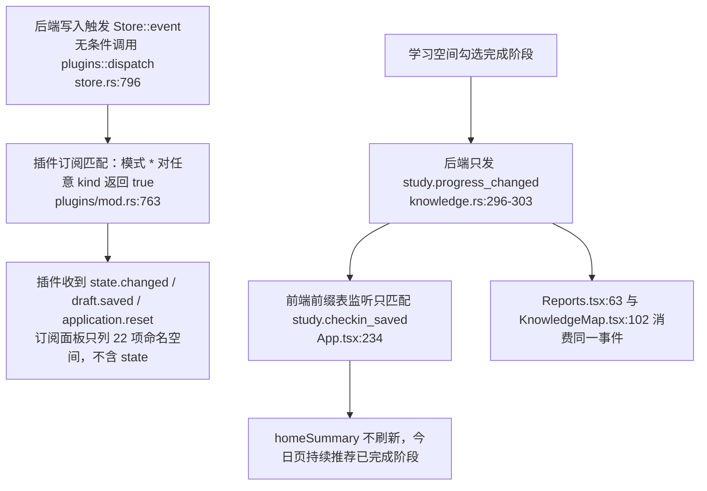

# 前后端与事件契约（命令载荷、事件命名空间与消费面）

本组收录 8 条问题，覆盖前端消费面与后端命令/事件载荷之间的契约不一致问题：后端返回值形状与前端类型声明或渲染代码不匹配、事件订阅范围超出白名单声明、事件前缀表遗漏导致派生视图不刷新，以及同一后端载荷在不同消费点的解释口径不一致。

本组两条事件链路的实际走向如下，分别对应 P-024 与 P-028：



---

## P-005 deferred/hints 练习答完一题后详情刷新使整页崩溃为错误页

严重度：高 | 状态：已复核 | 分类：ipc | 位置：desktop/src-tauri/src/backend/practice/mod.rs:1276-1291；desktop/src/pages/Practice.tsx:266；desktop/src/components/SubjectivePractice.tsx:161-162

### 详细说明

触发条件：反馈模式为 deferred 或 hints 的一组练习（题数 ≥ 2），答完第 1 至 N-1 题且整组尚未完成。客观题路径为 submit 后立即 `setDetail(await detail)`（Practice.tsx:169-170）；主观题路径为评分完成事件（practice.*）触发 refresh → detail，此时该题 status 为 done。

实际行为：后端 detail() 的分支条件为 `set.status == "completed" || set.feedback_mode == "immediate"`（mod.rs:1246），不满足时走 else 分支，已答记录的 AnswerView.feedback 被固定赋值为 `Value::Null`（mod.rs:1285），该载荷形态由后端回归测试以 `answer.feedback.is_null()` 固化（desktop/src-tauri/src/backend/practice/tests.rs:560）。前端类型却把 feedback 声明为非空对象（desktop/src/backend/practice.ts:58-68），渲染代码无空值防护地直接读取其属性：客观题 Practice.tsx:266 读取 `answer.feedback.explanation`，主观题 SubjectivePractice.tsx:162 读取 `answer.feedback.overallFeedback`，同文件 166 读取 `answer.feedback.hint`。

用户可见后果：渲染期对 null 取属性抛出 TypeError，PageErrorBoundary（App.tsx:492，组件定义见 App.tsx:542，错误标题「本页遇到问题」见 App.tsx:553）把整个练习页替换为错误页并显示原始异常文本；点击「重试本页」后数据未变、同一渲染路径再次抛出，deferred 与 hints 两种模式下的作答流程整体不可用，只能经左侧导航离开该页面。

### 代码证据

```rust
// desktop/src-tauri/src/backend/practice/mod.rs:1271-1291（else 分支）
    } else {
        // 148#2：deferred 进行中返回考生本人的作答原文（不含分数/对错/
        // 解析——遮蔽是设计意图，本人原文消失不是）；原先返回空集，提交
        // 客观题后回看显示空的禁用输入框，无法确认已保存（主观题经
        // pending_answers 一直有本人原文，两口径原先不一致）
        let mut statement = store.conn.prepare("SELECT id, question_id, response_json, grader_request_id FROM practice_answers WHERE set_id = ?1 AND status = 'done' ORDER BY id")?;
        ...
                feedback: Value::Null,
```

```tsx
// desktop/src/pages/Practice.tsx:266
{answered && answer && <div className={`answer-feedback ${answer.correct === true ? 'is-correct' : answer.correct === false ? 'is-wrong' : ''}`}><div>{answer.correct === true ? <CheckCircle2 size={21} /> : <CircleAlert size={21} />}<h3>{answer.correct === true ? '回答正确' : answer.correct === false ? '回答错误，解析与资料依据如下' : '答案已保存'}</h3></div><p>{answer.feedback.explanation ?? answer.feedback.hint ?? (detail.set.feedbackMode === 'deferred' ? '全部题目提交后统一显示答案与解析。' : '本组只提供提示，不显示标准答案。')}</p></div>}
```

```tsx
// desktop/src/components/SubjectivePractice.tsx:161-162
{answer?.status === 'done' && <div className="subjective-rubric"><div><CheckCircle2 size={20} /><h3>{answer.score === null ? '评分已保存，按当前设置仅显示提示' : answer.correct ? '达到本题掌握阈值' : '本题仍需巩固'}</h3>{answer.score !== null && <strong>{answer.score.toFixed(2)} / {answer.maxScore?.toFixed(2)}</strong>}</div>
{answer.feedback.overallFeedback && <p>{answer.feedback.overallFeedback}</p>}
```

```ts
// desktop/src/backend/practice.ts:58-68（feedback 声明为非空对象，无 null 分支）
  feedback: {
    answer?: number | string
    explanation?: string
    hint?: string
    status?: string
    unanswered?: boolean
    overallFeedback?: string
    criteria?: { id: string; description: string; score: number; maxScore: number; evidence: string; feedback: string }[]
    citations?: { materialId: number; quote: string }[]
  }
```

```tsx
// desktop/src/App.tsx:492
<main id="main-content" className="main-content" tabIndex={-1}><Suspense fallback={<div className="page-loading" role="status"><LoaderMark />正在加载学习工作区…</div>}><PageErrorBoundary key={page}>{renderPage()}</PageErrorBoundary></Suspense></main>
```

---

## P-006 hints 模式进行中已答题的提示在详情中不回显，整组完成前不可见

严重度：高 | 状态：已复核 | 分类：ipc | 位置：desktop/src-tauri/src/backend/practice/mod.rs:1246、:1258-1260、:1285、:1485-1486；desktop/src/pages/Practice.tsx:169-170、:266、:269；desktop/src/components/SubjectivePractice.tsx:166

### 详细说明

触发条件：hints 反馈模式下答任意一道题（客观题对应 Practice.tsx:266，主观题对应 SubjectivePractice.tsx:166），且整组练习尚未完成。

实际行为：hints 模式对外承诺只给提示、不显示标准答案，但提示在作答期间取不到。后端 detail() 的分支条件 `set.status == "completed" || set.feedback_mode == "immediate"`（mod.rs:1246）把进行中的 hints 集合送入遮蔽分支，该分支已答记录的 feedback 为 `Value::Null`（mod.rs:1285）且不带 hint 字段；只有 completed/immediate 分支才组装 `{"hint": …}`（mod.rs:1258-1260）。submit 命令的返回值同样携带 hint（mod.rs:1485-1486），但前端丢弃 submit 返回值，改用 detail 结果渲染（Practice.tsx:169-170），渲染表达式为 `answer.feedback.explanation ?? answer.feedback.hint ?? 兜底文案`（Practice.tsx:266），其中兜底文案在 hints 模式下为「本组只提供提示，不显示标准答案。」；「只给一点提示」按钮在已作答状态下禁用（Practice.tsx:269），进行期无回看途径。整组完成后集合进入 completed 分支，所有题的提示同时出现。

用户可见后果：提交瞬间的提示被通用文案替换且无法再展开，hints 模式唯一的反馈物在作答后至整组完成前不可见；整组完成后提示集体出现，行为前后不一致。submit 返回值与 detail 载荷两个口径不一致（前者带 hint，后者进行期不带），是该不一致的直接来源。

### 代码证据

```rust
// desktop/src-tauri/src/backend/practice/mod.rs:1246
let mut answers = if set.status == "completed" || set.feedback_mode == "immediate" {
```

```rust
// desktop/src-tauri/src/backend/practice/mod.rs:1258-1260（仅 completed/immediate 分支组装 hint）
feedback: if set.feedback_mode == "hints" {
    let question_id: i64 = row.get(1)?;
    json!({"hint": hints.get(&question_id).cloned().unwrap_or_default()})
```

```rust
// desktop/src-tauri/src/backend/practice/mod.rs:1285（进行中分支的已答行）
feedback: Value::Null,
```

```rust
// desktop/src-tauri/src/backend/practice/mod.rs:1485-1486（submit 返回值带 hint）
feedback: if set.feedback_mode == "hints" {
    json!({"hint": hint})
```

```tsx
// desktop/src/pages/Practice.tsx:169-170（submit 返回值被丢弃）
await practiceBackend.submit(detail.set.id, question.id, answer)
setDetail(await practiceBackend.detail(detail.set.id))
```

```tsx
// desktop/src/pages/Practice.tsx:269（已作答时提示按钮禁用）
<Button variant="ghost" onClick={() => setHint(!hint)} disabled={answered}><Lightbulb size={17} />{hint ? '收起提示' : '只给一点提示'}</Button>
```

```tsx
// desktop/src/components/SubjectivePractice.tsx:166
{answer.feedback.hint && <p>{answer.feedback.hint}</p>}
```

### 合并来源

后端-练习A-3、后端-练习B-4

---

## P-007 scan 失败事件触发前端自动重扫形成自激循环

严重度：高 | 状态：已复核 | 分类：ipc | 位置：desktop/src-tauri/src/backend/maintenance/mod.rs:660-666；desktop/src/components/MaintenancePanel.tsx:41-45

### 详细说明

触发条件：体检页（MaintenancePanel 挂载）处于打开状态，且体检持续失败——典型场景是外键违规的数据库，后端回归测试证实此类库每次调用 get_maintenance_report 均返回 foreign_key_violation（desktop/src-tauri/src/backend/maintenance/tests.rs:373-376），以及 integrity 检查失败的库。

实际行为：scan 命令的结果经 emit_result 统一收口，失败分支写入 maintenance.failed 事件并广播（mod.rs:660-666）；MaintenancePanel 的事件订阅命中 `maintenance.` 前缀即调用 pullReport()，pullReport 再调用 get_maintenance_report（desktop/src/backend/maintenance.ts:45），该调用失败后写入新的 maintenance.failed 事件并再次广播，构成闭合回路。scan 不参与任何互斥或停止机制，回路不会自行终止。后端广播使用 `app.emit("backend://event", event)`（desktop/src-tauri/src/backend/commands.rs:40-44），包含发起窗口自身，因此发起体检的同一窗口也会收到事件。

用户可见后果：其一，每一轮失败都经 window.dispatchEvent('backend-error') 触发全局错误通知（desktop/src/backend/client.ts:575；foreign_key_violation 不在 database_busy/store_busy 静默名单内），形成高频提示风暴。其二，events 表每轮新增一行 maintenance.failed，无界增长，与本模块 vacuum 裁剪所要遏制的增长问题方向相反。其三，每轮循环执行一次全库 integrity 检查、外键检查与全目录树遍历，CPU 与 IO 持续空转直至关闭体检页；另一窗口的 cleanup/vacuum 失败同样广播，跨窗口触发相同回路。

### 代码证据

```rust
// desktop/src-tauri/src/backend/maintenance/mod.rs:656-668
Err(error) => {
    // 86#6：失败分支的事件写入失败（同因磁盘满）不得经 ? 覆盖原始
    // 错误——尽力落审计事件，始终返回整理本身的失败原因
    if let Ok(event) = Store::event(
        &store.conn,
        "maintenance.failed",
        json!({"kind": kind, "error": error}),
    ) {
        emit(app, &event);
    }
    Err(error)
}
```

```tsx
// desktop/src/components/MaintenancePanel.tsx:41-45
void onBackendEvent(event => {
  if (disposed || !event.kind.startsWith('maintenance.')) return
  void pullReport()
// 136#2：订阅链补 .catch——与全仓其余订阅同口径，不留 unhandled rejection
}).then(remove => { if (disposed) remove(); else unlisten = remove }).catch(reportBackendError)
```

```ts
// desktop/src/backend/maintenance.ts:45
  report: () => invoke<MaintenanceReport>('get_maintenance_report'),
```

```rust
// desktop/src-tauri/src/backend/commands.rs:40-44
pub(crate) fn emit<R: Runtime>(app: &AppHandle<R>, event: &BackendEvent) {
    if let Err(error) = app.emit("backend://event", event) {
        eprintln!("backend event {} delivery failed: {error}", event.kind);
    }
}
```

---

## P-008 按版本号读取讲义只认已完成版本，生成全程报 not_found 并掩盖失败原因

严重度：高 | 状态：已复核 | 分类：ipc | 位置：desktop/src-tauri/src/backend/learning/lecture.rs:202；desktop/src-tauri/src/backend/learning/lecture.rs:762；desktop/src/pages/StudyRoom.tsx:166；desktop/src/pages/StudyRoom.tsx:234

### 详细说明

触发条件：学习空间页面对讲义执行带版本号的读取，版本号取自当前正在生成的版本。前端在生成请求返回后把 readingVersionRef.current 置为该版本号（StudyRoom.tsx:234），并在每条 lecture.* 事件上用该版本号回读（StudyRoom.tsx:166）；页面初始化的 refreshLecture 同样回填当前版本号。

实际行为：后端 get(state, id, stage_id, Some(version)) 先查询 learning_lecture_versions 是否存在对应版本行，不存在即返回 not_found「讲义历史版本不存在」（lecture.rs:202-205）。该表的唯一写入点在 finish_lecture，即全部单元完成之后（lecture.rs:762）。因此生成中、失败、被取消、被中断的版本均无版本行，按版本号读取一律 not_found。

用户可见后果：其一，生成开始后第一条 lecture.unit_started 或 lecture.unit_completed 事件即触发 not_found，页面顶部弹出红色错误横幅，弹窗内的「N / M 个单元已保存」进度与状态不再更新，阅读区取不到已生成单元正文。其二，生成失败时最后一条 lecture.failed 事件的刷新同样失败，真实失败原因（invalid_lecture_unit、provider 错误等）被 not_found 文案覆盖，界面不呈现失败原因。其三，用户在生成进行中进入学习空间页面，初始 refreshLecture 回填当前版本号，问题立即出现。仅当生成成功写入版本行后，lecture.completed 事件的刷新才成功，界面自愈。

本条根因为版本行存在性门控，与「历史版本响应缺当前版本字段」的契约根因不同，未与其合并。

### 代码证据

```rust
// desktop/src-tauri/src/backend/learning/lecture.rs:202-205
let exists: bool = store.conn.query_row("SELECT EXISTS(SELECT 1 FROM learning_lecture_versions WHERE plan_id = ?1 AND stage_id = ?2 AND version = ?3)", params![id, stage_id, version], |row| row.get(0))?;
if !exists {
    return Err(BackendError::new("not_found", "讲义历史版本不存在"));
}
```

```rust
// desktop/src-tauri/src/backend/learning/lecture.rs:762（版本行的唯一写入点，位于 finish_lecture）
tx.execute("INSERT OR IGNORE INTO learning_lecture_versions (plan_id, stage_id, version, created_at) VALUES (?1, ?2, ?3, ?4)", params![id, stage_id, version, now()?])?;
```

```tsx
// desktop/src/pages/StudyRoom.tsx:234
      readingVersionRef.current = next.version
```

```tsx
// desktop/src/pages/StudyRoom.tsx:166
      if (event.kind.startsWith('lecture.') && event.payload.planId === stageRef.current.planId && event.payload.stageId === stageRef.current.stageId) void refreshLectureRef.current(readingVersionRef.current)
```

---

## P-024 订阅「*」的启用插件实际收到 state.changed / draft.saved / application.reset 投递

严重度：中 | 状态：已复核 | 分类：logic | 位置：desktop/src-tauri/src/backend/plugins/mod.rs:763；desktop/src-tauri/src/backend/store.rs:796

### 详细说明

触发条件：安装 subscriptions 为 `["*"]` 的插件清单并启用。

实际行为：技术决策第 31 条（note/产品与技术决策.md:313-318）、docs/architecture/01-architecture.md:169 与前端订阅面板（desktop/src/pages/Integrations.tsx:9，列出 22 项命名空间、不含 state）均声明 state.changed 为内部状态同步事件、不开放给插件。后端侧，订阅模式 `*` 被判定为合法（mod.rs:325-326），matches 函数的 `pattern == "*"` 分支对任意 kind 返回 true（mod.rs:763-765）；Store::event 对写入的每个事件无条件调用 plugins::dispatch（store.rs:796），而 state.changed 正是由 Store::event 产出（store.rs:954-957）。两处合起来使通配订阅命中 state.changed。replace_collection 是高频写路径（desktop/src-tauri/src/backend/commands.rs:135 注释记为「打字保存/勾选任务」），每次执行都发出 state.changed；draft.saved（资料库编辑器 350ms 停顿后触发）与 application.reset 同样进入通配订阅。

用户可见后果：其一，插件卡片的「N 条真实投递」计数随每次打字保存或勾选任务递增。其二，「真实事件记录」面板最新 100 条被 state.changed 占据首屏，订阅命中的业务事件被挤出。其三，投递记录中出现面板未列出的 state.changed，与面板展示的 22 项命名空间自相矛盾。其四，plugin_deliveries 表无保留清理策略（仅在卸载或重置时随 CASCADE 清除），随高频事件无限增长侵蚀数据库。白名单一致性测试只校验「实发 ⊆ 白名单 ∪ {state}」方向，未覆盖「`*` 不命中 state」这一语义。

### 代码证据

```rust
// desktop/src-tauri/src/backend/plugins/mod.rs:763-769
fn matches(pattern: &str, kind: &str) -> bool {
    pattern == "*"
        || pattern.strip_suffix(".*").is_some_and(|prefix| {
            kind.strip_prefix(prefix)
                .is_some_and(|suffix| suffix.starts_with('.'))
        })
}
```

```rust
// desktop/src-tauri/src/backend/store.rs:795-796
        super::plugins::dispatch(conn, event.id, &event.kind)?;
```

```rust
// desktop/src-tauri/src/backend/store.rs:954-957
        let event = Self::event(
            &tx,
            "state.changed",
            json!({"namespace": namespace, "revision": revision}),
        )?;
```

```rust
// desktop/src-tauri/src/backend/plugins/mod.rs:24-25（白名单口径注释）
// 前端 Integrations.tsx 的 namespaces 数组须与本表同步
```

```md
<!-- docs/architecture/01-architecture.md:169 -->
插件可订阅 `EVENT_NAMESPACES` 中的 22 个事件命名空间或 `*`。`state.changed` 是内部快照同步事件，不开放给插件。
```

### 合并来源

后端-插件-1、横切-事件契约-2

---

## P-028 全局摘要刷新漏配 study.progress_changed，今日页持续推荐已完成阶段

严重度：中 | 状态：已复核 | 分类：logic | 位置：desktop/src/App.tsx:234

### 详细说明

触发条件：用户在学习空间勾选完成某个阶段后切回「今日」页。

实际行为：应用级 homeSummary 仅在 effect 挂载时加载一次（App.tsx:220-240），此后仅由 234 行的前缀表事件驱动刷新，无轮询，窗口聚焦也不触发。后端 set_reading_progress 只发出一条 study.progress_changed 事件（desktop/src-tauri/src/backend/learning/knowledge.rs:296-303），不产生 kv 集合变更、不发 state.changed、不改版本号；而 dashboard 的 nextTask 取自 learning_reading_progress 的完成状态（desktop/src-tauri/src/backend/engagement/mod.rs:866-873）。234 行的前缀表包含 'study.checkin'，只匹配 study.checkin_saved，不匹配 study.progress_changed。同一文件的通知监听（App.tsx:208）含 study 域，Reports（desktop/src/pages/Reports.tsx:63）与 KnowledgeMap（desktop/src/pages/KnowledgeMap.tsx:102）均消费该事件，唯独摘要监听漏配。

用户可见后果：今日页 hero 区「下一站：{已完成阶段标题}」与「继续学习」目标保持陈旧，直到某个恰好命中前缀表的无关事件（如勾选任务触发 state.changed）出现才自愈。

### 代码证据

```tsx
// desktop/src/App.tsx:234
      if (active && ['state.changed', 'plan.', 'study.checkin', 'security.session_started', 'focus.', 'practice.', 'review.'].some(prefix => event.kind.startsWith(prefix))) void load().catch(error => { if (active) { setHomeSummaryError(backendErrorMessage(error)); reportBackendError(error) } })
```

```rust
// desktop/src-tauri/src/backend/engagement/mod.rs:866-873
    let next_task = plan.as_ref().and_then(|plan| {
        let plan_id = super::learning::plan_id(&plan.id).ok()?;
        plan.result.as_ref().and_then(|result| {
            result.stages.iter().find(|stage| {
                let completed: bool = store.conn.query_row("SELECT COALESCE((SELECT completed FROM learning_reading_progress WHERE plan_id = ?1 AND stage_id = ?2), 0)", params![plan_id, stage.id], |row| row.get(0)).unwrap_or(false);
                !completed
```

```rust
// desktop/src-tauri/src/backend/learning/knowledge.rs:296-303
    let event = Store::event(
        &tx,
        "study.progress_changed",
        json!({"planId": format!("plan-{id}"), "stageId": stage_id, "completed": progress.completed, "bookmarked": progress.bookmarked}),
    )?;
```

```tsx
// desktop/src/pages/KnowledgeMap.tsx:102（对照：消费 study.progress_changed）
      if (event.kind === 'study.progress_changed' && event.payload.planId === planRef.current?.id) void refreshOverviewRef.current()
```

### 合并来源

横切-事件契约-1

---

## P-034 SyncPanel 下载配置后的「在资源管理器中显示」按钮必然被 reveal 白名单拒绝

严重度：中 | 状态：已复核 | 分类：ipc | 位置：desktop/src/components/SyncPanel.tsx:104；desktop/src/components/SyncPanel.tsx:140；desktop/src-tauri/src/backend/sync/mod.rs:582；desktop/src-tauri/src/backend/commands.rs:59-63

### 详细说明

触发条件：在配置同步面板点击「下载配置」，用原生保存对话框选定目的地后下载完成。

实际行为：面板记录下载目的地并渲染「在资源管理器中显示」按钮（SyncPanel.tsx:104、:140）。后端 reveal_path 只放行两类目标：当前数据根目录与 reveal 回执表中的路径（TTL 24 小时、上限 64 条，只有 write_export_bytes、export、backup、materials、sharing 命令在写盘成功后登记，见 desktop/src-tauri/src/backend/export/commands.rs:30、:56，materials/commands.rs:120、:147，sharing/commands.rs:83，backup/commands.rs:50）。同步下载在 sync/mod.rs:582 直接调用 materials::atomic_export 落盘，全程不调用 reveal::register——在整个 sync 模块中检索 reveal 关键字无任何匹配。同时下载目的地还须通过 reject_data_root_destination 检查（desktop/src-tauri/src/backend/sync/commands.rs:29、:84），必须位于数据目录之外。

用户可见后果：按钮 100% 返回错误 toast「reveal_not_allowed：只能定位数据目录或本应用刚导出的文件」。用户刚完成下载却被告知该文件不属于「本应用刚导出的」，提示与事实不符，功能完全不可用。

### 代码证据

```tsx
// desktop/src/components/SyncPanel.tsx:104
      if (kind === 'download' && destination) setDownloadTarget(destination)
```

```tsx
// desktop/src/components/SyncPanel.tsx:140
      {downloadTarget && <RevealExport path={downloadTarget} />}
```

```rust
// desktop/src-tauri/src/backend/commands.rs:59-63
    if !super::reveal::is_known(&target) && target != data_root {
        return Err(super::error::BackendError::new(
            "reveal_not_allowed",
            "只能定位数据目录或本应用刚导出的文件",
        ));
    }
```

```rust
// desktop/src-tauri/src/backend/sync/mod.rs:582（落盘路径无 reveal::register）
            super::materials::atomic_export(&path, &bytes)?;
```

---

## P-035 导入完成提示把所有 backupImportWarnings 统称为「重启后自动重试」

严重度：中 | 状态：已复核 | 分类：ipc | 位置：desktop/src/components/BackupPanel.tsx:57-60；desktop/src-tauri/src/backend/backup/mod.rs:46

### 详细说明

触发条件：备份导入回执携带任一警告。

实际行为：后端把多类警告混入同一个 backupImportWarnings 数组——transfer 层的跳行、请求列置空、同名账号合并等导入警告（backup/mod.rs:44-46，recover_warnings 初值即 import_warnings）、原件缺失警告（backup/mod.rs:88-93）、reindex 失败、九个域的 recover 失败（backup/mod.rs:168-185）。其中仅最后一类会在重启时由常规 recover 补跑；跳过的行、被置空的请求列、缺失的原件、并入的账号均为不可逆的数据降级，重启不会改变。前端对整个数组套用同一模板。

用户可见后果：例如仅含两条跳行警告的导入显示「导入完成，但 2 项恢复未完成（重启后自动重试）：学习方案数据一行引用了备份中不存在的记录，已跳过该行」。用户重启后数据原样，可能据此重复导入，而重复导入同样跳过该行。

### 代码证据

```tsx
// desktop/src/components/BackupPanel.tsx:57-60
      const warnings = snapshot.backupImportWarnings ?? []
      notify(warnings.length
        ? `导入完成，但 ${warnings.length} 项恢复未完成（重启后自动重试）：${warnings[0]}`
        : '备份已重新校验并追加导入；现有数据未被覆盖')
```

```rust
// desktop/src-tauri/src/backend/backup/mod.rs:44-46
    let (counts, import_warnings) = transfer::import(&mut backup, store, state)?;
    let mut reindex_warning: Option<String> = None;
    let mut recover_warnings: Vec<String> = import_warnings;
```

```rust
// desktop/src-tauri/src/backend/backup/mod.rs:172-185（多类警告合并进同一数组）
    if let Err(error) = result {
        recover_warnings.push(format!("{name} 恢复未完成：{}", error.message));
    }
    let mut snapshot = store.app_state()?;
    if let Some(warning) = reindex_warning {
        snapshot["backupImportWarnings"] = json!([warning]);
    }
    if !recover_warnings.is_empty() {
        snapshot["backupImportWarnings"] = match snapshot.get("backupImportWarnings") {
```
