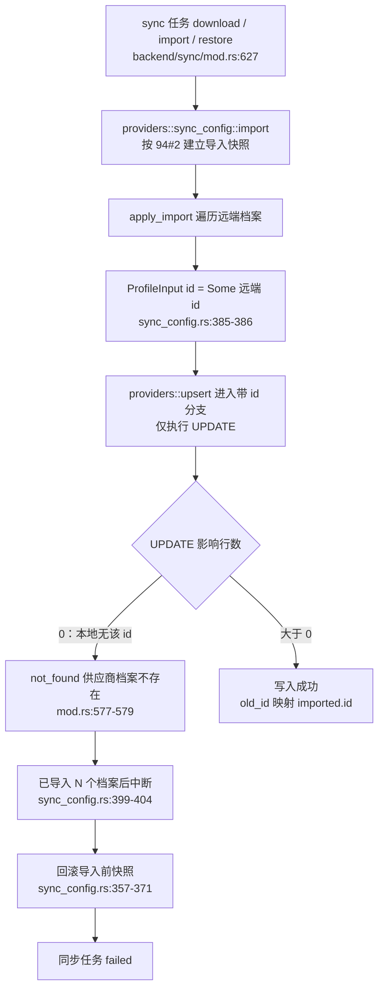
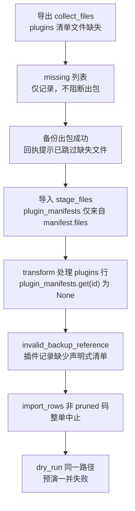
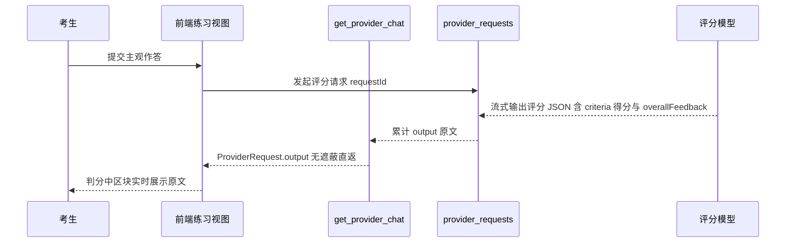
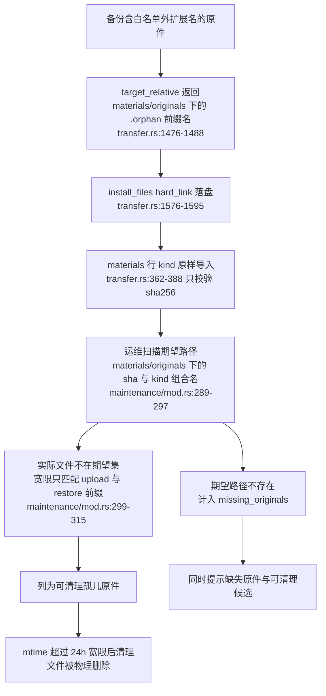
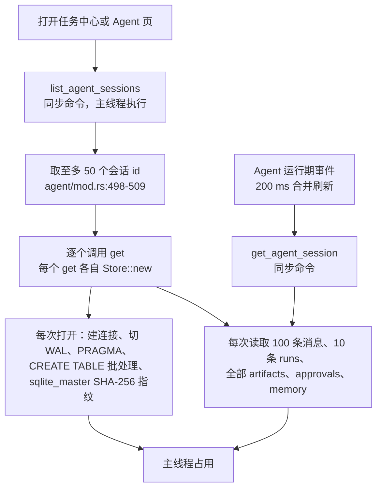

# 安全与数据边界（遮蔽泄露、导入导出、跨用户隔离）

本组收录 10 条问题，覆盖反馈遮蔽失效、备份与同步的导入导出边界、跨用户/跨设备数据边界，以及与上述边界同源的主线程阻塞与前端提示缺陷。所有条目的代码证据均在本会话中逐条读取所引文件与行号后确认；行号对应复核时的 `main` 分支代码（复核基点 06ae67d7，其后仅有文档提交，源码行号未变动）。严重度沿用复核结论，分类沿用原复核口径。

---

## P-003 同步恢复/导入对本地不存在的档案 id 直接报 not_found，空库或新机器恢复必然失败

严重度：high | 状态：已复核 | 分类：logic | 位置：desktop/src-tauri/src/backend/providers/sync_config.rs:386 + desktop/src-tauri/src/backend/providers/mod.rs:577

### 详细说明

**触发条件**：换机、重装或应用重置后，从 WebDAV/S3 执行导入或恢复。`providers::clear_all` 已删除 `provider_profiles` 全部行（providers/mod.rs:355-362），而该表主键为 `INTEGER PRIMARY KEY AUTOINCREMENT`（providers/mod.rs:282），AUTOINCREMENT 序列不复用旧号，新档案 id 不再落在旧号段；远端配置里的 p1、p2 等 id 在本地无对应行。backend/sync/mod.rs:627 的 download/import/restore 三类任务统一走 `providers::sync_config::import`。

**实际行为**：`sync_config::apply_import` 对每个远端档案构造 `ProfileInput { id: Some(profile.id) }`（sync_config.rs:385-386），`providers::upsert` 对带 id 的输入只执行 UPDATE（providers/mod.rs:572-576），行不存在时 `changed == 0`，返回 `not_found`「供应商档案不存在」（providers/mod.rs:577-579）。首个档案即失败，错误被包装为「已导入 N 个档案后中断」（sync_config.rs:399-404），随后按 94#2 建立的导入快照回滚本地配置（sync_config.rs:357-371），同步任务置 failed。

**用户可见后果**：同步配置的跨设备与灾备恢复能力不可用，只有「导出与导入发生在同一状态库」的往返可用。界面提示为「导入失败，已回滚到导入前的本地配置：已导入 0 个档案后中断：供应商档案不存在」，文案不指示本地缺少对应档案，用户无法自行定位。

**旁证**：

1. `apply_import` 内 `old_id → imported.id` 的重映射（sync_config.rs:405-427）仅在新建档案 id 与远端 id 不同时才有意义，说明设计预期为可新建，与 upsert 只 UPDATE 的实现相悖。
2. 前端 JSON 导入路径刻意剥掉 id 走追加：`importedProfiles` 不取 id 字段（ProviderHub.tsx:38-61），`confirmImport` 注释写明「导入的档案均为新追加（id: None），删除即恢复原状」（ProviderHub.tsx:350-352）。两条导入路径行为不一致。
3. 唯一覆盖 import 的测试 `webdav_upload_download_import_and_terminal_events_are_real`（backend/sync/tests.rs:161）先以 `create_provider` 建立 p1 占位再导入（backend/sync/tests.rs:182），只覆盖同机往返，未覆盖空库场景。



### 代码证据

`desktop/src-tauri/src/backend/providers/sync_config.rs:383-386`：

```rust
    for profile in config.providers {
        let old_id = profile.id.clone();
        let input = ProfileInput {
            id: Some(profile.id),
```

`desktop/src-tauri/src/backend/providers/mod.rs:572-579`：

```rust
    let id = if let Some(id) = id {
        let changed = tx.execute(
            "UPDATE provider_profiles SET name = ?1, preset = ?2, kind = ?3, protocol = ?4, base_url = ?5, default_model = ?6, models_json = ?7, enabled = ?8, note = ?9, health = 'unknown', latency_ms = NULL, updated_at = ?10 WHERE id = ?11",
            params![input.name, input.preset, input.kind, input.protocol, input.base_url, input.default_model, serde_json::to_string(&models)?, input.enabled.unwrap_or(true), input.note, now()?, id],
        )?;
        if changed == 0 {
            return Err(BackendError::new("not_found", "供应商档案不存在"));
        }
```

`desktop/src-tauri/src/backend/providers/sync_config.rs:399-404`：

```rust
        let imported = super::upsert(app, state, input).map_err(|error| {
            BackendError::new(
                &error.code,
                &format!("已导入 {applied} 个档案后中断：{}", error.message),
            )
        })?;
```

`desktop/src-tauri/src/backend/providers/mod.rs:281-282`：

```rust
        "CREATE TABLE IF NOT EXISTS provider_profiles (
            id INTEGER PRIMARY KEY AUTOINCREMENT,
```

`desktop/src/pages/ProviderHub.tsx:350-352`：

```tsx
    // 125#2：逐档案 upsert 失败时回滚本次已导入项——原先前 N-1 条各自
    // 提交留下「部分新档案」且无撤销入口（94#2 在 sync 恢复路径修掉的
    // 同型问题）；导入的档案均为新追加（id: None），删除即恢复原状
```

### 合并来源

- 后端-供应商B-1

---

## P-004 插件清单文件缺失时导出「成功」的备份无法预演也无法导入，整单被拒

严重度：high | 状态：已复核 | 分类：logic | 位置：desktop/src-tauri/src/backend/backup/transfer.rs:996（配合 desktop/src-tauri/src/backend/backup/archive.rs:317-319）

### 详细说明

**触发条件**：导出时 `plugins` 表有行，但 `plugins/{id}/manifest.json` 不在数据根盘上——杀毒隔离、同步盘部分同步、手动改动，正是 archive.rs:249-252 注释自认要处理的缺件场景。

**实际行为**：导出侧 `collect_files` 把缺失清单记入 `missing` 后继续出包（archive.rs:312-320），用户拿到「已保存全量备份……1 个文件已缺失，按只报告不替代跳过」的回执，备份看似有效。恢复侧 `stage_files` 只处理 `manifest.files` 中存在的条目，`transfer.plugin_manifests` 因此不含该插件 id（transfer.rs:1524-1553）；`transform` 处理 `plugins` 表每行时 `plugin_manifests.get(id)` 必为 None，返回 `invalid_backup_reference`「插件记录缺少声明式清单」（transfer.rs:994-1000）。`import_rows` 仅对 `pruned_backup_reference` 做跳行降级，该错误码不在其列，整单导入失败（transfer.rs:1386-1398）。`dry_run` 走同一条 `stage_files` + `import_rows` 路径（transfer.rs:1625-1627），预演同样失败。

**用户可见后果**：唯一一份「导出成功」的备份在换机或重装后完全无法恢复，连预演都无法打开，界面报错为「处理备份插件数据时：插件记录缺少声明式清单」，不指向当初那条「已跳过缺失文件」的提示。即使目标机已安装同一插件也无效：`global_conflict` 对 `plugins` 表走默认分支恒返回 false（transfer.rs:1272-1279），不存在按已存在记录跳过该行的路径。

**与既有规约的冲突**：docs/architecture/02-operation-principles.md:269 规定「缺失或漂移文件写入 manifest，预演和导入均必须返回对应警告」；实现为整单拒绝而非警告。



### 代码证据

`desktop/src-tauri/src/backend/backup/archive.rs:312-320`：

```rust
    for id in ids {
        let relative = format!("plugins/{id}/manifest.json");
        let source = root.join(format!("plugins/{id}/manifest.json"));
        let content = match fs::read_to_string(&source) {
            Ok(content) => content,
            Err(error) if error.kind() == std::io::ErrorKind::NotFound => {
                missing.push(relative);
                continue;
            }
```

`desktop/src-tauri/src/backend/backup/transfer.rs:994-1000`：

```rust
    if table == "plugins" {
        if let Some(id) = row.get("id").and_then(Value::as_str) {
            let content = transfer.plugin_manifests.get(id).cloned().ok_or_else(|| {
                BackendError::new("invalid_backup_reference", "插件记录缺少声明式清单")
            })?;
            row.insert("manifest_json".into(), Value::String(content));
        }
    }
```

`desktop/src-tauri/src/backend/backup/transfer.rs:1386-1398`：

```rust
            if let Err(error) = transform(transfer, table, row, tx) {
                if error.code == "pruned_backup_reference" {
                    transfer.warnings.push(format!(
                        "{}一行引用了备份中不存在的记录，已跳过该行",
                        table_label(table)
                    ));
                    continue;
                }
                return Err(BackendError::new(
                    &error.code,
                    &format!("处理备份{}时：{}", table_label(table), error.message),
                ));
            }
```

`desktop/src-tauri/src/backend/backup/transfer.rs:1529-1534`：

```rust
    let entries = backup.manifest.files.clone();
    let mut staged = Vec::new();
    for (index, entry) in entries.iter().enumerate() {
        let mut bytes = backup.read_file(entry)?;
        let relative = target_relative(entry, &transfer.maps)?;
        if relative.starts_with("plugins/") {
```

### 合并来源

- 后端-备份-1

---

## P-010 主观题评分模型的流式输出未遮蔽，判分信息在交卷前实时展示给考生

严重度：high | 状态：已复核 | 分类：security | 位置：desktop/src/components/ExamWorkspace.tsx:48,96,222；desktop/src/components/SubjectivePractice.tsx:70,158；desktop/src-tauri/src/backend/providers/commands.rs:133；desktop/src-tauri/src/backend/practice/subjective.rs:458-461

### 详细说明

**触发条件**：含简答或论述题的模拟考试中，考生提交主观作答后；或反馈方式为 deferred/hints 的主观题练习中提交作答后。

**实际行为**：deferred 模拟考试的作答载荷已遮蔽 score/correct/feedback（practice/mod.rs:1276-1292），set 级分数与正确率按 `feedback_mode != "hints" && !(mode == "exam" && status != "completed")` 判定可见性（practice/mod.rs:1103），客观题事件的 `correct` 字段亦按 reveal 置空（practice/mod.rs:1457）。但主观题的评分请求输出走另一条未遮蔽通道：前端把该作答的评分 requestId 当普通 provider chat 拉取——`get_provider_chat` 直接返回 `ProviderRequest.output` 的原始累计文本（providers/commands.rs:133-138，providers/mod.rs:1096-1102，输出字段定义 providers/mod.rs:990），无任何按反馈模式或考试状态的门槛；ExamWorkspace.tsx:96 与 SubjectivePractice.tsx:70 拉取该输出，ExamWorkspace.tsx:222 与 SubjectivePractice.tsx:158 在评分进行中渲染 `<pre className="streaming-output">{output}</pre>`。评分模型的输出内容按 requiredOutput 约定包含 `criteria[].score`（0 到 1 的完成比例）与 `overallFeedback`（practice/subjective.rs:454-462）。

**用户可见后果**：模型逐字输出的评分 JSON 在交卷或完成前实时显示给考生本人，逐题得分比例与总体评价提前泄露；遮蔽机制（practice/mod.rs:1099-1102 注释确立的「载荷在场即泄露面」口径）被最直接的通道击穿，模拟考试与延迟反馈练习的自测效度失效。



### 代码证据

`desktop/src/components/ExamWorkspace.tsx:96`：

```tsx
      void backend.getProviderChat(requestId).then(request => { if (active) setOutput(request.output) }).catch(error => {
```

`desktop/src/components/ExamWorkspace.tsx:222`：

```tsx
          {answer && ['grading', 'cancelling'].includes(answer.status) && <div className="answer-feedback" aria-live="polite"><h3>正在按评分要点判分</h3><pre className="streaming-output">{output || '作答已保存，等待评分模型输出…'}</pre><Button variant="secondary" onClick={() => void cancelAnswer()} disabled={busy || answer.status === 'cancelling'}>{busy ? '正在取消…' : '取消评分'}</Button></div>}
```

`desktop/src/components/ExamWorkspace.tsx:48`：

```tsx
  const activeRequest = exam && ['generating', 'cancelling'].includes(exam.set.status) ? exam.set.requestId : answer && ['grading', 'cancelling'].includes(answer.status) ? answer.requestId : null
```

`desktop/src-tauri/src/backend/providers/commands.rs:132-138`：

```rust
#[tauri::command]
pub fn get_provider_chat(
    state: State<'_, BackendState>,
    request_id: String,
) -> Result<super::ProviderRequest> {
    super::get_chat(&state.providers, &request_id)
}
```

`desktop/src-tauri/src/backend/practice/subjective.rs:454-462`：

```rust
    let prompt = serde_json::to_string(&json!({
        "questionKind": task.kind, "question": task.prompt,
        "referenceAnswer": expected, "rubric": rubric,
        "studentAnswer": response, "citations": citations,
        "requiredOutput": {
            "criteria": [{"id": "评分项标识", "score": "0到1的完成比例", "evidence": "评分依据", "feedback": "具体反馈"}],
            "overallFeedback": "总体反馈", "citations": if source_list.is_empty() { json!([]) } else { json!([{"materialId": "资料数字ID", "quote": "资料连续原文"}]) },
        },
    }))?;
```

`desktop/src-tauri/src/backend/practice/mod.rs:1103`（对照：已落定的遮蔽口径）：

```rust
            let visible = feedback_mode != "hints" && !(mode == "exam" && status != "completed");
```

### 合并来源

- 后端-练习B-1
- 前端-练习套件-2

---

## P-021 导出不执行清单 1 MiB 与条目数上限，文件条目多的备份「写得出、读不回」

严重度：medium | 状态：已复核 | 分类：logic | 位置：desktop/src-tauri/src/backend/backup/archive.rs:574（导出侧无对应检查，见 archive.rs:467-511）

### 详细说明

**触发条件**：库内文件条目累积到数千条量级。材料原件受 200 条配额限制（security/mod.rs:170）；插件清单数与插件数同阶；Agent 产物侧，`agent/tools.rs:389` 的提交动作每次新增一行并落盘一个 scratch 文件，行内 `expires_at` 为提交时间后 1 天（agent/tools.rs:350-351），而这些行仅在运维维护按 `expires_at < now` 回收（maintenance/mod.rs:600-606），未执行维护时持续累积。单条 `FileEntry` 序列化后含 path、64 位 sha256 与 bytes，约 130–200 字节（archive.rs:99-103），1 MiB 清单约容纳 5,000–8,000 条；归档条目数上限另为 20,000（archive.rs:571）。

**实际行为**：导出侧 `export` 直接把 `serde_json::to_string(&manifest)` 写入 `manifest.json`（archive.rs:484-488），对清单大小与文件条目数没有任何检查；导出完成后的唯一上限校验是整包 2 GiB（archive.rs:509-511）。导入侧 `open` 用 `read_bounded` 按 `MAX_MANIFEST_BYTES = 1 MiB` 读清单（archive.rs:574-579，超限即报 `backup_entry_too_large`「备份条目超过允许大小」），另有 `archive.len() > 20_002` 拒收（archive.rs:571-573）。

**用户可见后果**：导出全程成功、回执正常，日后预演与导入双双被拒，错误文案指向「条目」而非清单本身，无法自行定位；该备份在本应用内永远无法恢复。

**与既有规约的冲突**：docs/architecture/02-operation-principles.md:268 列出「上限为备份 2 GiB、数据库 512 MiB、单文件 50 MiB、清单 1 MiB」。其中数据库上限（archive.rs:447）、单文件上限（archive.rs:228）与整包上限（archive.rs:509、:562）在导出侧均有对应检查，清单 1 MiB 只在读侧存在。

### 代码证据

`desktop/src-tauri/src/backend/backup/archive.rs:481-488`：

```rust
    let mut bytes = Vec::new();
    {
        let mut writer = zip::ZipWriter::new(std::io::Cursor::new(&mut bytes));
        write_archive_file(
            &mut writer,
            "manifest.json",
            serde_json::to_string(&manifest)?.as_bytes(),
        )?;
```

`desktop/src-tauri/src/backend/backup/archive.rs:19-22`：

```rust
pub(crate) const MAX_BACKUP_BYTES: u64 = 2 * 1024 * 1024 * 1024;
const MAX_DATABASE_BYTES: u64 = 512 * 1024 * 1024;
const MAX_FILE_BYTES: u64 = 50 * 1024 * 1024;
const MAX_MANIFEST_BYTES: usize = 1024 * 1024;
```

`desktop/src-tauri/src/backend/backup/archive.rs:569-579`：

```rust
    let mut archive = ZipArchive::new(file)
        .map_err(|_| BackendError::new("invalid_backup", "备份文件损坏或不是有效的归档"))?;
    if archive.len() < 2 || archive.len() > 20_002 {
        return Err(BackendError::new("invalid_backup", "备份归档条目数量无效"));
    }
    let manifest: Manifest = serde_json::from_slice(&read_bounded(
        &mut archive
            .by_name("manifest.json")
            .map_err(|_| BackendError::new("invalid_backup", "备份缺少清单条目"))?,
        MAX_MANIFEST_BYTES as u64,
    )?)
```

`desktop/src-tauri/src/backend/backup/archive.rs:509-511`：

```rust
    if bytes.len() as u64 > MAX_BACKUP_BYTES {
        return Err(BackendError::new("backup_too_large", "备份超过 2 GB 上限"));
    }
```

### 合并来源

- 后端-备份-2

---

## P-022 备份导入的 .orphan-{ext} 原件被运维当无引用孤儿清除，同一记录先被误报为缺失原件

严重度：medium | 状态：已复核 | 分类：logic | 位置：desktop/src-tauri/src/backend/maintenance/mod.rs:289-315 + desktop/src-tauri/src/backend/backup/transfer.rs:1478-1488

### 详细说明

**触发条件**：导入含白名单外扩展名原件的备份。`target_relative` 对扩展名不在 `materials::SUPPORTED` 且非 zip 的原件，返回 `materials/originals/{sha256}.orphan-{ext前16位}`（transfer.rs:1476-1488，注释标记为 165#1），文件经 `install_files` 的 `fs::hard_link` 真实落盘（transfer.rs:1576-1595）；`materials` 表行的 `kind` 列原样导入，导入侧对该表只校验 sha256 格式与按哈希复用（transfer.rs:362-388），不校验扩展名。

**实际行为**：运维扫描按 `{sha256}.{kind}` 生成期望路径，期望路径不存在即计入 `missing_originals`（maintenance/mod.rs:289-297）；实际落盘的 `.orphan-` 文件不在期望集内，且宽限期只匹配 `.upload-` 与 `.restore-` 两种临时名（maintenance/mod.rs:299-315），该文件被列为「无引用资料原件」孤儿候选。清理时对孤儿原件执行 mtime 宽限复查（maintenance/mod.rs:781-800），超过 24 小时宽限（maintenance/mod.rs:216）即被物理删除。

**用户可见后果**：`materials` 记录仍存在而原件的唯一副本被删除——备份模块特意以 `.orphan-` 前缀保留的数据被运维模块当作垃圾回收。界面同时给出互相矛盾的两项提示：缺失原件警告，以及同一文件出现在可清理候选列表。



### 代码证据

`desktop/src-tauri/src/backend/backup/transfer.rs:1476-1488`：

```rust
            let known = super::super::materials::SUPPORTED.contains(&declared.as_str())
                || declared == "zip";
            if !known {
                return Ok(format!(
                    "materials/originals/{}.orphan-{}",
                    entry.sha256,
                    declared
                        .chars()
                        .take(16)
                        .filter(|c| c.is_ascii_alphanumeric())
                        .collect::<String>()
                ));
            }
```

`desktop/src-tauri/src/backend/maintenance/mod.rs:289-297`：

```rust
        let relative = format!(
            "materials/originals/{}.{}",
            sha256,
            kind.to_ascii_lowercase()
        );
        expected_originals.insert(relative.clone());
        if !root.join(&relative).is_file() {
            missing_originals.push(relative);
        }
```

`desktop/src-tauri/src/backend/maintenance/mod.rs:299-315`：

```rust
    let mut originals = Vec::new();
    for path in walk_files(&root.join("materials/originals"), &mut issues)? {
        let item = file_item(&root, &path)?;
        if !expected_originals.contains(&item.path) {
            let name = path
                .file_name()
                .and_then(|name| name.to_str())
                .unwrap_or_default();
            // 65#7：补写原件的 .restore-{pid}-{n} 临时件与 .upload- 同为
            // 进行中写入，共享宽限——原先只匹配后者，前者被误报为孤儿
            if (name.contains(".upload-") || name.contains(".restore-")) && modified_recently(&path)
            {
                continue;
            }
            originals.push(item);
        }
    }
```

`desktop/src-tauri/src/backend/maintenance/mod.rs:216`：

```rust
const IN_FLIGHT_GRACE: std::time::Duration = std::time::Duration::from_secs(24 * 60 * 60);
```

### 合并来源

- 后端-运维-2

---

## P-060 projects 四个写命令在主线程做 workspace/app_state 全量重建，违反项目自建的 103#7 移后台范式

严重度：medium | 状态：已复核 | 分类：perf | 位置：desktop/src-tauri/src/backend/projects/commands.rs:26-60；desktop/src-tauri/src/backend/projects/mod.rs:177-211,295-301,579,630,740

### 详细说明

**触发条件**：执行「保存版本并开始真实评价」「请求取消」「恢复真实评价」「保存迭代笔记」四类写操作。

**实际行为**：`get_project_workspace` 已按 103#7 移到后台线程（commands.rs:6-24，`#[tauri::command(async)]` + `spawn_blocking`，注释为「≤200 版本逐行 JSON 反序列化，原先同步命令在主线程执行；移后台」）。但 `submit_project_version`（commands.rs:26-33）、`cancel_project_feedback`（commands.rs:35-42）、`resume_project_feedback`（commands.rs:44-51）、`save_project_iteration_note`（commands.rs:53-60）均为未标 async 的同步命令，在主线程执行。四者中 submit/cancel/resume 的返回值都经 `workspace(state)` 重新构建工作区（projects/mod.rs:300、:579、:630），即 103#7 认定必须移后台的「取至多 200 个版本 id + 逐行 `feedback_json` 反序列化」（projects/mod.rs:177-211）仍在主线程执行一遍；`save_project_iteration_note` 末尾的 `store.app_state()`（projects/mod.rs:740）遍历全部 COLLECTIONS 聚合快照（store.rs:753-781），同样在主线程。

**用户可见后果**：版本数接近 200 条、feedback_json 总量增大或笔记集合较大时，点击提交、取消、恢复、保存笔记后主窗口输入与动画出现可感冻结（数十至数百毫秒量级），且与项目已落定的 103#7 修复口径不一致。写入侧正文上限为 100,000 字节（projects/mod.rs:309），200 版满额时 feedback_json 总量可达 20 MB 级。

### 代码证据

`desktop/src-tauri/src/backend/projects/commands.rs:6-8`（对照：已移后台的读命令）：

```rust
// 103#7：≤200 版本逐行 JSON 反序列化，原先同步命令在主线程执行；移后台
#[tauri::command(async)]
pub async fn get_project_workspace<R: Runtime + 'static>(
```

`desktop/src-tauri/src/backend/projects/commands.rs:26-33`：

```rust
#[tauri::command]
pub fn submit_project_version<R: Runtime>(
    app: AppHandle<R>,
    state: State<'_, BackendState>,
    input: SubmissionInput,
) -> Result<ProjectWorkspace> {
    super::submit(&app, &ProjectState::new(&state.learning), input)
}
```

`desktop/src-tauri/src/backend/projects/commands.rs:53-60`：

```rust
#[tauri::command]
pub fn save_project_iteration_note<R: Runtime>(
    app: AppHandle<R>,
    state: State<'_, BackendState>,
    input: IterationNoteInput,
) -> Result<Value> {
    super::iteration_note(&app, &ProjectState::new(&state.learning), input)
}
```

`desktop/src-tauri/src/backend/projects/mod.rs:177-192`：

```rust
pub fn workspace(state: &ProjectState) -> Result<ProjectWorkspace> {
    let store = state.store()?;
    let mut statement = store
        .conn
        .prepare("SELECT id FROM project_versions ORDER BY id DESC LIMIT 200")?;
    let ids = statement
        .query_map([], |row| row.get::<_, i64>(0))?
        .collect::<std::result::Result<Vec<_>, _>>()?;
    drop(statement);
```

`desktop/src-tauri/src/backend/projects/mod.rs:738-741`：

```rust
    tx.commit()?;
    emit(app, &event);
    store.app_state()
}
```

### 合并来源

- 后端-项目-1
- 前端-项目与报告-3
- 横切-主线程阻塞-1
- 横切-旅程-完整闭环-4

---

## P-061 Agent 命令族 9 个全部为同步 fn 在主线程执行，list_agent_sessions 串行 51 次 Store::new 与全套查询

严重度：medium | 状态：已复核 | 分类：perf | 位置：desktop/src-tauri/src/backend/agent/commands.rs:5-79；desktop/src-tauri/src/backend/agent/mod.rs:137-139,395-509,699-714；desktop/src/backend/client.ts:455,459

### 详细说明

**触发条件**：打开任务中心或 Agent 页，以及 Agent 运行期间事件驱动的周期性会话刷新。

**实际行为**：`agent/commands.rs` 的 9 个命令全部为未标 async 的同步命令，在主线程执行（commands.rs:5-79）。`AgentState::store()` 每次调用都 `Store::new` 新开 SQLite 连接（agent/mod.rs:137-139），`Store::new` 每次打开执行 `Connection::open`（store.rs:391）、journal_mode 切 WAL（store.rs:404-408）、PRAGMA 设置、CREATE TABLE IF NOT EXISTS 批处理（store.rs:434-457），并对 sqlite_master 全量读取计算 SHA-256 指纹（store.rs:232-252、:458）。`list` 取至多 50 个会话 id 后逐个调用 `get`（agent/mod.rs:498-509），而 `get` 每次读 100 条消息（agent/mod.rs:400）、10 条 runs（:423）、该会话全部 artifacts 行（:443，无条数上限，逐行反序列化 content_json）、pending approvals（:462）与至多 100 条 memory（:477），且每个 `get` 各自新建连接。前端 `getAgentSession` 封装直接 invoke 该同步命令（client.ts:459），并由 Agent 事件驱动的 200 ms 合并刷新高频触发（useAgent.ts:67-86、:177-191）。`delete_agent_session` 在命令内执行 `remove_dir_all` 递归删除 scratch 目录（agent/mod.rs:1496-1523）；`approve_agent_request` 含多次数据库查询、全量会话读取与文件读取（agent/tools.rs:858-863）。

**用户可见后果**：会话多、历史长的用户打开页面时，主线程被 51 次连接打开加全套查询与 JSON 反序列化占用，出现可感卡顿；对话流式输出期间每次事件刷新再叠加单次 `get` 的全套查询，界面掉帧。同型成本已在 103#6/127#1/127#2/141#2 系列于 backend/commands.rs 确认为主线程阻塞并改为后台执行（backend/commands.rs:70、:110-112、:135、:170-173），agent 域未跟进。对照 learning 域已确立的口径：「列表对每行做完整 result JSON 反序列化……移后台消除主线程打开延迟」（learning/commands.rs:14-17）。

与 P-059 的区分：本条根因为「Agent 命令族 9 个同步命令」，`list_agent_sessions` 的 51 次连接打开是其最重的一处；09 组 P-059 记录的是学习域读命令 `get_learning_plan` 与 `get_lecture` 的整份方案与单元正文重解析，P-059 已不登记本命令。两条的命令集与代价构成不同，不合并。



### 代码证据

`desktop/src-tauri/src/backend/agent/commands.rs:16-24`：

```rust
#[tauri::command]
pub fn list_agent_sessions(state: State<'_, BackendState>) -> Result<Vec<AgentSession>> {
    super::list(&state.agent)
}

#[tauri::command]
pub fn get_agent_session(state: State<'_, BackendState>, id: String) -> Result<AgentSession> {
    super::get(&state.agent, &id)
}
```

`desktop/src-tauri/src/backend/agent/mod.rs:137-139`：

```rust
    pub fn store(&self) -> Result<Store> {
        Store::new(self.database_path.clone())
    }
```

`desktop/src-tauri/src/backend/agent/mod.rs:498-509`：

```rust
pub fn list(state: &AgentState) -> Result<Vec<AgentSession>> {
    let store = state.store()?;
    let mut statement = store
        .conn
        .prepare("SELECT id FROM agent_sessions ORDER BY updated_at DESC LIMIT 50")?;
    let ids = statement
        .query_map([], |row| row.get::<_, i64>(0))?
        .collect::<std::result::Result<Vec<_>, _>>()?;
    ids.into_iter()
        .map(|id| get(state, &id.to_string()))
        .collect()
}
```

`desktop/src-tauri/src/backend/store.rs:391`：

```rust
        let conn = Connection::open(&path)?;
```

`desktop/src-tauri/src/backend/store.rs:458`：

```rust
        let fingerprint = Self::schema_fingerprint(&conn)?;
```

`desktop/src-tauri/src/backend/learning/commands.rs:14-17`（对照口径）：

```rust
// 90#10：方案列表对每行做完整 result JSON 反序列化（知识图谱+排期，单方案
// 可达数百 KB × 最多 100 行）——列表消费方（导出中心/任务中心）确实读取
// result.stages，摘要化会破坏契约，故移后台消除主线程打开延迟
```

### 合并来源

- 后端-Agent-4
- 前端-状态与IPC客户端-3

---

## P-062 sharing 四个命令未按 103#7 口径异步化，重 IO 与大 payload 序列化在主线程执行

严重度：medium | 状态：已复核 | 分类：perf | 位置：desktop/src-tauri/src/backend/sharing/commands.rs:6-27,38-40；desktop/src-tauri/src/backend/sharing/mod.rs:243,300,364,445-465

### 详细说明

**触发条件**：读取未被索引命中的分享令牌，或点击「创建新分享」，以及分享列表刷新。

**实际行为**：

1. `read_shared_plan`（commands.rs:24-27）为同步命令。令牌仅经 `validate_token` 格式校验（前缀 dt_ 加 43 位字母数字与 -_，sharing/mod.rs:201-212）；当未登录且 `share_index` 未命中（备份导入后 reindex 失败仅降级为警告、根库索引缺失或损坏、任何格式合法的陌生令牌），`read_token` 遍历 `users/` 下每个目录并对每个用户执行 `Store::at_user` 完整打开一个此前未打开的工作区库（sharing/mod.rs:445-466）。该打开路径包含全局打开锁、journal_mode 切 WAL（写操作）、PRAGMA 设置、CREATE TABLE 批处理与 sqlite_master 全量 SHA-256 指纹；指纹或 schema 版本不一致时（应用升级后每个用户库首次打开必然发生）还会串行执行全部模块迁移。少数多用户即造成每次读取上百毫秒卡顿，升级后首次命中可达数秒级窗口冻结；该路径无负缓存。
2. `create_shared_plan`（commands.rs:6-14）为同步命令：一次调用打开 2 个 SQLite 连接（工作区库 `state.store()`，sharing/mod.rs:306；根库 `Store::root`，:130），执行两次写提交（根库 share_index 的 `INSERT OR REPLACE`，:133-136；工作区库事务提交，:324），并对快照做一次完整 JSON 序列化（:295）加长度预检（:300，上限近 2 MiB）；导出离线包时 `make_package` 对同一快照再做一次序列化与一次 SHA-256（:358-374）。
3. `list_shared_plans`（commands.rs:16-22）为同步命令，逐行 `metadata` 完整反序列化 `payload_json`（sharing/mod.rs:243、:488-497，LIMIT 500）；前端在每个 `share.*` 事件上调用 `refreshShares`（SharePlanDialog.tsx:46-47），双击时卡顿。

**用户可见后果**：读取未被索引命中的分享令牌或点击「创建新分享」时窗口无响应、按钮持续转圈（数十毫秒至数秒）。对照：同文件的分享包读与导出命令已按 103#7 移后台（commands.rs:38-40 注释）。

### 代码证据

`desktop/src-tauri/src/backend/sharing/commands.rs:6-14`：

```rust
#[tauri::command]
pub fn create_shared_plan<R: Runtime>(
    app: AppHandle<R>,
    state: State<'_, BackendState>,
    plan_id: String,
    expires_in_days: Option<u32>,
) -> Result<CreatedShare> {
    super::create(&app, &state.sharing, &plan_id, expires_in_days)
}
```

`desktop/src-tauri/src/backend/sharing/commands.rs:24-27`：

```rust
#[tauri::command]
pub fn read_shared_plan(state: State<'_, BackendState>, token: String) -> Result<SharedPlanView> {
    super::read_token(&state.sharing, &token)
}
```

`desktop/src-tauri/src/backend/sharing/mod.rs:445-453`：

```rust
    for entry in entries.flatten().take(10_000) {
        let Ok(user_id) = entry.file_name().to_string_lossy().parse::<i64>() else {
            continue;
        };
        if user_id <= 0 || !entry.file_type().map(|kind| kind.is_dir()).unwrap_or(false) {
            continue;
        }
        // 135#3：某用户工作区库损坏不再上抛堵死全部用户的未登录分享读取
        let Ok(candidate) = Store::at_user(state.learning.database_path().to_path_buf(), user_id)
```

`desktop/src-tauri/src/backend/sharing/mod.rs:295-305`：

```rust
    let payload = serde_json::to_string(&snapshot)?;
    // 96#4：read_package 按整包长度（含 token/checksum/expires_at 与字段名，
    // 约 +250 字节）校验同一上限——原先 create 只量 snapshot，落在
    // [2MB−250, 2MB] 的快照创建成功但读取/导出被拒，不可自愈；预检预留
    // 512 字节外层开销，写库前拒绝
    if payload.len() + 512 > MAX_PACKAGE_BYTES {
        return Err(BackendError::new(
            "share_snapshot_too_large",
            "方案快照超过 2 MB 分享上限",
        ));
    }
```

`desktop/src-tauri/src/backend/sharing/mod.rs:364`：

```rust
    let checksum = format!("{:x}", Sha256::digest(serde_json::to_vec(&payload)?));
```

`desktop/src-tauri/src/backend/sharing/commands.rs:38-40`（对照：已移后台的同类命令）：

```rust
// 103#7：分享包读/写为单文件 IO（较轻），原先同步命令在主线程执行——
// 慢盘上可感卡顿；移后台
```

### 合并来源

- 后端-分享-1
- 后端-分享-3
- 前端-只读分享-1
- 横切-主线程阻塞-7

---

## P-099 事件驱动的只读拉取失败直接 setError，绕过 database_busy 抑制口径

严重度：low | 状态：已复核 | 分类：ipc | 位置：desktop/src/pages/PlanGenerator.tsx:170,184（对照 desktop/src/backend/client.ts:569、desktop/src/pages/Practice.tsx:102）

### 详细说明

**触发条件**：方案生成期间出现一次瞬时 `database_busy`（写锁竞争）或 `store_busy`（迁移检查点被长读挡住）。

**实际行为**：`plan.*` 事件触发的 `getLearningPlan`（PlanGenerator.tsx:170）与 chat_delta 节流触发的 `getProviderChat`（PlanGenerator.tsx:184）失败时都以 `setError(backendErrorMessage(cause))` 弹出页面级红色横幅；成功拉取不清理 error，只有 reread、selectPlan、start 等显式动作才清（PlanGenerator.tsx:143、:221、:259、:290、:327）。仓库既定口径为：事件驱动读路径命中的 `database_busy`/`store_busy` 属瞬态争用，不打断用户，等待下一轮事件自愈（client.ts:563-570，03#6/B-17）；兄弟页面对完全相同的 delta 拉取走 `.catch(reportBackendError)`（Practice.tsx:102、Projects.tsx:95）。

**用户可见后果**：长时间生成期间的一次瞬时 database_busy 会在「正在构建你的学习方案」视图顶部钉住红色「database_busy：数据库正忙」横幅；生成本身仍在正常推进，横幅持续显示直到用户手动关闭。

### 代码证据

`desktop/src/pages/PlanGenerator.tsx:164-170`：

```tsx
          void backend.getLearningPlan(id).then(next => {
            // 32#3：响应返回时用户可能已手动切换到历史方案——过期响应
            // 不得覆盖当前选择或强行拉回第 3 步
            if (disposed || planRef.current?.id !== next.id) return
            setPlan(next)
            if (next.result) setStep(3)
          }).catch(cause => setError(backendErrorMessage(cause)))
```

`desktop/src/pages/PlanGenerator.tsx:184`：

```tsx
          throttledFetch(() => void backend.getProviderChat(logicalId).then(setLiveRequest).catch(cause => setError(backendErrorMessage(cause))))
```

`desktop/src/backend/client.ts:563-570`：

```ts
  // 03#6：database_busy 是瞬态争用（写锁超时/维护检查点未完），事件驱动的
  // 读刷新会随下一个事件自动重试，不打断用户。
  // 152#8：store_busy（迁移 checkpoint 被长读挡住）同口径——同为「下一轮
  // 自愈」的瞬态争用，读路径命中原先弹红色错误 toast。
  // B-17：写操作失败没有后续事件自愈——静默等于丢操作（勾选弹回、答案
  // 丢失），写路径必须提示用户重试
  if (kind === 'read' && typeof error === 'object' && error !== null && 'code' in error && ['database_busy', 'store_busy'].includes(String((error as Partial<BackendError>).code))) return
  window.dispatchEvent(new CustomEvent('backend-error', { detail: message }))
```

`desktop/src/pages/Practice.tsx:102`：

```tsx
        throttledFetch(() => void backend.getProviderChat(logical).then(request => setGenerationOutput(request.output)).catch(reportBackendError))
```

### 合并来源

- 前端-方案生成器-6

---

## P-102 创建分享成功的 toast 要求用户「立即复制」令牌，对话框内已无任何可复制的令牌文本

严重度：low | 状态：已复核 | 分类：display | 位置：desktop/src/components/SharePlanDialog.tsx:59-61,100-107

### 详细说明

**触发条件**：每次创建分享成功。

**实际行为**：创建成功后 toast 提示「只读分享已创建；原始令牌仅在此对话框显示，请立即复制或下载分享包」（SharePlanDialog.tsx:61）。37#7 的修改移除了「本机只读地址」的展示与复制（SharePlanDialog.tsx:102-104 注释：原「本机只读地址」复制出的 tauri.localhost URL 无任何消费方——应用内无地址栏、无 deep-link、外部浏览器打不开——移除展示与复制）。此后「新分享已保存」区块（SharePlanDialog.tsx:100-107）只保留「只读预览」与「下载 .dtshare 分享包」两个按钮及一段说明文本（:105「令牌只返回一次；此后只能查看元数据」），对话框不再渲染任何令牌文本节点，令牌只存在于组件 state 与预览 URL 参数中。

**用户可见后果**：每次创建分享都会显示一条无法执行的指令，用户没有可复制的目标；令牌事实上只随 `.dtshare` 文件离机。

### 代码证据

`desktop/src/components/SharePlanDialog.tsx:58-62`：

```tsx
      const next = await sharingBackend.create(selectedId, days)
      setCreated(next)
      setShares(current => [next.share, ...current.filter(item => item.id !== next.share.id)])
      notify('只读分享已创建；原始令牌仅在此对话框显示，请立即复制或下载分享包')
```

`desktop/src/components/SharePlanDialog.tsx:100-107`：

```tsx
      {matchingCreated && <section className="share-created">
        <h3>新分享已保存 · 有效期至 {new Date(matchingCreated.share.expiresAt).toLocaleString()}</h3>
        {/* 37#7：原「本机只读地址」复制出的 tauri.localhost URL 无任何消费方（应用内
            无地址栏、无 deep-link、外部浏览器打不开）——移除展示与复制，只保留真正
            给接收者的两条通道：应用内只读预览与 .dtshare 分享包 */}
        <p className="form-help">令牌只返回一次；此后只能查看元数据。再次下载请保留当前对话框，或创建新分享。</p>
        <div className="share-actions"><Button variant="secondary" onClick={() => onPreview(matchingCreated.token)}><Eye size={16} />只读预览</Button><Button onClick={() => void download()} disabled={Boolean(busy)}><Download size={16} />{busy === 'download' ? '等待选择保存位置' : '下载 .dtshare 分享包'}</Button></div>
      </section>}
```

### 合并来源

- 后端-分享-4
- 前端-只读分享-4
