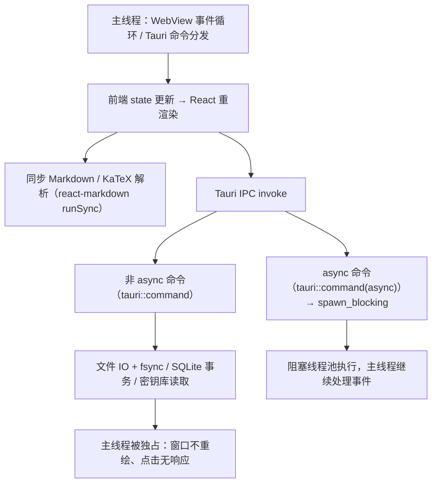
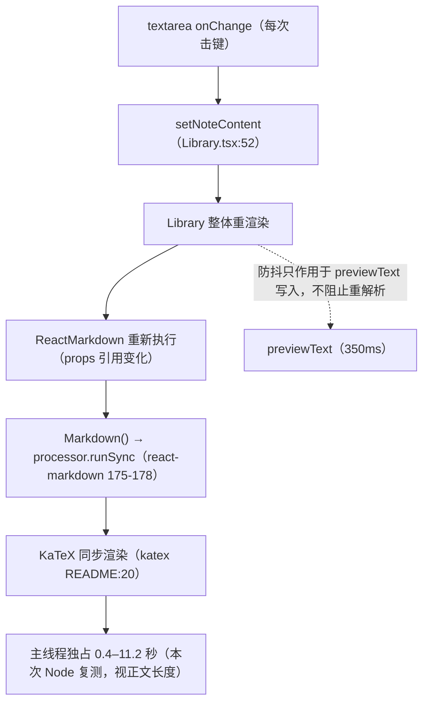

# 性能与响应性（主线程阻塞、同步命令与高频轮询）

本组收录 17 条问题。判定口径：Tauri 2 中未加 `async` 的 `#[tauri::command]` 命令体在主线程执行，命令体内的同步文件 IO、SQLite 事务、系统密钥库访问与 JSON 物化均占用主线程；前端侧未 memo 化的同步解析与 150ms 级高频 IPC 拉取同样落在 WebView 主线程。本组全部 `path:line` 对应仓库提交 `06ae67d7`，引用行文为该提交的原文。



---

## P-011 笔记预览未做 memo 化，击键触发整篇 Markdown/KaTeX 同步重解析

严重度：高 | 状态：已复核 | 分类：perf | 位置：desktop/src/pages/Library.tsx:427

**详细说明**

触发条件：打开「新建/编辑笔记」弹窗，在正文 textarea 中逐字输入，正文规模接近前端自设的 1,000,000 字节上限（Library.tsx:427 的 `clampToBytes(e.target.value, 1000000)`；同页页脚显示「x / 1,000,000 字节 · 接近上限」）。note/产品与技术决策.md:117 的 1 MB 单条正文上限针对 Rust 侧笔记导入校验，不是编辑器正文上限的直接出处。

实际行为：`noteContent` 为 Library 组件 state（Library.tsx:52），每次击键触发 Library 整体重渲染；预览区的 `<ReactMarkdown>` 为未 memo 化的函数组件，且每次渲染新建 `remarkPlugins`/`rehypePlugins` 数组与 `components` 对象，React 以 `oldProps !== newProps` 判定需要更新（react-dom.development.js:21563-21571），因此每次渲染重新执行 react-markdown 的 `Markdown()`，该函数同步执行 `processor.runSync(processor.parse(file), file)`（react-markdown/lib/index.js:175-178）；KaTeX 渲染同步进行（katex/README.md:20）。Library.tsx:53-59 的 350ms 防抖只推迟 `previewText` 写入，无法阻止 `ReactMarkdown` 随父组件重渲染而重解析。同一问题在讲义页已用 memo 化修复（StudyRoom.tsx:17-21），两处修法不一致。

用户可见后果：每次击键同步重解析整篇 Markdown 与全部公式，WebView 主线程被独占，窗口停止重绘、滚动与输入响应，Windows 侧表现为「未响应」。解析成本随正文长度增长：在仓库 TEMP 目录内以 Node 复测同一条插件链（react-markdown 10.1.0 + remark-gfm + remark-math + rehype-katex，脚本见本节末尾代码块，命令 `node bench.mjs`，连续两次运行）得 50 KB→401/402 ms、100 KB→590/660 ms、200 KB→1206/1237 ms、400 KB→3257/3150 ms、1000 KB→11180/11106 ms；每档为连续两次运行的两个观测值，未做多次采样。增长接近二次。上述为解析成本，不含生成 DOM 的追加开销。

复测脚本（Node ESM，置于仓库 TEMP 目录执行，依赖取自 `desktop/node_modules`，测毕按仓库规则清理）：

```
import { Markdown } from '../../desktop/node_modules/react-markdown/lib/index.js'
import remarkGfm from '../../desktop/node_modules/remark-gfm/index.js'
import remarkMath from '../../desktop/node_modules/remark-math/index.js'
import rehypeKatex from '../../desktop/node_modules/rehype-katex/index.js'

const unit = '## 章节标题\n\n这是一段用于基准测试的中文正文，包含 **加粗**、`代码` 与 [链接](https://example.com)。\n\n$$P(A|B)=\\frac{P(B|A)P(A)}{P(B)}$$\n\n- 列表项一\n- 列表项二\n\n'
for (const kb of [50, 100, 200, 400, 1000]) {
  let text = ''
  while (Buffer.byteLength(text, 'utf8') < kb * 1000) text += unit
  const start = process.hrtime.bigint()
  Markdown({ remarkPlugins: [remarkGfm, remarkMath], rehypePlugins: [rehypeKatex], children: text })
  console.log(kb + 'KB', (Number(process.hrtime.bigint() - start) / 1e6).toFixed(1) + 'ms')
}
```



**代码证据**

- `desktop/src/pages/Library.tsx:52-59`：
  ```
  const [noteContent, setNoteContent] = useState('')
  // 80#4：预览渲染防抖（350ms，与草稿自动保存同窗口）——正文上限 1MB，
  // 原先每击键全文 Markdown/KaTeX 重解析，长笔记编辑可感卡顿
  const [previewText, setPreviewText] = useState('')
  useEffect(() => {
    const timer = window.setTimeout(() => setPreviewText(noteContent), 350)
    return () => window.clearTimeout(timer)
  }, [noteContent])
  ```
- `desktop/src/pages/Library.tsx:427`：`<article className="note-preview"><ReactMarkdown remarkPlugins={[remarkGfm, remarkMath]} rehypePlugins={[rehypeKatex]} components={{ a: MarkdownLink }}>{previewText || '实时预览将在这里显示。'}</ReactMarkdown></article>`
- `desktop/src/pages/StudyRoom.tsx:17-21`：`// 80#2：讲义区块 memo 化——直播 tick 引发的整页重渲染不再对全文` … `const MemoMarkdown = memo(function MemoMarkdown({ text }: { text: string }) {`
- `desktop/node_modules/react-markdown/lib/index.js:175-178`：`export function Markdown(options) {` / `  const processor = createProcessor(options)` / `  const file = createFile(options)` / `  return post(processor.runSync(processor.parse(file), file), options)`
- `desktop/node_modules/react-dom/cjs/react-dom.development.js:21563-21571`：`if (oldProps !== newProps || hasContextChanged() || ( // Force a re-render if the implementation changed due to hot reload:` / `      workInProgress.type !== current.type )) {` / `      // If props or context changed, mark the fiber as having performed work.`
- `desktop/node_modules/katex/README.md:20`：`* **Fast:** KaTeX renders its math synchronously and doesn't need to reflow the page.`

**合并来源**

- 补审-8-1
- 补审-11-1

---

## P-063 资料文本导入与删除仍为同步命令，写盘 fsync、全表 JSON 扫描与 app_state 全量重建在主线程完成

严重度：中 | 状态：已复核 | 分类：perf | 位置：desktop/src-tauri/src/backend/materials/commands.rs:38-46、91-99

**详细说明**

触发条件：在资料库中粘贴大段文本导入资料，或删除一份已解析的资料（前端入口 Library.tsx:277-285 的确认对话框）。

实际行为：`import_material_text` 与 `delete_material` 均为未加 `async` 的 `#[tauri::command]`，命令体在主线程执行。import 走 `stage_validated`（materials/mod.rs:579）全链路：写临时文件并执行 `write_all` + `sync_all`（fsync）+ `rename`（materials/mod.rs:655-666），随后写 SQLite 事务并由 `sync_resources` 全量重建 resources 快照；文本正文上限 500,000 字节（materials/mod.rs:800-803），资料配额 200 条（security/mod.rs:170）。delete 内部新开 SQLite 连接（materials/mod.rs:101-103 的 `Store::new`），对 agent_artifacts 全表执行 `json_each(a.content_json, '$.citations')` JSON 表达式（materials/mod.rs:1472-1476），执行删除事务与 `sync_resources`（materials/mod.rs:1488-1495），并删除最大 50 MB 原件（materials/mod.rs:1497-1507；上限见 materials/parse.rs:11）。命令层随后调用 `state.materials.store()?.app_state()`（commands.rs:98），即再开一条连接并对四个命名空间做全量读取与逐行反序列化（store.rs:753-771）。

用户可见后果：删除资料或导入大段文本期间主线程被占用，窗口冻结数十毫秒至秒级，机械盘更明显，Windows 可能标记「未响应」。同族命令 `import_material_files`（commands.rs:13-14，44#1）、`export_material_original`（commands.rs:105，73#8）、`get_material`（commands.rs:55-56，90#6/90#12）已改为 async 并移出主线程，本组两条命令未跟进。附带事实：前端 `backend.deleteMaterial(id)` 的返回值（整份 app_state 快照）未被消费（Library.tsx:280），该返回值可省。

**代码证据**

- `desktop/src-tauri/src/backend/materials/commands.rs:38-46`：
  ```
  #[tauri::command]
  pub fn import_material_text<R: Runtime>(
      app: AppHandle<R>,
      state: State<'_, BackendState>,
      title: String,
      content: String,
  ) -> Result<IngestResult> {
      super::import_text(&app, &state.materials, title, content)
  }
  ```
- `desktop/src-tauri/src/backend/materials/commands.rs:91-99`：
  ```
  #[tauri::command]
  pub fn delete_material<R: Runtime>(
      app: AppHandle<R>,
      state: State<'_, BackendState>,
      id: i64,
  ) -> Result<Value> {
      delete(&app, &state.materials, id)?;
      state.materials.store()?.app_state()
  }
  ```
- `desktop/src-tauri/src/backend/materials/mod.rs:101-103`：`fn store(&self) -> Result<Store> { Store::new(self.database_path.clone()) }`
- `desktop/src-tauri/src/backend/materials/mod.rs:660-661`：`std::io::Write::write_all(&mut file, &bytes)?;` / `file.sync_all()?;`
- `desktop/src-tauri/src/backend/materials/mod.rs:811-813`：`let bytes = content.into_bytes();` / `let sha256 = format!("{:x}", Sha256::digest(&bytes));` / `stage_validated(`
- `desktop/src-tauri/src/backend/materials/mod.rs:1472-1476`：`"SELECT EXISTS(SELECT 1 FROM learning_plan_materials WHERE material_id = ?1) OR EXISTS(SELECT 1 FROM knowledge_session_materials WHERE material_id = ?1) OR EXISTS(SELECT 1 FROM project_versions WHERE material_id = ?1) OR EXISTS(SELECT 1 FROM agent_artifacts a, json_each(a.content_json, '$.citations') c WHERE json_extract(c.value, '$.materialId') = ?1)"` / `params![id],` / `|row| row.get(0),`
- `desktop/src-tauri/src/backend/store.rs:753-771`：`pub fn app_state(&self) -> Result<Value> {` … `for namespace in COLLECTIONS { let collection = self.collection(namespace)?;` … `state.insert("versions".to_string(), Value::Object(versions));`
- 对照 `desktop/src-tauri/src/backend/materials/commands.rs:19-20`：`// 44#1：≤32×50MB 逐文件读+校验+哈希+写盘的重 IO 移出主线程（原先` / `// 同步命令冻结窗口）；23#7：阻塞线程传播 principal`

**合并来源**

- 后端-材料-1
- 前端-状态与IPC客户端-2
- 横切-主线程阻塞-5
- 横切-数据生命周期-3
- 横切-主线程阻塞-6

---

## P-064 planning 域五个命令均为同步命令，重 IO 在主线程执行且被事件高频触发

严重度：中 | 状态：已复核 | 分类：perf | 位置：desktop/src-tauri/src/backend/planning/commands.rs:6-59

**详细说明**

触发条件：在计划页翻周、添加任务、切换排期强度；任务规模接近配额上限（任务集合上限 10000，见 planning/mod.rs:264 注释）。

实际行为：`get_plan_overview`、`get_plan_alternatives`、`apply_plan_intensity`、`update_learning_goal`、`assign_task_date` 五个命令全部为未加 `async` 的同步命令，在 Tauri 主线程执行。仓库自身注释为同一口径：planning/mod.rs:134-135 记「planning 命令全部为同步命令属主线程级故障」，engagement/commands.rs:113-117 记「原先同步命令在主线程执行，首页热路径的冻结随历史数据量线性增长」并据此把 `get_dashboard` 迁至 `spawn_blocking`，planning 域未迁移。`get_plan_overview` 每次调用把 tasks 集合整包读出并反序列化两遍（planning/mod.rs:154-192 的孤儿探测一遍、:269 待排期列表再一遍），逐行按 id 线性查找（:202-232），并对每个阶段单发一次阅读状态点查（:247-252）。`apply_plan_intensity` 在一个事务内对全集合逐条重写每个任务行（:584-595），并整体序列化 result_json 写 learning_plan_versions 快照（:540-543），提交后再做第三次 overview 全量读（:601-603）。前端 Plan 页对每个 `plan.*`、`state.changed(tasks|preferences)` 事件立即发起一次全量 overview 拉取（Plan.tsx:87-89，无合并去抖）；一次添加任务触发三次拉取：`setTasks` 写库产生 `state.changed`、排期产生 `plan.task_scheduled`（planning/mod.rs:743-747）、前端另显式 `await refresh()`（Plan.tsx:150）。

用户可见后果：任务量大时，翻周、排期与强度切换期间整个窗口出现随数据量线性增长的冻结。

**代码证据**

- `desktop/src-tauri/src/backend/planning/commands.rs:6-12`：
  ```
  #[tauri::command]
  pub fn get_plan_overview(
      state: State<'_, BackendState>,
      week_start: Option<String>,
  ) -> Result<PlanOverview> {
      super::get_overview(&PlanningState::new(&state.learning), week_start)
  }
  ```
  同文件 :14-20、:22-35、:37-44、:46-59 为另四个同型同步命令。
- `desktop/src-tauri/src/backend/planning/mod.rs:133-135`：`// 归一到周一后 +7 天）越界时 time 的 Add 实现直接 panic，而 planning` / `// 命令全部为同步命令属主线程级故障；week_end 一经验证，下方 offset<7` / `// 的逐日加法必不越界`
- `desktop/src-tauri/src/backend/planning/mod.rs:155`：`let snapshot = Store::collection_value(&store.conn, "tasks", &store.account_path)?;`
- `desktop/src-tauri/src/backend/planning/mod.rs:269`：`let tasks = store.collection("tasks")?.value;`
- `desktop/src-tauri/src/backend/planning/mod.rs:249`：`let completed: bool = store.conn.query_row("SELECT COALESCE((SELECT completed FROM learning_reading_progress WHERE plan_id = ?1 AND stage_id = ?2), 0)", params![stage_plan_id, stage.id], |row| row.get(0)).unwrap_or(false);`
- `desktop/src-tauri/src/backend/planning/mod.rs:584-595`：`for task in tasks.as_array().into_iter().flatten() {` / `    super::store::Store::insert_json(` / `        &tx,` / `        "tasks",`
- `desktop/src-tauri/src/backend/planning/mod.rs:601-603`：`tx.commit()?;` / `emit(app, &event);` / `overview(state, start, adopted_first_plan(state)?)`
- `desktop/src/pages/Plan.tsx:87-89`：`void onBackendEvent(event => {` / `  if (active && (event.kind.startsWith('plan.') || event.kind === 'security.session_started' || (event.kind === 'state.changed' && ['tasks', 'preferences'].includes(String(event.payload.namespace))))) void refreshRef.current()`
- `desktop/src/pages/Plan.tsx:136、142、150`：`await setTasks(current => [...current, { id, title: title.trim(), … }])` / `await planningBackend.assignTaskDate(id, newTaskDate)` / `await refresh()`
- 对照 `desktop/src-tauri/src/backend/engagement/commands.rs:113-118`：`// 103#4：dashboard = list_with + stats_with + calendar_with + report_with("4w")` … `#[tauri::command(async)]` / `pub async fn get_dashboard<R: Runtime + 'static>(app: AppHandle<R>) -> Result<DashboardOverview> {`

**合并来源**

- 后端-排期-5
- 前端-计划与首页-1
- 横切-主线程阻塞-4

---

## P-065 Wiki 问答的 ask/resume 为同步命令，提问时在主线程逐份新开连接并读取最多 8×5MiB 解析文本

严重度：中 | 状态：已复核 | 分类：perf | 位置：desktop/src-tauri/src/backend/knowledge/commands.rs:25、54-61

**详细说明**

触发条件：选择多份大资料（如 8 份 PDF 解析文本）后点「提问」，或对终态会话点「恢复问答」（前端入口 WikiPanel.tsx:94-102）。

实际行为：`ask_knowledge`（commands.rs:25-33）与 `resume_knowledge_answer`（commands.rs:54-61）均未加 `async`。ask 在命令线程内先执行 `load_scope`（knowledge/mod.rs:525），对每份选中资料调用 `materials::detail`，而 `detail` 各自 `Store::new` 新开 SQLite 连接（materials/mod.rs:101-103、:448-460），再读出 material_text 全文；单份解析文本上限 5 MiB（materials/parse.rs:12 `MAX_TEXT_BYTES`），8 份最坏约 40 MiB；随后才开事务并 spawn 工作线程。resume 走 `session_scope`（knowledge/mod.rs:595）→`load_scope` 同一 1+N 路径，该链路位于 `run()`，由 launch 在后台 wiki-answer-{id} 线程执行。同文件 `search_knowledge` 已按 44#2 口径移后台（commands.rs:5-23，注释记「原先同步命令在主线程执行，连续击键时窗口拖动/点击有可感迟滞」）。

用户可见后果：提问与恢复问答期间主线程阻塞数十至数百毫秒，期间窗口拖动、点击无响应；资料规模越大越明显。仓库已在 39#1（search 的 1+N 开库）、53#3（list 的 1+N 开库）、44#2（search 移后台）三轮修复同族问题，ask/resume 为剩余未修路径。

**代码证据**

- `desktop/src-tauri/src/backend/knowledge/commands.rs:25-33`：
  ```
  #[tauri::command]
  pub fn ask_knowledge<R: Runtime>(
      app: AppHandle<R>,
      state: State<'_, BackendState>,
      question: String,
      material_ids: Vec<i64>,
  ) -> Result<KnowledgeSession> {
      super::ask(&app, &state.knowledge, question, material_ids)
  }
  ```
- `desktop/src-tauri/src/backend/knowledge/mod.rs:525`：`let scope = load_scope(state, &material_ids)?;`
- `desktop/src-tauri/src/backend/knowledge/mod.rs:215-216`：`for id in ids {` / `    let detail = super::materials::detail(&state.materials, *id)?;`
- `desktop/src-tauri/src/backend/materials/mod.rs:448-459`：`pub fn detail(state: &MaterialState, id: i64) -> Result<MaterialDetail> {` / `    let store = state.store()?;` … `        "SELECT content FROM material_text WHERE material_id = ?1",`
- `desktop/src-tauri/src/backend/materials/parse.rs:12`：`pub const MAX_TEXT_BYTES: usize = 5 * 1024 * 1024;`
- 对照 `desktop/src-tauri/src/backend/knowledge/commands.rs:5-13`：`#[tauri::command(async)]` / `pub async fn search_knowledge<R: Runtime + 'static>(` … `    // 44#2：全库笔记+资料解析文本的内存逐条扫描是击键路径（120ms 防抖），` / `    // 大库单次可达上百毫秒——原先同步命令在主线程执行，连续击键时窗口`

**合并来源**

- 后端-Wiki知识-1
- 前端-资料库与Wiki-1

---

## P-066 adopt_learning_plan 为同步命令，主线程以 O(n²) 逐排期条目创建任务，极端方案下窗口冻结数秒

严重度：中 | 状态：已复核 | 分类：perf | 位置：desktop/src-tauri/src/backend/learning/commands.rs:57-64

**详细说明**

触发条件：模型生成较大图谱（validate.rs:19 放行 1–100 个知识节点，validate.rs:52 放行 `estimated_minutes` 5–600）且用户每日时长取低值（前端允许最低 10 分钟，PlanGenerator.tsx:293 的 `Math.max(10, Math.min(600, minutes || 10))`）后点击「采用此方案」（PlanGenerator.tsx:369）。

实际行为：`adopt_learning_plan` 为未加 `async` 的命令（commands.rs:57-64），命令体在主线程执行。`adopt` 对每条排期条目（actions.rs:73）调用 `Store::next_free_id`（store.rs:1119-1132，`SELECT MAX(COALESCE(MAX(CAST(id AS INTEGER)), 0) + 1, ?2) FROM kv WHERE namespace = ?1`，聚合参数为表达式，需扫描 kv 中 tasks 命名空间全部行），再 `kv INSERT`（actions.rs:89-101）与 `schedule_tasks INSERT`（actions.rs:102），每任务 3 条语句，总成本随条目数呈 O(n²)。排期装箱（validate.rs:235-276）按每日容量装箱，对条目总数与总天数无上限（仅 `cursor.next_day()` 溢出报错），条目数约等于总分钟数 ÷ 每日分钟数：100 节点、平均 100 分钟、每日 10 分钟对应约 1000 条 entries；顶格估算 6000 条对应约 3600 万行扫描。

用户可见后果：点击「采用此方案」后整个窗口（含 busy 态渲染、动画、输入）冻结数秒至数十秒，事务中途不可取消；一次性写入上千行任务后，其后每次事件触发的 get_app_state 全量快照都需反序列化整个 tasks 集合，持续拖慢后续事件校准。常规规模方案（数十条排期）无感，测试用例仅覆盖 3 任务，故属低频但真实的边界。

**代码证据**

- `desktop/src-tauri/src/backend/learning/commands.rs:57-64`：
  ```
  #[tauri::command]
  pub fn adopt_learning_plan<R: Runtime>(
      app: AppHandle<R>,
      state: State<'_, BackendState>,
      id: String,
  ) -> Result<serde_json::Value> {
      super::actions::adopt(&app, &state.learning, &id)
  }
  ```
- `desktop/src-tauri/src/backend/learning/actions.rs:73-79`：`for entry in &result.schedule.entries {` … `    let task_id = Store::next_free_id(&tx, "tasks")?`
- `desktop/src-tauri/src/backend/learning/actions.rs:102`：`tx.execute("INSERT INTO learning_plan_schedule_tasks (plan_id, task_id, date, stage_id, node_ids_json, minutes) VALUES (?1, ?2, ?3, ?4, ?5, ?6)", …)?;`
- `desktop/src-tauri/src/backend/store.rs:1126-1128`：`let id: i64 = conn.query_row(` / `    "SELECT MAX(COALESCE(MAX(CAST(id AS INTEGER)), 0) + 1, ?2) FROM kv WHERE namespace = ?1",` / `    params![namespace, floor],`
- `desktop/src-tauri/src/backend/learning/validate.rs:19`：`if graph.nodes.is_empty() || graph.nodes.len() > 100 {`
- `desktop/src-tauri/src/backend/learning/validate.rs:52`：`|| !(5..=600).contains(&node.estimated_minutes)`
- `desktop/src-tauri/src/backend/learning/validate.rs:269-274`：`if remaining_today == 0 {` / `    cursor = cursor.next_day().ok_or_else(|| {` / `        BackendError::new("schedule_too_long", "排期超出支持的日期范围")` / `    })?;` / `    remaining_today = daily_minutes;`
- `desktop/src/pages/PlanGenerator.tsx:293`：`const dailyMinutes = Math.max(10, Math.min(600, minutes || 10))`

---

## P-067 供应商 list/save 等同步命令在主线程执行密钥库 N+1 读取与多路 SQLite 查询

严重度：中 | 状态：已复核 | 分类：perf | 位置：desktop/src-tauri/src/backend/providers/commands.rs:10-13、147-154

**详细说明**

触发条件：模型接入中心刷新供应商列表、保存路由设置，或流式请求期间收到 provider.* 事件。

实际行为：`list_provider_profiles`（commands.rs:10-13）与 `save_routing_settings`（commands.rs:147-154）均未加 `async`，在主线程执行；两者第一步都经 `providers::list()` 枚举全部档案，而 `list` 对每行调用 `profile()`（providers/mod.rs:382-399）填充 `has_key`，即 `state.credentials.get(&id)` 每档案一次系统密钥库（Windows CredRead）同步读取，构成 N+1 密钥库调用；`save_routing_settings` 随后再做 SQLite 写事务与事件写入（providers/routing.rs:310 起）。同族同步命令还包括 `cancel_provider_chat`（commands.rs:116-123，含打开 store、SELECT、UPDATE 与事件事务提交）与 `list_provider_route_logs`（commands.rs:156-160，实现见 providers/routing.rs:1478-1503：100 行 run 查询后对每行再查一次 attempts，共约 101 次 prepare/query）。放大因素：ProviderHub 对每条非 chat 的 provider.* 事件（route_started、route_attempt、circuit_changed、routing_saved、active_changed、profile_saved、tested、route_completed、route_failed 等）都触发 5 命令全量 refresh（ProviderHub.tsx:112、:160），一次 routing 模式流式请求至少产生 3–6 条此类事件；UsagePanel 在每次模型请求终态也调用 `listProviderProfiles`（UsagePanel.tsx:32）。

用户可见后果：事件到达时主线程被串行密钥库调用与 SQL 查询占用，界面卡顿或掉帧；在杀毒软件挂钩凭据 API 或 SQLite 写锁竞争（busy_timeout 10 秒）时退化为可感知冻结。仓库已按同一口径把 upsert、test、deep_link、get_usage_overview 改为 async（commands.rs:20、:97、:80、:216，注释自证该模型），本组命令漏改。

**代码证据**

- `desktop/src-tauri/src/backend/providers/commands.rs:10-13`：
  ```
  #[tauri::command]
  pub fn list_provider_profiles(state: State<'_, BackendState>) -> Result<Vec<ProviderProfile>> {
      list(&state.providers)
  }
  ```
- `desktop/src-tauri/src/backend/providers/commands.rs:147-154`：
  ```
  #[tauri::command]
  pub fn save_routing_settings<R: Runtime>(
      app: AppHandle<R>,
      state: State<'_, BackendState>,
      settings: super::routing::RoutingSettings,
  ) -> Result<super::routing::RoutingSettings> {
      super::routing::save_settings(&app, &state.providers, settings)
  }
  ```
- `desktop/src-tauri/src/backend/providers/mod.rs:382-386`：`fn profile(row: &Row<'_>, state: &ProviderState) -> Result<ProviderProfile> {` / `    let id = format!("p{}", row.get::<_, i64>(0)?);` / `    Ok(ProviderProfile {` / `        has_key: state.credentials.get(&id)?.is_some(),`
- `desktop/src-tauri/src/backend/providers/routing.rs:310`：`let profiles = list(state)?;`
- `desktop/src-tauri/src/backend/providers/routing.rs:1480、1499-1501`：`"SELECT request_id, task, mode, status, provider_id, model, error_code, error_message, created_at, updated_at FROM provider_route_runs ORDER BY created_at DESC, rowid DESC LIMIT 100"` / `for log in &mut logs {` / `    log.attempts = attempt_logs(&store.conn, &log.request_id)?;`
- `desktop/src/pages/ProviderHub.tsx:112`：`const [items, active, settings, logs, circuitStates] = await Promise.all([backend.listProviderProfiles(), backend.getActiveProvider(), backend.getRoutingSettings(), backend.listProviderRouteLogs(), backend.listProviderCircuits()])`
- `desktop/src/pages/ProviderHub.tsx:160`：`if (event.kind.startsWith('provider.') && !event.kind.startsWith('provider.chat_')) void refresh()`
- `desktop/src/components/UsagePanel.tsx:32`：`const [usage, providers] = await Promise.all([usageBackend.overview(), backend.listProviderProfiles()])`

**合并来源**

- 后端-供应商A-2
- 后端-供应商B-3

---

## P-068 get_provider_chat 为同步命令，却承载流式输出期间每 150ms 一次的 MB 级全量拉取

严重度：中 | 状态：已复核 | 分类：perf | 位置：desktop/src-tauri/src/backend/providers/commands.rs:132-138

**详细说明**

触发条件：任何模型流式任务运行期间，前端按 `deltaThrottle` 窗口（约 150ms）调用一次 `getProviderChat`（客户端入口 desktop/src/backend/client.ts:437）。

实际行为：`get_provider_chat` 未加 `async`（commands.rs:132-138），在主线程执行；`ProviderState::store()` 每次调用新开 SQLite 连接（providers/mod.rs:270-272），`get_chat` 优先走 `routing::latest_chat`（providers/routing.rs:969-970）、未命中则走 `chat`（providers/mod.rs:1032-1038），两条路径均读取 provider_requests 整行，含 output 与 reasoning 列。输出累计上限 1 MiB（providers/protocol.rs:23 `MAX_COMPLETION_BYTES`，:163 处按该值截断），因此每次拉取为主线程读库 + MB 级 JSON 序列化与 IPC 传输。

用户可见后果：长输出阶段流式期间主线程持续被占用（单次数毫秒至数十毫秒 × 每 150ms 一次），打字、滚动与动画掉帧。对照同文件 `get_usage_overview` 因同款「最大表全量物化」成本已移后台（commands.rs:213-235，90#4）。

与 P-059 的区分：本条根因为「流式输出期间的高频取数」，即 150ms 轮询把 1 MiB 级 `output`/`reasoning` 载荷反复物化到主线程；09 组 P-059 记录的是学习域读命令 `get_learning_plan` 与 `get_lecture` 的整份方案与单元正文重解析，P-059 已不登记本命令。两条的触发路径与代价构成不同，不合并。

**代码证据**

- `desktop/src-tauri/src/backend/providers/commands.rs:132-138`：
  ```
  #[tauri::command]
  pub fn get_provider_chat(
      state: State<'_, BackendState>,
      request_id: String,
  ) -> Result<super::ProviderRequest> {
      super::get_chat(&state.providers, &request_id)
  }
  ```
- `desktop/src-tauri/src/backend/providers/mod.rs:270-272`：`pub fn store(&self) -> Result<Store> {` / `    Store::new(self.database_path.clone())` / `}`
- `desktop/src-tauri/src/backend/providers/mod.rs:1038`：`"SELECT request_id, provider_id, model, status, output, usage_json, finish_reason, error_code, error_message, attempts, latency_ms, created_at, updated_at, reasoning, tool_calls_json FROM provider_requests WHERE request_id = ?1",`
- `desktop/src-tauri/src/backend/providers/protocol.rs:23、163`：`const MAX_COMPLETION_BYTES: usize = 1024 * 1024;` / `if current.saturating_add(text.len()) > MAX_COMPLETION_BYTES {`
- `desktop/src/backend/client.ts:437、483-488`：`getProviderChat: (requestId: string) => invoke<ProviderRequest>('get_provider_chat', { requestId }),` / `export function deltaThrottle(): DeltaThrottle {` … `    timer = window.setTimeout(() => { timer = undefined; fire() }, 150)`
- `desktop/src/pages/StudyRoom.tsx:181`、`desktop/src/pages/PlanGenerator.tsx:184`、`desktop/src/pages/Practice.tsx:102`：`throttledFetch(() => void backend.getProviderChat(logicalId).then(setLiveRequest).catch(…))`
- 对照 `desktop/src-tauri/src/backend/providers/commands.rs:213-217`：`// 90#4：用量总览对 provider_requests（库中最大表，86#1 裁剪后仍至多` … `#[tauri::command(async)]` / `pub async fn get_usage_overview<R: Runtime + 'static>(`

---

## P-069 备份导入/VACUUM/重置等长写事务期间，高频同步写命令在主线程等待 SQLite busy_timeout（10 秒）

严重度：中 | 状态：已复核 | 分类：perf | 位置：desktop/src-tauri/src/backend/practice/commands.rs:53-62；desktop/src-tauri/src/backend/review/commands.rs:48-56

**详细说明**

触发条件：执行备份导入、VACUUM 或重置期间，在练习页提交答案或复习页点评分。导入期间应用不阻止页面导航，用户可切到复习页触发评分。

实际行为：`submit_practice_answer`（practice/commands.rs:53-62）与 `grade_review_card`（review/commands.rs:48-56）均为未加 `async` 的同步命令，事务在主线程执行：practice/mod.rs:1337-1340 与 review/mod.rs:424-427 均使用 `BEGIN IMMEDIATE`。备份导入（backup/commands.rs:85 起，:104-110 的 `spawn_blocking` 持全局 store 锁并在同一连接上跑长事务）与 VACUUM、重置期间，上述命令的 `BEGIN IMMEDIATE` 在主库 busy_timeout（store.rs:410 设置为 10000 毫秒）上等待写锁，主线程同步阻塞最长 10 秒后返回 database_busy。

用户可见后果：窗口冻结并被 Windows 标记「未响应」。同一症状在草稿族已修复（backend/commands.rs:170-173 的 141#2 注释自述「备份导入/重置（spawn_blocking 持锁可达数十秒）期间打字自动保存把主线程堵死（>5s 被 Windows 标『未响应』）」），但该轮只改了 `save_draft`（:174）、`get_draft`（:205）、`delete_draft`（:223）、`replace_collection`（:140）四个命令，练习提交与复习评分等其余同步写命令未跟进。

**代码证据**

- `desktop/src-tauri/src/backend/practice/commands.rs:53-62`：
  ```
  #[tauri::command]
  pub fn submit_practice_answer<R: Runtime>(
      app: AppHandle<R>,
      state: State<'_, BackendState>,
      set_id: i64,
      question_id: i64,
      answer: Value,
  ) -> Result<AnswerResult> {
      super::submit(&app, &state.practice, set_id, question_id, answer)
  }
  ```
- `desktop/src-tauri/src/backend/practice/mod.rs:1337-1340`：`let mut store = state.store()?;` / `let tx = store` / `    .conn` / `    .transaction_with_behavior(rusqlite::TransactionBehavior::Immediate)?;`
- `desktop/src-tauri/src/backend/review/commands.rs:48-56`：
  ```
  #[tauri::command]
  pub fn grade_review_card<R: Runtime>(
      app: AppHandle<R>,
      state: State<'_, BackendState>,
      id: i64,
      grade: String,
  ) -> Result<GradeResult> {
      super::grade(&app, &state.review, id, &grade)
  }
  ```
- `desktop/src-tauri/src/backend/review/mod.rs:424-427`：`let mut store = state.store()?;` / `let tx = store` / `    .conn` / `    .transaction_with_behavior(TransactionBehavior::Immediate)?;`
- `desktop/src-tauri/src/backend/store.rs:410`：`conn.pragma_update(None, "busy_timeout", 10000)?;`
- `desktop/src-tauri/src/backend/commands.rs:170-173`：`// 141#2：save_draft/get_draft/delete_draft 与 127#2 的 replace_collection 同` / `// 症状——同步命令在主线程取全局 store 互斥锁，备份导入/重置（spawn_blocking` / `// 持锁可达数十秒）期间打字自动保存把主线程堵死（>5s 被 Windows 标「未响应」）；` / `// 移后台对齐 127#2（principal 传播同口径）`
- `desktop/src-tauri/src/backend/backup/commands.rs:104-110`：`let result = {` / `    let store = backend` / `        .store` / `        .lock()` / `        .unwrap_or_else(|poisoned| poisoned.into_inner());` / `    super::import(&app, &store, &learning, std::path::Path::new(&path))` / `};`

---

## P-070 辅导面板与 Agent 工作区的发送按钮为 34/36px，低于 44px 的产品承诺

严重度：中 | 状态：已复核 | 分类：a11y | 位置：desktop/src/styles.css:525、1255

**详细说明**

触发条件：触屏或混合设备用户操作 StudyRoom 辅导面板或 Agent 工作区的发送按钮。

实际行为：desktop/DESIGN.md:33 记「主要行动与触屏路径上的控件不小于 44px」。styles.css:525 的 `.composer-bottom > button` 为 34px×34px，是 StudyRoom 辅导面板唯一的发送入口；styles.css:1255 的 `.agent-composer > div > button` 为 36px×36px，是 Agent 工作区发送入口（AgentCenter.tsx:143 与 TutorPanel.tsx:68 的 `<button type="submit" aria-label="发送…">`）。两个面板在窄窗下均直接可达（global-tutor 抽屉宽 390px，见 styles.css:528；单栏布局时导师位于底部）。项目自身已在 146#4 按同一承诺把任务勾选与直达按钮从 32/36px 提到 44px（styles.css:279-287 及其注释），发送按钮未纳入。差距较小者一并列出：styles.css:161 的 `.quick-add`（min-height 42px）与 styles.css:757 的 `.library-tabs > button`（min-height 42px）。

用户可见后果：触屏用户难以准确命中发送按钮，易误触相邻元素。

**代码证据**

- `desktop/src/styles.css:525`：`.composer-bottom > button { width: 34px; height: 34px; display: grid; place-items: center; border: 0; border-radius: 8px; background: var(--accent-strong); color: var(--paper-50); }`
- `desktop/src/styles.css:1255`：`.agent-composer > div > button { width: 36px; height: 36px; display: grid; place-items: center; border: 0; border-radius: 8px; background: var(--accent-strong); color: var(--paper-50); }`
- `desktop/src/styles.css:161`：`.quick-add { display: flex; align-items: center; gap: 6px; min-height: 42px; … }`
- `desktop/src/styles.css:757`：`.library-tabs > button { min-height: 42px; display: flex; align-items: center; gap: 7px; … }`
- `desktop/src/styles.css:279-287`：`/* 146#4：勾选/直达是任务行主操作，触屏路径控件提至 44px（DESIGN.md 自定` … `.task-check { width: 44px; height: 44px; … }` / `.task-go { width: 44px; height: 44px; … }`
- `desktop/DESIGN.md:33`：`- 主要行动与触屏路径上的控件不小于 44px。桌面指针环境中的紧凑次级控件可从 26px 起，必须保留可见焦点和键盘操作。隐藏功能同时支持点击，不依赖悬停。`

---

## P-071 大字模式 zoom:1.12 把 100dvh 固定弹层放大到超 viewport 12%，导师抽屉输入区落到视口外

严重度：中 | 状态：已复核 | 分类：a11y | 位置：desktop/src/styles.css:1075、528、1024

**详细说明**

触发条件：设置 → 外观与无障碍开启「增大正文字号」（`html.large-text` → `body { zoom: 1.12 }`），随后打开「问知舟」抽屉或任一达到 max-height 的长表单 Modal。

实际行为：按 css-viewport-1 对 `zoom` 的定义，后代元素的 used value 长度按 zoom 预乘。styles.css:528 的 `.global-tutor { height: 100dvh }` 绘制高度变为视口的 112%；styles.css:1024 的 `.focus-overlay { min-height: 100dvh }` 同理；styles.css:234 的 `.modal { max-height: min(88dvh, 900px) }` 绘制为 98.56% 视口高。

用户可见后果：（1）导师抽屉内 `.tutor-panel` 为 flex 列（styles.css:500），`.tutor-messages` 取 `flex: 1`（styles.css:514），composer（textarea 与发送按钮）位于面板底部，即视口下方 12% 处（1080p 约 130px、800p 约 96px），且抽屉为 position: fixed 不可滚动，开启大字模式后无法向导师提问；（2）专注层底部「Esc 退出专注」提示同样被推出视口；（3）长表单 Modal 底部操作行被裁剪，overlay 为 position: fixed（styles.css:233）不可滚动，被裁部分无法到达。补充：styles.css:234 的 `.modal` 本身不构成越界（88dvh×1.12 = 98.56% < 100%，且 `overflow-y: auto` 可滚至底部操作行）。本条结论基于 CSS 规则与规范语义推导，未运行安装包实测——仓库 AGENTS.md 禁止前台 UI 自动化与读取屏幕。

**代码证据**

- `desktop/src/styles.css:1075`：`.large-text body { font-size: 18px; zoom: 1.12; }`
- `desktop/src/styles.css:528`：`.global-tutor { width: min(390px, 100%); height: 100dvh; box-shadow: -20px 0 60px oklch(0.15 0.02 160 / .25); }`
- `desktop/src/styles.css:500、514、521-522`：`.tutor-panel { height: 100%; min-height: 620px; display: flex; flex-direction: column; … }` / `.tutor-messages { flex: 1; min-height: 240px; max-height: 480px; overflow-y: auto; … }` / `.tutor-composer { margin: 0 12px 8px; … }` / `.tutor-composer textarea { min-height: 62px; … }`
- `desktop/src/styles.css:1024`：`.focus-overlay { position: fixed; inset: 0; z-index: 90; display: flex; flex-direction: column; min-height: 100dvh; padding: 20px; background: var(--pine-950); color: white; }`
- `desktop/src/styles.css:233-234`：`.overlay { position: fixed; inset: 0; z-index: 70; display: grid; place-items: center; padding: 18px; … }` / `.modal { width: 100%; max-width: 560px; max-height: min(88dvh, 900px); overflow-y: auto; … }`
- 规范依据：css-viewport-1 §zoom ——「the used value of a CSS property … is pre-multiplied … by the used value of zoom for the element」

---

## P-072 Esc 关闭弹层未检查 isComposing，中文输入法组字时按 Esc 取消候选会误关整个弹窗

严重度：中 | 状态：已复核 | 分类：a11y | 位置：desktop/src/components/UI.tsx:186-192；desktop/src/App.tsx:312-321

**详细说明**

触发条件：在任一 Modal（快速记录、全局搜索、创建记忆卡、笔记编辑器等）的输入框中使用中文输入法组字，按 Esc 取消候选或组字。

实际行为：Modal 的 document 级监听（UI.tsx:186-192）与 App 的 window 级监听（App.tsx:312-321）均只判断 `event.key === 'Escape'`，不检查 `event.isComposing`。按 Chromium（WebView2）键盘事件语义，取消组字时派发的 keydown 携带 `isComposing = true`，该事件仍被上述两处监听消费并关闭弹层。同一代码库的 Enter 路径全部带 IME 守卫（App.tsx:501、App.tsx:672/675、TutorPanel.tsx:68、AgentCenter.tsx:143 均为 `!event.nativeEvent.isComposing`），App.tsx:671 的注释亦确认「IME 组字期间 ↑↓ 用于选候选词，不挪动结果高亮（Enter 已有同款守卫）」，即项目已知 IME 会向这些处理器派发键，Esc 路径为漏加守卫的一处。

用户可见后果：弹层被整体关闭，焦点丢失，全局搜索层的查询被 onClose 中的 `setQuery('')` 清空（App.tsx:677），半填表单被卸载。读屏与键盘用户的中文输入主流程被打断。

**代码证据**

- `desktop/src/components/UI.tsx:186-192`：
  ```
  const onKey = (event: KeyboardEvent) => {
    if (event.key !== 'Escape') return
    // 24#2：非最顶层弹层不响应——一次 Esc 只关闭一个叠加层
    const top = MODAL_STACK[MODAL_STACK.length - 1]
    if (!top || top.id !== id) return
    closeRef.current()
  }
  ```
- `desktop/src/App.tsx:312-321`：
  ```
  if (event.key === 'Escape') {
    // 24#2：Esc 分层仲裁——Modal（含确认框）打开时交给弹层栈处理最顶层，
    // 专注层次之，最后才收起抽屉/移动导航/共享页，一次 Esc 只关一层。
    …
    if (hasOpenModal()) return
    if (focusOpen) { setFocusOpen(false); return }
    if (tutorOpen) { setTutorOpen(false); return }
    setMobileNav(false); exitShared()
  }
  ```
- 对照 `desktop/src/App.tsx:501`：`onKeyDown={e => { if (e.key === 'Enter' && !e.nativeEvent.isComposing) void addQuick() }}`
- 对照 `desktop/src/App.tsx:671-672`：`// 68#3：IME 组字期间 ↑↓ 用于选候选词，不挪动结果高亮（Enter 已有同款守卫）` / `if (event.nativeEvent.isComposing) return`
- 对照 `desktop/src/components/TutorPanel.tsx:68`、`desktop/src/pages/AgentCenter.tsx:143`：`onKeyDown={event => { if (event.key === 'Enter' && !event.shiftKey && !event.nativeEvent.isComposing) { event.preventDefault(); void submit() } }}`

---

## P-073 快照形状断言失败分支缺提前返回，exit(2) 之后仍打印 "native verification passed"

严重度：低 | 状态：已复核 | 分类：logic | 位置：desktop/src-tauri/src/main.rs:82-92

**详细说明**

触发条件：`--verify-native` 自检时 bootstrap 快照形状不符（`snapshot["tasks"]` 非数组或 `snapshot["preferences"]` 非对象）。

实际行为：`AppHandle::exit` 不立即终止进程——tauri-2.12.5/src/app.rs:581-587 的 `exit` 仅经 `runtime_handle.request_exit(exit_code)` 投递退出请求；tauri-runtime-wry-2.12.3/src/lib.rs:4300-4311 在事件循环中处理 `Message::RequestExit(code)` 并置 `ControlFlow::ExitWithCode(code)`。该处理发生在 setup 阶段返回之后，因此第 84 行的 `app.handle().exit(2)` 之后，第 86-91 行的 `writeln!` 仍被执行，向 stdout 输出「native verification passed: workspace=…, lastEventId=…」，随后第 92 行再投递 exit(0)；事件循环按序处理时首条 RequestExit(2) 生效，最终退出码为 2。

用户可见后果：形状失败的一次运行同时输出失败信息（stderr）与通过信息（stdout）。按 stdout 文本而非退出码判断的脚本或人工读日志会把契约失败误读为通过；50#1 注释声称的「脚本按退出码即可区分、不必解析输出」所依赖的干净输出面被破坏。修复方式为在 exit(2) 后 return，或把 writeln 与 exit(0) 移入 else 分支。

**代码证据**

- `desktop/src-tauri/src/main.rs:82-92`：
  ```
  if !snapshot["tasks"].is_array() || !snapshot["preferences"].is_object() {
      eprintln!("native verification failed: unexpected bootstrap snapshot shape");
      app.handle().exit(2);
  }
  let _ = writeln!(
      std::io::stdout(),
      "native verification passed: workspace={}, lastEventId={}",
      snapshot["workspaceId"],
      snapshot["lastEventId"]
  );
  app.handle().exit(0);
  ```
- `desktop/src-tauri/src/main.rs:79-81`：`// 106#6：断言失败原先以 panic（退出码 101）交付，违背 50#1 声明的` / `// 「verify 校验不过 → exit(2)」契约，CI 按退出码会把内部断言崩坏` / `// 误读为运行崩溃；打印也改忽略错误（stdout 管道关闭不再 panic）`
- 依赖侧 `F:/DevCache/cargo/registry/src/rsproxy.cn-e3de039b2554c837/tauri-2.12.5/src/app.rs:581-587`：`pub fn exit(&self, exit_code: i32) {` / `    if let Err(e) = self.runtime_handle.request_exit(exit_code) {` / `      log::error!("failed to exit: {}", e);` / `      self.cleanup_before_exit();` / `      std::process::exit(exit_code);` / `    }` / `}`
- 依赖侧 `tauri-runtime-wry-2.12.3/src/lib.rs:4300-4311`：`Message::RequestExit(code) => {` … `if !should_prevent {` / `  *control_flow = ControlFlow::ExitWithCode(code);` / `}`

---

## P-074 update_learning_goal 的状态校验在事务外且事务内无复查，并发再生成窗口下留下部分提交状态

严重度：低 | 状态：已复核 | 分类：logic | 位置：desktop/src-tauri/src/backend/planning/mod.rs:611-635、701-716

**详细说明**

触发条件：方案处于 done/degraded 状态时修改目标；校验与提交之间，另一窗口或另一入口对同一方案启动了 regenerate（status 变 running、result 置 NULL）。

实际行为：`update_goal` 的状态与次数校验基于事务外读取的 plan 快照（planning/mod.rs:611-612 取 latest_plan，:622-635 做 status 与 regeneration_limit 校验）；进入事务后对 learning_plans.input_json 无条件 UPDATE（:701-708），写事件并提交（:709-714），最后才在事务外调用 `regenerate`（:716）。事务内无方案状态复查。

用户可见后果：目标已改写而重生成未执行——正是 25#4 决策（planning/mod.rs:619-621 注释：「原实现先提交 goal/deadline/偏好再由 regenerate 拒绝，留下『目标已改写但未重生成』的部分提交状态」）要避免的状态；此时用户看到的错误信息（「只有完成或降级的方案可以调整目标」）不会说明目标其实已经保存。同理，regenerate 启动失败（task_start_failed）时目标同样已提交而用户只看到启动错误。对照：同文件 `apply_intensity` 已在 34#21 补了事务内复查（:527-537），`update_goal` 缺同型守卫。

**代码证据**

- `desktop/src-tauri/src/backend/planning/mod.rs:611-612`：`let plan = latest_plan(state, input.plan_id.as_deref())?` / `    .ok_or_else(|| BackendError::new("no_plan", "请先创建学习方案，再调整目标"))?;`
- `desktop/src-tauri/src/backend/planning/mod.rs:619-626`：`// 25#4：先做与 regenerate 相同的状态/次数校验再落库——原实现先提交` / `// goal/deadline/偏好再由 regenerate 拒绝，留下"目标已改写但未重生成"的` / `// 部分提交状态` / `if !["done", "degraded"].contains(&plan.status.as_str()) {` / `    return Err(BackendError::new(` / `        "plan_not_ready",` / `        "只有完成或降级的方案可以调整目标",`
- `desktop/src-tauri/src/backend/planning/mod.rs:701-708`：`tx.execute(` / `    "UPDATE learning_plans SET input_json = ?1, updated_at = ?2 WHERE id = ?3",` / `    params![` / `        serde_json::to_string(&plan_input)?,` / `        timestamp(OffsetDateTime::now_utc())?,` / `        numeric` / `    ],` / `)?;`（事务内无状态复查）
- `desktop/src-tauri/src/backend/planning/mod.rs:714-716`：`tx.commit()?;` / `emit(app, &event);` / `super::learning::actions::regenerate(app, &state.learning, &plan.id, 2)`
- 对照 `desktop/src-tauri/src/backend/planning/mod.rs:524-537`：`// 34#21：事务内复查方案状态——读取 result 与开事务之间可能被并发` / `// regenerate 穿插（result 置 NULL、步骤重置），无守卫会复活旧结果并向` / `// 已移除的 artifacts $.step5 写旧值；对照 regenerate 自身的三重前置校验` / `let status: String = tx.query_row(` / `    "SELECT status FROM learning_plans WHERE id = ?1",` … `if !["done", "degraded"].contains(&status.as_str()) {`

---

## P-161 全局搜索的 ↑↓ 键盘高亮对屏幕阅读器不可感知，Enter 打开的是读屏用户无法识别的结果项

严重度：低 | 状态：已复核 | 分类：a11y | 位置：desktop/src/App.tsx:669-678

**详细说明**

触发条件：读屏用户在全局搜索（Ctrl+K）中用 ↑↓ 移动高亮并按 Enter 打开结果。

实际行为：`activeIndex` 变化只切换结果按钮的 `className='active'`（视觉底色，styles.css:1000）；焦点始终留在输入框，结果按钮不获得焦点；容器与输入框均无 `role="listbox"` / `role="combobox"` / `aria-activedescendant`（全仓 desktop/src 无该属性，见检索结果）。唯一的 live region（App.tsx:678）只播报结果条数与快捷键提示，不播报当前选中项。按 Enter 打开 `results[activeIndex] ?? results[0]`（App.tsx:675）。

用户可见后果：读屏用户无法感知当前选中项，Enter 打开的目标不可预知；「↑↓ 选择、Enter 打开」这条被 command-hint 明示的快捷路径对读屏用户不可用，只能逐个 Tab 到结果按钮。121#10 只解决了结果条数的播报。

**代码证据**

- `desktop/src/App.tsx:669-676`：
  ```
  const onKeyDown = (event: React.KeyboardEvent<HTMLInputElement>) => {
    if (!results.length) return
    // 68#3：IME 组字期间 ↑↓ 用于选候选词，不挪动结果高亮（Enter 已有同款守卫）
    if (event.nativeEvent.isComposing) return
    if (event.key === 'ArrowDown') { event.preventDefault(); setActiveIndex(index => (index + 1) % results.length) }
    else if (event.key === 'ArrowUp') { event.preventDefault(); setActiveIndex(index => (index - 1 + results.length) % results.length) }
    else if (event.key === 'Enter' && !event.nativeEvent.isComposing) { event.preventDefault(); openResult(results[activeIndex] ?? results[0]) }
  }
  ```
- `desktop/src/App.tsx:678`：`<span className="visually-hidden" aria-live="polite">{query.trim() ? `${results.length} 条结果，↑↓ 选择，Enter 打开` : ''}</span>` 与 `<button key={`${result.kind}-${result.id}`} className={index === activeIndex ? 'active' : ''} onMouseEnter={() => setActiveIndex(index)} onClick={() => openResult(result)}>`（无 aria-selected、无 aria-activedescendant，焦点留在输入框）
- `desktop/src/styles.css:997-1000`：`/* 121#4：键盘导航高亮——.active 类自 20#9 引入起无规则，↑↓ 移动的` … `.command-results > button.active { background: var(--surface-soft); box-shadow: inset 3px 0 0 var(--accent); }`

---

## P-162 设置页分类导航的平滑滚动只看应用内偏好，忽略系统 prefers-reduced-motion

严重度：低 | 状态：已复核 | 分类：a11y | 位置：desktop/src/pages/Settings.tsx:140

**详细说明**

触发条件：用户在系统开启「减少动态效果」（prefers-reduced-motion: reduce）但未开启应用内「减少动态效果」，点击设置页左侧分类按钮。

实际行为：Settings.tsx:140 的 `scrollIntoView` 显式传入 `behavior`，显式值优先于 CSS `scroll-behavior`，因此 styles.css:1066-1068 的媒体查询兜底对该调用无效；该调用只检查 `preferences.reducedMotion`。对照 App.tsx:378-384 的 `navigate` 已改为同时检查 `preferences.reducedMotion || systemReduced`（App.tsx:382-383 的 `window.matchMedia('(prefers-reduced-motion: reduce)').matches`），App.tsx:380-381 注释明记「显式 behavior 会覆盖 CSS 的 scroll-behavior，只看应用内偏好会让系统设置失效」。

用户可见后果：依赖系统减弱动态设置的前庭障碍用户，在设置页分类导航仍被迫接受平滑滚动动画，与应用其余导航行为不一致。

**代码证据**

- `desktop/src/pages/Settings.tsx:140`：`<button key={label} onClick={() => document.getElementById(`setting-${index}`)?.scrollIntoView({ behavior: preferences.reducedMotion ? 'auto' : 'smooth', block: 'start' })}>`
- `desktop/src/App.tsx:380-383`：`// 24#7：系统级 prefers-reduced-motion 同样禁用平滑滚动——显式 behavior` / `// 会覆盖 CSS 的 scroll-behavior，只看应用内偏好会让系统设置失效` / `const systemReduced = window.matchMedia('(prefers-reduced-motion: reduce)').matches` / `window.scrollTo({ top: 0, behavior: preferences.reducedMotion || systemReduced ? 'auto' : 'smooth' })`
- `desktop/src/styles.css:1066-1068`：`@media (prefers-reduced-motion: reduce) {` / `  *, *::before, *::after { scroll-behavior: auto !important; animation-duration: .01ms !important; animation-iteration-count: 1 !important; transition-duration: .01ms !important; }` / `}`

---

## P-163 visually-hidden 的文件输入仍在 Tab 序中且焦点圈被裁剪，ProviderHub 侧还缺可访问名

严重度：低 | 状态：已复核 | 分类：a11y | 位置：desktop/src/pages/ProviderHub.tsx:430；desktop/src/pages/Integrations.tsx:145

**详细说明**

触发条件：键盘用户在模型接入中心或插件页连续按 Tab。

实际行为：`.visually-hidden`（styles.css:116）以 1px 盒与 `clip: rect(0,0,0,0)` 实现裁剪，未使用 `display: none`，因此 `<input type="file">` 仍可聚焦并留在 Tab 序中；全局 `:focus-visible` 描边（styles.css:99，3px solid 描边 + 3px offset）绘制在 1px 裁剪区之外，焦点视觉上不可见。ProviderHub.tsx:430 的导入输入无 label 与 aria-label，读屏只能播报浏览器默认的「选择文件 按钮」；Integrations.tsx:145 通过 `<label htmlFor="plugin-file">` 提供了名称，同样存在焦点圈不可见。

用户可见后果：键盘用户的焦点序列出现一次「无反馈」跳转；ProviderHub 侧的读屏播报缺少用途说明。功能上 Enter 仍可打开文件选择器，属可发现性与体验缺陷而非完全不可用。

**代码证据**

- `desktop/src/pages/ProviderHub.tsx:430`：`<input ref={importRef} type="file" accept=".json" className="visually-hidden" onChange={event => { const file = event.target.files?.[0]; if (file) void applyImport(file); event.target.value = '' }} />`（同行的触发按钮为 `<IconButton label="导入 JSON 配置" onClick={() => importRef.current?.click()}>`，该 label 只作用于按钮）
- `desktop/src/pages/Integrations.tsx:145`：`<input id="plugin-file" type="file" accept=".json,application/json" className="visually-hidden" disabled={busy} onChange={…} /><label htmlFor="plugin-file" className="btn btn-secondary btn-md"><Upload size={16} />安装 JSON 事件插件</label>`
- `desktop/src/styles.css:116`：`.visually-hidden { position: absolute !important; width: 1px; height: 1px; padding: 0; margin: -1px; overflow: hidden; clip: rect(0,0,0,0); white-space: nowrap; border: 0; }`
- `desktop/src/styles.css:99`：`button:focus-visible, a:focus-visible, input:focus-visible, textarea:focus-visible, select:focus-visible, summary:focus-visible, [tabindex]:focus-visible { outline: 3px solid var(--focus-ring); outline-offset: 3px; }`

---

## P-164 lucide-react 装饰性图标不带 aria-hidden，与项目自身 SVG 约定不一致

严重度：低 | 状态：已复核 | 分类：a11y | 位置：desktop/node_modules/lucide-react/dist/esm/Icon.js:23-34、defaultAttributes.js:8-18（依赖侧）；desktop/src/App.tsx:491、desktop/src/components/UI.tsx:218（项目侧）；约定见 desktop/src/App.tsx:53、desktop/src/components/UI.tsx:83

**详细说明**

触发条件：任何渲染 lucide-react 图标的界面。当前 desktop/src 下 33 个文件从 lucide-react 导入图标，共 126 个不同图标名；`LoaderCircle` 出现在 59 行源码中，其中 44 处为 JSX 用法。

实际行为：lucide-react 0.468.0 的 `Icon` 组件把 `defaultAttributes` 原样铺到 `<svg>` 上（Icon.js:23-34），而 `defaultAttributes` 只有 xmlns、width、height、viewBox、fill、stroke、strokeWidth、线帽线接，既无 `aria-hidden` 也无 `role`，因此每个纯装饰图标都以无可访问名称的图形节点进入无障碍树。项目自身手写的内联 SVG（品牌标记、进度环）均显式声明 `aria-hidden="true"`，两套约定不一致。

用户可见后果：读屏用户按元素浏览时，每个图标多播报一次无名称图形（例如「问知舟 图形 按钮」「在资源管理器中显示 图形 按钮」），与 desktop/PRODUCT.md:50「功能不得牺牲阅读、响应式与无障碍体验」相抵。读屏实际播报文本本轮未实测——仓库 AGENTS.md 禁止前台 UI 自动化与读取屏幕，此处只给出代码层事实与标准无障碍实践结论。修复方向：在应用侧统一为装饰性图标补 `aria-hidden`（或改用项目内自绘图标组件），无需改动依赖包。

**代码证据**

- 依赖侧 `desktop/node_modules/lucide-react/dist/esm/defaultAttributes.js:8-18`：
  ```
  var defaultAttributes = {
    xmlns: "http://www.w3.org/2000/svg",
    width: 24,
    height: 24,
    viewBox: "0 0 24 24",
    fill: "none",
    stroke: "currentColor",
    strokeWidth: 2,
    strokeLinecap: "round",
    strokeLinejoin: "round"
  };
  ```
  （全表无 aria-hidden / role）
- 依赖侧 `desktop/node_modules/lucide-react/dist/esm/Icon.js:23-34`：`return createElement(` / `  "svg",` / `  {` / `    ref,` / `    ...defaultAttributes,` / `    width: size,` / `    height: size,` / `    stroke: color,`
- 项目侧约定相反：`desktop/src/App.tsx:53` `return <svg viewBox="0 0 36 36" aria-hidden="true" className="brand-mark">…`；`desktop/src/components/UI.tsx:83` `<svg viewBox="0 0 100 100" aria-hidden="true">`
- 未隐藏的装饰图标实例：`desktop/src/App.tsx:491` `<Sparkles size={16} />问知舟`；`desktop/src/components/UI.tsx:218` `<FolderOpen size={15} />在资源管理器中显示`
