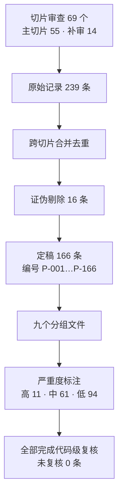

# Deep-tutor 全项目问题审查

本轮审查覆盖 69 个切片（主切片 55 个、补审 14 个），切片阶段累计记录 239 条原始发现，经跨切片合并去重与证伪剔除后定稿 166 条，编号 P-001 至 P-166 连续无缺号。定稿条目全部完成代码级复核，未复核 0 条；按严重度计，高 11 条、中 61 条、低 94 条。另有 16 条疑似问题经复核证伪，不计入定稿数，逐条列于文末附录。

条目编号在定稿时统一分配为 `P-xxx`；同一问题被多个切片独立发现的合并为同一条，合并来源记录在该条的「合并来源」节。各分组文件的元信息行存在 4 种写法，本索引统一归一为高/中/低：① 中文值、全角冒号、带字段名——`严重度：高 | 状态：已复核 | 分类：logic | 位置：…`（01、03、07、08 的全部条目与 09 的 15 条）；② 英文值、全角冒号、带字段名——`严重度：high | 状态：已复核 | 分类：logic | 位置：…`（04、06 的全部条目）；③ 英文值、半角冒号、带字段名——`严重度: medium | 状态: 已复核 | 分类: display | 位置: …`（02 的全部条目）；④ 无字段名的裸格式——`high | 状态：已复核 | flow | …`（05 的全部条目与 09 的 P-160）。9 个分组文件中均无 `severity:` 前缀写法。

元信息行的字段名与取值按上述 4 种写法归一；「位置」字段的多值分隔符按文件各自统一：02 用半角「;」（本次修订把原 6 条的全角「；」改为半角 `; `），其余 8 个分组文件用全角「；」，05 的裸格式位置项同样用全角「；」。

## 严重度与状态分布

| 严重度 | 已复核 | 未复核 | 合计 |
| --- | --- | --- | --- |
| 高 | 11 | 0 | 11 |
| 中 | 61 | 0 | 61 |
| 低 | 94 | 0 | 94 |
| 合计 | 166 | 0 | 166 |

| 分组文件 | 编号范围 | 条数 | 高 | 中 | 低 |
| --- | --- | --- | --- | --- | --- |
| [01-初次使用与新手旅程.md](./01-初次使用与新手旅程.md) | P-001、P-047–P-057、P-100、P-136、P-140–P-146 | 21 | 1 | 11 | 9 |
| [02-前端显示与布局.md](./02-前端显示与布局.md) | P-036–P-046、P-058、P-103–P-106、P-107–P-135 | 45 | 0 | 12 | 33 |
| [03-前后端与事件契约.md](./03-前后端与事件契约.md) | P-005–P-008、P-024、P-028、P-034、P-035 | 8 | 4 | 4 | 0 |
| [04-后端业务逻辑.md](./04-后端业务逻辑.md) | P-002、P-013、P-015、P-017、P-020、P-023、P-025–P-027、P-033、P-080、P-082–P-096、P-101、P-139 | 28 | 1 | 9 | 18 |
| [05-状态机取消与恢复.md](./05-状态机取消与恢复.md) | P-009、P-012、P-014、P-016、P-018–P-019、P-030–P-032、P-079、P-081、P-097–P-098、P-137–P-138 | 15 | 1 | 8 | 6 |
| [06-安全与数据边界.md](./06-安全与数据边界.md) | P-003–P-004、P-010、P-021–P-022、P-060–P-062、P-099、P-102 | 10 | 3 | 5 | 2 |
| [07-性能与响应性.md](./07-性能与响应性.md) | P-011、P-063–P-074、P-161–P-164 | 17 | 1 | 10 | 6 |
| [08-无障碍.md](./08-无障碍.md) | P-075–P-077、P-147、P-165、P-166 | 6 | 0 | 0 | 6 |
| [09-文档与构建配置.md](./09-文档与构建配置.md) | P-029、P-059、P-078、P-148–P-160 | 16 | 0 | 2 | 14 |

## 分组文件说明

| 分组文件 | 收录范围 |
| --- | --- |
| [01-初次使用与新手旅程.md](./01-初次使用与新手旅程.md) | 空工作区与无供应商场景的引导死路、错误横幅与弹窗反馈层级、通知免打扰与学习目标跨页状态、拖放导入与分享包切换、路径遏制与跨用户写入边界、文档与实现的表述差异（含 P-055–P-057 安全类与 P-143–P-146 文档／文案类条目）。 |
| [02-前端显示与布局.md](./02-前端显示与布局.md) | 表单网格与知识地图节点排版、公式与 KaTeX 宏的渲染退化及解析失败提示、空态与加载态误报、徽章与长文本截断、窄窗溢出与浮层遮挡、错误提示缺失与无重试入口、主题与目录切换的状态反馈，以及 P-058、P-132–P-134 等后端写入顺序与错误定位条目。 |
| [03-前后端与事件契约.md](./03-前后端与事件契约.md) | 练习详情刷新导致整页崩溃、提示语义在往返中丢失、扫描失败事件自激循环、按版本读取只认终态、插件订阅与投递命名空间错配、全局刷新漏配事件前缀、reveal 白名单拒绝与导入警告文案。 |
| [04-后端业务逻辑.md](./04-后端业务逻辑.md) | 强度缩放基准、必填校验缺口、字节上限与拒绝路径、事务边界与并发复查、IO 错误冒泡与降级、版本与分页状态、运行终态与路由取消、导出与导入形状守卫、费率与模型配置回填，以及 P-087、P-091、P-101、P-139 等前端输入与展示类条目。 |
| [05-状态机取消与恢复.md](./05-状态机取消与恢复.md) | 终态守卫与取消竞态、失败出口未恢复后台、目录切换后的双份状态、请求复用与重复计费、协议层重试期间取消不生效、异常路径终态收尾、悬挂行清理与备份配额不生效，以及 P-137、P-138 等列表空态与跳转交互条目。 |
| [06-安全与数据边界.md](./06-安全与数据边界.md) | 同步恢复与导入的档案 id 缺失、插件清单缺失导致备份不可用、评分流式输出遮蔽、导出上限与原件清理误报、跨用户提示口径，以及 P-060–P-062 等主线程同步命令条目与 P-099、P-102 等前端错误反馈条目。 |
| [07-性能与响应性.md](./07-性能与响应性.md) | 主线程同步 IO、同步命令的执行位置、事件刷新风暴与全量重拉开销；另收录本轮 7 条可访问性条目（点击目标尺寸、缩放下的弹层越界、输入法组字误关弹层、键盘高亮的读屏可感知性、reduced-motion 偏好、焦点序与可访问名、装饰性图标 aria-hidden）。 |
| [08-无障碍.md](./08-无障碍.md) | Agent 工具链错误传播与审批状态机收口、工具结果负载、运维命令互斥与实现注释偏差、安装包许可收集、公式复制。该组为分组计划分配的历史命名，实际不含可访问名、对比度、焦点管理与读屏语义类条目；本轮 7 条可访问性条目归入 07 组。 |
| [09-文档与构建配置.md](./09-文档与构建配置.md) | 归档 tar 偏移与许可收录统计、文档与实现的表述差异（注释撤销、变式来源、自动同步文案、命令计数与分组表）、升版构建产物清理、CSP 前置实测留档，以及 P-059、P-156–P-159 等主线程 IO、全量重扫与导出熔断条目与 P-078 记录大小预检条目。 |

### 分组文件结构差异

9 个分组文件的内容格式不统一，按本表解析各文件：

| 分组文件 | 条目分隔 | 分组引言 | 「详细说明」「代码证据」标题 | 条正文模板（触发条件／用户可见后果） | 「合并来源」标题 | 「合并来源」正文形式 | 登记「合并来源」节的条目数 |
| --- | --- | --- | --- | --- | --- | --- | --- |
| 01 | `---` | 有 | `### 详细说明` / `### 代码证据` | 21 / 21 齐备 | `### 合并来源` | 项目列表 | 3 / 21 |
| 02 | `---` | 有 | `### 详细说明` / `### 代码证据` | 45 / 45 齐备 | `### 合并来源` | 单行顿号串 | 38 / 45 |
| 03 | `---` | 有 | `### 详细说明` / `### 代码证据` | 8 / 8 齐备 | `### 合并来源` | 单行顿号串 | 3 / 8 |
| 04 | 空行 | 有 | `**详细说明**` / `**代码证据**` | 28 / 28 齐备 | `**合并来源**` | 项目列表 | 28 / 28 |
| 05 | 空行 | 有 | `### 详细说明` / `### 代码证据` | 15 / 15 齐备 | `### 合并来源` | 单行顿号串 | 7 / 15 |
| 06 | `---` | 有 | `### 详细说明` / `### 代码证据` | 10 / 10 齐备 | `### 合并来源` | 项目列表 | 10 / 10 |
| 07 | `---` | 有 | `**详细说明**` / `**代码证据**` | 17 / 17 齐备 | `**合并来源**` | 项目列表 | 5 / 17 |
| 08 | `---` | 有 | `### 详细说明` / `### 代码证据` | 6 / 6 齐备 | `### 合并来源` | 项目列表 | 6 / 6 |
| 09 | `---` | 有 | `### 详细说明` / `### 代码证据` | 16 / 16 齐备 | `### 合并来源` | 项目列表 | 3 / 16 |

补充说明：

- 元信息行的字段名与取值写法随文件不同，共 4 种，详见本文件开头的元信息格式说明；「合并来源」是各文件内唯一的来源登记位置，元信息行不再重复登记来源编号。
- 「合并来源」节只在该条登记了切片阶段来源编号时出现，未出现即表示该条未登记来源编号；02 的 45 条中有 7 条（P-036、P-037、P-038、P-103、P-104、P-105、P-106，由 03 组迁入）沿用原文件状态，未补记来源编号。
- 由 03 组迁入 02 的 7 条，元信息行已按 02 的写法（英文值、半角冒号、带字段名）归一，内容未改。
- 各文件的「分类」字段取值不统一，同一取值在不同文件可指不同范畴（如「logic」在 01 指流程分支缺陷，在 04 指后端逻辑缺陷），统计时按文件内语义理解。
- 本次修订补齐的结构差异：02 组 8 条缺「用户可见后果」小标题（P-040、P-109、P-113、P-120、P-121、P-123、P-131、P-135）、7 条缺「触发条件」小标题（P-043、P-107、P-108、P-113、P-125、P-126、P-133），已按其余 8 个分组文件的模板补齐；04 组与 05 组原在标题后直接进入首个条目，已补入分组引言段。上表的「分组引言」与「条正文模板」两列即记录这两项结构维度。

## 检查范围

### 审查流水线

### 切片清单概要

主切片 55 个：

- 后端 27 个——装配与通用存储、启动与数据目录、安全与会话、方案流水线（文件组一、二）、计划页与强度调整、练习与考试（文件组一、二）、间隔复习、项目成果与量规、Wiki 引用问答、Agent 工具循环、材料导入解析与媒体、笔记与知识库检查、网页检索与抓取、供应商（文件组一、二、三）、WebDAV/S3 配置同步、全量备份、只读分享、数据运维、多格式导出、本机社区、声明式插件、搜索通知与首页、专注打卡与学习报告。
- 前端 16 个——方案生成向导、计划页与首页、学习空间、知识地图与复习、练习与考试、资料库与 Wiki、项目与报告页、Agent 中心与全局导师、社区与集成页、模型接入中心、设置（目录/备份/安全）、设置（同步/运维/导出/媒体）、只读分享页、应用骨架与页面守卫、全局状态与 IPC 客户端、样式系统与基础组件。
- 横切与旅程 12 个——状态机与恢复（学习域、支撑域）、事件与刷新契约全链路、主线程阻塞专项、错误呈现与死路、安全边界横切、数据生命周期、无供应商裸新手、完整学习闭环、恢复迁移与多用户、无障碍与键盘、页面布局复核（第二意见）。

补审 14 个——缺口补审批次 12 个（对象为 `desktop/node_modules/` 下第三方包说明文档）、文档·决策与实现一致 1 个、构建·打包与配置 1 个。

### 覆盖核算

| 切片类别 | 切片数 | 完整阅读文件数 | 负责文件数 |
| --- | --- | --- | --- |
| 后端 | 27 | 135 | 136 |
| 前端 | 16 | 43 | 43 |
| 横切与旅程 | 12 | 0 | 0 |
| 文档 | 1 | 42 | 137 |
| 构建 | 1 | 14 | 14 |
| 补审 | 12 | 94 | 0 |
| 合计 | 69 | 328 | 330 |

结论：切片声明的负责文件合计 330 个，其中 234 个在所属切片内完整逐行阅读，占 70.9%；未满读的 96 个为两处——「方案流水线（文件组一）」的 1 个负责文件，「文档·决策与实现一致」切片的 95 个第三方依赖 README（该切片仅对短文件全文阅读，长文件读开头，属上游模板文档，不含项目决策）。另有 12 个补审批次以「负责文件数 0」的口径通读 94 个第三方包说明文件。完整阅读合计 328 个。横切与旅程类切片按约定不单独计文件数，其阅读量体现在所属后端与前端切片的计数中。

### 失败切片

无失败切片：69 个切片的执行状态标记均为未失败。

多数切片为只读静态审查，未运行规定门禁的全量套件，只在切片内运行与本切片相关的过滤子集；未运行项统一记入「未覆盖项」。

### 切片阶段实跑的检查

以下命令在各切片阶段实际执行（对应切片的检查记录），本轮索引撰写未重跑：

| 命令 | 结果 |
| --- | --- |
| `cargo test --release --locked security::` | 19 passed |
| `cargo test --release --locked practice::` | 27 passed |
| `cargo test --release --locked providers::` | 45 passed |
| `cargo test --release --locked agent::` | 18 passed |
| `cargo test --release --locked materials::` | 14 passed |
| `cargo test --release --locked notes::` | 9 passed |
| `cargo test --release --locked maintenance::` | 9 passed |
| `cargo test --release --locked export::` | 9 passed |
| `cargo test --release --locked reports::` | 5 passed |
| `cargo test --release --locked knowledge::` | 4 passed |
| `cargo test --release --locked community::` | 4 passed |
| `cargo test --release --locked plugins::` | 4 passed |
| `cargo test --release --locked review::` | 2 passed |
| `cargo test --release --locked sync::` | 10 passed |
| `cargo test --release --locked backend::sync` | 10 passed |
| `cargo test --release --locked restart_after_logout_does_not_silently_relogin` | 1 passed |
| `cargo test --release --locked no_material_plan_runs_through_adoption_and_lecture_generation` | 1 passed |
| `cargo test --release --locked a_missing_default_directory_is_created_without_a_dialog` | 1 passed |
| `cargo fmt --all -- --check` | 通过 |
| `npx tsc --noEmit`、`./node_modules/.bin/tsc -b` | 退出码 0 |
| `npm audit --omit=dev && npm audit` | found 0 vulnerabilities |
| `npm run build` | 通过 |
| `bash scripts/dev-smoke.sh` | 冒烟通过 |
| `node scripts/check-versions.mjs` | 6 处版本一致（1.1.16） |

另有两个一次性探针：esbuild `transformSync` 验证 JSX 行内注释的渲染路径（两处注释成为字符串字面量子节点），KaTeX 渲染管线计时（600 个公式 1010.6 ms，KaTeX 占比 72%–83%）；探针脚本写在仓库 `TEMP/` 下并已删除。

## 已排除的疑似问题（证伪清单）

下列 16 条在切片阶段被提出，经复核未构成用户可见缺陷，不计入 166 条定稿数。编号沿用切片阶段编号。

| 原编号 | 标题 | 证伪理由 |
| --- | --- | --- |
| 后端-项目-3 | 删除带 running 评价的项目时版本行被级联删除但不终止对应模型请求，评价继续执行至完成（消耗供应商计费/配额）后结果被静默丢弃 | 前端没有删除项目的入口：`projects` 集合的三处写入（desktop/src/pages/Projects.tsx:120、130、140）只做里程碑勾选与追加，删除只存在于集合替换的 GC（desktop/src-tauri/src/backend/store.rs:939），用户无法触发该组合。 |
| 后端-运维-6 | migration-tmp-wal 崩溃残留不在任何运维扫描面，永久滞留且体检不可见 | 迁移每次执行都清扫 staged 主文件与其 `-wal` 两种残留（desktop/src-tauri/src/backend/store.rs:328-334），残留不会永久滞留。 |
| 后端-导出-1 | APKG 构建临时数据库写入应用数据根内的 exports 目录，目录与崩溃残留无任何清理 | 临时库落在工作区 `exports` 目录，运维扫描按 `anki-*.db` 且超宽限期纳入清理候选（desktop/src-tauri/src/backend/maintenance/mod.rs:463-479，测试见 maintenance/tests.rs:106、139、184、196），进程内残留由 `TempDatabase` 的 Drop 删除（desktop/src-tauri/src/backend/export/anki.rs:16-22）。 |
| 后端-社区-2 | 房间行与侧栏下一次学习的标题/主题缺少 overflow-wrap 规则，长无空格串（URL、base64、错误日志）横向溢出容器 | `overflow-wrap` 为继承属性，body 级 `body { overflow-wrap: anywhere }`（desktop/src/styles.css:2040）覆盖全部后代，长无空格串在内容盒内折行。 |
| 前端-方案生成器-3 | 资料来源 URL 无折行约束，长 URL 溢出暂存列表并压到状态徽标/删除按钮 | 资料行文本容器为 `min-width:0` 的 grid（desktop/src/styles.css:1128），URL 所在 `small` 继承 body 级 `overflow-wrap:anywhere`（styles.css:2040）折行，状态徽标另有 `max-width:120px` 与省略号（styles.css:1132），不压到删除按钮。 |
| 前端-练习套件-5 | deferred（统一反馈）进行期主观题评分完成后显示 hints 语义的错误文案 | deferred 模式下后端按设计在交卷前置空 `score`/`correct`/`feedback`，「评分已保存，按当前设置仅显示提示」如实描述该状态（desktop/src/components/SubjectivePractice.tsx:161），统一显示口径由同页「答案已保存」分支给出，属措辞而非语义错误。 |
| 前端-练习套件-6 | 错题本标题等容器的长动态文本缺 overflow-wrap 约束（147 系列修复清单遗漏） | body 级 `overflow-wrap:anywhere`（desktop/src/styles.css:2040）为继承式全局兜底，147 系列之外无需逐容器补规则。 |
| 前端-资料库与Wiki-3 | 网页资料的 meta 行含完整 URL，但该 span 无 overflow-wrap 约束，长 URL 连续串撑破资源行 | 同上：body 级声明继承覆盖，长 URL 在内容盒内折行。 |
| 前端-资料库与Wiki-5 | 问题标题、历史标题与资料详情标题容器缺少 overflow-wrap，长无空格串（URL/哈希/base64）溢出 | 同上；另有容器以 `overflow:hidden` + 省略号截断（如 styles.css:1475 的 `.wiki-docs > label strong`），不产生横向溢出。 |
| 前端-项目与报告-6 | 里程碑标题、反馈总结/建议、方案目标、打卡笔记等容器缺 overflow-wrap 约束，长无空格串撑破布局 | body 级声明继承覆盖；页面主容器另有 `min-width:0`，摘要段为 `overflow:hidden` + 行数截断（desktop/src/styles.css:829、836、838）。 |
| 前端-Agent界面-4 | 批准产物提升后任务中心不刷新：agent.artifact_promoted 不匹配刷新过滤且 done 讲义缓存不失效 | 任务中心刷新过滤为「前缀 `plan.`/`agent.`/`lecture.` + 后缀 started/completed/failed/cancelled/interrupted/degraded」（desktop/src/components/AgentTaskCenter.tsx:60），产物提升所在的工具调用完成后发出 `agent.tool_completed`，运行终态另有 `agent.run_completed`，均在过滤集合内；done 讲义缓存按 `planId:stageId` 缓存讲义版本，产物提升不产生讲义版本，缓存无需失效。 |
| 前端-设置核心-4 | 导入预演弹窗的备份文件名无折行约束，长文件名横向溢出 560px 弹窗 | body 级 `overflow-wrap:anywhere`（desktop/src/styles.css:2040）继承覆盖弹窗内文本。 |
| 前端-设置核心-5 | 用户名/令牌名长无空格串缺少 min-width:0 与 overflow-wrap，窄窗口下文字溢出行卡片压到按钮 | body 级声明继承覆盖长串折行；徽标与按钮另有 `max-width:100%` 与 `min-width:0`（desktop/src/styles.css:2046-2047）。 |
| 横切-页面布局复核-3 | 窄窗（<699px）下第一步标签「辅助资料（可选）」nowrap 溢出 126px 固定宽按钮，与相邻步骤文字重叠 | 窄窗下步进条改为 `display:flex` + `overflow-x:auto` 的横向滚动条、按钮 `flex:0 0 126px`（desktop/src/styles.css:1709-1710）；按 12px 字号与 9 个全角字符计算，标签溢出量约 36px，落在相邻按钮左内边距内，未覆盖其序号圆点与文字；原结论为按字号与固定宽度的像素推算，未经真实渲染验证。 |
| 补审-12-3 | 单元卡在 running 且所属讲义已是终态时，恢复生成会复用同一个 request_id，命中缓存的失败请求，形成无法自愈的无限失败循环 | 单元与讲义行同事务推进，失败与取消都以 `status='running'` 守卫收口（desktop/src-tauri/src/backend/learning/lecture.rs:529、554），重启恢复对 running/cancelling 讲义同时改写单元为 interrupted/cancelled（lecture.rs:879-885）；中断单元仅在上一请求确实完成时才复用 request_id，否则 attempt+1 生成新 request_id（lecture.rs:485-497），不存在反复命中同一失败缓存的循环。 |
| 补审-5-5 | 范围核对结论：本批 8 个文件全部是 git 忽略的第三方类型包说明，不含产品代码 | 8 个文件逐个读完，内容为 DefinitelyTyped 类型包的说明文档（Installation / Summary / Details / Additional Details / Credits 五段），`@types/debug/README.md` 内嵌片段是 index.d.ts 的类型声明，无可执行逻辑；8 个文件均未被 git 跟踪，被 desktop/.gitignore:7 的 `node_modules/` 命中，不属仓库交付物，与产品代码的唯一交互是被 tsc 自动纳入编译程序（desktop/tsconfig.json 未设 `types` 字段）。核对命令与输出：`git ls-files --error-unmatch <file>` 与 `git check-ignore -q <file>` 全部 tracked=0、ignored=YES（8/8）；`npx tsc --noEmit -p tsconfig.json` 退出码 0、无输出；`npx tsc --noEmit -p tsconfig.json --listFiles` 显示 8 个包的 index.d.ts 均进入编译程序；`npm audit --audit-level=low` 为 `found 0 vulnerabilities`。另记类型面隐患（不单列为缺陷）：`@types/katex` 实装 0.16.8 与 desktop/package.json:16、34 固定 override 的 katex 0.19.1 同时进入编译程序并各自 `export as namespace katex`，因 tsconfig 开启 skipLibCheck 且应用不使用 katex 全局命名空间（仅 import CSS），实测无影响。 |

## 未覆盖项

1. 未启动应用与真实窗口：布局、溢出、对齐问题基于 CSS/JSX 结构静态推断，未做真实渲染验证（项目规则禁止前台 UI 自动化、模拟键鼠与截屏）。
2. 未使用真实模型供应商、真实 WebDAV/S3 服务与真实媒体编解码播放；相关结论以代码与本机回环协议测试为据。
3. 未运行 cargo 测试、npm 构建等重型命令（只读审查，避免与门禁/CI 重复）；构建与测试状态以 make check / CI 为准。
4. 性能未测量（启动耗时、SQL 查询计划、内存、安装包体积）；性能类发现均为静态推断。
5. REF/ 为用户提供的参考源、非交付物，未审查；dist/、node_modules/、src-tauri/target/、src-tauri/gen/、src-tauri/licenses/、TEMP/ 为可重建产物，未审查；.video_agent/ 为未跟踪目录，未审查；skill 资产的 README/templates 按 NOTICE 声明为存档不进产物，未逐字审查（SKILL.md 已审）。

说明：第 3 条指全量套件未在审查切片内运行；切片阶段实际运行的过滤子集与轻量门禁命令见「切片阶段实跑的检查」。
