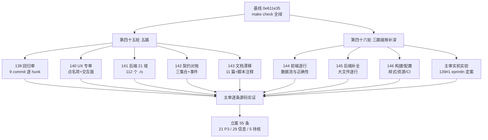

# note/problem——第四十五、四十六轮全量审计（139-146 号）

审计基线 `0e611e35`（工作树 clean，130-138 号 94 条处置完毕后的收口点）。
两轮共八面深审 + 主审逐条源码实证，立案 **55 条：21 P3 / 29 信息 / 5 待核**
（其中 139#1 已实机定案关闭，见文末定案记录）。
只立案不改代码，修复由后续 /goal 波次收口。

## 第四十五轮（基线 0e611e35，五路深审）

| 问题集 | 审计面 | P3 | 信息 | 待核 | 小计 |
| --- | --- | --- | --- | --- | --- |
| [139-1.1.9后修复波回归问题集](./139-1.1.9后修复波回归问题集.md) | 1.1.9 后 9 个修复 commit 逐 hunk diff 复读 + 与既有机制交互核实 | 0 | 3 | 1 | 4 |
| [140-前端交互与UX问题集](./140-前端交互与UX问题集.md) | 用户点名两项全链实证 + 16 页面 17 组件交互面（反馈/确认/错误/快捷键/空态） | 0 | 3 | 1 | 4 |
| [141-后端域逻辑问题集](./141-后端域逻辑问题集.md) | 21 域全量（112 .rs）注释一致性/错误处理/持久化/并发/资源/边界/密钥/幂等 | 3 | 1 | 1 | 5 |
| [142-前后端契约问题集](./142-前后端契约问题集.md) | 命令三集合对账/参数返回对齐/事件契约/同步阻塞面/错误传递/权限 | 0 | 4 | 0 | 4 |
| [143-文档漂移问题集](./143-文档漂移问题集.md) | note 两篇/DEEPTUTOR/AGENTS/README/NOTICE/desktop 三篇/architecture 四篇/脚本注释/release | 6 | 4 | 1 | 11 |
| 小计 | | 9 | 15 | 4 | 28 |

## 第四十六轮（补深上轮缝隙面，三路深审 + 一项实机定案）

| 问题集 | 审计面 | P3 | 信息 | 待核 | 小计 |
| --- | --- | --- | --- | --- | --- |
| [144-前端页面数据流问题集](./144-前端页面数据流问题集.md) | App.tsx 全文 + 16 页面 + 15 组件 + 全部 backend 封装，逐行找 stale closure/竞态/回显断点/文案与后端行为一致 | 3 | 2 | 0 | 5 |
| [145-后端协议与域补全问题集](./145-后端协议与域补全问题集.md) | 上轮仅结构扫描的大文件补全逐行（store.rs/practice/learning 全域/providers 三协议/parse.rs 等） | 2 | 0 | 0 | 2 |
| [146-构建配置样式与资源问题集](./146-构建配置样式与资源问题集.md) | vite/tsconfig/package/tauri.conf/Cargo.toml/styles.css 1938 行/public+skills 资产/ci.yml/Makefile/钩子/四脚本/DESIGN.md 交叉 | 7 | 12 | 1 | 20 |
| 小计 | | 12 | 14 | 1 | 27 |

**两轮合计：21 P3 / 29 信息 / 5 待核 = 55 条**（139#1 经实机实验定案不成立，
保留集内编号并在文末定案记录关闭，剩余在办待核 4 条见下方索引）。

## 方法

- 四十五轮：五路子代理并行深读（回归审/UX 专审/后端域逻辑/前后端契约/文档
  漂移），全部条目由主审回源码逐条实证（26/28 条亲证）后立案。
- 四十六轮：三路子代理补深上轮缝隙面（前端逐行数据流/后端大文件补全/构建
  配置样式资源——后者此前从未整体审过），12 条 P3 全部主审亲证。
- 全部条目四要素齐备（位置、传递链条、受影响/不受影响范围、修复方向）；文末
  各集附核实通过项免后续复查。
- 基线状态独立验证：`make check` 全绿（cargo test 246 串行通过、npm build 通过、
  dev-smoke 通过）。
- 用户点名的 UX 项（打开工作区是否弹程序选择框、按钮是否闪命令行窗口）第四轮
  复验：全链实证无问题（结论与明细见 140 号卷首）——自有代码零子进程；opener
  插件 2.7.2 启用 open 5.4.5 的 shellexecute-on-windows（Windows 直接
  ShellExecuteExW，零子进程），其兜底 spawn 路径全部显式 CREATE_NO_WINDOW；
  reveal 走 SHOpenFolderAndSelectItems；restart 子进程为 GUI 子系统 exe；文件
  对话框走 rfd COM。

## 基线数字（0e611e35 实测，供下轮对账）

- 命令注册 **188**（main.rs generate_handler 块）、定义 191（差 3 个为 92 号/
  138#1 有意收敛：events_since、get_agent_run、stream_provider_chat，测试 mock 面
  仍在用）；async 命令 **51**；同步 140（零直接重 IO）。
- 后端测试 **246**（串行全绿）；后端 .rs **112** 个、61,029 行、21 域；前端
  ts/tsx **64** 个、8,683 行（25 客户端 ts + 16 页面 + 17 组件）；styles.css
  1,938 行。
- 事件：单通道 backend://event，前端消费 50 个 kind/前缀全部命中生产发射；
  167 个 emit 点终态先落盘后发送。
- 版本 **1.1.9** 六处一致（package.json / package-lock.json / tauri.conf.json /
  Cargo.toml / Cargo.lock / 根 README）。
- UX 点名项第四轮复验通过。

## 待核条目索引（需外部条件，修复波前先核）

- 140#1：协议相对链接 `//host` 强制升 https 的实际出现频率——需真实资料样本。
- 141#5：providers 停用/删除约束预检查务外 TOCTOU——需双窗口毫秒级并发实测
  可触发性。
- 143#11：130-138 波 94 条无 release 文件承载——需用户决策版本归属（bump
  1.1.10 新建文件，或补入 1.1.9.md 并重打产物）。
- 146#20：生产 CSP `style-src 'unsafe-inline'` 可否收紧——需安装包实测
  KaTeX/mark 是否走 `setAttribute('style', …)` 路径。

## 定案记录（原待核，已关闭）

- **139#1（eprintln × windows_subsystem 双击场景 panic）——不成立**。主审
  实机实验（2026-11-12，F:\TEMP 临时 GUI 子系统 exe + PowerShell Start-Process
  无句柄启动）：`GetStdHandle(STD_ERROR_HANDLE)` 返回 NULL（0x0）时，
  `std::io::stderr().write_all` 返回 **Ok**（实验标记 1/2 全写入、退出码 0）——
  Rust std Windows 实现每次 write 重新取句柄，NULL 路径静默丢弃输出而非报错
  （机制见 [rust std stdio.rs](https://github.com/rust-lang/rust/blob/main/library/std/src/sys/pal/windows/stdio.rs)、
  [rust#40032](https://github.com/rust-lang/rust/issues/40032)、
  [rust#47271](https://github.com/rust-lang/rust/issues/47271)）。推论：
  133#5 的 eprintln → append_diagnostic → exit(1) 顺序在双击场景全部可达，
  修复目标成立；135#3 及其余生产 eprintln 同样不会让进程崩溃。实验产物已清理。
