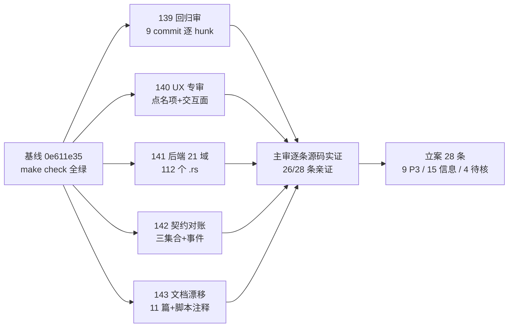

# note/problem——第四十五轮全量审计（139-143 号）

审计基线 `0e611e35`（工作树 clean，130-138 号 94 条处置完毕后的收口点）。
全仓五路并行深审 + 主审逐条源码实证，立案 **28 条：9 P3 / 15 信息 / 4 待核**。
本轮只立案不改代码，修复由后续 /goal 波次收口。

| 问题集 | 审计面 | P3 | 信息 | 待核 | 小计 |
| --- | --- | --- | --- | --- | --- |
| [139-1.1.9后修复波回归问题集](./139-1.1.9后修复波回归问题集.md) | 1.1.9 后 9 个修复 commit 逐 hunk diff 复读 + 与既有机制交互核实 | 0 | 3 | 1 | 4 |
| [140-前端交互与UX问题集](./140-前端交互与UX问题集.md) | 用户点名两项全链实证 + 16 页面 17 组件交互面（反馈/确认/错误/快捷键/空态） | 0 | 3 | 1 | 4 |
| [141-后端域逻辑问题集](./141-后端域逻辑问题集.md) | 21 域全量（112 .rs）注释一致性/错误处理/持久化/并发/资源/边界/密钥/幂等 | 3 | 1 | 1 | 5 |
| [142-前后端契约问题集](./142-前后端契约问题集.md) | 命令三集合对账/参数返回对齐/事件契约/同步阻塞面/错误传递/权限 | 0 | 4 | 0 | 4 |
| [143-文档漂移问题集](./143-文档漂移问题集.md) | note 两篇/DEEPTUTOR/AGENTS/README/NOTICE/desktop 三篇/architecture 四篇/脚本注释/release | 6 | 4 | 1 | 11 |
| **合计** | | **9** | **15** | **4** | **28** |

## 方法

- 五路子代理并行深读（回归审 / UX 专审 / 后端域逻辑 / 前后端契约 / 文档漂移），
  全部条目由主审回源码逐条实证后立案——位置、传递链条、受影响/不受影响范围、
  修复方向四要素齐备；文末各集附核实通过项免后续复查。
- 基线状态独立验证：`make check` 全绿（cargo test 246 串行通过、npm build 通过、
  dev-smoke 通过）。
- 用户点名的 UX 项（打开工作区是否弹程序选择框、按钮是否闪命令行窗口）第四轮
  复验：全链实证无问题（结论与明细见 140 号卷首）——自有代码零子进程；opener
  插件 2.7.2 启用 open 5.4.5 的 shellexecute-on-windows（Windows 直接
  ShellExecuteExW，零子进程），其兜底 spawn 路径全部显式 CREATE_NO_WINDOW；
  reveal 走 SHOpenFolderAndSelectItems；restart 子进程为 GUI 子系统 exe；文件
  对话框走 rfd COM。

## 基线数字（0e611e35 实测，供下轮对账）

- 命令注册 **188**（main.rs generate_handler 块）、定义 191（差 3 个为 92 号/
  138#1 有意收敛：events_since、get_agent_run、stream_provider_chat，测试 mock 面
  仍在用）；async 命令 **51**；同步 140（零直接重 IO）。
- 后端测试 **246**（串行全绿）；后端 .rs **112** 个、61,029 行、21 域；前端
  ts/tsx **64** 个、8,683 行（25 客户端 ts + 16 页面 + 17 组件）。
- 事件：单通道 backend://event，前端消费 50 个 kind/前缀全部命中生产发射；
  167 个 emit 点终态先落盘后发送。
- 版本 **1.1.9** 六处一致（package.json / package-lock.json / tauri.conf.json /
  Cargo.toml / Cargo.lock / 根 README）。
- UX 点名项第四轮复验通过。

## 待核条目索引（需外部条件，修复波前先核）

- 139#1：eprintln 在 release+windows_subsystem 双击启动下是否真实 panic——需
  release 安装包实机验证（stderr 句柄有效性）。
- 140#1：协议相对链接 `//host` 强制升 https 的实际出现频率——需真实资料样本。
- 141#5：providers 停用/删除约束预检查务外 TOCTOU——需双窗口毫秒级并发实测
  可触发性。
- 143#11：130-138 波 94 条无 release 文件承载——需用户决策版本归属（bump
  1.1.10 新建文件，或补入 1.1.9.md 并重打产物）。
