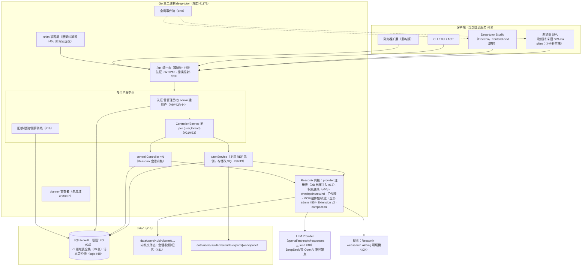

# 00 · 总方案：Deep-tutor 基于 Reasonix 内核的完全改造

> 状态：定稿（方向层）。决策依据：[note/12-Reasonix改造决策.md](../../note/12-Reasonix改造决策.md)（61 项，五轮确认）。
> 改造蓝本：REF/ 本地参考副本（R-Tutor = Reasonix studio 分支 + `internal/runtime/tutor` Deep-tutor 移植先例；zip 即磁盘备份，上游 https://github.com/esengine/DeepSeek-Reasonix）。
> 本文档族取代 docs/archive/plan-v1/ 的 Python 时代实施计划。

## 一、目标与范围

**一句话**：把 Deep-tutor 从 Python/FastAPI 单机应用改造为基于 Reasonix 内核的 Go 单二进制多用户服务，四前端全套（Web / Deep-tutor Studio / CLI / TUI / ACP），完整使用 Reasonix 内核能力，Web 产品能力以功能清单回归验收。

**在范围内**：
- Reasonix 内核源码作为一次性基线搬入本仓库（决策 #30/#49），自由修改不跟上游（#30），遵守 MIT 并显著署名（#30/#42）
- 多用户全登录服务形态（#9/#33），领域数据全 SQL（#13/#31），SQLite 预留 PG（#32）
- /api 重设计为长期统一 API 面（#34/#45），旧 SPA 经 shim 层回归全 19 页（#39/#45）
- Chat 以 control.Controller 为基座（#21），Reasonix 内核能力全套进 Web UI（#22）
- 9 个 Python 内置插件功能全部找等价（#25）；前端插件示例四功能全部重建（#59）

**不在范围内**（明确裁剪，依据见 01；执行状态见 01 执行状态注记）：
- OCR（tesseract）/ 音视频转写（faster-whisper）/ marker 深度 PDF 解析（#27）
- Python 进程内插件体系与 PluginProvider 自定义协议（#18/#25）
- Reasonix 遥测/云端服务（accounts/forum/crash-report，#12）、appupdate 自动更新、remote/remotecloud 远程访问（#37 默认）——原 `workers/` 目录已移除（2026-10-20）
- 上游产品周边资产：版本发布说明、评测夹具、扩展示例套件、npm 分发包、发布签名基础设施（2026-10-20 移除，清单见 01 §二）
- 存量数据迁移（#14 全新开始）、独立本地单用户模式（#33）

## 二、决策基础摘要

61 项决策全文见 note/12（第一至八节，编号 #1–#61）。改造实施时**逐条对照**，不得自行变更；如需变更先问用户（常设要求）。分组速览：

| 域 | 关键决策 |
|---|---|
| 形态 | 仓库内改造（#1）；前端可重做（#2）；tutor.Service 复用 + /api 兼容层（#3）；四前端全套（#4） |
| 前端 | Studio frontend-next 为底座（#5）；window.DeepTutor 废弃改接 Reasonix（#6）；浏览器扩展重构（#7）；中英双语（#8） |
| 用户 | 保留多用户 JWT/PAT/admin（#9/#10）；Reasonix 首次引导（#11）；遥测全禁（#12） |
| 数据 | 全 SQL=领域 SQL+内核文件态按用户分 root（#13/#31）；全新开始（#14）；新迁移机制（#15）；data/ 目录（#16）；SQLite+预留 PG（#32）；sqlc（#48） |
| LLM | 每用户 DB 档案为权威注入内核（#17）；三种原生 kind（#18）；SQL 台账+三层防线（#19）；Reasonix 官方费率表（#20） |
| Agent | Controller 为基座（#21）；内核能力全套进 Web UI（#22）；内建工具面（#23）；Bing 可切换（#24）；白名单+管理员全量+CUA 单独关（#35/#51）；按需召回（#52）；单入口动态工具面（#53）；planner 审查者（#57） |
| 插件 | 9 内置全等价（#25）；管理页对接安装态（#26）；扩展资产全局 admin 管理（#55）；权限全局底线+只能收紧（#56） |
| 解析导出 | 砍 OCR/转写（#27）；PDF Go 真实现（#28） |
| 工程 | 主二进制+Studio 包、41173、Windows 优先（#29/#42）；四阶段（#30）；旧契约 shim 回归（#39/#45）；Go 直接接管 41173（#40）；门禁全保留（#41）；顶层 go.mod（#49）；不签名+minisig（#50）；旧代码阶段④删（#47）；全自动细粒度谨慎推进（#58）；新分支+自主 commit（#61） |
| 其他 | 首管理员 Web+CLI（#43）；仅 admin 建用户（#44）；schema 语义等价自由设计（#46）；四示例功能全重建（#59）；全局事件流保留等价物（#60） |

## 三、目标架构

关键结构原则（自 note/REF 调研，实施时遵守）：
1. **分层不破坏**：`frontend → assembly(boot) → session(control) → runtime → {tools,ext,model,platform} → {contract,base}`，safety/state 横切。多用户改造在 `assembly` 之上加"用户装配层"，不向下穿透（详见 04）。
2. **缓存稳定硬约束**：系统提示/工具 schema/前缀字节级稳定，动态内容只进轮尾——多用户改造不得破坏（effect test 守卫，#41）。
3. **tutor.Service transport 无关**：R-Tutor 先例的 Service/serve 分离保持；/api 与 /tutor/* 都只是该 Service 的路由皮肤。

## 四、资产处置总表

| 资产 | 处置 | 去向 |
|---|---|---|
| REF/extracted 内核源码 | 拷贝入仓（裁剪+重命名，见 01） | 顶层 internal/ cmd/ desktop/ tools/ sdk/ docs/kernel/ |
| internal/runtime/tutor（先例） | 复用 Service 层，存储改 SQL（02），路由双皮肤（03） | internal/runtime/tutor/ |
| skills/ 8 份 SKILL.md | 语义对照 R-Tutor tutor/skills 移植版，缺漏补齐 | 随内核 skills 体系 |
| 旧 React SPA（frontend/） | 阶段①② shim 回归工具；阶段④删除（#39/#47） | 保留至阶段④ |
| API.md（117KB v1 契约） | **shim 兼容基准**，保留只读；新契约见 03 | 根目录+状态头 |
| note/01–11 分析 | 验收清单与语义基准 | git 跟踪（本轮已入库） |
| note/12 决策档案 | 改造宪法 | git 跟踪 |
| Python backend/ + 测试 | 阶段④删除（git 历史即备份） | — |
| plugins/ 9 个 Python 插件 | 等价物映射见 05 阶段③；本体阶段④删 | — |
| plugin-examples/ 4 个前端插件 | 四功能新前端重建（#59） | — |
| extension/ MV3 剪藏 | 阶段④重构对接新 /api | — |
| chat.md / err.md / plan v1 | 历史档案归档 docs/archive/（本轮完成） | docs/archive/ |
| stage.md | **活文件**：改造进度持续追加（用户常设要求） | 根目录 |
| 上游产品周边资产 | 按 01 §二 原表剔除：workers/ npm/ release-notes/ benchmarks/ examples/ output/ cmd/e2ebench cmd/signpath-contract .signpath/ prod_fast_test | 已移除，内容在 git 历史（commit `bec5525`） |

## 五、四阶段总览

| 阶段 | 内容 | 出口判据 |
|---|---|---|
| ① 内核+数据+生成域 | M1 内核落位与构建链 → M2 SQL+认证 → M3 生成流水线+/api → M4 学习闭环全页 → M5 管理页+事件流+回归 | Go 服务接管 41173（#40）；旧 SPA 全 19 页经 shim 可用（#39）；门禁绿 |
| ② Chat 接内核 | Controller 池化、审批/Rewind UI、workspace 三段桥接、记忆按需召回、白名单/动态工具面 | Chat 全功能回归 + 审批/rewind 演示通过 |
| ③ 插件等价+能力面板 | 9 插件等价物、MCP/技能/插件管理页、fleet/计划模式/Goal/沙箱/后台作业面板、双模型设置+planner 审查者 | 等价清单逐项验收（05 附表） |
| ④ 新前端+退役 | frontend-next 改造为统一前端（双语+四重建功能）、Studio 打包、CLI/TUI/ACP、发布（minisig）、浏览器扩展重构、旧代码删除 | 新前端全量覆盖功能清单；旧代码删除后构建绿 |

阶段①内部里程碑 M1–M5 细粒度任务见 05。节奏：全自动推进、任务拆分尽可能细、每步谨慎（#58）；顺序质量优先，每阶段完整验收再进（#54）。

## 六、风险登记表

| # | 风险 | 等级 | 缓解 |
|---|---|---|---|
| R1 | Reasonix 内核隐含单例/全局态（provider 注册表 init 自注册、技能全局目录、插件 host 单例、tutor.Service 进程级单例）与 per-user 多实例冲突 | **高** | M1 第一件事做"内核多实例化 spike"：盘点 boot.Build 全部输入的归属（进程级 vs 会话级），列出需参数化的全局态清单；不明确处读源码确认，不猜 |
| R2 | shim 的 SSE 语义对拍工作量被低估（旧 SPA 的 fetch+ReadableStream POST-SSE、Last-Event-ID、终态不重连、内容协商） | 高 | M3 先写对拍测试（SSE 事件序列录制/回放）再写 shim；以 API.md+note/06 为基准 |
| R3 | import 全量重命名（reasonix→deep-tutor）引发大规模机械 diff，掩盖真实改动 | 中 | 一次性独立 commit 只做重命名（构建+测试绿后立即提交），之后业务改动不混入 |
| R4 | repolint/coverage-gate 基线在裁剪+重命名后失效或报海量债务 | 中 | M1 重建基线：`-update` 收紧到新树实际值并记录；sensitive paths 增加 internal/auth、internal/api、internal/web（04） |
| R5 | SQLite 单写者在多用户并发下成瓶颈 | 中 | 32 预留 PG 方言；阶段①起写并发压测（≥5 并发生成）纳入 M4 验收 |
| R6 | tutor.Service 改 SQL 引入语义漂移（R-Tutor JSON 语义与 Deep-tutor 领域表语义的合并处） | 中 | 以 note/03（流水线语义）+R-Tutor types.go 双基准写等价测试；feedbackTargets/降级/预算行为逐条对拍 |
| R7 | Go PDF 库排版能力不及 weasyprint（#28 要求真实现） | 中 | M4 前做选型 spike（maroto/gofpdf/自绘）；排版降级需在导出物头部注明并回归验收 |
| R8 | Windows 无 OS 级沙箱 + bash 工具（#36 跟随原生）与多用户服务安全边界 | 中 | 白名单默认无 bash（#35）；管理员开全量时 UI 显著警示；CUA 单独开关默认关（#51） |
| R9 | 阶段①体量大（#33+#39+#40 叠加无过渡态）导致长期不可用窗口 | 中 | M1–M5 串行小步（#58），每 M 结束留可运行快照；旧 Python 后端保留至阶段①完成才停（#40 的"接管"以 M5 验收为时点） |
| R10 | 上游 Reasonix 后续修复无法跟进（#30 不跟上游） | 低 | 接受；在 README 注明基线快照日期与上游链接，重大安全修复人工评估移植 |

## 七、文档导航（本目录）

| 文件 | 内容 |
|---|---|
| [01-仓库布局与内核落位.md](01-仓库布局与内核落位.md) | 顶层布局、内核拷贝/裁剪/重命名、品牌化、MIT 署名、门禁搬入 |
| [02-数据层设计.md](02-数据层设计.md) | SQLite/PG 方言、sqlc、迁移框架、领域 schema 草案、data/ 目录总图 |
| [03-API设计与shim映射.md](03-API设计与shim映射.md) | 新 /api 契约（端点/SSE/错误码）、全局事件流、shim 映射表 |
| [04-多用户与内核集成.md](04-多用户与内核集成.md) | 认证链、per-user 装配、Controller 池、Chat 桥接、权限作用域、planner 审查者 |
| [05-四阶段任务分解与验收.md](05-四阶段任务分解与验收.md) | M1–M5 细粒度任务、阶段②③④任务、9 插件等价表、验收清单 |
